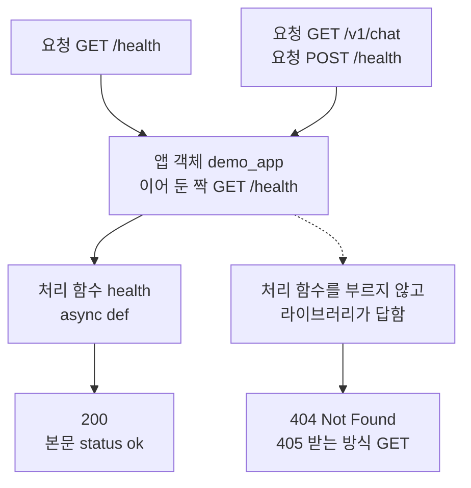
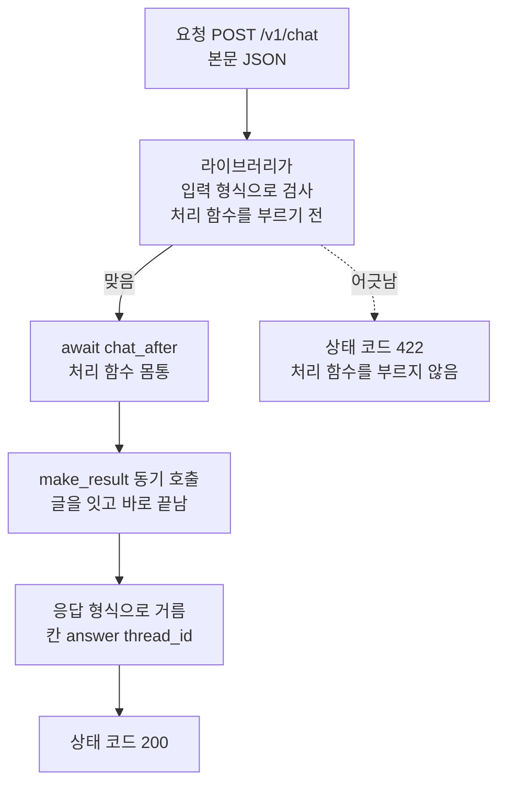
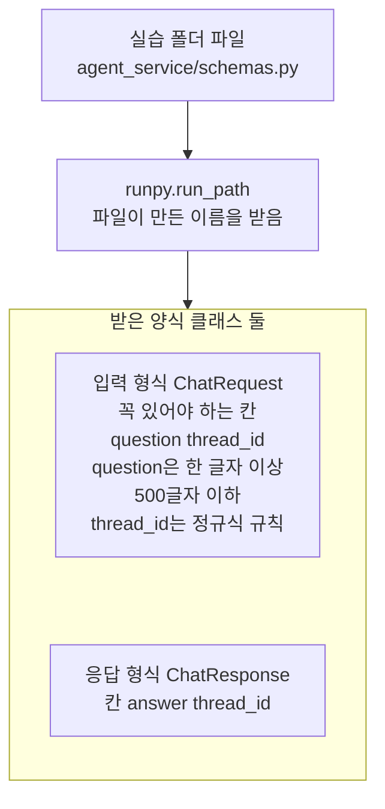
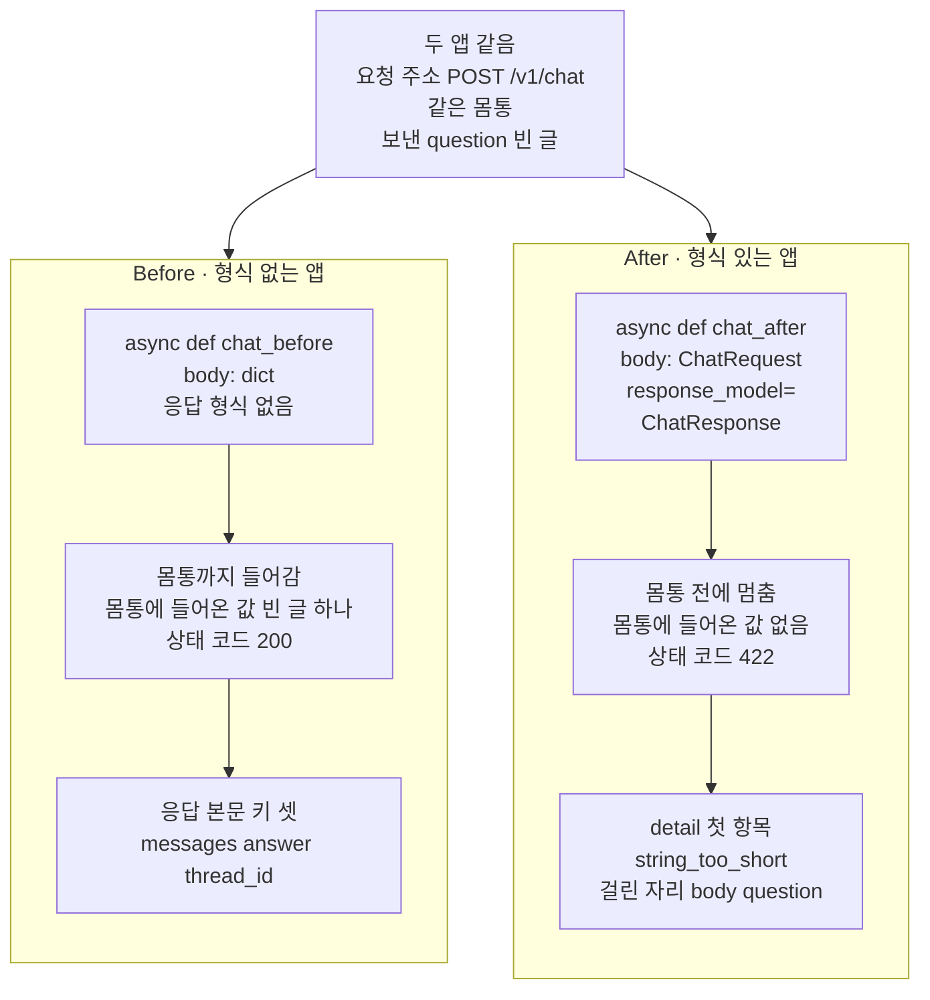
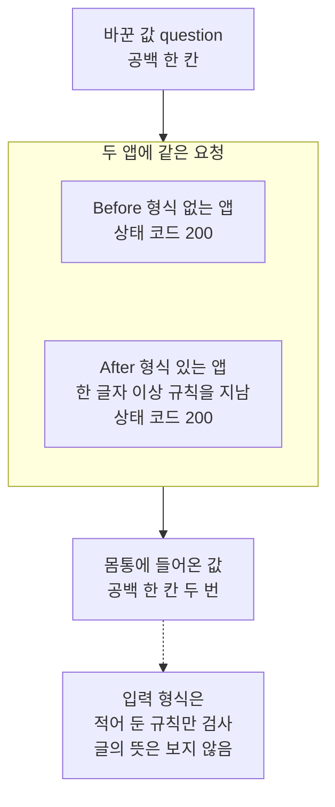

# 01-비동기-라우팅과-스키마

## _src 본문 (HTML 원본)

```html
<!--meta: 강의 1.25h | 실습 2.5h | 코드 notebooks/01-비동기-라우팅과-스키마.ipynb | 새 용어 6 -->
<style>html,body{overflow-x:hidden}.notebook,.nb-cell,.nb-main,.nb-input,.nb-result{min-width:0;max-width:100%}.nb-input pre,.nb-output{box-sizing:border-box;max-width:100%;overflow-x:auto}code.nb-source{display:block!important;width:100%!important;min-width:0!important;overflow-x:auto!important;padding:0!important}</style>
<h2 id="b1"><span class="no">1</span>학습 목표</h2><div class="goal"><ul>
<li>앱 객체에 요청 방식·요청 주소와 비동기 처리 함수를 잇고, 서버 프로그램 없이 요청을 넣어 상태 코드를 읽을 수 있습니다.</li>
<li>입력 형식이 없는 처리 함수와 있는 처리 함수에 같은 빈 질문을 보내, 몸통까지 가는지 견줄 수 있습니다.</li>
<li>응답 형식이 응답 본문의 칸을 거르는 것과, 처리 함수 안의 동기 호출이 이벤트 루프에 주는 영향을 말할 수 있습니다.</li>
</ul></div>
<h2 id="b2"><span class="no">2</span>이 내용을 배우는 이유</h2><p>Ch 29까지 에이전트는 노트북 셀에서 함수로 불렀습니다. Part 7은 에이전트를 웹 서비스로 내놓아, 다른 프로그램이 HTTP 요청으로 부르게 합니다. <a href="../../part6/ch29-agent-evaluation/05-Agent-평가-실습.html">Ch 29 05절</a> 끝에서 예고한 대로, 이 절은 웹 서비스가 받을 요청과 내놓을 응답의 모양을 정합니다. 요청이 셀 밖에서 오면, 빈 질문이나 칸이 빠진 본문도 들어올 수 있습니다.</p><p>그런 요청이 에이전트를 부르는 자리까지 들어가면, 쓸모없는 요청이 성공처럼 처리됩니다. 그래서 몸통에 들어가기 전에 요청을 검사할 입력 형식을 먼저 정합니다. 제목의 라우팅(routing)은 요청 주소와 처리 함수를 잇는 일입니다. 제목의 스키마(schema)는 요청과 응답의 모양이고, 이 교재에서는 입력 형식과 응답 형식으로 부릅니다.</p>
<h2 id="b3"><span class="no">3</span>앞에서 배운 내용</h2><p><a href="../../part1/ch04-data-tools/04-REST와-페이지네이션.html">Ch 4 04절</a>에서는 이 컴퓨터 안에 켠 연습용 서비스에 GET 요청을 보내고, 상태 코드와 JSON 본문을 읽었습니다. <a href="../../part4/ch15-evaluation-advanced/08-Batch-평가-입력.html">Ch 15 08절</a>에서는 일괄 처리 입력 파일의 칸으로 요청 주소와 요청 본문을 적었습니다. <a href="../../part6/ch28-mcp/03-stdio와-원격-전송-권한-경계.html">Ch 28 03절</a>에서는 서버 파일을 자식 프로세스로 띄우고 HTTP로 요청했습니다. 이 절은 요청을 받는 쪽을 직접 만들고, 서버 프로그램 없이 같은 노트북 안에서 요청을 넣습니다.</p><p><a href="../../part2/ch06-langchain-start/03-구조화-출력과-검증.html">Ch 6 03절</a>의 양식 클래스(<code>BaseModel</code>)는 칸마다 자료형과 규칙을 적어 값을 검사했습니다. 양식 클래스의 뜻은 <a href="../../part1/ch02-python/10-Pydantic.html">Ch 2 10절</a>에 있고, A 트랙은 그 절을 건너뛰어 Ch 6 03절에서 다시 풀었습니다. <a href="../../part5/ch19-model-tools/02-Pydantic-인자와-반환-스키마.html">Ch 19 02절</a>에서는 도구가 몸통 전에 인자를 입력 형식에 맞춰 보는 입력 검사를 배웠습니다. <a href="../../part6/ch28-mcp/02-FastMCP-로컬-서버-제작.html">Ch 28 02절</a>에서는 매개변수 힌트 없이 붙인 도구에 값 3이 몸통까지 들어갔습니다. 이 절의 Before·After는 같은 일을 웹 요청에서 봅니다.</p><p><a href="../../part1/ch02-python/12-async와-await.html">Ch 2 12절</a>에서는 <code>async def</code>·await·이벤트 루프를 배웠습니다. 그 절의 Before는 동기 함수 속 <code>time.sleep()</code>이 이벤트 루프까지 멈추게 하는 차단 호출이었습니다. 데코레이터 줄의 뜻은 <a href="../../part1/ch02-python/09-데코레이터와-컨텍스트-매니저.html">Ch 2 09절</a>에 있고, Ch 28 02절에서 도구를 붙일 때 같은 모양을 썼습니다. <a href="../../part6/ch21-create-agent/01-create-agent와-ReAct-루프.html">Ch 21 01절</a>에서는 함수 <code>create_agent</code>로 에이전트 그래프를 만들었습니다. 이 절은 그래프를 부를 자리에 평범한 함수를 두고, 요청과 응답의 모양부터 정합니다.</p>
<h2 id="b4"><span class="no">4</span>핵심 개념</h2><h3>비유로 시작하기</h3><p>화물역에서 선로 두 줄이 긴 창고 하나로 들어가는 장면을 떠올려 봅니다. 왼쪽 선로 입구에는 아무것도 없어, 짐을 싣지 않은 빈 화차도 창고 문 안으로 굴러 들어갑니다. 오른쪽 선로 입구에는 파란 규격 틀이 서 있고, 흰 차단봉이 선로를 가로막고 있습니다. 같은 빈 화차가 오른쪽에서는 틀 앞에서 멈춰 섭니다.</p><p>창고가 처리 함수의 몸통이고, 입구의 규격 틀이 입력 형식입니다. 빈 화차는 빈 질문입니다. 틀이 없는 왼쪽 선로가 Before 앱, 틀이 선 오른쪽 선로가 After 앱입니다.</p><p>비유와 다른 점이 있습니다. 규격 틀은 적어 둔 규칙만 봅니다. 노트북 6절의 공백 한 칸처럼 규칙은 지나지만 뜻이 없는 값은, 틀을 지나 창고 안으로 들어갑니다.</p>
{{img:01-6-규격-틀이-없는-선로와-있는-선로|흰 바탕 가운데에 지붕이 평평한 회색 창고 하나가 있고, 앞면에 어두운 문 둘이 나란히 있습니다. 앞쪽에서 선로 두 줄이 각 문으로 이어집니다. 왼쪽 선로는 문 앞이 비어 있고, 짐 없는 갈색 빈 화차 하나가 문 안으로 들어가고 있습니다. 오른쪽 선로는 문 앞에 두꺼운 파란 틀이 서 있고 흰 차단봉이 선로를 가로지르며, 같은 모양의 빈 화차 하나가 그 앞 선로 위에 멈춰 있습니다. 사람·글자·숫자·화살표는 없는 그림|틀이 없는 선로에서는 빈 화차가 창고 문 안으로 들어가고, 파란 규격 틀이 선 선로에서는 같은 빈 화차가 틀 앞에서 멈췄습니다.}}
<p class="look"><b>그림 읽기</b> — 흰 바탕에 회색 창고 하나가 있고, 앞면의 어두운 문 둘로 선로 두 줄이 들어갑니다. 왼쪽 선로는 문 앞이 비어 있어, 짐 없는 빈 화차 하나가 문 안으로 들어가고 있습니다. 오른쪽 선로는 문 앞에 두꺼운 파란 틀과 흰 차단봉이 있고, 같은 빈 화차가 그 앞에 멈춰 있습니다. 창고가 처리 함수의 몸통, 파란 틀과 차단봉이 입력 형식, 빈 화차가 빈 질문입니다. 오른쪽 화차는 앞쪽에 있어 크게 보일 뿐이고, 화차의 크기는 어떤 값과도 짝짓지 않습니다.</p>
<h3>앱 객체와 처리 함수</h3><p>패키지 fastapi의 앱 객체는 요청을 받아 알맞은 함수에 넘기는 웹 앱입니다. 요청 방식과 요청 주소의 짝마다 부를 함수를 데코레이터 줄로 등록합니다. 데코레이터 줄은 아래 함수를 만든 뒤 곧바로 <code>@</code> 뒤의 것에 넘기는 표시입니다. 줄 <code>@demo_app.get("/health")</code>는 GET <code>/health</code> 요청이 오면 아래 함수를 부르라고 앱 객체에 적습니다.</p><p>이렇게 등록한 함수를 이 챕터에서는 처리 함수라고 부릅니다. 이어 둔 짝이 없는 요청에는 처리 함수를 부르지 않고, 라이브러리가 404나 405로 답합니다. 시험용 클라이언트는 이 앱 객체에 직접 요청을 넣어, 서버 프로그램 없이 응답을 받습니다.</p>
<table><thead><tr><th>말</th><th>뜻</th></tr></thead><tbody><tr><td>앱 객체(<code>FastAPI</code>)</td><td>요청을 받아 알맞은 처리 함수에 넘기는 웹 앱 객체입니다. 기차역 발차 안내판이 행선지마다 몇 번 선로로 가는지 알려 주는 것과 같습니다. 이 절에서는 <code>demo_app</code>·<code>before_app</code>·<code>after_app</code> 셋을 만듭니다.</td></tr><tr><td>요청 방식(method)</td><td>GET·POST처럼 요청이 무엇을 하려는지 적은 말입니다. 같은 사물함이라도 물건을 꺼내는 일과 넣는 일이 다른 것과 같습니다. 이 절에서는 GET <code>/health</code>와 POST <code>/v1/chat</code>을 씁니다.</td></tr><tr><td>처리 함수</td><td>요청 방식과 요청 주소의 짝에 이어 둔 함수입니다. 선로마다 짐을 내리는 하역장이 정해져 있는 것과 같습니다. 이 절에서는 <code>health</code>·<code>chat_before</code>·<code>chat_after</code>이고, 모두 <code>async def</code>로 적었습니다.</td></tr><tr><td>시험용 클라이언트(<code>TestClient</code>)</td><td>서버 프로그램을 띄우지 않고, 같은 프로그램 안에서 앱 객체에 요청을 넣는 클라이언트입니다. 개통하기 전 선로에 시험 열차를 달려 보는 것과 같습니다. 이 절에서는 <code>TestClient(demo_app)</code>이고, 응답은 httpx 응답과 같은 모양입니다.</td></tr><tr><td>입력 형식(이어 씀) · 상태 코드 422</td><td>처리 함수의 매개변수 힌트에 적은 양식 클래스가 요청 본문의 입력 형식이 됩니다. 맞지 않는 본문은 처리 함수 전에 멈추고 상태 코드 422를 받습니다. 원서에 빈칸이 있으면 접수하기 전에 다시 채워 오라는 말을 듣는 것과 같습니다. 이 절에서는 <code>ChatRequest</code>이고, 빈 질문에 <code>string_too_short</code>가 나옵니다.</td></tr><tr><td>응답 형식(response model)</td><td>데코레이터 줄의 인자 <code>response_model</code>에 적은 양식 클래스이고, 응답 본문에 내보낼 칸을 정합니다. 처리 함수가 더 많은 키를 내놓아도 이 칸만 골라 보냅니다. 영수증에 합계와 날짜만 찍히고 가게 장부는 찍히지 않는 것과 같습니다. 이 절에서는 <code>ChatResponse</code>의 칸 <code>answer</code>·<code>thread_id</code>입니다.</td></tr></tbody></table>
<p>새 말을 이 절 코드에서 보면 이렇습니다. 앱 객체는 <code>앱 이름: 연습 앱</code>으로 출력됩니다. 처리 함수 <code>health</code>에 GET 요청을 넣자 <code>상태 코드: 200</code>이 나왔습니다. 입력 형식은 <code>꼭 있어야 하는 칸: ['question', 'thread_id']</code>로, 응답 형식은 <code>응답 형식의 칸: ['answer', 'thread_id']</code>로 보입니다.</p>
{{mermaid:01-1-방식과-주소의-짝과-처리-함수|위에서 아래로 읽는 흐름도입니다. 초록 상자 요청 GET /health에서 파란 상자 앱 객체 demo_app 이어 둔 짝 GET /health로, 다시 파란 상자 처리 함수 health async def를 지나 노란 상자 200 status ok로 화살표가 갑니다. 초록 상자 요청 GET /v1/chat과 POST /health도 앱 객체로 들어가고, 앱 객체에서 점선이 회색 상자 처리 함수를 부르지 않고 라이브러리가 답함으로, 다시 노란 상자 404 Not Found 405 받는 방식 GET으로 이어지는 그림|앱 객체는 요청 방식과 요청 주소의 짝으로 처리 함수를 골랐고, 이어 두지 않은 짝에는 404와 405로 답했습니다.}}
<p class="look"><b>도식 읽기</b> — 위에서 아래로 읽습니다. 초록 상자는 보낸 요청이고, 파란 상자 둘은 노트북 3절에서 우리가 만든 앱 객체와 처리 함수입니다. 노란 상자는 3절 출력으로 확인한 상태 코드입니다. 점선 갈래의 회색 상자는 처리 함수 없이 라이브러리가 답한 자리입니다.</p>
<h3>입력 형식과 응답 형식</h3><p>라이브러리는 처리 함수의 매개변수 힌트를 보고, 요청의 어느 부분을 어떻게 읽을지 정합니다. 힌트가 양식 클래스이면 요청 본문 JSON을 그 양식으로 읽고, 칸마다 적힌 규칙으로 검사합니다. 검사에 걸리면 처리 함수를 부르지 않고, 무엇이 어디서 걸렸는지 적은 목록과 함께 422로 답합니다. 힌트가 <code>dict</code>이면 JSON 객체라면 무엇이든 받고, 칸마다의 규칙이 없습니다.</p><p>응답 형식은 처리 함수가 내놓은 값을 양식 클래스로 한 번 더 읽어, 그 칸만 보냅니다. fastapi 문서는 이 거르기가 보안에 특히 중요하다고 적습니다. 처리 함수가 앱 안쪽 값을 담아 내놓아도, 응답 형식에 없는 칸은 밖으로 나가지 않습니다.</p><p>이 챕터는 처리 함수의 매개변수에 힌트를 적습니다. Ch 28 02절의 도구 매개변수 힌트처럼, 힌트가 요청을 읽는 방법을 정하기 때문입니다. 양식 클래스는 실습 폴더 파일 <code>schemas.py</code>에 있고, 노트북에서는 새로 만들지 않습니다.</p><h3>비동기 처리 함수와 그 안의 동기 호출</h3><p>이 절의 처리 함수는 모두 <code>async def</code>로 적었습니다. 라이브러리는 비동기 처리 함수를 불러 만든 코루틴을 await로 기다립니다. 정의 줄에 <code>async</code>가 없는 동기 처리 함수는 다른 스레드에서 부르고, 그 끝을 기다립니다. 설치판 fastapi 0.135.0 <code>routing.py</code> 322~325행이 이 두 갈래입니다.</p><p>비동기 처리 함수 안에서 부른 동기 함수는 끝날 때까지 이벤트 루프를 붙잡습니다. 이 절의 <code>make_result</code>는 글을 잇기만 해서 금방 끝납니다. Ch 2 12절의 <code>time.sleep()</code> 같은 차단 호출을 두면, 그동안 같은 앱에 온 다른 요청도 기다립니다. fastapi 문서는 await를 쓸 수 없는 라이브러리를 부를 때 처리 함수를 <code>def</code>로 적으라고 합니다.</p>
{{mermaid:01-2-처리-함수-한-번의-차례|위에서 아래로 읽는 흐름도입니다. 초록 상자 요청 POST /v1/chat 본문 JSON에서 회색 상자 라이브러리가 입력 형식으로 검사 처리 함수를 부르기 전으로 화살표가 갑니다. 맞음 화살표는 파란 상자 await chat_after 처리 함수 몸통, 파란 상자 make_result 동기 호출 글을 잇고 바로 끝남, 회색 상자 응답 형식으로 거름 칸 answer thread_id를 지나 노란 상자 상태 코드 200으로 이어집니다. 어긋남 점선은 노란 상자 상태 코드 422 처리 함수를 부르지 않음으로 가는 그림|라이브러리가 입력 형식으로 먼저 검사하고, 맞을 때만 처리 함수를 await로 부른 뒤 응답 형식으로 칸을 걸렀습니다.}}
<p class="look"><b>도식 읽기</b> — 위에서 아래로 읽습니다. 회색 상자 둘은 라이브러리가 처리 함수 앞뒤에서 하는 일입니다. 파란 상자 둘은 우리가 적은 처리 함수와 그 안의 동기 호출입니다. 노란 상자 둘은 노트북 5절 출력의 상태 코드입니다. 점선 갈래로 가면 처리 함수 몸통은 한 줄도 실행되지 않습니다.</p>
<h2 id="b5"><span class="no">5</span>실행 예제</h2><p>노트북 2절은 실습 폴더의 형식 파일을 찾아 읽고, 칸마다의 규칙을 출력합니다. 3절은 앱 객체에 GET <code>/health</code>를 잇고, 시험용 클라이언트로 요청을 넣습니다. 이어 두지 않은 짝 두 가지와, 처리 함수에서 부를 함수 <code>make_result</code>도 봅니다. 질문을 받는 처리 함수의 Before와 After는 본문 6블록에 있습니다.</p><p>모델 요청은 0번이고, API 키 없이 실행합니다. 서버 프로그램을 띄우지 않아 네트워크·포트·자식 프로세스를 쓰지 않습니다. 읽는 파일은 <code>schemas.py</code> 하나이고 쓰는 파일은 없습니다. 걸린 시간은 재지 않았습니다.</p>
{{notebook:01-비동기-라우팅과-스키마|example}}
<p class="look"><b>확인할 점</b> — 노트북 2절에서 <code>꼭 있어야 하는 칸: ['question', 'thread_id']</code>와 <code>'maxLength': 500</code>을 봅니다. 3절에서 <code>상태 코드: 200</code>과 <code>없는 요청 주소: 404 {'detail': 'Not Found'}</code>를 확인합니다. 방식만 바꾼 요청의 <code>받는 요청 방식: GET</code>과, 함수 <code>make_result</code>가 만든 키 <code>['messages', 'answer']</code>도 찾습니다.</p>
{{mermaid:01-3-파일에서-읽은-두-형식|위에서 아래로 읽는 흐름도입니다. 초록 상자 실습 폴더 파일 agent_service/schemas.py에서 파란 상자 runpy.run_path 파일이 만든 이름을 받음으로 화살표가 가고, 다시 받은 양식 클래스 둘이라는 칸으로 이어집니다. 칸 안에는 노란 상자 둘이 위아래로 놓여 있습니다. 하나는 입력 형식 ChatRequest 꼭 있어야 하는 칸 question thread_id, question은 한 글자 이상 500글자 이하, thread_id는 정규식 규칙이고, 다른 하나는 응답 형식 ChatResponse 칸 answer thread_id인 그림|실습 폴더 파일에서 받은 입력 형식은 칸 둘과 규칙을, 응답 형식은 내보낼 칸 둘을 적고 있었습니다.}}
<p class="look"><b>도식 읽기</b> — 위에서 아래로 읽습니다. 초록 상자는 실습 폴더의 파일이고, 파란 상자는 노트북 2절에서 부른 함수입니다. 칸 안 노란 상자 둘은 2절 출력으로 확인한 두 형식이고, 서로 다른 클래스라 화살표 없이 쌓았습니다.</p>
<h2 id="b6"><span class="no">6</span>일부러 실패해 보기</h2><p>아래 Before 셀은 요청 본문을 딕셔너리로 받는 처리 함수를 <code>/v1/chat</code>에 잇습니다. After 셀은 몸통을 그대로 두고, 매개변수 힌트를 입력 형식으로 바꾸고 응답 형식을 적습니다. 두 앱에 같은 빈 질문을 보내고, 몸통에 들어온 질문을 목록 <code>body_inputs</code>로 봅니다. 노트북 6절은 질문을 공백 한 칸으로 바꿔 봅니다.</p>
{{notebook:01-비동기-라우팅과-스키마|failure}}
{{mermaid:01-4-빈-질문에서-Before와-After|위에 회색 상자 하나가 있고 아래에 칸 둘이 나란히 놓인 그림입니다. 회색 상자에는 두 앱 같음 요청 주소 POST /v1/chat 같은 몸통 보낸 question 빈 글이 적혀 있고, 두 칸으로 화살표가 갑니다. 왼쪽 칸 Before 형식 없는 앱에는 파란 상자 async def chat_before body: dict 응답 형식 없음, 빨간 상자 몸통까지 들어감 몸통에 들어온 값 빈 글 하나 상태 코드 200, 빨간 상자 응답 본문 키 셋 messages answer thread_id가 위에서 아래로 이어집니다. 오른쪽 칸 After 형식 있는 앱에는 파란 상자 async def chat_after body: ChatRequest response_model=ChatResponse, 노란 상자 몸통 전에 멈춤 몸통에 들어온 값 없음 상태 코드 422, 노란 상자 detail 첫 항목 string_too_short body question이 이어지는 그림|같은 빈 질문을 보내자, 형식 없는 앱은 몸통까지 들여 200으로 답했고 형식 있는 앱은 몸통 전에 422로 멈췄습니다.}}
<p class="look"><b>도식 읽기</b> — 맨 위 회색 상자는 두 앱에서 같았던 것입니다. 왼쪽 칸이 Before, 오른쪽 칸이 After이고, 칸 안은 위에서 아래로 우리가 쓴 처리 함수와 받은 결과입니다. 빨간 상자 둘이 Before 결함 결과이고, 노란 상자는 노트북 5절 출력입니다. After 앱의 422는 받아 출력한 응답이라 노랑입니다.</p>
<table><thead><tr><th>견준 것</th><th>Before(형식 없는 앱)</th><th>After(형식 있는 앱)</th></tr></thead><tbody><tr><td>매개변수 힌트</td><td><code>body: dict</code></td><td><code>body: ChatRequest</code></td></tr><tr><td>응답 형식</td><td>없음</td><td><code>response_model=ChatResponse</code></td></tr><tr><td>맞는 질문의 상태 코드</td><td><code>200</code></td><td><code>200</code> · 답이 Before와 같음(<code>True</code>)</td></tr><tr><td>맞는 질문의 응답 본문 키</td><td><code>messages</code>·<code>answer</code>·<code>thread_id</code></td><td><code>answer</code>·<code>thread_id</code></td></tr><tr><td>빈 질문의 상태 코드</td><td><code>200</code></td><td><code>422</code> · <code>string_too_short</code></td></tr><tr><td>빈 질문일 때 몸통에 들어온 값</td><td><code>['']</code></td><td><code>[]</code></td></tr><tr><td>값 바꿔 보기 공백 한 칸</td><td><code>200</code> · 몸통까지</td><td><code>200</code> · 몸통까지</td></tr></tbody></table>
<p>두 처리 함수의 몸통은 같았고, 다른 것은 매개변수 힌트와 응답 형식 한 묶음이었습니다. 빈 질문의 결과를 가른 것은 입력 형식을 적은 매개변수 힌트입니다. 응답 형식은 응답 본문의 칸만 바꿨습니다.</p><p>Before 앱은 빈 질문을 검사 없이 몸통까지 들였습니다. 몸통은 빈 질문으로 결과를 만들었고, 상태 코드 200으로 답했습니다. 답 글은 앞말만 남은 글이었지만, 받는 쪽은 상태 코드로 알아챌 수 없었습니다. 응답 본문에는 앱 안쪽 값인 키 <code>messages</code>까지 실렸습니다.</p><p>After 앱은 같은 빈 질문을 몸통 전에 멈췄고, 몸통에 들어온 값은 빈 목록이었습니다. 422 응답의 목록 <code>detail</code>은 걸린 자리 <code>['body', 'question']</code>와 어긴 규칙을 알려 주었습니다. 몸통에서 에이전트를 불렀다면 빈 질문으로 모델 요청이 나갔을 자리를, 입력 형식이 앞에서 막았습니다.</p>
<p>노트북 6절에서 질문만 공백 한 칸으로 바꾸자, 두 앱 모두 몸통까지 들여 200으로 답했습니다. 공백 한 칸도 한 글자라서 규칙 「한 글자 이상」을 지났기 때문입니다. 입력 형식은 적어 둔 칸과 규칙만 검사하고, 질문에 뜻이 있는지는 보지 않습니다. Ch 28 02절의 「주차」처럼, 받을 값의 뜻은 몸통이나 더 자세한 규칙이 맡아야 합니다.</p>
{{mermaid:01-5-공백-한-칸을-넣은-두-앱|위에서 아래로 읽는 그림입니다. 파란 상자 바꾼 값 question 공백 한 칸에서 두 앱에 같은 요청이라는 칸으로 화살표가 갑니다. 칸 안에는 노란 상자 둘이 위아래로 놓여 있고, 하나는 Before 형식 없는 앱 상태 코드 200, 다른 하나는 After 형식 있는 앱 한 글자 이상 규칙을 지남 상태 코드 200입니다. 칸에서 노란 상자 몸통에 들어온 값 공백 한 칸 두 번으로 화살표가 가고, 그 아래 점선이 회색 상자 입력 형식은 적어 둔 규칙만 검사 글의 뜻은 보지 않음으로 이어지는 그림|질문을 공백 한 칸으로 바꾸자, 입력 형식이 있는 앱도 규칙을 지나 몸통까지 들였습니다.}}
<p class="look"><b>도식 읽기</b> — 위에서 아래로 읽습니다. 파란 상자는 6절에서 바꾼 값이고, 칸 안 노란 상자 둘은 두 앱의 상태 코드입니다. 아래 노란 상자는 6절 출력의 몸통에 들어온 값입니다. 점선 끝 회색 상자는 After 앱의 입력 형식에 대한 사실이고, 값 바꿔 보기 장면이라 빨강은 쓰지 않았습니다.</p>
<p>새 커널로 두 번 실행해 견주자, 코드 셀 스물둘의 출력이 셀마다 모두 같았습니다. 한 번은 프로젝트 맨 위에서, 한 번은 <code>notebooks/</code> 폴더에서 연 커널이었습니다. 모델을 부르지 않아, 이 절의 출력은 앱과 시험용 클라이언트가 주고받은 값으로 정해집니다.</p>
<p class="look"><b>확인할 점</b> — Before 마지막 셀에서 <code>몸통에 들어온 값: ['']</code>인지 봅니다. After에서 같은 빈 질문을 넣은 뒤 <code>상태 코드: 422</code>와 <code>몸통에 들어온 값: []</code>를 확인합니다. 6절의 <code>몸통에 들어온 값: [' ', ' ']</code>도 봅니다.</p>
<h2 id="b7"><span class="no">7</span>주의할 점과 실무 메모</h2><ul><li>비동기 처리 함수 안에 차단 호출을 두면, 같은 앱에 온 다른 요청도 기다립니다. 노트북 밖의 작은 앱으로 다섯 번 확인했습니다. 함수 <code>time.sleep(0.3)</code>을 부른 비동기 처리 함수가 끝날 때까지, 0.05초 뒤에 보낸 다른 요청의 처리 함수가 시작하지 못했습니다. 같은 자리를 <code>await asyncio.sleep(0.3)</code>으로 바꾸거나 처리 함수를 <code>def</code>로 적으면, 다른 요청이 먼저 끝났습니다. 이 장면은 노트북에서 실행하지 않았고, 초 값은 차례를 만들려고 정한 값입니다.</li><li>시험용 클라이언트는 서버 프로그램 없이 같은 프로그램 안에서 앱을 부릅니다. 실제 서버 프로그램(uvicorn)으로 띄워 요청하는 장면은 이 절에서 실행하지 않았습니다. 여러 요청이 한꺼번에 오는 장면도 이 절의 출력으로는 보이지 않습니다.</li><li>422 응답 본문의 항목에는 넣은 값을 담는 칸 <code>input</code>이 있습니다. 받는 쪽 화면에 이 값을 그대로 띄우지 말고, 칸 <code>loc</code>과 어긴 규칙으로 고칠 자리만 알려 주는 편이 안전합니다.</li><li>질문 길이 500글자는 실습 폴더 파일에 적힌 교재용 값입니다. 501글자 질문이 <code>string_too_long</code>으로, 모양이 틀린 칸 <code>thread_id</code>가 <code>string_pattern_mismatch</code>로 멈추는 것은 노트북 밖에서만 확인했습니다.</li><li>fastapi 문서의 오류 예시는 오류 종류를 <code>type_error.integer</code> 같은 옛 이름으로 적습니다. 설치판 pydantic 2.12.5는 노트북 출력처럼 <code>string_too_short</code>를 냈고, 이 교재는 출력을 기준으로 씁니다.</li><li>노트북의 처리 함수에는 라이브러리가 읽는 매개변수 힌트만 적고, 내놓는 값 힌트는 적지 않았습니다. 응답의 모양은 데코레이터 줄의 <code>response_model</code>이 정합니다.</li><li>실습 폴더 파일은 함수 <code>runpy.run_path</code>로 읽어, 실습 폴더에 컴파일한 파일(<code>.pyc</code>)을 남기지 않았습니다. 앱 폴더 <code>agent_service/</code>의 다른 파일은 이 절에서 쓰지 않았습니다.</li><li>걸린 시간은 재지 않았습니다. 교재 출력은 Linux의 Python 3.12.13으로 만들었고, 다른 판과 Windows·macOS에서는 실행하지 않았습니다.</li></ul>
<h2 id="b8"><span class="no">8</span>정리와 다음 절</h2><ul><li>앱 객체는 요청 방식과 요청 주소의 짝으로 처리 함수를 골랐고, 이어 두지 않은 짝에는 404·405로 답했습니다.</li><li>입력 형식이 없는 처리 함수는 빈 질문도 몸통까지 들여 200으로 답했고, 앱 안쪽 키 <code>messages</code>까지 내보냈습니다.</li><li>입력 형식을 적자 빈 질문은 몸통 전에 422로 멈췄고, 응답 형식이 칸 둘만 골라 보냈습니다.</li></ul><p><strong>다음 학습과 이어지는 지점</strong> — <a href="02-의존성으로-Agent-주입.html">02절</a>에서는 처리 함수가 쓸 객체를 라이브러리가 넘겨 주게 합니다. 시험 때 그 객체를 바꿔 끼우는 방법도 봅니다.</p>
<h2 id="b9"><span class="no">9</span>복습 문제</h2><details class="quiz" open><summary>문제 5개 · 해설 포함</summary><p class="quiz-q">1. 이어 두지 않은 요청 주소 <code>/v1/chat</code>에 GET을 보냈을 때와, <code>/health</code>에 POST를 보냈을 때 받은 상태 코드는 무엇인가요?</p><p class="quiz-a">앞은 404, 뒤는 405였습니다. 405 응답의 칸 <code>allow</code>에는 받는 요청 방식 GET이 적혀 있었습니다. 두 응답 모두 처리 함수 없이 라이브러리가 만들었습니다. 틀렸다면 노트북 3절을 다시 읽습니다.</p><p class="quiz-q">2. Before 앱에 빈 질문을 보냈을 때 상태 코드와 몸통에 들어온 값은 무엇이었고, 왜 결함인가요?</p><p class="quiz-a">상태 코드 200이었고, 몸통에 들어온 값은 빈 글 하나였습니다. 쓸모없는 요청이 몸통까지 들어갔는데, 받는 쪽은 상태 코드만으로 알아챌 수 없습니다. 틀렸다면 노트북 4절을 다시 읽습니다.</p><p class="quiz-q">3. After 앱에 같은 빈 질문을 보냈을 때, 422 응답의 첫 항목에서 오류 종류와 걸린 자리는 무엇이었나요?</p><p class="quiz-a">오류 종류는 <code>string_too_short</code>, 걸린 자리는 <code>['body', 'question']</code>였습니다. 몸통에 들어온 값은 빈 목록이었습니다. 틀렸다면 노트북 5절을 다시 읽습니다.</p><p class="quiz-q">4. 동료가 「입력 형식을 적었으니 뜻 없는 질문은 모두 막힌다」고 말합니다. 맞나요?</p><p class="quiz-a">맞지 않습니다. 6절에서 공백 한 칸은 규칙 「한 글자 이상」을 지나, After 앱에서도 몸통까지 들어갔습니다. 입력 형식은 적어 둔 규칙만 검사합니다. 틀렸다면 노트북 6절을 다시 읽습니다.</p><p class="quiz-q">5. 비동기 처리 함수 안에서 오래 기다리는 동기 함수를 부르면 무엇이 문제인가요? fastapi 문서는 어떻게 하라고 하나요?</p><p class="quiz-a">그 함수가 끝날 때까지 이벤트 루프가 멈춰, 같은 앱에 온 다른 요청도 기다립니다. 문서는 await를 쓸 수 없는 라이브러리를 부를 때 처리 함수를 <code>def</code>로 적으라고 합니다. 이 장면은 노트북 밖에서 확인했습니다. 틀렸다면 본문 4블록과 7블록을 다시 읽습니다.</p></details>
<h2 id="b10"><span class="no">10</span>참고 자료</h2><ul><li><div><a href="https://fastapi.tiangolo.com/tutorial/body/">FastAPI Request Body</a></div>확인 2026-09-29 · 양식 클래스로 적은 매개변수를 요청 본문으로 읽고, 받은 값을 검사한다고 적습니다. 잘못된 값이면 어디가 틀렸는지 알려 주는 오류를 낸다고 적습니다.</li><li><div><a href="https://fastapi.tiangolo.com/tutorial/response-model/">FastAPI Response Model</a></div>확인 2026-09-29 · 응답 형식으로 내놓는 값을 검사하고, 응답 형식에 적은 칸만 골라 보낸다고 적습니다. 이 거르기가 보안에 특히 중요하다고 적습니다.</li><li><div><a href="https://fastapi.tiangolo.com/tutorial/handling-errors/">FastAPI Handling Errors</a></div>확인 2026-09-29 · 잘못된 요청에는 검사 오류가 나고, 기본 응답은 422와 목록 <code>detail</code>이라고 적습니다. 예시의 오류 종류 이름은 옛 모양입니다.</li><li><div><a href="https://fastapi.tiangolo.com/async/">FastAPI Concurrency and async / await</a></div>확인 2026-09-29 · 정의 줄이 <code>def</code>인 처리 함수는 바깥 스레드에서 부르고 기다린다고 적습니다. 같은 문서는 await를 쓸 수 없는 라이브러리를 부를 때는 처리 함수를 <code>def</code>로 적으라고 합니다.</li><li><div><a href="https://fastapi.tiangolo.com/tutorial/testing/">FastAPI Testing</a></div>확인 2026-09-29 · 시험용 클라이언트는 HTTPX를 바탕으로 한다고 적습니다. 요청을 보내고 응답을 읽는 방법이 httpx와 같습니다.</li><li>설치판 fastapi 0.135.0 소스 <code>routing.py</code> 315~325행은 비동기·동기 처리 함수를 부르는 두 갈래입니다. 452~462행은 요청을 입력 형식으로 읽고, 오류가 없을 때만 처리 함수 쪽으로 갑니다. 651행은 응답 형식으로 거르고, 675~679행은 오류가 있으면 검사 오류를 일으킵니다.</li><li>같은 판 <code>exception_handlers.py</code> 20~26행은 검사 오류를 422와 목록 <code>detail</code>로 바꿉니다. starlette 1.6.0 <code>testclient.py</code> 377행은 시험용 클라이언트가 httpx 클라이언트를 바탕으로 만든 클래스임을 보여 줍니다.</li></ul>
```

## 노트북 셀 (순서대로)

### [0] markdown {'html': 'skip'}

# 비동기 라우팅과 스키마

**이 노트북에서 할 일**

1. 실습 폴더의 입력 형식·응답 형식 파일을 읽고, 칸마다 적힌 규칙을 봅니다.
2. 앱 객체에 요청 주소와 처리 함수를 잇고, 서버 프로그램 없이 요청을 넣어 봅니다.
3. 입력 형식이 없는 처리 함수와 있는 처리 함수에 같은 빈 질문을 보내, 몸통까지 가는지 견줍니다.

**준비물** — 이 노트북은 모델을 부르지 않습니다.
모델 요청은 0번이고, API 키 없이 실행합니다.
예상 비용도 0달러입니다.
출력은 모두 앱과 시험용 클라이언트가 주고받은 값이라, 다시 실행해도 같은 값이 나와야 합니다.

요청은 같은 노트북 안에서 앱 객체로 바로 들어갑니다.
서버 프로그램을 따로 띄우지 않아, 네트워크와 포트를 쓰지 않습니다.
읽는 파일은 실습 폴더의 `agent_service/schemas.py` 하나이고, 쓰는 파일은 없습니다.

걸린 시간은 재지 않았습니다.
이 절은 앞 챕터에서 배운 함수를 쓰지 않아, 가져오는 도구 파일도 없습니다.

**기준 버전** — 첫 셀에서 패키지 넷을 설치합니다.
판은 fastapi 0.135.0, httpx 0.28.1, pydantic 2.12.5, starlette 1.6.0입니다.
넷 모두 실습 폴더 잠금과 같은 판입니다.
교재 출력은 Linux의 Python 3.12.13으로 만들었습니다.
다른 판과 Windows·macOS에서는 실행하지 않았습니다.

**강의와 실습 범위** — 강의 시간에는 2~5절을 읽습니다.
요청 주소와 처리 함수를 잇고, 입력 형식이 빈 질문을 멈추는 자리를 Before·After로 보는 자리입니다.
6절은 넣는 값 하나를 바꿔 보는 실습이고, 실습 시간에 실행합니다.

실습 폴더 `labs/part7/ch30-fastapi-serving`에서 `uv sync --locked`를 실행합니다.
그다음 `notebooks/` 폴더의 이 노트북을 열고, 실습 폴더의 `.venv` 커널을 고릅니다.
첫 셀부터 순서대로 실행합니다.

### [1] markdown {'html': 'skip'}

## 오늘 볼 그림


위에서 아래로 읽습니다.
초록 상자는 보낸 요청이고, 파란 상자 둘은 노트북 3절에서 우리가 만든 앱 객체와 처리 함수입니다.
노란 상자는 3절 출력으로 확인한 상태 코드입니다.
점선 갈래의 회색 상자는 처리 함수 없이 라이브러리가 답한 자리입니다.

### [2] markdown {}

## 1. 준비

이 챕터는 에이전트를 웹 서비스로 내놓습니다.
이 절은 그 첫 단계로, 웹 서비스가 받을 요청과 내놓을 응답의 모양을 정합니다.
제목의 라우팅(routing)은 요청 주소와 처리 함수를 잇는 일입니다.
제목의 스키마(schema)는 요청과 응답의 모양이고, 이 교재에서는 입력 형식과 응답 형식으로 부릅니다.

첫 셀은 패키지 넷을 설치하고 설치된 판 번호를 출력합니다.
설치에는 몇십 초가 걸릴 수 있습니다.

### [3] code {'execution': {'iopub.execute_input': '2026-09-29T06:32:53.465572Z', 'iopub.status.busy': '2026-09-29T06:32:53.465411Z', 'iopub.status.idle': '2026-09-29T06:32:54.172042Z', 'shell.execute_reply': '2026-09-29T06:32:54.171181Z'}, 'lesson_role': 'setup'}

```python
# 이 절에서 쓰는 패키지를 설치하고 버전을 확인합니다
%pip install -q "fastapi==0.135.0" "httpx==0.28.1" "pydantic==2.12.5" "starlette==1.6.0"
from importlib.metadata import version

print("fastapi:", version("fastapi"))
print("httpx:", version("httpx"))
print("pydantic:", version("pydantic"))
print("starlette:", version("starlette"))
```

출력:
```
Note: you may need to restart the kernel to use updated packages.
fastapi: 0.135.0
httpx: 0.28.1
pydantic: 2.12.5
starlette: 1.6.0

```

### [4] markdown {}

**결과 읽기** — 출력 줄 `fastapi: 0.135.0`과 `pydantic: 2.12.5`가 보입니다.
넷 모두 실습 폴더 잠금과 같은 판입니다.
패키지 fastapi는 파이썬 함수로 웹 서비스를 만드는 라이브러리입니다.
패키지 pydantic은 양식 클래스(`BaseModel`)를 주는 라이브러리입니다.

패키지 starlette는 fastapi가 바탕으로 쓰는 라이브러리이고, 시험용 클라이언트가 이 안에 있습니다.
패키지 httpx는 Ch 4 04절에서 요청을 보낼 때 쓴 라이브러리이고, 시험용 클라이언트가 안에서 씁니다.

다음 셀은 이 절에서 쓸 이름을 가져옵니다.
모듈 `os`·`runpy`는 Python에 들어 있는 모듈입니다.
앱 클래스 `FastAPI`와 시험용 클라이언트 `TestClient`는 패키지 fastapi에서 가져옵니다.

### [5] code {'execution': {'iopub.execute_input': '2026-09-29T06:32:54.173555Z', 'iopub.status.busy': '2026-09-29T06:32:54.173441Z', 'iopub.status.idle': '2026-09-29T06:32:54.412518Z', 'shell.execute_reply': '2026-09-29T06:32:54.412085Z'}, 'lesson_role': 'setup'}

```python
# 이 절에서 쓸 이름을 가져옵니다(os·runpy는 Python에 들어 있는 모듈입니다)
import os
import runpy
from fastapi import FastAPI
from fastapi.testclient import TestClient

print("가져온 fastapi 이름:", "FastAPI, TestClient")
```

출력:
```
가져온 fastapi 이름: FastAPI, TestClient

```

### [6] markdown {}

**결과 읽기** — 출력 줄 `가져온 fastapi 이름: FastAPI, TestClient`가 보입니다.
이 노트북에는 API 키를 확인하는 셀이 없습니다.
모델을 부르지 않기 때문입니다.

## 2. 실습 폴더의 입력 형식 읽기

이 챕터의 앱 코드는 실습 폴더 맨 위의 폴더 `agent_service/`에 있습니다.
이 절은 그 가운데 입력 형식·응답 형식을 적은 파일 `schemas.py`만 읽습니다.
노트북을 어디서 열었는지에 따라 이 파일을 가리키는 글이 달라집니다.
다음 셀은 Ch 28 01절의 파일 위치 셀처럼 후보 셋을 차례로 보고, 처음 있는 것을 고릅니다.

### [7] code {'execution': {'iopub.execute_input': '2026-09-29T06:32:54.413232Z', 'iopub.status.busy': '2026-09-29T06:32:54.413163Z', 'iopub.status.idle': '2026-09-29T06:32:54.415442Z', 'shell.execute_reply': '2026-09-29T06:32:54.415066Z'}}

```python
# 노트북을 연 자리에서 본 실습 폴더의 위치를 후보 셋 가운데에서 고릅니다
candidates = ["..", ".", "labs/part7/ch30-fastapi-serving"]
lab_path = None
for candidate in candidates:
    if os.path.exists(candidate + "/agent_service/schemas.py"):
        lab_path = candidate
        break
print("실습 폴더를 찾았는가:", lab_path is not None)
assert lab_path is not None, "notebooks 폴더나 실습 폴더 맨 위에서 노트북을 열어 주세요."
```

출력:
```
실습 폴더를 찾았는가: True

```

### [8] markdown {}

**결과 읽기** — 출력 줄 `실습 폴더를 찾았는가: True`가 보입니다.
첫 후보 `..`는 `notebooks/` 폴더에서 열었을 때 맞는 자리입니다.
둘째 `.`는 실습 폴더 맨 위, 셋째는 프로젝트 맨 위에서 열었을 때 맞습니다.
학생 묶음을 풀어 `notebooks/`에서 열어도 첫 후보가 맞습니다.
고른 후보는 연 자리마다 달라서 출력하지 않습니다.

다음 셀은 Ch 28 01절처럼 함수 `runpy.run_path`로 이 파일을 실행합니다.
그 파일이 만든 이름을 딕셔너리로 받고, 양식 클래스 둘을 꺼냅니다.
파일 `schemas.py`는 pydantic만 가져오는 파일이라, 이 함수로 읽을 수 있습니다.

### [9] code {'execution': {'iopub.execute_input': '2026-09-29T06:32:54.416046Z', 'iopub.status.busy': '2026-09-29T06:32:54.415986Z', 'iopub.status.idle': '2026-09-29T06:32:54.420394Z', 'shell.execute_reply': '2026-09-29T06:32:54.419924Z'}}

```python
# 실습 폴더의 형식 파일을 실행해, 그 파일이 만든 이름을 딕셔너리로 받습니다
schema_names = runpy.run_path(lab_path + "/agent_service/schemas.py")
ChatRequest = schema_names["ChatRequest"]
ChatResponse = schema_names["ChatResponse"]
print("입력 형식 클래스:", ChatRequest.__name__)
print("응답 형식 클래스:", ChatResponse.__name__)
```

출력:
```
입력 형식 클래스: ChatRequest
응답 형식 클래스: ChatResponse

```

### [10] markdown {}

**결과 읽기** — 출력 줄 `입력 형식 클래스: ChatRequest`와 `응답 형식 클래스: ChatResponse`가 보입니다.
두 클래스 모두 Ch 6 03절의 양식 클래스(`BaseModel`)입니다.
입력 형식은 요청 본문에 올 칸을, 응답 형식은 응답 본문에 내보낼 칸을 정합니다.
이 절에서는 노트북에서 양식 클래스를 새로 만들지 않고, 실습 폴더의 두 클래스를 씁니다.

다음 셀은 입력 형식에 적힌 규칙을 봅니다.
메서드 `model_json_schema`는 Ch 6 03절에서 쓴 메서드로, 양식 클래스를 딕셔너리로 바꿉니다.
키 `required`에는 꼭 있어야 하는 칸이, 키 `properties`에는 칸마다의 규칙이 들어 있습니다.

### [11] code {'execution': {'iopub.execute_input': '2026-09-29T06:32:54.421103Z', 'iopub.status.busy': '2026-09-29T06:32:54.421032Z', 'iopub.status.idle': '2026-09-29T06:32:54.424214Z', 'shell.execute_reply': '2026-09-29T06:32:54.423862Z'}}

```python
# 입력 형식을 딕셔너리로 바꿔, 꼭 있어야 하는 칸과 칸마다 적힌 규칙을 봅니다
request_format = ChatRequest.model_json_schema()
print("꼭 있어야 하는 칸:", request_format["required"])
print("칸 question의 규칙:", request_format["properties"]["question"])
print("칸 thread_id의 규칙:", request_format["properties"]["thread_id"])
```

출력:
```
꼭 있어야 하는 칸: ['question', 'thread_id']
칸 question의 규칙: {'examples': ['휴관일을 알려 주세요'], 'maxLength': 500, 'minLength': 1, 'title': 'Question', 'type': 'string'}
칸 thread_id의 규칙: {'examples': ['demo-01'], 'pattern': '^[a-zA-Z0-9_-]{1,64}$', 'title': 'Thread Id', 'type': 'string'}

```

### [12] markdown {}

**결과 읽기** — 출력 줄 `꼭 있어야 하는 칸: ['question', 'thread_id']`가 보입니다.
칸 question의 규칙에 `'maxLength': 500`과 `'minLength': 1`이 있습니다.
질문은 한 글자 이상, 500글자 이하인 글이어야 한다는 뜻입니다.
칸 thread_id의 규칙 `'pattern'`은 받을 글의 모양을 정한 정규식(Ch 16 02절)입니다.

정규식은 영문자·숫자·밑줄·줄표로 된 한 글자부터 64글자까지의 글만 받습니다.
칸 `thread_id`는 Ch 23 01절처럼 대화 하나를 가르는 이름을 적는 자리입니다.
칸 `examples`는 문서에 보일 예시 글이고, 검사에는 쓰지 않습니다.

다음 셀은 응답 형식도 같은 메서드로 봅니다.

### [13] code {'execution': {'iopub.execute_input': '2026-09-29T06:32:54.424898Z', 'iopub.status.busy': '2026-09-29T06:32:54.424833Z', 'iopub.status.idle': '2026-09-29T06:32:54.426615Z', 'shell.execute_reply': '2026-09-29T06:32:54.426326Z'}}

```python
# 응답 형식도 딕셔너리로 바꿔, 칸 이름과 꼭 있어야 하는 칸을 봅니다
response_format = ChatResponse.model_json_schema()
print("응답 형식의 칸:", list(response_format["properties"]))
print("꼭 있어야 하는 칸:", response_format["required"])
```

출력:
```
응답 형식의 칸: ['answer', 'thread_id']
꼭 있어야 하는 칸: ['answer', 'thread_id']

```

### [14] markdown {}

**결과 읽기** — 출력 줄 `응답 형식의 칸: ['answer', 'thread_id']`가 보입니다.
두 칸 모두 꼭 있어야 하는 칸입니다.
이 앱이 응답 본문으로 내보낼 칸은 답 글과 대화 이름, 이 둘뿐이라는 약속입니다.

## 3. 요청 주소와 처리 함수 잇기

앱 클래스 `FastAPI`로 만든 앱 객체는 요청 방식과 요청 주소의 짝마다 부를 함수를 기억합니다.
요청 방식(method)은 GET·POST처럼 요청이 무엇을 하려는지 적은 말이고, Ch 4 04절에서 GET을 썼습니다.
요청 주소는 Ch 15 08절의 말로, 요청을 받을 기능의 주소입니다.
다음 셀은 연습용 앱 객체를 하나 만듭니다.

### [15] code {'execution': {'iopub.execute_input': '2026-09-29T06:32:54.427257Z', 'iopub.status.busy': '2026-09-29T06:32:54.427203Z', 'iopub.status.idle': '2026-09-29T06:32:54.429314Z', 'shell.execute_reply': '2026-09-29T06:32:54.428722Z'}}

```python
# 요청 방식·요청 주소의 짝과 처리 함수를 이어 둘 앱 객체를 하나 만듭니다
demo_app = FastAPI(title="연습 앱")
print("앱 이름:", demo_app.title)
```

출력:
```
앱 이름: 연습 앱

```

### [16] markdown {}

**결과 읽기** — 출력 줄 `앱 이름: 연습 앱`이 보입니다.
인자 `title`은 앱의 이름이고, 앱 문서에 쓰입니다.

다음 셀은 요청 방식 GET과 요청 주소 `/health`의 짝을 함수 하나에 잇습니다.
함수 위의 줄 `@demo_app.get("/health")`는 데코레이터 줄입니다.
이 줄은 아래 함수를 앱 객체에 넘겨, GET `/health` 요청이 오면 부를 함수로 등록합니다.
데코레이터의 뜻은 Ch 2 09절에 있고, Ch 28 02절에서 도구를 붙일 때도 같은 모양을 썼습니다.
이렇게 등록한 함수를 이 챕터에서는 처리 함수라고 부릅니다.

정의 줄의 `async def`는 Ch 2 12절의 비동기 함수입니다.
요청이 오면 라이브러리가 이 함수를 불러 만든 코루틴을 await로 기다립니다.
함수가 내놓은 딕셔너리는 JSON 글로 바뀌어 응답 본문이 됩니다.

### [17] code {'execution': {'iopub.execute_input': '2026-09-29T06:32:54.430242Z', 'iopub.status.busy': '2026-09-29T06:32:54.430152Z', 'iopub.status.idle': '2026-09-29T06:32:54.432366Z', 'shell.execute_reply': '2026-09-29T06:32:54.431901Z'}}

```python
# 요청 방식 GET과 요청 주소 /health의 짝을 아래 처리 함수에 잇습니다
@demo_app.get("/health")
async def health():
    return {"status": "ok"}
```

출력:
```

```

### [18] markdown {}

**결과 읽기** — 정의 셀이라 출력이 없습니다.
요청이 와야 이 함수가 불립니다.

다음 셀은 시험용 클라이언트로 이 앱에 요청을 넣습니다.
클래스 `TestClient`는 앱 객체를 받아, 서버 프로그램 없이 같은 노트북 안에서 앱에 요청을 넣습니다.
메서드 `get`은 GET 요청을 보내고, 응답은 Ch 4 04절의 httpx 응답과 같은 모양입니다.
상태 코드는 속성 `status_code`로, 본문은 메서드 `json()`으로 읽습니다.

### [19] code {'execution': {'iopub.execute_input': '2026-09-29T06:32:54.433224Z', 'iopub.status.busy': '2026-09-29T06:32:54.433151Z', 'iopub.status.idle': '2026-09-29T06:32:54.446581Z', 'shell.execute_reply': '2026-09-29T06:32:54.446212Z'}}

```python
# 시험용 클라이언트로 앱에 GET /health 요청을 넣고, 상태 코드와 본문을 봅니다
demo_client = TestClient(demo_app)
health_response = demo_client.get("/health")
print("상태 코드:", health_response.status_code)
print("본문:", health_response.json())
```

출력:
```
상태 코드: 200
본문: {'status': 'ok'}

```

### [20] markdown {}

**결과 읽기** — 출력 줄 `상태 코드: 200`과 `본문: {'status': 'ok'}`가 보입니다.
처리 함수 `health`가 내놓은 딕셔너리가 그대로 응답 본문이 되었습니다.

시험용 클라이언트는 httpx의 클라이언트를 바탕으로 만든 클래스입니다.
그래서 요청을 보내는 메서드와 응답을 읽는 방법이 httpx와 같습니다.

다음 셀은 이어 둔 적 없는 짝 두 가지를 보냅니다.
하나는 이어 두지 않은 요청 주소 `/v1/chat`에 보내는 GET 요청입니다.
다른 하나는 이어 둔 요청 주소 `/health`에 방식만 POST로 바꾼 요청입니다.
응답 머리(헤더)는 본문과 따로 오는 이름과 값의 목록이고, 그 가운데 칸 `allow`도 봅니다.

### [21] code {'execution': {'iopub.execute_input': '2026-09-29T06:32:54.447347Z', 'iopub.status.busy': '2026-09-29T06:32:54.447295Z', 'iopub.status.idle': '2026-09-29T06:32:54.450533Z', 'shell.execute_reply': '2026-09-29T06:32:54.450194Z'}}

```python
# 이어 둔 적 없는 요청 주소와, 이어 둔 요청 주소에 다른 요청 방식을 보내 봅니다
missing_response = demo_client.get("/v1/chat")
wrong_method_response = demo_client.post("/health")
print("없는 요청 주소:", missing_response.status_code, missing_response.json())
print("다른 요청 방식:", wrong_method_response.status_code, wrong_method_response.json())
# 응답 머리(헤더)의 칸 allow는 그 요청 주소가 받는 요청 방식입니다
print("받는 요청 방식:", wrong_method_response.headers["allow"])
```

출력:
```
없는 요청 주소: 404 {'detail': 'Not Found'}
다른 요청 방식: 405 {'detail': 'Method Not Allowed'}
받는 요청 방식: GET

```

### [22] markdown {}

**결과 읽기** — 출력 줄 `없는 요청 주소: 404 {'detail': 'Not Found'}`가 보입니다.
상태 코드 `404`는 Ch 4 04절에서 본 「찾을 수 없음」입니다.
방식만 바꾼 요청은 `405`와 `Method Not Allowed`를 받았고, 받는 요청 방식은 `GET`이었습니다.
두 응답 모두 처리 함수를 부르지 않고 라이브러리가 만든 응답입니다.
앱 객체는 요청 주소만이 아니라, 방식과 주소의 짝으로 처리 함수를 고릅니다.

이 챕터의 앱은 처리 함수 안에서 에이전트 그래프를 부릅니다.
이 절에서는 그 자리에 모델을 부르지 않는 평범한 함수를 둡니다.
다음 셀의 함수 `make_result`는 질문을 받아, 답과 메시지 목록을 담은 결과 딕셔너리를 내놓습니다.
키 둘(`messages`·`answer`)은 실습 폴더 `agent_service/agent.py`의 상태 형식에 적힌 칸 이름과 같습니다.

### [23] code {'execution': {'iopub.execute_input': '2026-09-29T06:32:54.451152Z', 'iopub.status.busy': '2026-09-29T06:32:54.451106Z', 'iopub.status.idle': '2026-09-29T06:32:54.452480Z', 'shell.execute_reply': '2026-09-29T06:32:54.452164Z'}}

```python
# 질문 하나로 결과 딕셔너리를 만듭니다(모델을 부르지 않는 평범한 동기 함수입니다)
def make_result(question):
    answer = "질문을 확인했습니다: " + question
    result = {"messages": [question], "answer": answer}
    return result
```

출력:
```

```

### [24] markdown {}

**결과 읽기** — 정의 셀이라 출력이 없습니다.
정의 줄에 `async`가 없는 동기 함수입니다.
답 글은 앞말 「질문을 확인했습니다: 」 뒤에 질문을 그대로 이은 글입니다.

다음 셀은 이 함수를 처리 함수에 넣기 전에 바로 불러 봅니다.

### [25] code {'execution': {'iopub.execute_input': '2026-09-29T06:32:54.452971Z', 'iopub.status.busy': '2026-09-29T06:32:54.452926Z', 'iopub.status.idle': '2026-09-29T06:32:54.454595Z', 'shell.execute_reply': '2026-09-29T06:32:54.454242Z'}}

```python
# 처리 함수에 넣기 전에, 함수를 바로 불러 결과 딕셔너리의 모양을 봅니다
sample_result = make_result("휴관일을 알려 주세요")
print("결과 딕셔너리의 키:", list(sample_result))
print("답:", sample_result["answer"])
```

출력:
```
결과 딕셔너리의 키: ['messages', 'answer']
답: 질문을 확인했습니다: 휴관일을 알려 주세요

```

### [26] markdown {}

**결과 읽기** — 출력 줄 `결과 딕셔너리의 키: ['messages', 'answer']`가 보입니다.
답은 `질문을 확인했습니다: 휴관일을 알려 주세요`입니다.
이 결과에는 응답 형식에 없는 키 `messages`가 들어 있습니다.

이 함수는 처리 함수 안에서 부를 동기 함수입니다.
글을 잇기만 해서 금방 끝나므로, 처리 함수가 이 줄에서 오래 멈추지 않습니다.
Ch 2 12절의 차단 호출처럼 오래 기다리는 동기 호출이라면 이야기가 다릅니다.
그동안 이벤트 루프가 멈춰, 같은 앱에 온 다른 요청의 처리 함수도 시작하지 못합니다.
이 장면은 노트북 밖에서 확인했고, 본문 「주의할 점」에 적었습니다.

### [27] markdown {'lesson_part': 'before'}

## 4. 입력 형식 없이 받는 처리 함수 (Before)

이제 질문을 받는 요청 주소 `/v1/chat`을 만듭니다.
Before 앱의 처리 함수는 요청 본문을 딕셔너리로 받고, 응답 형식도 적지 않습니다.
다음 셀은 Before 앱과, 몸통에 들어온 질문을 적어 둘 빈 목록 `body_inputs`를 만듭니다.
Ch 28 02절에서 도구 몸통에 들어온 값을 목록에 적은 방법과 같습니다.

### [28] code {'execution': {'iopub.execute_input': '2026-09-29T06:32:54.455179Z', 'iopub.status.busy': '2026-09-29T06:32:54.455119Z', 'iopub.status.idle': '2026-09-29T06:32:54.456898Z', 'shell.execute_reply': '2026-09-29T06:32:54.456449Z'}, 'lesson_part': 'before'}

```python
# Before: 입력 형식·응답 형식을 적지 않을 앱과, 몸통에 들어온 질문을 적어 둘 빈 목록을 만듭니다
before_app = FastAPI(title="형식 없는 앱")
body_inputs = []
print("앱 이름:", before_app.title)
```

출력:
```
앱 이름: 형식 없는 앱

```

### [29] markdown {'lesson_part': 'before'}

**결과 읽기** — 출력 줄 `앱 이름: 형식 없는 앱`이 보입니다.
목록 `body_inputs`는 요청을 보내는 셀마다 첫 줄에서 새 빈 목록으로 바꿉니다.

다음 셀은 처리 함수를 POST `/v1/chat`에 잇습니다.
라이브러리는 처리 함수의 매개변수 힌트를 보고, 요청의 어느 부분을 어떻게 읽을지 정합니다.
힌트 `dict`는 JSON 객체라면 무엇이든 요청 본문으로 받는다는 뜻이고, 칸마다의 규칙이 없습니다.
그래서 이 챕터는 처리 함수의 매개변수에 힌트를 적습니다.
Ch 28 02절에서 도구 매개변수 힌트가 입력 형식이 된 것과 같은 까닭입니다.

### [30] code {'execution': {'iopub.execute_input': '2026-09-29T06:32:54.457535Z', 'iopub.status.busy': '2026-09-29T06:32:54.457486Z', 'iopub.status.idle': '2026-09-29T06:32:54.476603Z', 'shell.execute_reply': '2026-09-29T06:32:54.476203Z'}, 'lesson_part': 'before'}

```python
# 요청 본문을 딕셔너리로 받는 처리 함수를 POST /v1/chat에 잇습니다
@before_app.post("/v1/chat")
async def chat_before(body: dict):
    question = body["question"]
    # 몸통에 들어온 질문을 적어 둡니다(몸통까지 왔는지 보려는 줄입니다)
    body_inputs.append(question)
    result = make_result(question)
    result["thread_id"] = body["thread_id"]
    return result
```

출력:
```

```

### [31] markdown {'lesson_part': 'before'}

**결과 읽기** — 정의 셀이라 출력이 없습니다.
처리 함수는 본문 딕셔너리에서 칸 `question`과 `thread_id`를 꺼내 씁니다.
결과 딕셔너리에 `thread_id`를 더해 그대로 내놓습니다.

다음 셀은 맞는 질문 「휴관일을 알려 주세요」를 보냅니다.
메서드 `post`의 인자 `json`에 딕셔너리를 넘기면, 시험용 클라이언트가 JSON 글로 바꿔 요청 본문에 싣습니다.
요청 방식 POST는 본문에 값을 실어 보내는 방식입니다.

### [32] code {'execution': {'iopub.execute_input': '2026-09-29T06:32:54.477299Z', 'iopub.status.busy': '2026-09-29T06:32:54.477249Z', 'iopub.status.idle': '2026-09-29T06:32:54.480548Z', 'shell.execute_reply': '2026-09-29T06:32:54.480190Z'}, 'lesson_part': 'before'}

```python
# 맞는 질문을 보내고, 상태 코드·응답 본문의 키·몸통에 들어온 값을 봅니다
before_client = TestClient(before_app)
body_inputs = []
normal_request = {"question": "휴관일을 알려 주세요", "thread_id": "demo-01"}
before_ok = before_client.post("/v1/chat", json=normal_request)
before_ok_body = before_ok.json()
print("상태 코드:", before_ok.status_code)
print("응답 본문의 키:", list(before_ok_body))
print("몸통에 들어온 값:", body_inputs)
```

출력:
```
상태 코드: 200
응답 본문의 키: ['messages', 'answer', 'thread_id']
몸통에 들어온 값: ['휴관일을 알려 주세요']

```

### [33] markdown {'lesson_part': 'before'}

**결과 읽기** — 출력 줄 `상태 코드: 200`과 `몸통에 들어온 값: ['휴관일을 알려 주세요']`가 보입니다.
라벨 `응답 본문의 키:` 뒤에는 `'messages'`까지 키 셋이 있습니다.
처리 함수가 만든 결과 딕셔너리가 거르지 않고 그대로 밖으로 나갔습니다.
키 `messages`는 앱 안쪽에서 쓰는 값이라, 받는 쪽이 이 칸에 기대면 앱을 고치기 어려워집니다.

다음 셀은 칸 `question`만 빈 글로 바꿔 보냅니다.
실행 전에 예상해 봅니다.
빈 질문도 몸통까지 들어갈까요?

### [34] code {'execution': {'iopub.execute_input': '2026-09-29T06:32:54.481303Z', 'iopub.status.busy': '2026-09-29T06:32:54.481251Z', 'iopub.status.idle': '2026-09-29T06:32:54.483799Z', 'shell.execute_reply': '2026-09-29T06:32:54.483498Z'}, 'lesson_part': 'before'}

```python
# 칸 question만 빈 글로 바꿔 보내고, 상태 코드·응답 본문·몸통에 들어온 값을 봅니다
body_inputs = []
empty_request = {"question": "", "thread_id": "demo-01"}
before_empty = before_client.post("/v1/chat", json=empty_request)
print("상태 코드:", before_empty.status_code)
print("응답 본문:", before_empty.json())
print("몸통에 들어온 값:", body_inputs)
```

출력:
```
상태 코드: 200
응답 본문: {'messages': [''], 'answer': '질문을 확인했습니다: ', 'thread_id': 'demo-01'}
몸통에 들어온 값: ['']

```

### [35] markdown {'lesson_part': 'before'}

**결과 읽기** — 출력 줄 `상태 코드: 200`과 `몸통에 들어온 값: ['']`가 보입니다.
빈 질문이 몸통까지 들어가 결과 딕셔너리를 만들었고, 답은 앞말만 남은 `'질문을 확인했습니다: '`입니다.
받는 쪽은 상태 코드 200만 보고, 요청이 잘 처리됐다고 여깁니다.
이것이 이 절의 Before 결함입니다.

몸통에서 에이전트를 불렀다면, 빈 질문으로 모델 요청이 나갔을 자리입니다.
이 절은 모델을 부르지 않지만, 몸통의 모든 줄이 빈 질문으로 실행됐습니다.

### [36] markdown {'lesson_part': 'after'}

## 5. 입력 형식을 적은 처리 함수 (After)

After 앱은 몸통을 그대로 두고 두 가지만 바꿉니다.
매개변수 힌트를 입력 형식 `ChatRequest`로 적고, 데코레이터 줄에 응답 형식을 적습니다.
힌트가 양식 클래스이면 라이브러리는 요청 본문 JSON을 그 양식으로 검사한 뒤 처리 함수를 부릅니다.
검사에 걸리면 처리 함수를 부르지 않고, 상태 코드 422로 답합니다.
다음 셀은 After 앱을 만듭니다.

### [37] code {'execution': {'iopub.execute_input': '2026-09-29T06:32:54.484365Z', 'iopub.status.busy': '2026-09-29T06:32:54.484315Z', 'iopub.status.idle': '2026-09-29T06:32:54.485936Z', 'shell.execute_reply': '2026-09-29T06:32:54.485622Z'}, 'lesson_part': 'after'}

```python
# After: 실습 폴더의 입력 형식·응답 형식을 쓸 앱을 만듭니다
after_app = FastAPI(title="형식 있는 앱")
print("앱 이름:", after_app.title)
```

출력:
```
앱 이름: 형식 있는 앱

```

### [38] markdown {'lesson_part': 'after'}

**결과 읽기** — 출력 줄 `앱 이름: 형식 있는 앱`이 보입니다.

다음 셀은 After 처리 함수를 같은 요청 주소 `/v1/chat`에 잇습니다.
데코레이터 줄의 인자 `response_model`에 응답 형식 `ChatResponse`를 넘깁니다.
몸통에서 칸을 꺼내는 모양만 `body["question"]`에서 속성 `body.question`으로 바뀝니다.
매개변수 `body`에 딕셔너리 대신 입력 형식의 객체가 들어오기 때문입니다.

### [39] code {'execution': {'iopub.execute_input': '2026-09-29T06:32:54.486488Z', 'iopub.status.busy': '2026-09-29T06:32:54.486437Z', 'iopub.status.idle': '2026-09-29T06:32:54.488534Z', 'shell.execute_reply': '2026-09-29T06:32:54.488253Z'}, 'lesson_part': 'after'}

```python
# 몸통은 그대로 두고, 요청 본문을 입력 형식으로 받고 응답 형식으로 내보내는 처리 함수를 잇습니다
@after_app.post("/v1/chat", response_model=ChatResponse)
async def chat_after(body: ChatRequest):
    question = body.question
    # 몸통에 들어온 질문을 적어 둡니다(Before와 같은 줄입니다)
    body_inputs.append(question)
    result = make_result(question)
    result["thread_id"] = body.thread_id
    return result
```

출력:
```

```

### [40] markdown {'lesson_part': 'after'}

**결과 읽기** — 정의 셀이라 출력이 없습니다.
몸통은 Before처럼 결과 딕셔너리를 내놓습니다.
응답 형식이 그 가운데 칸 둘만 골라 보냅니다.

다음 셀은 Before와 같은 맞는 질문을 보냅니다.

### [41] code {'execution': {'iopub.execute_input': '2026-09-29T06:32:54.489072Z', 'iopub.status.busy': '2026-09-29T06:32:54.489013Z', 'iopub.status.idle': '2026-09-29T06:32:54.492187Z', 'shell.execute_reply': '2026-09-29T06:32:54.491828Z'}, 'lesson_part': 'after'}

```python
# Before와 같은 맞는 질문을 보내고, 상태 코드·응답 본문·몸통에 들어온 값을 봅니다
after_client = TestClient(after_app)
body_inputs = []
after_ok = after_client.post("/v1/chat", json=normal_request)
after_ok_body = after_ok.json()
print("상태 코드:", after_ok.status_code)
print("응답 본문:", after_ok_body)
print("답이 Before와 같은가:", after_ok_body["answer"] == before_ok_body["answer"])
print("몸통에 들어온 값:", body_inputs)
```

출력:
```
상태 코드: 200
응답 본문: {'answer': '질문을 확인했습니다: 휴관일을 알려 주세요', 'thread_id': 'demo-01'}
답이 Before와 같은가: True
몸통에 들어온 값: ['휴관일을 알려 주세요']

```

### [42] markdown {'lesson_part': 'after'}

**결과 읽기** — 출력 줄 `상태 코드: 200`과 `답이 Before와 같은가: True`가 보입니다.
응답 본문에는 `'answer'`와 `'thread_id'` 두 칸만 있고, 키 `messages`는 빠졌습니다.
몸통은 결과 딕셔너리를 그대로 내놓았지만, 응답 형식에 없는 칸을 라이브러리가 걸러 냈습니다.

다음 셀은 Before와 같은 빈 질문을 보냅니다.
이번에도 빈 질문이 몸통까지 들어갈까요?

### [43] code {'execution': {'iopub.execute_input': '2026-09-29T06:32:54.492691Z', 'iopub.status.busy': '2026-09-29T06:32:54.492645Z', 'iopub.status.idle': '2026-09-29T06:32:54.495534Z', 'shell.execute_reply': '2026-09-29T06:32:54.495162Z'}, 'lesson_part': 'after'}

```python
# Before와 같은 빈 질문을 보내고, 상태 코드와 몸통에 들어온 값을 봅니다
body_inputs = []
after_empty = after_client.post("/v1/chat", json=empty_request)
print("상태 코드:", after_empty.status_code)
print("몸통에 들어온 값:", body_inputs)
```

출력:
```
상태 코드: 422
몸통에 들어온 값: []

```

### [44] markdown {'lesson_part': 'after'}

**결과 읽기** — 출력 줄 `상태 코드: 422`와 `몸통에 들어온 값: []`가 보입니다.
입력 형식의 규칙 「한 글자 이상」에 걸려, 처리 함수가 불리지 않았습니다.
받는 쪽은 상태 코드만 보고도 요청이 잘못됐다는 것을 압니다.

상태 코드 422는 요청 본문이 입력 형식에 맞지 않을 때 라이브러리가 내는 값입니다.
다음 셀은 422 응답 본문의 목록 `detail`에서 첫 항목을 봅니다.

### [45] code {'execution': {'iopub.execute_input': '2026-09-29T06:32:54.496128Z', 'iopub.status.busy': '2026-09-29T06:32:54.496073Z', 'iopub.status.idle': '2026-09-29T06:32:54.498121Z', 'shell.execute_reply': '2026-09-29T06:32:54.497796Z'}, 'lesson_part': 'after'}

```python
# 422 응답 본문의 목록 detail에서 첫 항목을 꺼내, 칸 이름과 칸마다의 값을 봅니다
first_error = after_empty.json()["detail"][0]
print("항목의 칸:", list(first_error))
print("오류 종류:", first_error["type"])
print("걸린 자리:", first_error["loc"])
print("안내 글:", first_error["msg"])
print("어긴 규칙:", first_error["ctx"])
```

출력:
```
항목의 칸: ['type', 'loc', 'msg', 'input', 'ctx']
오류 종류: string_too_short
걸린 자리: ['body', 'question']
안내 글: String should have at least 1 character
어긴 규칙: {'min_length': 1}

```

### [46] markdown {'lesson_part': 'after'}

**결과 읽기** — 출력 줄 `오류 종류: string_too_short`와 `걸린 자리: ['body', 'question']`이 보입니다.
요청 본문(`body`)의 칸 `question`이 너무 짧다는 뜻입니다.
칸 `ctx`에는 어긴 규칙 `{'min_length': 1}`이 담겼습니다.
받는 쪽은 이 칸들을 읽어, 사람이 고칠 자리를 알려 줄 수 있습니다.

라벨 `항목의 칸:` 뒤에는 칸 `input`도 있습니다.
넣은 값이 그대로 담기는 칸이라, 받는 쪽 화면에 그대로 띄우지 않는 편이 안전합니다.

## 6. 값 바꿔 보기: 공백 한 칸

값 하나만 바꿔 봅니다.
바꿀 값은 칸 `question`이고, 공백 한 칸 `" "`을 넣습니다.
같은 요청을 Before와 After 앱에 차례로 보냅니다.
실행 전에 예상해 봅니다.
After 앱의 입력 형식은 공백 한 칸을 막을까요?

### [47] code {'execution': {'iopub.execute_input': '2026-09-29T06:32:54.498664Z', 'iopub.status.busy': '2026-09-29T06:32:54.498616Z', 'iopub.status.idle': '2026-09-29T06:32:54.501861Z', 'shell.execute_reply': '2026-09-29T06:32:54.501548Z'}, 'lesson_part': 'after'}

```python
# 칸 question만 공백 한 칸으로 바꿔, Before와 After 앱에 차례로 보냅니다
body_inputs = []
space_request = {"question": " ", "thread_id": "demo-01"}
before_space = before_client.post("/v1/chat", json=space_request)
after_space = after_client.post("/v1/chat", json=space_request)
print("Before 상태 코드:", before_space.status_code)
print("After 상태 코드:", after_space.status_code)
print("몸통에 들어온 값:", body_inputs)
```

출력:
```
Before 상태 코드: 200
After 상태 코드: 200
몸통에 들어온 값: [' ', ' ']

```

### [48] markdown {'lesson_part': 'after'}

**결과 읽기** — 출력 줄 `After 상태 코드: 200`과 `몸통에 들어온 값: [' ', ' ']`가 보입니다.
공백 한 칸도 한 글자라서, 규칙 「한 글자 이상」을 지났습니다.
입력 형식은 적어 둔 규칙만 검사하고, 글에 뜻이 있는지는 보지 않습니다.

공백만 있는 질문까지 막으려면 규칙을 더 적거나, 몸통에서 따로 검사해야 합니다.
이 절에서는 그 방법을 실행하지 않았습니다.

## 정리

1. 앱 객체는 요청 방식과 요청 주소의 짝으로 처리 함수를 골랐고, 이어 두지 않은 짝에는 404·405로 답했습니다.
2. 입력 형식이 없는 처리 함수는 빈 질문도 몸통까지 들여 200으로 답했고, 앱 안쪽 키 messages까지 내보냈습니다.
3. 입력 형식을 적자 빈 질문은 몸통 전에 422로 멈췄고, 응답 형식이 칸 둘만 골라 보냈습니다.

02절에서는 처리 함수가 쓸 객체를 라이브러리가 넘겨 주게 하고, 시험 때 그 객체를 바꿔 끼우는 방법을 봅니다.

## 그림

### 01-1-방식과-주소의-짝과-처리-함수.mmd



앱 객체는 요청 방식과 요청 주소의 짝으로 처리 함수를 골랐고, 이어 두지 않은 짝에는 404와 405로 답했습니다.

### 01-2-처리-함수-한-번의-차례.mmd



라이브러리가 입력 형식으로 먼저 검사하고, 맞을 때만 처리 함수를 await로 부른 뒤 응답 형식으로 칸을 걸렀습니다.

### 01-3-파일에서-읽은-두-형식.mmd



실습 폴더 파일에서 받은 입력 형식은 칸 둘과 규칙을, 응답 형식은 내보낼 칸 둘을 적고 있었습니다.

### 01-4-빈-질문에서-Before와-After.mmd



같은 빈 질문을 보내자, 형식 없는 앱은 몸통까지 들여 200으로 답했고 형식 있는 앱은 몸통 전에 422로 멈췄습니다.

### 01-5-공백-한-칸을-넣은-두-앱.mmd



질문을 공백 한 칸으로 바꾸자, 입력 형식이 있는 앱도 규칙을 지나 몸통까지 들였습니다.

### 01-6-규격-틀이-없는-선로와-있는-선로.prompt.md

# 01-6-규격-틀이-없는-선로와-있는-선로 (Higgsfield 삽화)

설명 대상 문장(본문 b4 비유 단락): 화물역에서 선로 두 줄이 긴 창고 하나로 들어가는 장면을 떠올려 봅니다. 왼쪽 선로 입구에는 아무것도 없어, 짐을 싣지 않은 빈 화차도 창고 문 안으로 굴러 들어갑니다. 오른쪽 선로 입구에는 파란 규격 틀이 서 있고, 흰 차단봉이 선로를 가로막고 있습니다. 같은 빈 화차가 오른쪽에서는 틀 앞에서 멈춰 섭니다. … 창고가 처리 함수의 몸통이고, 입구의 규격 틀이 입력 형식입니다. 빈 화차는 빈 질문입니다.

구성 요소와 배치: **창고 하나**(= 처리 함수 몸통, 앞면에 문 둘) · **선로 정확히 둘**(= Before·After 앱) · **같은 빈 화차 둘**(= 똑같이 보낸 빈 질문 — 왼쪽은 문 안으로 들어가는 중, 오른쪽은 틀 앞에서 멈춤) · **오른쪽 문 앞의 파란 틀 하나와 차단봉 하나**(= 입력 형식). 비유 계열 **「화물 열차와 번호판 차량」**(챕터 리드 결정 13 — 01절이 엶, 번호판은 뒤 절 몫이라 이 그림에는 그리지 않음). 금지 소품(오르골·종이띠·도킹 포트·정거장·우주선·온실·모종판·예인선·바지선·밧줄·홈통·물방울·도미노·체스판·즉석사진·세탁기·승강 상자·전표·가마·발자국·쟁반·서랍·바구니·저울·공항 검사·안내 데스크·개찰구·플러그·주문표·창구·택배·출입구) 없음. 사람·손·글자·숫자·화살표·표지판·화면·기관차 없음.

시선 순서: 왼쪽 문 안으로 들어가는 빈 화차 → 오른쪽 파란 틀과 차단봉 앞에 멈춘 빈 화차.

검수 기준: 그림만 보고 「틀이 없는 선로에서는 빈 화차가 창고 문 안으로 들어가고, 파란 틀과 차단봉이 선 선로에서는 같은 빈 화차가 그 앞에서 멈췄다」가 읽히는가. 선로가 정확히 둘, 화차가 정확히 둘, 틀·차단봉이 오른쪽에만 있는가. 글자·숫자·사람·화살표가 없는가.

## 프롬프트 (1차, 채택)

```text
Simple flat educational illustration, white background, limited soft palette, clean outlines, plain everyday objects, no text, no letters, no numbers, no logos. Exactly two straight railway tracks run side by side from the front toward one long plain gray freight shed at the back, each track entering its own open doorway of the shed. Left track: nothing at all stands at its doorway, and one small empty flat railway wagon with no cargo is halfway inside the dark doorway, its back half still visible. Right track: a thick sturdy blue rectangular frame stands over the track right in front of its doorway, with a plain white barrier arm lowered across the track; an identical small empty flat wagon waits on the rails in front of the lowered barrier, completely outside the shed. Only these two wagons in the picture. No people, no hands, no arrows, no signs, no screens, no locomotives, no other trains.
```

## 상태

- 2026-09-29 · `generate_image` 한 번, `params` = `{"model":"nano_banana_pro","prompt":…,"aspect_ratio":"16:9","resolution":"2k","use_unlim":false,"count":1}`. `generate_image` 응답 모델 `nano_banana_pro`, **`jobs_wait` 응답 모델 표시 `nano_banana_2`**(Ch 25~29와 같은 표시, 거래 표시는 「Nano Banana Pro」 — 기록만).
- 생성 전 잔액 **2295**, 바로 앞 거래 2026-09-29T03:44:07.982093Z는 Ch 29 05절 몫.
- **1차 job `ee525ed0-f27f-41d4-8cb1-996627058ebc` 채택** — 거래 2026-09-29T06:35:38.172555Z 「Nano Banana Pro −2」. 원본 `dce7c4f66b4ee17dd063c896c564ae157c1d07e584022a792911853638c5b943`(2752 × 1536). **이 절 몫 거래 한 줄, 2크레딧**(잔액 2295 → 2293), 재생성 0회.
- **그림에서 확인한 것(그림 읽기·alt에 반영)**: 흰 바탕 가운데 지붕이 평평한 회색 창고 **하나**, 앞면에 어두운 문 **둘** · 앞쪽에서 선로 **두 줄**이 각 문으로 이어짐 · 왼쪽 선로 문 앞은 비어 있고, 짐 없는 갈색 빈 화차 **하나**가 문 안으로 들어가는 중(앞부분이 어두운 문 안) · 오른쪽 선로 문 앞에 두꺼운 파란 틀 **하나**(문 모양 기둥 둘과 윗보)와 선로를 가로지르는 흰 차단봉 **하나**, 같은 모양의 빈 화차 **하나**가 틀 앞 선로 위에 멈춰 있음. 화차 둘. 글자·숫자·사람·손·화살표·표지판·화면·기관차 없음.
- 검수: 「틀이 없는 선로에서는 빈 화차가 문 안으로, 틀과 차단봉이 선 선로에서는 그 앞에서 멈춤」이 그림만으로 읽힘 → 채택. **그림과 프롬프트의 차이**: 화차가 납작한 평판차가 아니라 테두리가 있는 짐칸 모양(빈 짐칸 — 「짐 없는 빈 화차」로 읽힘) · 오른쪽 화차가 앞쪽에 있어 크게 보임(원근) — 그림 읽기에 「화차의 크기는 어떤 값과도 짝짓지 않는다」를 적음 · 왼쪽 화차는 문 안에 반쯤 들어간 모습이라 본문을 「창고 문 안으로 굴러 들어갑니다」로 맞춤 · 오른쪽 화차가 선로 가운데에서 조금 오른쪽으로 비켜 그려짐.
- 저장: 기기 셸에서 결과 URL을 `curl`로 받아(`/tmp/ch30-01/illu/illu-1-orig.png`) `UV_CACHE_DIR=/tmp/uv-cache uv run --no-project --with pillow`로 RGB·폭 1100px(LANCZOS)로 줄여 `figures/01-6-규격-틀이-없는-선로와-있는-선로.png`(1100 × 614, `d1fbb0ffbef6931067cbdd6d47907d9316c7d5f2904bef607edd6d68eee1b9f7`)로 저장했습니다.
- 결과 URL을 한 번 더 받아(`illu-1-again.png`, 원본과 해시 같음) 같은 폭으로 줄인 그림과 저장 PNG를 픽셀 대조했습니다(`ImageChops.difference` bbox `None`, 최대 차이 0). 저장 PNG와 같은 사본(`.cache/ch30-01-view/illu-1-1100.png`)을 직접 열어 개수를 세고 그림 읽기를 썼습니다.

