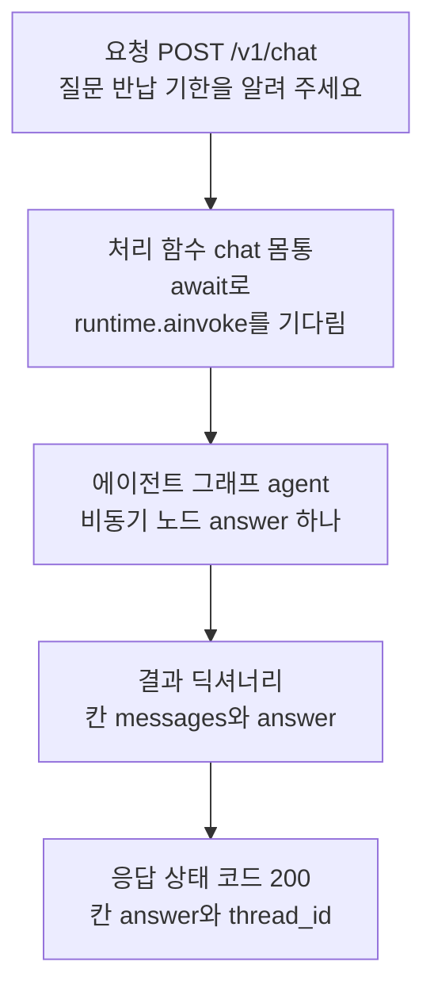
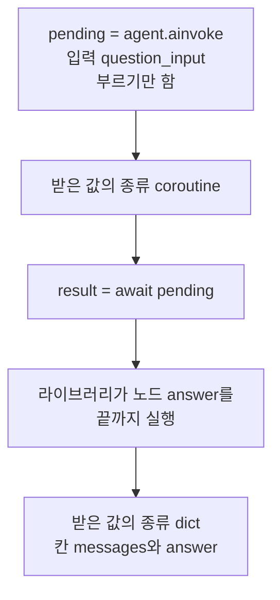
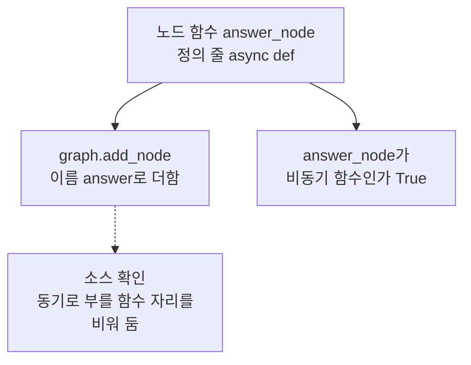
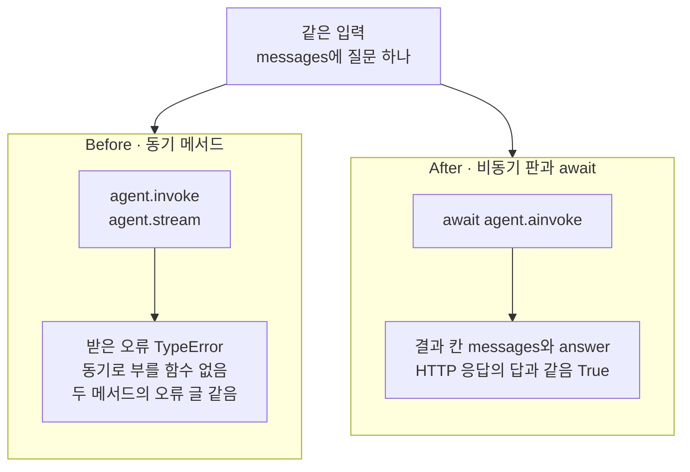
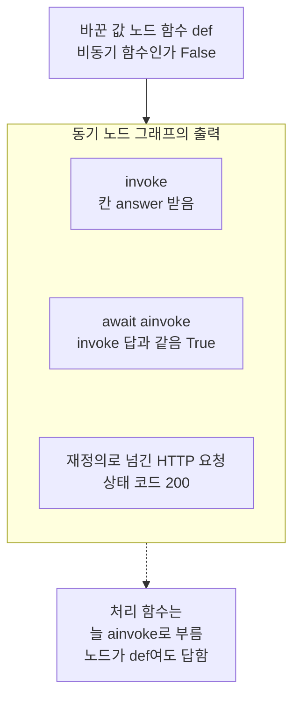

# 03-ainvoke-요청-응답

## _src 본문 (HTML 원본)

```html
<!--meta: 강의 1h | 실습 2.5h | 코드 notebooks/03-ainvoke-요청-응답.ipynb | 새 용어 1 -->
<style>html,body{overflow-x:hidden}.notebook,.nb-cell,.nb-main,.nb-input,.nb-result{min-width:0;max-width:100%}.nb-input pre,.nb-output{box-sizing:border-box;max-width:100%;overflow-x:auto}code.nb-source{display:block!important;width:100%!important;min-width:0!important;overflow-x:auto!important;padding:0!important}</style>
<h2 id="b1"><span class="no">1</span>학습 목표</h2><div class="goal"><ul>
<li>처리 함수 몸통이 에이전트 그래프를 await와 <code>ainvoke</code>로 부르는 줄을 읽고, 노트북에서 같게 부를 수 있습니다.</li>
<li>비동기 노드만 있는 그래프를 동기 메서드로 부르면 오류가 나는 까닭을 노드 함수의 정의 줄로 설명할 수 있습니다.</li>
<li>그래프 결과의 칸과 HTTP 응답 본문의 칸을 견줘, 처리 함수가 무엇을 골라 내보내는지 확인할 수 있습니다.</li>
</ul></div>
<h2 id="b2"><span class="no">2</span>이 내용을 배우는 이유</h2><p><a href="02-의존성으로-Agent-주입.html">02절</a>에서는 처리 함수 <code>chat</code>이 에이전트 그래프를 매개변수로 받는 데까지 봤습니다. 받은 그래프를 어떻게 부르는지는 몸통을 읽어야 보입니다. 이 앱의 그래프는 노드 함수가 비동기 함수라, Ch 13·21에서 배운 동기 메서드로는 부를 수 없습니다. 비동기 처리 함수 안에서는 그래프도 비동기로 부르고, 끝날 때까지 await로 기다립니다.</p><p>제목의 ainvoke는 그래프를 비동기로 부르는 메서드 이름입니다. <a href="../../part6/ch28-mcp/04-LangChain-MCP-클라이언트-연동.html">Ch 28 04절</a>에서 메서드 <code>invoke</code>의 비동기 판으로 이미 만났습니다. 이 절은 그 메서드를 웹 앱의 처리 함수 몸통에서 봅니다. 요청이 들어와 응답이 나갈 때까지, 그래프가 한 번 끝까지 실행되는 흐름입니다.</p>
<h2 id="b3"><span class="no">3</span>앞에서 배운 내용</h2><p><a href="01-비동기-라우팅과-스키마.html">01절</a>에서는 앱 객체·처리 함수·시험용 클라이언트와 응답 형식을 배웠습니다. <a href="02-의존성으로-Agent-주입.html">02절</a>에서는 의존성으로 처리 함수에 그래프를 넘기고, 재정의로 바꿔 끼웠습니다. 제공 함수 <code>get_agent</code>는 늘 같은 그래프 객체를 내놓았습니다. 몸통의 시간 제한 <code>asyncio.wait_for</code>와 상태 코드 504도 02절에서 봤습니다.</p><p><a href="../../part4/ch13-langgraph-basics/01-StateGraph와-노드-엣지.html">Ch 13 01절</a>에서는 노드 함수를 <code>def</code>로 적고, 컴파일한 그래프를 메서드 <code>invoke</code>로 불렀습니다. <a href="../../part6/ch21-create-agent/01-create-agent와-ReAct-루프.html">Ch 21 01절</a>의 에이전트 그래프도 <code>invoke</code>로 불렀습니다. <a href="../../part6/ch25-streaming/01-일곱-가지-stream-mode.html">Ch 25 01절</a>의 메서드 <code>stream</code>은 스트림 사건을 차례로 내놓는 동기 메서드였습니다. 셋 모두 동기로 부르는 방법입니다.</p><p><a href="../../part1/ch02-python/12-async와-await.html">Ch 2 12절</a>에서는 비동기 함수를 부르기만 하면 코루틴이 나오고, await 줄에서 본문이 실행된다고 배웠습니다. 기다리는 동안 이벤트 루프가 다른 코루틴을 실행할 수 있다는 것도 봤습니다. <a href="../../part6/ch28-mcp/04-LangChain-MCP-클라이언트-연동.html">Ch 28 04절</a>에서는 비동기 함수만 몸통으로 가진 MCP 도구를 <code>ainvoke</code>로만 불렀습니다. 그 도구를 <code>invoke</code>로 부르면 오류 <code>NotImplementedError</code>가 났습니다. 이 절의 그래프는 다른 오류 <code>TypeError</code>를 내지만, 동기로 부를 수 없다는 점은 같습니다.</p><p>오류를 받아 출력하는 <code>try</code>와 <code>except</code>는 <a href="../../part1/ch02-python/05-파일과-예외.html">Ch 2 05절</a>에서 배웠습니다. 이 절은 Before 셀 둘에서만 씁니다.</p>
<h2 id="b4"><span class="no">4</span>핵심 개념</h2><h3>비유로 시작하기</h3><p>화물역에서 화물 열차를 떠나보내면, 열차는 목적지에 들렀다가 짐을 싣고 돌아옵니다. 역은 열차가 돌아올 때까지 기다리고, 그동안 다른 열차도 받을 수 있습니다. 열차가 돌아오면 짐칸 둘이 한꺼번에 들어옵니다. 역은 그중 큰 나무 상자 하나만 손수레에 옮겨 내보내고, 작은 꾸러미 더미는 짐칸에 둡니다.</p><p>열차를 떠나보내는 일이 메서드 <code>ainvoke</code>를 부르는 일이고, 돌아올 때까지 기다리는 일이 await입니다. 한꺼번에 들어온 짐칸 둘이 결과 딕셔너리의 칸 <code>messages</code>·<code>answer</code>입니다. 손수레에 옮긴 상자가 응답 본문에 담긴 답입니다. 짐칸에 남은 꾸러미 더미는 응답에 담기지 않은 칸 <code>messages</code>입니다.</p><p>비유와 다른 점이 있습니다. 실제 결과 딕셔너리에서는 칸 <code>answer</code>가 빠지지 않고, 처리 함수가 그 값을 응답에 옮겨 적습니다. 또 이 절에서는 요청 둘을 함께 보내 보지 않아, 기다리는 동안 다른 일을 하는 모습은 출력으로 보지 않았습니다. 걸린 시간도 재지 않았습니다.</p>
{{img:03-6-한꺼번에-돌아온-화물-열차|흰 바탕에 곧은 선로 하나가 가로로 놓여 있고, 오른쪽 끝에 멈춤 막이가 있습니다. 선로 위에 짙은 회색 기관차 하나와 뚜껑 없는 갈색 짐칸 둘이 멈춰 서 있습니다. 기관차 바로 뒤 짐칸은 비어 있고, 맨 왼쪽 짐칸에는 작은 갈색 꾸러미가 수북이 쌓여 있습니다. 두 짐칸 앞쪽 땅에 노란 손수레 하나가 있고, 그 위에 큰 나무 상자 하나가 실려 있습니다. 사람·글자·숫자·화살표는 없는 그림|돌아온 열차의 짐칸 둘 가운데 큰 나무 상자는 손수레로 옮겨졌고, 작은 꾸러미 더미는 짐칸에 남았습니다.}}
<p class="look"><b>그림 읽기</b> — 흰 바탕의 선로 하나에 짙은 회색 기관차 하나와 갈색 짐칸 둘이 멈춰 서 있습니다. 기관차 바로 뒤 짐칸은 비었고, 맨 왼쪽 짐칸에는 작은 꾸러미가 수북합니다. 짐칸 앞 땅에는 노란 손수레 하나가 큰 나무 상자 하나를 싣고 있습니다. 멈춰 선 열차가 await로 기다려 한 번에 받은 결과이고, 짐칸 둘이 칸 <code>messages</code>·<code>answer</code>입니다. 손수레의 상자가 응답에 담긴 답이고, 남은 꾸러미 더미는 응답에 없는 칸 <code>messages</code>입니다.</p>
<h3>ainvoke와 await</h3><p>컴파일한 그래프에는 부르는 메서드가 짝으로 있습니다. 동기 메서드 <code>invoke</code>와 그 비동기 판 <code>ainvoke</code>입니다. 비동기 판을 부르기만 하면 코루틴이 나오고, 그래프는 아직 실행되지 않습니다. 코루틴 앞에 await를 붙이면 그래프가 끝까지 실행되고, 끝난 뒤의 상태를 딕셔너리 하나로 받습니다.</p><p>처리 함수 <code>chat</code>의 몸통도 같은 일을 합니다. 앱 파일 78~80행이 <code>runtime.ainvoke(...)</code>를 부르고, 그 코루틴을 시간 제한 함수가 await로 기다립니다. 그래프가 끝나면 83행이 결과의 칸 <code>answer</code>로 응답을 만듭니다. LangGraph 문서도 노드를 <code>async def</code>로 적은 그래프는 <code>ainvoke</code>나 <code>astream</code>으로 부르라고 적습니다.</p>
<table><thead><tr><th>말</th><th>뜻</th></tr></thead><tbody><tr><td>비동기로 부르기(ainvoke) — Ch 28 04절에서 이어 씀</td><td>메서드 <code>invoke</code>의 비동기 판으로, 끝날 때까지 await로 기다리며 부르는 메서드입니다. 은행에서 번호표를 받아 두고, 차례가 오면 일을 한 번에 마치는 것과 같습니다. 이 절에서는 <code>await agent.ainvoke(question_input)</code>로 그래프가 끝난 뒤의 상태를 딕셔너리 하나로 받습니다.</td></tr><tr><td>비동기 노드 · 동기 노드</td><td>노드 함수를 <code>async def</code>로 적은 노드가 비동기 노드이고, <code>def</code>로 적은 노드가 동기 노드입니다. 전기로만 움직이는 열차가 전선이 걸린 선로에서만 달리는 것처럼, 비동기 노드는 비동기로 부를 때만 실행됩니다. 이 절의 실습 노드 <code>answer</code>는 비동기 노드라 <code>ainvoke</code>로만 불렸습니다. 노트북 6절의 동기 노드는 <code>invoke</code>와 <code>ainvoke</code>로 모두 불렸습니다.</td></tr></tbody></table>
<p>새 말을 이 절 코드에서 보면 이렇습니다. 메서드 <code>ainvoke</code>를 부르기만 하자 받은 값의 종류가 <code>coroutine</code>이었습니다. 코루틴 앞에 await를 붙이자 <code>dict</code>를 받았고, 칸은 <code>['messages', 'answer']</code>였습니다. 비동기 노드만 있는 실습 그래프를 <code>invoke</code>로 부르자 오류 <code>TypeError</code>가 났습니다.</p>
{{mermaid:03-1-요청에서-응답까지-한-번의-ainvoke|위에서 아래로 읽는 흐름도입니다. 초록 상자 요청 POST /v1/chat 질문 반납 기한을 알려 주세요에서 초록 상자 처리 함수 chat 몸통 await로 runtime.ainvoke를 기다림으로 화살표가 갑니다. 이어서 초록 상자 에이전트 그래프 agent 비동기 노드 answer 하나와 노란 상자 결과 딕셔너리 칸 messages와 answer를 지나, 노란 상자 응답 상태 코드 200 칸 answer와 thread_id로 이어지는 그림|처리 함수 chat의 몸통이 에이전트 그래프를 await와 ainvoke로 한 번 끝까지 부르고, 결과의 칸 answer로 응답을 만들었습니다.}}
<p class="look"><b>도식 읽기</b> — 위에서 아래로 읽습니다. 초록 상자 셋은 보낸 요청과, 실습 폴더 파일의 처리 함수와 그래프입니다. 노란 상자 둘은 노트북 출력으로 확인한 결과의 칸과 응답입니다. 응답은 2절 출력에서, 결과의 칸은 5절 출력에서 봅니다.</p>
{{mermaid:03-2-부르기만-한-코루틴과-await|위에서 아래로 읽는 흐름도입니다. 파란 상자 pending = agent.ainvoke 입력 question_input 부르기만 함에서 노란 상자 받은 값의 종류 coroutine으로 화살표가 갑니다. 이어서 파란 상자 result = await pending과 회색 상자 라이브러리가 노드 answer를 끝까지 실행을 지나, 노란 상자 받은 값의 종류 dict 칸 messages와 answer로 이어지는 그림|메서드 ainvoke를 부르기만 하자 코루틴을 받았고, await를 붙이자 그래프가 끝까지 실행되어 결과 딕셔너리를 받았습니다.}}
<p class="look"><b>도식 읽기</b> — 위에서 아래로 읽습니다. 파란 상자 둘은 노트북 5절에서 우리가 쓴 줄입니다. 노란 상자 둘은 그 두 셀의 출력이고, 회색 상자는 await 줄에서 라이브러리가 하는 일입니다. Ch 2 12절에서 본 코루틴과 await가 그래프를 부를 때도 같게 보입니다.</p>
<h3>동기 메서드로 부르면 생기는 일</h3><p>패키지 langgraph는 노드를 더할 때 노드 함수가 비동기 함수인지 봅니다. 설치판 langgraph 1.2.11 <code>_internal/_runnable.py</code> 528~536행이 함수 <code>inspect.iscoroutinefunction</code>으로 확인합니다. 비동기 함수이면 566~567행이 동기로 부를 함수 자리를 비워 둡니다. 동기 함수이면 569~574행이 그 함수와 함께 비동기 판도 만들어 둡니다. 비동기 판은 동기 함수를 다른 스레드에서 부릅니다.</p><p>메서드 <code>invoke</code>는 동기로 부를 함수 자리를 씁니다. 자리가 비어 있으면 377~382행이 오류 <code>TypeError</code>를 냅니다. 설치판 <code>pregel/main.py</code> 3891행을 보면 <code>invoke</code>는 안에서 <code>stream</code>을 부르므로, <code>stream</code>도 같은 오류를 냅니다. 반대로 <code>ainvoke</code>는 비동기 판을 쓰므로 비동기 노드와 동기 노드를 모두 부릅니다. 이 소스 동작 가운데 오류와 두 메서드의 결과는 노트북 4~6절 출력으로 확인했고, 스레드는 확인하지 않았습니다.</p><h3>결과 딕셔너리와 응답 본문</h3><p>그래프가 끝난 뒤의 상태에는 칸 <code>messages</code>와 <code>answer</code>가 있습니다. 실습 파일의 상태 형식 <code>AgentState</code>가 이 두 칸을 적어 두었기 때문입니다. 과정에는 같은 이름의 상태 형식이 셋 있습니다. <a href="../../part5/ch20-tool-node/01-ToolNode와-tools-condition.html">Ch 20 01절</a>에서 우리가 적은 것, <a href="../../part6/ch21-create-agent/03-AgentState와-context-schema.html">Ch 21 03절</a>의 라이브러리 상태 형식, 그리고 이 실습 파일의 것입니다. 셋은 칸이 서로 다르고, 이 절에서 말하는 것은 셋째입니다.</p><p>처리 함수는 이 결과에서 칸 <code>answer</code>만 골라 응답을 만듭니다. 응답 본문의 칸은 01절의 응답 형식 <code>ChatResponse</code>가 정한 <code>answer</code>·<code>thread_id</code> 둘입니다. 칸 <code>messages</code>는 그래프 안에서만 쓰이고, 응답에는 담기지 않습니다.</p>
<h2 id="b5"><span class="no">5</span>실행 예제</h2><p>노트북 2절은 처리 함수 <code>chat</code>의 소스 글을 출력해, 몸통이 그래프를 부르는 줄을 읽습니다. 몸통이 받을 그래프가 가져온 <code>agent</code>와 같은 객체인지 보고, 시험용 클라이언트로 요청을 넣습니다. 3절은 그래프 파일을 읽어 노드 함수의 정의 줄을 보고, 그 함수가 비동기 함수인지 출력합니다. 끝으로 처리 함수와 같은 모양의 입력을 만듭니다.</p><p>모델 요청은 0번이고, API 키 없이 실행합니다. 서버 프로그램을 띄우지 않아 네트워크·포트·자식 프로세스를 쓰지 않습니다. 실습 폴더의 파일을 가져오고 읽기만 하며, 쓰는 파일은 없습니다. 걸린 시간은 재지 않았습니다.</p>
{{notebook:03-ainvoke-요청-응답|example}}
<p class="look"><b>확인할 점</b> — 노트북 2절에서 몸통의 줄 <code>runtime.ainvoke({"messages": [body.question]})</code>를 찾습니다. 출력 줄 <code>runtime에 들어오는 그래프가 agent와 같은 객체인가: True</code>와 <code>상태 코드: 200</code>도 확인합니다. 3절에서는 <code>answer_node가 비동기 함수인가: True</code>를 봅니다.</p>
{{mermaid:03-3-비동기-노드-answer|위에서 아래로 읽는 그림입니다. 초록 상자 노드 함수 answer_node 정의 줄 async def에서 두 화살표가 나갑니다. 하나는 초록 상자 graph.add_node 이름 answer로 더함으로, 다른 하나는 노란 상자 answer_node가 비동기 함수인가 True로 갑니다. 노드를 더하는 상자에서 점선이 회색 상자 소스 확인 동기로 부를 함수 자리를 비워 둠으로 가는 그림|실습 그래프의 노드 함수는 async def로 적은 비동기 함수라, 라이브러리가 동기로 부를 함수 자리를 비워 둡니다.}}
<p class="look"><b>도식 읽기</b> — 위에서 아래로 읽습니다. 초록 상자 둘은 그래프 파일에서 읽은 줄이고, 노란 상자는 3절 출력입니다. 점선 끝 회색 상자는 설치판 소스로 본 동작이라, 노트북 출력으로는 4절에서 확인합니다.</p>
<h2 id="b6"><span class="no">6</span>일부러 실패해 보기</h2><p>아래 Before 셀은 실습 그래프를 Ch 13·21에서 배운 동기 메서드 <code>invoke</code>로 부릅니다. 이어서 Ch 25의 동기 메서드 <code>stream</code>으로도 부릅니다. After 셀은 처리 함수 몸통과 같은 await와 <code>ainvoke</code>로 부르고, 2절의 HTTP 응답과 답을 견줍니다. 끝으로 노드 함수만 <code>def</code>로 바꾼 그래프로 값 바꿔 보기를 합니다.</p>
{{notebook:03-ainvoke-요청-응답|failure}}
{{mermaid:03-4-invoke와-ainvoke로-부른-결과|위에 초록 상자 같은 입력 messages에 질문 하나가 있고, 그 아래 칸 둘이 나란히 놓여 있습니다. 왼쪽 칸 Before 동기 메서드에는 파란 상자 agent.invoke agent.stream에서 빨간 상자 받은 오류 TypeError 동기로 부를 함수 없음 두 메서드의 오류 글 같음으로 이어집니다. 오른쪽 칸 After 비동기 판과 await에는 파란 상자 await agent.ainvoke에서 노란 상자 결과 칸 messages와 answer HTTP 응답의 답과 같음 True로 이어지는 그림|같은 입력을 동기 메서드로 부르자 두 메서드 모두 TypeError로 끝났고, await와 ainvoke로 부르자 HTTP 응답과 같은 답을 받았습니다.}}
<p class="look"><b>도식 읽기</b> — 맨 위 초록 상자는 두 판이 함께 쓰는 입력입니다. 왼쪽 칸이 Before, 오른쪽 칸이 After이고, 칸 안은 위에서 아래로 우리가 부른 메서드와 받은 결과입니다. 빨간 상자 하나가 Before 결함 결과이고, 노란 상자는 5절 출력입니다.</p>
<table><thead><tr><th>견준 것</th><th>Before(동기 메서드)</th><th>After(await와 ainvoke)</th></tr></thead><tbody><tr><td>부른 메서드</td><td><code>agent.invoke</code> · <code>agent.stream</code></td><td><code>await agent.ainvoke</code></td></tr><tr><td>받은 것</td><td>오류 <code>TypeError</code>(두 메서드 모두)</td><td>딕셔너리(<code>dict</code>)</td></tr><tr><td>오류 글의 첫 줄</td><td><code>No synchronous function provided to "answer".</code></td><td>오류 없음</td></tr><tr><td>결과의 칸</td><td>받은 결과 없음</td><td><code>['messages', 'answer']</code></td></tr><tr><td>2절 HTTP 응답의 답과 같은가</td><td>견줄 답이 없음</td><td><code>True</code></td></tr></tbody></table>
<p>두 판에서 그래프와 입력은 같았고, 다른 것은 부른 메서드였습니다. Before 판의 두 동기 메서드는 답을 하나도 받지 못하고, 같은 오류 글로 끝났습니다. 노드 <code>answer</code>의 함수가 비동기 함수라, 동기로 부를 함수 자리가 비어 있었기 때문입니다.</p><p>After 판은 <code>ainvoke</code>를 부르기만 해 코루틴을 받고, await 줄에서 그래프를 끝까지 실행했습니다. 받은 결과의 칸 <code>answer</code>는 2절에서 처리 함수가 HTTP로 내준 답과 같았습니다. 처리 함수 몸통과 노트북이 같은 그래프를 같은 방법으로 불렀기 때문입니다. 응답 본문에는 칸 <code>messages</code>가 없고, 처리 함수가 고른 답과 요청의 <code>thread_id</code>만 있었습니다.</p>
<p>노트북 6절에서 노드 함수만 <code>def</code>로 바꾸자, 동기 메서드 <code>invoke</code>도 답을 받았습니다. 같은 그래프를 <code>ainvoke</code>로 부른 답도 같았습니다. 재정의로 처리 함수에 넘긴 HTTP 요청도 200을 받았습니다. 처리 함수는 넘겨받은 그래프를 늘 <code>ainvoke</code>로 부르므로, 노드가 어느 쪽이든 답합니다.</p>
{{mermaid:03-5-def-노드-그래프도-답한-처리-함수|위에서 아래로 읽는 그림입니다. 파란 상자 바꾼 값 노드 함수 def 비동기 함수인가 False에서 동기 노드 그래프의 출력이라는 칸으로 화살표가 갑니다. 칸 안에는 노란 상자 invoke 칸 answer 받음, 노란 상자 await ainvoke invoke 답과 같음 True, 노란 상자 재정의로 넘긴 HTTP 요청 상태 코드 200이 위아래로 놓여 있습니다. 칸에서 점선이 회색 상자 처리 함수는 늘 ainvoke로 부름 노드가 def여도 답함으로 가는 그림|노드 함수만 def로 바꾼 그래프는 invoke와 ainvoke 모두로 답했고, 재정의로 처리 함수에 넘겨도 200을 받았습니다.}}
<p class="look"><b>도식 읽기</b> — 위에서 아래로 읽습니다. 파란 상자는 6절에서 바꾼 값이고, 칸 안 노란 상자 셋은 6절 출력입니다. 점선 끝 회색 상자는 세 출력과 2절의 소스 글을 함께 읽은 사실입니다. 값 바꿔 보기 장면이라 빨강은 쓰지 않았습니다.</p>
<p>새 커널로 두 번 실행해 견주자, 코드 셀 스물둘의 출력이 셀마다 모두 같았습니다. 한 번은 프로젝트 맨 위에서, 한 번은 <code>notebooks/</code> 폴더에서 연 커널이었습니다. 노트북 밖에서도 같은 장면을 파이썬 파일로 다섯 번 실행해, 출력이 모두 같았습니다. 모델을 부르지 않아, 이 절의 출력은 그래프와 시험용 클라이언트가 주고받은 값으로 정해집니다.</p>
<p class="look"><b>확인할 점</b> — Before 셀에서 <code>받은 오류: TypeError</code>와 <code>오류 글이 invoke 때와 같은가: True</code>를 봅니다. After 셀에서 <code>부르기만 해서 받은 값의 종류: coroutine</code>과 <code>두 답이 같은가: True</code>를 확인합니다. 6절에서는 <code>노드 함수가 비동기 함수인가: False</code>와 <code>2절 응답 본문과 같은가: True</code>를 찾습니다.</p>
<h2 id="b7"><span class="no">7</span>주의할 점과 실무 메모</h2><ul><li>이 앱의 그래프는 모델을 쓰지 않아, 같은 질문에 늘 같은 답을 냅니다. 모델을 부르는 에이전트의 답은 실행마다 달라질 수 있어, 두 답이 같은지로는 확인하기 어렵습니다. 그때는 <a href="../../part6/ch29-agent-evaluation/01-에이전트-평가-세-전략.html">Ch 29 01절</a>의 궤적 맞춰 보기나 <a href="../../part6/ch29-agent-evaluation/03-LLM-judge로-궤적-평가.html">03절</a>의 평가 모델 판정을 씁니다. 모델을 부르는 에이전트는 <a href="09-실제-Agent-HTTP-통합.html">09절</a>에서 씁니다.</li><li>비동기 처리 함수 안에서 동기 노드 그래프를 <code>invoke</code>로 부르면, 그래프가 끝날 때까지 이벤트 루프가 멈춥니다. 01절에서 본 차단 호출과 같은 모양입니다. 이 절에서는 그런 처리 함수를 만들어 실행하지 않았습니다.</li><li>메서드 <code>ainvoke</code>를 부르기만 하고 await하지 않으면, 그래프는 실행되지 않습니다. Python 문서도 코루틴을 부르기만 해서는 실행이 예약되지 않는다고 적습니다.</li><li>셀 맨 위의 await는 노트북 도구(IPython)의 기능입니다. 파이썬 파일에서는 Ch 2 12절처럼 <code>asyncio.run</code>으로 코루틴을 실행합니다. 노트북 밖의 다섯 번 실행은 이 모양으로 했습니다.</li><li>질문에 「오류」라는 글자가 들어가면 노드가 일부러 오류 <code>RuntimeError</code>를 냅니다. 그래프 파일 18~19행에 교재용으로 넣어 둔 줄입니다. 이 절에서는 그 글자가 든 질문을 보내지 않았습니다.</li><li>걸린 시간은 재지 않았습니다. 교재 출력은 Linux의 Python 3.12.13으로 만들었고, 다른 판과 Windows·macOS에서는 실행하지 않았습니다.</li></ul>
<h2 id="b8"><span class="no">8</span>정리와 다음 절</h2><ul><li>처리 함수 <code>chat</code>의 몸통은 에이전트 그래프를 await와 <code>ainvoke</code>로 불러, 끝난 결과를 한 번에 받았습니다.</li><li>비동기 노드만 있는 그래프를 동기 메서드 <code>invoke</code>·<code>stream</code>으로 부르자 오류 <code>TypeError</code>가 났습니다.</li><li>노드 함수를 <code>def</code>로 바꾼 그래프는 두 메서드로 모두 답했고, 처리 함수에 넘겨도 답했습니다.</li></ul><p><strong>다음 학습과 이어지는 지점</strong> — <a href="04-astream과-응답-스트림.html">04절</a>에서는 비동기 메서드 <code>astream</code>으로 모드 <code>custom</code>의 스트림 사건을 받아 이어 붙입니다. 노드가 적은 사건을 차례로 받는 방법입니다.</p>
<h2 id="b9"><span class="no">9</span>복습 문제</h2><details class="quiz" open><summary>문제 5개 · 해설 포함</summary><p class="quiz-q">1. 처리 함수 <code>chat</code>의 몸통은 에이전트 그래프를 어떤 메서드로 부르고, 무엇으로 기다리나요?</p><p class="quiz-a">메서드 <code>ainvoke</code>로 부르고, 그 코루틴을 시간 제한 함수와 await로 기다립니다. 그래프가 끝나면 결과의 칸 <code>answer</code>로 응답을 만듭니다. 틀렸다면 노트북 2절을 다시 읽습니다.</p><p class="quiz-q">2. 실습 그래프를 <code>invoke</code>로 부르면 무엇을 받나요? 까닭은 무엇인가요?</p><p class="quiz-a">오류 <code>TypeError</code>를 받습니다. 노드 함수 <code>answer_node</code>가 <code>async def</code>로 적은 비동기 함수라, 동기로 부를 함수 자리가 비어 있기 때문입니다. 틀렸다면 노트북 3절과 4절을 다시 읽습니다.</p><p class="quiz-q">3. <code>ainvoke</code>를 await 없이 부르기만 하면 무엇을 받나요?</p><p class="quiz-a">코루틴을 받고, 그래프는 아직 실행되지 않습니다. 코루틴 앞에 await를 붙여야 그래프가 끝까지 실행되어 딕셔너리를 받습니다. 틀렸다면 노트북 5절을 다시 읽습니다.</p><p class="quiz-q">4. 동료가 「노드를 <code>def</code>로 적은 그래프는 처리 함수가 부를 수 없다」고 말합니다. 맞나요?</p><p class="quiz-a">맞지 않습니다. 6절에서 노드 함수를 <code>def</code>로 바꾼 그래프를 재정의로 넘기자, 처리 함수가 200으로 답했습니다. 처리 함수는 늘 <code>ainvoke</code>로 부르고, <code>ainvoke</code>는 동기 노드도 부릅니다. 틀렸다면 노트북 6절을 다시 읽습니다.</p><p class="quiz-q">5. 그래프 결과에는 칸 <code>messages</code>가 있는데, 응답 본문에는 없습니다. 까닭은 무엇인가요?</p><p class="quiz-a">처리 함수가 결과에서 칸 <code>answer</code>만 골라 응답을 만들기 때문입니다. 응답 본문의 칸은 응답 형식 <code>ChatResponse</code>의 <code>answer</code>·<code>thread_id</code> 둘입니다. 틀렸다면 노트북 5절을 다시 읽습니다.</p></details>
<h2 id="b10"><span class="no">10</span>참고 자료</h2><ul><li><div><a href="https://docs.langchain.com/oss/python/langgraph/use-graph-api">LangGraph Use the graph API</a></div>확인 2026-09-29 · Async 절은 그래프를 비동기로 바꾸려면 노드를 <code>async def</code>로 적으라고 적습니다. 그래프는 <code>ainvoke</code>나 <code>astream</code>으로 부르라고 적습니다.</li><li><div><a href="https://docs.python.org/3.12/library/asyncio-task.html">Python asyncio Coroutines and Tasks</a></div>확인 2026-09-29 · 코루틴을 부르기만 해서는 실행이 예약되지 않는다고 적습니다. 코루틴을 await로 기다리면 본문이 실행되는 예를 보여 줍니다.</li><li>설치판 langgraph 1.2.11 소스 <code>_internal/_runnable.py</code> 528~536행은 노드 함수가 비동기 함수인지 봅니다. 566~567행은 비동기 노드 함수의 동기 자리를 비우고, 569~574행은 동기 함수에 비동기 판을 만듭니다. 377~382행은 동기 자리가 비었을 때 오류 <code>TypeError</code>를 냅니다.</li><li>설치판 langgraph 1.2.11 소스 <code>pregel/main.py</code>의 메서드 <code>invoke</code>는 3891·3913행에서 <code>stream</code>을 부릅니다. 메서드 <code>ainvoke</code>는 4068·4090행에서 <code>astream</code>을 부릅니다.</li><li>실습 폴더 <code>agent_service/agent.py</code> 23행은 노드 함수 <code>answer_node</code>를 <code>async def</code>로 적고, 40행이 노드로 더합니다. <code>agent_service/app.py</code> 75~83행이 처리 함수 <code>chat</code>이고, 78~80행이 <code>runtime.ainvoke</code>를 부릅니다.</li></ul>
```

## 노트북 셀 (순서대로)

### [0] markdown {'html': 'skip'}

# ainvoke 요청 응답

**이 노트북에서 할 일**

1. 처리 함수 `chat`의 몸통이 에이전트 그래프를 await와 `ainvoke`로 부르는 줄을 읽습니다.
2. 비동기 노드만 있는 그래프를 동기 메서드 `invoke`로 부르면 오류가 나는 것을 봅니다.
3. await와 `ainvoke`로 같은 그래프를 불러, HTTP 응답과 같은 답을 받습니다.

**준비물** — 이 노트북은 모델을 부르지 않습니다.
모델 요청은 0번이고, API 키 없이 실행합니다.
예상 비용도 0달러입니다.
실습 앱의 에이전트 그래프는 모델을 쓰지 않고, 정해 둔 말로 답합니다.
그래서 다시 실행해도 같은 값이 나와야 합니다.

요청은 같은 노트북 안에서 앱 객체로 바로 들어갑니다.
서버 프로그램을 따로 띄우지 않고, 네트워크와 포트를 쓰지 않습니다.
실습 폴더의 파일을 가져오고 읽기만 하며, 쓰는 파일은 없습니다.

걸린 시간은 재지 않았습니다.
이 절은 앞 챕터에서 배운 함수를 쓰지 않아, 가져오는 도구 파일도 없습니다.

**기준 버전** — 첫 셀에서 패키지 여섯을 설치합니다.
판은 fastapi 0.135.0, httpx 0.28.1, pydantic 2.12.5, starlette 1.6.0입니다.
패키지 langgraph 1.2.11과 langchain 1.4.0은 실습 앱 파일이 가져오는 패키지입니다.
여섯 모두 실습 폴더 잠금과 같은 판입니다.

교재 출력은 Linux의 Python 3.12.13으로 만들었습니다.
다른 판과 Windows·macOS에서는 실행하지 않았습니다.

**강의와 실습 범위** — 강의 시간에는 2~5절을 읽습니다.
처리 함수가 그래프를 부르는 줄을 보고, 동기로 부르기와 비동기로 부르기를 Before·After로 봅니다.
6절은 노드 함수 하나를 바꿔 보는 실습이고, 실습 시간에 실행합니다.

실습 폴더 `labs/part7/ch30-fastapi-serving`에서 `uv sync --locked`를 실행합니다.
그다음 `notebooks/` 폴더의 이 노트북을 열고, 실습 폴더의 `.venv` 커널을 고릅니다.
첫 셀부터 순서대로 실행합니다.

### [1] markdown {'html': 'skip'}

## 오늘 볼 그림


위에서 아래로 읽습니다.
초록 상자 셋은 보낸 요청과, 실습 폴더 파일의 처리 함수와 그래프입니다.
노란 상자 둘은 노트북 출력으로 확인한 결과의 칸과 응답입니다.
응답은 2절 출력에서, 결과의 칸은 5절 출력에서 봅니다.

### [2] markdown {}

## 1. 준비

02절에서는 처리 함수 `chat`이 의존성 셋의 값을 받는 것을 봤습니다.
이 절은 그 몸통이 에이전트 그래프를 부르는 줄을 봅니다.
제목의 ainvoke는 Ch 28 04절에서 본 비동기로 부르기입니다.
메서드 `invoke`의 비동기 판이고, 끝날 때까지 await로 기다리며 부릅니다.

첫 셀은 패키지 여섯을 설치하고 설치된 판 번호를 출력합니다.
설치에는 몇십 초가 걸릴 수 있습니다.

### [3] code {'execution': {'iopub.execute_input': '2026-09-29T07:42:42.122023Z', 'iopub.status.busy': '2026-09-29T07:42:42.121911Z', 'iopub.status.idle': '2026-09-29T07:42:42.760913Z', 'shell.execute_reply': '2026-09-29T07:42:42.760317Z'}, 'lesson_role': 'setup'}

```python
# 이 절에서 쓰는 패키지를 설치하고 버전을 확인합니다
%pip install -q "fastapi==0.135.0" "httpx==0.28.1" "pydantic==2.12.5" "starlette==1.6.0" "langgraph==1.2.11" "langchain==1.4.0"
from importlib.metadata import version

print("fastapi:", version("fastapi"))
print("httpx:", version("httpx"))
print("pydantic:", version("pydantic"))
print("starlette:", version("starlette"))
print("langgraph:", version("langgraph"))
print("langchain:", version("langchain"))
```

출력:
```
Note: you may need to restart the kernel to use updated packages.
fastapi: 0.135.0
httpx: 0.28.1
pydantic: 2.12.5
starlette: 1.6.0
langgraph: 1.2.11
langchain: 1.4.0

```

### [4] markdown {}

**결과 읽기** — 출력 줄 `fastapi: 0.135.0`과 `langgraph: 1.2.11`이 보입니다.
여섯 모두 실습 폴더 잠금과 같은 판이고, 02절과 같은 목록입니다.
패키지 langgraph와 langchain은 실습 앱 파일이 가져옵니다.
이 절은 모델 객체를 만들지 않습니다.

다음 셀은 이 절에서 쓸 이름을 가져옵니다.
모듈 `inspect`는 함수 같은 객체의 정보를 꺼내 보는 모듈이고, 2절과 3절에서 씁니다.
이름 `StateGraph`·`START`·`END`는 Ch 13 01절에서 그래프를 만들 때 쓴 이름입니다.

### [5] code {'execution': {'iopub.execute_input': '2026-09-29T07:42:42.761962Z', 'iopub.status.busy': '2026-09-29T07:42:42.761873Z', 'iopub.status.idle': '2026-09-29T07:42:43.371736Z', 'shell.execute_reply': '2026-09-29T07:42:43.371345Z'}, 'lesson_role': 'setup'}

```python
# 이 절에서 쓸 이름을 가져옵니다(os·inspect는 Python에 들어 있는 모듈입니다)
import os
import inspect
from fastapi.testclient import TestClient
from langgraph.graph import END, START, StateGraph

print("가져온 이름:", "inspect, TestClient, StateGraph, START, END")
```

출력:
```
가져온 이름: inspect, TestClient, StateGraph, START, END

```

### [6] markdown {}

**결과 읽기** — 출력 줄 `가져온 이름: inspect, TestClient, StateGraph, START, END`가 보입니다.
이 노트북에는 API 키를 확인하는 셀이 없습니다.
모델을 부르지 않기 때문입니다.

다음 셀은 01절 2절과 같은 파일 위치 셀로, 후보 셋 가운데 실습 폴더를 고릅니다.

### [7] code {'execution': {'iopub.execute_input': '2026-09-29T07:42:43.372454Z', 'iopub.status.busy': '2026-09-29T07:42:43.372387Z', 'iopub.status.idle': '2026-09-29T07:42:43.374743Z', 'shell.execute_reply': '2026-09-29T07:42:43.374377Z'}}

```python
# 노트북을 연 자리에서 본 실습 폴더의 위치를 후보 셋 가운데에서 고릅니다
candidates = ["..", ".", "labs/part7/ch30-fastapi-serving"]
lab_path = None
for candidate in candidates:
    if os.path.exists(candidate + "/agent_service/schemas.py"):
        lab_path = candidate
        break
print("실습 폴더를 찾았는가:", lab_path is not None)
assert lab_path is not None, "notebooks 폴더나 실습 폴더 맨 위에서 노트북을 열어 주세요."
```

출력:
```
실습 폴더를 찾았는가: True

```

### [8] markdown {}

**결과 읽기** — 출력 줄 `실습 폴더를 찾았는가: True`가 보입니다.
고른 후보는 연 자리마다 달라서 출력하지 않습니다.

다음 셀은 02절처럼 작업 폴더를 실습 폴더로 옮긴 뒤 이름을 가져옵니다.
그래프 파일 `agent.py`에서는 상태 형식 `AgentState`, 에이전트 그래프 `agent`, 노드 함수 `answer_node`를 가져옵니다.
앱 파일 `app.py`에서는 앱 객체 `app`, 처리 함수 `chat`, 제공 함수 `get_agent`를 가져옵니다.
컴파일한 그래프의 속성 `nodes`는 노드 이름을 키로 둔 딕셔너리입니다.

### [9] code {'execution': {'iopub.execute_input': '2026-09-29T07:42:43.375367Z', 'iopub.status.busy': '2026-09-29T07:42:43.375316Z', 'iopub.status.idle': '2026-09-29T07:42:43.437741Z', 'shell.execute_reply': '2026-09-29T07:42:43.437359Z'}}

```python
# 작업 폴더를 실습 폴더로 옮기고, 그래프 파일과 앱 파일에서 이름을 가져옵니다
os.chdir(lab_path)
from agent_service.agent import AgentState, agent, answer_node
from agent_service.app import app, chat, get_agent
print("가져온 그래프의 종류:", type(agent).__name__)
print("그래프의 노드 이름:", list(agent.nodes))
```

출력:
```
가져온 그래프의 종류: CompiledStateGraph
그래프의 노드 이름: ['__start__', 'answer']

```

### [10] markdown {}

**결과 읽기** — 출력 줄 `가져온 그래프의 종류: CompiledStateGraph`가 보입니다.
노드 이름은 `['__start__', 'answer']`이고, 답을 만드는 노드는 `answer` 하나입니다.
이름 `__start__`는 Ch 13 01절에서 쓴 `START`의 값과 같은 이름입니다.
이 그래프는 모델을 쓰지 않고, 질문 앞에 정해 둔 말을 붙여 답합니다.

## 2. 처리 함수 몸통이 그래프를 부르는 줄

02절에서는 처리 함수 `chat`의 정의 줄까지 봤습니다.
다음 셀은 함수 `inspect.getsource`로 `chat`의 소스 글 전체를 출력합니다.
이 함수는 함수 객체를 받아, 그 함수를 적은 소스 글을 글자 그대로 내놓습니다.

### [11] code {'execution': {'iopub.execute_input': '2026-09-29T07:42:43.438507Z', 'iopub.status.busy': '2026-09-29T07:42:43.438456Z', 'iopub.status.idle': '2026-09-29T07:42:43.440749Z', 'shell.execute_reply': '2026-09-29T07:42:43.440373Z'}}

```python
# 앱 파일의 처리 함수 chat을 소스 글 그대로 출력합니다
# inspect.getsource는 함수 객체를 받아, 그 함수를 적은 소스 글을 내놓습니다
chat_source = inspect.getsource(chat)
print("처리 함수 chat의 소스:")
print(chat_source)
```

출력:
```
처리 함수 chat의 소스:
@app.post("/v1/chat", response_model=ChatResponse)
async def chat(body: ChatRequest, runtime: AgentDep, _token: AuthDep, timeout: TimeoutDep) -> ChatResponse:
    try:
        result = await asyncio.wait_for(
            runtime.ainvoke({"messages": [body.question]}), timeout=timeout
        )
    except TimeoutError as exc:
        raise HTTPException(status_code=504, detail="Agent 응답 시간이 초과되었습니다") from exc
    return ChatResponse(answer=result["answer"], thread_id=body.thread_id)


```

### [12] markdown {}

**결과 읽기** — 라벨 줄 아래에 데코레이터 줄부터 `return` 줄까지 아홉 줄이 있습니다.
몸통의 줄 `runtime.ainvoke({"messages": [body.question]})`가 그래프를 부르는 자리입니다.
그 앞의 줄 `await asyncio.wait_for(`는 02절에서 본 시간 제한입니다.
그래프가 끝나면 결과 딕셔너리가 이름 `result`에 담깁니다.
마지막 줄은 `result["answer"]`와 요청의 `thread_id`로 응답을 만듭니다.

처리 함수는 메서드 `ainvoke`로 부르고, 그 코루틴을 await로 기다립니다.
매개변수 `runtime`에는 02절의 제공 함수 `get_agent`가 내놓는 그래프가 들어옵니다.
다음 셀은 그 그래프가 방금 가져온 `agent`와 같은 객체인지 봅니다.
제공 함수를 셀 맨 위에서 await로 부르는 것은 02절과 같은 모양입니다.

### [13] code {'execution': {'iopub.execute_input': '2026-09-29T07:42:43.441282Z', 'iopub.status.busy': '2026-09-29T07:42:43.441234Z', 'iopub.status.idle': '2026-09-29T07:42:43.442902Z', 'shell.execute_reply': '2026-09-29T07:42:43.442561Z'}}

```python
# 처리 함수의 매개변수 runtime에 들어올 그래프가, 가져온 agent와 같은 객체인지 봅니다
runtime_graph = await get_agent()
print("runtime에 들어오는 그래프가 agent와 같은 객체인가:", runtime_graph is agent)
```

출력:
```
runtime에 들어오는 그래프가 agent와 같은 객체인가: True

```

### [14] markdown {}

**결과 읽기** — 출력 줄 `runtime에 들어오는 그래프가 agent와 같은 객체인가: True`가 보입니다.
처리 함수 몸통이 부르는 그래프는 이 노트북의 `agent`와 같은 객체입니다.
그래서 노트북에서 `agent`를 부르면, 처리 함수 몸통과 같은 그래프를 부르는 셈입니다.

다음 셀은 시험용 클라이언트로 실제로 요청을 넣어 봅니다.
요청 머리의 칸 `Authorization`에는 02절처럼 교재용 접근 토큰을 적습니다.

### [15] code {'execution': {'iopub.execute_input': '2026-09-29T07:42:43.443477Z', 'iopub.status.busy': '2026-09-29T07:42:43.443434Z', 'iopub.status.idle': '2026-09-29T07:42:43.456666Z', 'shell.execute_reply': '2026-09-29T07:42:43.456355Z'}}

```python
# 시험용 클라이언트로 POST /v1/chat 요청을 넣고, 상태 코드와 응답 본문을 봅니다
client = TestClient(app)
auth_headers = {"Authorization": "Bearer local-demo-token"}
question_body = {"question": "반납 기한을 알려 주세요", "thread_id": "ainvoke-01"}
http_response = client.post("/v1/chat", json=question_body, headers=auth_headers)
http_body = http_response.json()
print("상태 코드:", http_response.status_code)
print("응답 본문:", http_body)
```

출력:
```
상태 코드: 200
응답 본문: {'answer': '질문을 확인했습니다: 반납 기한을 알려 주세요', 'thread_id': 'ainvoke-01'}

```

### [16] markdown {}

**결과 읽기** — 출력 줄 `상태 코드: 200`이 보입니다.
응답 본문은 `{'answer': '질문을 확인했습니다: 반납 기한을 알려 주세요', 'thread_id': 'ainvoke-01'}`입니다.
처리 함수 몸통이 await로 그래프를 기다린 뒤, 결과의 답으로 응답을 만들었습니다.
응답 본문의 칸은 `answer`·`thread_id` 둘입니다.

## 3. 실습 그래프의 노드 함수

그래프가 어떻게 만들어졌는지 파일을 읽어 봅니다.
다음 셀은 그래프 파일을 글로 읽어, 세 가지 줄만 출력합니다.
상태 형식의 정의 줄, 노드 함수의 정의 줄, 노드를 더하는 줄입니다.

### [17] code {'execution': {'iopub.execute_input': '2026-09-29T07:42:43.457306Z', 'iopub.status.busy': '2026-09-29T07:42:43.457255Z', 'iopub.status.idle': '2026-09-29T07:42:43.459657Z', 'shell.execute_reply': '2026-09-29T07:42:43.459296Z'}}

```python
# 그래프 파일을 글로 읽어, 상태 형식·노드 함수의 정의 줄과 노드를 더하는 줄만 출력합니다
with open("agent_service/agent.py", encoding="utf-8") as agent_file:
    agent_text = agent_file.read()
print("상태 형식·노드 함수·노드를 더하는 줄:")
for line in agent_text.splitlines():
    if line.startswith("class ") or line.startswith("async def ") or "add_node(" in line:
        print(line)
```

출력:
```
상태 형식·노드 함수·노드를 더하는 줄:
class AgentState(TypedDict):
async def answer_node(state: AgentState) -> dict[str, object]:
    graph.add_node("answer", answer_node)

```

### [18] markdown {}

**결과 읽기** — 라벨 줄 아래 첫 줄은 `class AgentState(TypedDict):`입니다.
이 파일이 칸 `messages`·`answer`를 적어 둔 상태 형식입니다.
과정에는 같은 이름 `AgentState`가 셋 있습니다.
Ch 20 01절에서 우리가 적은 것, Ch 21 03절의 라이브러리 상태 형식, 그리고 이 실습 파일의 것입니다.
이 절의 `AgentState`는 셋째이고, 앞의 둘과 칸이 다릅니다.

둘째 줄은 노드 함수 `answer_node`의 정의 줄이고, `async def`로 시작합니다.
셋째 줄은 이 비동기 함수를 이름 `answer`의 노드로 더합니다.
다음 셀은 이 노드 함수가 비동기 함수인지 출력으로 확인합니다.

### [19] code {'execution': {'iopub.execute_input': '2026-09-29T07:42:43.460197Z', 'iopub.status.busy': '2026-09-29T07:42:43.460134Z', 'iopub.status.idle': '2026-09-29T07:42:43.461588Z', 'shell.execute_reply': '2026-09-29T07:42:43.461259Z'}}

```python
# 노드 함수 answer_node가 비동기 함수인지 봅니다
# inspect.iscoroutinefunction은 async def로 적은 함수면 True를 내놓습니다
print("answer_node가 비동기 함수인가:", inspect.iscoroutinefunction(answer_node))
```

출력:
```
answer_node가 비동기 함수인가: True

```

### [20] markdown {}

**결과 읽기** — 출력 줄 `answer_node가 비동기 함수인가: True`가 보입니다.
패키지 langgraph도 노드를 더할 때 같은 함수로 노드 함수를 살핍니다.
설치판 langgraph 1.2.11 `_internal/_runnable.py` 528~536행이 그 자리입니다.
비동기 함수이면 566~567행이 동기로 부를 함수 자리를 비워 둡니다.
이 동작은 설치판 소스로 보았고, 그 결과는 4절에서 출력으로 봅니다.

다음 셀은 처리 함수 몸통과 같은 모양의 입력을 만듭니다.

### [21] code {'execution': {'iopub.execute_input': '2026-09-29T07:42:43.462189Z', 'iopub.status.busy': '2026-09-29T07:42:43.462146Z', 'iopub.status.idle': '2026-09-29T07:42:43.463585Z', 'shell.execute_reply': '2026-09-29T07:42:43.463245Z'}}

```python
# 처리 함수 몸통과 같은 모양의 입력을 만듭니다(칸 messages에 질문 하나를 담은 목록)
question_input = {"messages": ["반납 기한을 알려 주세요"]}
print("입력:", question_input)
```

출력:
```
입력: {'messages': ['반납 기한을 알려 주세요']}

```

### [22] markdown {}

**결과 읽기** — 출력 줄 `입력: {'messages': ['반납 기한을 알려 주세요']}`가 보입니다.
처리 함수 몸통의 `{"messages": [body.question]}`와 같은 모양입니다.
질문도 2절에서 보낸 요청과 같습니다.

### [23] markdown {'lesson_part': 'before'}

## 4. Ch 13·21처럼 invoke로 부르기 (Before)

그래프의 답만 빠르게 확인하고 싶을 때가 있습니다.
Ch 13 01절과 Ch 21 01절에서는 그래프를 메서드 `invoke`로 불렀습니다.
Before에서는 실습 그래프를 그 방법 그대로 부릅니다.
오류가 나면 저장된 출력에 긴 오류 기록이 남으므로, Ch 2 05절의 `try`와 `except`로 받아 출력합니다.
Ch 28 04절에서 MCP 도구를 `invoke`로 불러 본 셀과 같은 모양입니다.

실행 전에 예상해 봅니다.
동기 메서드로 비동기 노드를 부르면 답을 받을 수 있을까요?

### [24] code {'execution': {'iopub.execute_input': '2026-09-29T07:42:43.464136Z', 'iopub.status.busy': '2026-09-29T07:42:43.464083Z', 'iopub.status.idle': '2026-09-29T07:42:43.466356Z', 'shell.execute_reply': '2026-09-29T07:42:43.466027Z'}, 'lesson_part': 'before'}

```python
# Before: 비동기 노드만 있는 그래프를 동기 메서드 invoke로 부릅니다(오류 TypeError만 받습니다)
error_lines = []
try:
    agent.invoke(question_input)
except TypeError as error:
    print("받은 오류:", type(error).__name__)
    # 오류 글이 여러 줄이라, 줄마다 나눈 목록으로 담아 둡니다
    error_lines = str(error).splitlines()
print("오류 글의 줄 수:", len(error_lines))
```

출력:
```
받은 오류: TypeError
오류 글의 줄 수: 2

```

### [25] markdown {'lesson_part': 'before'}

**결과 읽기** — 출력 줄 `받은 오류: TypeError`와 `오류 글의 줄 수: 2`가 보입니다.
그래프는 답을 내지 못하고, 오류 `TypeError`로 끝났습니다.
오류 글은 두 줄이라, 다음 셀에서 한 줄씩 출력합니다.

### [26] code {'execution': {'iopub.execute_input': '2026-09-29T07:42:43.466882Z', 'iopub.status.busy': '2026-09-29T07:42:43.466840Z', 'iopub.status.idle': '2026-09-29T07:42:43.468550Z', 'shell.execute_reply': '2026-09-29T07:42:43.468236Z'}, 'lesson_part': 'before'}

```python
# 받은 오류 글을 한 줄씩 출력합니다
print("받은 오류 글:")
for line in error_lines:
    print(line)
```

출력:
```
받은 오류 글:
No synchronous function provided to "answer".
Either initialize with a synchronous function or invoke via the async API (ainvoke, astream, etc.)

```

### [27] markdown {'lesson_part': 'before'}

**결과 읽기** — 라벨 줄 아래 첫 줄은 `No synchronous function provided to "answer".`입니다.
노드 `answer`에 동기로 부를 함수가 없다는 뜻입니다.
둘째 줄은 동기 함수로 노드를 만들거나, 비동기로 부르라고 적습니다.
괄호 안의 `ainvoke`와 `astream`이 비동기로 부르는 메서드입니다.
이것이 이 절의 Before 결함입니다.

설치판 `_internal/_runnable.py` 377~382행이 이 오류를 내는 자리입니다.
3절에서 본 대로 노드 함수가 비동기 함수라, 동기로 부를 함수 자리가 비어 있었습니다.
다음 셀은 Ch 25 01절에서 배운 동기 메서드 `stream`으로도 불러 봅니다.

### [28] code {'execution': {'iopub.execute_input': '2026-09-29T07:42:43.469006Z', 'iopub.status.busy': '2026-09-29T07:42:43.468966Z', 'iopub.status.idle': '2026-09-29T07:42:43.471222Z', 'shell.execute_reply': '2026-09-29T07:42:43.470879Z'}, 'lesson_part': 'before'}

```python
# Ch 25 01절의 동기 메서드 stream으로도 불러 봅니다(오류 TypeError만 받습니다)
try:
    for event in agent.stream(question_input):
        print("받은 스트림 사건:", event)
except TypeError as error:
    stream_lines = str(error).splitlines()
    print("받은 오류:", type(error).__name__)
    print("오류 글이 invoke 때와 같은가:", stream_lines == error_lines)
```

출력:
```
받은 오류: TypeError
오류 글이 invoke 때와 같은가: True

```

### [29] markdown {'lesson_part': 'before'}

**결과 읽기** — 출력 줄 `받은 오류: TypeError`와 `오류 글이 invoke 때와 같은가: True`가 보입니다.
라벨 `받은 스트림 사건:`이 붙은 줄은 하나도 없습니다.
스트림 사건을 하나도 받지 못하고 같은 오류로 끝났습니다.
설치판 `pregel/main.py`를 보면 메서드 `invoke`도 안에서 `stream`을 부릅니다.
그래서 두 동기 메서드가 같은 자리에서 같은 오류를 냈습니다.

### [30] markdown {'lesson_part': 'after'}

## 5. await와 ainvoke로 부르기 (After)

After에서는 처리 함수 몸통과 같은 방법으로 부릅니다.
메서드 `ainvoke`는 Ch 28 04절에서 본 `invoke`의 비동기 판입니다.
Ch 2 12절에서는 비동기 함수를 부르기만 하면 코루틴이 나온다고 배웠습니다.
코루틴은 아직 실행하지 않은 본문 실행 하나이고, await 줄에서 본문이 실행됩니다.
다음 셀은 먼저 `ainvoke`를 await 없이 부르기만 합니다.

### [31] code {'execution': {'iopub.execute_input': '2026-09-29T07:42:43.471712Z', 'iopub.status.busy': '2026-09-29T07:42:43.471668Z', 'iopub.status.idle': '2026-09-29T07:42:43.473482Z', 'shell.execute_reply': '2026-09-29T07:42:43.473113Z'}, 'lesson_part': 'after'}

```python
# After 첫 단계: ainvoke를 await 없이 부르기만 하고, 받은 값의 종류를 봅니다
pending = agent.ainvoke(question_input)
print("부르기만 해서 받은 값의 종류:", type(pending).__name__)
```

출력:
```
부르기만 해서 받은 값의 종류: coroutine

```

### [32] markdown {'lesson_part': 'after'}

**결과 읽기** — 출력 줄 `부르기만 해서 받은 값의 종류: coroutine`이 보입니다.
그래프는 아직 실행되지 않았고, 이름 `pending`에 코루틴 하나가 담겼습니다.
Ch 2 12절에서 비동기 함수를 부르기만 했을 때와 같은 결과입니다.

다음 셀은 이 코루틴 앞에 await를 붙여, 그래프가 끝날 때까지 기다립니다.
셀 맨 위의 await 줄은 02절처럼 노트북 도구(IPython)의 기능입니다.

### [33] code {'execution': {'iopub.execute_input': '2026-09-29T07:42:43.473948Z', 'iopub.status.busy': '2026-09-29T07:42:43.473903Z', 'iopub.status.idle': '2026-09-29T07:42:43.476143Z', 'shell.execute_reply': '2026-09-29T07:42:43.475831Z'}, 'lesson_part': 'after'}

```python
# 코루틴 앞에 await를 붙여, 그래프가 끝날 때까지 기다린 뒤 결과를 받습니다
result = await pending
print("await로 받은 값의 종류:", type(result).__name__)
print("결과의 칸:", list(result))
print("칸 answer:", result["answer"])
print("칸 messages:", result["messages"])
```

출력:
```
await로 받은 값의 종류: dict
결과의 칸: ['messages', 'answer']
칸 answer: 질문을 확인했습니다: 반납 기한을 알려 주세요
칸 messages: ['반납 기한을 알려 주세요']

```

### [34] markdown {'lesson_part': 'after'}

**결과 읽기** — 출력 줄 `await로 받은 값의 종류: dict`와 `결과의 칸: ['messages', 'answer']`가 보입니다.
칸 `answer`는 `질문을 확인했습니다: 반납 기한을 알려 주세요`입니다.
칸 `messages`는 입력으로 넣은 질문 목록 그대로입니다.
await 줄에서 그래프가 끝까지 실행되었고, 끝난 뒤의 상태를 한 번에 받았습니다.

다음 셀은 2절에서 받은 HTTP 응답 본문과 이 결과를 견줍니다.

### [35] code {'execution': {'iopub.execute_input': '2026-09-29T07:42:43.476708Z', 'iopub.status.busy': '2026-09-29T07:42:43.476666Z', 'iopub.status.idle': '2026-09-29T07:42:43.478561Z', 'shell.execute_reply': '2026-09-29T07:42:43.478193Z'}, 'lesson_part': 'after'}

```python
# 2절에서 처리 함수가 HTTP로 내준 응답과, 노트북에서 부른 그래프의 결과를 견줍니다
print("응답 본문의 칸:", list(http_body))
print("결과의 칸:", list(result))
print("두 답이 같은가:", http_body["answer"] == result["answer"])
```

출력:
```
응답 본문의 칸: ['answer', 'thread_id']
결과의 칸: ['messages', 'answer']
두 답이 같은가: True

```

### [36] markdown {'lesson_part': 'after'}

**결과 읽기** — 출력 줄 `응답 본문의 칸: ['answer', 'thread_id']`와 `두 답이 같은가: True`가 보입니다.
결과의 칸은 `['messages', 'answer']`이고, 응답 본문에는 칸 `messages`가 없습니다.
처리 함수는 결과에서 칸 `answer`만 골라, 요청의 `thread_id`와 함께 응답을 만들었습니다.
응답 본문의 칸 둘은 01절에서 본 응답 형식 `ChatResponse`의 칸입니다.

노트북과 처리 함수는 같은 그래프를 같은 방법, 곧 await와 `ainvoke`로 불렀습니다.
그래서 두 답이 같았습니다.

## 6. 값 바꿔 보기: 노드 함수를 def로

값 하나만 바꿔 봅니다.
바꿀 것은 노드 함수의 정의 줄로, `async def` 대신 `def`로 적습니다.
상태 형식은 실습 파일의 `AgentState`로, 노드 이름과 답을 만드는 규칙도 같게 둡니다.
다음 셀은 그 동기 노드 함수를 정의합니다.

### [37] code {'execution': {'iopub.execute_input': '2026-09-29T07:42:43.479016Z', 'iopub.status.busy': '2026-09-29T07:42:43.478977Z', 'iopub.status.idle': '2026-09-29T07:42:43.480639Z', 'shell.execute_reply': '2026-09-29T07:42:43.480337Z'}, 'lesson_part': 'after'}

```python
# 값 바꿔 보기: 실습 노드와 같은 답을 만드는 동기 노드 함수를 def로 정의합니다
def sync_answer_node(state):
    # 목록 messages의 마지막 질문 앞에, 실습 노드와 같은 말을 붙입니다
    question = state["messages"][-1]
    return {"answer": "질문을 확인했습니다: " + question}
```

출력:
```

```

### [38] markdown {'lesson_part': 'after'}

**결과 읽기** — 정의 셀이라 출력이 없습니다.
실습 노드처럼 목록 `messages`의 마지막 질문 앞에 정해 둔 말을 붙입니다.
실습 노드에는 답을 낱말마다 나눠 적는 줄도 있지만, 이 함수는 답만 내놓습니다.
그 줄은 04절에서 봅니다.

다음 셀은 Ch 13 01절처럼 이 함수로 노드 하나인 그래프를 만들고 컴파일합니다.

### [39] code {'execution': {'iopub.execute_input': '2026-09-29T07:42:43.481221Z', 'iopub.status.busy': '2026-09-29T07:42:43.481170Z', 'iopub.status.idle': '2026-09-29T07:42:43.483430Z', 'shell.execute_reply': '2026-09-29T07:42:43.483129Z'}, 'lesson_part': 'after'}

```python
# 실습 파일의 상태 형식 AgentState로, 노드 하나인 그래프를 Ch 13 01절처럼 만듭니다
sync_builder = StateGraph(AgentState)
sync_builder.add_node("answer", sync_answer_node)
sync_builder.add_edge(START, "answer")
sync_builder.add_edge("answer", END)
sync_graph = sync_builder.compile()
print("노드 함수가 비동기 함수인가:", inspect.iscoroutinefunction(sync_answer_node))
print("그래프의 노드 이름:", list(sync_graph.nodes))
```

출력:
```
노드 함수가 비동기 함수인가: False
그래프의 노드 이름: ['__start__', 'answer']

```

### [40] markdown {'lesson_part': 'after'}

**결과 읽기** — 출력 줄 `노드 함수가 비동기 함수인가: False`가 보입니다.
노드 이름은 실습 그래프와 같은 `['__start__', 'answer']`입니다.
달라진 것은 노드 함수의 정의 줄 하나입니다.

다음 셀은 이 그래프를 4절에서 오류가 난 동기 메서드 `invoke`로 부릅니다.
실행 전에 예상해 봅니다.
이번에도 오류가 날까요?

### [41] code {'execution': {'iopub.execute_input': '2026-09-29T07:42:43.483918Z', 'iopub.status.busy': '2026-09-29T07:42:43.483878Z', 'iopub.status.idle': '2026-09-29T07:42:43.485628Z', 'shell.execute_reply': '2026-09-29T07:42:43.485344Z'}, 'lesson_part': 'after'}

```python
# 동기 노드 그래프를, 4절에서 오류가 난 동기 메서드 invoke로 부릅니다
sync_result = sync_graph.invoke(question_input)
print("결과의 칸:", list(sync_result))
print("칸 answer:", sync_result["answer"])
```

출력:
```
결과의 칸: ['messages', 'answer']
칸 answer: 질문을 확인했습니다: 반납 기한을 알려 주세요

```

### [42] markdown {'lesson_part': 'after'}

**결과 읽기** — 출력 줄 `결과의 칸: ['messages', 'answer']`가 보입니다.
칸 `answer`는 `질문을 확인했습니다: 반납 기한을 알려 주세요`입니다.
노드 함수를 `def`로 적자, 동기 메서드 `invoke`가 오류 없이 답을 받았습니다.

다음 셀은 같은 그래프를 await와 `ainvoke`로도 부릅니다.
동기 노드 그래프도 비동기로 부를 수 있을까요?

### [43] code {'execution': {'iopub.execute_input': '2026-09-29T07:42:43.486110Z', 'iopub.status.busy': '2026-09-29T07:42:43.486065Z', 'iopub.status.idle': '2026-09-29T07:42:43.488527Z', 'shell.execute_reply': '2026-09-29T07:42:43.488187Z'}, 'lesson_part': 'after'}

```python
# 같은 동기 노드 그래프를 await와 ainvoke로도 부르고, 답을 견줍니다
async_result = await sync_graph.ainvoke(question_input)
print("ainvoke로 받은 칸 answer:", async_result["answer"])
print("invoke 답과 같은가:", async_result["answer"] == sync_result["answer"])
print("실습 그래프의 답과 같은가:", async_result["answer"] == result["answer"])
```

출력:
```
ainvoke로 받은 칸 answer: 질문을 확인했습니다: 반납 기한을 알려 주세요
invoke 답과 같은가: True
실습 그래프의 답과 같은가: True

```

### [44] markdown {'lesson_part': 'after'}

**결과 읽기** — 출력 줄 `invoke 답과 같은가: True`와 `실습 그래프의 답과 같은가: True`가 보입니다.
동기 노드 그래프는 `invoke`와 `ainvoke` 모두로 부를 수 있었습니다.
비동기 노드만 있는 실습 그래프는 `ainvoke`로만 부를 수 있었습니다.

설치판 `_internal/_runnable.py` 569~574행은 동기 노드 함수에 비동기 판을 함께 만들어 둡니다.
그 비동기 판은 동기 함수를 다른 스레드에서 부르며, 노트북에서는 스레드를 확인하지 않았습니다.
다음 셀은 이 그래프를 02절의 재정의로 처리 함수에 넘기려고, 제공 함수 하나를 정의합니다.

### [45] code {'execution': {'iopub.execute_input': '2026-09-29T07:42:43.489014Z', 'iopub.status.busy': '2026-09-29T07:42:43.488972Z', 'iopub.status.idle': '2026-09-29T07:42:43.490681Z', 'shell.execute_reply': '2026-09-29T07:42:43.490348Z'}, 'lesson_part': 'after'}

```python
# 재정의에 쓸, 동기 노드 그래프를 내놓는 제공 함수를 정의합니다
async def get_sync_graph():
    return sync_graph
```

출력:
```

```

### [46] markdown {'lesson_part': 'after'}

**결과 읽기** — 정의 셀이라 출력이 없습니다.
02절의 `zero_timeout`처럼 이름 있는 비동기 함수이고, 늘 `sync_graph`를 내놓습니다.

다음 셀은 재정의 딕셔너리에 `get_agent` 대신 이 함수를 적고, 2절과 같은 요청을 넣습니다.
02절 Before처럼 재정의가 남지 않도록, 요청을 넣은 바로 뒤에 딕셔너리를 비웁니다.

### [47] code {'execution': {'iopub.execute_input': '2026-09-29T07:42:43.491246Z', 'iopub.status.busy': '2026-09-29T07:42:43.491197Z', 'iopub.status.idle': '2026-09-29T07:42:43.495238Z', 'shell.execute_reply': '2026-09-29T07:42:43.494971Z'}, 'lesson_part': 'after'}

```python
# get_agent 대신 get_sync_graph를 재정의로 적고, 2절과 같은 요청을 넣은 뒤 바로 비웁니다
app.dependency_overrides[get_agent] = get_sync_graph
sync_response = client.post("/v1/chat", json=question_body, headers=auth_headers)
app.dependency_overrides.clear()
print("상태 코드:", sync_response.status_code)
print("응답 본문:", sync_response.json())
print("2절 응답 본문과 같은가:", sync_response.json() == http_body)
print("재정의 딕셔너리의 키 수:", len(app.dependency_overrides))
```

출력:
```
상태 코드: 200
응답 본문: {'answer': '질문을 확인했습니다: 반납 기한을 알려 주세요', 'thread_id': 'ainvoke-01'}
2절 응답 본문과 같은가: True
재정의 딕셔너리의 키 수: 0

```

### [48] markdown {'lesson_part': 'after'}

**결과 읽기** — 출력 줄 `상태 코드: 200`과 `2절 응답 본문과 같은가: True`가 보입니다.
재정의 딕셔너리의 키 수는 `0`이라, 재정의는 남지 않았습니다.
처리 함수 몸통은 넘겨받은 그래프를 늘 await와 `ainvoke`로 부릅니다.
그래서 노드 함수가 `def`인 그래프를 넘겨도 같은 답을 냈습니다.

## 정리

1. 처리 함수 `chat`의 몸통은 에이전트 그래프를 await와 `ainvoke`로 불러, 끝난 결과를 한 번에 받았습니다.
2. 비동기 노드만 있는 그래프를 동기 메서드 `invoke`·`stream`으로 부르자 오류 `TypeError`가 났습니다.
3. 노드 함수를 `def`로 바꾼 그래프는 두 메서드로 모두 답했고, 처리 함수에 넘겨도 답했습니다.

04절에서는 비동기 메서드 `astream`으로 모드 `custom`의 스트림 사건을 받아 이어 붙입니다.

## 그림

### 03-1-요청에서-응답까지-한-번의-ainvoke.mmd



처리 함수 chat의 몸통이 에이전트 그래프를 await와 ainvoke로 한 번 끝까지 부르고, 결과의 칸 answer로 응답을 만들었습니다.

### 03-2-부르기만-한-코루틴과-await.mmd



메서드 ainvoke를 부르기만 하자 코루틴을 받았고, await를 붙이자 그래프가 끝까지 실행되어 결과 딕셔너리를 받았습니다.

### 03-3-비동기-노드-answer.mmd



실습 그래프의 노드 함수는 async def로 적은 비동기 함수라, 라이브러리가 동기로 부를 함수 자리를 비워 둡니다.

### 03-4-invoke와-ainvoke로-부른-결과.mmd



같은 입력을 동기 메서드로 부르자 두 메서드 모두 TypeError로 끝났고, await와 ainvoke로 부르자 HTTP 응답과 같은 답을 받았습니다.

### 03-5-def-노드-그래프도-답한-처리-함수.mmd



노드 함수만 def로 바꾼 그래프는 invoke와 ainvoke 모두로 답했고, 재정의로 처리 함수에 넘겨도 200을 받았습니다.

### 03-6-한꺼번에-돌아온-화물-열차.prompt.md

# 03-6-한꺼번에-돌아온-화물-열차 (Higgsfield 삽화)

설명 대상 문장(본문 b4 비유 단락): 화물역에서 화물 열차를 떠나보내면, 열차는 목적지에 들렀다가 짐을 싣고 돌아옵니다. 역은 열차가 돌아올 때까지 기다리고, 그동안 다른 열차도 받을 수 있습니다. 열차가 돌아오면 짐칸 둘이 한꺼번에 들어옵니다. 역은 그중 큰 나무 상자 하나만 손수레에 옮겨 내보내고, 작은 꾸러미 더미는 짐칸에 둡니다. … 한꺼번에 들어온 짐칸 둘이 결과 딕셔너리의 칸 messages·answer입니다. 손수레에 옮긴 상자가 응답 본문에 담긴 답입니다.

구성 요소와 배치: **선로 하나**(오른쪽 끝 멈춤 막이) · 돌아와 선 **열차 하나** = 기관차 **하나**(짙은 회색, 오른쪽 끝) + **뚜껑 없는 짐칸 둘**(갈색) · 기관차 바로 뒤 짐칸은 **비어 있음**(= 응답으로 옮긴 칸 answer) · 맨 뒤 짐칸에는 **작은 갈색 꾸러미 더미**(= 응답에 담기지 않은 칸 messages) · 빈 짐칸 옆 땅 위에 **노란 손수레 하나**, 그 위에 **큰 나무 상자 하나**(= 응답 본문의 답). 비유 계열 **「화물 열차와 번호판 차량」** — 01 소품(창고·파란 규격 틀·흰 차단봉·빈 화차)·02 소품(주황·파란 기관차·초록 짐칸·세 줄 선로) 되풀이 안 함, 번호판은 05·06 몫이라 그리지 않음. 금지 소품(오르골·종이띠·도킹 포트·정거장·우주선·온실·모종판·예인선·바지선·밧줄·홈통·물방울·도미노·체스판·즉석사진·세탁기·승강 상자·전표·가마·물레·발자국·말뚝·쟁반·서랍·바구니·저울·도장·개찰구·플러그·공항 검사·안내 데스크·주문표·창구·택배·출입구) 없음. 사람·손·글자·숫자·화살표·표지판·화면·건물·승강장 없음.

시선 순서: 멈춰 선 열차 전체(한꺼번에 도착) → 빈 짐칸 옆 손수레 위 나무 상자 → 맨 뒤 짐칸에 남은 꾸러미 더미.

검수 기준: 그림만 보고 「돌아온 열차의 짐칸 둘 가운데 하나는 비었고, 그 옆 손수레에 큰 상자 하나가 실려 있으며, 다른 짐칸에는 작은 꾸러미가 그대로 있다」가 읽히는가. 열차 하나·기관차 하나·짐칸 둘·손수레 하나·큰 상자 하나인가. 글자·숫자·사람·화살표가 없는가.

## 프롬프트 (1차, 채택 — 재생성 0)

```text
Simple flat educational illustration, white background, limited soft palette, clean outlines, plain everyday objects, no text, no letters, no numbers, no logos. Side view of one straight railway track running across the whole picture and ending at a buffer stop on the right, large objects, little empty space. One short freight train stands still at the buffer stop: exactly one dark gray locomotive at the right end and exactly two brown open-top wagons behind it. The wagon right behind the locomotive is completely empty. The last wagon on the left is filled with a neat pile of small brown paper parcels. On the ground in front of the empty wagon stands exactly one small yellow hand cart carrying exactly one large light wooden crate. Exactly one locomotive, two wagons, one cart and one crate in the whole picture. No people, no hands, no arrows, no signs, no screens, no buildings, no platforms.
```

## 상태

- 2026-09-29 · `generate_image` 한 번(재생성 0 — 규격 §5-4 한도 1회 안), `params` = `{"model":"nano_banana_pro","prompt":…,"aspect_ratio":"16:9","resolution":"2k","use_unlim":false,"count":1}`. `generate_image` 응답 모델 `nano_banana_pro`, **`jobs_wait` 응답 모델 표시 `nano_banana_2`**(01·02·Ch 25~29와 같은 표시, 거래 표시는 「Nano Banana Pro」 — 기록만). 두 번째 `jobs_wait` 호출이 Cloudflare 502(서비스 쪽 조회 실패)로 한 번 막혀 60초 뒤 다시 조회했습니다(생성 요청은 한 번뿐 — 재생성으로 세지 않음).
- 생성 전 잔액 **2289**, 바로 앞 거래 2026-09-29T07:14:00.857586Z는 Ch 30 02절 몫.
- **1차 job `1b5d4a73-4a3e-46c3-860e-aec3d5217188` 채택** — 거래 2026-09-29T07:45:24.270179Z 「Nano Banana Pro −2」. 원본 `509ba2e0c9c7aad884c752b4cfb6be4e789a0d8414ddbdef8ee5fa4da547352c`(2752 × 1536). **이 절 몫 거래 한 줄, 2크레딧**(잔액 2289 → 2287).
- **그림에서 확인한 것(그림 읽기·alt에 반영)**: 흰 바탕에 곧은 선로 **하나**, 오른쪽 끝 멈춤 막이 **하나** · 짙은 회색 기관차 **하나**(오른쪽) · 뚜껑 없는 갈색 짐칸 **둘** — 기관차 바로 뒤 짐칸은 **비어 있음**, 맨 왼쪽 짐칸에는 끈으로 묶은 작은 갈색 꾸러미가 수북함(스무 개 안팎, 개수는 읽지 않음) · 두 짐칸 앞쪽 땅(선로 앞)에 노란 손수레 **하나**, 그 위에 큰 나무 상자 **하나**. 글자·숫자·사람·손·화살표·표지판·화면·건물·승강장 없음.
- 검수: 「돌아온 열차의 짐칸 둘 가운데 하나는 비었고, 그 앞 손수레에 큰 상자 하나가 실려 있으며, 다른 짐칸에는 작은 꾸러미가 그대로 있다」가 그림만으로 읽힘 → 채택. **그림과 프롬프트의 차이**: 손수레가 빈 짐칸 바로 앞이 아니라 두 짐칸 사이 앞쪽에 놓임(alt·그림 읽기는 「짐칸 앞 땅」으로 적음) · 멈춤 막이와 기관차 앞 완충 막대에 붉은 색이 조금 있음(관계와 무관 — 빨강 의미 색은 Mermaid에만 씀) · 그림 위쪽 약 4분의 1이 흰 여백.
- 저장: 기기 셸에서 결과 URL을 `curl`로 받아(`/tmp/ch30-03/illu/illu-1-orig.png`) `UV_CACHE_DIR=/tmp/uv-cache uv run --no-project --with pillow`로 RGB·폭 1100px(LANCZOS)로 줄여 `figures/03-6-한꺼번에-돌아온-화물-열차.png`(1100 × 614, `9eb4fef4024772e8e2a0eea91df755d1ec208bbb10bc5fcf2260ec6e5d236812`)로 저장했습니다.
- 결과 URL을 한 번 더 받아(`illu-1-again.png`, 원본과 해시 같음) 같은 폭으로 줄인 그림과 저장 PNG를 픽셀 대조했습니다(`ImageChops.difference` bbox `None`, 최대 차이 0). 저장 PNG와 같은 사본(`.cache/ch30-03-view/illu-1-1100.png`, 해시 같음)을 직접 열어 개수를 세고 그림 읽기를 썼습니다.

