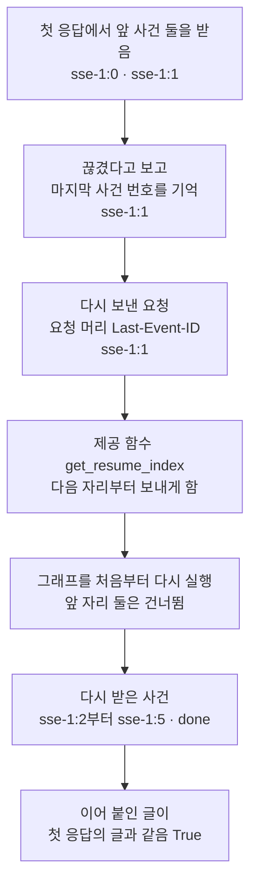
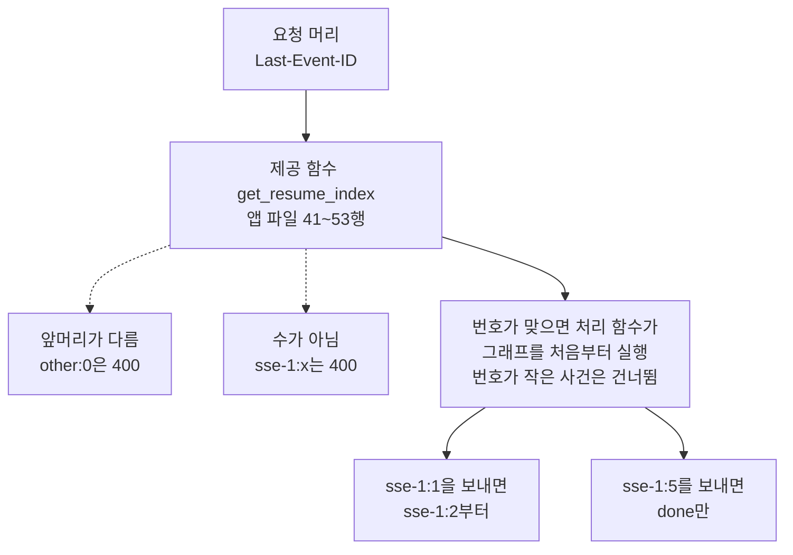
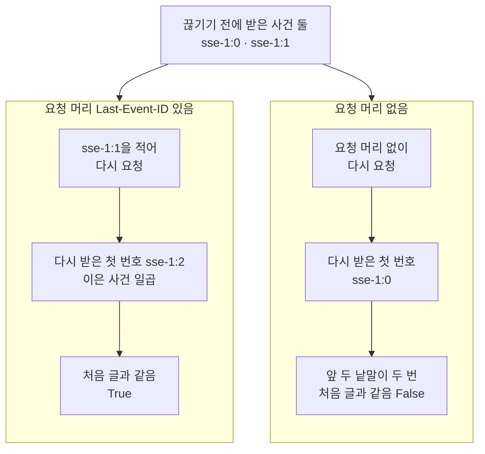
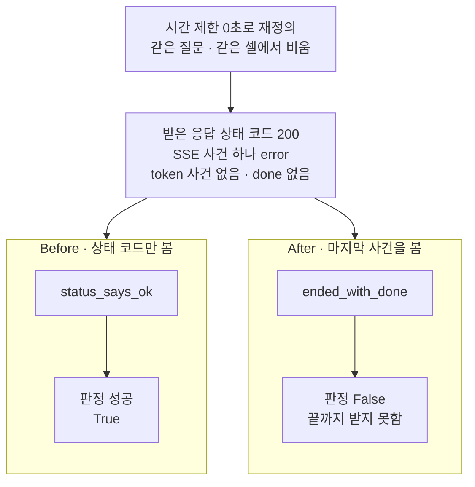

# 06-fetch-재연결과-오류-이벤트

## _src 본문 (HTML 원본)

```html
<!--meta: 강의 1.5h | 실습 2.75h | 코드 notebooks/06-fetch-재연결과-오류-이벤트.ipynb | 새 용어 3 -->
<style>html,body{overflow-x:hidden}.notebook,.nb-cell,.nb-main,.nb-input,.nb-result{min-width:0;max-width:100%}.nb-input pre,.nb-output{box-sizing:border-box;max-width:100%;overflow-x:auto}code.nb-source{display:block!important;width:100%!important;min-width:0!important;overflow-x:auto!important;padding:0!important}</style>
<h2 id="b1"><span class="no">1</span>학습 목표</h2><div class="goal"><ul>
<li>마지막으로 받은 사건 번호를 요청 머리 <code>Last-Event-ID</code>에 적어, 그다음 사건부터 이어 받을 수 있습니다.</li>
<li>이어 받기 요청에도 서버가 그래프를 처음부터 다시 실행한다는 것을 앱 파일의 줄과 출력으로 설명할 수 있습니다.</li>
<li>상태 코드가 200인 응답도 마지막 SSE 사건이 <code>done</code>인지 보고, 오류 사건으로 끝난 응답을 가려낼 수 있습니다.</li>
</ul></div>
<h2 id="b2"><span class="no">2</span>이 내용을 배우는 이유</h2><p><a href="05-POST-SSE-이벤트-설계.html">05절</a>의 SSE 응답은 한 응답 안에 사건을 차례로 적어 보냈습니다. 그런데 네트워크가 끊기면 받는 쪽은 사건을 일부만 받습니다. 처음부터 다시 받으면 이미 받은 글이 두 번 붙습니다. 그래서 어디까지 받았는지 서버에 알리고, 그다음부터 받아야 합니다.</p><p>SSE 응답은 본문을 보내기 전에 상태 코드부터 보냅니다. 그래서 답을 만들다 오류가 나도, 받는 쪽이 받은 상태 코드는 200입니다. 상태 코드만 보는 받는 쪽은 이런 응답을 성공으로 잘못 셉니다. 이 절의 Before가 그 장면입니다.</p><p>제목의 fetch는 브라우저와 Node.js에 들어 있는 함수 이름이고, 웹 화면이 요청을 보낼 때 씁니다. 제목의 재연결은 본문에서 이어 받기라고 부릅니다. 제목의 오류 이벤트는 사건 이름이 <code>error</code>인 SSE 사건이고, 본문에서는 오류 사건이라고 부릅니다.</p>
<h2 id="b3"><span class="no">3</span>앞에서 배운 내용</h2><p><a href="05-POST-SSE-이벤트-설계.html">05절</a>에서는 처리 함수 <code>chat_stream</code>이 보낸 응답 본문을 빈 줄로 나눠 SSE 사건 일곱을 얻었습니다. 사건마다 칸 <code>event</code>의 사건 이름, 칸 <code>id</code>의 사건 번호, 칸 <code>data</code>의 JSON 글이 있었습니다. 사건 번호는 <code>sse-1:0</code>부터 하나씩 커졌고, 끝 사건 <code>done</code>에는 번호가 없었습니다. 그 절의 함수 <code>split_sse</code>와 <code>parse_sse</code>는 이 절부터 도구 파일에서 가져옵니다.</p><p><a href="02-의존성으로-Agent-주입.html">02절</a>에서는 시간 제한 제공 함수 <code>get_timeout</code>을 0초를 내놓는 <code>zero_timeout</code>으로 재정의했습니다. 재정의는 앱 객체에 남아, 지우지 않으면 다음 질문까지 바꿨습니다. 그래서 이 절은 재정의를 적은 셀 안에서 재정의 딕셔너리를 비웁니다. <a href="04-astream과-응답-스트림.html">04절</a>의 함수 <code>join_tokens</code>는 진행 값의 칸 <code>token</code>을 이어 붙였고, 이 절에서도 씁니다.</p><p><a href="../../part6/ch23-persistence/01-체크포인터와-스레드.html">Ch 23 01절</a>에서는 체크포인터가 스레드마다 상태를 저장했습니다. 이 절의 실습 앱은 체크포인터를 쓰지 않아, 요청 본문의 <code>thread_id</code>는 사건 번호의 앞머리와 응답 본문에만 쓰입니다. <a href="../../part6/ch24-human-in-the-loop/01-interrupt-승인-게이트.html">Ch 24 01절</a>에서는 멈춘 노드를 이어 갈 때, 노드가 첫 줄부터 다시 실행되었습니다. 그래서 바깥 쓰기는 <a href="../../part6/ch23-persistence/06-노드-재시작과-멱등성.html">Ch 23 06절</a>의 멱등성을 갖춰, 두 번 실행돼도 한 번만 반영되게 했습니다. 이 절의 서버도 이어 받을 때 그래프를 처음부터 다시 실행하므로, 그래프에 바깥 쓰기가 있으면 같은 원칙이 필요합니다.</p><p><a href="../../part6/ch28-mcp/02-FastMCP-로컬-서버-제작.html">Ch 28 02절</a>에서는 함수 <code>logging.getLogger</code>로 서버 쪽 기록기의 수준을 올렸습니다. 오류 기록이 셀 출력에 섞이지 않게 하려는 줄이었고, 이 절도 앱의 기록기에 같은 줄을 씁니다.</p>
<h2 id="b4"><span class="no">4</span>핵심 개념</h2><h3>비유로 시작하기</h3><p>화물역으로 짐칸 일곱 량짜리 열차가 들어오다가, 앞 두 량이 들어온 뒤 연결이 끊겼습니다. 역은 마지막으로 받은 칸의 번호판을 출발역에 알립니다. 출발역은 열차를 처음부터 다시 꾸린 뒤, 알려 준 번호 다음 칸부터만 보냅니다. 그래서 역에는 같은 칸이 두 번 들어오지 않습니다.</p><p>짐칸 하나가 SSE 사건 하나이고, 번호판이 칸 <code>id</code>의 사건 번호입니다. 역이 알리는 번호가 요청 머리 <code>Last-Event-ID</code>이고, 출발역이 서버입니다. 번호판이 없는 끝 칸은 <code>done</code> 사건입니다.</p><p>비유와 다른 점이 있습니다. 실제 서버는 보낸 칸을 보관하지 않고, 그래프를 다시 실행해 칸을 새로 만듭니다. 또 이 절은 연결을 실제로 끊지 않았고, 첫 응답의 앞 사건 둘을 받은 사건으로 썼습니다.</p>
{{img:06-5-끊긴-자리에서-이어-온-열차|흰 바탕에 선로 두 줄이 왼쪽 아래에서 오른쪽 위로 조금 비스듬히, 위아래로 나란히 놓여 있습니다. 위 선로에는 왼쪽 끝에 크림색 짐칸 둘만 이어져 있고, 오른쪽은 비어 있습니다. 아래 선로에는 짐칸 다섯이 한 줄로 이어져 있고, 왼쪽부터 크림색 짐칸 넷과 오른쪽 끝의 분홍 짐칸 하나입니다. 크림색 짐칸 여섯은 옆면마다 검은 세모 판이 하나씩 있고, 분홍 짐칸에는 판이 없습니다. 기관차·사람·글자·숫자·화살표는 없는 그림|위 선로에는 먼저 온 크림색 칸 둘이, 아래 선로에는 나머지 크림색 칸 넷과 판이 없는 분홍 끝 칸이 이어져 있습니다.}}
<p class="look"><b>그림 읽기</b> — 위 선로 왼쪽 끝에 크림색 짐칸 둘, 아래 선로에 크림색 짐칸 넷과 분홍 짐칸 하나가 있습니다. 크림색 칸마다 옆면에 검은 세모 판이 하나씩 있고, 오른쪽 끝의 분홍 칸에는 판이 없습니다. 위 선로의 두 칸이 끊기기 전에 받은 사건 <code>sse-1:0</code>·<code>sse-1:1</code>이고, 아래 선로가 이어 받은 사건입니다. 세모 판을 단 칸은 두 선로를 합쳐 여섯으로, 끊기지 않은 첫 응답의 token 사건 수와 같고 겹치는 칸이 없습니다. 그림의 세모 판은 모두 같은 모양이지만, 실제 사건 번호는 칸마다 하나씩 커집니다.</p>
<h3>이어 받기와 요청 머리 Last-Event-ID</h3><p>SSE 사건의 칸 <code>id</code>는 받는 쪽이 어디까지 받았는지 적어 둘 번호입니다. 받는 쪽은 번호가 있는 사건을 받을 때마다 그 번호를 기억합니다. 끊긴 뒤 다시 요청할 때 그 번호를 요청 머리 <code>Last-Event-ID</code>에 적으면, 서버가 그다음 사건부터 보냅니다. 웹 표준 문서인 WHATWG의 HTML 표준은 브라우저의 <code>EventSource</code>가 다시 연결할 때 이 요청 머리를 스스로 붙인다고 적습니다.</p><p>이 앱은 요청 방식 POST로 질문을 받습니다. 05절에서 본 것처럼 <code>EventSource</code> 생성자에는 요청 본문을 적을 자리가 없습니다. 그래서 이 앱의 받는 쪽은 함수 <code>fetch</code>로 요청하고, 번호도 직접 기억해 요청 머리에 적습니다.</p>
<table><thead><tr><th>말</th><th>뜻</th></tr></thead><tbody><tr><td>이어 받기(resuming)</td><td>끊긴 뒤 다시 요청할 때, 마지막으로 받은 사건 번호를 함께 보내 그다음 사건부터 받는 일입니다. 책을 덮을 때 책갈피를 꽂아 두고, 다음에 그 쪽부터 펴는 것과 같습니다. 이 절에서는 요청 머리 <code>Last-Event-ID</code>에 <code>sse-1:1</code>을 적자 <code>sse-1:2</code>부터 왔습니다.</td></tr><tr><td>오류 사건</td><td>사건 이름이 <code>error</code>인 SSE 사건입니다. 주문 앱이 주문 접수를 먼저 알린 뒤, 재료가 떨어지면 주문 취소를 따로 알리는 것과 같습니다. 이 절에서는 시간 제한 0초 응답이 상태 코드 200과 오류 사건 하나로 왔습니다.</td></tr><tr><td>함수 fetch</td><td>브라우저와 Node.js에 들어 있는 함수로, 주소에 요청을 보내고 응답을 받아 줍니다. 편지를 부치고, 답장이 오면 봉투를 열어 읽는 일과 같습니다. 이 절에서는 TS 파일 <code>client/stream.ts</code>가 이 함수로 요청 방식 POST를 보내고 응답 본문을 읽습니다.</td></tr></tbody></table>
<p>새 말을 이 절 코드에서 보면 이렇습니다. 요청 머리에 <code>sse-1:1</code>을 적자 다시 받은 첫 사건 번호가 <code>sse-1:2</code>였습니다. 시간 제한 0초 응답은 상태 코드 200에 사건 이름 <code>['error']</code> 하나였습니다. TS 파일 <code>client/stream.ts</code>는 16행에서 같은 요청 머리를 적고, 17행에서 함수 <code>fetch</code>를 부릅니다.</p>
{{mermaid:06-1-끊긴-뒤-번호로-이어-받기|위에서 아래로 읽는 흐름도입니다. 노란 상자 첫 응답에서 앞 사건 둘을 받음 sse-1:0과 sse-1:1에서, 파란 상자 끊겼다고 보고 마지막 사건 번호 sse-1:1을 기억으로 갑니다. 이어서 초록 상자 다시 보낸 요청 요청 머리 Last-Event-ID sse-1:1, 초록 상자 제공 함수 get_resume_index 다음 자리부터 보내게 함, 초록 상자 그래프를 처음부터 다시 실행 앞 자리 둘은 건너뜀을 지납니다. 마지막으로 노란 상자 다시 받은 사건 sse-1:2부터 sse-1:5와 done, 노란 상자 이어 붙인 글이 첫 응답의 글과 같음 True에 닿는 그림|마지막으로 받은 번호 sse-1:1을 요청 머리에 적어 다시 보내자, 서버가 그래프를 다시 실행하고 sse-1:2부터 보냈습니다.}}
<p class="look"><b>도식 읽기</b> — 위에서 아래로 읽습니다. 파란 상자는 노트북에서 우리가 쓴 줄이고, 초록 상자 셋은 보낸 요청과 실습 앱 파일의 줄입니다. 노란 상자 셋은 노트북 2절과 3절의 출력입니다.</p>
<h3>서버가 이어 받을 자리를 정하는 곳</h3><p>실습 앱의 제공 함수 <code>get_resume_index</code>(41~53행)가 요청 머리 <code>Last-Event-ID</code>를 읽습니다. 요청 머리가 없으면 0을, 있으면 쌍점 뒤의 수에 1을 더한 수를 내놓습니다. 번호의 앞머리가 요청 본문의 스레드 이름과 다르거나 쌍점 뒤가 수가 아니면, 상태 코드 400으로 멈춥니다. 설치판 fastapi <code>routing.py</code> 452행이 제공 함수를 먼저 부르므로, 이 400은 응답을 시작하기 전에 나갑니다.</p><p>처리 함수 <code>chat_stream</code>은 107~117행에서 요청마다 자리 번호를 0부터 세며, 그래프를 처음부터 실행합니다. 자리 번호가 이어 받을 자리보다 작은 사건은 보내지 않고 건너뜁니다. FastAPI 문서의 이어 받기 예도 같은 모양으로, 처음부터 세며 앞 자리를 건너뜁니다. 이 절의 그래프는 모델을 쓰지 않아 다시 만든 글이 처음과 같았고, 모델을 부르는 그래프로는 실행하지 않았습니다.</p>
{{mermaid:06-2-요청-머리-Last-Event-ID를-읽는-갈래|위에서 아래로 읽는 흐름도입니다. 초록 상자 요청 머리 Last-Event-ID에서 초록 상자 제공 함수 get_resume_index 앱 파일 41~53행으로 갑니다. 여기서 점선 갈래 둘이 노란 상자 앞머리가 다름 other:0은 400, 노란 상자 수가 아님 sse-1:x는 400으로 가고, 실선이 초록 상자 번호가 맞으면 처리 함수가 그래프를 처음부터 실행 번호가 작은 사건은 건너뜀으로 갑니다. 그 아래로 실선 둘이 갈라져, 서로 다른 요청의 결과인 노란 상자 sse-1:1을 보내면 sse-1:2부터와 노란 상자 sse-1:5를 보내면 done만에 나란히 닿는 그림|제공 함수가 요청 머리를 먼저 읽어 형식이 틀리면 400으로 멈추고, 맞으면 처리 함수가 그래프를 다시 실행하며 앞 사건을 건너뛰었습니다.}}
<p class="look"><b>도식 읽기</b> — 위에서 아래로 읽습니다. 초록 상자는 보낸 요청 머리와 실습 앱 파일의 함수이고, 노란 상자는 노트북 3절의 출력입니다. 점선 두 갈래는 제공 함수가 상태 코드 400으로 멈춘 자리입니다. 맨 아래 노란 상자 둘은 번호가 맞는 서로 다른 요청의 출력이라, 차례로 잇지 않고 나란히 두었습니다.</p>
<h3>상태 코드 200 뒤에 오는 오류 사건</h3><p>SSE 응답은 본문의 첫 사건을 보내기 전에 상태 코드를 먼저 보냅니다. 설치판 starlette 1.6.0 <code>responses.py</code> 248~255행이 상태 코드를 보낸 뒤에 본문을 꺼냅니다. 그래서 그래프를 실행하다 오류가 나면, 서버는 상태 코드를 바꾸지 못합니다. 실습 앱은 119~124행에서 그 오류를 받아, 칸 <code>data</code>에 오류 코드 <code>stream_failed</code>를 담은 오류 사건을 보냅니다.</p><p>MDN 문서는 함수 <code>fetch</code>가 상태 코드 504 같은 오류 응답에도 실패하지 않는다고 적습니다. 받는 쪽이 <code>response.ok</code>나 상태 코드를 직접 봐야 한다는 뜻입니다. 그런데 SSE 응답은 오류가 나도 상태 코드가 200이라, 상태 코드만으로는 모자랍니다. 받는 쪽은 사건 이름까지 보고, 마지막 사건이 <code>done</code>인지로 끝까지 받았는지 가립니다.</p>
<h2 id="b5"><span class="no">5</span>실행 예제</h2><p>노트북 2절은 05절과 같은 질문을 보내고, 첫 응답의 사건 번호를 읽습니다. 앞 사건 둘을 받고 끊겼다고 보고, 마지막 번호 <code>sse-1:1</code>을 기억합니다. 3절은 앱 파일의 제공 함수를 읽고, 그 번호를 요청 머리에 적어 다시 보냅니다. 요청 머리 없이 다시 보낸 경우와, 요청 머리에 값 셋을 넣은 경우도 봅니다. 4절은 TS 파일 <code>client/stream.ts</code>의 줄을 글로 읽습니다.</p><p>모델 요청은 0번이고, API 키 없이 실행합니다. 서버 프로그램을 띄우지 않아 네트워크와 포트, 자식 프로세스를 쓰지 않습니다. 연결을 실제로 끊지 않고, 첫 응답의 앞 사건 둘을 받은 사건으로 씁니다. TS 파일은 노트북에서 실행하지 않았고, 걸린 시간은 재지 않았습니다.</p>
{{notebook:06-fetch-재연결과-오류-이벤트|example}}
<p class="look"><b>확인할 점</b> — 노트북 2절에서 <code>받은 마지막 사건 번호: sse-1:1</code>을 찾습니다. 3절에서 <code>다시 받은 첫 사건 번호: sse-1:2</code>와 <code>끊기지 않은 첫 응답의 글과 같은가: True</code>를 봅니다. 요청 머리 없이 다시 보낸 셀의 <code>끊기지 않은 첫 응답의 글과 같은가: False</code>와, 값 셋에 대한 서버의 답도 확인합니다.</p>
{{mermaid:06-3-Last-Event-ID가-있을-때와-없을-때|맨 위에 노란 상자 끊기기 전에 받은 사건 둘 sse-1:0과 sse-1:1이 있고, 그 아래 칸 둘이 나란히 놓여 있습니다. 왼쪽 칸 요청 머리 Last-Event-ID 있음에는 파란 상자 sse-1:1을 적어 다시 요청, 노란 상자 다시 받은 첫 번호 sse-1:2 이은 사건 일곱, 노란 상자 처음 글과 같음 True가 위에서 아래로 있습니다. 오른쪽 칸 요청 머리 없음에는 파란 상자 요청 머리 없이 다시 요청, 노란 상자 다시 받은 첫 번호 sse-1:0, 노란 상자 앞 두 낱말이 두 번 처음 글과 같음 False가 위에서 아래로 있는 그림|받은 번호를 요청 머리에 적으면 이어 붙인 글이 처음 글과 같았고, 적지 않으면 앞 두 낱말이 두 번 붙었습니다.}}
<p class="look"><b>도식 읽기</b> — 맨 위 노란 상자는 두 칸이 함께 쓰는, 끊기기 전에 받은 사건입니다. 왼쪽 칸이 요청 머리를 적은 요청, 오른쪽 칸이 적지 않은 요청이고, 칸마다 맨 위 파란 상자가 우리가 쓴 줄입니다. 노란 상자는 노트북 3절의 출력이고, 이 그림은 Before가 아니라 빨강을 쓰지 않았습니다.</p>
<h2 id="b6"><span class="no">6</span>일부러 실패해 보기</h2><p>아래 Before 셀은 시간 제한을 0초로 재정의하고, 2절과 같은 질문을 보냅니다. 받은 응답을 상태 코드만 보고 성공인지 판정합니다. After 셀은 같은 응답을, 마지막 SSE 사건의 이름이 <code>done</code>인지로 판정합니다. 두 판은 같은 요청과 응답을 쓰고, 다른 것은 판정 함수 하나입니다.</p>
{{notebook:06-fetch-재연결과-오류-이벤트|failure}}
{{mermaid:06-4-상태-코드만-본-판정과-마지막-사건을-본-판정|맨 위에 파란 상자 시간 제한 0초로 재정의 같은 질문 같은 셀에서 비움이 있고, 노란 상자 받은 응답 상태 코드 200 SSE 사건 하나 error token 사건 없음 done 없음으로 이어집니다. 그 아래 칸 둘이 나란히 놓여 있습니다. 왼쪽 칸 Before 상태 코드만 봄에는 파란 상자 status_says_ok에서 빨간 상자 판정 성공 True로 이어집니다. 오른쪽 칸 After 마지막 사건을 봄에는 파란 상자 ended_with_done에서 노란 상자 판정 False 끝까지 받지 못함으로 이어지는 그림|같은 0초 응답을 상태 코드만 본 판정은 성공으로 셌고, 마지막 사건을 본 판정은 끝까지 받지 못했다고 가렸습니다.}}
<p class="look"><b>도식 읽기</b> — 맨 위 파란 상자와 노란 상자는 두 판이 함께 쓰는 요청과 응답이고, 노트북에서는 한 번 보냈습니다. 왼쪽 칸이 Before, 오른쪽 칸이 After이고, 칸마다 위가 우리가 쓴 판정 함수, 아래가 그 판정 값입니다. 빨간 상자 하나가 Before 결함 결과이고, 노란 상자는 노트북 5절·6절의 출력입니다.</p>
<table><thead><tr><th>견준 것</th><th>Before(상태 코드만 봄)</th><th>After(마지막 사건을 봄)</th></tr></thead><tbody><tr><td>받는 쪽이 보는 것</td><td>상태 코드</td><td>마지막 SSE 사건의 사건 이름</td></tr><tr><td>판정 함수</td><td><code>status_says_ok</code></td><td><code>ended_with_done</code></td></tr><tr><td>시간 제한 0초 응답(사건 <code>error</code> 하나)</td><td><code>True</code> — 성공으로 셈</td><td><code>False</code> — 끝까지 받지 못함</td></tr><tr><td>2절 첫 응답(사건 일곱, 끝이 <code>done</code>)</td><td><code>True</code></td><td><code>True</code></td></tr><tr><td>7절 범위 밖 번호 응답(사건 <code>done</code> 하나)</td><td>상태 코드 <code>200</code>(판정 함수는 부르지 않음)</td><td><code>True</code> — token 사건이 없어도 통과</td></tr></tbody></table>
<p>시간 제한 0초 응답은 상태 코드 200이었지만, SSE 사건은 오류 사건 하나뿐이었습니다. 답의 글은 한 낱말도 오지 않았고, <code>done</code>도 없었습니다. 상태 코드만 본 Before 판정은 이 응답을 성공으로 셌습니다. 받는 쪽이 이 판정을 믿으면, 빈 답을 끝난 답으로 화면에 둡니다.</p><p>After 판정은 같은 응답을 끝까지 받지 못했다고 가렸습니다. 끝까지 받은 2절 첫 응답은 두 판정 모두 <code>True</code>였습니다. 그래서 After 판정은 끝까지 받은 응답을 실패로 잘못 세지 않습니다. 오류 사건의 칸 <code>data</code>에는 오류 코드 <code>stream_failed</code>가 있어, 받는 쪽이 까닭을 가를 수 있습니다.</p><p>노트북 7절에서 요청 머리의 번호만 범위 밖 <code>sse-1:99</code>로 바꾸자, 사건은 <code>done</code> 하나였습니다. After 판정은 <code>True</code>였고, token 사건은 하나도 없었습니다. 끝까지 받은 번호 <code>sse-1:5</code>를 보냈을 때와 받는 쪽에서 본 모양이 같습니다. 이 앱의 제공 함수는 번호가 범위 안인지 검사하지 않고, After 판정도 그것까지 보지는 못합니다.</p>
<p>새 커널로 두 번 실행해 견주자, 코드 셀의 출력이 셀마다 모두 같았습니다. 한 번은 프로젝트 맨 위에서, 한 번은 <code>notebooks/</code> 폴더에서 연 커널이었습니다. 노트북 밖에서도 같은 장면을 파이썬 파일로 다섯 번 실행해, 출력이 모두 같았습니다. 모델을 부르지 않아, 사건의 차례와 두 판정의 값은 앱과 그래프의 코드가 정합니다.</p>
<p class="look"><b>확인할 점</b> — 5절에서 <code>상태 코드만 본 판정(성공인가): True</code>와 <code>받은 사건 이름: ['error']</code>를 봅니다. 6절에서 <code>0초 응답 | True | False</code>와 <code>첫 응답 | True | True</code>를 확인합니다. 7절에서는 <code>받은 사건 이름: ['done']</code>인데 <code>마지막 사건이 done인가: True</code>인지 봅니다.</p>
<h2 id="b7"><span class="no">7</span>주의할 점과 실무 메모</h2><ul><li>시험용 클라이언트는 앱이 응답을 다 보낸 뒤 본문을 한꺼번에 줍니다. 그래서 이 절은 연결을 실제로 끊지 못했고, 첫 응답의 앞 사건 둘을 받은 사건으로 썼습니다. 사건마다 도착한 때도 이 절 결과로는 말할 수 없습니다.</li><li>이어 받기 요청마다 서버는 그래프를 처음부터 다시 실행합니다. 모델을 부르는 그래프라면 다시 만든 글이 처음과 달라, 이어 붙인 글이 어긋날 수 있습니다. 이 절에서는 그런 그래프로 실행하지 않았습니다. 보낸 사건을 저장해 두었다가 다시 보내는 방법도 실행하지 않았습니다.</li><li>Ch 31은 PostgreSQL 데이터베이스에 표를 만들어 쓰는 방법과 체크포인터를 다룹니다. 보낸 SSE 사건을 저장하는 방법은 Ch 31에서도 다루지 않습니다.</li><li>그래프 안에 결제처럼 바깥에 쓰는 일이 있으면, 이어 받을 때마다 그 일이 다시 실행됩니다. Ch 23 06절의 멱등성처럼, 두 번 실행돼도 한 번만 반영되게 적어야 합니다. 이 절의 그래프에는 바깥 쓰기가 없어 실행하지 않았습니다.</li><li>이 앱은 범위 밖 번호를 검사하지 않고, <code>done</code>만 보냅니다. 번호의 뒤 수가 음수인 경우는 이 노트북에서 넣어 보지 않았습니다. 노트북 밖에서 <code>sse-1:-1</code>을 보내자, 사건 일곱이 모두 다시 왔습니다.</li><li>함수 <code>split_sse</code>와 <code>parse_sse</code>는 FastAPI가 적는 모양만 다룹니다. 줄 끝이 <code>\r\n</code>인 글이나, 쌍점으로 시작하는 쉼 신호 줄 <code>: ping</code>은 다루지 않습니다. TS 파일 28행은 <code>\r\n</code>도 나누지만, 함수 <code>decodeBlock</code>은 칸마다 첫 줄만 읽습니다.</li><li>기록기 수준을 올린 줄은 교재 출력에 오류 기록이 섞이지 않게 하려는 줄입니다. 앱을 실제로 돌릴 때는 기록을 남겨 두어야 오류의 까닭을 찾을 수 있습니다.</li><li>서버를 띄우는 명령과 TS 시험을 실행하는 명령은 실습 폴더 README에 있습니다. 교재를 만들 때는 노트북 밖에서 uvicorn으로 서버를 <code>127.0.0.1</code>에 띄웠습니다. 그다음 Node.js 22.23.2가 TS 파일을 바로 읽는 명령 <code>node client/test_stream.ts</code>로 이 시험 파일을 실행해 통과했습니다. 시험 파일의 오류 확인은 질문에 「오류」가 들어 있으면 그래프가 일부러 예외를 일으키는 교재용 줄(<code>agent.py</code> 18~19행)을 씁니다. 이 절의 Before는 그 줄 대신 시간 제한 0초를 썼습니다.</li><li>걸린 시간은 재지 않았습니다. 교재 출력은 Linux의 Python 3.12.13으로 만들었고, 다른 판과 Windows·macOS에서는 실행하지 않았습니다.</li></ul>
<h2 id="b8"><span class="no">8</span>정리와 다음 절</h2><ul><li>요청 머리 <code>Last-Event-ID</code>에 받은 마지막 번호를 적자, 서버가 다음 번호부터 보내 이어 붙인 글이 처음 글과 같았습니다.</li><li>시간 제한 0초 응답은 상태 코드 200이었지만 사건은 <code>error</code> 하나뿐이라, 상태 코드만 본 판정은 틀렸습니다.</li><li>마지막 사건이 <code>done</code>인지 보는 판정은 이 응답을 가려냈지만, 범위 밖 번호에 온 <code>done</code>까지 가리지는 못했습니다.</li></ul><p><strong>다음 학습과 이어지는 지점</strong> — <a href="07-인증-CORS-타임아웃.html">07절</a>에서는 접근 토큰 검사와 다른 출처의 요청을 다루는 설정, 시간 제한을 함께 봅니다.</p>
<h2 id="b9"><span class="no">9</span>복습 문제</h2><details class="quiz" open><summary>문제 5개 · 해설 포함</summary><p class="quiz-q">1. 앞 사건 둘을 받고 끊겼을 때, 요청 머리 <code>Last-Event-ID</code>에는 어떤 값을 적나요?</p><p class="quiz-a">마지막으로 받은 사건의 번호 <code>sse-1:1</code>을 적습니다. 서버는 그다음 자리부터 보내, 다시 받은 첫 번호가 <code>sse-1:2</code>였습니다. 틀렸다면 노트북 2절과 3절을 다시 읽습니다.</p><p class="quiz-q">2. 요청 머리를 적지 않고 다시 요청해, 받은 사건 둘에 이어 붙이면 어떻게 되나요?</p><p class="quiz-a">서버가 <code>sse-1:0</code>부터 다시 보내, 앞 두 낱말이 두 번 붙습니다. 이 절에서는 이어 붙인 글이 첫 응답의 글과 같지 않았습니다. 틀렸다면 노트북 3절을 다시 읽습니다.</p><p class="quiz-q">3. 동료가 「이어 받기 요청이면 서버는 남은 사건만 계산한다」고 말합니다. 맞나요?</p><p class="quiz-a">맞지 않습니다. 앱 107~117행은 요청마다 그래프를 처음부터 실행하고, 자리 번호가 작은 사건을 보내지 않고 건너뜁니다. 그래서 모델을 부르는 그래프라면 다시 만든 글이 달라질 수 있습니다. 틀렸다면 노트북 3절을 다시 읽습니다.</p><p class="quiz-q">4. 시간 제한 0초 응답의 상태 코드가 200이었던 까닭은 무엇인가요?</p><p class="quiz-a">SSE 응답은 본문을 보내기 전에 상태 코드를 먼저 보내기 때문입니다. 그 뒤에 난 오류는 앱이 받아 오류 사건으로 보냈고, 상태 코드는 바뀌지 않았습니다. 틀렸다면 노트북 5절을 다시 읽습니다.</p><p class="quiz-q">5. 마지막 사건이 <code>done</code>인지 보는 판정으로도 가려내지 못한 응답은 무엇이었나요?</p><p class="quiz-a">범위 밖 번호 <code>sse-1:99</code>를 보낸 응답입니다. token 사건 없이 <code>done</code> 하나만 와서, 판정이 <code>True</code>였습니다. 틀렸다면 노트북 7절을 다시 읽습니다.</p></details>
<h2 id="b10"><span class="no">10</span>참고 자료</h2><ul><li><div><a href="https://html.spec.whatwg.org/multipage/server-sent-events.html">HTML Standard Server-sent events</a></div>확인 2026-09-29 · 다시 연결할 때 마지막 사건 번호가 비어 있지 않으면 요청 머리 <code>Last-Event-ID</code>에 담는다고 적습니다. 칸 <code>id</code>가 없는 사건은 앞에서 본 번호를 이어 쓴다고 적습니다. 상태 코드가 200이 아니거나 본문 종류가 다르면 다시 연결하지 않는다고 적습니다.</li><li><div><a href="https://fastapi.tiangolo.com/tutorial/server-sent-events/">FastAPI Server-Sent Events (SSE)</a></div>확인 2026-09-29 · 브라우저가 끊긴 뒤 다시 연결하면 마지막 번호를 요청 머리 <code>Last-Event-ID</code>로 보낸다고 적습니다. 요청 머리 매개변수로 읽어, 처음부터 세며 앞 자리를 건너뛰는 예를 보입니다. 어느 요청 방식에서나 SSE가 된다고도 적습니다.</li><li><div><a href="https://developer.mozilla.org/en-US/docs/Web/API/Window/fetch">MDN Window: fetch() method</a></div>확인 2026-09-29 · 최종 수정 2025-12-16 · 함수 <code>fetch</code>는 응답이 오면 <code>Response</code> 객체를 내놓는다고 적습니다. 404·504 같은 오류 응답에는 실패하지 않아, <code>Response.ok</code>나 상태 코드를 봐야 한다고 적습니다.</li><li><div><a href="https://developer.mozilla.org/en-US/docs/Web/API/Response/body">MDN Response: body property</a></div>확인 2026-09-29 · 최종 수정 2025-03-13 · 응답 본문을 <code>ReadableStream</code>으로 내놓는다고 적습니다.</li><li><div><a href="https://developer.mozilla.org/en-US/docs/Web/API/Server-sent_events/Using_server-sent_events">MDN Using server-sent events</a></div>확인 2026-09-29 · 최종 수정 2026-09-03 · 칸 <code>id</code>는 <code>EventSource</code>의 마지막 사건 번호가 된다고 적습니다.</li><li>설치판 fastapi 0.135.0 소스 <code>routing.py</code> 452행이 제공 함수를 먼저 부릅니다. 491~493행은 그 뒤에 SSE 처리 함수를 부릅니다. 설치판 starlette 1.6.0 <code>responses.py</code> 248~255행은 상태 코드를 보낸 뒤 본문을 꺼냅니다.</li><li>설치판 Python 3.12.13 <code>asyncio/timeouts.py</code> 68~69행은 정한 때가 지났으면 곧바로 취소를 겁니다. 112~115행은 그 취소를 오류 <code>TimeoutError</code>로 바꿉니다.</li><li>실습 폴더 <code>agent_service/app.py</code> 18행은 기록기, 41~53행은 제공 함수 <code>get_resume_index</code>입니다. 107~117행은 자리 번호를 세며 건너뛰고, 118행은 <code>done</code>, 119~124행은 오류 사건을 보냅니다. <code>agent.py</code> 43행은 체크포인터 없이 그래프를 만듭니다.</li><li>실습 폴더 <code>client/stream.ts</code> 11~37행은 함수 <code>fetch</code>로 SSE 사건을 읽는 TS 함수입니다. 시험 파일 <code>client/test_stream.ts</code>는 첫 번호·끝 사건 <code>done</code>·이어 받은 첫 번호·오류 사건을 확인합니다.</li></ul>
```

## 노트북 셀 (순서대로)

### [0] markdown {'html': 'skip'}

# fetch 재연결과 오류 이벤트

**이 노트북에서 할 일**

1. 요청 머리 `Last-Event-ID`에 마지막으로 받은 사건 번호를 적어, 그다음 사건부터 이어 받습니다.
2. 시간 제한을 0초로 바꾼 응답에서, 상태 코드만 보는 판정이 놓치는 것을 봅니다.
3. 마지막 SSE 사건의 이름이 `done`인지 보는 판정으로 고칩니다.

**준비물** — 이 노트북은 모델을 부르지 않습니다.
모델 요청은 0번이고, API 키 없이 실행합니다.
예상 비용도 0달러입니다.
실습 앱의 에이전트 그래프는 모델을 쓰지 않고, 정해 둔 말로 답합니다.
그래서 다시 실행해도 같은 값이 나와야 합니다.

요청은 시험용 클라이언트로 같은 노트북 안에서 보냅니다.
서버 프로그램을 띄우지 않고, 네트워크와 포트를 쓰지 않습니다.
실습 폴더의 파일을 가져오고 읽기만 하며, 쓰는 파일은 없습니다.

걸린 시간은 재지 않았습니다.
앞 절에서 배운 함수 넷은 도구 파일 `serve_tools.py`에서 가져옵니다.
TS 파일 `client/stream.ts`는 글로 읽기만 하고, 이 노트북에서 실행하지 않습니다.

**기준 버전** — 첫 셀에서 패키지 여섯을 설치합니다.
판은 fastapi 0.135.0, httpx 0.28.1, pydantic 2.12.5, starlette 1.6.0입니다.
패키지 langgraph 1.2.11과 langchain 1.4.0은 실습 앱 파일이 가져오는 패키지입니다.
여섯 모두 실습 폴더 잠금과 같은 판입니다.

교재 출력은 Linux의 Python 3.12.13으로 만들었습니다.
다른 판과 Windows·macOS에서는 실행하지 않았습니다.

**강의와 실습 범위** — 강의 시간에는 2~4절을 읽고, 5절과 6절의 Before·After를 함께 봅니다.
7절은 넣는 값 하나를 바꿔 보는 실습이고, 실습 시간에 실행합니다.

실습 폴더 `labs/part7/ch30-fastapi-serving`에서 `uv sync --locked`를 실행합니다.
그다음 `notebooks/` 폴더의 이 노트북을 열고, 실습 폴더의 `.venv` 커널을 고릅니다.
첫 셀부터 순서대로 실행합니다.

### [1] markdown {'html': 'skip'}

## 오늘 볼 그림


위에서 아래로 읽습니다.
파란 상자는 노트북에서 우리가 쓴 줄이고, 초록 상자 셋은 보낸 요청과 실습 앱 파일의 줄입니다.
노란 상자 셋은 노트북 2절과 3절의 출력입니다.

### [2] markdown {}

## 1. 준비

05절에서는 처리 함수 `chat_stream`이 보낸 응답 글을 SSE 사건 일곱으로 나눠 읽었습니다.
이 절은 연결이 끊긴 뒤 사건 번호로 이어 받는 방법과, 오류 사건을 받는 쪽의 판정을 봅니다.
제목의 fetch는 브라우저와 Node.js에 들어 있는 함수 이름이고, 4절에서 봅니다.
제목의 재연결은 이 절에서 이어 받기라고 부르고, 제목의 오류 이벤트는 오류 사건이라고 부릅니다.

첫 셀은 패키지 여섯을 설치하고 설치된 판 번호를 출력합니다.
설치에는 몇십 초가 걸릴 수 있습니다.

### [3] code {'execution': {'iopub.execute_input': '2026-09-29T09:32:31.477547Z', 'iopub.status.busy': '2026-09-29T09:32:31.477376Z', 'iopub.status.idle': '2026-09-29T09:32:32.154953Z', 'shell.execute_reply': '2026-09-29T09:32:32.154312Z'}, 'lesson_role': 'setup'}

```python
# 이 절에서 쓰는 패키지를 설치하고 버전을 확인합니다
%pip install -q "fastapi==0.135.0" "httpx==0.28.1" "pydantic==2.12.5" "starlette==1.6.0" "langgraph==1.2.11" "langchain==1.4.0"
from importlib.metadata import version

print("fastapi:", version("fastapi"))
print("httpx:", version("httpx"))
print("pydantic:", version("pydantic"))
print("starlette:", version("starlette"))
print("langgraph:", version("langgraph"))
print("langchain:", version("langchain"))
```

출력:
```
Note: you may need to restart the kernel to use updated packages.
fastapi: 0.135.0
httpx: 0.28.1
pydantic: 2.12.5
starlette: 1.6.0
langgraph: 1.2.11
langchain: 1.4.0

```

### [4] markdown {}

**결과 읽기** — 출력 줄 `fastapi: 0.135.0`과 `langgraph: 1.2.11`이 보입니다.
여섯 모두 실습 폴더 잠금과 같은 판이고, 05절과 같은 목록입니다.
이 절은 모델 객체를 만들지 않아, API 키를 확인하는 셀도 없습니다.

다음 셀은 이 절에서 쓸 이름을 가져옵니다.
모듈 `logging`은 앱이 남기는 기록을 다룰 때 씁니다.
마지막 가져오기 줄은 앞 절에서 배운 함수 넷을 도구 파일에서 가져옵니다.

### [5] code {'execution': {'iopub.execute_input': '2026-09-29T09:32:32.156103Z', 'iopub.status.busy': '2026-09-29T09:32:32.155993Z', 'iopub.status.idle': '2026-09-29T09:32:32.368150Z', 'shell.execute_reply': '2026-09-29T09:32:32.367803Z'}, 'lesson_role': 'setup'}

```python
# 이 절에서 쓸 이름을 가져옵니다(os·json·logging은 Python에 들어 있는 모듈입니다)
import os
import json
import logging
from fastapi.testclient import TestClient
# 02·04·05절에서 배운 함수 넷은 도구 파일에서 가져옵니다
from serve_tools import join_tokens, parse_sse, split_sse, zero_timeout

print("가져온 이름:", "json, logging, TestClient")
print("도구 파일에서 가져온 함수:", "join_tokens, parse_sse, split_sse, zero_timeout")
```

출력:
```
가져온 이름: json, logging, TestClient
도구 파일에서 가져온 함수: join_tokens, parse_sse, split_sse, zero_timeout

```

### [6] markdown {}

**결과 읽기** — 출력 줄 `도구 파일에서 가져온 함수: join_tokens, parse_sse, split_sse, zero_timeout`이 보입니다.
함수 `zero_timeout`은 02절, `join_tokens`는 04절, `split_sse`와 `parse_sse`는 05절에서 배웠습니다.
네 함수 모두 그 절 노트북의 셀을 주석과 본문 그대로 옮겼습니다.
도구 파일에는 04절이 옮긴 Ch 25 함수 둘도 있지만, 이 절에서는 쓰지 않습니다.

앞에서 배운 함수는 `serve_tools.py`에 모아 두었습니다.
파일을 열면 코드를 볼 수 있습니다.
노트북과 같은 폴더(`notebooks/`)에 있는 파일입니다.
커널이 `notebooks/` 폴더에서 시작해야 이 파일을 가져올 수 있습니다.
교재 출력을 만든 실행 도구는 이 폴더를 따로 알려 주어, 다른 자리에서 시작해도 가져오기가 되었습니다.

다음 셀은 01절 2절과 같은 파일 위치 셀로, 후보 셋 가운데 실습 폴더를 고릅니다.

### [7] code {'execution': {'iopub.execute_input': '2026-09-29T09:32:32.368943Z', 'iopub.status.busy': '2026-09-29T09:32:32.368873Z', 'iopub.status.idle': '2026-09-29T09:32:32.371181Z', 'shell.execute_reply': '2026-09-29T09:32:32.370865Z'}}

```python
# 노트북을 연 자리에서 본 실습 폴더의 위치를 후보 셋 가운데에서 고릅니다
candidates = ["..", ".", "labs/part7/ch30-fastapi-serving"]
lab_path = None
for candidate in candidates:
    if os.path.exists(candidate + "/agent_service/schemas.py"):
        lab_path = candidate
        break
print("실습 폴더를 찾았는가:", lab_path is not None)
assert lab_path is not None, "notebooks 폴더나 실습 폴더 맨 위에서 노트북을 열어 주세요."
```

출력:
```
실습 폴더를 찾았는가: True

```

### [8] markdown {}

**결과 읽기** — 출력 줄 `실습 폴더를 찾았는가: True`가 보입니다.
고른 후보는 연 자리마다 달라서 출력하지 않습니다.
실습 폴더 맨 위에서 연 커널은 이 안내를 보기 전에, 앞 셀의 도구 파일 가져오기에서 먼저 멈춥니다.

다음 셀은 05절처럼 작업 폴더를 실습 폴더로 옮긴 뒤 이름을 가져옵니다.
앱 파일에서 앱 객체 `app`과 시간 제한 제공 함수 `get_timeout`을 가져옵니다.
그래프 파일에서는 에이전트 그래프 `agent`를 가져와, 체크포인터가 있는지 봅니다.

### [9] code {'execution': {'iopub.execute_input': '2026-09-29T09:32:32.371812Z', 'iopub.status.busy': '2026-09-29T09:32:32.371756Z', 'iopub.status.idle': '2026-09-29T09:32:32.873164Z', 'shell.execute_reply': '2026-09-29T09:32:32.872717Z'}}

```python
# 작업 폴더를 실습 폴더로 옮기고, 그래프·앱 객체·시간 제한 제공 함수를 가져옵니다
os.chdir(lab_path)
from agent_service.agent import agent
from agent_service.app import app, get_timeout
print("가져온 앱 객체의 종류:", type(app).__name__)
print("재정의 딕셔너리의 키 수:", len(app.dependency_overrides))
print("그래프의 체크포인터:", agent.checkpointer)
```

출력:
```
가져온 앱 객체의 종류: FastAPI
재정의 딕셔너리의 키 수: 0
그래프의 체크포인터: None

```

### [10] markdown {}

**결과 읽기** — 출력 줄 `가져온 앱 객체의 종류: FastAPI`와 `재정의 딕셔너리의 키 수: 0`이 보입니다.
출력 줄 `그래프의 체크포인터: None`은 이 그래프에 체크포인터가 없다는 뜻입니다.
Ch 23 01절의 체크포인터는 스레드마다 상태를 저장했지만, 이 앱은 상태를 저장하지 않습니다.
그래서 요청 본문의 `thread_id`는 사건 번호의 앞머리와 응답 본문에만 쓰입니다.

5절에서는 시간 제한을 넘긴 앱이 오류를 기록합니다.
앱 파일 18행이 만든 기록기는 그 기록을 여러 줄로 표준 오류에 남기고, 기록에는 파일 위치가 들어 있습니다.
다음 셀은 그 기록이 셀 출력에 섞이지 않게, 기록기의 수준을 올립니다.

### [11] code {'execution': {'iopub.execute_input': '2026-09-29T09:32:32.873958Z', 'iopub.status.busy': '2026-09-29T09:32:32.873903Z', 'iopub.status.idle': '2026-09-29T09:32:32.875608Z', 'shell.execute_reply': '2026-09-29T09:32:32.875295Z'}}

```python
# 앱의 오류 기록이 셀 출력에 섞이지 않게, 이름이 agent_service.app인 기록기의 수준을 올립니다
app_logger = logging.getLogger("agent_service.app")
app_logger.setLevel(logging.CRITICAL)
print("앱 기록기의 수준:", logging.getLevelName(app_logger.level))
```

출력:
```
앱 기록기의 수준: CRITICAL

```

### [12] markdown {}

**결과 읽기** — 출력 줄 `앱 기록기의 수준: CRITICAL`이 보입니다.
함수 `logging.getLogger`는 Ch 28 02절에서 본 것처럼, 이름으로 기록기(logger)를 찾아 내놓습니다.
기록기는 정한 수준보다 낮은 기록을 남기지 않고, 이제 가장 높은 수준의 기록만 남깁니다.
앱 120행의 오류 기록은 그보다 낮은 수준이라 셀 출력에 나오지 않습니다.
막은 것은 기록뿐이고, 앱이 보내는 응답은 바뀌지 않습니다.

막지 않으면 5절의 요청 하나에 기록이 25줄 나왔고, 파일 위치가 든 줄도 있었습니다.
줄 수는 노트북 밖의 작은 스크립트로 확인했습니다.

## 2. 첫 응답의 사건 번호

05절에서 본 것처럼 SSE 사건에는 칸 `id`의 사건 번호가 있습니다.
다음 셀은 05절과 같은 질문을 보내고, 상태 코드와 SSE 사건 수를 봅니다.
함수 `split_sse`는 도구 파일에서 가져온 05절 함수입니다.

### [13] code {'execution': {'iopub.execute_input': '2026-09-29T09:32:32.876159Z', 'iopub.status.busy': '2026-09-29T09:32:32.876101Z', 'iopub.status.idle': '2026-09-29T09:32:32.890697Z', 'shell.execute_reply': '2026-09-29T09:32:32.890305Z'}}

```python
# 시험용 클라이언트로 05절과 같은 질문을 보내고, 상태 코드와 SSE 사건 수를 봅니다
client = TestClient(app)
auth_headers = {"Authorization": "Bearer local-demo-token"}
question_body = {"question": "반납 기한을 알려 주세요", "thread_id": "sse-1"}
first_response = client.post("/v1/chat/stream", json=question_body, headers=auth_headers)
first_texts = split_sse(first_response.text)
print("상태 코드:", first_response.status_code)
print("SSE 사건 수:", len(first_texts))
```

출력:
```
상태 코드: 200
SSE 사건 수: 7

```

### [14] markdown {}

**결과 읽기** — 출력 줄 `상태 코드: 200`과 `SSE 사건 수: 7`이 보입니다.
05절과 같은 질문이라, 사건 수도 05절과 같은 일곱입니다.

다음 셀은 응답 본문 글을 받아, SSE 사건마다 칸 딕셔너리로 바꾼 목록을 내놓는 함수를 정의합니다.
05절에서 두 셀로 나눠 했던 일을 함수 하나로 묶습니다.

### [15] code {'execution': {'iopub.execute_input': '2026-09-29T09:32:32.891392Z', 'iopub.status.busy': '2026-09-29T09:32:32.891323Z', 'iopub.status.idle': '2026-09-29T09:32:32.893097Z', 'shell.execute_reply': '2026-09-29T09:32:32.892707Z'}}

```python
# 응답 본문 글을 SSE 사건으로 나누고, 사건마다 칸 딕셔너리로 바꾼 목록을 내놓습니다
def read_events(body_text):
    events = []
    for sse_text in split_sse(body_text):
        events.append(parse_sse(sse_text))
    return events
```

출력:
```

```

### [16] markdown {}

**결과 읽기** — 정의 셀이라 출력이 없습니다.
함수 안에서 `split_sse`로 사건 글을 나누고, `parse_sse`로 사건마다 칸 딕셔너리를 만듭니다.

다음 셀은 칸 딕셔너리 목록에서 사건 이름만 모아 내놓는 함수를 정의합니다.

### [17] code {'execution': {'iopub.execute_input': '2026-09-29T09:32:32.893618Z', 'iopub.status.busy': '2026-09-29T09:32:32.893568Z', 'iopub.status.idle': '2026-09-29T09:32:32.895366Z', 'shell.execute_reply': '2026-09-29T09:32:32.894978Z'}}

```python
# 칸 딕셔너리 목록에서, 사건마다 칸 event의 사건 이름을 모은 목록을 내놓습니다
def event_names(events):
    names = []
    for fields in events:
        names.append(fields["event"])
    return names
```

출력:
```

```

### [18] markdown {}

**결과 읽기** — 정의 셀이라 출력이 없습니다.
받은 사건의 차례를 한 줄로 볼 때 씁니다.

다음 셀은 첫 응답을 읽어, 사건 이름 목록과 첫 사건·마지막 사건의 칸을 출력합니다.

### [19] code {'execution': {'iopub.execute_input': '2026-09-29T09:32:32.895853Z', 'iopub.status.busy': '2026-09-29T09:32:32.895807Z', 'iopub.status.idle': '2026-09-29T09:32:32.897665Z', 'shell.execute_reply': '2026-09-29T09:32:32.897363Z'}}

```python
# 첫 응답을 칸 딕셔너리 목록으로 읽고, 사건 이름과 첫 사건·마지막 사건을 출력합니다
first_events = read_events(first_response.text)
print("사건 이름:", event_names(first_events))
print("첫 사건:", first_events[0])
print("마지막 사건:", first_events[-1])
```

출력:
```
사건 이름: ['token', 'token', 'token', 'token', 'token', 'token', 'done']
첫 사건: {'event': 'token', 'data': '{"token": "\\uc9c8\\ubb38\\uc744 "}', 'id': 'sse-1:0'}
마지막 사건: {'event': 'done', 'data': '{"thread_id": "sse-1"}'}

```

### [20] markdown {}

**결과 읽기** — 출력 줄 `사건 이름: ['token', 'token', 'token', 'token', 'token', 'token', 'done']`이 보입니다.
첫 사건의 칸에는 `'id': 'sse-1:0'`이 있고, 마지막 사건 `done`에는 칸 `id`가 없습니다.
사건 번호는 스레드 이름 `sse-1`과 자리 번호를 쌍점으로 이은 글입니다.

받는 쪽이 이어 받으려면, 마지막으로 받은 사건 번호를 기억해야 합니다.
다음 셀은 칸 딕셔너리 목록에서, 칸 `id`가 있는 마지막 사건의 번호를 내놓는 함수를 정의합니다.

### [21] code {'execution': {'iopub.execute_input': '2026-09-29T09:32:32.898233Z', 'iopub.status.busy': '2026-09-29T09:32:32.898190Z', 'iopub.status.idle': '2026-09-29T09:32:32.899655Z', 'shell.execute_reply': '2026-09-29T09:32:32.899333Z'}}

```python
# 칸 딕셔너리 목록에서, 칸 id가 있는 마지막 사건의 번호를 내놓습니다(하나도 없으면 None)
def last_event_id(events):
    found = None
    for fields in events:
        # 번호가 없는 사건(done 등)은 건너뛰어, 앞에서 본 번호를 그대로 둡니다
        if "id" in fields:
            found = fields["id"]
    return found
```

출력:
```

```

### [22] markdown {}

**결과 읽기** — 정의 셀이라 출력이 없습니다.
번호가 없는 사건을 만나면, 앞에서 본 번호를 그대로 둡니다.
웹 표준 문서인 WHATWG의 HTML 표준도 칸 `id`가 없는 사건은 앞에서 본 번호를 이어 쓴다고 적습니다.

다음 셀은 앞 사건 둘까지 받고 연결이 끊겼다고 보고, 받은 목록과 마지막 번호를 만듭니다.
이 노트북은 연결을 실제로 끊지 않습니다.
시험용 클라이언트는 본문을 끝까지 모아 주므로, 첫 응답 목록의 앞 둘을 받은 사건으로 씁니다.

### [23] code {'execution': {'iopub.execute_input': '2026-09-29T09:32:32.900253Z', 'iopub.status.busy': '2026-09-29T09:32:32.900208Z', 'iopub.status.idle': '2026-09-29T09:32:32.901886Z', 'shell.execute_reply': '2026-09-29T09:32:32.901536Z'}}

```python
# 앞 사건 둘까지 받고 연결이 끊겼다고 보고, 받은 목록과 마지막 사건 번호를 만듭니다
received_events = first_events[0:2]
received_last = last_event_id(received_events)
print("받은 사건 이름:", event_names(received_events))
print("받은 마지막 사건 번호:", received_last)
print("첫 응답 전체의 마지막 사건 번호:", last_event_id(first_events))
```

출력:
```
받은 사건 이름: ['token', 'token']
받은 마지막 사건 번호: sse-1:1
첫 응답 전체의 마지막 사건 번호: sse-1:5

```

### [24] markdown {}

**결과 읽기** — 출력 줄 `받은 사건 이름: ['token', 'token']`과 `받은 마지막 사건 번호: sse-1:1`이 보입니다.
끊기지 않고 끝까지 받았다면, 마지막 번호는 `sse-1:5`입니다.
마지막 사건 `done`에는 번호가 없어, 그 앞 사건의 번호가 남았습니다.

## 3. Last-Event-ID로 이어 받기

이어 받기는 끊긴 뒤 다시 요청할 때, 마지막으로 받은 사건 번호를 함께 보내 그다음 사건부터 받는 일입니다.
책을 덮을 때 책갈피를 꽂아 두고, 다음에 그 쪽부터 펴는 것과 같습니다.
이 앱에서는 요청 머리 `Last-Event-ID`에 그 번호를 적습니다.
다음 셀은 앱 파일에서 이 요청 머리를 읽는 제공 함수의 줄을 출력합니다.

### [25] code {'execution': {'iopub.execute_input': '2026-09-29T09:32:32.902410Z', 'iopub.status.busy': '2026-09-29T09:32:32.902368Z', 'iopub.status.idle': '2026-09-29T09:32:32.904634Z', 'shell.execute_reply': '2026-09-29T09:32:32.904392Z'}}

```python
# 앱 파일을 글로 읽어, 요청 머리 Last-Event-ID를 읽는 제공 함수의 41~53행을 출력합니다
first_line = 41
last_line = 53
with open("agent_service/app.py", encoding="utf-8") as app_file:
    app_lines = app_file.read().splitlines()
print("줄 번호 | 줄")
for index in range(first_line - 1, last_line):
    print(index + 1, "|", app_lines[index])
```

출력:
```
줄 번호 | 줄
41 | async def get_resume_index(
42 |     body: ChatRequest,
43 |     last_event_id: Annotated[str | None, Header(alias="Last-Event-ID")] = None,
44 | ) -> int:
45 |     if last_event_id is None:
46 |         return 0
47 |     prefix = f"{body.thread_id}:"
48 |     if not last_event_id.startswith(prefix):
49 |         raise HTTPException(status_code=400, detail="Last-Event-ID의 thread가 다릅니다")
50 |     try:
51 |         return int(last_event_id.removeprefix(prefix)) + 1
52 |     except ValueError as exc:
53 |         raise HTTPException(status_code=400, detail="Last-Event-ID 형식이 올바르지 않습니다") from exc

```

### [26] markdown {}

**결과 읽기** — 라벨 줄 아래 43행의 `Header(alias="Last-Event-ID")`는 요청 머리 `Last-Event-ID`의 값을 이 매개변수에 넣으라는 뜻입니다.
45~46행은 이 요청 머리가 없으면 0을 내놓습니다.
47~49행은 값이 스레드 이름과 쌍점으로 시작하지 않으면, 상태 코드 400으로 멈춥니다.
50~53행은 쌍점 뒤의 글을 수로 바꿔 1을 더하고, 수가 아니면 400으로 멈춥니다.

내놓은 수는 이어 받을 첫 자리이고, 05절에서 본 113행의 `start`가 이 값입니다.
47행은 f-string으로 `sse-1:` 같은 앞머리를 만들고, 51행의 메서드 `removeprefix`는 그 앞머리를 떼어 냅니다.
43행의 `str | None`은 글이거나 없음(`None`)일 수 있다는 힌트이고, `= None`은 요청 머리가 없을 때 쓰는 기본값입니다.
44행 끝의 `-> int`는 내놓는 값이 수라는 힌트입니다.
이 모양들은 이 과정의 노트북에서는 쓰지 않아, 뜻만 봅니다.

다음 셀은 받은 마지막 번호를 요청 머리 `Last-Event-ID`에 적어, 같은 질문을 다시 보냅니다.
요청 머리 딕셔너리에는 02절의 접근 토큰과 이 번호를 함께 적습니다.

### [27] code {'execution': {'iopub.execute_input': '2026-09-29T09:32:32.905221Z', 'iopub.status.busy': '2026-09-29T09:32:32.905180Z', 'iopub.status.idle': '2026-09-29T09:32:32.909438Z', 'shell.execute_reply': '2026-09-29T09:32:32.909043Z'}}

```python
# 요청 머리 Last-Event-ID에 받은 마지막 번호를 적어, 같은 질문을 다시 보냅니다
resume_headers = {"Authorization": "Bearer local-demo-token", "Last-Event-ID": received_last}
resumed_response = client.post("/v1/chat/stream", json=question_body, headers=resume_headers)
resumed_events = read_events(resumed_response.text)
print("상태 코드:", resumed_response.status_code)
print("다시 받은 사건 이름:", event_names(resumed_events))
print("다시 받은 첫 사건 번호:", resumed_events[0]["id"])
print("다시 받은 마지막 사건 번호:", last_event_id(resumed_events))
```

출력:
```
상태 코드: 200
다시 받은 사건 이름: ['token', 'token', 'token', 'token', 'done']
다시 받은 첫 사건 번호: sse-1:2
다시 받은 마지막 사건 번호: sse-1:5

```

### [28] markdown {}

**결과 읽기** — 출력 줄 `상태 코드: 200`과 `다시 받은 첫 사건 번호: sse-1:2`가 보입니다.
사건 이름은 `token` 넷과 `done` 하나이고, 출력 줄 `다시 받은 마지막 사건 번호: sse-1:5`도 보입니다.
이미 받은 두 사건은 다시 오지 않았습니다.

다음 셀은 칸 딕셔너리 목록에서 `token` 사건의 칸 `data`를 읽어 모으는 함수를 정의합니다.
모은 값은 04절의 함수 `join_tokens`로 이어 붙입니다.

### [29] code {'execution': {'iopub.execute_input': '2026-09-29T09:32:32.909956Z', 'iopub.status.busy': '2026-09-29T09:32:32.909911Z', 'iopub.status.idle': '2026-09-29T09:32:32.911740Z', 'shell.execute_reply': '2026-09-29T09:32:32.911400Z'}}

```python
# 칸 딕셔너리 목록에서 token 사건만 골라, 칸 data의 JSON 글을 읽은 값의 목록을 내놓습니다
def token_values(events):
    values = []
    for fields in events:
        if fields["event"] == "token":
            values.append(json.loads(fields["data"]))
    return values
```

출력:
```

```

### [30] markdown {}

**결과 읽기** — 정의 셀이라 출력이 없습니다.
읽은 값 하나는 05절에서 본 `{'token': '질문을 '}` 같은 딕셔너리이고, 04절의 진행 값과 같은 모양입니다.
그래서 04절의 함수 `join_tokens`에 그대로 넣을 수 있습니다.

다음 셀은 끊기기 전에 받은 사건과 다시 받은 사건을 잇고, 칸 `token`의 글을 이어 붙입니다.
끊기지 않은 첫 응답의 글과도 견줍니다.

### [31] code {'execution': {'iopub.execute_input': '2026-09-29T09:32:32.912285Z', 'iopub.status.busy': '2026-09-29T09:32:32.912243Z', 'iopub.status.idle': '2026-09-29T09:32:32.913904Z', 'shell.execute_reply': '2026-09-29T09:32:32.913684Z'}}

```python
# 끊기기 전에 받은 사건과 다시 받은 사건을 잇고, 칸 token의 글을 이어 붙입니다
joined_events = received_events + resumed_events
resumed_text = join_tokens(token_values(joined_events))
full_text = join_tokens(token_values(first_events))
print("이은 사건 수:", len(joined_events))
print("이어 붙인 글:", resumed_text)
print("끊기지 않은 첫 응답의 글과 같은가:", resumed_text == full_text)
```

출력:
```
이은 사건 수: 7
이어 붙인 글: 질문을 확인했습니다: 반납 기한을 알려 주세요 
끊기지 않은 첫 응답의 글과 같은가: True

```

### [32] markdown {}

**결과 읽기** — 출력 줄 `이은 사건 수: 7`과 `끊기지 않은 첫 응답의 글과 같은가: True`가 보입니다.
이어 붙인 글은 `질문을 확인했습니다: 반납 기한을 알려 주세요`이고, 끝에 공백이 하나 더 있습니다.
04절에서 본 것처럼 노드가 낱말마다 공백을 붙여 적기 때문입니다.

글이 같았던 까닭은 서버 쪽 줄을 보면 드러납니다.
다음 셀은 앱 파일에서, 이어 받을 자리 앞 사건을 건너뛰는 줄을 출력합니다.
3절 앞 셀에서 읽어 둔 앱 파일의 줄 목록을 그대로 씁니다.

### [33] code {'execution': {'iopub.execute_input': '2026-09-29T09:32:32.914454Z', 'iopub.status.busy': '2026-09-29T09:32:32.914413Z', 'iopub.status.idle': '2026-09-29T09:32:32.916265Z', 'shell.execute_reply': '2026-09-29T09:32:32.915965Z'}}

```python
# 앱 파일에서, 자리 번호를 0부터 세며 이어 받을 자리 앞 사건을 건너뛰는 107~117행을 출력합니다
first_line = 107
last_line = 117
print("줄 번호 | 줄")
for index in range(first_line - 1, last_line):
    print(index + 1, "|", app_lines[index])
```

출력:
```
줄 번호 | 줄
107 |     index = 0
108 |     try:
109 |         async with asyncio.timeout(timeout):
110 |             async for chunk in runtime.astream(
111 |                 {"messages": [body.question]}, stream_mode="custom"
112 |             ):
113 |                 if index >= start:
114 |                     yield ServerSentEvent(
115 |                         data=chunk, event="token", id=_event_id(body.thread_id, index)
116 |                     )
117 |                 index += 1

```

### [34] markdown {}

**결과 읽기** — 라벨 줄 아래 107행 `index = 0`은 요청마다 자리 번호를 0부터 셉니다.
110~112행은 요청마다 그래프의 `astream`을 새로 부릅니다.
113행 `if index >= start:`는 자리 번호가 이어 받을 자리보다 작은 사건을 보내지 않고 건너뜁니다.
117행은 보내든 건너뛰든 자리 번호를 하나 키웁니다.

그래서 이어 받기 요청에도 서버는 그래프를 처음부터 다시 실행합니다.
보낸 사건을 저장해 두었다가 보내는 것이 아니라, 다시 만든 사건 가운데 뒤쪽만 보냅니다.
이 그래프는 모델을 쓰지 않아, 다시 만든 글이 처음 글과 같았습니다.
모델을 부르는 그래프라면 다시 만든 글이 처음 글과 달라질 수 있습니다.
이 노트북에서는 그런 그래프로 실행하지 않았습니다.

그래프 안에 결제처럼 바깥에 쓰는 일이 있다면, 이어 받을 때마다 그 일도 다시 실행됩니다.
Ch 24 01절에서 이어 가는 노드가 첫 줄부터 다시 실행된 것과 같은 모양입니다.
이 그래프에는 바깥 쓰기가 없어, 그 장면은 실행하지 않았습니다.

다음 셀은 요청 머리 `Last-Event-ID` 없이 다시 요청하는 받는 쪽을 봅니다.
끊기기 전에 받은 사건 둘에, 다시 받은 사건을 같은 방법으로 이어 붙입니다.

### [35] code {'execution': {'iopub.execute_input': '2026-09-29T09:32:32.916764Z', 'iopub.status.busy': '2026-09-29T09:32:32.916719Z', 'iopub.status.idle': '2026-09-29T09:32:32.920537Z', 'shell.execute_reply': '2026-09-29T09:32:32.920218Z'}}

```python
# 요청 머리 Last-Event-ID 없이 다시 보내고, 받은 사건 둘에 같은 방법으로 이어 붙입니다
plain_response = client.post("/v1/chat/stream", json=question_body, headers=auth_headers)
plain_events = read_events(plain_response.text)
doubled_text = join_tokens(token_values(received_events + plain_events))
print("다시 받은 첫 사건 번호:", plain_events[0]["id"])
print("이어 붙인 글:", doubled_text)
print("끊기지 않은 첫 응답의 글과 같은가:", doubled_text == full_text)
```

출력:
```
다시 받은 첫 사건 번호: sse-1:0
이어 붙인 글: 질문을 확인했습니다: 질문을 확인했습니다: 반납 기한을 알려 주세요 
끊기지 않은 첫 응답의 글과 같은가: False

```

### [36] markdown {}

**결과 읽기** — 출력 줄 `다시 받은 첫 사건 번호: sse-1:0`과 `끊기지 않은 첫 응답의 글과 같은가: False`가 보입니다.
이어 붙인 글은 `질문을 확인했습니다: 질문을 확인했습니다: 반납 기한을 알려 주세요`로, 앞 두 낱말이 두 번 들어갔습니다.
서버는 처음부터 다시 보냈고, 받는 쪽은 이미 받은 사건 둘에 그것을 또 붙였습니다.

받는 쪽이 번호를 보내지 않으면, 서버는 어디까지 받았는지 모릅니다.
그래서 다시 요청할 때 마지막 번호를 요청 머리에 적습니다.

다음 셀은 요청 머리 `Last-Event-ID`에 값 셋을 차례로 넣어, 서버가 어떻게 답하는지 봅니다.
끝까지 받은 번호 `sse-1:5`, 다른 스레드의 번호 `other:0`, 수가 아닌 번호 `sse-1:x`입니다.

### [37] code {'execution': {'iopub.execute_input': '2026-09-29T09:32:32.921197Z', 'iopub.status.busy': '2026-09-29T09:32:32.921145Z', 'iopub.status.idle': '2026-09-29T09:32:32.926461Z', 'shell.execute_reply': '2026-09-29T09:32:32.926121Z'}}

```python
# 요청 머리 Last-Event-ID에 값 셋을 차례로 넣어, 상태 코드와 받은 것을 한 줄씩 봅니다
print("Last-Event-ID | 상태 코드 | 받은 것")
for sent_id in ["sse-1:5", "other:0", "sse-1:x"]:
    edge_headers = {"Authorization": "Bearer local-demo-token", "Last-Event-ID": sent_id}
    edge_response = client.post("/v1/chat/stream", json=question_body, headers=edge_headers)
    if edge_response.status_code == 200:
        edge_events = read_events(edge_response.text)
        print(sent_id, "|", edge_response.status_code, "|", event_names(edge_events))
    else:
        print(sent_id, "|", edge_response.status_code, "|", edge_response.json()["detail"])
```

출력:
```
Last-Event-ID | 상태 코드 | 받은 것
sse-1:5 | 200 | ['done']
other:0 | 400 | Last-Event-ID의 thread가 다릅니다
sse-1:x | 400 | Last-Event-ID 형식이 올바르지 않습니다

```

### [38] markdown {}

**결과 읽기** — 라벨 줄 아래 첫 줄은 `sse-1:5 | 200 | ['done']`으로, 사건 `done` 하나만 왔습니다.
다른 스레드의 번호는 `other:0 | 400 | Last-Event-ID의 thread가 다릅니다`였습니다.
수가 아닌 번호는 `sse-1:x | 400 | Last-Event-ID 형식이 올바르지 않습니다`였습니다.

400은 41~53행의 제공 함수가 보낸 상태 코드입니다.
설치판 fastapi `routing.py` 452행이 제공 함수를 먼저 부르고, 493행에서야 처리 함수를 부릅니다.
그래서 제공 함수는 응답을 시작하기 전에 400으로 멈출 수 있습니다.
끝까지 받은 번호에는 그래프를 다시 실행하고도 보낼 사건이 없어, `done`만 보냈습니다.

## 4. fetch로 읽는 쪽

지금까지는 파이썬의 시험용 클라이언트로 요청을 보냈습니다.
웹 화면에서는 JavaScript 함수 `fetch`로 같은 요청을 보냅니다.
함수 `fetch`는 브라우저와 Node.js에 들어 있는 함수로, 주소에 요청을 보내고 응답을 받아 줍니다.
편지를 부치고, 답장이 오면 봉투를 열어 읽는 일과 같습니다.
실습 폴더의 TS 파일 `client/stream.ts`가 이 함수로 SSE 사건을 읽습니다.

TS 파일은 JavaScript에 자료형 표시를 더한 TypeScript로 적은 파일입니다.
다음 셀은 그 파일을 글로 읽어, 요청을 보내고 사건을 나누는 11~30행을 출력합니다.

### [39] code {'execution': {'iopub.execute_input': '2026-09-29T09:32:32.927004Z', 'iopub.status.busy': '2026-09-29T09:32:32.926961Z', 'iopub.status.idle': '2026-09-29T09:32:32.930010Z', 'shell.execute_reply': '2026-09-29T09:32:32.929716Z'}}

```python
# TS 파일 client/stream.ts를 글로 읽어, 요청을 보내고 사건을 나누는 11~30행을 출력합니다
first_line = 11
last_line = 30
with open("client/stream.ts", encoding="utf-8") as ts_file:
    ts_lines = ts_file.read().splitlines()
print("줄 번호 | 줄")
for index in range(first_line - 1, last_line):
    print(index + 1, "|", ts_lines[index])
```

출력:
```
줄 번호 | 줄
11 | export async function* streamChat(question: string, lastEventId?: string) {
12 |   const headers: Record<string, string> = {
13 |     Authorization: "Bearer local-demo-token",
14 |     "Content-Type": "application/json",
15 |   };
16 |   if (lastEventId) headers["Last-Event-ID"] = lastEventId;
17 |   const response = await fetch("http://127.0.0.1:8000/v1/chat/stream", {
18 |     method: "POST",
19 |     headers,
20 |     body: JSON.stringify({ question, thread_id: "web-01" }),
21 |   });
22 |   if (!response.ok || !response.body) throw new Error(`HTTP ${response.status}`);
23 |   const reader = response.body.pipeThrough(new TextDecoderStream()).getReader();
24 |   let buffer = "";
25 |   for (;;) {
26 |     const { value, done } = await reader.read();
27 |     buffer += value ?? "";
28 |     const blocks = buffer.split(/\r?\n\r?\n/);
29 |     buffer = blocks.pop() ?? "";
30 |     for (const block of blocks) yield decodeBlock(block);

```

### [40] markdown {}

**결과 읽기** — 라벨 줄 아래 16행은 `if (lastEventId) headers["Last-Event-ID"] = lastEventId;`입니다.
이어 받을 번호가 있으면 요청 머리 `Last-Event-ID`에 적는 줄로, 3절에서 파이썬으로 한 일과 같습니다.
17~21행은 함수 `fetch`로 요청 방식 POST와 요청 머리, 요청 본문을 보냅니다.
22행은 `response.ok`가 거짓이면 멈추고, 이 값은 상태 코드가 200대인지를 뜻합니다.
28~29행은 받은 글을 빈 줄에서 나누고, 빈 줄로 끝나지 않은 끝 글은 남겨 둡니다.

네트워크로 받는 본문은 여러 번에 나뉘어 오고, 나뉜 자리가 SSE 사건의 경계와 다를 수 있습니다.
그래서 29행이 남긴 끝 글은 다음에 받은 글 앞에 붙습니다.
이 절의 시험용 클라이언트는 본문을 끝까지 모아 주어, 이런 나뉨이 없었습니다.
28행은 줄 끝이 `\r\n`인 글도 나누지만, 05절의 함수 `split_sse`는 `\n\n`만 봅니다.
30행의 함수 `decodeBlock`은 3~9행에 있고, 사건 글에서 칸 셋의 첫 줄을 읽습니다.

이 파일은 README에 적힌 명령으로, 서버를 띄운 뒤 실행하는 파일입니다.
이 노트북에서는 실행하지 않았고, 실행하는 명령은 실습 폴더 `README.md`에 있습니다.

### [41] markdown {'lesson_part': 'before'}

## 5. 상태 코드만 보는 판정 (Before)

SSE 응답은 본문을 보내기 전에 상태 코드부터 보냅니다.
설치판 starlette `responses.py` 249행이 본문의 첫 사건을 꺼내기 전에 상태 코드를 보냅니다.
그래서 처리 함수 안에서 오류가 나도, 받는 쪽이 받은 상태 코드는 이미 200입니다.
앱 119~124행은 그 오류를 받아, 사건 이름이 `error`인 SSE 사건을 보냅니다.

오류 사건은 사건 이름이 `error`인 SSE 사건입니다.
주문 앱이 주문 접수를 먼저 알린 뒤, 재료가 떨어지면 주문 취소를 따로 알리는 것과 같습니다.
이 앱의 오류 사건은 칸 `data`에 `stream_failed` 같은 오류 코드를 담습니다.

Before 판에서 받는 쪽은 상태 코드만 보고 성공인지 판정합니다.
다음 셀은 그 판정 함수를 정의합니다.

### [42] code {'execution': {'iopub.execute_input': '2026-09-29T09:32:32.930519Z', 'iopub.status.busy': '2026-09-29T09:32:32.930478Z', 'iopub.status.idle': '2026-09-29T09:32:32.931778Z', 'shell.execute_reply': '2026-09-29T09:32:32.931553Z'}, 'lesson_part': 'before'}

```python
# Before 판정: 응답의 상태 코드만 보고, 200이면 성공으로 셉니다
def status_says_ok(response):
    return response.status_code == 200
```

출력:
```

```

### [43] markdown {'lesson_part': 'before'}

**결과 읽기** — 정의 셀이라 출력이 없습니다.
응답 본문의 사건은 보지 않고, 상태 코드가 200인지만 봅니다.

다음 셀은 시간 제한을 0초로 재정의하고, 2절과 같은 질문을 보냅니다.
재정의 함수 `zero_timeout`은 02절 함수이고, 도구 파일에서 가져왔습니다.
02절에서 본 것처럼 재정의는 앱 객체에 남으므로, 같은 셀 안에서 재정의 딕셔너리를 비웁니다.
시간 제한 0초는 정한 초가 아주 짧은 경우로, 실제로 일어날 수 있는 조건입니다.

### [44] code {'execution': {'iopub.execute_input': '2026-09-29T09:32:32.932355Z', 'iopub.status.busy': '2026-09-29T09:32:32.932315Z', 'iopub.status.idle': '2026-09-29T09:32:32.936713Z', 'shell.execute_reply': '2026-09-29T09:32:32.936323Z'}, 'lesson_part': 'before'}

```python
# 시간 제한을 0초로 재정의해 같은 질문을 보내고, 같은 셀에서 재정의 딕셔너리를 비웁니다
app.dependency_overrides[get_timeout] = zero_timeout
zero_seconds = await zero_timeout()
zero_response = client.post("/v1/chat/stream", json=question_body, headers=auth_headers)
app.dependency_overrides.clear()
print("재정의한 함수가 내놓는 초:", zero_seconds)
print("상태 코드:", zero_response.status_code)
print("본문 종류:", zero_response.headers["content-type"])
print("비운 뒤 재정의 딕셔너리의 키 수:", len(app.dependency_overrides))
```

출력:
```
재정의한 함수가 내놓는 초: 0.0
상태 코드: 200
본문 종류: text/event-stream; charset=utf-8
비운 뒤 재정의 딕셔너리의 키 수: 0

```

### [45] markdown {'lesson_part': 'before'}

**결과 읽기** — 출력 줄 `재정의한 함수가 내놓는 초: 0.0`과 `상태 코드: 200`이 보입니다.
본문 종류도 `text/event-stream; charset=utf-8`로 2절과 같습니다.
출력 줄 `비운 뒤 재정의 딕셔너리의 키 수: 0`으로, 재정의가 남지 않은 것도 확인했습니다.

앱 109행의 `asyncio.timeout`은 05절에서 풀이만 하고 실행하지 않은 줄입니다.
설치판 Python 3.12.13 `asyncio/timeouts.py` 68~69행은 정한 때가 이미 지났으면 곧바로 취소를 겁니다.
그 취소는 112~115행에서 오류 `TimeoutError`로 바뀌고, 앱 119행이 그 오류를 받습니다.

다음 셀은 상태 코드만 본 판정과, 실제로 받은 SSE 사건을 함께 출력합니다.
실행 전에 예상해 봅니다.
상태 코드가 200이니, 답의 글도 모두 왔을까요?

### [46] code {'execution': {'iopub.execute_input': '2026-09-29T09:32:32.937398Z', 'iopub.status.busy': '2026-09-29T09:32:32.937344Z', 'iopub.status.idle': '2026-09-29T09:32:32.939352Z', 'shell.execute_reply': '2026-09-29T09:32:32.938997Z'}, 'lesson_part': 'before'}

```python
# 상태 코드만 본 판정과, 실제로 받은 SSE 사건을 함께 출력합니다
zero_events = read_events(zero_response.text)
print("상태 코드만 본 판정(성공인가):", status_says_ok(zero_response))
zero_tokens = token_values(zero_events)
print("받은 사건 이름:", event_names(zero_events))
print("받은 token 사건 수:", len(zero_tokens))
```

출력:
```
상태 코드만 본 판정(성공인가): True
받은 사건 이름: ['error']
받은 token 사건 수: 0

```

### [47] markdown {'lesson_part': 'before'}

**결과 읽기** — 출력 줄 `상태 코드만 본 판정(성공인가): True`가 보입니다.
그런데 받은 사건 이름은 `['error']` 하나뿐이고, 출력 줄 `받은 token 사건 수: 0`도 보입니다.
답의 글은 한 낱말도 오지 않았고, 끝을 알리는 `done`도 없었습니다.
그래도 Before 판정은 이 응답을 성공으로 셉니다.
이것이 이 절의 Before 결함입니다.

다음 셀은 받은 사건 하나의 칸을 보고, 칸 `data`의 JSON 글을 읽습니다.

### [48] code {'execution': {'iopub.execute_input': '2026-09-29T09:32:32.939996Z', 'iopub.status.busy': '2026-09-29T09:32:32.939950Z', 'iopub.status.idle': '2026-09-29T09:32:32.941723Z', 'shell.execute_reply': '2026-09-29T09:32:32.941332Z'}, 'lesson_part': 'before'}

```python
# 받은 사건 하나의 칸 이름을 출력하고, 칸 data의 JSON 글을 읽습니다
error_fields = zero_events[0]
print("받은 사건의 칸 이름:", list(error_fields))
error_value = json.loads(error_fields["data"])
print("칸 data를 읽은 값:", error_value)
```

출력:
```
받은 사건의 칸 이름: ['event', 'data']
칸 data를 읽은 값: {'code': 'stream_failed', 'message': 'Agent 스트림이 중단되었습니다'}

```

### [49] markdown {'lesson_part': 'before'}

**결과 읽기** — 출력 줄 `받은 사건의 칸 이름: ['event', 'data']`가 보입니다.
오류 사건에는 칸 `id`가 없어, 이 사건으로는 이어 받을 번호가 생기지 않습니다.
칸 `data`를 읽은 값은 `{'code': 'stream_failed', 'message': 'Agent 스트림이 중단되었습니다'}`입니다.
앱 121~124행이 적은 오류 코드와 알림 글입니다.

### [50] markdown {'lesson_part': 'after'}

## 6. 마지막 사건을 보는 판정 (After)

After 판에서 받는 쪽은 마지막 SSE 사건의 이름이 `done`인지 봅니다.
앱 118행은 그래프의 사건을 끝까지 보낸 뒤에만 `done`을 보냅니다.
오류 사건으로 끝났거나 사건이 하나도 없으면, 끝까지 받지 못한 것입니다.
다음 셀은 그 판정 함수를 정의합니다.

### [51] code {'execution': {'iopub.execute_input': '2026-09-29T09:32:32.942299Z', 'iopub.status.busy': '2026-09-29T09:32:32.942256Z', 'iopub.status.idle': '2026-09-29T09:32:32.943637Z', 'shell.execute_reply': '2026-09-29T09:32:32.943332Z'}, 'lesson_part': 'after'}

```python
# After 판정: 칸 딕셔너리 목록에서 마지막 사건의 이름이 done인지 봅니다
def ended_with_done(events):
    # 사건이 하나도 없으면 끝까지 받지 못한 것으로 셉니다
    if len(events) == 0:
        return False
    last_fields = events[-1]
    return last_fields["event"] == "done"
```

출력:
```

```

### [52] markdown {'lesson_part': 'after'}

**결과 읽기** — 정의 셀이라 출력이 없습니다.
목록이 비었는지 먼저 보는 까닭은, 빈 목록에서 끝 사건을 꺼내면 오류가 나기 때문입니다.

다음 셀은 5절의 0초 응답과 2절의 첫 응답을, 두 판정으로 함께 봅니다.

### [53] code {'execution': {'iopub.execute_input': '2026-09-29T09:32:32.944198Z', 'iopub.status.busy': '2026-09-29T09:32:32.944151Z', 'iopub.status.idle': '2026-09-29T09:32:32.945849Z', 'shell.execute_reply': '2026-09-29T09:32:32.945511Z'}, 'lesson_part': 'after'}

```python
# 0초 응답과 첫 응답을, Before 판정과 After 판정으로 함께 봅니다
print("응답 | 상태 코드만 본 판정 | 마지막 사건이 done인가")
print("0초 응답 |", status_says_ok(zero_response), "|", ended_with_done(zero_events))
print("첫 응답 |", status_says_ok(first_response), "|", ended_with_done(first_events))
```

출력:
```
응답 | 상태 코드만 본 판정 | 마지막 사건이 done인가
0초 응답 | True | False
첫 응답 | True | True

```

### [54] markdown {'lesson_part': 'after'}

**결과 읽기** — 라벨 줄 아래 첫 줄은 `0초 응답 | True | False`입니다.
상태 코드만 본 판정은 성공이라 했지만, After 판정은 끝까지 받지 못했다고 봅니다.
둘째 줄 `첫 응답 | True | True`에서는 두 판정이 같습니다.
After 판정은 끝까지 받은 응답을 실패로 잘못 세지 않았습니다.

끝까지 받지 못했다고 보면, 받는 쪽은 칸 `code`를 보고 다음 일을 정합니다.
연결이 끊긴 것이면 마지막 번호로 이어 받고, 오류 사건이면 사용자에게 알리는 식입니다.
이 노트북에서는 그 다음 일을 실행하지 않았습니다.

## 7. 값 바꿔 보기: 범위 밖 사건 번호

값 하나만 바꿔 봅니다.
바꿀 것은 요청 머리 `Last-Event-ID`의 값이고, 3절의 `sse-1:1` 대신 범위 밖 번호 `sse-1:99`를 넣습니다.
이 질문의 사건 번호는 `sse-1:5`까지뿐입니다.
실행 전에 예상해 봅니다.
After 판정은 이 응답을 어떻게 볼까요?

### [55] code {'execution': {'iopub.execute_input': '2026-09-29T09:32:32.946451Z', 'iopub.status.busy': '2026-09-29T09:32:32.946410Z', 'iopub.status.idle': '2026-09-29T09:32:32.950148Z', 'shell.execute_reply': '2026-09-29T09:32:32.949791Z'}, 'lesson_part': 'after'}

```python
# 요청 머리 Last-Event-ID만 범위 밖 번호 sse-1:99로 바꿔 보내고, After 판정으로 봅니다
far_headers = {"Authorization": "Bearer local-demo-token", "Last-Event-ID": "sse-1:99"}
far_response = client.post("/v1/chat/stream", json=question_body, headers=far_headers)
far_events = read_events(far_response.text)
print("상태 코드:", far_response.status_code)
print("받은 사건 이름:", event_names(far_events))
far_tokens = token_values(far_events)
print("마지막 사건이 done인가:", ended_with_done(far_events))
print("받은 token 사건 수:", len(far_tokens))
```

출력:
```
상태 코드: 200
받은 사건 이름: ['done']
마지막 사건이 done인가: True
받은 token 사건 수: 0

```

### [56] markdown {'lesson_part': 'after'}

**결과 읽기** — 출력 줄 `상태 코드: 200`과 `받은 사건 이름: ['done']`이 보입니다.
출력 줄 `마지막 사건이 done인가: True`와 `받은 token 사건 수: 0`도 보입니다.
서버는 범위 밖 번호를 검사하지 않고, 그래프를 끝까지 실행한 뒤 `done`만 보냈습니다.
그래서 After 판정은 글을 한 낱말도 받지 않은 이 응답도 끝까지 받았다고 봅니다.

3절에서 끝까지 받은 번호 `sse-1:5`를 보냈을 때도 `done`만 왔습니다.
받는 쪽에서 보면 두 응답은 모양이 같습니다.
After 판정은 오류 사건과 끝까지 받은 응답을 가를 뿐, 보낸 번호가 맞는지까지 보지는 못합니다.
번호가 이 질문의 범위 안인지는 서버의 제공 함수가 검사해야 하고, 이 앱은 그 검사를 하지 않습니다.

## 정리

1. 요청 머리 `Last-Event-ID`에 받은 마지막 번호를 적자, 서버가 다음 번호부터 보내 이어 붙인 글이 처음 글과 같았습니다.
2. 시간 제한 0초 응답은 상태 코드 200이었지만 사건은 `error` 하나뿐이라, 상태 코드만 본 판정은 틀렸습니다.
3. 마지막 사건이 `done`인지 보는 판정은 이 응답을 가려냈지만, 범위 밖 번호에 온 `done`까지 가리지는 못했습니다.

07절에서는 접근 토큰 검사와 다른 출처의 요청을 다루는 설정, 시간 제한을 함께 봅니다.

## 그림

### 06-1-끊긴-뒤-번호로-이어-받기.mmd



마지막으로 받은 번호 sse-1:1을 요청 머리에 적어 다시 보내자, 서버가 그래프를 다시 실행하고 sse-1:2부터 보냈습니다.

### 06-2-요청-머리-Last-Event-ID를-읽는-갈래.mmd



제공 함수가 요청 머리를 먼저 읽어 형식이 틀리면 400으로 멈추고, 맞으면 처리 함수가 그래프를 다시 실행하며 앞 사건을 건너뛰었습니다.

### 06-3-Last-Event-ID가-있을-때와-없을-때.mmd



받은 번호를 요청 머리에 적으면 이어 붙인 글이 처음 글과 같았고, 적지 않으면 앞 두 낱말이 두 번 붙었습니다.

### 06-4-상태-코드만-본-판정과-마지막-사건을-본-판정.mmd



같은 0초 응답을 상태 코드만 본 판정은 성공으로 셌고, 마지막 사건을 본 판정은 끝까지 받지 못했다고 가렸습니다.

### 06-5-끊긴-자리에서-이어-온-열차.prompt.md

# 06-5-끊긴-자리에서-이어-온-열차 (Higgsfield 삽화)

설명 대상 문장(본문 b4 비유 단락): 화물역으로 짐칸 일곱 량짜리 열차가 들어오다가, 앞 두 량이 들어온 뒤 연결이 끊겼습니다. 역은 마지막으로 받은 칸의 번호판을 출발역에 알립니다. 출발역은 열차를 처음부터 다시 꾸린 뒤, 알려 준 번호 다음 칸부터만 보냅니다. 그래서 역에는 같은 칸이 두 번 들어오지 않습니다. … 짐칸 하나가 SSE 사건 하나이고, 번호판이 칸 id의 사건 번호입니다. … 번호판이 없는 끝 칸은 done 사건입니다.

구성 요소와 배치: **선로 두 줄**(위아래로 나란히) · 위 선로 왼쪽 끝에 크림색 짐칸 **둘**(= 끊기기 전에 받은 사건 `sse-1:0`·`sse-1:1` — 노트북 셀 [11] `받은 사건 이름: ['token', 'token']`) · 아래 선로에 짐칸 **다섯**(= 이어 받은 사건 — 셀 [13] `다시 받은 사건 이름: ['token', 'token', 'token', 'token', 'done']`) = 크림색 짐칸 **넷** + 오른쪽 끝 분홍 짐칸 **하나**(= `done`, 번호판 없음) · 크림색 칸마다 검은 세모 판 **하나**(= 사건 번호, 글자·숫자 없음). 설계 때 바란 모양: 아래 줄이 위 줄이 끝난 자리 오른쪽에서 계단처럼 시작(겹치지 않음). 비유 계열 **「화물 열차와 번호판 차량」 — 번호판을 05와 다른 색·모양(검은 세모)으로**. 01 소품(창고·파란 규격 틀·흰 차단봉·빈 화차)·02 소품(주황·파란 기관차·초록 짐칸·세 줄 선로)·03 소품(짙은 회색 기관차·갈색 뚜껑 없는 짐칸·노란 손수레·나무 상자·꾸러미 더미·멈춤 막이)·04 소품(짙은 빨강 기관차·옅은 회색 평판 짐칸·청록 통·겨자색 망루 끝 칸·콘크리트 짐 내리는 자리)·05 소품(하늘색 닫힌 짐칸·짙은 초록 네모 판·흰 동그라미 번호판·연한 주황 끝 칸·짙은 갈색 네모 판·자갈 선로 한 줄 비스듬한 구도) 되풀이 안 함. 금지 소품(오르골·종이띠·도킹 포트·정거장·우주선·온실·모종판·예인선·바지선·밧줄·홈통·물방울·도미노·체스판·즉석사진·세탁기·승강 상자·전표·가마·물레·발자국·말뚝·쟁반·서랍·바구니·저울·도장·개찰구·플러그·공항 검사·안내 데스크·주문표·창구·택배·출입구) 없음. 사람·손·글자·숫자·화살표·표지판·화면·건물·승강장 없음.

시선 순서: 위 선로의 크림색 칸 둘(세모 판) → 아래 선로의 크림색 칸 넷(세모 판) → 오른쪽 끝 분홍 칸(판 없음).

검수 기준: 그림만 보고 「한 선로에 먼저 온 칸 둘, 다른 선로에 나머지 칸 넷과 판 없는 끝 칸 하나가 있고, 판을 단 칸이 겹치지 않는다」가 읽히는가. 칸 일곱(위 둘·아래 크림색 넷·분홍 하나)을 셀 수 있는가. 크림색 칸마다 세모 판 하나, 분홍 칸에 판 없음. 글자·숫자·사람·화살표 없음. 흰 여백이 크지 않은가.

## 프롬프트 (1차, 채택)

```text
Simple flat educational illustration, white background, limited soft palette, clean outlines, plain everyday objects, no text, no letters, no numbers, no logos. Elevated three-quarter view from above of two parallel straight railway tracks running across the whole frame, one above the other, drawn large so the cars fill the picture. Upper track: exactly two cream-colored boxcars coupled together at the left end, the rest of the upper track empty. Lower track: exactly five cars in one row that start just to the right of where the upper pair ends and continue to the right edge, like the next step of a staircase, with no overlap: four cream-colored boxcars, then at the far right one dusty pink boxcar. Each cream boxcar carries exactly one small black triangle plate on its side; the pink boxcar has no plate. Small gaps with couplers between cars. No locomotive, no people, no arrows, no signs, no buildings, no platforms.
```

## 상태

- 2026-09-29 · `generate_image` 한 번(재생성 0), `params` = `{"model":"nano_banana_pro","prompt":…,"aspect_ratio":"16:9","resolution":"2k","use_unlim":false,"count":1}`. `generate_image` 응답 모델 `nano_banana_pro`, **`jobs_wait` 응답 모델 표시 `nano_banana_2`**(01~05와 같은 표시, 거래 표시는 「Nano Banana Pro」 — 기록만). 서비스 쪽 실패 0.
- 생성 전 잔액 **2279**, 바로 앞 거래 2026-09-29T08:57:46.544682Z는 Ch 30 05절 몫.
- **1차 job `88ffc73c-f7e9-4e7c-b8e4-8e30821d91f7`** — 거래 2026-09-29T09:35:17.872916Z 「Nano Banana Pro −2」(**이 절 몫 2크레딧**, 잔액 2279 → 2277). 원본 `5f6dee4302a7c6cfa07301cf78ca9af152b111636873cd8f41294429d3e8024c`(2752 × 1536).
- **그림에서 확인한 것(그림 읽기·alt에 반영)**: 흰 바탕에 선로 **두 줄**이 왼쪽 아래에서 오른쪽 위로 조금 비스듬히 위아래로 나란히 · 위 선로 왼쪽 끝에 크림색 짐칸 **둘**(지붕 회색, 옆면마다 검은 세모 판 **하나**), 위 선로 오른쪽은 비어 있음 · 아래 선로에 짐칸 **다섯**이 한 줄, 왼쪽부터 크림색 짐칸 **넷**(옆면마다 검은 세모 판 **하나**)과 오른쪽 끝 분홍 짐칸 **하나**(판 **없음**) · 칸 사이 작은 틈과 연결 고리. 기관차·사람·손·글자·숫자·화살표·표지판·화면·건물·승강장 없음. 거의 흰 가로줄 **115줄 / 614줄**(위 약 70줄·아래 약 45줄 — 05 채택본 6줄보다 많고 04 채택본 423줄보다 적음).
- **설계와 다른 점**: 아래 줄이 위 줄 끝의 오른쪽에서 계단처럼 시작하지 않고, 아래 선로 왼쪽 끝부터 시작함(두 줄이 가로로 겹침). 개수·색·판의 있고 없음은 프롬프트대로라, 「두 선로의 세모 판 칸을 합치면 여섯 — 끊기지 않은 첫 응답의 token 사건 수와 같고 겹치는 칸 없음」으로 그림 읽기에 적고 채택(재생성 한도 1회를 쓰지 않음 — 개수가 맞은 그림을 개수 위험이 있는 다시 그리기로 바꾸지 않음).
- 검수: 「한 선로에 먼저 온 칸 둘, 다른 선로에 나머지 칸 넷과 판 없는 끝 칸 하나」가 그림만으로 읽힘 → 채택. **그림과 비유 글의 차이**: 그림에 역과 출발역은 없고(건물·정거장 금지), 끊긴 자리(연결 고리)는 그리지 않았으며, 세모 판은 모두 같은 모양(실제 사건 번호는 칸마다 하나씩 커짐 — 그림 읽기에 밝힘).
- 저장: 기기 셸에서 결과 URL을 `curl`로 받아(`/tmp/ch30-06/illu/illu-1-orig.png`) `UV_CACHE_DIR=/tmp/uv-cache uv run --no-project --with pillow`로 RGB·폭 1100px(LANCZOS)로 줄여 `figures/06-5-끊긴-자리에서-이어-온-열차.png`(1100 × 614, `18ec9260164f786bc7fe400255d9481b6d8db7dfa977d3f60784a6162016c0a7`)로 저장했습니다.
- 결과 URL을 한 번 더 받아(`illu-1-again.png`, 원본과 해시 같음) 같은 폭으로 줄인 그림과 저장 PNG를 픽셀 대조했습니다(`ImageChops.difference` bbox `None`, 최대 차이 0). 저장 PNG와 같은 사본(`.cache/ch30-06-view/illu-1-1100.png`)을 직접 열어 개수를 세고 그림 읽기를 썼습니다.

