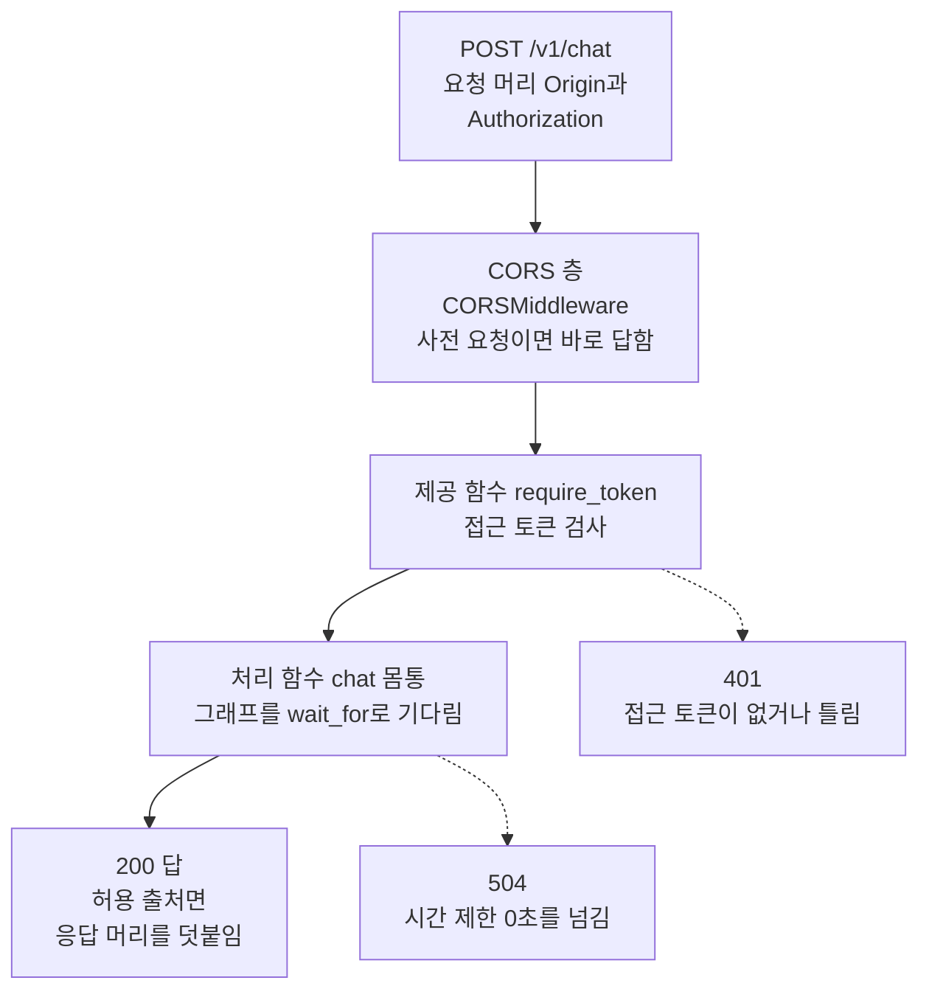
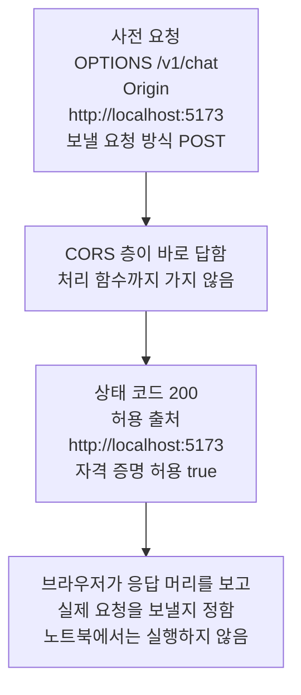
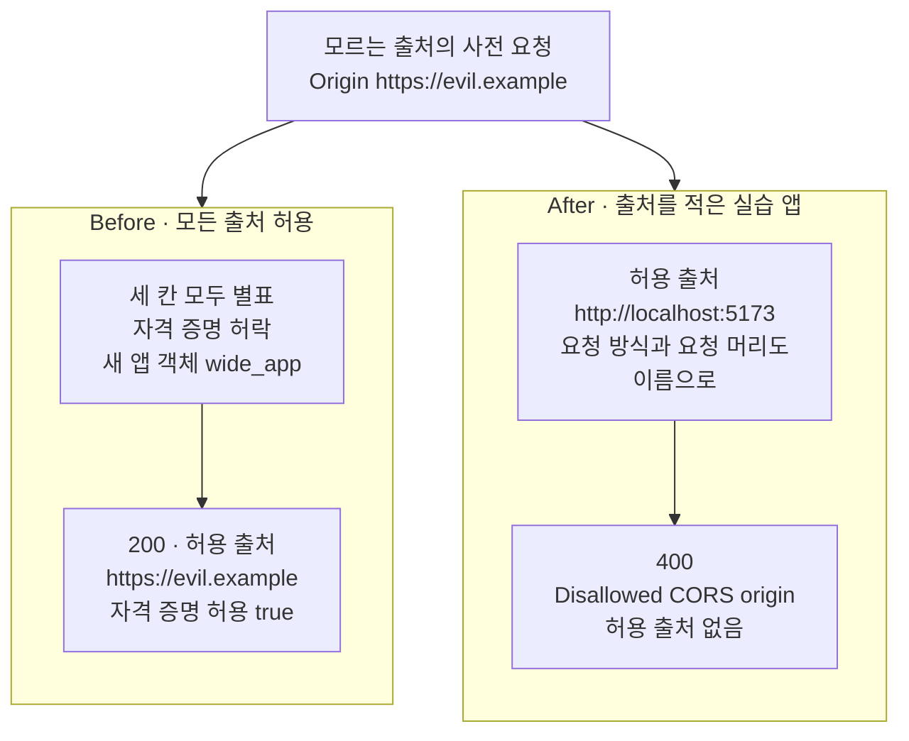
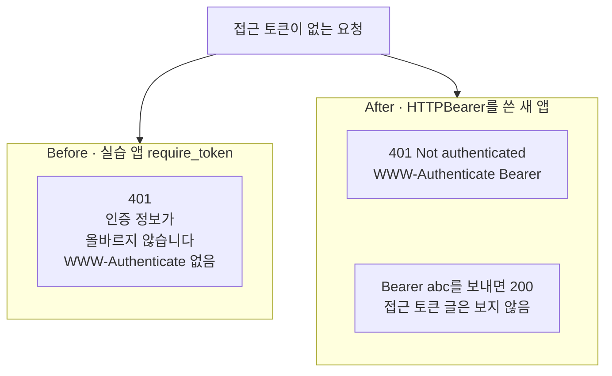

# 07-인증-CORS-타임아웃

## _src 본문 (HTML 원본)

```html
<!--meta: 강의 1h | 실습 2.5h | 코드 notebooks/07-인증-CORS-타임아웃.ipynb | 새 용어 4 -->
<style>html,body{overflow-x:hidden}.notebook,.nb-cell,.nb-main,.nb-input,.nb-result{min-width:0;max-width:100%}.nb-input pre,.nb-output{box-sizing:border-box;max-width:100%;overflow-x:auto}code.nb-source{display:block!important;width:100%!important;min-width:0!important;overflow-x:auto!important;padding:0!important}</style>
<h2 id="b1"><span class="no">1</span>학습 목표</h2><div class="goal"><ul>
<li>접근 토큰 검사와 시간 제한이 각각 401과 504로 답하는 차례를 출력으로 설명할 수 있습니다.</li>
<li>모든 출처와 자격 증명을 함께 허락한 CORS 설정의 결함을 찾아, 출처를 적은 설정으로 고칠 수 있습니다.</li>
<li>401 응답에 응답 머리 <code>WWW-Authenticate</code>가 필요한 까닭을, 보안 도구 클래스 <code>HTTPBearer</code>로 확인할 수 있습니다.</li>
</ul></div>
<h2 id="b2"><span class="no">2</span>이 내용을 배우는 이유</h2><p><a href="06-fetch-재연결과-오류-이벤트.html">06절</a>까지는 요청을 시험용 클라이언트로 보냈습니다. 실제 서비스에서는 다른 주소에서 받아 온 웹 화면이 브라우저 안에서 이 앱에 요청합니다. 그러면 세 가지를 따로 정해야 합니다. 누가 보낸 요청인지, 어느 웹 화면이 응답을 읽어도 되는지, 얼마나 기다릴지입니다.</p><p>세 설정은 서로를 대신하지 않습니다. CORS 설정을 넓게 열면, 모르는 웹 화면도 자격 증명을 실은 요청의 응답을 읽게 됩니다. 이 절의 Before가 그 설정입니다. 설정을 좁혀도 브라우저 밖 프로그램의 요청은 막지 못해, 서버를 지키는 일은 접근 토큰 검사가 맡습니다.</p><p>제목의 인증은 <a href="../../part6/ch28-mcp/03-stdio와-원격-전송-권한-경계.html">Ch 28 03절</a>의 말로, 요청을 보낸 쪽이 누구인지 확인하는 일입니다. 제목의 CORS는 4블록에서 풀고, 제목의 타임아웃은 본문에서 시간 제한이라고 부릅니다.</p>
<h2 id="b3"><span class="no">3</span>앞에서 배운 내용</h2><p><a href="02-의존성으로-Agent-주입.html">02절</a>에서는 요청 머리의 칸 <code>Authorization</code>에 교재용 접근 토큰을 적었고, 없으면 401을 받는 것을 한 번 봤습니다. 시간 제한 제공 함수 <code>get_timeout</code>을 0초를 내놓는 <code>zero_timeout</code>으로 재정의해, 504도 받았습니다. 재정의는 앱 객체에 남으므로, 이 절도 재정의를 적은 셀 안에서 재정의 딕셔너리를 비웁니다. <a href="06-fetch-재연결과-오류-이벤트.html">06절</a>에서는 제공 함수가 처리 함수보다 먼저 불려, 응답을 시작하기 전에 400으로 멈추는 것을 봤습니다.</p><p><a href="../../part6/ch28-mcp/03-stdio와-원격-전송-권한-경계.html">Ch 28 03절</a>에서는 인증과 접근 토큰을 배웠습니다. 인증은 요청을 보낸 쪽이 누구인지 확인하는 일이고, 접근 토큰은 요청에 실어 보내 누구인지 알리는 글입니다. 그 절 노트북 6절의 서버는 접근 토큰 없는 요청에 401과 응답 머리 <code>WWW-Authenticate</code>의 값 <code>Bearer</code>를 보냈습니다. 이 절은 실습 앱의 401을 그 응답과 견줍니다.</p><p><a href="../../part4/ch16-guardrails/01-입출력-출처-검증.html">Ch 16 01절</a>에서는 빈 질문과 너무 긴 질문을 모델을 부르기 전에 막았습니다. <a href="../../part4/ch16-guardrails/04-호출-한도와-비용-상한.html">Ch 16 04절</a>에서는 호출 한도나 비용 상한을 넘는 요청을 모델을 부르기 전에 멈췄습니다. 이 절의 접근 토큰 검사도 에이전트 그래프를 기다리기 전에 401로 멈춥니다. <a href="../../part6/ch22-middleware/01-미들웨어와-6개-훅.html">Ch 22 01절</a>의 감싸기형 훅은 호출 하나를 앞뒤로 감쌌습니다. 이 절의 CORS 설정 층도 처리 함수 앞에서 요청을 보고, 나가는 응답에 응답 머리를 덧붙입니다.</p>
<h2 id="b4"><span class="no">4</span>핵심 개념</h2><h3>비유로 시작하기</h3><p>화물역에 짐칸 하나가 들어와 옆문을 열었습니다. 짐을 받으러 온 트럭 둘이 짐칸 앞에 섰고, 한 대는 노란 번호판, 한 대는 파란 번호판을 달았습니다. 역은 짐마다 꼬리표를 달아, 어느 색 번호판의 트럭이 실어 가도 되는지 적습니다. 트럭 회사는 꼬리표 색이 자기 번호판 색과 같을 때만 짐을 싣게 합니다.</p><p>짐이 서버의 응답이고, 꼬리표가 응답 머리 <code>access-control-allow-origin</code>입니다. 번호판 색은 요청을 보낸 웹 화면의 출처이고, 트럭 회사가 브라우저입니다. 찾아온 트럭의 번호판 색을 꼬리표에 그대로 적어 주는 역이 이 절의 Before 설정입니다.</p><p>비유와 다른 점이 있습니다. 실제 서버는 꼬리표가 맞지 않는 출처에도 답을 만들어 보냈고, 싣지 못하게 막는 쪽은 브라우저뿐입니다. 서버를 지키는 일은 따로 접근 토큰 검사가 맡습니다. 이 절은 브라우저에서 실행하지 않아, 트럭 회사의 판단은 문서로만 확인했습니다.</p>
{{img:07-5-꼬리표-색이-맞는-트럭만-실은-짐|흰 바탕에 짧은 선로 위 은색 짐칸 하나가 옆문을 열고 서 있습니다. 짐칸 앞에는 작은 트럭 둘이 뒤쪽을 보이며 나란히 서 있습니다. 왼쪽은 노란 트럭으로 번호판도 노란색이고, 뒤 짐칸에 흰 자루 넷이 실려 있으며 보이는 꼬리표는 모두 노란색입니다. 오른쪽은 파란 트럭으로 번호판도 파란색이고, 뒤 짐칸이 비어 있습니다. 번호판에는 글자가 없고, 사람·글자·숫자·화살표는 없는 그림|노란 꼬리표를 단 자루는 노란 번호판 트럭에만 실렸고, 파란 번호판 트럭의 짐칸은 비어 있습니다.}}
<p class="look"><b>그림 읽기</b> — 은색 짐칸 앞에 트럭 둘이 뒤쪽을 보이며 서 있습니다. 왼쪽 노란 트럭은 번호판도 노란색이고, 짐칸에 흰 자루 넷을 실었으며 보이는 꼬리표 셋은 모두 노란색입니다. 오른쪽 파란 트럭은 번호판도 파란색이고, 짐칸이 비어 있습니다. 노란 꼬리표가 허용 출처 <code>http://localhost:5173</code>을 적은 응답 머리이고, 노란 트럭이 그 출처의 웹 화면입니다. 파란 트럭은 모르는 출처 <code>https://evil.example</code>이고, 그림은 출처를 적은 After 설정의 모습입니다.</p>
<h3>접근 토큰 검사와 시간 제한</h3><p>실습 앱의 제공 함수 <code>require_token</code>(56~60행)은 요청 머리 <code>Authorization</code>의 값을 읽습니다. 값이 <code>Bearer local-demo-token</code>과 다르면 상태 코드 401로 멈춥니다. 라이브러리는 제공 함수를 처리 함수보다 먼저 부르므로, 이 401은 에이전트 그래프를 부르기 전에 나갑니다. 노트북 3절에서 시간 제한을 0초로 두어도, 접근 토큰이 없는 요청은 504가 아니라 401을 받았습니다.</p><p>처리 함수 <code>chat</code>은 그래프를 <code>asyncio.wait_for</code>로 기다리고, 시간 제한을 넘기면 504로 답합니다. 이 처리 함수는 그래프를 다 기다린 뒤에 응답을 시작하므로, 상태 코드를 504로 정할 수 있습니다. <a href="06-fetch-재연결과-오류-이벤트.html">06절</a>의 SSE 응답은 상태 코드 200을 먼저 보내, 같은 0초에도 오류 사건으로 알렸습니다.</p>
<table><thead><tr><th>말</th><th>뜻</th></tr></thead><tbody><tr><td>CORS(Cross-Origin Resource Sharing)</td><td>다른 출처의 웹 화면이 보낸 요청에, 그 응답을 화면의 스크립트가 읽어도 되는지 서버가 응답 머리로 알리는 규칙입니다. 이웃이 우리 집 우편물을 받아 가려 하면, 경비실이 적힌 받는 사람을 보고 내줄지 정하는 것과 같습니다. 이 절에서는 앱 파일 19~26행이 설정이고, 응답 머리 <code>access-control-allow-origin</code>으로 허용 출처를 알립니다.</td></tr><tr><td>출처(origin)</td><td>주소 앞부분의 방식(http·https), 호스트 이름, 포트 번호를 합친 것입니다. 같은 아파트라도 동과 호수가 다르면 다른 집인 것과 같습니다. 이 절에서는 허용 출처 <code>http://localhost:5173</code>과 모르는 출처 <code>https://evil.example</code>을 씁니다.</td></tr><tr><td>사전 요청(preflight request)</td><td>브라우저가 실제 요청 전에 요청 방식 OPTIONS로 먼저 보내, 그 요청을 보내도 되는지 묻는 요청입니다. 큰 짐을 부치기 전에, 받는 쪽에 받을 수 있는지 전화로 먼저 묻는 것과 같습니다. 이 절에서는 요청 머리 <code>Origin</code>과 <code>Access-Control-Request-Method</code>를 적어 <code>client.options</code>로 보냅니다.</td></tr><tr><td>자격 증명(credentials)</td><td>쿠키와 인증 정보처럼, 요청한 사람이 누구인지 알리는 값입니다. 가게에서 회원 카드를 내밀면, 가게가 누구인지 알아보는 것과 같습니다. 이 절에서는 설정 <code>allow_credentials=True</code>가 응답 머리 <code>access-control-allow-credentials</code>를 <code>true</code>로 붙입니다.</td></tr></tbody></table>
<p>새 말을 이 절 코드에서 보면 이렇습니다. 허용 출처는 앱 파일 21행의 <code>http://localhost:5173</code> 하나였습니다. 사전 요청은 요청 머리 <code>Origin</code>을 적어 <code>client.options</code>로 보냈고, CORS 층이 상태 코드 200으로 답했습니다. 자격 증명을 허락한 설정은 응답 머리 <code>access-control-allow-credentials</code>의 값 <code>true</code>로 보였습니다.</p>
{{mermaid:07-1-요청이-처리-함수-몸통에-닿기까지|위에서 아래로 읽는 흐름도입니다. 초록 상자 POST /v1/chat 요청 머리 Origin과 Authorization에서, 회색 상자 CORS 층 CORSMiddleware 사전 요청이면 여기서 바로 답함으로 갑니다. 이어서 초록 상자 제공 함수 require_token 접근 토큰 검사, 초록 상자 처리 함수 chat 몸통 그래프를 wait_for로 기다림을 지나 노란 상자 200 답 허용 출처면 응답 머리를 덧붙임에 닿습니다. 제공 함수에서 점선이 노란 상자 401 접근 토큰이 없거나 틀림으로, 몸통에서 점선이 노란 상자 504 시간 제한 0초를 넘김으로 갈라지는 그림|요청은 CORS 층과 접근 토큰 검사를 지난 뒤에야 처리 함수 몸통에 닿았고, 몸통은 시간 제한 안에서만 그래프를 기다렸습니다.}}
<p class="look"><b>도식 읽기</b> — 위에서 아래로 읽습니다. 초록 상자는 보낸 요청과 실습 앱 파일의 함수이고, 회색 상자는 라이브러리가 맡은 CORS 층입니다. 노란 상자 셋은 노트북 2절·3절·6절의 출력이고, 점선 두 갈래는 몸통까지 가지 않거나 기다림이 끊긴 자리입니다.</p>
<h3>CORS 설정이 하는 일</h3><p>앱 파일 19행의 메서드 <code>add_middleware</code>는 클래스 <code>CORSMiddleware</code>를 앱 객체 앞에 끼워 넣습니다. 이 층은 요청이 처리 함수에 닿기 전에 먼저 봅니다. 사전 요청이면 설치판 starlette 1.6.0 <code>cors.py</code> 91~94행이 앱으로 넘기지 않고 바로 답합니다. 보통 요청이면 앱이 만든 응답에 CORS 응답 머리를 덧붙입니다.</p><p>응답 머리를 보고 응답을 화면의 스크립트에 넘길지 정하는 쪽은 브라우저입니다. 같은 파일 143~145행의 주석도 CORS 규칙을 지키는 쪽이 브라우저라고 적습니다. 이 절의 시험용 클라이언트는 브라우저가 아니라서, 응답 머리를 보여 줄 뿐 막지 않습니다. 그래서 이 절은 응답 머리를 읽어 견줬고, 브라우저가 막는 모양은 실행하지 않았습니다.</p><p>브라우저는 요청 머리 <code>Authorization</code>이나 본문 종류 <code>application/json</code>을 싣는 요청이면 사전 요청을 먼저 보냅니다. MDN 문서가 적은 단순 요청의 조건에 이 둘이 들지 않기 때문입니다. 이 앱의 요청은 둘 다 실어서, 브라우저에서 보내면 사전 요청이 먼저 갑니다.</p>
<h2 id="b5"><span class="no">5</span>실행 예제</h2><p>노트북 2절은 실습 앱의 접근 토큰 검사 줄을 읽고, 요청 머리 셋으로 같은 질문을 보냅니다. 3절은 시간 제한을 0초로 재정의해, 접근 토큰이 있는 요청과 없는 요청을 견줍니다. 4절은 CORS 설정 줄을 읽고, 허용 출처에서 온 것처럼 사전 요청을 보냅니다.</p><p>모델 요청은 0번이고, API 키 없이 실행합니다. 서버 프로그램과 브라우저를 쓰지 않고, 시험용 클라이언트로 요청 머리 <code>Origin</code>을 직접 적어 보냅니다. 걸린 시간은 재지 않았습니다.</p>
{{notebook:07-인증-CORS-타임아웃|example}}
<p class="look"><b>확인할 점</b> — 노트북 2절에서 접근 토큰이 없거나 틀린 요청의 <code>401</code>과, 맞는 요청의 <code>200</code>을 찾습니다. 3절에서 <code>접근 토큰이 있는 요청: 504</code>로 시작하는 줄과, 없는 요청이 <code>401</code>인 줄을 봅니다. 4절에서는 <code>허용 출처: http://localhost:5173</code>과 <code>자격 증명 허용: true</code>를 확인합니다.</p>
{{mermaid:07-2-사전-요청과-CORS-응답-머리|위에서 아래로 읽는 흐름도입니다. 초록 상자 사전 요청 OPTIONS /v1/chat Origin http://localhost:5173 보낼 요청 방식 POST에서, 회색 상자 CORS 층이 바로 답함 처리 함수까지 가지 않음, 노란 상자 상태 코드 200 허용 출처 http://localhost:5173 자격 증명 허용 true를 지나, 회색 상자 브라우저가 응답 머리를 보고 실제 요청을 보낼지 정함 노트북에서는 실행하지 않음에 닿는 그림|허용 출처에서 온 사전 요청에 CORS 층이 직접 200과 허용 출처를 답했고, 그다음 판단은 브라우저가 합니다.}}
<p class="look"><b>도식 읽기</b> — 위에서 아래로 읽습니다. 초록 상자는 노트북 4절에서 보낸 사전 요청이고, 노란 상자는 그 셀의 출력입니다. 회색 상자 둘은 라이브러리와 브라우저가 하는 일이고, 브라우저 쪽은 이 노트북에서 실행하지 않았습니다.</p>
<h2 id="b6"><span class="no">6</span>일부러 실패해 보기</h2><p>아래 Before 셀은 결함 둘을 봅니다. 하나는 허용 출처·요청 방식·요청 머리를 모두 <code>"*"</code>로 두고 자격 증명을 허락한 새 앱 객체입니다. 다른 하나는 실습 앱이 보낸 401 응답의 응답 머리입니다. After 셀은 출처를 적은 실습 앱의 설정과, 보안 도구 클래스 <code>HTTPBearer</code>를 쓴 새 앱 객체를 봅니다.</p>
{{notebook:07-인증-CORS-타임아웃|failure}}
{{mermaid:07-3-모든-출처-허용과-출처를-적은-설정|맨 위에 초록 상자 모르는 출처의 사전 요청 Origin https://evil.example이 있고, 그 아래 칸 둘이 나란히 놓여 있습니다. 왼쪽 칸 Before 모든 출처 허용에는 파란 상자 세 칸 모두 별표 자격 증명 허락 새 앱 객체 wide_app에서 빨간 상자 200 허용 출처 https://evil.example 자격 증명 허용 true로 이어집니다. 오른쪽 칸 After 출처를 적은 실습 앱에는 초록 상자 허용 출처 http://localhost:5173 요청 방식과 요청 머리도 이름으로에서 노란 상자 400 Disallowed CORS origin 허용 출처 없음으로 이어지는 그림|같은 모르는 출처의 사전 요청에, 모든 출처를 허용한 앱은 그 출처를 허용 출처로 적었고 출처를 적은 실습 앱은 400으로 답했습니다.}}
<p class="look"><b>도식 읽기</b> — 맨 위 초록 상자는 두 칸이 함께 받은 같은 사전 요청입니다. 왼쪽 칸이 Before, 오른쪽 칸이 After이고, 칸마다 위가 CORS 설정, 아래가 노트북 5절·6절의 출력입니다. 파란 상자는 노트북에서 만든 새 앱 객체이고, 초록 상자는 실습 앱 파일의 설정입니다. 빨간 상자 하나가 Before 결함 결과입니다.</p>
<table><thead><tr><th>견준 것</th><th>Before</th><th>After</th></tr></thead><tbody><tr><td>CORS 설정</td><td>새 앱 객체 — 세 칸 모두 <code>"*"</code>, 자격 증명 허락</td><td>실습 앱 — 허용 출처·요청 방식·요청 머리를 이름으로, 자격 증명 허락</td></tr><tr><td>모르는 출처의 사전 요청</td><td><code>200</code> · 허용 출처 <code>https://evil.example</code></td><td><code>400</code> · <code>Disallowed CORS origin</code> · 허용 출처 <code>None</code></td></tr><tr><td>자격 증명 허용 응답 머리</td><td><code>true</code></td><td><code>true</code> — 허용 출처가 없어 브라우저는 버림(MDN)</td></tr><tr><td>접근 토큰 없는 요청의 401</td><td>실습 앱 — <code>WWW-Authenticate: None</code></td><td><code>HTTPBearer</code>를 쓴 새 앱 — 값 <code>Bearer</code></td></tr><tr><td>방식 <code>Bearer</code>에 틀린 글</td><td>실습 앱 — <code>401</code>(글을 견줌)</td><td><code>HTTPBearer</code>만 쓴 새 앱 — <code>200</code>(글은 보지 않음)</td></tr></tbody></table>
<p>모르는 출처 <code>https://evil.example</code>의 사전 요청에, 모든 출처를 허용한 앱은 200과 그 출처를 허용 출처로 적어 보냈습니다. 자격 증명 허용도 <code>true</code>였고, 이어 보낸 POST에도 같은 두 응답 머리가 붙었습니다. 브라우저가 보기에는 이 출처를 이름으로 허락한 응답입니다. 출처를 적은 실습 앱은 같은 사전 요청에 400으로 답하고, 허용 출처 응답 머리를 붙이지 않았습니다.</p><p>FastAPI 문서는 자격 증명을 허락하면 세 칸 가운데 어느 것도 <code>["*"]</code>로 둘 수 없다고 적습니다. 그런데 설치판 starlette 1.6.0은 이 설정에 오류를 내지 않았습니다.</p><p>같은 설치판의 <code>cors.py</code> 37행은 이때 출처를 이름으로 적는 쪽을 고릅니다. 116~120행과 166~168행은 받은 출처를 그대로 적습니다. MDN 문서가 자격 증명이 있으면 출처를 이름으로 적으라고 한 조건을, 받은 출처를 옮겨 적어 맞춘 셈입니다. 문서와 설치판이 달라서, 이 절은 설치판의 출력을 기준으로 썼습니다.</p>
{{mermaid:07-4-두-가지-401-응답|맨 위에 초록 상자 접근 토큰이 없는 요청이 있고, 그 아래 칸 둘이 나란히 놓여 있습니다. 왼쪽 칸 Before 실습 앱 require_token에는 빨간 상자 401 인증 정보가 올바르지 않습니다 WWW-Authenticate 없음이 있습니다. 오른쪽 칸 After HTTPBearer를 쓴 새 앱에는 노란 상자 401 Not authenticated WWW-Authenticate Bearer가 있고, 그 아래에 노란 상자 Bearer abc를 보내면 200 접근 토큰 글은 보지 않음이 있는 그림|접근 토큰이 없는 요청에 실습 앱은 인증 방식을 알리지 않은 401을, HTTPBearer를 쓴 새 앱은 Bearer를 알린 401을 보냈습니다.}}
<p class="look"><b>도식 읽기</b> — 맨 위 초록 상자는 두 칸이 함께 받은, 접근 토큰이 없는 요청입니다. 왼쪽 칸이 Before의 실습 앱, 오른쪽 칸이 After의 새 앱이고, 상자는 모두 노트북 5절·6절의 출력입니다. 오른쪽 칸 아래 상자는 다른 요청의 결과로, 보안 객체가 접근 토큰 글을 견주지 않는다는 한계입니다. 빨간 상자 하나가 Before 결함 결과입니다.</p>
<p>실습 앱의 401 응답에는 응답 머리 <code>WWW-Authenticate</code>가 없었습니다. 표준 문서 RFC 9110은 401 응답에 이 응답 머리를 반드시 담으라고 적습니다. MDN 문서도 401은 이 응답 머리와 함께 보낸다고 적습니다.</p><p>보안 도구 클래스 <code>HTTPBearer</code>를 쓴 새 앱은 머리가 없거나 방식이 <code>Basic</code>인 요청에 401과 값 <code>Bearer</code>를 보냈습니다. 다만 방식 <code>Bearer</code>에 틀린 글 <code>abc</code>를 보내자 200이었습니다. 이 클래스는 방식 이름만 보므로, 접근 토큰 글은 우리 코드가 견줘야 합니다.</p><p>노트북 7절에서 사전 요청 없이 같은 POST를 실습 앱에 보내자, 상태 코드 200과 답이 왔습니다. 허용 출처 응답 머리가 없으니, 브라우저라면 이 답을 화면에 넘기지 않았을 것입니다. 하지만 서버는 요청을 끝까지 실행했습니다. CORS 설정은 서버를 지키는 장치가 아니고, 서버를 지키는 일은 접근 토큰 검사가 맡습니다.</p>
<p>새 커널로 두 번 실행해 견주자, 코드 셀의 출력이 셀마다 모두 같았습니다. 한 번은 프로젝트 맨 위에서, 한 번은 <code>notebooks/</code> 폴더에서 연 커널이었습니다. 노트북 밖에서도 같은 장면을 파이썬 파일로 다섯 번 실행해, 출력이 모두 같았습니다. 모델을 부르지 않아, 상태 코드와 응답 머리는 앱과 설치판 라이브러리의 코드가 정합니다.</p>
<p class="look"><b>확인할 점</b> — 5절에서 <code>허용 출처: https://evil.example</code>과 <code>WWW-Authenticate: None</code>을 봅니다. 6절에서 <code>상태 코드: 400</code>·<code>허용 출처: None</code>과, <code>401 | Bearer</code>·<code>200 | None</code>으로 시작하는 줄을 확인합니다. 7절에서는 <code>상태 코드: 200</code>인데 <code>허용 출처: None</code>인지 봅니다.</p>
<h2 id="b7"><span class="no">7</span>주의할 점과 실무 메모</h2><ul><li>시험용 클라이언트는 브라우저가 아니라서, CORS 응답 머리를 보고 요청이나 응답을 막지 않습니다. 이 절은 응답 머리를 읽어 견줬고, 브라우저가 응답을 막는 모양은 실행하지 않았습니다. 그 동작은 MDN 문서의 설명으로만 적었습니다.</li><li>FastAPI 문서는 자격 증명을 허락하면 세 칸을 <code>["*"]</code>로 둘 수 없다고 적습니다. 설치판 starlette 1.6.0은 오류 없이 받은 출처를 그대로 적었고, 다른 판에서는 실행하지 않았습니다. 자격 증명을 허락할 때는 실습 앱처럼 세 칸을 모두 이름으로 적습니다.</li><li>출처를 적은 설정에서도, 모르는 출처의 응답에 응답 머리 <code>access-control-allow-credentials</code>가 <code>true</code>로 붙었습니다. 설치판 <code>cors.py</code> 42~43행과 62~63행이 설정에 따라 이 머리를 늘 붙이기 때문입니다. 허용 출처 머리가 없으면 브라우저가 응답을 버린다고 MDN 문서는 적습니다.</li><li>실습 앱의 401에는 응답 머리 <code>WWW-Authenticate</code>가 없고, 이 절은 앱을 고치지 않았습니다. 인증을 <code>HTTPBearer</code>로 바꾸면 응답 문서가 달라져, 실습 폴더의 <code>openapi.json</code>과 <a href="08-OpenAPI와-TS-SDK.html">08절</a>의 TS 코드가 어긋납니다. 오류 <code>HTTPException</code>의 인자 <code>headers</code>로 이 머리를 붙이는 방법도 있지만, 이 노트북에서는 실행하지 않았습니다.</li><li>보안 도구 클래스 <code>HTTPBearer</code>는 방식 이름과 글이 있는지만 봅니다. 접근 토큰 글이 맞는지는 실습 앱 58행처럼 우리 코드가 견줘야 합니다. FastAPI 문서도 이 클래스가 글을 견준다고 적지 않습니다.</li><li>교재용 접근 토큰 <code>local-demo-token</code>은 README가 적은 대로 교재용 값이라, 실제 서비스의 비밀 값으로 쓰지 않습니다. 앱 57행은 환경 변수 <code>DEMO_API_TOKEN</code>이 있으면 그 값을 쓰고, 이 노트북은 그 변수를 두지 않았습니다. 접근 토큰을 만들고 바꾸고 없애는 일은 이 절에서 다루지 않았습니다.</li><li>시간 제한 0초가 끊은 것은 처리 함수가 그래프를 기다리는 일입니다. 모델을 부르는 그래프라면, 끊은 뒤 모델 쪽 요청도 멈추는지 따로 확인해야 합니다. 이 절은 모델을 부르지 않아 그 장면을 실행하지 않았습니다.</li><li>걸린 시간은 재지 않았습니다. 교재 출력은 Linux의 Python 3.12.13으로 만들었고, 다른 판과 Windows·macOS에서는 실행하지 않았습니다.</li></ul>
<h2 id="b8"><span class="no">8</span>정리와 다음 절</h2><ul><li>접근 토큰 검사는 처리 함수의 몸통보다 먼저 401로 멈췄고, 시간 제한 0초는 504였습니다.</li><li>모든 출처와 자격 증명을 함께 허락한 설정은, 모르는 출처를 그대로 허용 출처로 적었습니다.</li><li>출처를 적은 설정은 그 사전 요청을 400으로 막았고, 보안 객체는 401에 인증 방식을 알렸습니다.</li></ul><p><strong>다음 학습과 이어지는 지점</strong> — <a href="08-OpenAPI와-TS-SDK.html">08절</a>에서는 응답 문서를 실습 폴더의 파일과 견주고, 그 문서로 만든 TS 코드를 봅니다.</p>
<h2 id="b9"><span class="no">9</span>복습 문제</h2><details class="quiz" open><summary>문제 5개 · 해설 포함</summary><p class="quiz-q">1. 시간 제한을 0초로 둔 채, 접근 토큰 없이 보낸 요청은 몇 번 상태 코드를 받았나요?</p><p class="quiz-a">401입니다. 제공 함수 <code>require_token</code>이 처리 함수보다 먼저 불려, 몸통에서 그래프를 기다리기 전에 멈췄습니다. 틀렸다면 노트북 3절을 다시 읽습니다.</p><p class="quiz-q">2. 사전 요청은 누가, 언제 보내나요?</p><p class="quiz-a">브라우저가 실제 요청 전에 요청 방식 OPTIONS로 보냅니다. 요청 머리 <code>Authorization</code>이나 본문 종류 <code>application/json</code>을 싣는 요청이 여기에 듭니다. 이 절의 사전 요청에는 CORS 층이 처리 함수까지 가지 않고 답했습니다. 틀렸다면 노트북 4절을 다시 읽습니다.</p><p class="quiz-q">3. 동료가 「허용 출처를 <code>"*"</code>로 두면 자격 증명 요청은 브라우저가 알아서 막는다」고 말합니다. 맞나요?</p><p class="quiz-a">이 설치판에서는 맞지 않습니다. 서버가 요청에 온 출처를 그대로 허용 출처로 적어, 브라우저가 보기에는 그 출처를 이름으로 허락한 응답이 됩니다. 노트북 5절에서 <code>https://evil.example</code>이 허용 출처로 적혀 왔습니다. 틀렸다면 노트북 5절을 다시 읽습니다.</p><p class="quiz-q">4. 401 응답에 응답 머리 <code>WWW-Authenticate</code>가 있어야 하는 까닭은 무엇인가요?</p><p class="quiz-a">받는 쪽이 어떤 방식으로 접근 토큰을 보내야 하는지 알게 하려는 것이고, RFC 9110은 반드시 담으라고 적습니다. 실습 앱의 401에는 없었고, <code>HTTPBearer</code>를 쓴 새 앱은 값 <code>Bearer</code>를 보냈습니다. 틀렸다면 노트북 5절과 6절을 다시 읽습니다.</p><p class="quiz-q">5. CORS 설정을 좁히면, 모르는 출처의 요청을 서버가 실행하지 않나요?</p><p class="quiz-a">아닙니다. 노트북 7절에서 사전 요청 없이 보낸 POST는 200과 답을 받았습니다. 허용 출처 머리가 없어 브라우저라면 답을 넘기지 않을 뿐이고, 서버를 지키는 일은 접근 토큰 검사가 맡습니다. 틀렸다면 노트북 7절을 다시 읽습니다.</p></details>
<h2 id="b10"><span class="no">10</span>참고 자료</h2><ul><li><div><a href="https://fastapi.tiangolo.com/tutorial/cors/">FastAPI CORS (Cross-Origin Resource Sharing)</a></div>확인 2026-09-29 · 출처는 방식·도메인·포트의 짝이라고 적습니다. 자격 증명을 허락하면 <code>allow_origins</code>·<code>allow_methods</code>·<code>allow_headers</code> 어느 것도 <code>["*"]</code>일 수 없다고 적습니다. 사전 요청에는 알아보기 좋게 200이나 400으로 답한다고 적습니다.</li><li><div><a href="https://developer.mozilla.org/en-US/docs/Web/HTTP/Guides/CORS">MDN Cross-Origin Resource Sharing (CORS)</a></div>확인 2026-09-29 · 최종 수정 2026-09-04 · 사전 요청은 요청 방식 OPTIONS로 먼저 보낸다고 적습니다. 자격 증명을 실은 요청에는 <code>*</code> 대신 출처를 이름으로 적어야 한다고 적습니다. 허용 출처 응답 머리가 없으면 브라우저가 응답을 버린다고 적습니다.</li><li><div><a href="https://developer.mozilla.org/en-US/docs/Web/HTTP/Reference/Status/401">MDN 401 Unauthorized</a></div>확인 2026-09-29 · 최종 수정 2026-06-22 · 401은 응답 머리 <code>WWW-Authenticate</code>와 함께 보낸다고 적습니다. 이 머리가 인증 방식을 알린다고 적습니다.</li><li><div><a href="https://www.rfc-editor.org/rfc/rfc9110.html#name-401-unauthorized">RFC 9110 HTTP Semantics 15.5.2</a></div>확인 2026-09-29 · 401을 보내는 서버는 응답 머리 <code>WWW-Authenticate</code>를 반드시 보내야 한다고 적습니다.</li><li><div><a href="https://fastapi.tiangolo.com/reference/security/">FastAPI Security Tools HTTPBearer</a></div>확인 2026-09-29 · 객체를 <code>Depends()</code>에 넣으면 칸 <code>scheme</code>과 <code>credentials</code>가 든 값을 넘긴다고 적습니다. 요청 머리가 없으면 오류로 멈춘다고 적고, 글이 맞는지 견준다고는 적지 않습니다.</li><li><div><a href="https://fastapi.tiangolo.com/tutorial/handling-errors/">FastAPI Handling Errors</a></div>확인 2026-09-29 · 오류 <code>HTTPException</code>의 인자 <code>headers</code>로 오류 응답에 머리를 더할 수 있다고 적습니다.</li><li>설치판 starlette 1.6.0 소스 <code>middleware/cors.py</code> 12행은 늘 허락하는 요청 머리 넷입니다. 35~37행은 모든 출처와 자격 증명을 함께 허락하면 출처를 이름으로 적는 쪽을 고릅니다. 42~43행과 62~63행은 자격 증명 머리를 붙입니다.</li><li>같은 파일 91~94행은 사전 요청에 바로 답하고, 116~122행은 출처를 봅니다. 143~148행은 주석과 400 응답입니다. 166~168행은 보통 요청에 받은 출처를 적습니다.</li><li>설치판 fastapi 0.135.0 소스 <code>security/http.py</code> 84~92행은 401에 응답 머리 <code>WWW-Authenticate</code>를 붙입니다. 303~316행은 요청 머리를 방식 이름과 글로 나누고, 방식만 견줍니다.</li><li>실습 폴더 <code>agent_service/app.py</code> 19~26행은 CORS 설정, 56~60행은 제공 함수 <code>require_token</code>입니다. 78~82행은 그래프를 <code>asyncio.wait_for</code>로 기다리고 504로 답합니다.</li></ul>
```

## 노트북 셀 (순서대로)

### [0] markdown {'html': 'skip'}

# 인증 CORS 타임아웃

**이 노트북에서 할 일**

1. 접근 토큰 검사가 401로, 시간 제한이 504로 답하는 차례를 봅니다.
2. 모든 출처를 허용한 CORS 설정이 모르는 출처에도 자격 증명을 허락하는 것을 봅니다.
3. 출처를 적은 설정과, 401에 인증 방식을 알리는 보안 도구로 고칩니다.

**준비물** — 이 노트북은 모델을 부르지 않습니다.
모델 요청은 0번이고, API 키 없이 실행합니다.
예상 비용도 0달러입니다.
실습 앱의 에이전트 그래프는 모델을 쓰지 않고, 정해 둔 말로 답합니다.
그래서 다시 실행해도 같은 값이 나와야 합니다.

요청은 시험용 클라이언트로 같은 노트북 안에서 보냅니다.
서버 프로그램과 브라우저를 쓰지 않고, 네트워크와 포트도 쓰지 않습니다.
실습 폴더의 파일을 가져오고 읽기만 하며, 쓰는 파일은 없습니다.

걸린 시간은 재지 않았습니다.
02절에서 배운 함수 하나는 도구 파일 `serve_tools.py`에서 가져옵니다.

**기준 버전** — 첫 셀에서 패키지 여섯을 설치합니다.
판은 fastapi 0.135.0, httpx 0.28.1, pydantic 2.12.5, starlette 1.6.0입니다.
패키지 langgraph 1.2.11과 langchain 1.4.0은 실습 앱 파일이 가져오는 패키지입니다.
여섯 모두 실습 폴더 잠금과 같은 판입니다.

교재 출력은 Linux의 Python 3.12.13으로 만들었습니다.
다른 판과 Windows·macOS에서는 실행하지 않았습니다.

**강의와 실습 범위** — 강의 시간에는 2~4절을 읽고, 5절과 6절의 Before·After를 함께 봅니다.
7절은 보내는 요청 하나를 바꿔 보는 실습이고, 실습 시간에 실행합니다.

실습 폴더 `labs/part7/ch30-fastapi-serving`에서 `uv sync --locked`를 실행합니다.
그다음 `notebooks/` 폴더의 이 노트북을 열고, 실습 폴더의 `.venv` 커널을 고릅니다.
첫 셀부터 순서대로 실행합니다.

### [1] markdown {'html': 'skip'}

## 오늘 볼 그림


위에서 아래로 읽습니다.
초록 상자는 보낸 요청과 실습 앱 파일의 함수이고, 회색 상자는 라이브러리가 맡은 CORS 층입니다.
노란 상자 셋은 노트북 2절·3절·6절의 출력이고, 점선 두 갈래는 몸통까지 가지 않거나 기다림이 끊긴 자리입니다.

### [2] markdown {}

## 1. 준비

06절에서는 시간 제한을 0초로 바꾼 SSE 응답이 상태 코드 200과 오류 사건으로 오는 것을 봤습니다.
이 절은 요청이 처리 함수 몸통에 닿기 전후에 앱이 하는 검사 셋을 봅니다.
접근 토큰 검사와, 다른 출처의 요청을 다루는 CORS 설정, 시간 제한입니다.
제목의 인증은 Ch 28 03절에서 배운 말로, 요청을 보낸 쪽이 누구인지 확인하는 일입니다.
제목의 CORS는 4절에서 풀고, 제목의 타임아웃은 이 절에서 시간 제한이라고 부릅니다.

첫 셀은 패키지 여섯을 설치하고 설치된 판 번호를 출력합니다.
설치에는 몇십 초가 걸릴 수 있습니다.

### [3] code {'execution': {'iopub.execute_input': '2026-09-29T10:12:28.542246Z', 'iopub.status.busy': '2026-09-29T10:12:28.542047Z', 'iopub.status.idle': '2026-09-29T10:12:29.171812Z', 'shell.execute_reply': '2026-09-29T10:12:29.171268Z'}, 'lesson_role': 'setup'}

```python
# 이 절에서 쓰는 패키지를 설치하고 버전을 확인합니다
%pip install -q "fastapi==0.135.0" "httpx==0.28.1" "pydantic==2.12.5" "starlette==1.6.0" "langgraph==1.2.11" "langchain==1.4.0"
from importlib.metadata import version

print("fastapi:", version("fastapi"))
print("httpx:", version("httpx"))
print("pydantic:", version("pydantic"))
print("starlette:", version("starlette"))
print("langgraph:", version("langgraph"))
print("langchain:", version("langchain"))
```

출력:
```
Note: you may need to restart the kernel to use updated packages.
fastapi: 0.135.0
httpx: 0.28.1
pydantic: 2.12.5
starlette: 1.6.0
langgraph: 1.2.11
langchain: 1.4.0

```

### [4] markdown {}

**결과 읽기** — 출력 줄 `fastapi: 0.135.0`과 `starlette: 1.6.0`이 보입니다.
여섯 모두 실습 폴더 잠금과 같은 판이고, 06절과 같은 목록입니다.
CORS 설정을 맡는 클래스는 패키지 starlette에 있고, 패키지 fastapi가 같은 이름으로 내어 줍니다.
이 절은 모델 객체를 만들지 않아, API 키를 확인하는 셀도 없습니다.

다음 셀은 이 절에서 쓸 이름을 가져옵니다.
클래스 `CORSMiddleware`는 CORS 설정을, 클래스 `HTTPBearer`는 접근 토큰 읽기를 맡습니다.
마지막 가져오기 줄은 02절에서 배운 함수를 도구 파일에서 가져옵니다.

### [5] code {'execution': {'iopub.execute_input': '2026-09-29T10:12:29.172838Z', 'iopub.status.busy': '2026-09-29T10:12:29.172750Z', 'iopub.status.idle': '2026-09-29T10:12:29.361833Z', 'shell.execute_reply': '2026-09-29T10:12:29.361435Z'}, 'lesson_role': 'setup'}

```python
# 이 절에서 쓸 이름을 가져옵니다(os와 typing은 Python에 들어 있는 모듈입니다)
import os
from typing import Annotated
from fastapi import Depends, FastAPI
from fastapi.middleware.cors import CORSMiddleware
from fastapi.security import HTTPBearer
from fastapi.testclient import TestClient
# 02절에서 배운 함수는 도구 파일에서 가져옵니다
from serve_tools import zero_timeout

print("가져온 이름:", "Annotated, Depends, FastAPI, CORSMiddleware, HTTPBearer, TestClient")
print("도구 파일에서 가져온 함수:", "zero_timeout")
```

출력:
```
가져온 이름: Annotated, Depends, FastAPI, CORSMiddleware, HTTPBearer, TestClient
도구 파일에서 가져온 함수: zero_timeout

```

### [6] markdown {}

**결과 읽기** — 출력 줄 `도구 파일에서 가져온 함수: zero_timeout`이 보입니다.
함수 `zero_timeout`은 02절에서 배운, 0초를 내놓는 재정의 함수입니다.
06절이 도구 파일로 옮긴 판을 그대로 가져왔습니다.
도구 파일에는 다른 함수도 있지만, 이 절에서는 쓰지 않습니다.

앞에서 배운 함수는 `serve_tools.py`에 모아 두었습니다.
파일을 열면 코드를 볼 수 있습니다.
노트북과 같은 폴더(`notebooks/`)에 있는 파일입니다.
커널이 `notebooks/` 폴더에서 시작해야 이 파일을 가져올 수 있습니다.
교재 출력을 만든 실행 도구는 이 폴더를 따로 알려 주어, 다른 자리에서 시작해도 가져오기가 되었습니다.

다음 셀은 01절 2절과 같은 파일 위치 셀로, 후보 셋 가운데 실습 폴더를 고릅니다.

### [7] code {'execution': {'iopub.execute_input': '2026-09-29T10:12:29.362608Z', 'iopub.status.busy': '2026-09-29T10:12:29.362553Z', 'iopub.status.idle': '2026-09-29T10:12:29.364641Z', 'shell.execute_reply': '2026-09-29T10:12:29.364345Z'}}

```python
# 노트북을 연 자리에서 본 실습 폴더의 위치를 후보 셋 가운데에서 고릅니다
candidates = ["..", ".", "labs/part7/ch30-fastapi-serving"]
lab_path = None
for candidate in candidates:
    if os.path.exists(candidate + "/agent_service/schemas.py"):
        lab_path = candidate
        break
print("실습 폴더를 찾았는가:", lab_path is not None)
assert lab_path is not None, "notebooks 폴더나 실습 폴더 맨 위에서 노트북을 열어 주세요."
```

출력:
```
실습 폴더를 찾았는가: True

```

### [8] markdown {}

**결과 읽기** — 출력 줄 `실습 폴더를 찾았는가: True`가 보입니다.
고른 후보는 연 자리마다 달라서 출력하지 않습니다.
실습 폴더 맨 위에서 연 커널은 이 안내를 보기 전에, 앞 셀의 도구 파일 가져오기에서 먼저 멈춥니다.

다음 셀은 06절처럼 작업 폴더를 실습 폴더로 옮긴 뒤 이름을 가져옵니다.
앱 파일에서 앱 객체 `app`과 처리 함수 `chat`, 시간 제한 제공 함수 `get_timeout`을 가져옵니다.
처리 함수 `chat`은 5절에서 새 앱 객체에 다시 잇습니다.

### [9] code {'execution': {'iopub.execute_input': '2026-09-29T10:12:29.365207Z', 'iopub.status.busy': '2026-09-29T10:12:29.365156Z', 'iopub.status.idle': '2026-09-29T10:12:29.867520Z', 'shell.execute_reply': '2026-09-29T10:12:29.867128Z'}}

```python
# 작업 폴더를 실습 폴더로 옮기고, 앱 객체·처리 함수 chat·시간 제한 제공 함수를 가져옵니다
os.chdir(lab_path)
from agent_service.app import app, chat, get_timeout
print("가져온 앱 객체의 종류:", type(app).__name__)
print("가져온 처리 함수:", chat.__name__)
print("재정의 딕셔너리의 키 수:", len(app.dependency_overrides))
```

출력:
```
가져온 앱 객체의 종류: FastAPI
가져온 처리 함수: chat
재정의 딕셔너리의 키 수: 0

```

### [10] markdown {}

**결과 읽기** — 출력 줄 `가져온 앱 객체의 종류: FastAPI`와 `가져온 처리 함수: chat`이 보입니다.
출력 줄 `재정의 딕셔너리의 키 수: 0`은 아직 바꿔 낀 제공 함수가 없다는 뜻입니다.

## 2. 접근 토큰 검사

02절에서는 접근 토큰 없이 보낸 질문이 401을 받는 것을 한 번 봤습니다.
이 절에서는 그 검사를 하는 줄을 읽습니다.
다음 셀은 앱 파일에서 제공 함수 `require_token`의 줄을 출력합니다.

### [11] code {'execution': {'iopub.execute_input': '2026-09-29T10:12:29.868224Z', 'iopub.status.busy': '2026-09-29T10:12:29.868167Z', 'iopub.status.idle': '2026-09-29T10:12:29.870618Z', 'shell.execute_reply': '2026-09-29T10:12:29.870375Z'}}

```python
# 앱 파일을 글로 읽어, 접근 토큰을 검사하는 제공 함수 require_token의 56~60행을 출력합니다
first_line = 56
last_line = 60
with open("agent_service/app.py", encoding="utf-8") as app_file:
    app_lines = app_file.read().splitlines()
print("줄 번호 | 줄")
for index in range(first_line - 1, last_line):
    print(index + 1, "|", app_lines[index])
```

출력:
```
줄 번호 | 줄
56 | async def require_token(authorization: Annotated[str | None, Header()] = None) -> str:
57 |     expected = os.getenv("DEMO_API_TOKEN", "local-demo-token")
58 |     if authorization != f"Bearer {expected}":
59 |         raise HTTPException(status_code=401, detail="인증 정보가 올바르지 않습니다")
60 |     return expected

```

### [12] markdown {}

**결과 읽기** — 라벨 줄 아래 56행의 `Header()`는 요청 머리 `Authorization`의 값을 매개변수에 넣으라는 뜻입니다.
57행은 환경 변수 `DEMO_API_TOKEN`이 없으면 교재용 값 `local-demo-token`을 씁니다.
58행은 받은 값이 `Bearer`와 공백, 교재용 값을 이은 글과 다르면 59행에서 401로 멈춥니다.
58행의 f-string은 이 과정의 노트북에서 쓰지 않는 모양이라, 뜻만 봅니다.
56행의 `str | None`과 `= None`, 내놓는 값 힌트 `-> str`은 06절에서 본 모양입니다.

접근 토큰은 Ch 28 03절의 말로, 요청에 실어 보내 누구인지 알리는 글입니다.
값 앞의 `Bearer`는 접근 토큰을 요청 머리에 그대로 싣는 인증 방식의 이름입니다.
다음 셀은 요청 머리 셋으로 같은 질문을 보내, 상태 코드와 응답 본문을 봅니다.
접근 토큰이 없는 요청, 틀린 요청, 맞는 요청입니다.

### [13] code {'execution': {'iopub.execute_input': '2026-09-29T10:12:29.871230Z', 'iopub.status.busy': '2026-09-29T10:12:29.871174Z', 'iopub.status.idle': '2026-09-29T10:12:29.886001Z', 'shell.execute_reply': '2026-09-29T10:12:29.885653Z'}}

```python
# 요청 머리 셋으로 같은 질문을 보내, 접근 토큰 검사의 상태 코드와 응답 본문을 봅니다
client = TestClient(app)
auth_headers = {"Authorization": "Bearer local-demo-token"}
question_body = {"question": "반납 기한을 알려 주세요", "thread_id": "auth-1"}
print("요청 머리 | 상태 코드 | 응답 본문")
for sent_headers in [{}, {"Authorization": "Bearer wrong-token"}, auth_headers]:
    auth_response = client.post("/v1/chat", json=question_body, headers=sent_headers)
    print(sent_headers, "|", auth_response.status_code, "|", auth_response.json())
```

출력:
```
요청 머리 | 상태 코드 | 응답 본문
{} | 401 | {'detail': '인증 정보가 올바르지 않습니다'}
{'Authorization': 'Bearer wrong-token'} | 401 | {'detail': '인증 정보가 올바르지 않습니다'}
{'Authorization': 'Bearer local-demo-token'} | 200 | {'answer': '질문을 확인했습니다: 반납 기한을 알려 주세요', 'thread_id': 'auth-1'}

```

### [14] markdown {}

**결과 읽기** — 라벨 줄 아래 첫 두 줄은 상태 코드 `401`과 `{'detail': '인증 정보가 올바르지 않습니다'}`입니다.
접근 토큰이 없을 때와 틀렸을 때 같은 응답이 왔습니다.
셋째 줄은 `200`이고, 응답 본문에 답 `질문을 확인했습니다: 반납 기한을 알려 주세요`가 있습니다.

06절에서 본 것처럼, 라이브러리는 제공 함수를 처리 함수보다 먼저 부릅니다.
그래서 접근 토큰이 틀리면 처리 함수의 몸통은 실행되지 않습니다.
그런지는 3절의 출력으로 확인합니다.

## 3. 시간 제한

02절에서 본 것처럼, 처리 함수 `chat`은 에이전트 그래프를 `asyncio.wait_for`로 기다립니다.
정한 초 안에 끝나지 않으면, 앱 78~82행이 오류 `TimeoutError`를 받아 상태 코드 504로 답합니다.
다음 셀은 시간 제한을 0초로 재정의하고, 접근 토큰이 있는 요청과 없는 요청을 보냅니다.
재정의 함수 `zero_timeout`은 도구 파일에서 가져왔고, 재정의는 같은 셀 안에서 비웁니다.

실행 전에 예상해 봅니다.
접근 토큰이 없는 요청도 504를 받을까요?

### [15] code {'execution': {'iopub.execute_input': '2026-09-29T10:12:29.886562Z', 'iopub.status.busy': '2026-09-29T10:12:29.886516Z', 'iopub.status.idle': '2026-09-29T10:12:29.890633Z', 'shell.execute_reply': '2026-09-29T10:12:29.890291Z'}}

```python
# 시간 제한을 0초로 재정의해 접근 토큰이 있는 요청과 없는 요청을 보내고, 같은 셀에서 재정의를 비웁니다
app.dependency_overrides[get_timeout] = zero_timeout
timed_response = client.post("/v1/chat", json=question_body, headers=auth_headers)
no_token_response = client.post("/v1/chat", json=question_body)
app.dependency_overrides.clear()
print("접근 토큰이 있는 요청:", timed_response.status_code, timed_response.json())
print("접근 토큰이 없는 요청:", no_token_response.status_code, no_token_response.json())
print("비운 뒤 재정의 딕셔너리의 키 수:", len(app.dependency_overrides))
```

출력:
```
접근 토큰이 있는 요청: 504 {'detail': 'Agent 응답 시간이 초과되었습니다'}
접근 토큰이 없는 요청: 401 {'detail': '인증 정보가 올바르지 않습니다'}
비운 뒤 재정의 딕셔너리의 키 수: 0

```

### [16] markdown {}

**결과 읽기** — 출력 줄 `접근 토큰이 있는 요청: 504 {'detail': 'Agent 응답 시간이 초과되었습니다'}`가 보입니다.
접근 토큰이 없는 요청은 시간 제한이 0초인데도 `401`을 받았습니다.
접근 토큰 검사가 몸통보다 먼저 멈춰, 그래프를 기다리는 줄까지 가지 않았다는 뜻입니다.
출력 줄 `비운 뒤 재정의 딕셔너리의 키 수: 0`으로, 재정의가 남지 않은 것도 확인했습니다.

이 앱의 `/v1/chat`은 그래프를 다 기다린 뒤에 응답을 시작합니다.
그래서 기다림이 끊기면 상태 코드를 504로 정할 수 있습니다.
06절의 SSE 응답은 상태 코드 200을 먼저 보내, 같은 0초에도 오류 사건으로 알렸습니다.

## 4. CORS와 사전 요청

제목의 CORS는 Cross-Origin Resource Sharing의 머리글자입니다.
다른 출처의 웹 화면이 보낸 요청에, 그 응답을 화면의 스크립트가 읽어도 되는지 서버가 응답 머리로 알리는 규칙입니다.
응답을 스크립트에 넘길지는 브라우저가 그 응답 머리를 보고 정합니다.
이웃이 우리 집 우편물을 받아 가려 하면, 경비실이 적힌 받는 사람을 보고 내줄지 정하는 것과 같습니다.
이 앱에서는 앱 파일 19~26행이 CORS 설정입니다.

출처(origin)는 주소 앞부분의 방식(http·https), 호스트 이름, 포트 번호를 합친 것입니다.
같은 아파트라도 동과 호수가 다르면 다른 집인 것과 같습니다.
주소 `http://localhost:5173`과 `https://evil.example`은 서로 다른 출처입니다.
다음 셀은 앱 파일에서 CORS 설정을 적은 줄을 출력합니다.

### [17] code {'execution': {'iopub.execute_input': '2026-09-29T10:12:29.891246Z', 'iopub.status.busy': '2026-09-29T10:12:29.891202Z', 'iopub.status.idle': '2026-09-29T10:12:29.892862Z', 'shell.execute_reply': '2026-09-29T10:12:29.892520Z'}}

```python
# 앱 파일에서 CORS 설정을 적은 19~26행을 출력합니다(2절에서 읽어 둔 줄 목록을 씁니다)
first_line = 19
last_line = 26
print("줄 번호 | 줄")
for index in range(first_line - 1, last_line):
    print(index + 1, "|", app_lines[index])
```

출력:
```
줄 번호 | 줄
19 | app.add_middleware(
20 |     CORSMiddleware,
21 |     allow_origins=["http://localhost:5173"],
22 |     allow_credentials=True,
23 |     allow_methods=["GET", "POST"],
24 |     allow_headers=["Authorization", "Content-Type", "Last-Event-ID"],
25 |     expose_headers=["X-Request-ID"],
26 | )

```

### [18] markdown {}

**결과 읽기** — 라벨 줄 아래 21행은 허용 출처를 `http://localhost:5173` 하나로 적었습니다.
허용 출처는 응답을 읽어도 된다고 서버가 허락한 출처입니다.
22행 `allow_credentials=True`는 자격 증명을 실은 요청도 허락한다는 뜻입니다.
23행과 24행은 허락할 요청 방식과 요청 머리를 이름으로 적었습니다.
25행의 `expose_headers`는 스크립트가 읽어도 되는 응답 머리 이름이고, 이 절에서는 쓰지 않습니다.

자격 증명(credentials)은 쿠키와 인증 정보처럼, 요청한 사람이 누구인지 알리는 값입니다.
가게에서 회원 카드를 내밀면, 가게가 누구인지 알아보는 것과 같습니다.
MDN 문서는 자격 증명을 실은 요청이면, 허용 출처 응답 머리가 없는 응답을 브라우저가 버린다고 적습니다.
19행의 메서드 `add_middleware`는 이 설정을 맡은 층을 앱 객체 앞에 끼워 넣습니다.

다음 셀은 응답 머리에서 이름 하나의 값을 꺼내는 함수를 정의합니다.
CORS 응답 머리는 조건에 따라 붙지 않을 수 있어, 없으면 `None`을 내놓게 합니다.

### [19] code {'execution': {'iopub.execute_input': '2026-09-29T10:12:29.893439Z', 'iopub.status.busy': '2026-09-29T10:12:29.893392Z', 'iopub.status.idle': '2026-09-29T10:12:29.894977Z', 'shell.execute_reply': '2026-09-29T10:12:29.894666Z'}}

```python
# 응답 머리에서 이름이 name인 칸의 값을 내놓습니다(그런 칸이 없으면 None)
def header_or_none(response, name):
    if name in response.headers:
        return response.headers[name]
    return None
```

출력:
```

```

### [20] markdown {}

**결과 읽기** — 정의 셀이라 출력이 없습니다.
응답 머리 이름은 대문자와 소문자를 가리지 않아, 소문자로 적어도 찾습니다.

사전 요청(preflight request)은 실제 요청 전에 브라우저가 먼저 보내, 허락을 묻는 요청입니다.
큰 짐을 부치기 전에, 받는 쪽에 받을 수 있는지 전화로 먼저 묻는 것과 같습니다.
요청 방식은 OPTIONS이고, 요청 머리 `Origin`에 출처를, `Access-Control-Request-Method`에 보낼 요청 방식을 적습니다.
MDN 문서에 따르면, 요청 머리 `Authorization`이나 본문 종류 `application/json`을 실으면 사전 요청이 먼저 갑니다.
다음 셀은 허용 출처에서 온 것처럼 사전 요청을 보내고, CORS 응답 머리를 봅니다.

### [21] code {'execution': {'iopub.execute_input': '2026-09-29T10:12:29.895467Z', 'iopub.status.busy': '2026-09-29T10:12:29.895410Z', 'iopub.status.idle': '2026-09-29T10:12:29.898155Z', 'shell.execute_reply': '2026-09-29T10:12:29.897808Z'}}

```python
# 허용 출처 http://localhost:5173에서 온 것처럼 사전 요청을 보내고, CORS 응답 머리를 봅니다
ok_preflight_headers = {"Origin": "http://localhost:5173", "Access-Control-Request-Method": "POST",
                        "Access-Control-Request-Headers": "Authorization, Content-Type"}
ok_preflight = client.options("/v1/chat", headers=ok_preflight_headers)
print("상태 코드:", ok_preflight.status_code)
print("허용 출처:", header_or_none(ok_preflight, "access-control-allow-origin"))
print("자격 증명 허용:", header_or_none(ok_preflight, "access-control-allow-credentials"))
print("허용 요청 방식:", header_or_none(ok_preflight, "access-control-allow-methods"))
print("허용 요청 머리:", header_or_none(ok_preflight, "access-control-allow-headers"))
```

출력:
```
상태 코드: 200
허용 출처: http://localhost:5173
자격 증명 허용: true
허용 요청 방식: GET, POST
허용 요청 머리: Accept, Accept-Language, Authorization, Content-Language, Content-Type, Last-Event-ID

```

### [22] markdown {}

**결과 읽기** — 출력 줄 `상태 코드: 200`과 `허용 출처: http://localhost:5173`이 보입니다.
출력 줄 `자격 증명 허용: true`도 보입니다.
허용 요청 방식은 `GET, POST`이고, 허용 요청 머리에는 `Authorization`과 `Content-Type`이 들어 있습니다.
허용 요청 머리에는 설정에 적지 않은 `Accept` 같은 이름도 있습니다.
설치판 starlette `cors.py` 12행이 늘 허락하는 요청 머리 넷을 설정에 더하기 때문입니다.

이 응답은 처리 함수까지 가지 않았습니다.
설치판 `cors.py` 91~94행은 사전 요청이면 CORS 층이 바로 답하고, 앱으로 넘기지 않습니다.
시험용 클라이언트는 브라우저가 아니라서, 이 응답 머리를 보고 요청을 막지 않습니다.
그래서 이 절은 응답 머리를 출력해 읽고, 브라우저가 막는 모양은 실행하지 않았습니다.

### [23] markdown {'lesson_part': 'before'}

## 5. 모든 출처를 허용한 설정과 머리 없는 401 (Before)

설정의 세 칸을 모두 `"*"`로 두면, 모든 출처와 요청 방식, 요청 머리를 허락한다는 뜻입니다.
여기에 `allow_credentials=True`까지 더하면 어떻게 될까요?
FastAPI 문서는 자격 증명을 허락하면 세 칸 가운데 어느 것도 `["*"]`로 둘 수 없다고 적습니다.
다음 셀은 그 설정으로 새 앱 객체를 만들고, 실습 앱의 처리 함수 `chat`을 잇습니다.
메서드 `add_api_route`는 05절에서 본, 처리 함수를 요청 방식과 요청 주소에 잇는 메서드입니다.

### [24] code {'execution': {'iopub.execute_input': '2026-09-29T10:12:29.898751Z', 'iopub.status.busy': '2026-09-29T10:12:29.898702Z', 'iopub.status.idle': '2026-09-29T10:12:29.901416Z', 'shell.execute_reply': '2026-09-29T10:12:29.901020Z'}, 'lesson_part': 'before'}

```python
# 허용 출처·요청 방식·요청 머리를 모두 "*"로 두고 자격 증명을 허락한 새 앱 객체에, 처리 함수 chat을 잇습니다
wide_app = FastAPI()
wide_app.add_middleware(CORSMiddleware, allow_origins=["*"], allow_credentials=True,
                        allow_methods=["*"], allow_headers=["*"])
wide_app.add_api_route("/v1/chat", chat, methods=["POST"])
wide_client = TestClient(wide_app)
print("새 앱 객체에 이은 요청 주소:", wide_app.routes[-1].path)
```

출력:
```
새 앱 객체에 이은 요청 주소: /v1/chat

```

### [25] markdown {'lesson_part': 'before'}

**결과 읽기** — 출력 줄 `새 앱 객체에 이은 요청 주소: /v1/chat`이 보입니다.
설치판 starlette 1.6.0은 이 설정에 오류를 내지 않고 앱을 만들었습니다.
처리 함수는 실습 앱과 같아, 접근 토큰 검사와 시간 제한도 그대로 따라옵니다.

다음 셀은 모르는 출처 `https://evil.example`에서 온 것처럼 사전 요청을 보냅니다.
4절과 같은 요청 머리에서 출처만 바꿉니다.
실행 전에 예상해 봅니다.
모르는 출처에도 허용 출처 응답 머리가 올까요?

### [26] code {'execution': {'iopub.execute_input': '2026-09-29T10:12:29.901903Z', 'iopub.status.busy': '2026-09-29T10:12:29.901857Z', 'iopub.status.idle': '2026-09-29T10:12:29.904694Z', 'shell.execute_reply': '2026-09-29T10:12:29.904384Z'}, 'lesson_part': 'before'}

```python
# 모르는 출처 https://evil.example에서 온 것처럼 사전 요청을 보내고, CORS 응답 머리를 봅니다
evil_preflight_headers = {"Origin": "https://evil.example", "Access-Control-Request-Method": "POST",
                          "Access-Control-Request-Headers": "Authorization, Content-Type"}
wide_preflight = wide_client.options("/v1/chat", headers=evil_preflight_headers)
print("상태 코드:", wide_preflight.status_code)
print("허용 출처:", header_or_none(wide_preflight, "access-control-allow-origin"))
print("자격 증명 허용:", header_or_none(wide_preflight, "access-control-allow-credentials"))
```

출력:
```
상태 코드: 200
허용 출처: https://evil.example
자격 증명 허용: true

```

### [27] markdown {'lesson_part': 'before'}

**결과 읽기** — 출력 줄 `상태 코드: 200`과 `허용 출처: https://evil.example`이 보입니다.
출력 줄 `자격 증명 허용: true`도 보입니다.
서버는 요청 머리에 온 출처를 그대로 허용 출처 응답 머리에 적어 보냈습니다.
브라우저가 보기에는 이 출처를 이름으로 허락한 응답입니다.

설치판 `cors.py` 37행은 모든 출처와 자격 증명을 함께 허락하면, 출처를 이름으로 적는 쪽을 고릅니다.
116~120행은 그때 요청에 온 출처를 그대로 응답 머리에 씁니다.
MDN 문서는 자격 증명을 실은 요청에는 `"*"` 대신 출처를 이름으로 적으라고 적습니다.
설치판은 받은 출처를 옮겨 적어 그 조건을 맞추고, 그래서 아무 출처나 허락합니다.

다음 셀은 같은 모르는 출처에서 접근 토큰을 실은 POST를 보냅니다.
사전 요청이 통과하면 브라우저가 이어서 보내는 실제 요청입니다.

### [28] code {'execution': {'iopub.execute_input': '2026-09-29T10:12:29.905197Z', 'iopub.status.busy': '2026-09-29T10:12:29.905151Z', 'iopub.status.idle': '2026-09-29T10:12:29.908694Z', 'shell.execute_reply': '2026-09-29T10:12:29.908310Z'}, 'lesson_part': 'before'}

```python
# 같은 모르는 출처에서 접근 토큰을 실은 POST를 보내고, 응답 본문과 CORS 응답 머리를 봅니다
evil_headers = {"Origin": "https://evil.example", "Authorization": "Bearer local-demo-token"}
wide_post = wide_client.post("/v1/chat", json=question_body, headers=evil_headers)
print("상태 코드:", wide_post.status_code)
print("응답 본문:", wide_post.json())
print("허용 출처:", header_or_none(wide_post, "access-control-allow-origin"))
print("자격 증명 허용:", header_or_none(wide_post, "access-control-allow-credentials"))
```

출력:
```
상태 코드: 200
응답 본문: {'answer': '질문을 확인했습니다: 반납 기한을 알려 주세요', 'thread_id': 'auth-1'}
허용 출처: https://evil.example
자격 증명 허용: true

```

### [29] markdown {'lesson_part': 'before'}

**결과 읽기** — 출력 줄 `상태 코드: 200`과 `허용 출처: https://evil.example`이 보입니다.
응답 본문에는 답이 있고, 출력 줄 `자격 증명 허용: true`도 보입니다.
설치판 `cors.py` 166~168행이 보통 요청에도 받은 출처를 그대로 적었습니다.
모르는 출처의 웹 화면도 자격 증명을 실은 요청의 답을 읽게 된다는 뜻입니다.
이것이 이 절의 첫째 Before 결함입니다.

이 앱은 접근 토큰을 스크립트가 요청 머리에 직접 싣습니다.
모르는 웹 화면이 이 값을 실으려면, 먼저 그 값을 알아야 합니다.
설정 `allow_credentials`로 문제가 되는 것은 브라우저가 스스로 붙이는 쿠키 같은 값입니다.
쿠키로 사용자를 알아보는 앱이라면, 사용자가 연 다른 웹 화면이 그 답을 읽을 수 있습니다.
브라우저에서는 이 장면을 실행하지 않았습니다.

둘째 결함은 접근 토큰 검사의 응답에 있습니다.
Ch 28 03절 노트북 6절의 서버는 401과 함께 응답 머리 `WWW-Authenticate`의 값 `Bearer`를 보냈습니다.
그 값은 요청 머리에 접근 토큰을 실어 보내라는 표시였습니다.
HTTP 표준 문서 RFC 9110은 401 응답에 이 응답 머리를 반드시 담으라고 적습니다.
다음 셀은 실습 앱이 보낸 401 응답에 이 응답 머리가 있는지 봅니다.

### [30] code {'execution': {'iopub.execute_input': '2026-09-29T10:12:29.909279Z', 'iopub.status.busy': '2026-09-29T10:12:29.909227Z', 'iopub.status.idle': '2026-09-29T10:12:29.911704Z', 'shell.execute_reply': '2026-09-29T10:12:29.911379Z'}, 'lesson_part': 'before'}

```python
# 실습 앱이 보낸 401 응답에, 인증 방식을 알리는 응답 머리 WWW-Authenticate가 있는지 봅니다
missing_response = client.post("/v1/chat", json=question_body)
print("상태 코드:", missing_response.status_code)
print("WWW-Authenticate:", header_or_none(missing_response, "www-authenticate"))
print("응답 머리 이름:", list(missing_response.headers))
```

출력:
```
상태 코드: 401
WWW-Authenticate: None
응답 머리 이름: ['content-length', 'content-type']

```

### [31] markdown {'lesson_part': 'before'}

**결과 읽기** — 출력 줄 `상태 코드: 401`과 `WWW-Authenticate: None`이 보입니다.
출력 줄 `응답 머리 이름: ['content-length', 'content-type']`에서, 응답 머리는 둘뿐입니다.
앱 59행의 오류에는 응답 머리를 적는 인자가 없기 때문입니다.
받는 쪽은 401을 받고도, 어떤 방식으로 접근 토큰을 보내야 하는지 응답에서 찾지 못합니다.
이것이 둘째 Before 결함입니다.

### [32] markdown {'lesson_part': 'after'}

## 6. 출처를 적은 설정과 HTTPBearer (After)

첫째 After는 실습 앱의 설정입니다.
4절에서 본 것처럼 실습 앱은 허용 출처와 요청 방식, 요청 머리를 모두 이름으로 적었습니다.
다음 셀은 5절과 같은 모르는 출처의 사전 요청을 실습 앱에 보냅니다.

### [33] code {'execution': {'iopub.execute_input': '2026-09-29T10:12:29.912320Z', 'iopub.status.busy': '2026-09-29T10:12:29.912277Z', 'iopub.status.idle': '2026-09-29T10:12:29.914713Z', 'shell.execute_reply': '2026-09-29T10:12:29.914400Z'}, 'lesson_part': 'after'}

```python
# 출처를 적은 실습 앱에 5절과 같은 모르는 출처의 사전 요청을 보내고, 상태 코드와 CORS 응답 머리를 봅니다
lab_preflight = client.options("/v1/chat", headers=evil_preflight_headers)
print("상태 코드:", lab_preflight.status_code)
print("응답 본문:", lab_preflight.text)
print("허용 출처:", header_or_none(lab_preflight, "access-control-allow-origin"))
print("자격 증명 허용:", header_or_none(lab_preflight, "access-control-allow-credentials"))
```

출력:
```
상태 코드: 400
응답 본문: Disallowed CORS origin
허용 출처: None
자격 증명 허용: true

```

### [34] markdown {'lesson_part': 'after'}

**결과 읽기** — 출력 줄 `상태 코드: 400`과 `응답 본문: Disallowed CORS origin`이 보입니다.
출력 줄 `허용 출처: None`으로, 허용 출처 응답 머리가 붙지 않았습니다.
설치판 `cors.py` 116~122행은 허락하지 않은 출처를 실패 목록에 넣고, 146~148행이 400으로 답합니다.
출력 줄 `자격 증명 허용: true`는 설정 값이 그대로 붙은 것입니다.
허용 출처 응답 머리가 없으니, MDN 문서대로라면 브라우저는 이 응답을 버립니다.

같은 파일 143~145행의 주석은 400이 꼭 필요하지는 않다고 적습니다.
CORS 규칙을 지키는 쪽은 브라우저이고, 400은 알아보기 좋게 보내는 값이라는 뜻입니다.

다음 셀은 허용 출처에서 접근 토큰을 실은 POST를 실습 앱에 보냅니다.
출처를 적은 설정이 허용 출처의 요청까지 막지 않는지 봅니다.

### [35] code {'execution': {'iopub.execute_input': '2026-09-29T10:12:29.915219Z', 'iopub.status.busy': '2026-09-29T10:12:29.915172Z', 'iopub.status.idle': '2026-09-29T10:12:29.918387Z', 'shell.execute_reply': '2026-09-29T10:12:29.917995Z'}, 'lesson_part': 'after'}

```python
# 허용 출처에서 접근 토큰을 실은 POST를 실습 앱에 보내고, 응답 본문과 허용 출처 응답 머리를 봅니다
ok_headers = {"Origin": "http://localhost:5173", "Authorization": "Bearer local-demo-token"}
ok_post = client.post("/v1/chat", json=question_body, headers=ok_headers)
print("상태 코드:", ok_post.status_code)
print("응답 본문:", ok_post.json())
print("허용 출처:", header_or_none(ok_post, "access-control-allow-origin"))
```

출력:
```
상태 코드: 200
응답 본문: {'answer': '질문을 확인했습니다: 반납 기한을 알려 주세요', 'thread_id': 'auth-1'}
허용 출처: http://localhost:5173

```

### [36] markdown {'lesson_part': 'after'}

**결과 읽기** — 출력 줄 `상태 코드: 200`과 `허용 출처: http://localhost:5173`이 보입니다.
응답 본문에도 2절과 같은 답이 왔습니다.
설정에 적은 출처의 웹 화면은 전처럼 답을 읽을 수 있습니다.

둘째 After는 FastAPI가 주는 보안 도구 클래스 `HTTPBearer`입니다.
이 클래스로 만든 객체를 의존성에 적으면, 요청 머리 `Authorization`에서 방식 이름과 글을 읽어 줍니다.
실습 앱을 이 클래스로 바꾸면 응답 문서가 달라져서, 이 절은 노트북에 새 앱 객체를 만들어 봅니다.
다음 셀은 보안 객체와, 02절처럼 표시 `Annotated`로 만든 의존성 이름을 만듭니다.

### [37] code {'execution': {'iopub.execute_input': '2026-09-29T10:12:29.918957Z', 'iopub.status.busy': '2026-09-29T10:12:29.918907Z', 'iopub.status.idle': '2026-09-29T10:12:29.920579Z', 'shell.execute_reply': '2026-09-29T10:12:29.920355Z'}, 'lesson_part': 'after'}

```python
# Bearer 방식의 접근 토큰을 읽는 보안 객체와 의존성 이름, 그 객체를 쓸 새 앱 객체를 만듭니다
bearer = HTTPBearer()
BearerDep = Annotated[object, Depends(bearer)]
bearer_app = FastAPI()
print("보안 객체의 종류:", type(bearer).__name__)
```

출력:
```
보안 객체의 종류: HTTPBearer

```

### [38] markdown {'lesson_part': 'after'}

**결과 읽기** — 출력 줄 `보안 객체의 종류: HTTPBearer`가 보입니다.
의존성 이름 `BearerDep`의 둘째 자리에는, 제공 함수 대신 이 객체를 넣었습니다.
라이브러리는 요청마다 이 객체를 불러, 요청 머리를 읽은 값을 매개변수에 넣습니다.

다음 셀은 새 앱 객체에 처리 함수를 잇습니다.
데코레이터 줄은 01절처럼 아래 함수를 요청 방식 GET과 요청 주소 `/whoami`에 잇습니다.
처리 함수는 읽은 값의 칸 `scheme`에 든 방식 이름만 내놓습니다.

### [39] code {'execution': {'iopub.execute_input': '2026-09-29T10:12:29.921139Z', 'iopub.status.busy': '2026-09-29T10:12:29.921089Z', 'iopub.status.idle': '2026-09-29T10:12:29.922546Z', 'shell.execute_reply': '2026-09-29T10:12:29.922317Z'}, 'lesson_part': 'after'}

```python
# 새 앱 객체의 GET /whoami에 처리 함수를 잇습니다 — 보안 객체가 읽은 값에서 방식 이름만 내놓습니다
@bearer_app.get("/whoami")
async def whoami(cred: BearerDep):
    return {"scheme": cred.scheme}
```

출력:
```

```

### [40] markdown {'lesson_part': 'after'}

**결과 읽기** — 정의 셀이라 출력이 없습니다.
매개변수 `cred`에는 칸 `scheme`과 `credentials`가 있는 값이 들어옵니다.
칸 `credentials`는 접근 토큰 글이라, 이 처리 함수는 내놓지 않습니다.

다음 셀은 요청 머리 셋으로 이 처리 함수를 부릅니다.
머리 없음, 다른 인증 방식 `Basic`, 방식 `Bearer`에 틀린 글 `abc`를 적은 요청입니다.
실행 전에 예상해 봅니다.
틀린 글 `abc`는 몇 번 상태 코드를 받을까요?

### [41] code {'execution': {'iopub.execute_input': '2026-09-29T10:12:29.923174Z', 'iopub.status.busy': '2026-09-29T10:12:29.923123Z', 'iopub.status.idle': '2026-09-29T10:12:29.927297Z', 'shell.execute_reply': '2026-09-29T10:12:29.926946Z'}, 'lesson_part': 'after'}

```python
# 요청 머리 셋으로 GET /whoami를 보내, 상태 코드와 응답 머리 WWW-Authenticate를 봅니다
bearer_client = TestClient(bearer_app)
print("요청 머리 | 상태 코드 | WWW-Authenticate | 응답 본문")
for sent_headers in [{}, {"Authorization": "Basic abc"}, {"Authorization": "Bearer abc"}]:
    bearer_response = bearer_client.get("/whoami", headers=sent_headers)
    challenge = header_or_none(bearer_response, "www-authenticate")
    print(sent_headers, "|", bearer_response.status_code, "|", challenge, "|", bearer_response.json())
```

출력:
```
요청 머리 | 상태 코드 | WWW-Authenticate | 응답 본문
{} | 401 | Bearer | {'detail': 'Not authenticated'}
{'Authorization': 'Basic abc'} | 401 | Bearer | {'detail': 'Not authenticated'}
{'Authorization': 'Bearer abc'} | 200 | None | {'scheme': 'Bearer'}

```

### [42] markdown {'lesson_part': 'after'}

**결과 읽기** — 라벨 줄 아래 첫 두 줄은 `401 | Bearer | {'detail': 'Not authenticated'}`로 끝납니다.
머리가 없을 때와 방식이 `Basic`일 때 모두, 401과 함께 응답 머리 `WWW-Authenticate`의 값 `Bearer`가 왔습니다.
Ch 28 03절의 401과 같은 모양입니다.
셋째 줄은 `200 | None | {'scheme': 'Bearer'}`입니다.
보안 객체는 방식 이름과 글이 있는지만 보고, 접근 토큰 글이 맞는지는 보지 않습니다.

설치판 fastapi `security/http.py` 303~316행은 요청 머리를 방식 이름과 글로 나누고, 방식만 견줍니다.
84~92행은 401을 만들 때 응답 머리 `WWW-Authenticate`를 함께 적습니다.
그래서 글을 견주는 일은 실습 앱 58행처럼 우리 코드가 맡아야 합니다.
틀린 글에 보낼 401에도 같은 응답 머리를 적어야 하고, 이 노트북에서는 그 줄을 실행하지 않았습니다.

다음 셀은 두 앱 객체가 만든 응답 문서(OpenAPI)에서, 보안 방식을 적는 칸을 봅니다.
응답 문서는 앱 객체가 요청 주소와 입력 형식을 모아 적은 문서이고, 08절에서 자세히 봅니다.

### [43] code {'execution': {'iopub.execute_input': '2026-09-29T10:12:29.927880Z', 'iopub.status.busy': '2026-09-29T10:12:29.927835Z', 'iopub.status.idle': '2026-09-29T10:12:29.932252Z', 'shell.execute_reply': '2026-09-29T10:12:29.931949Z'}, 'lesson_part': 'after'}

```python
# 두 앱 객체가 만든 응답 문서(OpenAPI)에서, 보안 방식 칸과 접근 토큰을 받는 자리를 봅니다
lab_components = app.openapi()["components"]
bearer_components = bearer_app.openapi()["components"]
lab_parameters = app.openapi()["paths"]["/v1/chat"]["post"]["parameters"]
print("실습 앱 응답 문서에 보안 방식 칸이 있는가:", "securitySchemes" in lab_components)
print("새 앱 응답 문서의 보안 방식:", bearer_components["securitySchemes"])
print("실습 앱 /v1/chat의 매개변수 이름과 자리:", lab_parameters[0]["name"], lab_parameters[0]["in"])
```

출력:
```
실습 앱 응답 문서에 보안 방식 칸이 있는가: False
새 앱 응답 문서의 보안 방식: {'HTTPBearer': {'type': 'http', 'scheme': 'bearer'}}
실습 앱 /v1/chat의 매개변수 이름과 자리: authorization header

```

### [44] markdown {'lesson_part': 'after'}

**결과 읽기** — 출력 줄 `실습 앱 응답 문서에 보안 방식 칸이 있는가: False`가 보입니다.
새 앱 응답 문서의 보안 방식은 `{'HTTPBearer': {'type': 'http', 'scheme': 'bearer'}}`입니다.
실습 앱은 접근 토큰을 요청 머리 매개변수 `authorization`으로 받아, 응답 문서에도 매개변수로만 적힙니다.
실습 앱을 보안 객체로 바꾸면 응답 문서가 바뀌고, 08절이 쓰는 문서 파일과 어긋납니다.
그래서 이 절은 실습 앱을 고치지 않았습니다.

## 7. 값 바꿔 보기: 사전 요청 없이 보낸 POST

값 하나만 바꿔 봅니다.
6절 첫 셀은 모르는 출처의 사전 요청을 실습 앱에 보냈습니다.
이번에는 사전 요청 없이, 5절의 POST를 그대로 실습 앱에 보냅니다.
브라우저가 아닌 프로그램은 사전 요청을 보내지 않고 바로 요청할 수 있습니다.

실행 전에 예상해 봅니다.
출처를 적은 실습 앱은 이 요청에 답을 만들까요?

### [45] code {'execution': {'iopub.execute_input': '2026-09-29T10:12:29.932888Z', 'iopub.status.busy': '2026-09-29T10:12:29.932846Z', 'iopub.status.idle': '2026-09-29T10:12:29.936120Z', 'shell.execute_reply': '2026-09-29T10:12:29.935770Z'}, 'lesson_part': 'after'}

```python
# 사전 요청 없이, 5절의 모르는 출처 POST를 출처를 적은 실습 앱에 바로 보냅니다
evil_post = client.post("/v1/chat", json=question_body, headers=evil_headers)
print("상태 코드:", evil_post.status_code)
print("응답 본문:", evil_post.json())
print("허용 출처:", header_or_none(evil_post, "access-control-allow-origin"))
```

출력:
```
상태 코드: 200
응답 본문: {'answer': '질문을 확인했습니다: 반납 기한을 알려 주세요', 'thread_id': 'auth-1'}
허용 출처: None

```

### [46] markdown {'lesson_part': 'after'}

**결과 읽기** — 출력 줄 `상태 코드: 200`과 `허용 출처: None`이 보입니다.
응답 본문에는 2절과 같은 답이 있습니다.
서버는 모르는 출처의 요청도 끝까지 실행하고 답을 보냈습니다.
허용 출처 응답 머리가 없으니, 브라우저라면 이 답을 화면에 넘기지 않았을 것입니다.
브라우저에서는 실행하지 않았습니다.

CORS 설정은 서버가 요청을 막는 장치가 아니라, 브라우저가 응답을 넘길지 정하게 하는 규칙입니다.
서버를 지키는 일은 2절의 접근 토큰 검사가 맡고, 이 요청은 접근 토큰이 맞아 통과했습니다.

## 정리

1. 접근 토큰 검사는 처리 함수의 몸통보다 먼저 401로 멈췄고, 시간 제한 0초는 504였습니다.
2. 모든 출처와 자격 증명을 함께 허락한 설정은, 모르는 출처를 그대로 허용 출처로 적었습니다.
3. 출처를 적은 설정은 그 사전 요청을 400으로 막았고, 보안 객체는 401에 인증 방식을 알렸습니다.

08절에서는 응답 문서를 실습 폴더의 파일과 견주고, 그 문서로 만든 TS 코드를 봅니다.

## 그림

### 07-1-요청이-처리-함수-몸통에-닿기까지.mmd



요청은 CORS 층과 접근 토큰 검사를 지난 뒤에야 처리 함수 몸통에 닿았고, 몸통은 시간 제한 안에서만 그래프를 기다렸습니다.

### 07-2-사전-요청과-CORS-응답-머리.mmd



허용 출처에서 온 사전 요청에 CORS 층이 직접 200과 허용 출처를 답했고, 그다음 판단은 브라우저가 합니다.

### 07-3-모든-출처-허용과-출처를-적은-설정.mmd



같은 모르는 출처의 사전 요청에, 모든 출처를 허용한 앱은 그 출처를 허용 출처로 적었고 출처를 적은 실습 앱은 400으로 답했습니다.

### 07-4-두-가지-401-응답.mmd



접근 토큰이 없는 요청에 실습 앱은 인증 방식을 알리지 않은 401을, HTTPBearer를 쓴 새 앱은 Bearer를 알린 401을 보냈습니다.

### 07-5-꼬리표-색이-맞는-트럭만-실은-짐.prompt.md

# 07-5-꼬리표-색이-맞는-트럭만-실은-짐 (Higgsfield 삽화)

설명 대상 문장(본문 b4 비유 단락): 화물역에 짐칸 하나가 들어와 옆문을 열었습니다. 짐을 받으러 온 트럭 둘이 짐칸 앞에 섰고, 한 대는 노란 번호판, 한 대는 파란 번호판을 달았습니다. 역은 짐마다 꼬리표를 달아, 어느 색 번호판의 트럭이 실어 가도 되는지 적습니다. 트럭 회사는 꼬리표 색이 자기 번호판 색과 같을 때만 짐을 싣게 합니다. … 짐이 서버의 응답이고, 꼬리표가 응답 머리 access-control-allow-origin입니다. 번호판 색은 요청을 보낸 웹 화면의 출처이고, 트럭 회사가 브라우저입니다.

구성 요소와 배치: 짧은 선로 위 **은색 짐칸 하나**(옆문 열림 = 서버) · 그 앞에 **작은 트럭 둘**(뒤쪽이 보이게 나란히) · 왼쪽 트럭 **노란 번호판**(글자 없음 = 허용 출처 `http://localhost:5173`의 웹 화면 — 노트북 셀 [16] `허용 출처: http://localhost:5173`), 짐칸에 흰 자루(설계 **셋**)와 자루마다 **노란 꼬리표**(= 허용 출처를 적은 응답 머리) · 오른쪽 트럭 **파란 번호판**(글자 없음 = 모르는 출처 `https://evil.example` — 셀 [15] `허용 출처: None`), **빈 짐칸**. 비유 계열 **「화물 열차와 번호판 차량」 — 번호판 차량(트럭)을 처음 그림**. 01 소품(창고·파란 규격 틀·흰 차단봉·빈 화차)·02 소품(주황·파란 기관차·초록 짐칸·세 줄 선로)·03 소품(짙은 회색 기관차·갈색 뚜껑 없는 짐칸·노란 손수레·나무 상자·꾸러미 더미·멈춤 막이)·04 소품(짙은 빨강 기관차·옅은 회색 평판 짐칸·청록 통·겨자색 망루 끝 칸·콘크리트 짐 내리는 자리)·05 소품(하늘색 닫힌 짐칸·짙은 초록 네모 판·흰 동그라미 번호판·연한 주황 끝 칸·짙은 갈색 네모 판·자갈 선로 비스듬한 구도)·06 소품(크림색 짐칸·검은 세모 판·분홍 끝 칸·두 줄 선로·회색 지붕) 되풀이 안 함(상자는 03·택배를 피해 천 자루로). 금지 소품(오르골·종이띠·도킹 포트·정거장·우주선·온실·모종판·예인선·바지선·밧줄·홈통·물방울·도미노·체스판·즉석사진·세탁기·승강 상자·전표·가마·물레·발자국·말뚝·쟁반·서랍·바구니·저울·도장·개찰구·플러그·공항 검사·안내 데스크·주문표·창구·택배·출입구) 없음. 사람·손·글자·숫자·화살표·표지판·화면·건물·승강장·차단기·시계 없음.

시선 순서: 은색 짐칸(열린 옆문) → 노란 번호판 트럭과 노란 꼬리표 자루 → 파란 번호판 트럭의 빈 짐칸.

검수 기준: 그림만 보고 「꼬리표 색과 번호판 색이 같은 트럭에만 짐이 실렸고, 다른 색 트럭은 비었다」가 읽히는가. 트럭 둘·번호판 색 둘·빈 짐칸 하나를 셀 수 있는가. 번호판에 글자·숫자 없음. 사람·화살표 없음. 흰 여백이 크지 않은가.

## 프롬프트 (1차, 채택)

```text
Simple flat educational illustration, white background, limited soft palette, clean outlines, plain everyday objects, no text, no letters, no numbers, no logos. Close elevated three-quarter view, objects drawn large to fill the frame: one silver metal boxcar on a short railway track with its wide side door open. In front of the boxcar, exactly two small pickup trucks parked side by side, seen from behind, open cargo beds facing the viewer. Left truck: a plain yellow license plate with no characters, and its bed holds exactly three plump white cloth sacks, each with one small yellow tag tied at the neck. Right truck: a plain blue license plate with no characters, and its bed is completely empty. No people, no drivers, no arrows, no signs, no buildings, no platforms, no barriers, no clocks.
```

## 상태

- 2026-09-29 · `generate_image` 한 번(재생성 0), `params` = `{"model":"nano_banana_pro","prompt":…,"aspect_ratio":"16:9","resolution":"2k","use_unlim":false,"count":1}`. `generate_image` 응답 모델 `nano_banana_pro`, **`jobs_wait` 응답 모델 표시 `nano_banana_2`**(01~06과 같은 표시, 거래 표시는 「Nano Banana Pro」 — 기록만). 서비스 쪽 실패 0.
- 생성 전 잔액 **2277**, 바로 앞 거래 2026-09-29T09:35:17.872916Z는 Ch 30 06절 몫.
- **1차 job `58026534-d2dd-4032-a405-ad344ea9562b`** — 거래 2026-09-29T10:15:02.663841Z 「Nano Banana Pro −2」(**이 절 몫 2크레딧**, 잔액 2277 → 2275). 원본 `4533d86a3c66d6ea84a5001c550c87af1189d4799f5bf4972dfbb6ceccb8c937`(2752 × 1536).
- **그림에서 확인한 것(그림 읽기·alt에 반영)**: 흰 바탕 · 짧은 선로 위 은색 짐칸 **하나**(옆문 열림, 안은 어두움) · 그 앞에 작은 트럭 **둘**이 뒤쪽을 보이며 나란히 · 왼쪽 트럭은 **차체도 노란색**이고 번호판 노란색(글자 없음), 짐칸에 흰 천 자루 **넷**(목을 묶음), **보이는 꼬리표 셋** 모두 노란색(뒤쪽 가운데 자루의 꼬리표는 보이지 않음) · 오른쪽 트럭은 **차체도 파란색**이고 번호판 파란색(글자 없음), 짐칸 **비어 있음**. 사람·손·글자·숫자·화살표·표지판·화면·건물·승강장·차단기·시계 없음. 거의 흰 가로줄 **109줄 / 614줄**(위아래 여백 — 06 채택본 115줄과 비슷).
- **설계와 다른 점**: 자루가 설계의 셋이 아니라 넷이고, 꼬리표는 셋만 보임 · 번호판뿐 아니라 차체 색도 노란색·파란색. 자루 수는 어떤 값과도 짝짓지 않았고, 「꼬리표 색이 맞는 트럭만 실었다」는 관계는 그대로 읽혀 채택(재생성 한도 1회를 쓰지 않음). 그림 읽기는 센 개수(자루 넷·보이는 꼬리표 셋)로 적음.
- 검수: 「노란 꼬리표 짐은 노란 번호판 트럭에만 실렸고, 파란 번호판 트럭은 비었다」가 그림만으로 읽힘 → 채택. **그림과 비유 글의 차이**: 그림에 역(꼬리표를 다는 쪽)과 트럭 회사(브라우저)는 없고, Before 설정(꼬리표에 찾아온 트럭의 색을 적어 주는 역)도 그리지 않음 — 그림은 출처를 적은 After 설정의 모습(그림 읽기에 밝힘).
- 저장: 기기 셸에서 결과 URL을 `curl`로 받아(`/tmp/ch30-07/illu/illu-1-orig.png`) `UV_CACHE_DIR=/tmp/uv-cache uv run --no-project --with pillow`로 RGB·폭 1100px(LANCZOS)로 줄여 `figures/07-5-꼬리표-색이-맞는-트럭만-실은-짐.png`(1100 × 614, `10981ab5f082757275862cd482c80b12ef7082dc9ea4ebe2d09cae2b7208e1a1`)로 저장했습니다.
- 결과 URL을 한 번 더 받아(`illu-1-again.png`, 원본과 해시 같음) 같은 폭으로 줄인 그림과 저장 PNG를 픽셀 대조했습니다(`ImageChops.difference` bbox `None`, 최대 차이 0). 저장 PNG와 같은 사본(`.cache/ch30-07-view/illu-1-1100.png` — bbox `None`)과 원본에서 잘라 낸 확대 둘(자루·번호판)을 직접 열어 개수를 세고 그림 읽기를 썼습니다.

