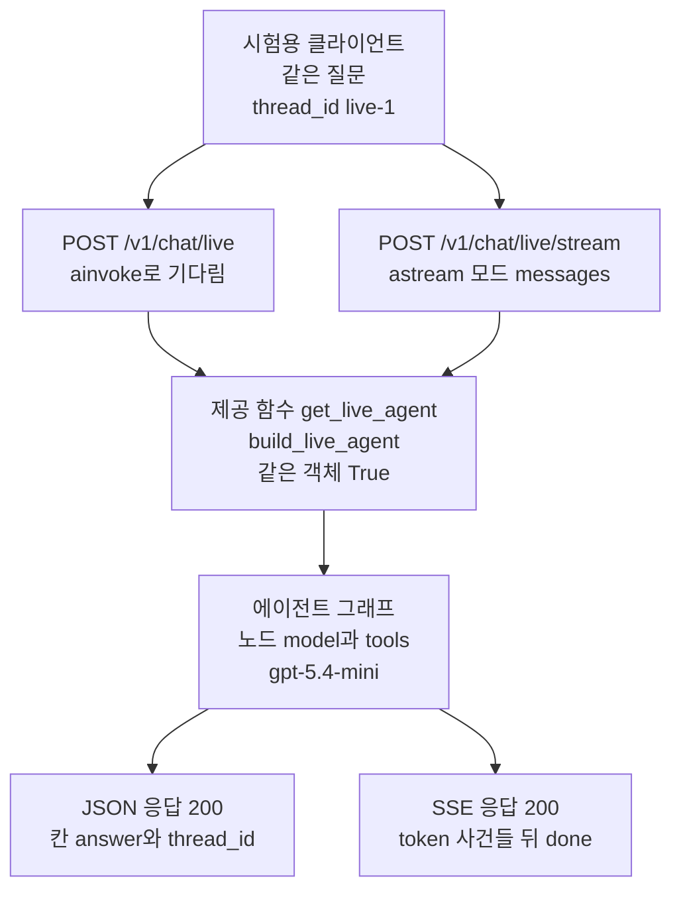
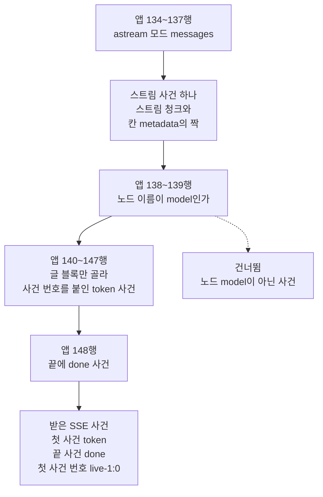
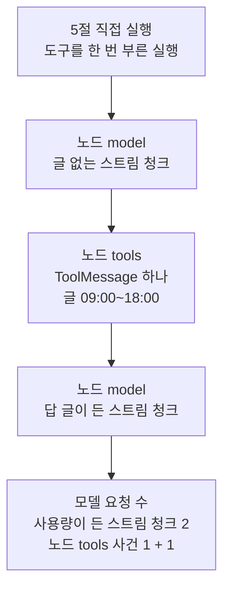
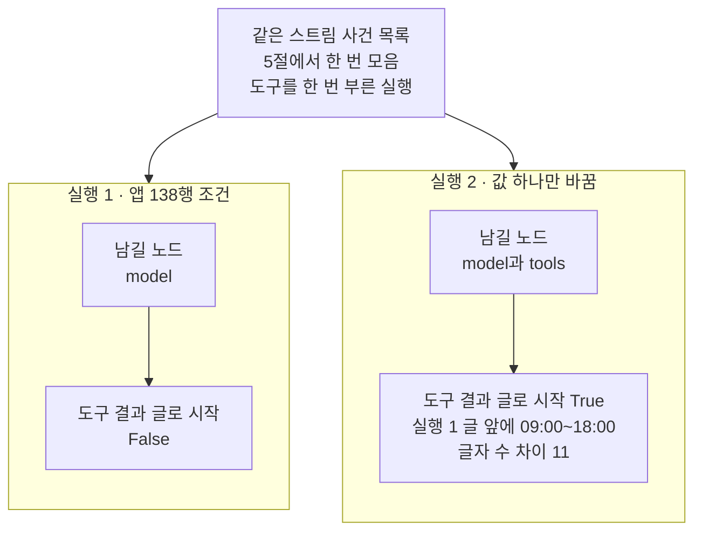

# 09-실제-Agent-HTTP-통합

## _src 본문 (HTML 원본)

```html
<!--meta: 강의 1h | 실습 2h | 코드 notebooks/09-실제-Agent-HTTP-통합.ipynb | 새 용어 0 -->
<style>html,body{overflow-x:hidden}.notebook,.nb-cell,.nb-main,.nb-input,.nb-result{min-width:0;max-width:100%}.nb-input pre,.nb-output{box-sizing:border-box;max-width:100%;overflow-x:auto}code.nb-source{display:block!important;width:100%!important;min-width:0!important;overflow-x:auto!important;padding:0!important}</style>
<h2 id="b1"><span class="no">1</span>학습 목표</h2><div class="goal"><ul>
<li>요청 주소 <code>/v1/chat/live</code>로 실제 모델과 도구를 쓰는 에이전트를 부르고, 응답 본문에 담기는 것과 담기지 않는 것을 가를 수 있습니다.</li>
<li>요청 주소 <code>/v1/chat/live/stream</code>이 모드 <code>messages</code>의 스트림 청크를 SSE 사건으로 보내는 줄을 읽고, 받은 사건을 이어 붙일 수 있습니다.</li>
<li>남길 노드 이름 하나만 바꾼 실험으로, 앱이 노드 <code>model</code>의 사건만 보내는 까닭을 출력으로 설명할 수 있습니다.</li>
</ul></div>
<h2 id="b2"><span class="no">2</span>이 내용을 배우는 이유</h2><p>01절부터 08절까지 요청 주소는 모델을 쓰지 않는 그래프를 불렀습니다. 같은 질문에 늘 같은 답이 와서, 입력 형식과 SSE 사건의 모양을 되풀이해 확인하기 좋았습니다. 그러나 실제 서비스의 에이전트는 모델에게 요청을 보내고, 도구를 부를지도 모델이 정합니다. 그래서 같은 처리 함수 모양에 실제 에이전트를 이었을 때, 무엇이 그대로이고 무엇이 달라지는지 직접 봐야 합니다.</p><p>제목의 Agent는 에이전트를 가리키고, HTTP는 웹에서 요청과 응답을 주고받는 규칙입니다. 제목의 통합은 실제 에이전트를 앱의 처리 함수에 이어, 요청 하나로 끝까지 실행하는 일입니다. 이 절은 이 챕터에서 처음으로 실제 모델을 부릅니다.</p>
<h2 id="b3"><span class="no">3</span>앞에서 배운 내용</h2><p><a href="../../part6/ch21-create-agent/01-create-agent와-ReAct-루프.html">Ch 21 01절</a>에서는 함수 <code>create_agent</code>에 모델과 도구, 시스템 메시지 글을 넘겨 에이전트 그래프를 만들었습니다. 그래프는 노드 <code>model</code>과 <code>tools</code>를 번갈아 실행하고, 모델이 도구를 더 요청하지 않으면 끝났습니다. 이 절의 실습 파일 <code>live_agent.py</code>도 같은 함수로 에이전트를 만듭니다.</p><p><a href="02-의존성으로-Agent-주입.html">02절</a>에서는 제공 함수가 만든 값을 의존성으로 처리 함수에 넘겼습니다. 이 절의 두 요청 주소는 제공 함수 <code>get_live_agent</code>가 만든 실제 에이전트를 받습니다. <a href="05-POST-SSE-이벤트-설계.html">05절</a>에서는 비동기 제너레이터 함수가 SSE 사건을 하나씩 보내는 모양을 읽었습니다. <a href="06-fetch-재연결과-오류-이벤트.html">06절</a>의 함수 <code>read_events</code>·<code>event_names</code>·<code>token_values</code>·<code>ended_with_done</code>은 이 절부터 도구 파일에서 가져옵니다.</p><p><a href="../../part6/ch25-streaming/02-토큰과-중간-진행-스트리밍.html">Ch 25 02절</a>에서는 모드 <code>messages</code>의 스트림 사건이 스트림 청크와 칸 <code>metadata</code>의 짝이었습니다. 칸 <code>metadata</code>의 키 <code>langgraph_node</code>로 스트림 청크가 온 노드를 봤고, 그 절의 그래프는 모델을 부르는 노드가 하나뿐이었습니다. <a href="../../part6/ch29-agent-evaluation/04-운영-지표와-Ch18-궤적-비교.html">Ch 29 04절</a>에서는 에이전트의 모델 요청 수를 「도구를 요청한 응답 수 + 1」로 셌고, 이 절도 같은 셈을 씁니다.</p>
<h2 id="b4"><span class="no">4</span>핵심 개념</h2><h3>비유로 시작하기</h3><p>화물역으로 들어오는 열차에는 손님에게 보낼 짐을 실은 칸만 있는 것이 아닙니다. 짐을 실은 칸들 사이에, 짐 대신 확인 결과만 담은 작은 닫힌 칸이 하나 끼어 있습니다. 역의 갈림길은 짐을 실은 칸만 손님 쪽 큰 선로로 내보냅니다. 확인 결과를 담은 작은 칸은 옆 선로에 남겨 둡니다.</p><p>열차의 칸 하나가 모드 <code>messages</code>의 스트림 사건 하나입니다. 짐을 실은 칸은 노드 <code>model</code>의 스트림 청크이고, 작은 닫힌 칸은 노드 <code>tools</code>가 내놓은 도구 메시지입니다. 갈림길이 앱 138행의 조건이고, 손님 쪽 선로가 SSE 응답입니다.</p><p>비유와 다른 점이 있습니다. 실제 앱은 걸러 낸 사건을 모아 두지 않고 그냥 건너뜁니다. 또 짐 칸이 몇 개인지는 모델 서비스가 글을 나눠 보내는 방식에 따라, 실행마다 달라질 수 있습니다.</p>
{{img:09-5-짐-칸만-나가는-갈림길|흰 바탕에 왼쪽 아래에서 오른쪽 위로 비스듬한 선로가 있고, 왼쪽에서 선로 하나가 갈라져 옆 선로가 됩니다. 큰 선로 위에는 연한 노란색 뚜껑 없는 칸 넷이 한 줄로 서 있고, 칸마다 빨간 사과가 가득 쌓여 있습니다. 왼쪽 옆 선로에는 남색 작은 닫힌 칸 하나가 문을 닫은 채 따로 서 있습니다. 기관차·사람·글자·숫자·화살표는 없는 그림|빨간 사과를 실은 칸 넷은 큰 선로에 이어져 있고, 남색 작은 닫힌 칸 하나만 옆 선로에 따로 서 있습니다.}}
<p class="look"><b>그림 읽기</b> — 오른쪽 위로 뻗은 큰 선로에 연한 노란색 칸 넷이 이어져 있고, 칸마다 빨간 사과가 가득합니다. 왼쪽에서 갈라진 옆 선로에는 남색 작은 닫힌 칸 하나가 따로 서 있습니다. 사과를 실은 칸이 노드 <code>model</code>의 스트림 청크이고, 남색 칸이 노드 <code>tools</code>의 도구 메시지입니다. 선로가 갈라지는 자리가 앱 138행의 조건이고, 큰 선로가 SSE 응답입니다. 그림의 사과 칸은 넷이지만, 실제 스트림 청크 수는 실행마다 달라질 수 있어 개수는 짝짓지 않습니다.</p>
<h3>실제 에이전트를 잇는 곳</h3><p>실습 파일 <code>live_agent.py</code>의 함수 <code>build_live_agent</code>는 모델 객체를 만들어, 도구 <code>lookup_library_hours</code>와 함께 <code>create_agent</code>에 넘깁니다. 모델 설정은 <code>temperature=0</code>·<code>reasoning_effort="none"</code>·<code>timeout=30</code>이고, 앞의 두 값은 이 과정의 모델 셀과 같습니다. 함수 위의 <code>@lru_cache(maxsize=1)</code> 줄 때문에, 에이전트는 처음 부를 때 한 번만 만들어집니다. 앱의 제공 함수 <code>get_live_agent</code>가 이 함수를 불러, 두 요청 주소에 같은 에이전트를 넘깁니다.</p><p>요청 주소 <code>/v1/chat/live</code>는 <code>ainvoke</code>를 45초 시간 제한 안에서 기다리고, 마지막 메시지의 글을 칸 <code>answer</code>에 담습니다. 응답 형식이 칸 둘만 보내므로, 도구를 불렀는지와 모델 요청 수는 응답 본문에 없습니다. 이 처리 함수는 시간 제한 오류를 504로 바꾸지 않아, <a href="02-의존성으로-Agent-주입.html">02절</a>의 <code>/v1/chat</code>과 다릅니다. 이 노트북에서는 시간 제한을 넘기는 장면을 실행하지 않았습니다.</p>
<h3>이 절에서 다시 쓰는 말</h3><table><thead><tr><th>말</th><th>뜻</th></tr></thead><tbody><tr><td>스트림 청크(<a href="../../part6/ch25-streaming/02-토큰과-중간-진행-스트리밍.html">Ch 25 02절</a>)</td><td>모드 <code>messages</code>에서 모델의 답을 여러 번에 나눠 받은 한 덩어리입니다. 모델 서비스가 글을 나눠 보내는 대로 오므로, 나뉘는 자리와 개수는 실행마다 다를 수 있습니다. 이 절에서는 <code>AIMessageChunk</code>이고, 앱이 그 글을 token 사건으로 보냅니다.</td></tr><tr><td>칸 <code>metadata</code>(<a href="../../part6/ch25-streaming/02-토큰과-중간-진행-스트리밍.html">Ch 25 02절</a>)</td><td>모드 <code>messages</code>에서 스트림 청크와 짝으로 오는 딕셔너리로, 사건이 온 노드와 모델의 정보를 담습니다. 키 <code>langgraph_node</code>에 노드 이름이 있습니다. 앱 138행이 이 키로 사건을 거릅니다.</td></tr><tr><td>도구 메시지(<a href="../../part5/ch19-model-tools/05-bind_tools와-병렬-호출.html">Ch 19 05절</a>)</td><td>도구를 실행한 결과를 담은 메시지 <code>ToolMessage</code>입니다. 이 절에서는 노드 <code>tools</code>가 내놓았고, 글은 도구가 내놓은 <code>09:00~18:00</code>이었습니다.</td></tr></tbody></table>
<p>다시 쓰는 말을 이 절 코드에서 보면 이렇습니다. 요청 주소 <code>/v1/chat/live/stream</code>은 스트림 청크의 글을 token 사건으로 보냈습니다. 5절에서 에이전트를 직접 부르자, 칸 <code>metadata</code>의 노드 이름이 <code>tools</code>인 사건 하나가 도구 메시지였습니다.</p>
{{mermaid:09-1-두-요청-주소와-실제-에이전트|위에서 아래로 읽는 흐름도입니다. 맨 위 파란 상자 시험용 클라이언트 같은 질문 thread_id live-1에서 초록 상자 둘로 갈라집니다. 왼쪽은 POST /v1/chat/live ainvoke로 기다림, 오른쪽은 POST /v1/chat/live/stream astream 모드 messages입니다. 두 상자는 초록 상자 제공 함수 get_live_agent build_live_agent 같은 객체 True로 모이고, 보라 상자 에이전트 그래프 노드 model과 tools gpt-5.4-mini로 이어집니다. 맨 아래 노란 상자 둘은 JSON 응답 200 칸 answer와 thread_id, SSE 응답 200 token 사건들 뒤 done인 그림|두 요청 주소는 같은 제공 함수에서 같은 실제 에이전트를 받아, JSON 응답과 SSE 응답을 보냈습니다.}}
<p class="look"><b>도식 읽기</b> — 위에서 아래로 읽습니다. 파란 상자는 노트북이 보낸 요청이고, 초록 상자는 실습 앱의 처리 함수와 제공 함수입니다. 보라 상자는 이 절에서 실제로 부른 모델을 쓰는 에이전트 그래프입니다. 노란 상자 둘은 노트북 3절과 4절의 출력입니다.</p>
<h3>스트림 청크를 SSE 사건으로 보내는 곳</h3><p>요청 주소 <code>/v1/chat/live/stream</code>은 <a href="04-astream과-응답-스트림.html">04절</a>의 <code>astream</code>을 모드 <code>messages</code>로 부릅니다. 앱 138~139행은 스트림 사건마다 칸 <code>metadata</code>의 노드 이름을 보고, <code>model</code>이 아니면 건너뜁니다. 140~147행은 남은 스트림 청크에서 글 블록만 골라, 사건 번호를 붙인 token 사건으로 보냅니다. 스트림이 끝나면 <code>done</code> 사건을 보내고, 오류가 나면 오류 코드 <code>live_stream_failed</code>를 담은 오류 사건을 보냅니다.</p><p>LangGraph 문서는 모드 <code>messages</code>를 모델의 스트림 청크를 받는 모드로 설명합니다. 설치판 langgraph 1.2.11의 소스는 노드가 끝날 때 내놓은 메시지도 이 모드로 내보냅니다. 스트림 청크로 이미 보낸 메시지는 빼고 내보냅니다. 노드 <code>tools</code>의 도구 메시지가 그런 메시지인지를 5절 실험이 출력으로 봅니다.</p>
{{mermaid:09-2-스트림-청크를-SSE-사건으로|위에서 아래로 읽는 흐름도입니다. 초록 상자 앱 134~137행 astream 모드 messages에서 회색 상자 스트림 사건 하나 스트림 청크와 칸 metadata의 짝으로 갑니다. 이어서 초록 상자 앱 138~139행 노드 이름이 model인가에서, 실선은 초록 상자 앱 140~147행 글 블록만 골라 사건 번호를 붙인 token 사건으로, 점선은 회색 상자 건너뜀 노드 model이 아닌 사건으로 갈라집니다. 실선은 초록 상자 앱 148행 끝에 done 사건을 지나 노란 상자 받은 SSE 사건 첫 사건 token 끝 사건 done 첫 사건 번호 live-1:0에 닿는 그림|앱은 모드 messages의 스트림 사건 가운데 노드 model의 것만 남겨, 글 블록을 token 사건으로 보냈습니다.}}
<p class="look"><b>도식 읽기</b> — 위에서 아래로 읽습니다. 초록 상자는 노트북 4절에서 출력한 앱 파일의 줄이고, 위쪽 회색 상자는 라이브러리가 넘겨 주는 사건입니다. 점선은 앱이 건너뛰는 갈래이고, 맨 아래 노란 상자는 노트북 4절의 출력입니다.</p>
<h2 id="b5"><span class="no">5</span>실행 예제</h2><p>노트북 2절은 실습 파일 <code>live_agent.py</code>를 글로 읽고, 도구를 모델 없이 직접 부릅니다. 3절은 요청 주소 <code>/v1/chat/live</code>의 처리 함수를 읽고, 질문 하나를 보내 JSON 답을 받습니다. 4절은 <code>/v1/chat/live/stream</code>의 처리 함수를 읽고, 같은 질문의 SSE 사건을 읽어 이어 붙입니다. 5절은 에이전트를 직접 불러 모은 스트림 사건으로 실험합니다.</p><p>모델 요청은 에이전트가 도구를 한 번씩 부르면 여섯 번이고, 3·4·5절에서 두 번씩 나갑니다. 요금표(2026-09-17)로 어림한 비용은 0.002달러보다 적고, 청구 금액이 아닙니다. 서버 프로그램 없이 시험용 클라이언트로 요청하고, 걸린 시간은 재지 않았습니다.</p>
{{notebook:09-실제-Agent-HTTP-통합}}
<p class="look"><b>확인할 점</b> — 노트북 3절에서 <code>상태 코드: 200</code>과 <code>응답 본문의 칸: ['answer', 'thread_id']</code>를 찾습니다. 4절에서는 첫 사건과 마지막 사건의 이름 <code>token done</code>과 <code>첫 사건 번호: live-1:0</code>을 봅니다. 답 글과 SSE 사건 수는 모델이 쓴 글에서 나온 값이라, 교재 출력과 다를 수 있습니다.</p>
{{mermaid:09-3-도구를-한-번-부른-실행의-사건-차례|위에서 아래로 읽는 흐름도입니다. 파란 상자 5절 직접 실행 도구를 한 번 부른 실행에서, 보라 상자 노드 model 글 없는 스트림 청크, 초록 상자 노드 tools ToolMessage 하나 글 09:00~18:00, 보라 상자 노드 model 답 글이 든 스트림 청크를 차례로 지납니다. 맨 아래 노란 상자는 모델 요청 수 사용량이 든 스트림 청크 2 노드 tools 사건 1 + 1인 그림|도구를 한 번 부른 실행에서 스트림 사건은 노드 model, tools, model 차례로 왔고, 모델 요청은 두 번이었습니다.}}
<p class="look"><b>도식 읽기</b> — 위에서 아래로 읽습니다. 보라 상자 둘은 실제로 부른 모델의 노드에서 온 사건이고, 초록 상자는 도구 노드에서 온 사건입니다. 차례와 요청 수는 모델이 도구를 한 번 부른 실행의 값이고, 노트북 5절의 출력입니다. 첫 보라 상자에 글이 없다는 것은, 실행 2의 글이 도구 결과 글로 시작한 데서 읽습니다.</p>
<h2 id="b6"><span class="no">6</span>실험 결과 해석</h2><p>가설은 <a href="../../part6/ch25-streaming/02-토큰과-중간-진행-스트리밍.html">Ch 25 02절</a>의 그래프와 이 에이전트 그래프의 차이에서 세웠습니다. Ch 25 02절의 그래프는 모델을 부르는 노드가 하나였고, 이 그래프는 노드 <code>model</code>과 <code>tools</code>를 번갈아 실행합니다. 실험은 5절에서 한 번 모은 스트림 사건 목록에, 남길 노드 이름 목록만 바꿔 두 번 적용했습니다. 실행 1은 앱 138행과 같은 <code>["model"]</code>이고, 실행 2는 <code>["model", "tools"]</code>입니다.</p>
{{mermaid:09-4-남긴-노드만-바꾼-두-실행|맨 위 회색 상자 같은 스트림 사건 목록 5절에서 한 번 모음 도구를 한 번 부른 실행 아래에 칸 둘이 나란히 있습니다. 왼쪽 칸 실행 1 앱 138행 조건에는 초록 상자 남길 노드 model에서 노란 상자 도구 결과 글로 시작 False로 이어집니다. 오른쪽 칸 실행 2 값 하나만 바꿈에는 파란 상자 남길 노드 model과 tools에서 노란 상자 도구 결과 글로 시작 True 실행 1 글 앞에 09:00~18:00 글자 수 차이 11로 이어지는 그림|남길 노드에 tools를 더하자, 도구 결과 글 09:00~18:00이 답 글 앞에 붙었습니다.}}
<p class="look"><b>도식 읽기</b> — 맨 위 회색 상자는 두 실행이 함께 쓴 사건 목록입니다. 왼쪽 칸이 실행 1, 오른쪽 칸이 실행 2이고, 칸마다 위가 남길 노드 목록, 아래가 노트북 5절의 출력입니다. 오른쪽 칸의 파란 상자가 바꾼 값입니다.</p>
<table><thead><tr><th>견준 것</th><th>실행 1</th><th>실행 2</th></tr></thead><tbody><tr><td>바꾼 값 — 남길 노드 이름 목록</td><td><code>["model"]</code>(앱 138행 조건)</td><td><code>["model", "tools"]</code></td></tr><tr><td>도구 결과 글로 시작하는가</td><td><code>False</code></td><td><code>True</code></td></tr><tr><td>실행 1 글 앞에 도구 결과 글을 붙인 것과 같은가</td><td>—</td><td><code>True</code></td></tr><tr><td>글자 수 차이</td><td>—</td><td><code>11</code> — 도구 결과 글 <code>09:00~18:00</code>의 글자 수 <code>11</code>과 같음</td></tr><tr><td>글자 수(교재 출력, 실행마다 다를 수 있음)</td><td><code>32</code></td><td><code>43</code></td></tr></tbody></table>
<p>모드 <code>messages</code>는 모델의 스트림 청크뿐 아니라, 노드 <code>tools</code>가 내놓은 도구 메시지도 사건으로 내놓았습니다. 그래서 노드 <code>tools</code>까지 남긴 실행 2에서는 도구 결과 글이 답 글 앞에 붙었습니다. 앱이 138행 없이 사건을 보냈다면, 받는 쪽이 이어 붙인 글은 실행 2의 글과 같은 모양이었을 것입니다. 이 절은 앱을 고쳐 그 모양을 실행하지는 않았습니다.</p><p>노드 차례와 요청 수는 모델이 정한 값입니다. 흔들림 확인 다섯 번과 새 커널 두 번에서 모두, 모델은 도구를 한 번 부르고 답을 썼습니다. 그 실행에서 노드 차례는 model, tools, model이었고 요청은 두 번이었습니다. 셈으로 쓰면, 요청 수는 도구를 요청한 응답 수에 1을 더한 값입니다. 모델이 도구를 부르지 않은 실행이라면 노드 <code>tools</code>의 사건이 없어, 두 실행의 글이 같아집니다.</p><p>이 절은 모델이 쓴 답 글이 맞는지 판정하지 않았습니다. 궤적이나 답을 평가하려면 <a href="../../part6/ch29-agent-evaluation/01-에이전트-평가-세-전략.html">Ch 29 01절</a>의 궤적 맞춰 보기나 <a href="../../part6/ch29-agent-evaluation/03-LLM-judge로-궤적-평가.html">03절</a>의 평가 모델 판정을 씁니다.</p>
<p>새 커널로 두 번 실행해 견주자, 코드 셀의 출력이 셀마다 모두 같았습니다. 한 번은 프로젝트 맨 위에서, 한 번은 <code>notebooks/</code> 폴더에서 연 커널이었습니다. 모델이 쓴 답 글과 사건 수까지 같았지만, 다시 실행하면 달라질 수 있어 결론에는 쓰지 않았습니다. 노트북 밖에서 같은 코드를 다섯 번 실행한 흔들림 확인에서도 값이 모두 같았습니다.</p>
<p class="look"><b>확인할 점</b> — 5절에서 <code>노드 차례: ['model', 'tools', 'model']</code>과 요청 수 두 줄의 <code>2</code>를 찾습니다. 결과 표의 줄 <code>도구 결과 글로 시작하는가 | False | True</code>와 <code>글자 수 차이 | 11</code>도 확인합니다. 모델이 도구를 부르지 않은 실행이라면 노드 <code>tools</code>의 사건이 없어, 두 실행의 글이 같아집니다.</p>
<h2 id="b7"><span class="no">7</span>주의할 점과 실무 메모</h2><ul><li>두 요청 주소의 응답에는 답 글만 담깁니다. 도구를 불렀는지는 5절처럼 에이전트를 따로 실행해야 보였고, 그 실행은 3·4절 요청과 같은 차례라고 할 수 없습니다. 교재를 만들 때 노트북 밖에서 같은 코드를 다섯 번 실행했습니다. 도구 함수가 받은 인자를 적어 보니, 3·4·5절 자리 모두 월요일 인자로 한 번씩 실행되었습니다.</li><li>같은 요청도 실행한 때에 따라 도구를 부르는 모양과 답 글이 달라질 수 있습니다. 모델 설정 temperature를 0으로 두어도, 늘 같은 글이 나온다고 할 수 없습니다. 흔들림 확인 다섯 번에서는 답 글과 사건 수까지 모두 같았지만, 모델이 쓴 값이라 결론에 쓰지 않았습니다.</li><li>요청 주소 <code>/v1/chat/live</code>는 45초 시간 제한 오류를 504로 바꾸지 않습니다. 노트북 밖에서 시간 제한 오류를 곧바로 일으키는 시험용 객체를 따로 만들어, 제공 함수 재정의로 넣어 보았습니다. 시험용 클라이언트가 서버 오류를 올리지 않게 설정하자, 서버처럼 상태 코드 500이 왔습니다. 노트북과 같은 기본 설정에서는 오류가 그대로 올라옵니다.</li><li>같은 시험용 객체로 스트림 쪽은 상태 코드 200과 오류 코드 <code>live_stream_failed</code>의 오류 사건을 보냈습니다. 시간 제한 45초는 코드에 적혀 있어, 02절처럼 제공 함수로 바꿀 수 없습니다.</li><li>모델 요청 하나는 <code>timeout=30</code>에 따라 30초까지 기다립니다. 이 절의 실행에서는 시간 제한에 걸린 요청이 없었습니다.</li><li>키가 없으면 키 셀의 <code>assert</code>가 멈춥니다. 그 셀을 건너뛰고 실행하면 모델 객체를 만드는 줄에서 오류 <code>OpenAIError</code>가 나고, 시험용 클라이언트도 그 오류를 그대로 올립니다. 노트북 밖에서 키 없이 확인했고, 그때 모델 요청은 나가지 않았습니다.</li><li>시험용 클라이언트는 응답이 끝난 뒤 본문을 한꺼번에 줍니다. 그래서 token 사건이 도착한 때와, 스트리밍으로 답을 얼마나 먼저 보는지는 이 절 결과로 말할 수 없습니다. 걸린 시간도 재지 않았습니다.</li><li>설치판 langgraph 1.2.11 <code>pregel/_messages.py</code> 223~246행은 노드가 끝날 때 내놓은 메시지를 찾습니다. 그 가운데 앞에서 보내지 않은 것을 모드 <code>messages</code>로 내보냅니다. LangGraph 문서의 스트리밍 안내는 이 경우를 적지 않고, 이 절은 설치판의 출력을 기준으로 썼습니다.</li><li>모델 요청 수는 사용량이 든 스트림 청크 수로 셌습니다. 3·4절의 응답 본문에는 사용량이 없어, 두 요청 주소의 요청 수는 셈으로만 말할 수 있습니다. 요금표로 어림한 비용은 청구 금액이 아닙니다.</li><li>교재 출력은 Linux의 Python 3.12.13으로 만들었고, 다른 판과 Windows·macOS에서는 실행하지 않았습니다.</li></ul>
<h2 id="b8"><span class="no">8</span>정리와 다음 절</h2><ul><li>실습 앱의 두 요청 주소는 실제 모델과 도구를 쓰는 에이전트를 03·05절과 같은 모양으로 불렀습니다.</li><li>요청 주소 <code>/v1/chat/live/stream</code>은 스트림 청크의 글을 token 사건으로 보냈고, 끝 사건은 <code>done</code>이었습니다.</li><li>모드 <code>messages</code>는 도구 메시지도 내놓아서, 앱 138행이 노드 <code>model</code>의 사건만 골라 보냈습니다.</li></ul><p><strong>다음 학습과 이어지는 지점</strong> — <a href="10-FastAPI-서빙-실습.html">10절</a>에서는 05~07절의 사전 요청·SSE 응답·이어 받기를 한 흐름으로 이어 실행합니다. 접근 토큰 하나만 바꾼 실행과 견주고, 모델은 부르지 않습니다.</p>
<h2 id="b9"><span class="no">9</span>복습 문제</h2><details class="quiz" open><summary>문제 5개 · 해설 포함</summary><p class="quiz-q">1. 요청 주소 <code>/v1/chat/live</code>의 응답 본문에 도구를 부른 기록이 없는 까닭은 무엇인가요?</p><p class="quiz-a">응답 형식 <code>ChatResponse</code>가 칸 <code>answer</code>와 <code>thread_id</code>만 보내기 때문입니다. 처리 함수도 결과 딕셔너리에서 마지막 메시지의 글만 꺼냅니다. 틀렸다면 노트북 3절을 다시 읽습니다.</p><p class="quiz-q">2. 실습 파일 <code>live_agent.py</code>에서 과정의 모델 셀과 같게 둔 모델 설정 둘은 무엇인가요?</p><p class="quiz-a">두 설정은 <code>temperature=0</code>과 <code>reasoning_effort="none"</code>입니다. 함께 적힌 <code>timeout=30</code>은 모델 요청 하나를 기다리는 한도입니다. 틀렸다면 노트북 2절을 다시 읽습니다.</p><p class="quiz-q">3. 동료가 「<code>/v1/chat/live</code>도 45초를 넘기면 02절처럼 504가 온다」고 말합니다. 맞나요?</p><p class="quiz-a">맞지 않습니다. 이 처리 함수에는 시간 제한 오류를 504로 바꾸는 줄이 없어, 오류가 그대로 올라갑니다. 노트북 밖에서 시간 제한 오류를 일으키는 시험용 객체를 넣었습니다. 시험용 클라이언트가 서버 오류를 올리지 않게 하자, 상태 코드 500이 왔습니다. 틀렸다면 노트북 3절을 다시 읽습니다.</p><p class="quiz-q">4. 5절에서 노드 <code>tools</code>가 내놓은 사건은 무엇이었고, 앱은 그 사건을 어떻게 다루나요?</p><p class="quiz-a">글이 <code>09:00~18:00</code>인 도구 메시지 <code>ToolMessage</code>였습니다. 앱 138행은 노드 이름이 <code>model</code>이 아닌 사건을 건너뛰어, 이 사건을 보내지 않습니다. 틀렸다면 노트북 5절을 다시 읽습니다.</p><p class="quiz-q">5. 실험 실행 2의 글은 실행 1과 어떻게 달랐고, 모델이 도구를 부르지 않았다면 어떻게 되나요?</p><p class="quiz-a">실행 2의 글은 실행 1의 글 앞에 도구 결과 글이 붙어 있었습니다. 모델이 도구를 부르지 않으면 노드 <code>tools</code>의 사건이 없어, 두 글이 같아집니다. 틀렸다면 노트북 5절을 다시 읽습니다.</p></details>
<h2 id="b10"><span class="no">10</span>참고 자료</h2><ul><li><div><a href="https://docs.langchain.com/oss/python/langchain/agents">LangChain Agents</a></div>확인 2026-09-29 · 에이전트는 과제를 마칠 때까지 모델이 도구를 되풀이해 부르는 것이라고 적습니다. 인자 <code>system_prompt</code>는 글이나 <code>SystemMessage</code>를 받는다고 적습니다.</li><li><div><a href="https://docs.langchain.com/oss/python/langgraph/streaming">LangGraph Streaming</a></div>확인 2026-09-29 · 모드 <code>messages</code>는 스트림 청크와 딕셔너리의 짝을 내놓는다고 적습니다. 딕셔너리의 <code>langgraph_node</code>로 노드를 골라 거를 수 있다고 적고, 비동기 예로 <code>astream</code>을 보입니다. 노드가 내놓은 도구 메시지는 적지 않습니다.</li><li><div><a href="https://developers.openai.com/api/docs/guides/reasoning">OpenAI Reasoning models</a></div>확인 2026-09-29 · 추론 노력 값으로 <code>none</code>부터 <code>max</code>까지를 들고, 지원하는 값은 모델마다 다르다고 적습니다. 값 <code>none</code>은 빨리 답해야 하는 일에 맞는다고 적습니다.</li><li>설치판 langgraph 1.2.11 소스 <code>pregel/_messages.py</code> 67행은 이 처리기가 모델과 노드의 메시지를 내보낸다고 적습니다. 97~104행은 메시지를 한 번만 내보내고, 106~121행과 223~246행은 노드가 끝날 때 내놓은 메시지를 찾습니다.</li><li>설치판 langchain-core 1.6.2 소스 <code>messages/base.py</code> 262~291행은 속성 <code>text</code>입니다. 글 블록만 이어 붙이고, 다른 블록은 뺍니다.</li><li>실습 폴더 <code>agent_service/live_agent.py</code> 8~12행은 도구 함수, 15~28행은 에이전트를 만드는 함수입니다. 18~23행이 모델 설정입니다.</li><li>실습 폴더 <code>agent_service/app.py</code> 33~34행은 제공 함수 <code>get_live_agent</code>입니다. 86~92행은 요청 주소 <code>/v1/chat/live</code>, 127~154행은 <code>/v1/chat/live/stream</code>의 처리 함수입니다.</li></ul>
```

## 노트북 셀 (순서대로)

### [0] markdown {'html': 'skip'}

# 실제 Agent HTTP 통합

**이 노트북에서 할 일**

1. 실제 모델과 도구를 쓰는 실습 에이전트를 요청 주소 `/v1/chat/live`로 불러 JSON 답을 받습니다.
2. 같은 에이전트를 요청 주소 `/v1/chat/live/stream`으로 불러, 스트림 청크가 SSE 사건으로 오는 모양을 봅니다.
3. 앱이 노드 `model`의 스트림 청크만 보내는 까닭을 실험으로 확인합니다.

**준비물** — 이 노트북은 이 챕터에서 처음으로 실제 모델을 부릅니다.
프로젝트 폴더의 `.env` 파일에 `OPENAI_API_KEY`가 있어야 합니다.
키가 없으면 키를 확인하는 셀에서 멈추고, 모델 요청은 나가지 않습니다.
모델은 실습 앱 파일에 적힌 `gpt-5.4-mini`입니다.

모델 요청은 에이전트가 도구를 한 번씩 부르면 여섯 번입니다.
3·4·5절에서 에이전트를 한 번씩 실행하고, 실행마다 요청이 두 번 나갑니다.
요금표(2026-09-17)로 어림한 비용은 0.002달러보다 적습니다.
청구 금액이 아니라, 교재를 만들 때 본 사용량으로 어림한 값입니다.
실행마다 답 글이 달라질 수 있습니다.

요청은 시험용 클라이언트로 같은 노트북 안에서 보냅니다.
서버 프로그램을 띄우지 않고, 포트를 쓰지 않습니다.
네트워크는 모델 서비스에 요청을 보낼 때만 씁니다.
실습 폴더의 파일은 가져오고 읽기만 하며, 쓰는 파일은 없습니다.
걸린 시간은 재지 않았습니다.

**기준 버전** — 첫 셀에서 패키지 여덟을 설치합니다.
판은 fastapi 0.135.0, httpx 0.28.1, pydantic 2.12.5, starlette 1.6.0입니다.
실습 앱 파일은 패키지 langgraph 1.2.11과 langchain 1.4.0을 가져옵니다.
모델을 부를 때는 패키지 langchain-openai 1.6.0을 씁니다.
패키지 python-dotenv 1.2.1은 `.env` 파일에서 키를 읽을 때 씁니다.

여덟 모두 실습 폴더 잠금과 같은 판입니다.
교재 출력은 Linux의 Python 3.12.13으로 만들었습니다.
다른 판과 Windows·macOS에서는 실행하지 않았습니다.

**강의와 실습 범위** — 강의 시간에는 2~4절의 앱 파일 줄을 읽고, 5절 실험의 가설을 함께 세웁니다.
모델을 부르는 3~5절의 셀은 실습 시간에 실행합니다.

실습 폴더 `labs/part7/ch30-fastapi-serving`에서 `uv sync --locked`를 실행합니다.
그다음 `notebooks/` 폴더의 이 노트북을 열고, 실습 폴더의 `.venv` 커널을 고릅니다.
첫 셀부터 순서대로 실행합니다.

### [1] markdown {'html': 'skip'}

## 오늘 볼 그림


위에서 아래로 읽습니다.
파란 상자는 노트북이 보낸 요청이고, 초록 상자는 실습 앱의 처리 함수와 제공 함수입니다.
보라 상자는 이 절에서 실제로 부른 모델을 쓰는 에이전트 그래프입니다.
노란 상자 둘은 노트북 3절과 4절의 출력입니다.

### [2] markdown {}

## 1. 준비

08절에서는 앱 객체가 만든 응답 문서를 읽었고, 요청 주소 다섯이 적혀 있었습니다.
01~08절의 요청 주소는 모델을 쓰지 않는 그래프를 불렀습니다.
이 절은 남은 두 요청 주소 `/v1/chat/live`와 `/v1/chat/live/stream`을 부릅니다.
두 요청 주소는 실제 모델과 도구를 쓰는 에이전트를 부릅니다.

제목의 Agent는 에이전트를 가리키고, HTTP는 웹에서 요청과 응답을 주고받는 규칙입니다.
제목의 통합은 실제 에이전트를 앱의 처리 함수에 이어, 요청 하나로 끝까지 실행하는 일입니다.
첫 셀은 패키지 여덟을 설치하고 설치된 판 번호를 출력합니다.
설치에는 몇십 초가 걸릴 수 있습니다.

### [3] code {'execution': {'iopub.execute_input': '2026-09-29T11:36:32.664169Z', 'iopub.status.busy': '2026-09-29T11:36:32.664000Z', 'iopub.status.idle': '2026-09-29T11:36:33.332850Z', 'shell.execute_reply': '2026-09-29T11:36:33.332249Z'}, 'lesson_role': 'setup'}

```python
# 이 절에서 쓰는 패키지를 설치하고 버전을 확인합니다
%pip install -q "fastapi==0.135.0" "httpx==0.28.1" "pydantic==2.12.5" "starlette==1.6.0" "langgraph==1.2.11" "langchain==1.4.0" "langchain-openai==1.6.0" "python-dotenv==1.2.1"
from importlib.metadata import version

print("fastapi:", version("fastapi"))
print("httpx:", version("httpx"))
print("pydantic:", version("pydantic"))
print("starlette:", version("starlette"))
print("langgraph:", version("langgraph"))
print("langchain:", version("langchain"))
print("langchain-openai:", version("langchain-openai"))
print("python-dotenv:", version("python-dotenv"))
```

출력:
```
Note: you may need to restart the kernel to use updated packages.
fastapi: 0.135.0
httpx: 0.28.1
pydantic: 2.12.5
starlette: 1.6.0
langgraph: 1.2.11
langchain: 1.4.0
langchain-openai: 1.6.0
python-dotenv: 1.2.1

```

### [4] markdown {}

**결과 읽기** — 출력 줄 `langchain-openai: 1.6.0`과 `python-dotenv: 1.2.1`이 보입니다.
07·08절의 패키지 여섯에 두 패키지를 더했습니다.
패키지 langchain-openai는 실습 앱이 OpenAI 모델을 부를 때 씁니다.
패키지 python-dotenv는 `.env` 파일에서 키를 읽을 때 씁니다.

다음 셀은 이 절에서 쓸 이름을 가져옵니다.
04·06절에서 배운 함수 다섯은 도구 파일 `serve_tools.py`에서 가져옵니다.

### [5] code {'execution': {'iopub.execute_input': '2026-09-29T11:36:33.333888Z', 'iopub.status.busy': '2026-09-29T11:36:33.333796Z', 'iopub.status.idle': '2026-09-29T11:36:33.529923Z', 'shell.execute_reply': '2026-09-29T11:36:33.529484Z'}, 'lesson_role': 'setup'}

```python
# 이 절에서 쓸 이름을 가져옵니다(os와 json은 Python에 들어 있는 모듈입니다)
import os
import json
from fastapi.testclient import TestClient
# 04·06절에서 배운 함수 다섯은 도구 파일에서 가져옵니다
from serve_tools import ended_with_done, event_names, join_tokens, read_events, token_values

print("가져온 이름:", "json, TestClient")
print("도구 파일에서 가져온 함수:", "ended_with_done, event_names, join_tokens, read_events, token_values")
```

출력:
```
가져온 이름: json, TestClient
도구 파일에서 가져온 함수: ended_with_done, event_names, join_tokens, read_events, token_values

```

### [6] markdown {}

**결과 읽기** — 출력 줄 `도구 파일에서 가져온 함수:` 뒤에 함수 다섯이 보입니다.
함수 `join_tokens`는 04절에서, 나머지 넷은 06절에서 배웠습니다.
06절 함수 넷은 이 절부터 도구 파일에 있고, 그 절 노트북의 셀을 주석과 본문 그대로 옮겼습니다.
함수 `read_events`가 부르는 05절 함수 `split_sse`와 `parse_sse`도 도구 파일에 있습니다.
함수 `token_values`가 모듈 json을 쓰므로, 도구 파일 머리에 가져오기 줄 하나를 더했습니다.

앞에서 배운 함수는 `serve_tools.py`에 모아 두었습니다.
파일을 열면 코드를 볼 수 있습니다.
노트북과 같은 폴더(`notebooks/`)에 있는 파일입니다.
커널이 `notebooks/` 폴더에서 시작해야 이 파일을 가져올 수 있습니다.
교재 출력을 만든 실행 도구는 이 폴더를 따로 알려 주어, 다른 자리에서 시작해도 가져오기가 되었습니다.

다음 셀은 `.env` 파일에서 API 키를 읽고, 키가 있는지만 출력합니다.

### [7] code {'execution': {'iopub.execute_input': '2026-09-29T11:36:33.530561Z', 'iopub.status.busy': '2026-09-29T11:36:33.530512Z', 'iopub.status.idle': '2026-09-29T11:36:33.533720Z', 'shell.execute_reply': '2026-09-29T11:36:33.533389Z'}, 'lesson_role': 'setup'}

```python
# .env 파일에서 OpenAI API 키를 읽습니다(키 값은 출력하지 않습니다)
import os
from dotenv import find_dotenv, load_dotenv

env_path = find_dotenv(usecwd=True)
load_dotenv(env_path)
has_key = os.getenv("OPENAI_API_KEY") is not None
print("OPENAI_API_KEY 설정 여부:", has_key)
assert has_key, "프로젝트 폴더의 .env 파일에 OPENAI_API_KEY를 적어 주세요."
```

출력:
```
OPENAI_API_KEY 설정 여부: True

```

### [8] markdown {}

**결과 읽기** — 출력 줄 `OPENAI_API_KEY 설정 여부: True`가 보입니다.
키 값은 출력하지 않고, 있는지만 봅니다.
키가 없으면 이 셀의 `assert`가 멈추고, `.env` 파일에 키를 적으라는 글을 보입니다.
그러면 뒤 셀로 가지 않아, 모델 요청도 나가지 않습니다.

다음 셀은 01절 2절과 같은 파일 위치 셀로, 후보 셋 가운데 실습 폴더를 고릅니다.

### [9] code {'execution': {'iopub.execute_input': '2026-09-29T11:36:33.534352Z', 'iopub.status.busy': '2026-09-29T11:36:33.534299Z', 'iopub.status.idle': '2026-09-29T11:36:33.536665Z', 'shell.execute_reply': '2026-09-29T11:36:33.536252Z'}}

```python
# 노트북을 연 자리에서 본 실습 폴더의 위치를 후보 셋 가운데에서 고릅니다
candidates = ["..", ".", "labs/part7/ch30-fastapi-serving"]
lab_path = None
for candidate in candidates:
    if os.path.exists(candidate + "/agent_service/schemas.py"):
        lab_path = candidate
        break
print("실습 폴더를 찾았는가:", lab_path is not None)
assert lab_path is not None, "notebooks 폴더나 실습 폴더 맨 위에서 노트북을 열어 주세요."
```

출력:
```
실습 폴더를 찾았는가: True

```

### [10] markdown {}

**결과 읽기** — 출력 줄 `실습 폴더를 찾았는가: True`가 보입니다.
고른 후보는 연 자리마다 달라서 출력하지 않습니다.
실습 폴더 맨 위에서 연 커널은 이 안내를 보기 전에, 앞 셀의 도구 파일 가져오기에서 먼저 멈춥니다.

다음 셀은 작업 폴더를 실습 폴더로 옮긴 뒤 이름을 가져옵니다.
앱 파일에서는 앱 객체 `app`을 가져옵니다.
실제 에이전트 파일 `live_agent.py`에서는 에이전트를 만드는 함수와 도구를 가져옵니다.

### [11] code {'execution': {'iopub.execute_input': '2026-09-29T11:36:33.537183Z', 'iopub.status.busy': '2026-09-29T11:36:33.537137Z', 'iopub.status.idle': '2026-09-29T11:36:34.034234Z', 'shell.execute_reply': '2026-09-29T11:36:34.033804Z'}}

```python
# 작업 폴더를 실습 폴더로 옮기고, 앱 객체와 실제 에이전트 파일의 두 이름을 가져옵니다
os.chdir(lab_path)
from agent_service.app import app
from agent_service.live_agent import build_live_agent, lookup_library_hours
print("가져온 앱 객체의 종류:", type(app).__name__)
print("가져온 함수:", build_live_agent.__name__)
print("가져온 도구의 종류와 이름:", type(lookup_library_hours).__name__, lookup_library_hours.name)
```

출력:
```
가져온 앱 객체의 종류: FastAPI
가져온 함수: build_live_agent
가져온 도구의 종류와 이름: StructuredTool lookup_library_hours

```

### [12] markdown {}

**결과 읽기** — 출력 줄 `가져온 도구의 종류와 이름: StructuredTool lookup_library_hours`가 보입니다.
Ch 19 01절에서 본 것처럼, 데코레이터 줄 `@tool`로 등록한 함수는 도구 객체가 됩니다.
함수 `build_live_agent`는 아직 부르지 않아서, 모델 객체도 아직 없습니다.

## 2. 실습 앱의 실제 에이전트

파일 `agent_service/live_agent.py`는 실제 모델과 도구 하나로 에이전트를 만듭니다.
Ch 21 01절에서 함수 `create_agent`로 만든 에이전트 그래프와 같은 모양입니다.
다음 셀은 이 파일을 글로 읽어, 도구 함수가 적힌 8~12행을 출력합니다.

### [13] code {'execution': {'iopub.execute_input': '2026-09-29T11:36:34.034903Z', 'iopub.status.busy': '2026-09-29T11:36:34.034849Z', 'iopub.status.idle': '2026-09-29T11:36:34.037356Z', 'shell.execute_reply': '2026-09-29T11:36:34.036921Z'}}

```python
# 실제 에이전트 파일을 글로 읽어, 도구 함수가 적힌 8~12행을 출력합니다
first_line = 8
last_line = 12
with open("agent_service/live_agent.py", encoding="utf-8") as agent_file:
    agent_lines = agent_file.read().splitlines()
print("줄 번호 | 줄")
for index in range(first_line - 1, last_line):
    print(index + 1, "|", agent_lines[index])
```

출력:
```
줄 번호 | 줄
8 | @tool
9 | def lookup_library_hours(day: str) -> str:
10 |     """한빛도서관의 요일별 운영 시간을 조회합니다."""
11 |     hours = {"월요일": "09:00~18:00", "화요일": "09:00~21:00"}
12 |     return hours.get(day, "해당 요일의 운영 시간 정보가 없습니다")

```

### [14] markdown {}

**결과 읽기** — 라벨 줄 아래 8~12행이 도구 함수 `lookup_library_hours`입니다.
11행의 딕셔너리가 요일별 운영 시간 표이고, 월요일과 화요일만 있습니다.
12행의 메서드 `get`은 표에 없는 요일이면 둘째 인자의 글을 내놓습니다.
10행의 독스트링은 모델이 도구를 고를 때 읽는 설명입니다.

다음 셀은 이 도구를 모델 없이 직접 불러, 표에 있는 요일과 없는 요일의 결과를 봅니다.
Ch 19 05절처럼, 도구의 메서드 `invoke`에 인자 딕셔너리를 넣습니다.

### [15] code {'execution': {'iopub.execute_input': '2026-09-29T11:36:34.037891Z', 'iopub.status.busy': '2026-09-29T11:36:34.037846Z', 'iopub.status.idle': '2026-09-29T11:36:34.041518Z', 'shell.execute_reply': '2026-09-29T11:36:34.041143Z'}}

```python
# 도구를 모델 없이 직접 불러, 표에 있는 요일과 없는 요일의 결과를 봅니다(모델 요청 0)
monday_result = lookup_library_hours.invoke({"day": "월요일"})
sunday_result = lookup_library_hours.invoke({"day": "일요일"})
print("월요일:", monday_result)
print("일요일:", sunday_result)
```

출력:
```
월요일: 09:00~18:00
일요일: 해당 요일의 운영 시간 정보가 없습니다

```

### [16] markdown {}

**결과 읽기** — 출력 줄 `월요일: 09:00~18:00`이 보입니다.
표에 없는 일요일은 「해당 요일의 운영 시간 정보가 없습니다」라는 글을 받았습니다.
도구는 우리가 적은 평범한 함수라, 같은 인자에는 늘 같은 글을 내놓습니다.
월요일 결과 `09:00~18:00`은 5절 실험에서 다시 씁니다.

다음 셀은 같은 파일에서 모델 객체와 에이전트를 만드는 15~28행을 출력합니다.

### [17] code {'execution': {'iopub.execute_input': '2026-09-29T11:36:34.042052Z', 'iopub.status.busy': '2026-09-29T11:36:34.042002Z', 'iopub.status.idle': '2026-09-29T11:36:34.043711Z', 'shell.execute_reply': '2026-09-29T11:36:34.043388Z'}}

```python
# 같은 파일에서 모델 객체와 에이전트를 만드는 15~28행을 출력합니다
first_line = 15
last_line = 28
print("줄 번호 | 줄")
for index in range(first_line - 1, last_line):
    print(index + 1, "|", agent_lines[index])
```

출력:
```
줄 번호 | 줄
15 | @lru_cache(maxsize=1)
16 | def build_live_agent():
17 |     """환경 변수의 OpenAI 키를 사용하는 실제 도구 호출 Agent를 만듭니다."""
18 |     model = init_chat_model(
19 |         "openai:gpt-5.4-mini",
20 |         temperature=0,
21 |         reasoning_effort="none",
22 |         timeout=30,
23 |     )
24 |     return create_agent(
25 |         model=model,
26 |         tools=[lookup_library_hours],
27 |         system_prompt="도서관 운영 시간 질문은 반드시 도구로 확인한 뒤 한국어 한 문장으로 답하세요.",
28 |     )

```

### [18] markdown {}

**결과 읽기** — 라벨 줄 아래 18~23행이 모델 객체를 만드는 줄입니다.
20행 `temperature=0`과 21행 `reasoning_effort="none"`은 이 과정의 모델 셀과 같은 설정입니다.
22행 `timeout=30`은 Ch 6 05절의 인자로, 모델 요청 하나를 30초까지 기다린다는 뜻입니다.
24~28행은 Ch 21 01절처럼 모델과 도구, 시스템 메시지 글을 함수 `create_agent`에 넘깁니다.
이 노트북의 출력은 2026-09-29에 이 모델로 실행한 결과입니다.

15행 `@lru_cache(maxsize=1)`은 함수가 처음 만든 결과를 담아 두게 하는 데코레이터 줄입니다.
그래서 두 번째로 부르면, 에이전트를 다시 만들지 않고 담아 둔 객체를 내놓습니다.
27행의 시스템 메시지 글은 운영 시간 질문을 반드시 도구로 확인하라고 적습니다.
그래도 도구를 부를지는 모델이 정하므로, 실행마다 같다고 할 수 없습니다.

다음 셀은 에이전트를 만드는 함수를 두 번 불러, 같은 객체인지 봅니다.
모델 객체를 만들 때 키가 필요하지만, 모델 요청은 아직 나가지 않습니다.

### [19] code {'execution': {'iopub.execute_input': '2026-09-29T11:36:34.044226Z', 'iopub.status.busy': '2026-09-29T11:36:34.044164Z', 'iopub.status.idle': '2026-09-29T11:36:35.060759Z', 'shell.execute_reply': '2026-09-29T11:36:35.060384Z'}}

```python
# 에이전트를 만드는 함수를 두 번 불러, 같은 객체인지와 그래프의 노드 이름을 봅니다(모델 요청 0)
live_agent = build_live_agent()
again_agent = build_live_agent()
graph_view = live_agent.get_graph()
print("두 번 부른 결과가 같은 객체인가:", live_agent is again_agent)
print("그래프의 노드 이름:", list(graph_view.nodes))
```

출력:
```
두 번 부른 결과가 같은 객체인가: True
그래프의 노드 이름: ['__start__', 'model', 'tools', '__end__']

```

### [20] markdown {}

**결과 읽기** — 출력 줄 `두 번 부른 결과가 같은 객체인가: True`가 보입니다.
앱의 제공 함수 `get_live_agent`도 이 함수를 불러 에이전트를 넘깁니다.
그래서 3·4절의 요청은 이 셀의 `live_agent`와 같은 객체를 씁니다.
그래프의 노드 `model`은 모델을 부르고, 노드 `tools`는 모델이 요청한 도구를 실행합니다.
Ch 21 01절에서 본 것처럼, 모델이 도구를 더 요청하지 않으면 실행이 끝납니다.

## 3. 요청 주소 /v1/chat/live

요청 주소 `/v1/chat/live`는 03절의 `/v1/chat`처럼 JSON 글로 답합니다.
다른 점은 제공 함수가 넘기는 에이전트가 실제 모델을 부른다는 것입니다.
다음 셀은 앱 파일에서 이 요청 주소의 처리 함수 86~92행을 출력합니다.

### [21] code {'execution': {'iopub.execute_input': '2026-09-29T11:36:35.061537Z', 'iopub.status.busy': '2026-09-29T11:36:35.061481Z', 'iopub.status.idle': '2026-09-29T11:36:35.063861Z', 'shell.execute_reply': '2026-09-29T11:36:35.063457Z'}}

```python
# 앱 파일을 글로 읽어, 요청 주소 /v1/chat/live의 처리 함수 86~92행을 출력합니다
first_line = 86
last_line = 92
with open("agent_service/app.py", encoding="utf-8") as app_file:
    app_lines = app_file.read().splitlines()
print("줄 번호 | 줄")
for index in range(first_line - 1, last_line):
    print(index + 1, "|", app_lines[index])
```

출력:
```
줄 번호 | 줄
86 | @app.post("/v1/chat/live", response_model=ChatResponse)
87 | async def live_chat(body: ChatRequest, runtime: LiveAgentDep, _token: AuthDep) -> ChatResponse:
88 |     result = await asyncio.wait_for(
89 |         runtime.ainvoke({"messages": [{"role": "user", "content": body.question}]}),
90 |         timeout=45.0,
91 |     )
92 |     return ChatResponse(answer=result["messages"][-1].text, thread_id=body.thread_id)

```

### [22] markdown {}

**결과 읽기** — 라벨 줄 아래 87행에서 매개변수 `runtime`의 힌트가 `LiveAgentDep`입니다.
02절에서 본 의존성이라, 제공 함수 `get_live_agent`가 만든 에이전트가 들어옵니다.
88~91행은 03절처럼 `ainvoke`를 await로 기다리고, 45초 시간 제한을 겁니다.
92행은 결과 딕셔너리의 칸 `messages`에서 마지막 메시지의 글을 답으로 꺼냅니다.

02절의 `/v1/chat`은 시간 제한을 넘기면 상태 코드 504로 답했습니다.
이 처리 함수에는 그렇게 바꾸는 줄이 없어, 시간 제한 오류가 그대로 올라갑니다.
이 노트북에서는 시간 제한을 넘기는 장면을 실행하지 않았습니다.

다음 셀은 시험용 클라이언트로 이 요청 주소에 질문을 보냅니다.
요청 머리와 요청 본문은 02절부터 써 온 모양이고, 질문만 도서관 운영 시간으로 바꿨습니다.
에이전트가 도구를 한 번 부르면, 이 셀에서 모델 요청이 두 번 나갑니다.

### [23] code {'execution': {'iopub.execute_input': '2026-09-29T11:36:35.064426Z', 'iopub.status.busy': '2026-09-29T11:36:35.064362Z', 'iopub.status.idle': '2026-09-29T11:36:37.301034Z', 'shell.execute_reply': '2026-09-29T11:36:37.300052Z'}}

```python
# 시험용 클라이언트로 요청 주소 /v1/chat/live에 질문을 보냅니다(도구를 한 번 부르면 모델 요청 2번)
client = TestClient(app)
auth_headers = {"Authorization": "Bearer local-demo-token"}
question_body = {"question": "한빛도서관 월요일 운영 시간은?", "thread_id": "live-1"}
live_response = client.post("/v1/chat/live", json=question_body, headers=auth_headers)
live_body = live_response.json()
print("상태 코드:", live_response.status_code)
print("응답 본문의 칸:", list(live_body))
print("thread_id:", live_body["thread_id"])
print("답 글:", live_body["answer"])
```

출력:
```
상태 코드: 200
응답 본문의 칸: ['answer', 'thread_id']
thread_id: live-1
답 글: 한빛도서관 월요일 운영 시간은 09:00~18:00입니다.

```

### [24] markdown {}

**결과 읽기** — 출력 줄 `상태 코드: 200`과 `응답 본문의 칸: ['answer', 'thread_id']`가 보입니다.
칸 `thread_id`는 보낸 그대로 `live-1`입니다.
응답 본문의 칸은 01절의 응답 형식 `ChatResponse`가 정한 둘뿐입니다.
그래서 에이전트가 도구를 불렀는지, 모델 요청이 몇 번 나갔는지는 이 응답에 나오지 않습니다.

라벨 `답 글:` 뒤의 글은 모델이 쓴 글이라, 실행마다 달라질 수 있습니다.
교재 출력에서는 도구가 내놓는 시각 `09:00~18:00`이 답 글에 들어 있었습니다.

## 4. 요청 주소 /v1/chat/live/stream

요청 주소 `/v1/chat/live/stream`은 05절의 `/v1/chat/stream`처럼 SSE 사건으로 답합니다.
다음 셀은 이 요청 주소의 처리 함수 127~154행을 출력합니다.

### [25] code {'execution': {'iopub.execute_input': '2026-09-29T11:36:37.303715Z', 'iopub.status.busy': '2026-09-29T11:36:37.303525Z', 'iopub.status.idle': '2026-09-29T11:36:37.307486Z', 'shell.execute_reply': '2026-09-29T11:36:37.306793Z'}}

```python
# 앱 파일에서 요청 주소 /v1/chat/live/stream의 처리 함수 127~154행을 출력합니다
first_line = 127
last_line = 154
print("줄 번호 | 줄")
for index in range(first_line - 1, last_line):
    print(index + 1, "|", app_lines[index])
```

출력:
```
줄 번호 | 줄
127 | @app.post("/v1/chat/live/stream", response_class=EventSourceResponse)
128 | async def live_chat_stream(
129 |     body: ChatRequest, runtime: LiveAgentDep, _token: AuthDep
130 | ) -> AsyncIterable[ServerSentEvent]:
131 |     index = 0
132 |     try:
133 |         async with asyncio.timeout(45.0):
134 |             async for message, metadata in runtime.astream(
135 |                 {"messages": [{"role": "user", "content": body.question}]},
136 |                 stream_mode="messages",
137 |             ):
138 |                 if metadata.get("langgraph_node") != "model":
139 |                     continue
140 |                 for block in message.content_blocks:
141 |                     if block.get("type") == "text" and block.get("text"):
142 |                         yield ServerSentEvent(
143 |                             data={"token": block["text"]},
144 |                             event="token",
145 |                             id=_event_id(body.thread_id, index),
146 |                         )
147 |                         index += 1
148 |         yield ServerSentEvent(data={"thread_id": body.thread_id}, event="done")
149 |     except Exception:
150 |         logger.exception("Live Agent SSE stream failed", extra={"thread_id": body.thread_id})
151 |         yield ServerSentEvent(
152 |             data={"code": "live_stream_failed", "message": "Agent 스트림이 중단되었습니다"},
153 |             event="error",
154 |         )

```

### [26] markdown {}

**결과 읽기** — 라벨 줄 아래 134~137행이 04절의 메서드 `astream`을 모드 `messages`로 부릅니다.
Ch 25 02절에서 본 것처럼, 이 모드의 스트림 사건은 스트림 청크와 칸 `metadata`의 짝입니다.
134행은 for 줄에 이름 둘을 적어, 짝의 앞 값을 `message`에, 뒤 값을 `metadata`에 받습니다.
138~139행은 칸 `metadata`의 노드 이름이 `model`이 아니면, `continue`로 다음 사건에 넘어갑니다.
140~147행은 글 블록 가운데 글이 있는 것만 골라, 사건 번호를 붙인 token 사건으로 보냅니다.

133행은 05절에서 본 `asyncio.timeout`으로 45초 시간 제한을 겁니다.
148행은 끝에 `done` 사건을 보내고, 149~154행은 오류가 나면 오류 사건을 보냅니다.
오류 코드는 06절의 `stream_failed`와 다른 `live_stream_failed`입니다.
이 노트북에서는 오류 사건이 나오는 장면을 실행하지 않았습니다.

다음 셀은 같은 질문을 이 요청 주소로 보내고, 응답 본문을 SSE 사건으로 읽습니다.
06절 함수 `read_events`는 본문 글을 사건마다 칸 딕셔너리로 바꿉니다.
이 셀에서도 에이전트가 도구를 한 번 부르면 모델 요청이 두 번 나갑니다.

### [27] code {'execution': {'iopub.execute_input': '2026-09-29T11:36:37.308994Z', 'iopub.status.busy': '2026-09-29T11:36:37.308862Z', 'iopub.status.idle': '2026-09-29T11:36:39.614083Z', 'shell.execute_reply': '2026-09-29T11:36:39.613266Z'}}

```python
# 같은 질문을 요청 주소 /v1/chat/live/stream에 보내고, 응답 본문을 SSE 사건으로 읽습니다(도구를 한 번 부르면 모델 요청 2번)
stream_response = client.post("/v1/chat/live/stream", json=question_body, headers=auth_headers)
live_events = read_events(stream_response.text)
live_names = event_names(live_events)
print("상태 코드:", stream_response.status_code)
print("본문 종류:", stream_response.headers["content-type"])
print("첫 사건과 마지막 사건의 이름:", live_names[0], live_names[-1])
print("마지막 사건이 done인가:", ended_with_done(live_events))
print("SSE 사건 수:", len(live_events))
```

출력:
```
상태 코드: 200
본문 종류: text/event-stream; charset=utf-8
첫 사건과 마지막 사건의 이름: token done
마지막 사건이 done인가: True
SSE 사건 수: 21

```

### [28] markdown {}

**결과 읽기** — 출력 줄 `본문 종류: text/event-stream; charset=utf-8`이 보입니다.
첫 사건은 `token`, 마지막 사건은 `done`입니다.
06절 함수 `ended_with_done`도 `True`라, 끝까지 받은 응답입니다.
시험용 클라이언트는 응답이 다 끝난 뒤 본문을 한꺼번에 주므로, 사건이 도착한 때는 이 출력으로 알 수 없습니다.

SSE 사건 수는 모델 서비스가 글을 몇 개로 나눠 보냈는지에 따라 달라집니다.
라벨 `SSE 사건 수:` 뒤의 값은 이번 실행의 수이고, 다시 실행하면 다를 수 있습니다.

다음 셀은 첫 사건과 끝 사건의 칸을 보고, token이 아닌 사건 이름을 모읍니다.

### [29] code {'execution': {'iopub.execute_input': '2026-09-29T11:36:39.616546Z', 'iopub.status.busy': '2026-09-29T11:36:39.616351Z', 'iopub.status.idle': '2026-09-29T11:36:39.620184Z', 'shell.execute_reply': '2026-09-29T11:36:39.619473Z'}}

```python
# 첫 사건의 칸 이름과 사건 번호, done 사건의 칸 data를 보고, token이 아닌 사건 이름을 모읍니다
print("첫 사건의 칸 이름:", list(live_events[0]))
print("첫 사건 번호:", live_events[0]["id"])
print("done 사건의 칸 data:", json.loads(live_events[-1]["data"]))
other_names = []
for name in live_names:
    if name != "token":
        other_names.append(name)
print("token이 아닌 사건 이름:", other_names)
```

출력:
```
첫 사건의 칸 이름: ['event', 'data', 'id']
첫 사건 번호: live-1:0
done 사건의 칸 data: {'thread_id': 'live-1'}
token이 아닌 사건 이름: ['done']

```

### [30] markdown {}

**결과 읽기** — 출력 줄 `첫 사건 번호: live-1:0`이 보입니다.
사건 번호는 05절처럼 스레드 이름과 쌍점, 0부터 센 자리입니다.
끝 사건의 칸 `data`는 `{'thread_id': 'live-1'}`이고, 칸 `id`는 없습니다.
사건 이름 가운데 token이 아닌 것은 `['done']` 하나라, 이 응답에는 오류 사건이 없었습니다.

다음 셀은 token 사건의 칸 `data`를 읽어 칸 `token`의 글을 이어 붙입니다.
이어 붙인 글을 3절의 JSON 답과 견줍니다.

### [31] code {'execution': {'iopub.execute_input': '2026-09-29T11:36:39.621542Z', 'iopub.status.busy': '2026-09-29T11:36:39.621427Z', 'iopub.status.idle': '2026-09-29T11:36:39.624396Z', 'shell.execute_reply': '2026-09-29T11:36:39.623886Z'}}

```python
# token 사건의 칸 data를 읽어 칸 token의 글을 이어 붙이고, 3절의 JSON 답과 견줍니다
live_values = token_values(live_events)
stream_text = join_tokens(live_values)
print("token 사건 수:", len(live_values))
print("이어 붙인 글:", stream_text)
print("3절 JSON 답과 같은가:", stream_text == live_body["answer"])
```

출력:
```
token 사건 수: 20
이어 붙인 글: 한빛도서관 월요일 운영 시간은 09:00~18:00입니다.
3절 JSON 답과 같은가: True

```

### [32] markdown {}

**결과 읽기** — 라벨 `token 사건 수:`와 `이어 붙인 글:` 뒤의 값은 모델이 쓴 글에서 나온 값이라, 실행마다 달라질 수 있습니다.
04·05절의 token 사건은 노드 코드가 낱말마다 나눈 진행 값이었습니다.
이 절의 token 사건은 모델 서비스가 나눠 보낸 스트림 청크의 글입니다.

교재 출력에서는 이어 붙인 글이 3절의 JSON 답과 같았습니다.
두 요청은 따로 실행한 것이라, 늘 같은 글이 온다고 할 수 없습니다.

## 5. 실험: 모드 messages가 내놓는 사건과 앱 138행

Ch 25 02절의 그래프는 모델을 부르는 노드가 하나뿐이었고, 스트림 청크도 그 노드에서만 왔습니다.
실습 에이전트의 그래프에는 노드 `model`과 `tools`가 있습니다.
앱 138행은 노드 이름이 `model`인 사건만 SSE 사건으로 보냅니다.
이 줄이 무엇을 거르는지 보려면, 노드 이름 조건 하나만 바꿔 견줘야 합니다.

**가설** — 모드 `messages`는 노드 `tools`가 내놓은 도구 메시지도 사건으로 내놓을 것입니다.
그렇다면 노드 `tools`의 사건까지 남기면, 도구 결과 글이 답 글 앞에 붙을 것입니다.
노드 `model`의 사건만 남기면, 앱이 보낸 글과 같은 모양이 될 것입니다.

다음 셀은 실습 에이전트를 앱 134~137행과 같은 모양으로 불러, 스트림 사건을 모두 모읍니다.
3·4절의 요청과 따로 한 번 더 실행하는 것이라, 앞 실행과 같은 차례라고 할 수 없습니다.
04절처럼 셀 맨 위에서 `async for`로 사건을 하나씩 꺼내 목록에 담습니다.
에이전트가 도구를 한 번 부르면, 이 셀에서 모델 요청이 두 번 나갑니다.

### [33] code {'execution': {'iopub.execute_input': '2026-09-29T11:36:39.625863Z', 'iopub.status.busy': '2026-09-29T11:36:39.625748Z', 'iopub.status.idle': '2026-09-29T11:36:41.859898Z', 'shell.execute_reply': '2026-09-29T11:36:41.859223Z'}}

```python
# 실습 에이전트를 앱 134~137행과 같은 모양으로 불러, 모드 messages의 스트림 사건을 모두 모읍니다(도구를 한 번 부르면 모델 요청 2번)
live_input = {"messages": [{"role": "user", "content": question_body["question"]}]}
message_events = []
async for event in live_agent.astream(live_input, stream_mode="messages"):
    message_events.append(event)
print("사건 하나의 종류와 길이:", type(message_events[0]).__name__, len(message_events[0]))
print("앞 값의 종류:", type(message_events[0][0]).__name__)
print("뒤 값의 종류:", type(message_events[0][1]).__name__)
print("받은 스트림 사건 수:", len(message_events))
```

출력:
```
사건 하나의 종류와 길이: tuple 2
앞 값의 종류: AIMessageChunk
뒤 값의 종류: dict
받은 스트림 사건 수: 35

```

### [34] markdown {}

**결과 읽기** — 출력 줄 `사건 하나의 종류와 길이: tuple 2`가 보입니다.
앞 값은 스트림 청크 `AIMessageChunk`이고, 뒤 값은 칸 `metadata`의 딕셔너리입니다.
Ch 25 02절과 같은 모양이라, 사건 하나를 앞 값과 뒤 값으로 나눠 읽습니다.

받은 스트림 사건 수는 모델 서비스가 글을 몇 개로 나눠 보냈는지에 따라 달라집니다.
라벨 `받은 스트림 사건 수:` 뒤의 값은 이번 실행의 수입니다.

다음 셀은 이 절에서 쓸 함수를 정의합니다.
Ch 25 02절의 함수 `mode_order`처럼, 같은 이름이 이어지면 한 번만 적어 노드가 바뀐 차례를 만듭니다.
노드 이름은 칸 `metadata`의 키 `langgraph_node`에 있습니다.

### [35] code {'execution': {'iopub.execute_input': '2026-09-29T11:36:41.861455Z', 'iopub.status.busy': '2026-09-29T11:36:41.861318Z', 'iopub.status.idle': '2026-09-29T11:36:41.864887Z', 'shell.execute_reply': '2026-09-29T11:36:41.864236Z'}}

```python
# 스트림 사건 목록에서 같은 노드가 이어지면 한 번만 적어, 노드가 바뀐 차례를 목록으로 내놓습니다
def node_order(message_events):
    order = []
    last_node = ""
    for event in message_events:
        # 사건 하나는 (메시지, 칸 metadata) 짝이라, [1]의 키 langgraph_node가 노드 이름입니다
        node = event[1]["langgraph_node"]
        if node != last_node:
            order.append(node)
        last_node = node
    return order
```

출력:
```

```

### [36] markdown {}

**결과 읽기** — 정의 셀이라 출력이 없습니다.
함수 `mode_order`는 사건 짝의 앞 값에서 모드 이름을 읽었습니다.
이 함수는 짝의 뒤 값 `event[1]`에서 노드 이름을 읽는 점만 다릅니다.

다음 셀은 노드가 바뀐 차례를 보고, 노드 `tools`에서 온 사건의 메시지를 출력합니다.

### [37] code {'execution': {'iopub.execute_input': '2026-09-29T11:36:41.866121Z', 'iopub.status.busy': '2026-09-29T11:36:41.866012Z', 'iopub.status.idle': '2026-09-29T11:36:41.868945Z', 'shell.execute_reply': '2026-09-29T11:36:41.868458Z'}}

```python
# 노드가 바뀐 차례를 보고, 노드 tools에서 온 사건의 메시지 종류·이름·글을 출력합니다
print("노드 차례:", node_order(message_events))
for event in message_events:
    if event[1]["langgraph_node"] == "tools":
        print("노드 tools의 사건:", type(event[0]).__name__, event[0].name, event[0].text)
```

출력:
```
노드 차례: ['model', 'tools', 'model']
노드 tools의 사건: ToolMessage lookup_library_hours 09:00~18:00

```

### [38] markdown {}

**결과 읽기** — 출력 줄 `노드 차례: ['model', 'tools', 'model']`이 보입니다.
노드 `tools`에서 온 사건은 도구 메시지 `ToolMessage` 하나이고, 글은 `09:00~18:00`입니다.
2절에서 도구를 직접 불러 받은 월요일 결과와 같은 글입니다.
가설대로 모드 `messages`는 모델의 스트림 청크뿐 아니라, 노드가 내놓은 도구 메시지도 사건으로 내놓았습니다.

노드 차례는 모델이 도구를 한 번 부르고 답을 쓴 실행의 차례입니다.
교재를 만들 때 노트북 밖에서 같은 실행을 다섯 번 해 보니, 다섯 번 모두 이 차례였습니다.
모델이 도구를 부르지 않거나 두 번 부르면 차례가 달라집니다.

다음 셀은 이 실행에서 모델 요청이 몇 번 나갔는지 셉니다.
Ch 25 02절에서는 모델 응답 하나의 스트림 청크 가운데 하나에만 사용량이 들어 있었습니다.
그래서 사용량이 든 스트림 청크 수를 모델 요청 수로 봅니다.
Ch 29 04절의 셈인 「요청 수 = 도구를 요청한 응답 수 + 1」과도 견줍니다.

### [39] code {'execution': {'iopub.execute_input': '2026-09-29T11:36:41.870182Z', 'iopub.status.busy': '2026-09-29T11:36:41.870063Z', 'iopub.status.idle': '2026-09-29T11:36:41.873215Z', 'shell.execute_reply': '2026-09-29T11:36:41.872705Z'}}

```python
# 사용량이 든 노드 model의 스트림 청크와 노드 tools의 사건을 세어, 이 실행의 모델 요청 수를 봅니다
usage_count = 0
tool_count = 0
for event in message_events:
    if event[1]["langgraph_node"] == "tools":
        tool_count = tool_count + 1
    if event[1]["langgraph_node"] == "model" and event[0].usage_metadata is not None:
        usage_count = usage_count + 1
print("사용량이 든 스트림 청크 수:", usage_count)
print("노드 tools의 사건 수 + 1:", tool_count + 1)
```

출력:
```
사용량이 든 스트림 청크 수: 2
노드 tools의 사건 수 + 1: 2

```

### [40] markdown {}

**결과 읽기** — 두 줄 모두 `2`입니다.
노드 `tools`의 사건이 하나이므로, 이 실행에서 도구를 요청한 응답도 하나입니다.
그래서 Ch 29 04절의 셈으로도 요청 수는 1 + 1 = 2입니다.
3·4절의 요청도 같은 에이전트라, 도구를 한 번 불렀다면 요청이 두 번씩 나갔습니다.
다만 3·4절의 응답에는 사용량이 없어, 그 요청 수는 이 노트북에서 세지 못했습니다.

노드 `tools`의 사건 수로 센 것은, 도구 메시지 하나가 도구를 요청한 응답 하나에서 나왔기 때문입니다.
한 응답이 도구를 여럿 요청하면 도구 메시지 수가 더 커져, 이 셈이 맞지 않습니다.

다음 셀은 이 절에서 쓸 함수를 하나 더 정의합니다.
스트림 사건 가운데 노드 이름이 목록 `node_names` 안에 있는 사건만 골라, 메시지의 글을 이어 붙입니다.
속성 `text`는 메시지의 글 블록만 이어 붙인 글이라, 앱 140~141행이 글 블록을 고르는 일과 같습니다.

### [41] code {'execution': {'iopub.execute_input': '2026-09-29T11:36:41.874331Z', 'iopub.status.busy': '2026-09-29T11:36:41.874238Z', 'iopub.status.idle': '2026-09-29T11:36:41.876793Z', 'shell.execute_reply': '2026-09-29T11:36:41.876266Z'}}

```python
# 스트림 사건 목록에서 노드 이름이 node_names 안에 있는 사건만 골라, 메시지의 글을 차례대로 이어 붙입니다
def stream_text(message_events, node_names):
    joined = ""
    for event in message_events:
        if event[1]["langgraph_node"] in node_names:
            # 속성 text는 메시지의 글 블록만 이은 글이라, 도구 요청만 든 스트림 청크는 빈 글입니다
            joined = joined + event[0].text
    return joined
```

출력:
```

```

### [42] markdown {}

**결과 읽기** — 정의 셀이라 출력이 없습니다.
연산자 `in`은 왼쪽 값이 오른쪽 목록 안에 있는지 봅니다.
바꿀 값은 두 번째 인자로 넘기는 노드 이름 목록 하나입니다.

**실행 1** — 다음 셀은 앱 138행처럼 노드 `model`의 사건만 남겨 글을 이어 붙입니다.
실행 전에 예상해 봅니다.
이어 붙인 글은 도구 결과 글로 시작할까요?

### [43] code {'execution': {'iopub.execute_input': '2026-09-29T11:36:41.877792Z', 'iopub.status.busy': '2026-09-29T11:36:41.877704Z', 'iopub.status.idle': '2026-09-29T11:36:41.880111Z', 'shell.execute_reply': '2026-09-29T11:36:41.879609Z'}}

```python
# 실행 1: 앱 138행처럼 노드 model의 사건만 남겨 글을 이어 붙입니다
model_only = stream_text(message_events, ["model"])
print("남긴 노드:", ["model"])
print("이어 붙인 글:", model_only)
print("도구 결과 글로 시작하는가:", model_only.startswith(monday_result))
```

출력:
```
남긴 노드: ['model']
이어 붙인 글: 한빛도서관 월요일 운영 시간은 09:00~18:00입니다.
도구 결과 글로 시작하는가: False

```

### [44] markdown {}

**결과 읽기** — 출력 줄 `도구 결과 글로 시작하는가: False`가 보입니다.
노드 `model`의 사건만 남기면, 앱이 SSE 사건으로 보내는 글과 같은 조건입니다.
이어 붙인 글은 모델이 쓴 답 글이라, 실행마다 달라질 수 있습니다.

**실행 2** — 다음 셀은 값 하나만 바꿔, 남길 노드 목록에 `tools`를 더합니다.
같은 스트림 사건 목록을 쓰므로, 모델 요청은 더 나가지 않습니다.
실행 전에 예상해 봅니다.
실행 1의 글과 무엇이 달라질까요?

### [45] code {'execution': {'iopub.execute_input': '2026-09-29T11:36:41.881176Z', 'iopub.status.busy': '2026-09-29T11:36:41.881065Z', 'iopub.status.idle': '2026-09-29T11:36:41.883896Z', 'shell.execute_reply': '2026-09-29T11:36:41.883466Z'}}

```python
# 실행 2: 값 하나만 바꿔, 노드 tools의 사건도 남겨 글을 이어 붙입니다(모델 요청 0 — 같은 사건 목록)
with_tools = stream_text(message_events, ["model", "tools"])
print("남긴 노드:", ["model", "tools"])
print("이어 붙인 글:", with_tools)
print("도구 결과 글로 시작하는가:", with_tools.startswith(monday_result))
print("실행 1 글 앞에 도구 결과 글을 붙인 것과 같은가:", with_tools == monday_result + model_only)
```

출력:
```
남긴 노드: ['model', 'tools']
이어 붙인 글: 09:00~18:00한빛도서관 월요일 운영 시간은 09:00~18:00입니다.
도구 결과 글로 시작하는가: True
실행 1 글 앞에 도구 결과 글을 붙인 것과 같은가: True

```

### [46] markdown {}

**결과 읽기** — 출력 줄 `도구 결과 글로 시작하는가: True`가 보입니다.
마지막 줄도 `True`로, 실행 2의 글은 실행 1의 글 앞에 도구 결과 글을 붙인 것과 같습니다.
노드 `tools`의 사건이 답 글을 담은 노드 `model`의 사건보다 먼저 왔기 때문입니다.

다음 셀은 두 실행을 한 표로 모읍니다.

### [47] code {'execution': {'iopub.execute_input': '2026-09-29T11:36:41.884917Z', 'iopub.status.busy': '2026-09-29T11:36:41.884831Z', 'iopub.status.idle': '2026-09-29T11:36:41.887720Z', 'shell.execute_reply': '2026-09-29T11:36:41.887166Z'}}

```python
# 두 실행의 남긴 노드·시작 글·글자 수를 한 표로 모읍니다
print("견준 것 | 실행 1 | 실행 2")
print("남긴 노드 | model | model, tools")
print("도구 결과 글로 시작하는가 |", model_only.startswith(monday_result), "|", with_tools.startswith(monday_result))
print("글자 수 |", len(model_only), "|", len(with_tools))
print("글자 수 차이 |", len(with_tools) - len(model_only))
print("도구 결과 글의 글자 수 |", len(monday_result))
```

출력:
```
견준 것 | 실행 1 | 실행 2
남긴 노드 | model | model, tools
도구 결과 글로 시작하는가 | False | True
글자 수 | 32 | 43
글자 수 차이 | 11
도구 결과 글의 글자 수 | 11

```

### [48] markdown {}

**결과 읽기** — 라벨 줄 아래 다섯 줄이 두 실행을 견줍니다.
줄 `도구 결과 글로 시작하는가 | False | True`에서, 실행 2만 도구 결과 글로 시작합니다.
글자 수 차이는 `11`이고, 도구 결과 글의 글자 수 `11`과 같습니다.
글자 수 두 값은 모델이 쓴 글에서 나온 값이라, 실행마다 달라질 수 있습니다.

**결론** — 바꾼 값은 남길 노드 이름 목록 하나였습니다.
모드 `messages`는 노드 `tools`가 내놓은 도구 메시지도 사건으로 내놓았습니다.
노드 `tools`까지 남기면 도구 결과 글이 답 글 앞에 붙었습니다.
앱 138행은 이 도구 메시지를 걸러, 받는 쪽이 답 글만 이어 붙이게 합니다.
이 결론은 모델이 도구를 한 번 부른 실행에서 본 것이고, 걸린 시간은 재지 않았습니다.

## 정리

1. 실습 앱의 두 요청 주소는 실제 모델과 도구를 쓰는 에이전트를 03·05절과 같은 모양으로 불렀습니다.
2. 요청 주소 `/v1/chat/live/stream`은 스트림 청크의 글을 token 사건으로 보냈고, 끝 사건은 `done`이었습니다.
3. 모드 `messages`는 도구 메시지도 내놓아서, 앱 138행이 노드 `model`의 사건만 골라 보냈습니다.

10절에서는 05~07절의 사전 요청·SSE 응답·이어 받기를 한 흐름으로 이어 실행합니다.
접근 토큰 하나만 바꾼 실행과 견주고, 모델은 부르지 않습니다.

## 그림

### 09-1-두-요청-주소와-실제-에이전트.mmd



두 요청 주소는 같은 제공 함수에서 같은 실제 에이전트를 받아, JSON 응답과 SSE 응답을 보냈습니다.

### 09-2-스트림-청크를-SSE-사건으로.mmd



앱은 모드 messages의 스트림 사건 가운데 노드 model의 것만 남겨, 글 블록을 token 사건으로 보냈습니다.

### 09-3-도구를-한-번-부른-실행의-사건-차례.mmd



도구를 한 번 부른 실행에서 스트림 사건은 노드 model, tools, model 차례로 왔고, 모델 요청은 두 번이었습니다.

### 09-4-남긴-노드만-바꾼-두-실행.mmd



남길 노드에 tools를 더하자, 도구 결과 글 09:00~18:00이 답 글 앞에 붙었습니다.

### 09-5-짐-칸만-나가는-갈림길.prompt.md

# 09-5-짐-칸만-나가는-갈림길 (Higgsfield 삽화)

설명 대상 문장(본문 b4 비유 단락): 화물역으로 들어오는 열차에는 손님에게 보낼 짐을 실은 칸만 있는 것이 아닙니다. 짐을 실은 칸들 사이에, 짐 대신 확인 결과만 담은 작은 닫힌 칸이 하나 끼어 있습니다. 역의 갈림길은 짐을 실은 칸만 손님 쪽 큰 선로로 내보냅니다. 확인 결과를 담은 작은 칸은 옆 선로에 남겨 둡니다. … 짐을 실은 칸은 노드 model의 스트림 청크이고, 작은 닫힌 칸은 노드 tools가 내놓은 도구 메시지입니다. 갈림길이 앱 138행의 조건이고, 손님 쪽 선로가 SSE 응답입니다.

구성 요소와 배치: **선로 갈림길**(선로 하나가 둘로 갈라짐 = 앱 138행 조건) · 큰 선로 위 **빨간 사과를 가득 실은 뚜껑 없는 칸 넷**(= 노드 `model`의 스트림 청크 — 실제 개수는 실행마다 달라 짝짓지 않음) · 짧은 옆 선로에 **남색 작은 닫힌 칸 하나**(= 노드 `tools`의 도구 메시지 하나 — 노트북 셀 [18]). 기관차·사람·글자·숫자·화살표·표지판·신호기·화면·건물·승강장 없음. 비유 계열 「화물 열차와 번호판 차량」의 「실제 화물을 실은 열차」. 01~08 소품(창고·파란 규격 틀·흰 차단봉·빈 화차 / 주황·파란 기관차·초록 짐칸·세 줄 선로 / 짙은 회색 기관차·갈색 뚜껑 없는 짐칸·노란 손수레·나무 상자·꾸러미 더미·멈춤 막이 / 짙은 빨강 기관차·옅은 회색 평판 짐칸·청록 통·겨자색 끝 칸·콘크리트 짐 내리는 자리 / 하늘색 닫힌 짐칸·짙은 초록 네모 판·흰 동그라미 번호판·연한 주황 끝 칸·짙은 갈색 네모 판·자갈 비스듬한 구도 / 크림색 짐칸·검은 세모 판·분홍 끝 칸·두 줄 나란한 선로·회색 지붕 / 은색 짐칸·노란·파란 트럭·흰 천 자루·노란 꼬리표·색 번호판 / 나무 탁자·축소 모형·올리브색 덮개 칸·흰·회색 빗금 칸·크림색 바닥 빈 평판 칸) 되풀이 안 함. 금지 소품(오르골·종이띠·도킹 포트·정거장·우주선·온실·모종판·예인선·바지선·밧줄·홈통·물방울·도미노·체스판·즉석사진·세탁기·승강 상자·전표·가마·물레·발자국·말뚝·쟁반·서랍·바구니·저울·도장·개찰구·플러그·공항 검사·안내 데스크·주문표·창구·택배·출입구) 없음.

시선 순서: 갈림길 → 큰 선로의 사과 칸들 → 옆 선로의 남색 작은 칸.

검수 기준: 그림만 보고 「짐(사과)을 실은 칸들은 큰 선로로 이어지고, 작은 닫힌 칸 하나만 옆 선로에 따로 서 있다」가 읽히는가. 사과 칸 넷·남색 칸 하나를 셀 수 있는가. 사람·글자·숫자·화살표 없음. 흰 여백이 크지 않은가.

## 프롬프트 (1차, 탈락)

```text
Simple flat educational illustration, white background, limited soft palette, clean outlines, plain everyday objects, no text, no letters, no numbers, no logos. Close elevated three-quarter view of a railway switch where one track splits into two, objects drawn large to fill the frame. On the main track that continues to the right, exactly four open freight cars stand in a row, each heaped high with bright red apples. On the short side track that branches off to the left, exactly one small closed navy blue boxcar stands alone with its doors shut. No locomotive, no people, no hands, no arrows, no signs, no signals, no buildings, no platforms, no screens.
```

## 프롬프트 (2차, 채택)

```text
Simple flat educational illustration, white background, limited soft palette, clean outlines, plain everyday objects, no text, no letters, no numbers, no logos. Close elevated three-quarter view of a railway switch where one track splits into two, objects drawn large to fill the frame. On the main track that continues to the right, exactly four open freight cars painted pale yellow stand in a row, each heaped high with bright red apples. On the short side track that branches off to the left, exactly one small closed navy blue boxcar stands alone with its doors shut. No brown cars, no locomotive, no people, no hands, no arrows, no signs, no signals, no buildings, no platforms, no screens.
```

## 상태

- 2026-09-29 · `generate_image` 두 번(재생성 1회 — 한도 안), `params` = `{"model":"nano_banana_pro","prompt":…,"aspect_ratio":"16:9","resolution":"2k","use_unlim":false,"count":1}`. `generate_image` 응답 모델 `nano_banana_pro`, **`jobs_wait` 응답 모델 표시 `nano_banana_2`**(01~08과 같은 표시, 거래 표시는 「Nano Banana Pro」 — 기록만). 서비스 쪽 실패 0.
- 생성 전 잔액 **2273**(`balance`), 바로 앞 거래 2026-09-29T10:52:17.842524Z는 Ch 30 08절 몫.
- **1차 job `9d9e5210-7fbe-47ed-9820-8ec4d0eb7ed4` — 탈락**: 거래 2026-09-29T11:41:51.872594Z 「Nano Banana Pro −2」. 원본 `0a423240ce934cfd1d019c4a6cf13696d0106dcdc7e56f864b8bcaf7d53798a9`(2752 × 1536). 사과 칸 넷·남색 칸 하나·갈림길이 읽히고 거의 흰 가로줄 0 / 614였으나, **짐칸이 갈색 뚜껑 없는 칸**이라 03절 삽화 소품(갈색 뚜껑 없는 짐칸)을 되풀이함 → 탈락(프롬프트가 색을 정하지 않은 탓 — 2차에 「pale yellow」·「No brown cars」를 더함). 갈림길 옆 작은 전철기 손잡이 둘이 그려짐(값과 무관).
- **2차 job `d61314ff-bb6a-4ebc-aa24-08b1aa1ee773` — 채택**: 거래 2026-09-29T11:43:08.928671Z 「Nano Banana Pro −2」. **이 절 몫 4크레딧**(잔액 2273 → 2269). 원본 `95df06fa52810db8ba306b5903d4891ae55708174a06e32e8df384b485475f9e`(2752 × 1536).
- **그림에서 확인한 것(그림 읽기·alt에 반영)**: 흰 바탕 · 왼쪽 아래에서 오른쪽 위로 비스듬한 큰 선로 위 **연한 노란색 뚜껑 없는 칸 넷**이 한 줄, 칸마다 **빨간 사과**가 가득 · 왼쪽에서 갈라진 옆 선로에 **남색 작은 닫힌 칸 하나**(문 닫힘) · 기관차·사람·손·글자·숫자·화살표·표지판·신호기·화면·건물·승강장 없음. 거의 흰 가로줄 **119 / 614**(06 115·07 109와 비슷 — 위쪽 왼편이 비어 있음), 흰 픽셀 비율 0.671.
- **설계와 다른 점**: 갈림길이 그림 왼쪽 가운데에 있어, 옆 선로가 큰 선로의 왼쪽 끝에서 갈라지는 모양 — 「사과 칸은 큰 선로, 남색 칸 하나만 옆 선로」가 읽혀 채택. 위쪽 흰 여백이 1차보다 큼(재생성 한도를 다 써서 더 만들지 않음).
- 검수: 「짐을 실은 칸들은 큰 선로로 이어지고, 작은 닫힌 칸 하나만 옆 선로에 따로 서 있다」가 그림만으로 읽힘 → 채택.
- 저장: 기기 셸에서 결과 URL을 `curl`로 받아(`/tmp/ch30-09/illu/illu-2-orig.png`) `UV_CACHE_DIR=/tmp/uv-cache uv run --no-project --with pillow`로 RGB·폭 1100px(LANCZOS)로 줄여 `figures/09-5-짐-칸만-나가는-갈림길.png`(1100 × 614, `ef760939c3e8c799740aa8a2bf154eb28da59d19684eac610c3777a308aefc45`)로 저장했습니다.
- 결과 URL을 한 번 더 받아(`illu-2-again.png`, 원본과 해시 같음) 같은 폭으로 줄인 그림과 저장 PNG를 픽셀 대조했습니다(`ImageChops.difference` bbox `None`, 최대 차이 0). 저장 PNG와 같은 보기 사본(`.cache/ch30-09-view/illu-2-1100.png` — bbox `None`)을 직접 열어 개수를 세고 그림 읽기를 썼습니다.

