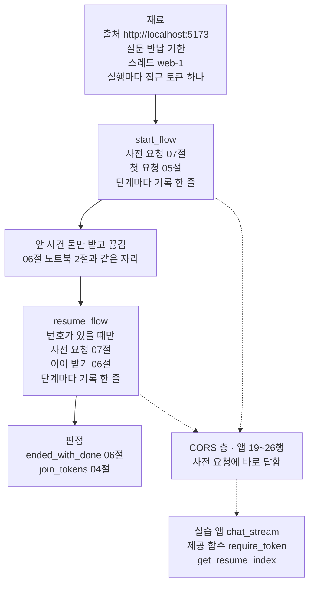
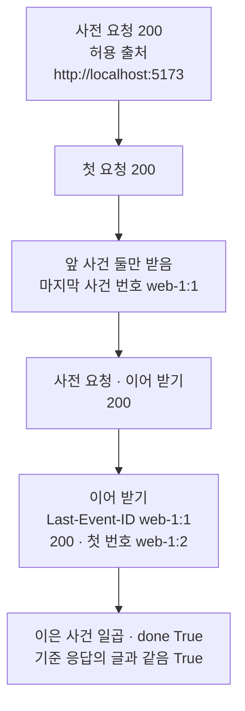
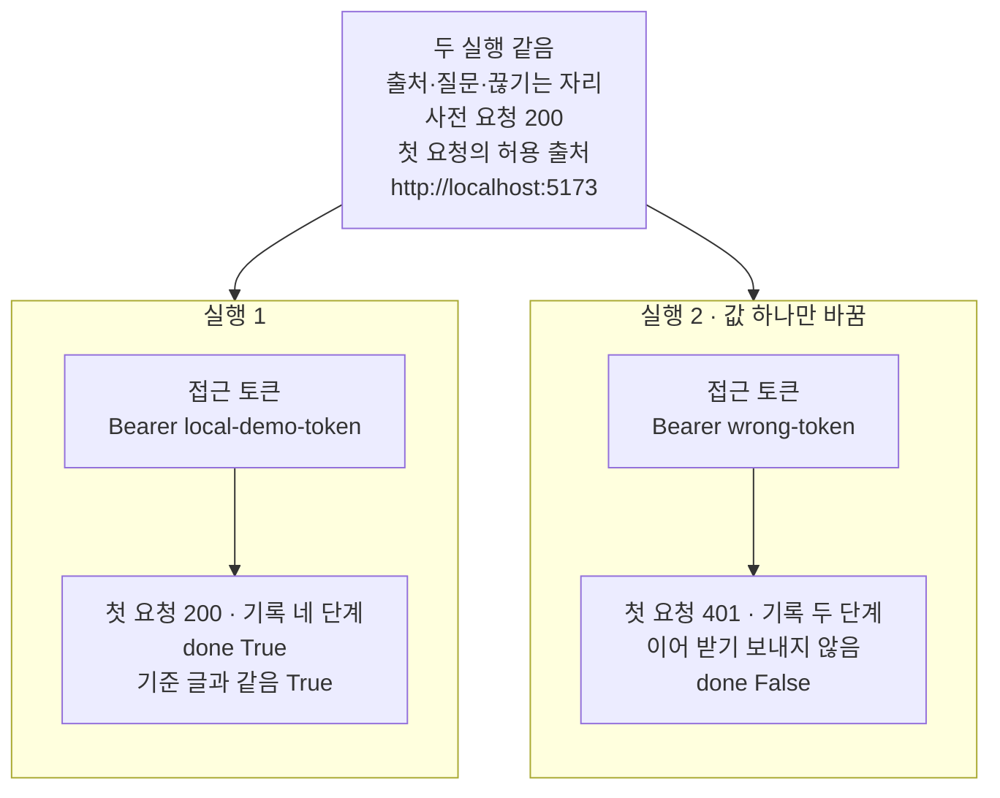

# 10-FastAPI-서빙-실습

## _src 본문 (HTML 원본)

```html
<!--meta: 실습 30분 | 코드 notebooks/10-FastAPI-서빙-실습.ipynb | 새 용어 0 -->
<style>html,body{overflow-x:hidden}.notebook,.nb-cell,.nb-main,.nb-input,.nb-result{min-width:0;max-width:100%}.nb-input pre,.nb-output{box-sizing:border-box;max-width:100%;overflow-x:auto}code.nb-source{display:block!important;width:100%!important;min-width:0!important;overflow-x:auto!important;padding:0!important}</style>
<h2 id="b1"><span class="no">1</span>학습 목표</h2><div class="goal"><ul>
<li>05~07절에서 배운 사전 요청·SSE 응답·이어 받기를 한 요청 흐름으로 이어, 끊긴 SSE 응답을 이어 받을 수 있습니다.</li>
<li>단계마다 상태 코드와 허용 출처를 기록하고, 이어 붙인 글을 끊기지 않은 응답의 글과 견줄 수 있습니다.</li>
<li>접근 토큰 하나만 바꾼 실행에서, 흐름이 어느 단계에서 멈추는지 단계 기록으로 설명할 수 있습니다.</li>
</ul></div>
<h2 id="b2"><span class="no">2</span>이 내용을 배우는 이유</h2><p>이 챕터에서는 웹 앱이 답을 보내는 방법을 절마다 따로 익혔습니다. <a href="05-POST-SSE-이벤트-설계.html">05절</a>은 답을 SSE 사건으로 보냈고, <a href="06-fetch-재연결과-오류-이벤트.html">06절</a>은 끊긴 뒤 사건 번호로 이어 받았습니다. <a href="07-인증-CORS-타임아웃.html">07절</a>은 접근 토큰을 검사하고, 다른 출처의 화면에 응답 머리로 허락을 알렸습니다. 실제 웹 화면에서는 이 일들이 질문 하나 안에서 차례로 일어납니다.</p><p>이번 실습은 세 기능을 도서관 웹 화면의 질문 하나에 모아 실행합니다. 화면은 SSE 사건 둘을 받고 끊긴 뒤, 받은 마지막 사건 번호로 이어 받습니다. 접근 토큰 하나만 바꿔 한 번 더 실행하고, 두 실행의 단계 기록을 견줍니다. 07절에서도 틀린 접근 토큰에는 401이 왔습니다. 새로 볼 것은 그 401이 흐름의 어느 단계에서 나오고, 사전 요청과 허용 출처 응답 머리가 어떻게 되는지입니다.</p><p>제목의 서빙은 만든 에이전트를 웹 앱에 올려, 요청에 답하게 하는 일입니다. 이번 절은 이 챕터의 실습입니다. 01~09절에서 쓴 이름과 Ch 2에서 배운 문법만 쓰고, 따로 내는 과제는 없습니다. 강사와 함께 노트북 셀을 차례로 실행합니다.</p><p>이 절의 질문 — 사전 요청, SSE 응답, 이어 받기를 한 흐름으로 이으면 끊긴 답을 온전히 받을 수 있을까요? 접근 토큰 하나를 바꾸면 흐름의 어디까지 달라질까요?</p>
<h2 id="b3"><span class="no">3</span>앞에서 배운 내용</h2><p>이번 실습은 아래 절에서 배운 이름을 그대로 씁니다. 앞 절 함수는 도구 파일 <code>serve_tools.py</code>에서 가져오고, 흐름을 잇는 함수는 노트북에 적습니다.</p><table><thead><tr><th>절</th><th>배운 것</th><th>실습에서 쓰는 곳</th></tr></thead><tbody><tr><td><a href="01-비동기-라우팅과-스키마.html">01절</a></td><td>시험용 클라이언트 <code>TestClient(app)</code>, 입력 형식 <code>ChatRequest</code>의 칸 <code>question</code>·<code>thread_id</code></td><td>재료의 시험용 클라이언트와 질문 본문</td></tr><tr><td><a href="02-의존성으로-Agent-주입.html">02절</a></td><td>의존성과 제공 함수, 재정의 딕셔너리 <code>dependency_overrides</code></td><td>처리 함수 머리 99~105행 읽기, 재정의 딕셔너리의 키 수 0 확인</td></tr><tr><td><a href="04-astream과-응답-스트림.html">04절</a></td><td>진행 값의 칸 <code>token</code>을 이어 붙이는 함수 <code>join_tokens</code>(도구 파일)</td><td>이어 붙인 글</td></tr><tr><td><a href="05-POST-SSE-이벤트-설계.html">05절</a></td><td>요청 주소 <code>/v1/chat/stream</code>의 SSE 응답, SSE 사건의 칸 <code>event</code>·<code>id</code>·<code>data</code></td><td>첫 요청과 이어 받기 요청의 응답</td></tr><tr><td><a href="06-fetch-재연결과-오류-이벤트.html">06절</a></td><td>요청 머리 <code>Last-Event-ID</code>로 이어 받기, 함수 <code>last_event_id</code>·<code>read_events</code>·<code>event_names</code>·<code>token_values</code>·<code>ended_with_done</code>(도구 파일)</td><td>끊긴 뒤 이어 받기와 두 실행의 판정</td></tr><tr><td><a href="07-인증-CORS-타임아웃.html">07절</a></td><td>접근 토큰 검사와 401, CORS 사전 요청과 허용 출처 응답 머리, 함수 <code>header_or_none</code>(도구 파일)</td><td>사전 요청 단계, 단계 기록의 허용 출처, 실행 2의 틀린 접근 토큰</td></tr></tbody></table>
<p>붙인 기능은 05절 SSE 응답, 06절 이어 받기, 07절 사전 요청과 접근 토큰 셋이고, 모두 실행 1 흐름에서 일합니다. 01절의 422와 03절의 JSON 요청 주소는 SSE 응답을 받는 흐름 하나에 모으려고 뺐습니다. 02·06절의 시간 제한 재정의는 06절에서 이미 견줘 뺐고, 07절 <code>HTTPBearer</code> 새 앱은 실습 앱을 고치지 않으려고 뺐습니다. 04절 <code>astream</code>은 앱이 안에서 부르고, 08절 응답 문서는 요청 흐름에 들지 않아 뺐습니다. <a href="09-실제-Agent-HTTP-통합.html">09절</a>의 실제 모델은 결론을 매번 같은 값으로 내려고 부르지 않았습니다.</p><p>이 챕터의 실습은 모델을 부르지 않습니다. 01~08절도 모델을 쓰지 않는 그래프로 결과를 갈랐고, 이번 흐름의 결론도 상태 코드와 사건 번호처럼 매번 같은 값입니다.</p>
<h2 id="b4"><span class="no">4</span>핵심 개념</h2><h3>비유로 시작하기</h3><p>01~09절에서는 화물 열차의 칸을 한 가지씩 따로 살펴보았습니다. 05절은 번호판을 단 칸이 차례로 들어오는 모습이었고, 06절은 끊긴 뒤 번호부터 다시 받는 모습이었습니다. 07절은 허락을 적은 꼬리표와 번호판 차량의 모습이었습니다. 이번에는 따로 본 칸을 한 열차로 이어, 한 번에 달려 봅니다.</p><p>열차 하나가 질문 하나의 요청 흐름입니다. 칸의 종류는 흐름에 붙인 05·06·07절의 기능입니다. 기관차 뒤로 칸이 붙은 차례가 흐름의 차례이고, 칸을 잇는 연결 고리가 함수 <code>start_flow</code>와 <code>resume_flow</code>입니다.</p><p>비유와 다른 점이 있습니다. 실제 흐름에서는 접근 토큰이 틀리면 앞 단계에서 멈추지만, 그림의 열차는 늘 칸이 다 이어져 있습니다.</p>
{{img:10-4-세-가지-칸을-이은-열차|흰 바탕에 오른쪽 아래에서 왼쪽 위로 비스듬히 곧게 뻗은 선로 하나가 있고, 그 위에 화물 열차 하나가 한 줄로 이어져 있습니다. 오른쪽 아래 맨 앞에 검은 기관차 하나가 있고, 그 뒤로 연보라색 닫힌 칸 둘, 흰 둥근 통 칸 둘, 산호색 덮개 칸 둘이 차례로 붙어 있습니다. 칸 사이에 빈틈은 없고, 짐·사람·글자·숫자·화살표는 없는 그림|검은 기관차 뒤에 서로 다른 세 종류의 칸이 둘씩 이어져, 열차 하나가 되었습니다.}}
<p class="look"><b>그림 읽기</b> — 검은 기관차 뒤로 연보라색 닫힌 칸 둘, 흰 둥근 통 칸 둘, 산호색 덮개 칸 둘이 이어져 있습니다. 세 종류의 칸은 따로 배운 05·06·07절의 기능이고, 이어진 열차 하나가 이 절의 요청 흐름입니다. 기관차 바로 뒤 연보라색 칸은 흐름이 먼저 보내는 07절의 사전 요청과 접근 토큰입니다. 흰 통 칸은 05절의 SSE 응답이고, 맨 뒤 산호색 칸은 06절의 이어 받기입니다. 칸의 색과 모양은 절을 가르려고 고른 것이고, 칸이 둘씩인 것은 값과 짝짓지 않습니다.</p>
<h3>실습 조립의 구성</h3>{{mermaid:10-1-세-절-기능을-이은-요청-흐름|위에서 아래로 읽는 흐름도입니다. 맨 위 초록 상자 재료에는 출처 http://localhost:5173, 질문 반납 기한, 스레드 web-1, 실행마다 접근 토큰 하나가 적혀 있습니다. 그 아래 파란 상자 넷이 실선으로 차례로 이어집니다. start_flow 사전 요청 07절 첫 요청 05절 단계마다 기록 한 줄, 앞 사건 둘만 받고 끊김 06절 노트북 2절과 같은 자리, resume_flow 번호가 있을 때만 사전 요청 07절 이어 받기 06절 단계마다 기록 한 줄, 판정 ended_with_done 06절 join_tokens 04절입니다. start_flow와 resume_flow에서 오른쪽 회색 상자 CORS 층 앱 19~26행 사전 요청에 바로 답함으로 점선이 가고, 회색 상자에서 초록 상자 실습 앱 chat_stream 제공 함수 require_token get_resume_index로 점선이 가는 그림|05절 SSE 응답, 06절 이어 받기, 07절 사전 요청과 접근 토큰을 함수 둘로 이어, 한 질문의 요청 흐름을 만들었습니다.}}
<p class="look"><b>도식 읽기</b> — 위에서 아래로 읽습니다. 초록 상자는 우리가 보낸 재료와 실습 앱 파일의 처리 함수입니다. 파란 상자는 이 절 노트북에서 만든 함수와 흐름의 자리이고, 상자 안의 절 번호는 그 기능을 배운 절입니다. 실선은 흐름의 차례이고, 점선은 실습 앱으로 보내는 요청입니다. 회색 상자인 CORS 층은 사전 요청에 바로 답하고, 그 밖의 요청만 실습 앱으로 넘깁니다.</p>
<table><thead><tr><th>이름</th><th>하는 일</th><th>가져온 곳</th></tr></thead><tbody><tr><td><code>send_preflight(header_names)</code></td><td>허용 출처 화면의 사전 요청을 <code>/v1/chat/stream</code>에 보냅니다</td><td>이 절에서 만듦(07절 사전 요청 모양)</td></tr><tr><td><code>send_question(token, resume_id)</code></td><td>출처와 접근 토큰, 번호가 있으면 <code>Last-Event-ID</code>까지 실어 질문을 보냅니다</td><td>이 절에서 만듦(05·06·07절 요청 모양)</td></tr><tr><td><code>events_of(response)</code></td><td>상태 코드가 200이면 칸 딕셔너리 목록, 아니면 빈 목록을 내놓습니다</td><td>이 절에서 만듦(06절 <code>read_events</code>를 부름)</td></tr><tr><td><code>record_step</code>·<code>print_log</code></td><td>단계 기록에 한 줄 더하기, 기록을 표 모양으로 출력하기</td><td>이 절에서 만듦</td></tr><tr><td><code>start_flow</code>·<code>resume_flow</code></td><td>흐름의 앞 절반(사전 요청·첫 요청)과 뒤 절반(사전 요청·이어 받기)</td><td>이 절에서 만듦</td></tr><tr><td><code>last_event_id</code>·<code>read_events</code>·<code>event_names</code>·<code>token_values</code>·<code>ended_with_done</code></td><td>받은 마지막 사건 번호, 칸 딕셔너리 목록, 사건 이름, 칸 <code>data</code>를 읽은 값, 끝 판정</td><td>도구 파일(06절)</td></tr><tr><td><code>header_or_none</code></td><td>응답 머리 한 칸의 값, 없으면 <code>None</code></td><td>도구 파일(07절)</td></tr><tr><td><code>join_tokens</code></td><td>칸 <code>token</code>의 글을 차례대로 이어 붙이기</td><td>도구 파일(04절)</td></tr></tbody></table>
<p>함수 <code>send_preflight</code>와 <code>send_question</code>은 노트북 2절에서 만든 시험용 클라이언트와 출처, 질문 본문을 그대로 씁니다. 두 실행에서 달라지는 값은 인자 <code>token</code> 하나뿐입니다. 흐름을 잇는 함수 둘은 기록 목록을 인자로 받아, 단계마다 한 줄씩 남깁니다.</p>
<h3>흐름이 지나는 실습 앱의 자리</h3><p>요청 주소 <code>/v1/chat/stream</code>에 온 요청은 먼저 앱 19~26행의 CORS 층을 지납니다. 사전 요청이면 CORS 층이 앱으로 넘기지 않고 바로 답합니다. 사전 요청이 아니면 CORS 층은 요청을 앱으로 넘기고, 앱이 보낸 응답에 허용 출처 응답 머리를 붙입니다.</p><p>앱으로 넘어간 요청은 처리 함수 <code>chat_stream</code>의 제공 함수들을 먼저 지납니다. 제공 함수 <code>require_token</code>이 접근 토큰을 검사하고, 틀리면 401로 답합니다. 제공 함수 <code>get_resume_index</code>는 요청 머리 <code>Last-Event-ID</code>에서 이어 받을 자리를 읽습니다. 두 검사를 지나야 처리 함수 몸통이 SSE 사건을 보냅니다.</p>
<h2 id="b5"><span class="no">5</span>실행 예제</h2><p>노트북 1절은 준비이고, 2절은 처리 함수의 머리와 재료를 봅니다. 3~5절은 흐름의 부품과 단계 기록, 조립을 정의합니다. 6절은 교재용 접근 토큰으로 흐름을 실행하고, 끊긴 뒤 이어 받은 글을 기준 응답과 견줍니다.</p><p>모델 요청은 0번이라 API 키가 필요 없습니다. 서버 프로그램 없이 시험용 클라이언트로 요청하고, 걸린 시간은 재지 않았습니다.</p>
{{notebook:10-FastAPI-서빙-실습}}
<p class="look"><b>확인할 점</b> — 노트북 3절에서 <code>허용 출처: http://localhost:5173</code>과 token 여섯 뒤 <code>done</code>인 사건 이름을 찾습니다. 6절에서는 단계 기록 네 줄의 <code>200</code>과, <code>끊기기 전에 받은 마지막 사건 번호: web-1:1</code>·<code>이어 받은 첫 사건 번호: web-1:2</code>를 봅니다. 마지막으로 <code>기준 응답의 글과 같은가: True</code>를 확인합니다.</p>
{{mermaid:10-2-실행-1의-단계-차례|위에서 아래로 읽는 흐름도입니다. 노란 상자 사전 요청 200 허용 출처 http://localhost:5173에서 노란 상자 첫 요청 200으로 이어지고, 파란 상자 앞 사건 둘만 받음 마지막 사건 번호 web-1:1을 지납니다. 이어서 노란 상자 사전 요청 이어 받기 200, 노란 상자 이어 받기 Last-Event-ID web-1:1 200 첫 번호 web-1:2를 지나, 맨 아래 노란 상자 이은 사건 일곱 done True 기준 응답의 글과 같음 True에 닿는 그림|실행 1은 사전 요청부터 이어 받기까지 네 단계 모두 200이었고, 이은 사건 일곱의 글이 기준 응답과 같았습니다.}}
<p class="look"><b>도식 읽기</b> — 위에서 아래로 읽습니다. 노란 상자는 노트북 6절의 출력이고, 파란 상자는 우리 흐름이 앞 사건 둘만 받은 것으로 본 자리입니다. 첫 요청과 이어 받기는 처리 함수 <code>chat_stream</code>이 답했고, 두 사전 요청은 CORS 층이 앱으로 넘기지 않고 답했습니다. 두 번째 사전 요청은 브라우저가 담아 둔 답이 없는 경우를 흉내 내어 보낸 것입니다. 맨 아래 노란 상자는 6절의 판정 출력입니다.</p>
<h2 id="b6"><span class="no">6</span>실험 결과 해석</h2><p>두 실행은 요청 머리 <code>Authorization</code>에 실은 접근 토큰 하나만 달랐습니다. 출처, 질문, 끊기는 자리, 사전 요청의 머리 이름은 같았습니다. 결과는 아래 표와 같았습니다.</p><table><thead><tr><th>견준 것</th><th>실행 1</th><th>실행 2</th></tr></thead><tbody><tr><td>바꾼 값 — 접근 토큰</td><td><code>Bearer local-demo-token</code></td><td><code>Bearer wrong-token</code></td></tr><tr><td>사전 요청의 상태 코드</td><td><code>200</code></td><td><code>200</code></td></tr><tr><td>첫 요청의 상태 코드</td><td><code>200</code></td><td><code>401</code></td></tr><tr><td>첫 요청의 허용 출처</td><td><code>http://localhost:5173</code></td><td><code>http://localhost:5173</code></td></tr><tr><td>기록한 단계 수</td><td><code>4</code></td><td><code>2</code> — 이어 받기 앞의 사전 요청과 이어 받기를 보내지 않음</td></tr><tr><td>마지막 사건이 done인가</td><td><code>True</code></td><td><code>False</code></td></tr><tr><td>기준 응답의 글과 같은가</td><td><code>True</code></td><td><code>False</code></td></tr></tbody></table>
{{mermaid:10-3-접근-토큰만-바꾼-두-실행|맨 위 회색 상자에는 두 실행 같음, 출처·질문·끊기는 자리, 사전 요청 200, 첫 요청의 허용 출처 http://localhost:5173이 적혀 있고, 그 아래에 칸 둘이 나란히 있습니다. 왼쪽 칸 실행 1에는 초록 상자 접근 토큰 Bearer local-demo-token에서 노란 상자 첫 요청 200 기록 네 단계 done True 기준 글과 같음 True로 이어집니다. 오른쪽 칸 실행 2 값 하나만 바꿈에는 파란 상자 접근 토큰 Bearer wrong-token에서 노란 상자 첫 요청 401 기록 두 단계 이어 받기 보내지 않음 done False로 이어지는 그림|접근 토큰 하나만 틀리게 바꾸자 첫 요청이 401로 끝나, 흐름이 이어 받기로 가지 않았습니다.}}
<p class="look"><b>도식 읽기</b> — 맨 위 회색 상자는 두 실행의 출력에서 모두 확인한 값입니다. 왼쪽 칸이 실행 1, 오른쪽 칸이 실행 2입니다. 칸마다 위 상자는 보낸 접근 토큰이고, 실행 2 칸의 것은 바꾼 값이라 파랑입니다. 아래 노란 상자는 노트북 6·7절의 출력입니다. 두 칸끼리는 화살표로 잇지 않았습니다.</p>
<p>사전 요청은 두 실행 모두 200이었습니다. 흐름이 보낸 사전 요청에는 접근 토큰이 없고, CORS 층이 앱으로 넘기지 않고 답하기 때문입니다. 그래서 접근 토큰이 틀렸다는 것은 사전 요청 단계에서는 드러나지 않았습니다.</p><p>달라진 것은 첫 요청부터입니다. 실행 2의 첫 요청은 제공 함수 <code>require_token</code>에서 401로 끝났고, 본문은 SSE 사건이 아니라 JSON 글이었습니다. 받은 사건이 없어 받은 마지막 사건 번호도 없었고, 흐름은 이어 받기 앞의 사전 요청과 이어 받기를 보내지 않았습니다. 06절의 판정은 빈 목록을 끝까지 받지 못한 것으로 세어 <code>False</code>였습니다.</p><p>401 응답에도 허용 출처 응답 머리 <code>http://localhost:5173</code>이 붙었습니다. CORS 층은 앱이 보낸 응답이면 상태 코드와 상관없이 이 머리를 붙입니다. 07절의 규칙으로는 화면의 스크립트가 이 401을 읽을 수 있어, 접근 토큰이 틀렸다는 것을 화면에 알릴 수 있습니다. 브라우저에서 이 동작을 실행하지는 않았습니다.</p>
<p>새 커널로 두 번 실행해 견주자, 코드 셀 21개의 출력이 셀마다 모두 같았습니다. 한 번은 프로젝트 맨 위에서, 한 번은 <code>notebooks/</code> 폴더에서 연 커널이었습니다. 노트북 밖에서 같은 흐름을 다섯 번 실행했을 때도 값이 모두 같았습니다.</p>
<p class="look"><b>확인할 점</b> — 7절의 단계 기록 두 줄에서 <code>첫 요청 | 401 | http://localhost:5173</code>을 찾습니다. 8절 표의 줄 <code>기록한 단계 수 | 4 | 2</code>와 <code>마지막 사건이 done인가 | True | False</code>도 확인합니다. 바꾼 값은 접근 토큰 하나뿐이라, 두 칸의 차이는 모두 그 값에서 나왔습니다.</p>
<h2 id="b7"><span class="no">7</span>주의할 점과 실무 메모</h2><ul><li>손으로 적은 값은 모두 실행 전에 정했습니다. 출처 <code>http://localhost:5173</code>은 앱 21행의 허용 출처이고, 질문은 03~07절과 같습니다. 스레드 이름 <code>web-1</code>은 이 절에서 정했습니다. 교재용 접근 토큰은 앱 57행의 값이고, 틀린 접근 토큰은 07절 노트북 2절에서 쓴 값입니다.</li><li>끊기는 자리 둘은 06절 노트북 2절과 같은 자리입니다. 연결을 실제로 끊지 않고, 첫 응답에서 앞 사건 둘만 받은 것으로 보았습니다. 사전 요청의 머리 이름 글은 07절과 같은 글에, 이어 받기 때 <code>Last-Event-ID</code>를 더했습니다.</li><li>시험용 클라이언트는 CORS 규칙을 따지지 않고, 응답 머리만 보여 줍니다. 화면이 응답을 읽을 수 있는지는 07절에서 본 규칙으로 말한 것이고, 브라우저에서는 실행하지 않았습니다. </li><li>첫 사전 요청의 답에도 허용 요청 머리 <code>Last-Event-ID</code>와 담아 둘 시간 600초가 이미 붙어 옵니다. 설치판 starlette <code>cors.py</code> 26행의 기본값 600을 56행이 응답 머리 <code>access-control-max-age</code>로 적습니다. MDN 문서는 브라우저가 그 시간 안에는 같은 사전 요청을 다시 보내지 않을 수 있다고 적습니다. 이 흐름의 두 번째 사전 요청은 담아 둔 답이 없는 경우를 흉내 낸 것이고, 브라우저에서 확인하지는 않았습니다.</li><li>시험용 클라이언트는 응답이 끝난 뒤 본문을 한꺼번에 줍니다. 그래서 사건이 도착한 때는 이 절 결과로 말할 수 없고, 걸린 시간도 재지 않았습니다.</li><li>06절에서 본 것처럼, 이어 받기 요청마다 앱은 그래프를 처음부터 다시 실행하고 앞 자리를 건너뜁니다. 이 절의 그래프에는 바깥에 쓰는 일이 없어, 다시 실행해도 같은 사건이 나왔습니다.</li><li>401에서 이어 받기로 가지 않은 것은 이 절의 흐름 코드가 정한 것입니다. 받은 사건이 없으면 함수 <code>last_event_id</code>가 <code>None</code>을 내놓고, 함수 <code>resume_flow</code>가 그 자리에서 멈춥니다. 401을 받은 화면이 접근 토큰을 새로 얻는 방법은 이 절에서 다루지 않았습니다.</li><li>실습 앱의 401 응답에 인증 방식을 알리는 응답 머리가 없다는 것은 07절에서 보았습니다. 이 절도 실습 앱 파일을 고치지 않았고, 실습 폴더에 쓰는 파일도 없습니다.</li><li>교재 출력은 Linux의 Python 3.12.13으로 만들었고, 다른 판과 Windows·macOS에서는 실행하지 않았습니다.</li></ul>
<h2 id="b8"><span class="no">8</span>정리와 다음 절</h2><ul><li>사전 요청·SSE 응답·이어 받기를 한 흐름으로 이어, 끊긴 뒤에도 기준 응답과 같은 글을 받았습니다.</li><li>흐름의 사전 요청은 접근 토큰과 상관없이 200이었고, 허용 출처 응답 머리는 401 응답에도 붙었습니다.</li><li>접근 토큰 하나만 틀리면 흐름은 첫 요청의 401에서 멈췄고, 06절의 판정은 <code>False</code>였습니다.</li></ul><p><strong>다음 학습과 이어지는 지점</strong> — 이 절로 Ch 30이 끝납니다. <a href="../../part7/ch31-database/01-SQLAlchemy-비동기-PostgreSQL.html">Ch 31</a>은 PostgreSQL 데이터베이스에 표를 만들어 쓰는 방법과 체크포인터를 다룹니다. Ch 31 05절은 체크포인터로 그래프의 실행 상태를 PostgreSQL 표에 저장합니다. 이 챕터의 실습 앱에 붙이는 일은 다루지 않습니다. 보낸 SSE 사건을 저장하는 방법은 Ch 31에서도 다루지 않습니다.</p>
<h2 id="b9"><span class="no">9</span>복습 문제</h2><details class="quiz" open><summary>문제 5개 · 해설 포함</summary><p class="quiz-q">1. 실행 2에서 접근 토큰이 틀렸는데도 사전 요청이 200이었던 까닭은 무엇인가요?</p><p class="quiz-a">흐름이 보낸 사전 요청에는 요청 머리 <code>Authorization</code>이 없습니다. 또 CORS 층은 사전 요청을 앱으로 넘기지 않고 바로 답하므로, 접근 토큰을 검사하는 제공 함수까지 가지 않습니다. 틀렸다면 노트북 7절을 다시 읽습니다.</p><p class="quiz-q">2. 실행 1에서 이어 받은 첫 사건 번호는 무엇이었고, 왜 그 번호였나요?</p><p class="quiz-a">번호는 <code>web-1:2</code>였습니다. 끊기기 전에 받은 마지막 번호 <code>web-1:1</code>을 요청 머리 <code>Last-Event-ID</code>로 보내자, 앱이 그다음 자리부터 보냈습니다. 틀렸다면 노트북 6절을 다시 읽습니다.</p><p class="quiz-q">3. 함수 <code>resume_flow</code>는 이어 받기 전에 사전 요청을 한 번 더 보냅니다. 실제 브라우저도 늘 이렇게 다시 보낼까요?</p><p class="quiz-a">늘 그렇지는 않습니다. 첫 사전 요청의 답에도 허용 요청 머리 <code>Last-Event-ID</code>가 이미 들어 있습니다. 브라우저는 그 답을 정한 시간 동안 담아 두면, 그동안 다시 묻지 않을 수 있습니다. 이 흐름은 담아 둔 답이 없는 경우를 흉내 내어 한 번 더 보냈고, 200을 받았습니다. 틀렸다면 노트북 5절과 6절을 다시 읽습니다.</p><p class="quiz-q">4. 동료가 「401이 났으니 허용 출처 응답 머리도 없을 것」이라고 말합니다. 맞나요?</p><p class="quiz-a">맞지 않습니다. 실행 2의 401 응답에도 허용 출처 <code>http://localhost:5173</code>이 붙었습니다. CORS 층은 앱이 보낸 응답이면 상태 코드와 상관없이 이 머리를 붙입니다. 틀렸다면 노트북 7절을 다시 읽습니다.</p><p class="quiz-q">5. 실행 2의 판정 <code>ended_with_done</code>이 <code>False</code>였던 까닭은 무엇인가요?</p><p class="quiz-a">401 응답은 SSE 사건이 아니어서 받은 사건이 하나도 없었고, 이어 받기도 보내지 않았습니다. 06절에서 정한 대로, 이 함수는 빈 목록을 끝까지 받지 못한 것으로 셉니다. 틀렸다면 노트북 7절을 다시 읽습니다.</p></details>
<h2 id="b10"><span class="no">10</span>참고 자료</h2><ul><li><a href="07-인증-CORS-타임아웃.html">07절</a> 참고 자료에 CORS와 사전 요청의 문서가 있습니다. SSE 이어 받기와 요청 머리 <code>Last-Event-ID</code>의 문서는 <a href="06-fetch-재연결과-오류-이벤트.html">06절</a> 참고 자료에 있습니다.</li><li>설치판 starlette 1.6.0 소스 <code>middleware/cors.py</code> 91~94행은 사전 요청이면 앱으로 넘기지 않고 바로 답합니다. 152~154행은 그 밖의 요청을 앱으로 넘깁니다. 156~174행은 응답을 보내기 시작할 때 허용 출처 응답 머리를 붙이고, 상태 코드는 보지 않습니다. 26행은 담아 둘 시간의 기본값 600초이고, 56행이 그 값을 응답 머리 <code>Access-Control-Max-Age</code>로 적습니다.</li><li><div><a href="https://developer.mozilla.org/en-US/docs/Web/HTTP/Reference/Headers/Access-Control-Max-Age">MDN Access-Control-Max-Age</a></div>확인 2026-09-29 · 허용 요청 방식과 허용 요청 머리의 정보를 담아 둘 수 있는 시간을 알린다고 적습니다.</li><li>실습 폴더 <code>agent_service/app.py</code> 19~26행은 CORS 설정이고, 24행 <code>allow_headers</code>에 <code>Last-Event-ID</code>가 있습니다. 41~53행은 제공 함수 <code>get_resume_index</code>, 56~60행은 <code>require_token</code>입니다. 99~124행은 처리 함수 <code>chat_stream</code>입니다.</li><li>도구 파일 <code>notebooks/serve_tools.py</code>의 함수 <code>last_event_id</code>는 06절 노트북에서, <code>header_or_none</code>은 07절 노트북에서 옮겼습니다.</li></ul>
```

## 노트북 셀 (순서대로)

### [0] markdown {'html': 'skip'}

# FastAPI 서빙 실습: 끊긴 SSE 응답을 이어 받는 흐름에서 접근 토큰 하나만 바꾸기

**이 노트북에서 할 일**

1. 05~07절에서 배운 사전 요청·SSE 응답·이어 받기를 한 요청 흐름으로 잇습니다.
2. 교재용 접근 토큰으로 흐름을 끝까지 실행하고, 이어 붙인 글을 끊기지 않은 응답과 견줍니다.
3. 접근 토큰 하나만 틀린 값으로 바꿔 같은 흐름을 실행하고, 두 실행의 단계 기록을 견줍니다.

**준비물** — 이 노트북은 모델을 부르지 않아 API 키가 필요 없습니다.
모델 요청은 0번이고, 비용도 들지 않습니다.
요청은 시험용 클라이언트로 같은 노트북 안에서 보냅니다.
서버 프로그램을 띄우지 않고, 포트를 쓰지 않습니다.
실습 폴더의 파일은 가져오고 읽기만 하며, 쓰는 파일은 없습니다.

첫 셀의 설치에는 몇십 초가 걸릴 수 있습니다.
걸린 시간은 재지 않았습니다.

**기준 버전** — 첫 셀에서 패키지 여섯을 설치합니다.
판은 fastapi 0.135.0, httpx 0.28.1, pydantic 2.12.5, starlette 1.6.0입니다.
실습 앱 파일은 패키지 langgraph 1.2.11과 langchain 1.4.0을 가져옵니다.
여섯 모두 실습 폴더 잠금과 같은 판입니다.
교재 출력은 Linux의 Python 3.12.13으로 만들었습니다.

다른 판과 Windows·macOS에서는 실행하지 않았습니다.

**실습 방법** — 따로 내는 과제는 없고, 강사와 함께 첫 셀부터 순서대로 실행합니다.
실습 폴더 `labs/part7/ch30-fastapi-serving`에서 `uv sync --locked`를 실행합니다.
그다음 `notebooks/` 폴더의 이 노트북을 열고, 실습 폴더의 `.venv` 커널을 고릅니다.

### [1] markdown {'html': 'skip'}

## 오늘 볼 그림


위에서 아래로 읽습니다.
초록 상자는 우리가 보낸 재료와 실습 앱 파일의 처리 함수입니다.
파란 상자는 이 절 노트북에서 만든 함수와 흐름의 자리이고, 상자 안의 절 번호는 그 기능을 배운 절입니다.
실선은 흐름의 차례이고, 점선은 실습 앱으로 보내는 요청입니다.
회색 상자인 CORS 층은 사전 요청에 바로 답하고, 그 밖의 요청만 실습 앱으로 넘깁니다.

### [2] markdown {}

## 1. 준비

이 절은 이 챕터의 실습입니다.
01~09절에서 쓴 라이브러리 이름과 문법만 쓰고, 흐름을 잇는 함수만 이 절에서 새로 만듭니다.
제목의 서빙은 만든 에이전트를 웹 앱에 올려, 요청에 답하게 하는 일입니다.
첫 셀은 07·08절과 같은 패키지 여섯을 설치하고, 설치된 판 번호를 출력합니다.

### [3] code {'execution': {'iopub.execute_input': '2026-09-29T12:23:29.795283Z', 'iopub.status.busy': '2026-09-29T12:23:29.795115Z', 'iopub.status.idle': '2026-09-29T12:23:30.436992Z', 'shell.execute_reply': '2026-09-29T12:23:30.436439Z'}, 'lesson_role': 'setup'}

```python
# 이 절에서 쓰는 패키지를 설치하고 버전을 확인합니다
%pip install -q "fastapi==0.135.0" "httpx==0.28.1" "pydantic==2.12.5" "starlette==1.6.0" "langgraph==1.2.11" "langchain==1.4.0"
from importlib.metadata import version

print("fastapi:", version("fastapi"))
print("httpx:", version("httpx"))
print("pydantic:", version("pydantic"))
print("starlette:", version("starlette"))
print("langgraph:", version("langgraph"))
print("langchain:", version("langchain"))
```

출력:
```
Note: you may need to restart the kernel to use updated packages.
fastapi: 0.135.0
httpx: 0.28.1
pydantic: 2.12.5
starlette: 1.6.0
langgraph: 1.2.11
langchain: 1.4.0

```

### [4] markdown {}

**결과 읽기** — 출력 줄 `fastapi: 0.135.0`부터 `langchain: 1.4.0`까지 여섯 줄이 보입니다.
07·08절과 같은 패키지를 같은 판으로 설치했습니다.

다음 셀은 이 절에서 쓸 이름을 가져옵니다.
04·06·07절에서 배운 함수 일곱은 도구 파일 `serve_tools.py`에서 가져옵니다.

### [5] code {'execution': {'iopub.execute_input': '2026-09-29T12:23:30.438006Z', 'iopub.status.busy': '2026-09-29T12:23:30.437918Z', 'iopub.status.idle': '2026-09-29T12:23:30.640799Z', 'shell.execute_reply': '2026-09-29T12:23:30.640466Z'}, 'lesson_role': 'setup'}

```python
# 이 절에서 쓸 이름을 가져옵니다(os는 Python에 들어 있는 모듈입니다)
import os
from fastapi.testclient import TestClient
# 04·06·07절에서 배운 함수 일곱은 도구 파일에서 가져옵니다
from serve_tools import ended_with_done, event_names, header_or_none, join_tokens, last_event_id, read_events, token_values

print("가져온 이름:", "TestClient")
print("도구 파일에서 가져온 함수:", "ended_with_done, event_names, header_or_none, join_tokens, last_event_id, read_events, token_values")
```

출력:
```
가져온 이름: TestClient
도구 파일에서 가져온 함수: ended_with_done, event_names, header_or_none, join_tokens, last_event_id, read_events, token_values

```

### [6] markdown {}

**결과 읽기** — 출력 줄 `도구 파일에서 가져온 함수:` 뒤에 함수 일곱이 보입니다.
함수 `join_tokens`는 04절, `header_or_none`은 07절에서 배웠고, 나머지 다섯은 06절에서 배웠습니다.
06절 함수 `last_event_id`와 07절 함수 `header_or_none`은 이 절부터 도구 파일에 있습니다.
두 함수는 그 절 노트북의 셀을 주석과 본문 그대로 옮겼습니다.

앞에서 배운 함수는 `serve_tools.py`에 모아 두었습니다.
파일을 열면 코드를 볼 수 있습니다.
노트북과 같은 폴더(`notebooks/`)에 있는 파일입니다.
커널이 `notebooks/` 폴더에서 시작해야 이 파일을 가져올 수 있습니다.
교재 출력을 만든 실행 도구는 이 폴더를 따로 알려 주어, 다른 자리에서 시작해도 가져오기가 되었습니다.

다음 셀은 01절 2절과 같은 파일 위치 셀로, 후보 셋 가운데 실습 폴더를 고릅니다.

### [7] code {'execution': {'iopub.execute_input': '2026-09-29T12:23:30.641539Z', 'iopub.status.busy': '2026-09-29T12:23:30.641485Z', 'iopub.status.idle': '2026-09-29T12:23:30.643832Z', 'shell.execute_reply': '2026-09-29T12:23:30.643456Z'}}

```python
# 노트북을 연 자리에서 본 실습 폴더의 위치를 후보 셋 가운데에서 고릅니다
candidates = ["..", ".", "labs/part7/ch30-fastapi-serving"]
lab_path = None
for candidate in candidates:
    if os.path.exists(candidate + "/agent_service/schemas.py"):
        lab_path = candidate
        break
print("실습 폴더를 찾았는가:", lab_path is not None)
assert lab_path is not None, "notebooks 폴더나 실습 폴더 맨 위에서 노트북을 열어 주세요."
```

출력:
```
실습 폴더를 찾았는가: True

```

### [8] markdown {}

**결과 읽기** — 출력 줄 `실습 폴더를 찾았는가: True`가 보입니다.
고른 후보는 연 자리마다 달라서 출력하지 않습니다.
실습 폴더 맨 위에서 연 커널은 이 안내를 보기 전에, 앞 셀의 도구 파일 가져오기에서 먼저 멈춥니다.

다음 셀은 작업 폴더를 실습 폴더로 옮긴 뒤, 앱 파일에서 앱 객체 `app`을 가져옵니다.
02절에서 본 재정의 딕셔너리의 키 수도 함께 출력합니다.

### [9] code {'execution': {'iopub.execute_input': '2026-09-29T12:23:30.644431Z', 'iopub.status.busy': '2026-09-29T12:23:30.644380Z', 'iopub.status.idle': '2026-09-29T12:23:31.147758Z', 'shell.execute_reply': '2026-09-29T12:23:31.147481Z'}}

```python
# 작업 폴더를 실습 폴더로 옮기고, 앱 파일에서 앱 객체를 가져옵니다
os.chdir(lab_path)
from agent_service.app import app
print("가져온 앱 객체의 종류:", type(app).__name__)
print("재정의 딕셔너리의 키 수:", len(app.dependency_overrides))
```

출력:
```
가져온 앱 객체의 종류: FastAPI
재정의 딕셔너리의 키 수: 0

```

### [10] markdown {}

**결과 읽기** — 출력 줄 `재정의 딕셔너리의 키 수: 0`이 보입니다.
바꿔 낀 제공 함수가 하나도 없어, 실습 앱의 제공 함수가 그대로 불립니다.
이 절은 재정의를 쓰지 않습니다.

## 2. 오늘의 상황과 재료

도서관 웹 화면 하나가 실습 앱에 질문을 보내고, 답을 SSE 사건으로 받습니다.
화면의 출처는 `http://localhost:5173`이고, 앱이 허용 출처로 적은 값입니다.
화면은 SSE 사건 둘을 받은 뒤 연결이 끊겨, 받은 마지막 사건 번호로 이어 받습니다.
다음 셀은 이 흐름이 요청을 보낼 처리 함수 `chat_stream`의 머리 99~105행을 출력합니다.

### [11] code {'execution': {'iopub.execute_input': '2026-09-29T12:23:31.148533Z', 'iopub.status.busy': '2026-09-29T12:23:31.148479Z', 'iopub.status.idle': '2026-09-29T12:23:31.151251Z', 'shell.execute_reply': '2026-09-29T12:23:31.150915Z'}}

```python
# 앱 파일을 글로 읽어, SSE 처리 함수 chat_stream의 머리 99~105행을 출력합니다
first_line = 99
last_line = 105
with open("agent_service/app.py", encoding="utf-8") as app_file:
    app_lines = app_file.read().splitlines()
print("줄 번호 | 줄")
for index in range(first_line - 1, last_line):
    print(index + 1, "|", app_lines[index])
```

출력:
```
줄 번호 | 줄
99 | @app.post("/v1/chat/stream", response_class=EventSourceResponse)
100 | async def chat_stream(
101 |     body: ChatRequest,
102 |     runtime: AgentDep,
103 |     _token: AuthDep,
104 |     timeout: TimeoutDep,
105 |     start: ResumeIndexDep,

```

### [12] markdown {}

**결과 읽기** — 라벨 줄 아래 99~105행이 처리 함수 `chat_stream`의 머리입니다.
103행의 `_token: AuthDep`은 02·07절에서 본 제공 함수 `require_token`으로 접근 토큰을 검사합니다.
105행의 `start: ResumeIndexDep`은 06절의 제공 함수로, 요청 머리 `Last-Event-ID`에서 이어 받을 자리를 읽습니다.
102행과 104행은 02절에서 본 그래프와 시간 제한의 제공 함수입니다.
라이브러리는 이 제공 함수들을 처리 함수 몸통보다 먼저 부릅니다.

07절에서 본 것처럼, 앱 19~26행의 CORS 층은 이보다도 앞에서 요청을 봅니다.
사전 요청이면 CORS 층이 앱으로 넘기지 않고 바로 답합니다.

다음 셀은 두 실행이 함께 쓸 재료를 만듭니다.
모두 실행 전에 정한 값이고, 출력 라벨에 어디서 온 값인지 적었습니다.

### [13] code {'execution': {'iopub.execute_input': '2026-09-29T12:23:31.151788Z', 'iopub.status.busy': '2026-09-29T12:23:31.151735Z', 'iopub.status.idle': '2026-09-29T12:23:31.153766Z', 'shell.execute_reply': '2026-09-29T12:23:31.153397Z'}}

```python
# 두 실행이 함께 쓸 재료를 만듭니다 — 모두 실행 전에 정한 값입니다
client = TestClient(app)
page_origin = "http://localhost:5173"
question_body = {"question": "반납 기한을 알려 주세요", "thread_id": "web-1"}
good_token = "Bearer local-demo-token"
print("화면의 출처(앱 21행의 허용 출처):", page_origin)
print("질문 본문(스레드 이름 web-1은 이 절에서 정함):", question_body)
print("실행 1의 접근 토큰(앱 57행의 교재용 값):", good_token)
```

출력:
```
화면의 출처(앱 21행의 허용 출처): http://localhost:5173
질문 본문(스레드 이름 web-1은 이 절에서 정함): {'question': '반납 기한을 알려 주세요', 'thread_id': 'web-1'}
실행 1의 접근 토큰(앱 57행의 교재용 값): Bearer local-demo-token

```

### [14] markdown {}

**결과 읽기** — 출력 줄 `화면의 출처(앱 21행의 허용 출처): http://localhost:5173`이 보입니다.
질문 「반납 기한을 알려 주세요」는 03~07절과 같은 질문입니다.
스레드 이름 `web-1`은 이 절에서 정한 이름이고, 사건 번호의 앞머리가 됩니다.
접근 토큰은 02·07절에서 쓴 교재용 값이고, 실행 2에서만 바꿉니다.

## 3. 흐름의 부품

흐름은 요청 두 가지를 보냅니다.
하나는 07절의 사전 요청이고, 다른 하나는 접근 토큰을 실은 질문 요청입니다.
다음 셀은 사전 요청을 보내는 함수를 정의합니다.

### [15] code {'execution': {'iopub.execute_input': '2026-09-29T12:23:31.154293Z', 'iopub.status.busy': '2026-09-29T12:23:31.154236Z', 'iopub.status.idle': '2026-09-29T12:23:31.155729Z', 'shell.execute_reply': '2026-09-29T12:23:31.155406Z'}}

```python
# 허용 출처 화면이 보낼 사전 요청을 요청 주소 /v1/chat/stream에 보내고, 응답을 내놓습니다
def send_preflight(header_names):
    # 요청 머리 이름은 실제 요청에 실을 머리를 쉼표로 이어 적은 글입니다(07절과 같은 모양)
    preflight_headers = {"Origin": page_origin, "Access-Control-Request-Method": "POST",
                         "Access-Control-Request-Headers": header_names}
    return client.options("/v1/chat/stream", headers=preflight_headers)
```

출력:
```

```

### [16] markdown {}

**결과 읽기** — 정의 셀이라 출력이 없습니다.
인자 `header_names`에는 실제 요청에 실을 요청 머리 이름을 쉼표로 이어 적은 글을 넣습니다.
함수는 2절에서 만든 `client`와 `page_origin`을 그대로 씁니다.

다음 셀은 출처와 접근 토큰을 요청 머리에 실어 질문을 보내는 함수를 정의합니다.
이어 받을 사건 번호가 있으면, 06절처럼 요청 머리 `Last-Event-ID`도 싣습니다.

### [17] code {'execution': {'iopub.execute_input': '2026-09-29T12:23:31.156322Z', 'iopub.status.busy': '2026-09-29T12:23:31.156272Z', 'iopub.status.idle': '2026-09-29T12:23:31.157913Z', 'shell.execute_reply': '2026-09-29T12:23:31.157591Z'}}

```python
# 출처와 접근 토큰을 요청 머리에 실어 질문을 보내고, 응답을 내놓습니다
def send_question(token, resume_id):
    request_headers = {"Origin": page_origin, "Authorization": token}
    # 이어 받을 사건 번호가 있으면 06절처럼 요청 머리 Last-Event-ID도 싣습니다
    if resume_id is not None:
        request_headers = {"Origin": page_origin, "Authorization": token, "Last-Event-ID": resume_id}
    return client.post("/v1/chat/stream", json=question_body, headers=request_headers)
```

출력:
```

```

### [18] markdown {}

**결과 읽기** — 정의 셀이라 출력이 없습니다.
인자 `resume_id`가 `None`이면 요청 머리가 둘이고, 사건 번호가 있으면 셋입니다.
질문 본문은 늘 2절의 `question_body`입니다.

다음 셀은 응답을 칸 딕셔너리 목록으로 읽는 함수를 정의합니다.
오류 응답의 본문은 SSE 사건이 아니라 JSON 글이라, 상태 코드가 200일 때만 읽습니다.

### [19] code {'execution': {'iopub.execute_input': '2026-09-29T12:23:31.158544Z', 'iopub.status.busy': '2026-09-29T12:23:31.158501Z', 'iopub.status.idle': '2026-09-29T12:23:31.160078Z', 'shell.execute_reply': '2026-09-29T12:23:31.159734Z'}}

```python
# 응답의 상태 코드가 200이면 본문을 칸 딕셔너리 목록으로 읽고, 아니면 빈 목록을 내놓습니다
def events_of(response):
    # 401 같은 오류 응답의 본문은 SSE 사건이 아니라 JSON 글이라 읽지 않습니다
    if response.status_code == 200:
        return read_events(response.text)
    return []
```

출력:
```

```

### [20] markdown {}

**결과 읽기** — 정의 셀이라 출력이 없습니다.
함수 `read_events`는 06절에서 배운 함수로, 본문 글을 SSE 사건마다 칸 딕셔너리로 바꿉니다.
상태 코드가 200이 아니면 빈 목록을 내놓습니다.

다음 셀은 부품을 한 번 시험합니다.
끊기지 않은 요청을 보내, 뒤에서 견줄 기준 응답을 만듭니다.

### [21] code {'execution': {'iopub.execute_input': '2026-09-29T12:23:31.160675Z', 'iopub.status.busy': '2026-09-29T12:23:31.160632Z', 'iopub.status.idle': '2026-09-29T12:23:31.175821Z', 'shell.execute_reply': '2026-09-29T12:23:31.175496Z'}}

```python
# 부품을 한 번 시험합니다 — 끊기지 않은 요청을 보내, 뒤에서 견줄 기준 응답을 만듭니다
full_response = send_question(good_token, None)
full_events = events_of(full_response)
full_text = join_tokens(token_values(full_events))
print("상태 코드:", full_response.status_code)
print("허용 출처:", header_or_none(full_response, "access-control-allow-origin"))
print("사건 이름:", event_names(full_events))
print("이어 붙인 글:", full_text)
```

출력:
```
상태 코드: 200
허용 출처: http://localhost:5173
사건 이름: ['token', 'token', 'token', 'token', 'token', 'token', 'done']
이어 붙인 글: 질문을 확인했습니다: 반납 기한을 알려 주세요 

```

### [22] markdown {}

**결과 읽기** — 출력 줄 `허용 출처: http://localhost:5173`이 보입니다.
SSE 응답에도 CORS 층이 허용 출처 응답 머리를 붙였습니다.
사건 이름은 token 여섯 뒤에 `done`으로, 05·06절과 같은 차례입니다.
출력 줄 `이어 붙인 글:`의 글이 뒤에서 견줄 기준 응답의 글입니다.

## 4. 단계 기록

흐름이 단계마다 무엇을 받았는지 보려면 기록이 필요합니다.
다음 셀은 단계 이름과 응답을 받아, 기록 목록에 한 줄을 더하는 함수를 정의합니다.
한 줄에는 상태 코드와 허용 출처를 적습니다.

### [23] code {'execution': {'iopub.execute_input': '2026-09-29T12:23:31.176366Z', 'iopub.status.busy': '2026-09-29T12:23:31.176318Z', 'iopub.status.idle': '2026-09-29T12:23:31.177794Z', 'shell.execute_reply': '2026-09-29T12:23:31.177381Z'}}

```python
# 단계 이름과 응답을 받아, 상태 코드와 허용 출처 응답 머리를 기록 목록에 한 줄로 더합니다
def record_step(log_rows, step_name, response):
    allowed = header_or_none(response, "access-control-allow-origin")
    log_rows.append([step_name, response.status_code, allowed])
```

출력:
```

```

### [24] markdown {}

**결과 읽기** — 정의 셀이라 출력이 없습니다.
기록 한 줄은 단계 이름, 상태 코드, 허용 출처를 담은 목록입니다.
허용 출처는 07절 함수 `header_or_none`으로 읽어, 응답 머리가 없으면 `None`이 됩니다.

다음 셀은 기록 목록을 표 모양으로 출력하는 함수를 정의합니다.

### [25] code {'execution': {'iopub.execute_input': '2026-09-29T12:23:31.178340Z', 'iopub.status.busy': '2026-09-29T12:23:31.178293Z', 'iopub.status.idle': '2026-09-29T12:23:31.179739Z', 'shell.execute_reply': '2026-09-29T12:23:31.179417Z'}}

```python
# 기록 목록을 「단계 | 상태 코드 | 허용 출처」 표 모양으로 한 줄씩 출력합니다
def print_log(log_rows):
    print("단계 | 상태 코드 | 허용 출처")
    for row in log_rows:
        print(row[0], "|", row[1], "|", row[2])
```

출력:
```

```

### [26] markdown {}

**결과 읽기** — 정의 셀이라 출력이 없습니다.
라벨 줄 다음에, 기록 한 줄이 출력 한 줄이 됩니다.

## 5. 조립

부품을 흐름의 차례대로 잇습니다.
흐름이 길어 함수 둘로 나눴습니다.
다음 셀은 흐름의 앞 절반으로, 사전 요청과 첫 요청을 보냅니다.

### [27] code {'execution': {'iopub.execute_input': '2026-09-29T12:23:31.180296Z', 'iopub.status.busy': '2026-09-29T12:23:31.180245Z', 'iopub.status.idle': '2026-09-29T12:23:31.181708Z', 'shell.execute_reply': '2026-09-29T12:23:31.181383Z'}}

```python
# 흐름의 앞 절반 — 사전 요청(07절)을 보낸 뒤, 접근 토큰을 실은 첫 요청(05절)을 보내고 그 응답을 내놓습니다
def start_flow(token, log_rows):
    preflight = send_preflight("Authorization, Content-Type")
    record_step(log_rows, "사전 요청", preflight)
    first_response = send_question(token, None)
    record_step(log_rows, "첫 요청", first_response)
    return first_response
```

출력:
```

```

### [28] markdown {}

**결과 읽기** — 정의 셀이라 출력이 없습니다.
사전 요청의 요청 머리 이름은 07절과 같은 `Authorization, Content-Type`입니다.
첫 요청은 이어 받을 번호가 없어 `None`을 넘깁니다.
두 요청 모두 기록 목록에 한 줄씩 남기고, 첫 요청의 응답을 내놓습니다.

다음 셀은 흐름의 뒤 절반을 정의합니다.
받은 사건에 번호가 있으면, 요청 머리 이름에 `Last-Event-ID`를 더한 사전 요청을 한 번 더 보냅니다.
그다음 그 번호로 이어 받고, 받은 사건과 이어 받은 사건을 이은 목록을 내놓습니다.

### [29] code {'execution': {'iopub.execute_input': '2026-09-29T12:23:31.182363Z', 'iopub.status.busy': '2026-09-29T12:23:31.182304Z', 'iopub.status.idle': '2026-09-29T12:23:31.184113Z', 'shell.execute_reply': '2026-09-29T12:23:31.183756Z'}}

```python
# 흐름의 뒤 절반 — 받은 마지막 사건 번호가 있으면 사전 요청을 한 번 더 보내고 이어 받습니다(06절)
def resume_flow(token, received, log_rows):
    resume_id = last_event_id(received)
    # 받은 사건 번호가 없으면 이어 받을 자리가 없어, 받은 목록을 그대로 내놓습니다
    if resume_id is None:
        return received
    preflight = send_preflight("Authorization, Content-Type, Last-Event-ID")
    record_step(log_rows, "사전 요청(이어 받기)", preflight)
    resumed_response = send_question(token, resume_id)
    record_step(log_rows, "이어 받기", resumed_response)
    return received + events_of(resumed_response)
```

출력:
```

```

### [30] markdown {}

**결과 읽기** — 정의 셀이라 출력이 없습니다.
받은 사건이 하나도 없으면 함수 `last_event_id`가 `None`을 내놓아, 이어 받기 단계를 보내지 않습니다.

이어 받기 요청은 요청 머리 `Last-Event-ID`를 더 싣습니다.
07절 출력처럼, 첫 사전 요청의 답에도 허용 요청 머리 `Last-Event-ID`가 이미 들어 있습니다.
브라우저는 그 답을 담아 두면, 정한 시간 안에는 사전 요청을 다시 보내지 않을 수 있습니다.
이 흐름은 담아 둔 답이 없는 경우를 흉내 내어, 그 이름을 적은 사전 요청을 한 번 더 보냅니다.

## 6. 실행 1 — 교재용 접근 토큰

실행 1은 2절의 재료 그대로 흐름을 끝까지 실행합니다.
첫 요청에서 앞 사건 둘만 받고 끊겼다고 보며, 06절 노트북 2절과 같은 자리입니다.
실행 전에 예상해 봅니다.
기록 목록에는 몇 단계가 남고, 모두 200일까요?

### [31] code {'execution': {'iopub.execute_input': '2026-09-29T12:23:31.184635Z', 'iopub.status.busy': '2026-09-29T12:23:31.184589Z', 'iopub.status.idle': '2026-09-29T12:23:31.190898Z', 'shell.execute_reply': '2026-09-29T12:23:31.190576Z'}}

```python
# 실행 1 — 교재용 접근 토큰으로 흐름을 끝까지 실행하고, 단계 기록을 표로 출력합니다
run1_log = []
run1_first = start_flow(good_token, run1_log)
# 첫 요청에서 앞 사건 둘까지 받고 연결이 끊겼다고 봅니다(06절 2절과 같은 자리)
run1_received = events_of(run1_first)[0:2]
run1_events = resume_flow(good_token, run1_received, run1_log)
print_log(run1_log)
```

출력:
```
단계 | 상태 코드 | 허용 출처
사전 요청 | 200 | http://localhost:5173
첫 요청 | 200 | http://localhost:5173
사전 요청(이어 받기) | 200 | http://localhost:5173
이어 받기 | 200 | http://localhost:5173

```

### [32] markdown {}

**결과 읽기** — 라벨 줄 아래 네 줄이 실행 1의 단계 기록입니다.
사전 요청, 첫 요청, 이어 받기 앞의 사전 요청, 이어 받기가 차례대로 모두 `200`입니다.
네 응답 모두 허용 출처가 `http://localhost:5173`으로, 화면의 출처와 같습니다.
07절의 규칙으로는 화면이 네 응답을 모두 읽을 수 있습니다.

다음 셀은 끊기기 전에 받은 사건과, 이어 받은 뒤 이은 사건을 봅니다.

### [33] code {'execution': {'iopub.execute_input': '2026-09-29T12:23:31.191436Z', 'iopub.status.busy': '2026-09-29T12:23:31.191376Z', 'iopub.status.idle': '2026-09-29T12:23:31.193112Z', 'shell.execute_reply': '2026-09-29T12:23:31.192816Z'}}

```python
# 실행 1에서 끊기기 전에 받은 사건과, 이어 받은 뒤 이은 사건을 봅니다
print("끊기기 전에 받은 사건 이름:", event_names(run1_received))
print("끊기기 전에 받은 마지막 사건 번호:", last_event_id(run1_received))
# 이은 목록의 자리 2(셋째 사건)가 이어 받은 첫 사건입니다
print("이어 받은 첫 사건 번호:", run1_events[2]["id"])
print("이은 사건 이름:", event_names(run1_events))
```

출력:
```
끊기기 전에 받은 사건 이름: ['token', 'token']
끊기기 전에 받은 마지막 사건 번호: web-1:1
이어 받은 첫 사건 번호: web-1:2
이은 사건 이름: ['token', 'token', 'token', 'token', 'token', 'token', 'done']

```

### [34] markdown {}

**결과 읽기** — 출력 줄 `끊기기 전에 받은 마지막 사건 번호: web-1:1`이 보입니다.
이어 받은 첫 사건 번호는 `web-1:2`로, 받은 번호의 바로 다음 자리입니다.
이은 사건 이름은 token 여섯 뒤에 `done`으로, 기준 응답과 같은 차례입니다.

다음 셀은 06절의 방법으로 실행 1을 판정합니다.
마지막 사건이 `done`인지 보고, 이어 붙인 글을 기준 응답의 글과 견줍니다.

### [35] code {'execution': {'iopub.execute_input': '2026-09-29T12:23:31.193650Z', 'iopub.status.busy': '2026-09-29T12:23:31.193603Z', 'iopub.status.idle': '2026-09-29T12:23:31.195487Z', 'shell.execute_reply': '2026-09-29T12:23:31.195100Z'}}

```python
# 실행 1을 판정합니다 — 마지막 사건이 done인가(06절)와, 이어 붙인 글이 기준 응답의 글과 같은가
run1_text = join_tokens(token_values(run1_events))
print("마지막 사건이 done인가:", ended_with_done(run1_events))
print("이어 붙인 글:", run1_text)
print("기준 응답의 글과 같은가:", run1_text == full_text)
```

출력:
```
마지막 사건이 done인가: True
이어 붙인 글: 질문을 확인했습니다: 반납 기한을 알려 주세요 
기준 응답의 글과 같은가: True

```

### [36] markdown {}

**결과 읽기** — 출력 줄 `마지막 사건이 done인가: True`와 `기준 응답의 글과 같은가: True`가 보입니다.
끊긴 뒤 이어 받아도, 같은 낱말이 겹치거나 빠지지 않았습니다.

## 7. 실행 2 — 접근 토큰 하나만 바꿈

실행 2는 값 하나만 바꿔, 접근 토큰을 07절 노트북 2절의 틀린 값 `Bearer wrong-token`으로 둡니다.
출처·질문·끊기는 자리·사전 요청의 머리 이름은 실행 1과 같습니다.
07절에서도 틀린 접근 토큰에는 401이 왔습니다.
새로 볼 것은 흐름의 어느 단계에서 무엇이 달라지는지입니다.

실행 전에 예상해 봅니다.
사전 요청의 상태 코드와 기록 목록의 줄 수는 어떻게 될까요?

### [37] code {'execution': {'iopub.execute_input': '2026-09-29T12:23:31.196014Z', 'iopub.status.busy': '2026-09-29T12:23:31.195971Z', 'iopub.status.idle': '2026-09-29T12:23:31.199564Z', 'shell.execute_reply': '2026-09-29T12:23:31.199220Z'}}

```python
# 실행 2 — 값 하나만 바꿉니다: 접근 토큰을 07절에서 쓴 틀린 값으로 두고 같은 흐름을 실행합니다
wrong_token = "Bearer wrong-token"
run2_log = []
run2_first = start_flow(wrong_token, run2_log)
run2_received = events_of(run2_first)[0:2]
run2_events = resume_flow(wrong_token, run2_received, run2_log)
print("실행 2의 접근 토큰(07절 2절의 틀린 값):", wrong_token)
print_log(run2_log)
```

출력:
```
실행 2의 접근 토큰(07절 2절의 틀린 값): Bearer wrong-token
단계 | 상태 코드 | 허용 출처
사전 요청 | 200 | http://localhost:5173
첫 요청 | 401 | http://localhost:5173

```

### [38] markdown {}

**결과 읽기** — 라벨 줄 아래 두 줄이 실행 2의 단계 기록입니다.
사전 요청은 실행 1과 같이 `200`이고, 첫 요청은 `401`입니다.
401 응답에도 허용 출처 `http://localhost:5173`이 붙어 있습니다.
기록이 두 줄뿐이라, 이어 받기 앞의 사전 요청과 이어 받기는 보내지 않았습니다.

흐름이 보낸 사전 요청에는 요청 머리 `Authorization`이 없습니다.
07절의 사전 요청처럼 출처, 요청 방식, 요청 머리 이름만 실었습니다.
그래서 CORS 층은 접근 토큰과 상관없이 사전 요청에 답했습니다.
접근 토큰 검사는 그 뒤의 첫 요청에서, 처리 함수 앞의 제공 함수가 했습니다.

다음 셀은 첫 요청의 응답 본문과, 끊기기 전에 받은 사건을 봅니다.

### [39] code {'execution': {'iopub.execute_input': '2026-09-29T12:23:31.200079Z', 'iopub.status.busy': '2026-09-29T12:23:31.200036Z', 'iopub.status.idle': '2026-09-29T12:23:31.201797Z', 'shell.execute_reply': '2026-09-29T12:23:31.201492Z'}}

```python
# 실행 2의 첫 요청 응답 본문과, 끊기기 전에 받은 사건을 봅니다
print("첫 요청의 응답 본문:", run2_first.json())
print("끊기기 전에 받은 사건 수:", len(run2_received))
print("끊기기 전에 받은 마지막 사건 번호:", last_event_id(run2_received))
```

출력:
```
첫 요청의 응답 본문: {'detail': '인증 정보가 올바르지 않습니다'}
끊기기 전에 받은 사건 수: 0
끊기기 전에 받은 마지막 사건 번호: None

```

### [40] markdown {}

**결과 읽기** — 출력 줄 `첫 요청의 응답 본문: {'detail': '인증 정보가 올바르지 않습니다'}`가 보입니다.
07절의 401과 같은 본문이고, SSE 사건이 아니라 JSON 글입니다.
그래서 함수 `events_of`가 빈 목록을 내놓아, 받은 사건 수가 `0`입니다.
받은 마지막 사건 번호가 `None`이라, 뒤 절반은 이어 받기를 보내지 않았습니다.

다음 셀은 실행 2를 실행 1과 같은 방법으로 판정합니다.

### [41] code {'execution': {'iopub.execute_input': '2026-09-29T12:23:31.202319Z', 'iopub.status.busy': '2026-09-29T12:23:31.202274Z', 'iopub.status.idle': '2026-09-29T12:23:31.203876Z', 'shell.execute_reply': '2026-09-29T12:23:31.203542Z'}}

```python
# 실행 2를 실행 1과 같은 방법으로 판정합니다
run2_text = join_tokens(token_values(run2_events))
print("이은 사건 수:", len(run2_events))
print("마지막 사건이 done인가:", ended_with_done(run2_events))
print("이어 붙인 글의 글자 수:", len(run2_text))
print("기준 응답의 글과 같은가:", run2_text == full_text)
```

출력:
```
이은 사건 수: 0
마지막 사건이 done인가: False
이어 붙인 글의 글자 수: 0
기준 응답의 글과 같은가: False

```

### [42] markdown {}

**결과 읽기** — 출력 줄 `마지막 사건이 done인가: False`와 `기준 응답의 글과 같은가: False`가 보입니다.
이은 사건이 하나도 없고, 06절에서 정한 대로 빈 목록은 끝까지 받지 못한 것으로 셉니다.
이어 붙인 글의 글자 수도 `0`입니다.

## 8. 두 실행 견주기

다음 셀은 두 실행의 단계 기록과 판정을 한 표로 모읍니다.

### [43] code {'execution': {'iopub.execute_input': '2026-09-29T12:23:31.204447Z', 'iopub.status.busy': '2026-09-29T12:23:31.204404Z', 'iopub.status.idle': '2026-09-29T12:23:31.206435Z', 'shell.execute_reply': '2026-09-29T12:23:31.206173Z'}}

```python
# 두 실행의 단계 기록과 판정을 한 표로 모읍니다
print("견준 것 | 실행 1 | 실행 2")
print("사전 요청의 상태 코드 |", run1_log[0][1], "|", run2_log[0][1])
print("첫 요청의 상태 코드 |", run1_first.status_code, "|", run2_first.status_code)
print("첫 요청의 허용 출처 |", run1_log[1][2], "|", run2_log[1][2])
print("기록한 단계 수 |", len(run1_log), "|", len(run2_log))
print("마지막 사건이 done인가 |", ended_with_done(run1_events), "|", ended_with_done(run2_events))
print("기준 응답의 글과 같은가 |", run1_text == full_text, "|", run2_text == full_text)
```

출력:
```
견준 것 | 실행 1 | 실행 2
사전 요청의 상태 코드 | 200 | 200
첫 요청의 상태 코드 | 200 | 401
첫 요청의 허용 출처 | http://localhost:5173 | http://localhost:5173
기록한 단계 수 | 4 | 2
마지막 사건이 done인가 | True | False
기준 응답의 글과 같은가 | True | False

```

### [44] markdown {}

**결과 읽기** — 라벨 줄 아래 여섯 줄이 두 실행을 견줍니다.
줄 `사전 요청의 상태 코드 | 200 | 200`은 두 실행이 같습니다.
줄 `첫 요청의 허용 출처 | http://localhost:5173 | http://localhost:5173`도 같습니다.
줄 `첫 요청의 상태 코드 | 200 | 401`부터 달라져, 기록한 단계 수가 `4`에서 `2`로 줄었습니다.

**결론** — 바꾼 값은 요청 머리 `Authorization`의 접근 토큰 하나였습니다.
사전 요청은 접근 토큰을 싣지 않아, 두 실행 모두 200이었습니다.
접근 토큰이 틀리면 첫 요청이 401로 끝나고, 흐름은 이어 받기로 가지 않았습니다.
401 응답에도 허용 출처 응답 머리가 붙어, 07절의 규칙으로는 화면이 이 오류 응답도 읽을 수 있습니다.
이 값들은 모델 없이 매번 같은 값이고, 걸린 시간은 재지 않았습니다.

## 정리

1. 사전 요청·SSE 응답·이어 받기를 한 흐름으로 이어, 끊긴 뒤에도 기준 응답과 같은 글을 받았습니다.
2. 흐름의 사전 요청은 접근 토큰과 상관없이 200이었고, 허용 출처 응답 머리는 401 응답에도 붙었습니다.
3. 접근 토큰 하나만 틀리면 흐름은 첫 요청의 401에서 멈췄고, 06절의 판정은 `False`였습니다.

이 절로 Ch 30이 끝납니다.
Ch 31에서는 PostgreSQL 데이터베이스에 표를 만들어 쓰는 방법과 체크포인터를 다룹니다.
Ch 31 05절은 체크포인터로 그래프의 실행 상태를 PostgreSQL 표에 저장합니다.
이 챕터의 실습 앱에 붙이는 일은 다루지 않습니다.
보낸 SSE 사건을 저장하는 방법은 Ch 31에서도 다루지 않습니다.

## 그림

### 10-1-세-절-기능을-이은-요청-흐름.mmd



05절 SSE 응답, 06절 이어 받기, 07절 사전 요청과 접근 토큰을 함수 둘로 이어, 한 질문의 요청 흐름을 만들었습니다.

### 10-2-실행-1의-단계-차례.mmd



실행 1은 사전 요청부터 이어 받기까지 네 단계 모두 200이었고, 이은 사건 일곱의 글이 기준 응답과 같았습니다.

### 10-3-접근-토큰만-바꾼-두-실행.mmd



접근 토큰 하나만 틀리게 바꾸자 첫 요청이 401로 끝나, 흐름이 이어 받기로 가지 않았습니다.

### 10-4-세-가지-칸을-이은-열차.prompt.md

# 10-4-세-가지-칸을-이은-열차 (Higgsfield 삽화)

설명 대상 문장(본문 b4 비유 단락): 01~09절에서는 화물 열차의 칸을 한 가지씩 따로 살펴보았습니다. … 이번에는 따로 본 칸을 한 열차로 이어, 한 번에 달려 봅니다. 열차 하나가 질문 하나의 요청 흐름입니다. 칸의 종류는 흐름에 붙인 05·06·07절의 기능입니다. 기관차가 끄는 차례가 흐름의 차례이고, 칸 사이의 연결 고리가 함수 start_flow와 resume_flow입니다.

구성 요소와 배치: **선로 하나**(크게 휘어 그림 전체를 가로지름 — 두 줄·세 줄 선로·갈림길은 앞 절 소품이라 쓰지 않음) 위에 **열차 하나** — 맨 앞 **검은 기관차 하나** · 그 뒤 **연보라 닫힌 칸 둘**(= 07절 사전 요청과 접근 토큰) · **흰 둥근 통 칸 둘**(= 05절 SSE 응답) · **산호색 덮개 칸 둘**(= 06절 이어 받기) · 칸마다 연결 고리가 보임. 칸의 색과 모양은 절을 가르려고 고른 것이고, 칸 수(둘씩)는 값과 짝짓지 않음. 짐·사람·손·글자·숫자·화살표·표지판·번호판·신호기·건물·승강장·자갈 없음. 비유 계열 「화물 열차와 번호판 차량」의 「조립」. 01~09 소품(창고·파란 규격 틀·흰 차단봉·빈 화차 / 주황·파란 기관차·초록 짐칸·세 줄 선로 / 짙은 회색 기관차·갈색 뚜껑 없는 짐칸·노란 손수레·나무 상자·꾸러미 더미·멈춤 막이 / 짙은 빨강 기관차·옅은 회색 평판 짐칸·청록 통·겨자색 끝 칸·콘크리트 짐 내리는 자리 / 하늘색 닫힌 짐칸·짙은 초록 네모 판·흰 동그라미 번호판·연한 주황 끝 칸·짙은 갈색 네모 판·자갈 비스듬한 구도 / 크림색 짐칸·검은 세모 판·분홍 끝 칸·두 줄 나란한 선로·회색 지붕 / 은색 짐칸·노란·파란 트럭·흰 천 자루·노란 꼬리표·색 번호판 / 나무 탁자·축소 모형·올리브색 덮개 칸·흰·회색 빗금 칸·크림색 바닥 빈 평판 칸 / 갈림길·빨간 사과를 실은 연한 노란 뚜껑 없는 칸·남색 작은 닫힌 칸) 되풀이 안 함. 금지 소품(오르골·종이띠·도킹 포트·정거장·우주선·온실·모종판·예인선·바지선·밧줄·홈통·물방울·도미노·체스판·즉석사진·세탁기·승강 상자·전표·가마·물레·발자국·말뚝·쟁반·서랍·바구니·저울·도장·개찰구·플러그·공항 검사·안내 데스크·주문표·창구·택배·출입구) 없음.

시선 순서: 기관차 → 연보라 칸 둘 → 흰 통 칸 둘 → 산호색 칸 둘(선로의 휘어짐을 따라).

검수 기준: 그림만 보고 「서로 다른 세 종류의 칸이 기관차 뒤에 한 줄로 이어져 열차 하나가 되었다」가 읽히는가. 기관차 하나와 세 종류 칸을 둘씩 셀 수 있는가. 앞 절 소품(특히 갈색·연한 노랑·크림색·은색·올리브색 칸, 두 줄 선로, 갈림길)이 없는가. 사람·글자·숫자·화살표 없음. 흰 여백이 크지 않은가.

## 프롬프트 (1차, 탈락)

```text
Simple flat educational illustration, white background, limited soft palette, clean outlines, plain everyday objects, no text, no letters, no numbers, no logos. Slightly elevated three-quarter view of one freight train on a single railway track that curves in a wide gentle arc across the whole picture, objects drawn large to fill the frame. At the front is exactly one small black diesel locomotive. Behind it, coupled in this order with a visible coupler between every car: exactly two lavender closed boxcars, then exactly two white round tank cars, then exactly two coral-red covered hopper cars. Only these seven vehicles. No second track, no switches, no stations, no platforms, no buildings, no signals, no gravel, no cargo, no people, no hands, no arrows, no signs, no license plates, no brown cars, no yellow cars.
```

## 프롬프트 (2차, 채택)

```text
Simple flat educational illustration, white background, limited soft palette, clean outlines, plain everyday objects, no text, no letters, no numbers, no logos. Close, slightly elevated view of one freight train on a single railway track. The track does not loop: it runs in one shallow curve from the lower right corner to the upper left corner, and the train fills almost the whole length of the track, drawn large to fill the frame. At the lower right front is exactly one small black diesel locomotive. Directly behind it are exactly two lavender closed boxcars side by side in the line, then exactly two white round tank cars next to each other, then exactly two coral-red covered hopper cars next to each other at the end. All seven vehicles are joined in one continuous line with a visible coupler between every pair and no gaps. Only these seven vehicles. No second track, no loop, no switches, no stations, no platforms, no buildings, no signals, no gravel, no cargo, no people, no hands, no arrows, no signs, no license plates, no brown cars, no yellow cars.
```

## 상태

- 2026-09-29 · `generate_image` 두 번(재생성 1회 — 한도 안), `params` = `{"model":"nano_banana_pro","prompt":…,"aspect_ratio":"16:9","resolution":"2k","use_unlim":false,"count":1}`. `generate_image` 응답 모델 `nano_banana_pro`, **`jobs_wait` 응답 모델 표시 `nano_banana_2`**(01~09와 같은 표시, 거래 표시는 「Nano Banana Pro」 — 기록만). 서비스 쪽 실패 0.
- 생성 전 잔액 **2269**(`balance`), 바로 앞 거래 2026-09-29T11:43:08.928671Z는 Ch 30 09절 몫.
- **1차 job `97fb9b4b-3e07-49b2-81dc-983fb190263f` — 탈락**: 거래 2026-09-29T12:27:55.767824Z 「Nano Banana Pro −2」. 원본 `05766740218bd773f252af77675c4f8ac5fae1d0ed6d733512e97fb517455005`(2752 × 1536). 선로가 크게 돌아 고리 모양이 되고, 연보라 칸 둘 뒤에 흰 통 칸·산호색 칸·흰 통 칸이 섞여 이어졌으며, 산호색 칸 둘은 먼 쪽 선로에 떨어져 그려짐 → 「세 종류의 칸이 차례로 한 열차로 이어짐」이 읽히지 않고 가운데 흰 여백이 큼 → 탈락(2차에 「고리 없음·한 줄·빈틈 없음·종류마다 나란히」를 더함).
- **2차 job `a5351a85-82f9-4b7f-b64d-41f72c9aab31` — 채택**: 거래 2026-09-29T12:29:22.775608Z 「Nano Banana Pro −2」. **이 절 몫 4크레딧**(잔액 2269 → 2265). 원본 `b80fa428de24705abd0ddbca7a191654f5100d03df239d66651228ca5ecb569e`(2752 × 1536, RGBA — 알파 모두 255).
- **그림에서 확인한 것(그림 읽기·alt에 반영)**: 흰 바탕 · 오른쪽 아래에서 왼쪽 위로 조금 휘어 뻗은 선로 하나 · 오른쪽 아래 맨 앞 **검은 기관차 하나** · 그 뒤 **연보라색 닫힌 칸 둘** · **흰 둥근 통 칸 둘** · 왼쪽 위 끝 **산호색 덮개 칸 둘** · 칸 사이 빈틈 없음 · 짐·사람·손·글자·숫자·화살표·표지판·번호판·신호기·건물·승강장·자갈 없음(선로 양 끝에 침목 몇 개가 갈색). 거의 흰 가로줄 **106 / 614**(06 115·07 109·09 119와 비슷 — 오른쪽 위와 왼쪽 아래가 비어 있음), 흰 픽셀 비율 0.863(선 그림이라 칸 안이 흰색·연한 색).
- **설계와 다른 점**: 「크게 휜 곡선」을 바랐으나 거의 곧은 비스듬한 선로(09-5처럼 비스듬한 구도 — 자갈은 없음). 칸 사이 연결 고리는 작게 보임. 관계(세 종류가 차례로 한 줄)는 읽혀 채택.
- 검수: 「서로 다른 세 종류의 칸이 기관차 뒤에 한 줄로 이어져 열차 하나가 되었다」가 그림만으로 읽힘 → 채택. 앞 절 소품(갈색·연한 노랑·크림색·은색·올리브색·남색 칸, 두 줄 선로, 갈림길) 없음.
- 저장: 기기 셸에서 결과 URL을 `curl`로 받아(`/tmp/ch30-10/illu/illu-2-orig.png`) `UV_CACHE_DIR=/tmp/uv-cache uv run --no-project --with pillow`로 RGB·폭 1100px(LANCZOS)로 줄여 `figures/10-4-세-가지-칸을-이은-열차.png`(1100 × 614, `f25780a4097885ad7216e74544f09caf809d885dc862089d370fff06d28580ef`)로 저장했습니다.
- 결과 URL을 한 번 더 받아(`illu-2-again.png`, 원본과 해시 같음) 같은 폭으로 줄인 그림과 저장 PNG를 픽셀 대조했습니다(`ImageChops.difference` bbox `None`, 최대 차이 0). 저장 PNG와 같은 보기 사본(`.cache/ch30-10-view/illu-2-1100.png`)을 직접 열어 개수를 세고 그림 읽기를 썼습니다.
- **마감(2026-09-29, 검토 B-17)**: 본문 alt의 「조금 휘어 뻗은 선로」를 「비스듬히 곧게 뻗은 선로」로 고침(위 「설계와 다른 점」과 저장 PNG 그대로 — 그림은 다시 만들지 않음). 위 「그림에서 확인한 것」 줄의 「휘어」도 곧은 비스듬한 선로로 읽습니다.

