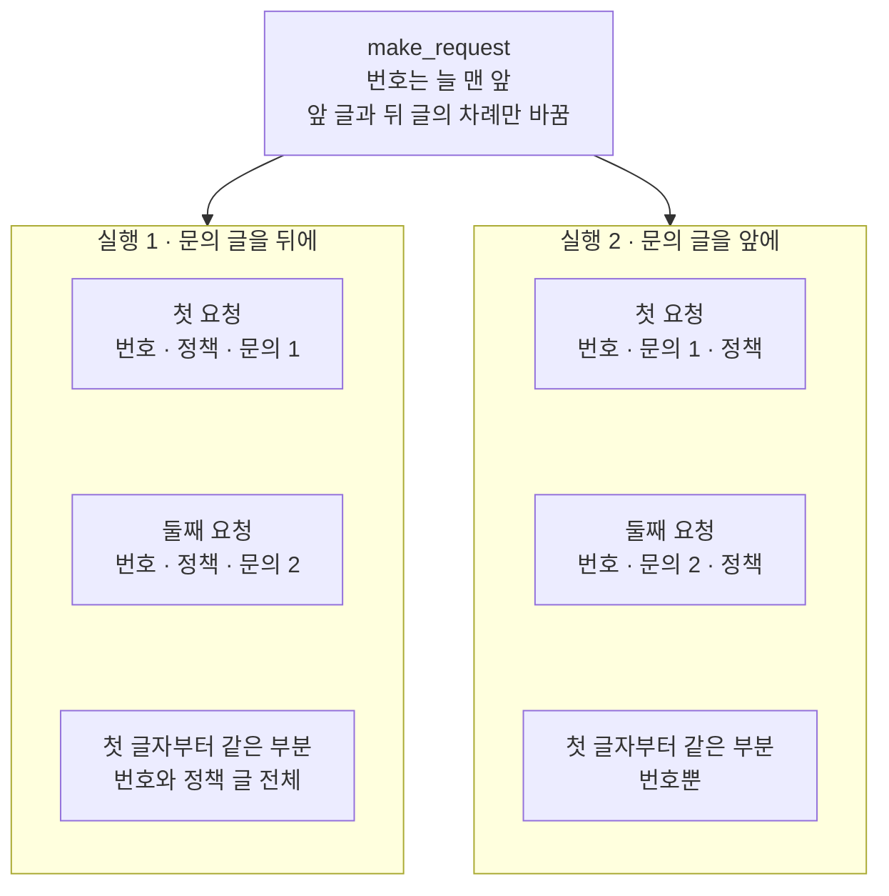
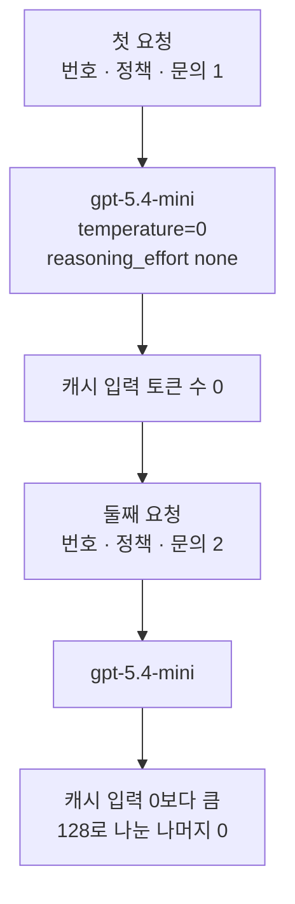
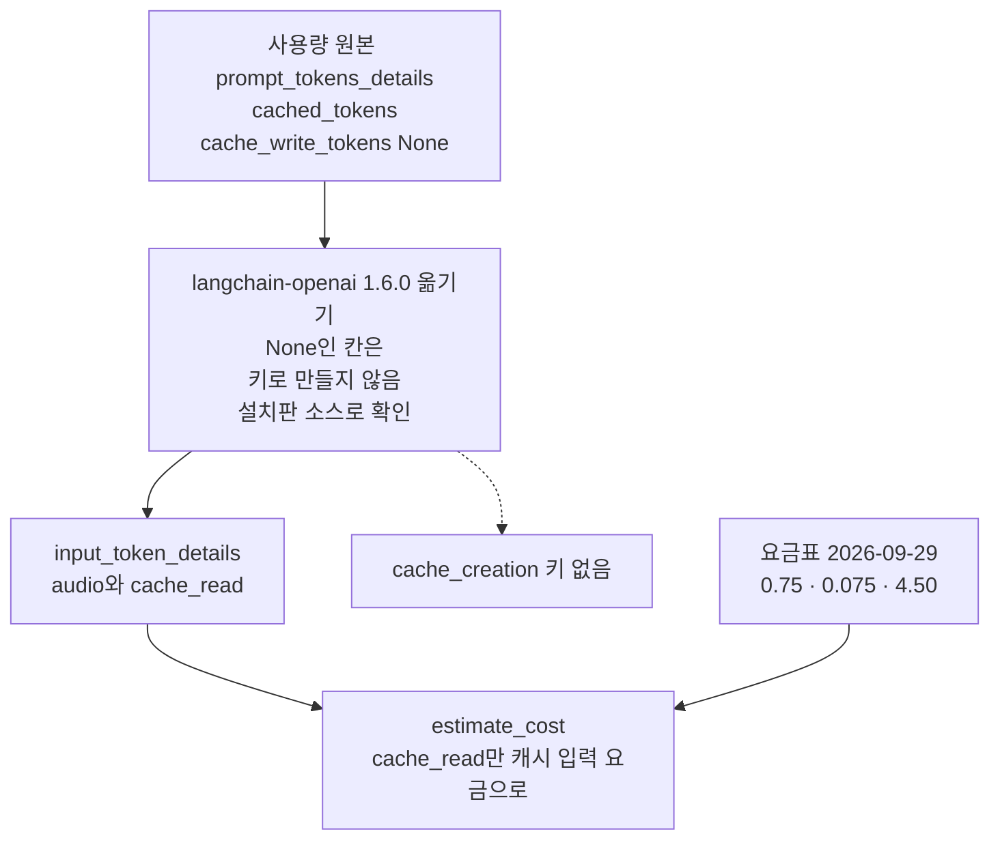
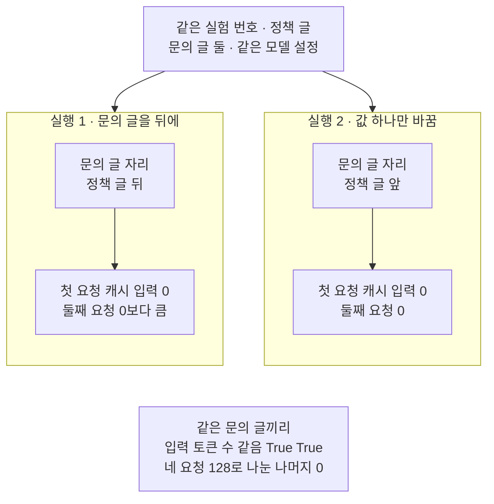

# 01-프롬프트-캐시-계측

## _src 본문 (HTML 원본)

```html
<!--meta: 강의 0.6h | 실습 1h | 코드 notebooks/01-프롬프트-캐시-계측.ipynb | 새 용어 4 -->
<style>html,body{overflow-x:hidden}.notebook,.nb-cell,.nb-main,.nb-input,.nb-result{min-width:0;max-width:100%}.nb-input pre,.nb-output{box-sizing:border-box;max-width:100%;overflow-x:auto}code.nb-source{display:block!important;width:100%!important;min-width:0!important;overflow-x:auto!important;padding:0!important}</style>
<h2 id="b1"><span class="no">1</span>학습 목표</h2><div class="goal"><ul>
<li>긴 공통 앞부분에 바뀌는 글을 붙인 요청을 두 번 보내고, 사용량의 <code>cache_read</code>에서 캐시 입력 토큰 수를 읽을 수 있습니다.</li>
<li>바뀌는 글의 자리 하나만 바꾼 실험으로, 캐시 입력이 첫 글자부터 같은 앞부분에서 생긴다는 것을 출력으로 설명할 수 있습니다.</li>
<li>캐시 입력 할인을 넣은 예상 비용과 할인 없이 센 값을, 도구 파일의 함수 <code>estimate_cost</code>로 계산할 수 있습니다.</li>
</ul></div>
<h2 id="b2"><span class="no">2</span>이 내용을 배우는 이유</h2><p>상담 서비스는 요청마다 긴 정책 글을 모델에 되풀이해 보냅니다. 되풀이해 보낸 글도 입력 토큰으로 세어져 요금이 붙습니다. 제공자는 앞 요청의 앞부분을 저장해 두었다가, 같은 앞부분이 오면 싼 요금으로 다시 씁니다. 그러나 요청 글을 짜는 차례에 따라, 다시 쓸 앞부분이 아예 생기지 않을 수도 있습니다.</p><p>제목의 프롬프트 캐시 계측은, 이렇게 다시 쓴 양을 사용량에서 세어 보는 일입니다. <a href="../../part2/ch06-langchain-start/06-토큰-비용-지연-비교.html">Ch 6 06절</a>에서는 다시 쓴 입력 토큰을 캐시 입력이라고 불렀고, 이 절도 그 말을 씁니다. 이 챕터에서 토큰은 <a href="../../part1/ch05-llm-principles/01-토큰화와-한국어-효율.html">Ch 5</a>에서 배운, 모델이 글을 나눠 세는 단위만 뜻합니다. Ch 28·30에서 쓴 접근 토큰과는 다른 말입니다.</p>
<h2 id="b3"><span class="no">3</span>앞에서 배운 내용</h2><p><a href="../../part2/ch06-langchain-start/06-토큰-비용-지연-비교.html">Ch 6 06절</a>에서는 응답의 <code>usage_metadata</code>에서 입력·출력·캐시 입력 토큰 수를 읽었습니다. 요금표와 함수 <code>estimate_cost</code>로 요청 한 번의 예상 비용도 계산했습니다. 긴 시스템 메시지를 두 번 보내자 둘째 요청에 캐시 입력이 생겼고, 그 글의 맨 앞에는 지금 시각을 두었습니다. 이 절은 그 실험에서 바뀌는 글의 자리를 옮겨 봅니다.</p><p><a href="../../part4/ch15-evaluation-advanced/05-로컬-트레이싱과-지연.html">Ch 15 05절</a>은 실행 추적에 캐시 입력 토큰 수를 적었고, 노트북의 첫 요청에도 캐시 입력이 있었습니다. <a href="../../part4/ch15-evaluation-advanced/06-대화당-비용-백분위수.html">Ch 15 06절</a>은 캐시 입력이 있으면 그만큼 예상 비용이 줄어든다고 셈했습니다. 두 절 모두 캐시 입력 토큰 수만 적었고, 캐시 쓰기 토큰은 다루지 않았습니다. 함수 <code>estimate_cost</code>는 이 절부터 이 챕터의 도구 파일 <code>cost_tools.py</code>에서 가져옵니다.</p>
<h2 id="b4"><span class="no">4</span>핵심 개념</h2><h3>비유로 시작하기</h3><p>배터리 여섯 개를 칸마다 하나씩 꽂는 충전 거치대가 있습니다. 거치대는 앞서 꽂았던 배터리 줄을 칸 차례대로 기억하고, 채워 둔 전기도 남겨 둡니다. 다음에 꽂는 배터리 줄이 첫 칸부터 앞 줄과 같으면, 같은 칸까지는 채워 둔 것을 그대로 씁니다. 그래서 끝 칸의 새 배터리 하나만 새로 채우면 됩니다.</p><p>그런데 새 배터리를 맨 앞 칸에 꽂으면 첫 칸부터 앞 줄과 달라집니다. 뒤의 다섯 칸이 앞 줄과 같은 배터리여도, 거치대는 여섯 칸을 모두 새로 채웁니다. 배터리 줄이 요청 글이고, 채워 둔 전기가 캐시 입력입니다. 앞의 같은 배터리들이 공통 앞부분이고, 새 배터리가 요청마다 바뀌는 문의 글입니다.</p><p>비유와 다른 점이 있습니다. 실제 제공자는 글을 토큰으로 세고, GPT-5.6 앞 모델은 다시 쓴 토큰 수를 128의 배수로 내려 적습니다. 또 채워 둔 것은 요청이 그것을 가진 기계에 닿아야 다시 쓰이므로, 늘 남아 있다고 장담할 수 없습니다.</p>
{{img:01-5-미리-채워-둔-배터리|흰 바탕에 길쭉한 연회색 충전 거치대 둘이 위아래로 놓여 있습니다. 거치대마다 칸 여섯에 회색 원통 배터리가 하나씩 꽂혀 있고, 칸 아래에 작은 동그란 표시등이 하나씩 있습니다. 위 거치대는 왼쪽 다섯 칸의 표시등이 초록이고 맨 오른쪽 한 칸만 주황입니다. 아래 거치대는 여섯 칸의 표시등이 모두 주황입니다. 사람·손·글자·숫자·화살표·전선은 없는 그림|위 거치대는 왼쪽 다섯 칸이 초록 불이고 끝 칸 하나만 주황 불이며, 아래 거치대는 여섯 칸 모두 주황 불입니다.}}
<p class="look"><b>그림 읽기</b> — 위 거치대는 칸 여섯 가운데 왼쪽 다섯 칸이 초록 불이고, 맨 오른쪽 한 칸만 주황 불입니다. 아래 거치대는 여섯 칸이 모두 주황 불입니다. 초록 불은 채워 둔 것을 그대로 쓴 칸, 곧 캐시 입력이고, 주황 불은 새로 채우는 칸입니다. 위 거치대가 문의 글을 뒤에 둔 실행 1의 둘째 요청이고, 아래 거치대가 문의 글을 앞에 둔 실행 2의 둘째 요청입니다. 그림의 칸 수는 비유라서, 실제 캐시 입력 토큰 수와 짝짓지 않습니다.</p>
<h3>공통 앞부분과 바뀌는 글</h3><p>공통 앞부분(common prefix)은 여러 요청이 첫 글자부터 똑같이 보내는 부분입니다. 매일 같은 인사말과 규정 안내로 시작하는 상담 메일의 머리와 같습니다. 이 절 코드에서는 실험 번호와 정책 글이 실행 1의 두 요청에 공통인 앞부분입니다. 공식 안내는 요청 글의 앞부분 전체가 맞아야 저장한 것을 다시 쓴다고 적습니다.</p><p>바뀌는 글은 요청마다 달라지는 부분입니다. 가게 게시판에서 매일 바꿔 붙이는 오늘의 안내 한 줄과 같습니다. 이 절에서는 손님의 문의 글이 바뀌는 글입니다. 공식 안내는 시각이나 사용자마다 다른 글을 앞이 아니라 끝에 두라고 권합니다.</p><p>실험 번호는 이 실행의 요청이 앞 실행이 남긴 앞부분과 맞지 않게 하는 장치입니다. 두 실행 모두 요청 글 맨 앞에 두고, 실행마다 새 값을 씁니다. 그래서 두 실행의 첫 요청은 다시 쓸 앞부분 없이 시작합니다.</p>
<h3>이 절에서 쓰는 말</h3><table><thead><tr><th>말</th><th>뜻</th><th>이 절에서 보이는 모습</th></tr></thead><tbody><tr><td>캐시 입력(<a href="../../part2/ch06-langchain-start/06-토큰-비용-지연-비교.html">Ch 6 06절</a>)</td><td>제공자가 앞선 요청에서 처리해 둔 앞부분을 다시 쓴 입력 토큰입니다.</td><td>사용량의 키 <code>cache_read</code> — 실행 1 둘째 요청에서 0보다 큼</td></tr><tr><td>공통 앞부분(common prefix)</td><td>여러 요청이 첫 글자부터 똑같이 보내는 부분입니다.</td><td>실행 1에서는 실험 번호와 정책 글, 실행 2에서는 실험 번호뿐</td></tr><tr><td>바뀌는 글</td><td>요청마다 달라지는 부분입니다.</td><td>문의 글 둘 — 실행 1은 정책 글 뒤, 실행 2는 앞</td></tr><tr><td>캐시 쓰기 토큰(cache write)</td><td>제공자가 앞부분을 새로 저장한 토큰 수입니다.</td><td>사용량 원본의 칸 <code>cache_write_tokens</code> — 이 모델의 응답에서는 None</td></tr><tr><td>실험 번호</td><td>이 실행의 요청이 앞 실행이 남긴 앞부분과 맞지 않게, 요청 글 맨 앞에 두는 무작위 글입니다.</td><td><code>"실험 번호 " + uuid.uuid4().hex</code> — 38글자, 출력하지 않음</td></tr></tbody></table>
{{mermaid:01-1-요청-글의-두-차례|위에서 아래로 읽는 흐름도입니다. 맨 위 파란 상자 make_request 번호는 늘 맨 앞 앞 글과 뒤 글의 차례만 바꿈에서 칸 둘로 갈라집니다. 왼쪽 칸 실행 1 문의 글을 뒤에는 초록 상자 첫 요청 번호 정책 문의 1과 초록 상자 둘째 요청 번호 정책 문의 2 아래에 회색 상자 첫 글자부터 같은 부분 번호와 정책 글 전체가 있습니다. 오른쪽 칸 실행 2 문의 글을 앞에는 초록 상자 첫 요청 번호 문의 1 정책과 초록 상자 둘째 요청 번호 문의 2 정책 아래에 회색 상자 첫 글자부터 같은 부분 번호뿐이 있는 그림|문의 글을 뒤에 두면 두 요청은 번호와 정책 글까지 같고, 앞에 두면 번호 뒤부터 달라집니다.}}
<p class="look"><b>도식 읽기</b> — 위에서 아래로 읽습니다. 파란 상자는 우리가 정의한 함수이고, 초록 상자는 그 함수로 만든 요청 글입니다. 왼쪽 칸이 실행 1, 오른쪽 칸이 실행 2입니다. 칸마다 아래 회색 상자는 두 요청 글이 첫 글자부터 같은 부분을 코드의 차례로 셈한 것입니다.</p>
<h3>사용량에서 캐시 입력을 읽는 곳</h3><p>이 절의 모델 요청은 OpenAI의 채팅 응답 요청 주소로 갑니다. 응답의 사용량 원본에는 안쪽 딕셔너리 <code>prompt_tokens_details</code>가 있고, 칸 <code>cached_tokens</code>가 캐시 입력 토큰 수입니다. 설치판 langchain-openai 1.6.0은 이 값을 <code>usage_metadata</code>의 키 <code>cache_read</code>로 옮겨 담습니다. 칸 <code>cache_write_tokens</code>는 키 <code>cache_creation</code>으로 옮기되, 값이 None이면 키를 만들지 않습니다.</p><p>노트북 3절의 출력에서 원본의 <code>cache_write_tokens</code>는 None이었고, 키 <code>cache_creation</code>은 없었습니다. 공식 안내는 GPT-5.6 이후 모델에만 캐시 쓰기 요금을 매기고, 그 앞 모델에는 따로 매기지 않는다고 적습니다. 또 GPT-5.6 앞 모델은 캐시 입력 토큰 수를 128의 배수로 내려 적는다고 설명합니다. 옮기는 규칙은 소스로 확인했고, 노트북에서는 None과 없는 키만 보았습니다.</p>
{{mermaid:01-3-사용량-칸이-옮겨지는-자리|위에서 아래로 읽는 흐름도입니다. 노란 상자 사용량 원본 prompt_tokens_details cached_tokens cache_write_tokens None에서 회색 상자 langchain-openai 1.6.0 옮기기 None인 칸은 키로 만들지 않음 설치판 소스로 확인으로 갑니다. 회색 상자에서 실선은 노란 상자 input_token_details audio와 cache_read로, 점선은 노란 상자 cache_creation 키 없음으로 갈라집니다. 노란 상자 input_token_details와 초록 상자 요금표 2026-09-29 0.75 0.075 4.50이 파란 상자 estimate_cost cache_read만 캐시 입력 요금으로로 모이는 그림|사용량 원본의 cached_tokens는 cache_read로 옮겨졌고, cache_write_tokens가 None인 응답에는 키 cache_creation이 없었습니다.}}
<p class="look"><b>도식 읽기</b> — 위에서 아래로 읽습니다. 노란 상자는 노트북 3절에서 출력한 사용량이고, 회색 상자는 설치판 소스로만 확인한 옮기기 단계입니다. 점선 끝 노란 상자에는 출력에서 본 「키 없음」만 적었습니다. None인 칸을 키로 만들지 않는 규칙은 회색 상자의 소스 확인입니다. 맨 아래 파란 상자는 도구 파일의 함수이고, 초록 상자는 6절에 적은 요금표입니다.</p>
<h2 id="b5"><span class="no">5</span>실행 예제</h2><p>노트북 2절은 규칙 문장 100번으로 정책 글을 만들고, 문의 글 둘과 실험 번호를 준비합니다. 함수 <code>make_request</code>는 실험 번호 뒤에 두 글을 인자의 차례대로 잇습니다. 3절은 실행 1로, 문의 글을 정책 글 뒤에 둔 요청 둘을 보냅니다. 4절은 실행 2로, 문의 글을 앞에 둔 요청 둘을 보냅니다. 5절은 네 요청을 한 표로 모으고, 6·7절은 예상 비용을 어림합니다.</p><p>모델 요청은 모두 네 번이고, 요금표(2026-09-29)로 어림한 비용은 합쳐 0.01달러보다 적습니다. 요청 글은 <a href="../../part2/ch06-langchain-start/01-계층-지도와-첫-호출.html">Ch 6 01절</a>처럼 글 하나로 보내, 사용자 메시지 하나가 됩니다. 이 노트북은 파일을 쓰지 않고, 걸린 시간은 재지 않았습니다. 교재를 만들 때 같은 요청 넷을 노트북 밖에서 다섯 번 더 보내 보았고, 이를 흔들림 확인이라고 부릅니다.</p>
{{notebook:01-프롬프트-캐시-계측}}
<p class="look"><b>확인할 점</b> — 노트북 3절에서 첫 요청의 <code>캐시 입력 토큰 수: 0</code>과 <code>input_token_details: {'audio': 0, 'cache_read': 0}</code>을 찾습니다. 둘째 요청은 캐시 입력 토큰 수가 0보다 큰지와 <code>128로 나눈 나머지: 0</code>을 봅니다. 교재 출력에서 둘째 요청의 캐시 입력은 <code>2816</code>이었지만, 여러분의 실행에서는 수가 다르거나 0일 수 있습니다.</p>
{{mermaid:01-2-실행-1의-두-요청|위에서 아래로 한 줄로 읽는 흐름도입니다. 초록 상자 첫 요청 번호 정책 문의 1이 보라 상자 gpt-5.4-mini temperature=0 reasoning_effort none으로 가고, 노란 상자 캐시 입력 토큰 수 0으로 이어집니다. 이어서 초록 상자 둘째 요청 번호 정책 문의 2가 보라 상자 gpt-5.4-mini로 가고, 노란 상자 캐시 입력 0보다 큼 128로 나눈 나머지 0으로 이어지는 그림|실행 1의 첫 요청은 캐시 입력이 0이었고, 같은 앞부분을 보낸 둘째 요청은 캐시 입력이 0보다 컸습니다.}}
<p class="look"><b>도식 읽기</b> — 위에서 아래로 읽습니다. 초록 상자는 보낸 요청 글이고, 보라 상자는 이 절에서 실제로 부른 모델입니다. 노란 상자는 노트북 3절에서 출력으로 확인한 값입니다. 둘째 요청의 캐시 입력은 흔들림 확인 다섯 번과 새 커널 두 번에서 모두 0보다 컸습니다. 그 수는 실행마다 다를 수 있어 그림에 넣지 않았습니다.</p>
<h2 id="b6"><span class="no">6</span>실험 결과 해석</h2><p>가설은 공식 안내의 두 문장에서 세웠습니다. 요청 글의 앞부분 전체가 맞아야 다시 쓰고, 바뀌는 글은 끝에 두라는 문장입니다. 실험은 같은 실험 번호·정책 글·문의 글로, 문의 글의 자리 하나만 바꿔 두 번 했습니다. 실행 1은 문의 글을 정책 글 뒤에, 실행 2는 앞에 두었습니다.</p>
{{mermaid:01-4-문의-글의-자리만-바꾼-두-실행|맨 위 회색 상자 같은 실험 번호 정책 글 문의 글 둘 같은 모델 설정 아래에 칸 둘이 나란히 있습니다. 왼쪽 칸 실행 1 문의 글을 뒤에는 초록 상자 문의 글 자리 정책 글 뒤에서 노란 상자 첫 요청 캐시 입력 0 둘째 요청 0보다 큼으로 이어집니다. 오른쪽 칸 실행 2 값 하나만 바꿈에는 파란 상자 문의 글 자리 정책 글 앞에서 노란 상자 첫 요청 캐시 입력 0 둘째 요청 0으로 이어집니다. 맨 아래 회색 상자는 같은 문의 글끼리 입력 토큰 수 같음 True True 네 요청 128로 나눈 나머지 0인 그림|문의 글을 정책 글 앞에 두자, 둘째 요청의 캐시 입력도 0이 되었습니다.}}
<p class="look"><b>도식 읽기</b> — 맨 위와 맨 아래 회색 상자는 두 실행에 공통인 값입니다. 왼쪽 칸이 실행 1, 오른쪽 칸이 실행 2이고, 칸마다 위가 문의 글의 자리, 아래가 노트북 3·4절의 출력입니다. 오른쪽 칸의 파란 상자가 바꾼 값입니다.</p>
<table><thead><tr><th>견준 것</th><th>실행 1 — 문의 글을 뒤에</th><th>실행 2 — 문의 글을 앞에</th></tr></thead><tbody><tr><td>바꾼 값 — 문의 글의 자리</td><td>정책 글 뒤</td><td>정책 글 앞</td></tr><tr><td>첫 요청의 캐시 입력</td><td><code>0</code></td><td><code>0</code></td></tr><tr><td>둘째 요청의 캐시 입력</td><td>0보다 큼</td><td><code>0</code></td></tr><tr><td>128로 나눈 나머지(두 요청)</td><td><code>0</code> · <code>0</code></td><td><code>0</code> · <code>0</code></td></tr><tr><td>같은 문의 글끼리 입력 토큰 수</td><td>실행 2와 같음(<code>True</code>)</td><td>실행 1과 같음(<code>True</code>)</td></tr><tr><td>둘째 요청 캐시 입력 토큰 수(교재 출력, 실행마다 다를 수 있음)</td><td><code>2816</code></td><td><code>0</code></td></tr><tr><td>두 요청 예상 비용 합(교재 출력, 실행마다 다를 수 있음)</td><td><code>0.002892</code>달러</td><td><code>0.004792</code>달러</td></tr></tbody></table>
<p>두 실행 모두 첫 요청의 캐시 입력은 0이었고, 문의 글을 앞에 둔 실행 2에서는 둘째 요청도 0이었습니다. 두 요청이 첫 글자부터 같은 부분이 실험 번호와 줄바꿈뿐이라, 128의 배수로 내리면 0이 되기 때문입니다. 그 길이는 캐시 입력이 생기는 가장 짧은 길이에도 크게 모자랍니다. 네 요청 모두 캐시 입력 토큰 수를 128로 나눈 나머지는 0이었습니다.</p><p>문의 글을 뒤에 둔 실행 1의 둘째 요청은 캐시 입력이 0보다 컸습니다. 흔들림 확인 다섯 번과 새 커널 두 번에서 모두 그랬습니다. 같은 문의 글끼리는 두 실행의 입력 토큰 수가 같아, 두 실행의 차이는 입력 토큰 가운데 캐시 입력의 몫뿐이었습니다.</p>
<p>새 커널로 두 번 실행해 견주자, 코드 셀 스물둘 가운데 열다섯의 출력이 같았습니다. 한 번은 프로젝트 맨 위에서, 한 번은 <code>notebooks/</code> 폴더에서 연 커널이었습니다. 달랐던 일곱 셀은 입력 토큰 수와, 그 수로 셈한 예상 비용이 든 셀입니다. 실험 번호가 실행마다 달라, 입력 토큰 수가 두 실행에서 조금 달랐습니다. 캐시 입력 토큰 수와 참·거짓 값은 두 번 모두 같았습니다.</p>
<p class="look"><b>확인할 점</b> — 5절 표에서 캐시 입력이 0보다 큰 줄이 <code>실행 1 둘째 요청(뒤에)</code> 하나인지 봅니다. 5절 마지막 셀의 두 줄 <code>True</code>와, 6절 표에서 마지막 칸이 <code>False</code>인 줄이 하나인지도 확인합니다. 교재 출력에서는 실행 1의 예상 비용 합이 실행 2보다 적었습니다. 합의 값과 차이는 캐시 입력 토큰 수에 따라 달라져, 결론에는 쓰지 않습니다.</p>
<h2 id="b7"><span class="no">7</span>주의할 점과 실무 메모</h2><ul><li>공식 안내는 저장한 앞부분을 가진 기계에 요청이 닿고, 그 앞부분이 아직 남아 있어야 다시 쓴다고 적습니다. 그래서 같은 요청도 실행한 때에 따라 캐시 입력이 달라질 수 있습니다. 교재를 만들 때 노트북 밖에서 같은 요청 넷을 다섯 번 보냈고, 둘째 요청의 캐시 입력은 다섯 번 모두 0보다 컸습니다.</li><li>교재 출력에서 실행 1 둘째 요청의 캐시 입력은 <code>2816</code>이었고, 두 요청이 첫 글자부터 같았던 부분의 토큰 수보다 적었습니다. 공식 안내는 GPT-5.6 앞 모델이 모델마다 정해진 간격으로 나눈 자리까지만 다시 쓴다고 적습니다. 그러나 그 간격이 몇 토큰인지는 적지 않아, 그 차이는 가르지 않았습니다.</li><li>GPT-5.6 앞 모델은 캐시 입력이 생기는 가장 짧은 길이가 요청 설정에 따라 다르다고 공식 안내가 적습니다. <a href="../../part2/ch06-langchain-start/06-토큰-비용-지연-비교.html">Ch 6 06절</a>의 탐색에서는 규칙 문장 50번(약 1,250토큰)에서 캐시 입력이 생기지 않았습니다. 그래서 이 절은 정책 글을 그보다 길게 만들었습니다.</li><li>실험 번호를 빼고 노트북을 몇 분 안에 다시 실행하면, 앞 실행과 앞부분이 같아져 첫 요청부터 캐시 입력이 생길 수 있습니다. 이 경우는 노트북에서는 실행하지 않았습니다. <a href="../../part4/ch15-evaluation-advanced/05-로컬-트레이싱과-지연.html">Ch 15 05절</a>의 첫 요청에 캐시 입력이 있었던 것도 이런 경우로 볼 수 있습니다.</li><li>저장한 앞부분이 얼마나 오래 남는지와, 요청을 같은 기계로 보내게 돕는 인자 <code>prompt_cache_key</code>는 이번에 실행하지 않았습니다. 공식 안내는 기본 보관이 보통 쉬는 때 5~10분, 길어도 한 시간이라고 적습니다.</li><li>GPT-5.6 이후 모델은 캐시 쓰기 토큰을 보고하고, 그 토큰에 입력 요금의 1.25배를 매긴다고 공식 안내가 적습니다. 이 절의 모델에서는 그 값이 비어 있어 실행하지 않았습니다.</li><li>캐시 입력은 비용을 줄일 뿐, 답의 품질을 바꾸지 않습니다. 이 절은 답의 품질과 걸린 시간을 재지 않았습니다.</li><li>캐시 입력은 계정과 조직마다 따로 쌓이므로, 여러분의 실행 결과는 교재 출력과 다를 수 있습니다. 여러분의 키로 보내는 요청에는 실제 요금이 붙습니다.</li></ul>
<h2 id="b8"><span class="no">8</span>정리와 다음 절</h2><ul><li>캐시 입력은 요청 글이 첫 글자부터 같은 앞부분에서만 생겼고, 문의 글을 앞에 두면 둘째 요청도 0이었습니다.</li><li>사용량의 키 <code>cache_read</code>가 캐시 입력 토큰 수이고, 이 모델의 응답에는 캐시 쓰기 토큰 값이 없었습니다.</li><li>캐시 입력 토큰 수는 128의 배수였고, 함수 <code>estimate_cost</code>는 그만큼을 싼 요금으로 셉니다.</li></ul><p><strong>다음 학습과 이어지는 지점</strong> — <a href="02-Batch-API.html">02절</a>은 일괄 처리(Batch API)를 다룹니다. 곧바로 답이 필요 없는 요청을 모아 맡기는 방법입니다.</p>
<h2 id="b9"><span class="no">9</span>복습 문제</h2><details class="quiz" open><summary>문제 4개 · 해설 포함</summary><p class="quiz-q">1. 요청마다 바뀌는 문의 글을 긴 정책 글 앞에 두면, 둘째 요청의 캐시 입력은 어떻게 되었나요?</p><p class="quiz-a">0이었습니다. 두 요청이 실험 번호 바로 뒤부터 달라져, 첫 글자부터 같은 부분이 128토큰보다 훨씬 짧았습니다. 틀렸다면 노트북 4절을 다시 읽습니다.</p><p class="quiz-q">2. 노트북 2절에서 실험 번호를 요청 글 맨 앞에 둔 까닭은 무엇인가요?</p><p class="quiz-a">앞서 실행한 노트북이 남긴 앞부분과 이 실행의 요청이 맞지 않게 하려는 것입니다. 그래서 두 실행의 첫 요청은 캐시 입력이 0이었습니다. 틀렸다면 노트북 2절과 3절 첫 셀을 다시 읽습니다.</p><p class="quiz-q">3. 사용량에 키 <code>cache_creation</code>이 없었던 까닭은 무엇인가요?</p><p class="quiz-a">사용량 원본의 칸 <code>cache_write_tokens</code> 값이 None이었고, 라이브러리가 None인 값은 키로 만들지 않기 때문입니다. 공식 안내는 캐시 쓰기 요금을 GPT-5.6 이후 모델에만 매긴다고 적습니다. 틀렸다면 노트북 3절의 둘째 셀을 다시 읽습니다.</p><p class="quiz-q">4. 입력 3,000토큰 가운데 캐시 입력이 2,560토큰이고 출력이 10토큰이면, mini 요금표로 예상 비용은 얼마인가요?</p><p class="quiz-a">일반 입력은 3,000 − 2,560 = 440토큰입니다. 식은 (440 × 0.75 + 2,560 × 0.075 + 10 × 4.50) ÷ 1000000입니다. 330 + 192 + 45 = 567이라, 예상 비용은 0.000567달러입니다. 틀렸다면 노트북 6절과 Ch 6 06절의 식을 다시 봅니다.</p></details>
<h2 id="b10"><span class="no">10</span>참고 자료</h2><ul><li><div><a href="https://developers.openai.com/api/docs/guides/prompt-caching">OpenAI Prompt caching</a></div>확인 2026-09-29 · 요청 글의 앞부분 전체가 맞아야 다시 쓰고, 바뀌는 글은 끝에 두라고 적습니다. GPT-5.6 앞 모델은 캐시 입력 토큰 수를 128의 배수로 내려 적고, 캐시 쓰기 요금을 따로 매기지 않는다고 적습니다. 저장한 앞부분을 가진 기계에 닿아야 다시 쓴다는 문장과, 기본 보관 시간도 이 안내에 있습니다.</li><li><div><a href="https://developers.openai.com/api/docs/models/gpt-5.4-mini">OpenAI GPT-5.4 mini</a></div>확인 2026-09-29 · 100만 토큰당 입력 0.75달러, 캐시 입력 0.075달러, 출력 4.50달러입니다. 날짜판 이름은 <code>gpt-5.4-mini-2026-03-17</code>입니다.</li><li><div><a href="https://docs.langchain.com/oss/python/langchain/messages">LangChain Messages</a></div>확인 2026-09-29 · 사용량 <code>usage_metadata</code>의 예에 안쪽 딕셔너리 <code>input_token_details</code>와 키 <code>cache_read</code>가 있습니다. 키 <code>cache_creation</code>은 예에 없습니다.</li><li><div>설치판 소스 langchain-openai 1.6.0 · openai 3.13.0</div>확인 2026-09-29 · 파일 <code>chat_models/base.py</code>의 함수 <code>_create_usage_metadata</code>가 두 칸을 옮깁니다. 칸 <code>cached_tokens</code>는 키 <code>cache_read</code>로, 칸 <code>cache_write_tokens</code>는 키 <code>cache_creation</code>으로 갑니다. 값이 None인 키는 뺍니다. 두 칸의 이름은 openai 파일 <code>types/completion_usage.py</code>에 있습니다.</li></ul>
```

## 노트북 셀 (순서대로)

### [0] markdown {'html': 'skip'}

# 프롬프트 캐시 계측

**이 노트북에서 할 일**

1. 긴 정책 글 뒤에 문의 글을 붙인 요청을 두 번 보내고, 사용량에서 캐시 입력 토큰 수를 읽습니다.
2. 문의 글을 정책 글 앞에 두는 값 하나만 바꿔 같은 두 요청을 다시 보내고, 두 실행을 견줍니다.
3. 도구 파일의 함수 `estimate_cost`로 네 요청의 예상 비용을 어림합니다.

**준비물** — 이 노트북은 실제 모델에 요청을 네 번 보냅니다.
실행 1에서 두 번, 실행 2에서 두 번입니다.
프로젝트 폴더의 `.env` 파일에 `OPENAI_API_KEY`가 있어야 합니다.
키가 없으면 키를 확인하는 셀에서 멈추고, 모델 요청은 나가지 않습니다.

요금표(2026-09-29 확인)로 어림한 비용은 네 번을 합쳐 0.01달러보다 적습니다.
청구 금액이 아니라, 교재를 만들 때 본 사용량으로 어림한 값입니다.
실행마다 답 글과 토큰 수가 달라질 수 있습니다.
걸린 시간은 재지 않았습니다.

교재를 만들 때 같은 요청 넷을 노트북 밖에서 다섯 번 더 보내 보았고, 이를 흔들림 확인이라고 부릅니다.
새 커널 두 번은 프로젝트 맨 위와 `notebooks/` 폴더에서 새 커널을 하나씩 열어, 이 노트북을 두 번 실행한 것입니다.

실습 폴더의 도구 파일 `cost_tools.py`에서 함수 하나를 가져옵니다.
이 노트북은 파일을 쓰지 않습니다.

**기준 버전** — 첫 셀에서 패키지 셋을 설치합니다.
버전은 langchain 1.4.0, langchain-openai 1.6.0, python-dotenv 1.2.3입니다.
셋 모두 실습 폴더 잠금과 같은 버전입니다.
교재 출력은 Linux의 Python 3.12.13으로 만들었습니다.
다른 버전과 Windows·macOS에서는 실행하지 않았습니다.

**강의와 실습 범위** — 강의 시간에는 2절의 요청 글 모양을 보고 가설을 함께 세웁니다.
모델에 요청을 보내는 3·4절과 표를 만드는 5·6절은 실습 시간에 실행합니다.

실습 폴더 `labs/part7/ch34-cost-rate-limits`에서 `uv sync --locked`를 실행합니다.
그다음 `notebooks/` 폴더의 이 노트북을 열고, 실습 폴더의 `.venv` 커널을 고릅니다.
첫 셀부터 순서대로 실행합니다.

### [1] markdown {'html': 'skip'}

## 오늘 볼 그림


위에서 아래로 읽습니다.
파란 상자는 우리가 정의한 함수이고, 초록 상자는 그 함수로 만든 요청 글입니다.
왼쪽 칸이 실행 1, 오른쪽 칸이 실행 2입니다.
칸마다 아래 회색 상자는 두 요청 글이 첫 글자부터 같은 부분을 코드의 차례로 셈한 것입니다.

### [2] markdown {}

## 1. 준비

제목의 프롬프트 캐시 계측은, 제공자가 앞 요청의 앞부분을 다시 쓴 양을 사용량에서 세어 보는 일입니다.
Ch 6 06절에서는 이렇게 다시 쓴 입력 토큰을 캐시 입력이라고 불렀습니다.
이 절도 그 말을 그대로 씁니다.
이 챕터에서 토큰은 Ch 5에서 배운, 모델이 글을 나눠 세는 단위만 뜻합니다.
Ch 28·30에서 쓴 접근 토큰과는 다른 말입니다.

첫 셀은 패키지 셋을 설치하고 설치된 버전을 출력합니다.
설치에는 몇십 초가 걸릴 수 있습니다.

### [3] code {'execution': {'iopub.execute_input': '2026-09-29T22:43:21.657058Z', 'iopub.status.busy': '2026-09-29T22:43:21.656877Z', 'iopub.status.idle': '2026-09-29T22:43:22.362474Z', 'shell.execute_reply': '2026-09-29T22:43:22.361932Z'}, 'lesson_role': 'setup'}

```python
# 이 절에서 쓰는 패키지를 설치하고 버전을 확인합니다
%pip install -q "langchain==1.4.0" "langchain-openai==1.6.0" "python-dotenv==1.2.3"
from importlib.metadata import version

print("langchain:", version("langchain"))
print("langchain-openai:", version("langchain-openai"))
print("python-dotenv:", version("python-dotenv"))
```

출력:
```
Note: you may need to restart the kernel to use updated packages.
langchain: 1.4.0
langchain-openai: 1.6.0
python-dotenv: 1.2.3

```

### [4] markdown {}

**결과 읽기** — 출력 줄 `langchain: 1.4.0`과 `langchain-openai: 1.6.0`이 보입니다.
패키지 python-dotenv는 `.env` 파일에서 키를 읽을 때 씁니다.
세 패키지 모두 Ch 6 06절과 같은 버전입니다.

다음 셀은 이 절에서 쓸 이름을 가져옵니다.
Ch 6 06절에서 배운 함수 `estimate_cost`는 도구 파일 `cost_tools.py`에서 가져옵니다.

### [5] code {'execution': {'iopub.execute_input': '2026-09-29T22:43:22.363613Z', 'iopub.status.busy': '2026-09-29T22:43:22.363526Z', 'iopub.status.idle': '2026-09-29T22:43:22.758808Z', 'shell.execute_reply': '2026-09-29T22:43:22.758385Z'}, 'lesson_role': 'setup'}

```python
# 이 절에서 쓸 이름을 가져옵니다(uuid는 Python에 들어 있는 모듈입니다)
import uuid
from langchain.chat_models import init_chat_model
# Ch 6 06절에서 배운 함수는 도구 파일에서 가져옵니다
from cost_tools import estimate_cost

print("가져온 이름:", "uuid, init_chat_model")
print("도구 파일에서 가져온 함수:", estimate_cost.__name__)
```

출력:
```
가져온 이름: uuid, init_chat_model
도구 파일에서 가져온 함수: estimate_cost

```

### [6] markdown {}

**결과 읽기** — 출력 줄 `도구 파일에서 가져온 함수: estimate_cost`가 보입니다.
이 함수는 Ch 6 06절 셀의 함수와 def 줄부터 끝 줄까지 글자가 같고, 이 절에서 도구 파일에 처음 옮겼습니다.
모듈 uuid는 Python에 들어 있는 모듈로, 2절에서 실험 번호를 만들 때 씁니다.

앞에서 배운 함수는 `cost_tools.py`에 모아 두었습니다.
파일을 열면 코드를 볼 수 있습니다.
노트북과 같은 폴더(`notebooks/`)에 있는 파일입니다.
커널이 `notebooks/` 폴더에서 시작해야 이 파일을 가져올 수 있습니다.
교재 출력을 만든 실행 도구는 이 폴더를 따로 알려 주어, 다른 자리에서 시작해도 가져오기가 되었습니다.

다음 셀은 `.env` 파일에서 API 키를 읽고, 키가 있는지만 출력합니다.

### [7] code {'execution': {'iopub.execute_input': '2026-09-29T22:43:22.759524Z', 'iopub.status.busy': '2026-09-29T22:43:22.759472Z', 'iopub.status.idle': '2026-09-29T22:43:22.765313Z', 'shell.execute_reply': '2026-09-29T22:43:22.764898Z'}, 'lesson_role': 'setup'}

```python
# .env 파일에서 OpenAI API 키를 읽습니다(키 값은 출력하지 않습니다)
import os
from dotenv import find_dotenv, load_dotenv

env_path = find_dotenv(usecwd=True)
load_dotenv(env_path)
has_key = os.getenv("OPENAI_API_KEY") is not None
print("OPENAI_API_KEY 설정 여부:", has_key)
assert has_key, "프로젝트 폴더의 .env 파일에 OPENAI_API_KEY를 적어 주세요."
```

출력:
```
OPENAI_API_KEY 설정 여부: True

```

### [8] markdown {}

**결과 읽기** — 출력 줄 `OPENAI_API_KEY 설정 여부: True`가 보입니다.
키 값은 출력하지 않고, 있는지만 봅니다.
키가 없으면 이 셀의 `assert`가 멈추고, 뒤 셀의 모델 요청도 나가지 않습니다.

다음 셀은 과정 표준 설정으로 모델 객체를 만듭니다.
객체를 만들 때는 모델 요청이 나가지 않습니다.

### [9] code {'execution': {'iopub.execute_input': '2026-09-29T22:43:22.765932Z', 'iopub.status.busy': '2026-09-29T22:43:22.765879Z', 'iopub.status.idle': '2026-09-29T22:43:23.849715Z', 'shell.execute_reply': '2026-09-29T22:43:23.849310Z'}}

```python
# 실습에 쓸 모델을 준비합니다
model = init_chat_model(
    "openai:gpt-5.4-mini",
    temperature=0,
    reasoning_effort="none",
)
print("모델 이름:", model.model_name)
print("temperature:", model.temperature)
```

출력:
```
모델 이름: gpt-5.4-mini
temperature: 0.0

```

### [10] markdown {}

**결과 읽기** — 모델 이름 `gpt-5.4-mini`, temperature `0.0`이 보이면 준비가 끝났습니다.
이 노트북의 출력은 2026-09-29에 이 모델로 실행한 결과입니다.
온도 값을 0으로 두어도 모델의 답이 매번 같다고 할 수는 없습니다.
인자 `reasoning_effort="none"`은 모델이 답하기 전에 따로 생각하는 단계를 쓰지 않게 합니다.

## 2. 요청마다 같은 글과 바뀌는 글

상담 서비스는 요청마다 같은 정책 글을 모델에 보내고, 그 끝에 손님의 문의 글을 붙이곤 합니다.
여러 요청이 첫 글자부터 똑같이 보내는 부분을 이 절에서는 공통 앞부분이라고 부릅니다.
매일 같은 인사말과 규정 안내로 시작하는 상담 메일의 머리와 같습니다.
이 절 코드에서는 실험 번호와 정책 글이 실행 1의 두 요청에 공통인 앞부분입니다.

다음 셀은 규칙 문장 하나를 100번 이어 붙여 긴 정책 글을 만듭니다.
Ch 6 06절의 긴 시스템 메시지처럼, 캐시 입력이 생길 만큼 길게 만들려고 같은 문장을 되풀이합니다.

### [11] code {'execution': {'iopub.execute_input': '2026-09-29T22:43:23.850437Z', 'iopub.status.busy': '2026-09-29T22:43:23.850374Z', 'iopub.status.idle': '2026-09-29T22:43:23.852531Z', 'shell.execute_reply': '2026-09-29T22:43:23.852119Z'}}

```python
# 규칙 문장 하나를 100번 이어 붙여, 요청마다 똑같이 보낼 긴 정책 글을 만듭니다
rule_sentence = "고객 문의에 답할 때는 확인한 주문 정보만 근거로 삼고, 확인하지 못한 내용은 확인하지 못했다고 적습니다. "
repeat_count = 100
policy_text = ""
for number in range(repeat_count):
    policy_text = policy_text + rule_sentence
print("규칙 문장의 글자 수:", len(rule_sentence))
print("정책 글의 글자 수:", len(policy_text))
```

출력:
```
규칙 문장의 글자 수: 60
정책 글의 글자 수: 6000

```

### [12] markdown {}

**결과 읽기** — 출력 줄 `정책 글의 글자 수: 6000`이 보입니다.
규칙 문장 하나가 끝 공백까지 `60`글자라, 100번 이으면 6000글자입니다.
이 길이는 Ch 6 06절에서 캐시 입력이 생긴 긴 시스템 메시지(규칙 문장 80번)보다 조금 깁니다.

다음 셀은 요청마다 바뀌는 문의 글 둘을 목록에 담습니다.
요청마다 달라지는 부분을 이 절에서는 바뀌는 글이라고 부릅니다.
가게 게시판에서 매일 바꿔 붙이는 오늘의 안내 한 줄과 같습니다.

### [13] code {'execution': {'iopub.execute_input': '2026-09-29T22:43:23.853122Z', 'iopub.status.busy': '2026-09-29T22:43:23.853070Z', 'iopub.status.idle': '2026-09-29T22:43:23.854651Z', 'shell.execute_reply': '2026-09-29T22:43:23.854344Z'}}

```python
# 요청마다 바뀌는 문의 글 둘을 목록에 담습니다(두 글은 첫 글자부터 다릅니다)
inquiries = [
    "주문한 책이 일주일째 오지 않습니다. 이 문의의 종류를 배송, 환불, 결제 가운데 한 낱말로 답하세요.",
    "받은 책이 찢어져 있어 돈을 되찾고 싶습니다. 이 문의의 종류를 배송, 환불, 결제 가운데 한 낱말로 답하세요.",
]
print("문의 글 1:", inquiries[0])
print("문의 글 2:", inquiries[1])
print("두 문의 글의 첫 글자:", inquiries[0][0], inquiries[1][0])
```

출력:
```
문의 글 1: 주문한 책이 일주일째 오지 않습니다. 이 문의의 종류를 배송, 환불, 결제 가운데 한 낱말로 답하세요.
문의 글 2: 받은 책이 찢어져 있어 돈을 되찾고 싶습니다. 이 문의의 종류를 배송, 환불, 결제 가운데 한 낱말로 답하세요.
두 문의 글의 첫 글자: 주 받

```

### [14] markdown {}

**결과 읽기** — 출력 줄 `두 문의 글의 첫 글자: 주 받`이 보입니다.
두 문의 글은 첫 글자부터 달라, 문의 글끼리는 첫 글자부터 같은 부분이 없습니다.
두 문의 모두 종류를 배송, 환불, 결제 가운데 한 낱말로 답하게 해서, 출력 토큰이 적게 나오게 했습니다.

다음 셀은 이 실행에서만 쓸 실험 번호를 만듭니다.
실험 번호를 요청 글 맨 앞에 두면, 앞서 실행한 노트북의 요청과 첫 부분부터 달라집니다.
그래서 이 실행의 첫 요청은 앞 실행이 남긴 앞부분을 다시 쓸 수 없습니다.
Ch 6 06절은 같은 목적으로 지금 시각을 맨 앞에 두었습니다.

### [15] code {'execution': {'iopub.execute_input': '2026-09-29T22:43:23.855278Z', 'iopub.status.busy': '2026-09-29T22:43:23.855214Z', 'iopub.status.idle': '2026-09-29T22:43:23.856686Z', 'shell.execute_reply': '2026-09-29T22:43:23.856451Z'}}

```python
# 이 실행에서만 쓸 실험 번호를 만듭니다(번호는 실행마다 달라서 글자 수만 출력합니다)
# uuid.uuid4()는 겹치지 않는 무작위 값을 만들고, 속성 hex는 그 값을 32글자 글로 내놓습니다
experiment_mark = "실험 번호 " + uuid.uuid4().hex
print("실험 번호의 글자 수:", len(experiment_mark))
```

출력:
```
실험 번호의 글자 수: 38

```

### [16] markdown {}

**결과 읽기** — 출력 줄 `실험 번호의 글자 수: 38`이 보입니다.
「실험 번호 」 여섯 글자 뒤에 무작위 32글자가 붙었습니다.
번호 자체는 실행마다 달라서 출력하지 않습니다.

다음 셀은 실험 번호·앞 글·뒤 글을 이어 요청 글 하나를 만드는 함수를 정의합니다.
두 글 가운데 무엇을 앞에 둘지는 인자의 차례로 정합니다.

### [17] code {'execution': {'iopub.execute_input': '2026-09-29T22:43:23.857281Z', 'iopub.status.busy': '2026-09-29T22:43:23.857220Z', 'iopub.status.idle': '2026-09-29T22:43:23.858691Z', 'shell.execute_reply': '2026-09-29T22:43:23.858372Z'}}

```python
# 실험 번호·앞 글·뒤 글을 줄바꿈으로 이어, 모델에 보낼 요청 글 하나를 만듭니다
def make_request(mark, first_text, second_text):
    # 실험 번호는 언제나 맨 앞에 두고, 정책 글과 문의 글의 차례만 인자로 정합니다
    request_text = mark + "\n" + first_text + "\n" + second_text
    return request_text
```

출력:
```

```

### [18] markdown {}

**결과 읽기** — 정의 셀이라 출력이 없습니다.
글 사이에 넣은 `"\n"`은 줄바꿈 한 글자입니다.
실험 번호는 늘 맨 앞에 두고, 정책 글과 문의 글의 차례만 바꿀 수 있게 했습니다.

다음 셀은 문의 글 1로 두 가지 차례의 요청 글을 만들고, 정책 글이 시작하는 자리를 견줍니다.
메서드 `find`는 글 안에서 찾는 글이 처음 시작하는 자리를 0부터 센 번호로 내놓습니다.

### [19] code {'execution': {'iopub.execute_input': '2026-09-29T22:43:23.859254Z', 'iopub.status.busy': '2026-09-29T22:43:23.859201Z', 'iopub.status.idle': '2026-09-29T22:43:23.861021Z', 'shell.execute_reply': '2026-09-29T22:43:23.860668Z'}}

```python
# 문의 글 1로 두 가지 차례의 요청 글을 만들어, 정책 글이 시작하는 자리를 견줍니다
after_text = make_request(experiment_mark, policy_text, inquiries[0])
before_text = make_request(experiment_mark, inquiries[0], policy_text)
print("두 요청 글의 글자 수:", len(after_text), len(before_text))
# 메서드 find는 찾는 글이 처음 시작하는 자리를 0부터 센 번호로 내놓습니다
print("정책 글이 시작하는 자리(문의 글을 뒤에 둘 때):", after_text.find(policy_text))
print("정책 글이 시작하는 자리(문의 글을 앞에 둘 때):", before_text.find(policy_text))
```

출력:
```
두 요청 글의 글자 수: 6097 6097
정책 글이 시작하는 자리(문의 글을 뒤에 둘 때): 39
정책 글이 시작하는 자리(문의 글을 앞에 둘 때): 97

```

### [20] markdown {}

**결과 읽기** — 출력 줄 `두 요청 글의 글자 수: 6097 6097`이 보입니다.
두 글은 같은 글을 차례만 바꿔 이었으므로 길이가 같습니다.
정책 글은 문의 글을 뒤에 둘 때 `39`번 자리에서, 앞에 둘 때 `97`번 자리에서 시작합니다.
실험 번호 38글자와 줄바꿈 한 글자 뒤가 39번 자리입니다.
앞에 둘 때는 그 사이에 문의 글 57글자와 줄바꿈 한 글자가 더 끼었습니다.

**가설** — 캐시 입력은 공통 앞부분을 다시 쓴 입력 토큰입니다.
문의 글을 정책 글 뒤에 두면, 두 요청은 실험 번호와 정책 글까지 첫 글자부터 같습니다.
그러면 둘째 요청에서 캐시 입력이 생길 수 있습니다.
문의 글을 정책 글 앞에 두면, 두 요청은 실험 번호 바로 뒤부터 달라집니다.
그러면 둘째 요청도 캐시 입력이 0일 것입니다.

## 3. 실행 1 — 문의 글을 정책 글 뒤에

다음 셀은 실행 1의 첫 요청으로, 문의 글 1을 정책 글 뒤에 둔 글을 보냅니다.
Ch 6 01절처럼 글 하나를 메서드 `invoke`에 넣으면, 사용자 메시지 하나로 보냅니다.
이 셀에서 모델 요청이 한 번 나갑니다.

### [21] code {'execution': {'iopub.execute_input': '2026-09-29T22:43:23.861550Z', 'iopub.status.busy': '2026-09-29T22:43:23.861501Z', 'iopub.status.idle': '2026-09-29T22:43:25.017643Z', 'shell.execute_reply': '2026-09-29T22:43:25.016792Z'}}

```python
# 실행 1의 첫 요청: 문의 글 1을 정책 글 뒤에 둔 글을 보냅니다(모델 요청 1번)
after_first = model.invoke(after_text)
after_first_usage = after_first.usage_metadata
print("답:", after_first.text)
print("입력 토큰 수:", after_first_usage["input_tokens"])
print("캐시 입력 토큰 수:", after_first_usage["input_token_details"]["cache_read"])
```

출력:
```
답: 배송
입력 토큰 수: 3166
캐시 입력 토큰 수: 0

```

### [22] markdown {}

**결과 읽기** — 출력 줄 `캐시 입력 토큰 수: 0`이 보입니다.
이 요청은 이 실행에서 처음 보낸 글이고, 맨 앞의 실험 번호가 앞 실행의 글과 다릅니다.
그래서 다시 쓸 앞부분이 없었습니다.
흔들림 확인 다섯 번에서도 첫 요청의 캐시 입력은 모두 0이었습니다.

교재 출력에서는 답이 `배송`, 입력 토큰 수가 `3166`이었습니다.
입력 토큰 수는 실험 번호가 토큰 몇 개로 나뉘는지에 따라 실행마다 조금 달라집니다.
답 글도 모델이 쓴 글이라 실행마다 달라질 수 있습니다.

다음 셀은 사용량의 안쪽 딕셔너리를 보고, 사용량 원본의 안쪽 칸도 봅니다.
사용량 원본은 응답 객체의 `response_metadata`에서 키 `token_usage`로 꺼냅니다.
라이브러리가 받은 사용량을 딕셔너리로 바꾼 것이라, 값이 없던 칸은 None으로 보입니다.

### [23] code {'execution': {'iopub.execute_input': '2026-09-29T22:43:25.019289Z', 'iopub.status.busy': '2026-09-29T22:43:25.019101Z', 'iopub.status.idle': '2026-09-29T22:43:25.022010Z', 'shell.execute_reply': '2026-09-29T22:43:25.021525Z'}}

```python
# 첫 요청의 사용량 안쪽 딕셔너리와, 사용량 원본(token_usage)의 안쪽 칸을 봅니다(요청 없음)
raw_usage = after_first.response_metadata["token_usage"]
print("input_token_details:", after_first_usage["input_token_details"])
print("키 cache_creation이 있는가:", "cache_creation" in after_first_usage["input_token_details"])
print("prompt_tokens_details:", raw_usage["prompt_tokens_details"])
```

출력:
```
input_token_details: {'audio': 0, 'cache_read': 0}
키 cache_creation이 있는가: False
prompt_tokens_details: {'audio_tokens': 0, 'cache_write_tokens': None, 'cached_tokens': 0, 'image_tokens': None, 'text_tokens': None}

```

### [24] markdown {}

**결과 읽기** — 출력 줄 `input_token_details: {'audio': 0, 'cache_read': 0}`이 보입니다.
키 `cache_read`가 캐시 입력 토큰 수이고, 다음 줄 `False`처럼 키 `cache_creation`은 없습니다.
사용량 원본의 안쪽 칸에는 `'cached_tokens': 0`과 `'cache_write_tokens': None`이 있습니다.
라이브러리 LangChain은 원본의 칸 `cached_tokens`를 키 `cache_read`로 옮겨 담습니다.
원본의 칸 `cache_write_tokens`는 키 `cache_creation`으로 옮기지만, 값이 None이면 키를 만들지 않습니다.

두 칸을 옮기는 규칙은 설치판 langchain-openai 1.6.0의 소스에서 확인했습니다.
칸 `cache_write_tokens`는 제공자가 앞부분을 새로 저장한 토큰 수, 곧 캐시 쓰기 토큰을 적는 자리입니다.
공식 안내는 GPT-5.6 이후 모델에만 캐시 쓰기 요금을 따로 매긴다고 적습니다.
이 모델의 응답에서는 그 값이 비어 있었으므로, 이 절은 캐시 쓰기 토큰을 세지 않습니다.

다음 셀은 실행 1의 둘째 요청으로, 같은 정책 글 뒤에 문의 글 2를 둔 글을 보냅니다.
실험 번호와 정책 글은 첫 요청과 같습니다.
이 셀에서 모델 요청이 한 번 나갑니다.

### [25] code {'execution': {'iopub.execute_input': '2026-09-29T22:43:25.023302Z', 'iopub.status.busy': '2026-09-29T22:43:25.023172Z', 'iopub.status.idle': '2026-09-29T22:43:25.814405Z', 'shell.execute_reply': '2026-09-29T22:43:25.813461Z'}}

```python
# 실행 1의 둘째 요청: 같은 정책 글 뒤에 문의 글 2를 둔 글을 보냅니다(모델 요청 1번)
after_second_text = make_request(experiment_mark, policy_text, inquiries[1])
after_second = model.invoke(after_second_text)
after_second_usage = after_second.usage_metadata
print("답:", after_second.text)
print("입력 토큰 수:", after_second_usage["input_tokens"])
print("캐시 입력 토큰 수:", after_second_usage["input_token_details"]["cache_read"])
```

출력:
```
답: 환불
입력 토큰 수: 3170
캐시 입력 토큰 수: 2816

```

### [26] markdown {}

**결과 읽기** — 라벨 `캐시 입력 토큰 수:` 뒤의 값이 0보다 큽니다.
첫 요청과 첫 글자부터 같은 앞부분 가운데 일부를, 제공자가 다시 썼다는 뜻입니다.
흔들림 확인 다섯 번과 새 커널 두 번에서도 모두 0보다 컸습니다.
그래도 공식 안내는 저장한 앞부분이 있는 기계에 요청이 닿아야 다시 쓴다고 적습니다.
그래서 늘 캐시 입력이 생긴다고 장담할 수는 없습니다.

교재 출력에서는 캐시 입력 토큰 수가 `2816`, 입력 토큰 수가 `3170`이었습니다.
캐시 입력은 입력 토큰 수 안의 일부이고, 3170에서 2816을 뺀 354토큰이 일반 입력입니다.
답은 `환불`이었고, 실행마다 달라질 수 있습니다.

다음 셀은 둘째 요청의 캐시 입력 토큰 수를 128로 나눈 몫과 나머지를 봅니다.
연산자 `//`는 나눗셈의 몫을, 연산자 `%`는 나머지를 냅니다.
공식 안내는 GPT-5.6 앞 모델이 캐시 입력 토큰 수를 128의 배수로 내려 적는다고 설명합니다.

### [27] code {'execution': {'iopub.execute_input': '2026-09-29T22:43:25.817066Z', 'iopub.status.busy': '2026-09-29T22:43:25.816858Z', 'iopub.status.idle': '2026-09-29T22:43:25.820831Z', 'shell.execute_reply': '2026-09-29T22:43:25.820017Z'}}

```python
# 둘째 요청의 캐시 입력 토큰 수를 128로 나눈 몫과 나머지를 봅니다(요청 없음)
block_size = 128
second_cache = after_second_usage["input_token_details"]["cache_read"]
print("128로 나눈 몫:", second_cache // block_size)
print("128로 나눈 나머지:", second_cache % block_size)
print("캐시 입력이 입력 토큰 수보다 적은가:", second_cache < after_second_usage["input_tokens"])
```

출력:
```
128로 나눈 몫: 22
128로 나눈 나머지: 0
캐시 입력이 입력 토큰 수보다 적은가: True

```

### [28] markdown {}

**결과 읽기** — 출력 줄 `128로 나눈 나머지: 0`이 보입니다.
캐시 입력 토큰 수가 128의 배수라는 뜻으로, 공식 안내의 설명과 맞습니다.
마지막 줄 `True`는 캐시 입력이 입력 토큰 수보다 적다는 뜻입니다.
흔들림 확인 다섯 번에서도 이 나머지는 모두 0이었습니다.

몫은 교재 출력에서 `22`였고, 캐시 입력 토큰 수에 따라 달라집니다.
두 요청이 첫 글자부터 같았던 부분은 실험 번호와 정책 글 전체입니다.
교재 출력의 캐시 입력은 그 부분의 토큰 수보다 적은 128의 배수였습니다.

공식 안내는 GPT-5.6 앞 모델이 모델마다 정해진 간격으로 나눈 자리까지만 다시 쓴다고 적습니다.
그러나 그 간격이 몇 토큰인지는 적지 않아, 이 절에서는 그 차이를 가르지 않았습니다.

## 4. 실행 2 — 문의 글을 정책 글 앞에

실행 2는 값 하나만 바꿉니다.
바꾸는 값은 문의 글의 자리이고, 정책 글 뒤에서 앞으로 옮깁니다.
실험 번호·정책 글·문의 글·모델 설정은 실행 1과 같습니다.

다음 셀은 실행 2의 첫 요청으로, 2절에서 만든 글 `before_text`를 보냅니다.
이 셀에서 모델 요청이 한 번 나갑니다.

### [29] code {'execution': {'iopub.execute_input': '2026-09-29T22:43:25.822303Z', 'iopub.status.busy': '2026-09-29T22:43:25.822159Z', 'iopub.status.idle': '2026-09-29T22:43:26.846381Z', 'shell.execute_reply': '2026-09-29T22:43:26.845450Z'}}

```python
# 실행 2의 첫 요청: 2절에서 만든, 문의 글 1을 정책 글 앞에 둔 글을 보냅니다(모델 요청 1번)
before_first = model.invoke(before_text)
before_first_usage = before_first.usage_metadata
print("답:", before_first.text)
print("입력 토큰 수:", before_first_usage["input_tokens"])
print("캐시 입력 토큰 수:", before_first_usage["input_token_details"]["cache_read"])
```

출력:
```
답: 배송
입력 토큰 수: 3166
캐시 입력 토큰 수: 0

```

### [30] markdown {}

**결과 읽기** — 출력 줄 `캐시 입력 토큰 수: 0`이 보입니다.
실행 1의 두 요청과는 실험 번호 뒤부터 달라서, 다시 쓸 앞부분이 없었습니다.
흔들림 확인 다섯 번에서도 이 요청의 캐시 입력은 모두 0이었습니다.

교재 출력에서는 입력 토큰 수가 `3166`으로, 실행 1의 첫 요청과 같았습니다.
답은 `배송`이었고, 실행마다 달라질 수 있습니다.

다음 셀은 실행 2의 둘째 요청으로, 문의 글 2를 정책 글 앞에 둔 글을 보냅니다.
정책 글은 첫 요청과 똑같지만, 그 앞의 문의 글이 다릅니다.
이 셀에서 모델 요청이 한 번 나갑니다.

### [31] code {'execution': {'iopub.execute_input': '2026-09-29T22:43:26.848763Z', 'iopub.status.busy': '2026-09-29T22:43:26.848576Z', 'iopub.status.idle': '2026-09-29T22:43:27.875368Z', 'shell.execute_reply': '2026-09-29T22:43:27.874467Z'}}

```python
# 실행 2의 둘째 요청: 문의 글 2를 정책 글 앞에 둔 글을 보냅니다(모델 요청 1번)
before_second_text = make_request(experiment_mark, inquiries[1], policy_text)
before_second = model.invoke(before_second_text)
before_second_usage = before_second.usage_metadata
print("답:", before_second.text)
print("입력 토큰 수:", before_second_usage["input_tokens"])
print("캐시 입력 토큰 수:", before_second_usage["input_token_details"]["cache_read"])
```

출력:
```
답: 환불
입력 토큰 수: 3170
캐시 입력 토큰 수: 0

```

### [32] markdown {}

**결과 읽기** — 출력 줄 `캐시 입력 토큰 수: 0`이 보입니다.
두 요청이 첫 글자부터 같은 부분은 실험 번호와 줄바꿈까지뿐입니다.
그 길이는 128토큰에 한참 못 미쳐, 128의 배수로 내리면 0이 됩니다.
캐시 입력이 생기는 가장 짧은 길이에도 크게 모자랍니다.
흔들림 확인 다섯 번에서도 이 요청의 캐시 입력은 모두 0이었습니다.

교재 출력에서는 입력 토큰 수가 `3170`, 답이 `환불`이었습니다.

## 5. 두 실행을 한 표로

다음 셀은 요청 하나의 라벨과 사용량으로, 표 한 줄을 출력하는 함수를 정의합니다.
입력 토큰 수·캐시 입력 토큰 수·128로 나눈 나머지를 차례로 적습니다.

### [33] code {'execution': {'iopub.execute_input': '2026-09-29T22:43:27.877362Z', 'iopub.status.busy': '2026-09-29T22:43:27.877170Z', 'iopub.status.idle': '2026-09-29T22:43:27.881307Z', 'shell.execute_reply': '2026-09-29T22:43:27.880455Z'}}

```python
# 요청 하나의 라벨과 사용량으로, 입력 토큰·캐시 입력 토큰·128로 나눈 나머지를 한 줄로 출력합니다
def print_row(label, usage):
    cache_read = usage["input_token_details"]["cache_read"]
    block_size = 128
    remainder = cache_read % block_size
    print(label, "|", usage["input_tokens"], "|", cache_read, "|", remainder)
```

출력:
```

```

### [34] markdown {}

**결과 읽기** — 정의 셀이라 출력이 없습니다.
사용량 딕셔너리를 인자로 받으므로, 네 요청 모두 같은 함수로 적을 수 있습니다.

다음 셀은 두 실행의 네 요청을 한 표로 모읍니다.

### [35] code {'execution': {'iopub.execute_input': '2026-09-29T22:43:27.882834Z', 'iopub.status.busy': '2026-09-29T22:43:27.882694Z', 'iopub.status.idle': '2026-09-29T22:43:27.886067Z', 'shell.execute_reply': '2026-09-29T22:43:27.885439Z'}}

```python
# 두 실행의 네 요청을 한 표로 모읍니다(요청 없음)
print("요청 | 입력 토큰 | 캐시 입력 토큰 | 128로 나눈 나머지")
print_row("실행 1 첫 요청(뒤에)", after_first_usage)
print_row("실행 1 둘째 요청(뒤에)", after_second_usage)
print_row("실행 2 첫 요청(앞에)", before_first_usage)
print_row("실행 2 둘째 요청(앞에)", before_second_usage)
```

출력:
```
요청 | 입력 토큰 | 캐시 입력 토큰 | 128로 나눈 나머지
실행 1 첫 요청(뒤에) | 3166 | 0 | 0
실행 1 둘째 요청(뒤에) | 3170 | 2816 | 0
실행 2 첫 요청(앞에) | 3166 | 0 | 0
실행 2 둘째 요청(앞에) | 3170 | 0 | 0

```

### [36] markdown {}

**결과 읽기** — 라벨 줄 아래 네 줄이 두 실행의 네 요청입니다.
캐시 입력이 0보다 큰 줄은 `실행 1 둘째 요청(뒤에)` 하나뿐입니다.
나머지 세 줄의 캐시 입력은 0이고, 네 줄 모두 128로 나눈 나머지가 0입니다.
가설대로 문의 글을 앞에 둔 실행 2에서는 둘째 요청도 캐시 입력이 0이었습니다.

입력 토큰 수와 캐시 입력 토큰 수는 교재 출력의 값이라, 여러분의 실행에서는 다를 수 있습니다.

다음 셀은 같은 문의 글을 쓴 요청끼리, 두 실행의 입력 토큰 수가 같은지 봅니다.

### [37] code {'execution': {'iopub.execute_input': '2026-09-29T22:43:27.887562Z', 'iopub.status.busy': '2026-09-29T22:43:27.887432Z', 'iopub.status.idle': '2026-09-29T22:43:27.890678Z', 'shell.execute_reply': '2026-09-29T22:43:27.889948Z'}}

```python
# 같은 문의 글을 쓴 요청끼리, 두 실행의 입력 토큰 수가 같은지 봅니다(요청 없음)
same_first = after_first_usage["input_tokens"] == before_first_usage["input_tokens"]
same_second = after_second_usage["input_tokens"] == before_second_usage["input_tokens"]
print("문의 글 1 요청의 입력 토큰 수가 같은가:", same_first)
print("문의 글 2 요청의 입력 토큰 수가 같은가:", same_second)
```

출력:
```
문의 글 1 요청의 입력 토큰 수가 같은가: True
문의 글 2 요청의 입력 토큰 수가 같은가: True

```

### [38] markdown {}

**결과 읽기** — 두 줄 모두 `True`입니다.
두 실행은 같은 글을 차례만 바꿔 보냈고, 입력 토큰 수도 같았습니다.
그래서 두 실행의 차이는 입력 토큰 가운데 캐시 입력이 몇 개인지뿐입니다.
흔들림 확인 다섯 번에서도 같은 회차 안에서는 모두 같았습니다.

## 6. 요금표로 예상 비용 어림하기

캐시 입력은 일반 입력보다 싼 요금으로 셉니다.
Ch 6 06절처럼 요금표와 함수 `estimate_cost`로 요청마다 예상 비용을 어림합니다.
다음 셀은 모델 안내에 적힌 요금과 확인한 날짜를 적습니다.
요금표의 키 이름은 Ch 6 06절과 같습니다.

### [39] code {'execution': {'iopub.execute_input': '2026-09-29T22:43:27.891972Z', 'iopub.status.busy': '2026-09-29T22:43:27.891867Z', 'iopub.status.idle': '2026-09-29T22:43:27.894571Z', 'shell.execute_reply': '2026-09-29T22:43:27.893982Z'}}

```python
# gpt-5.4-mini의 공식 요금(100만 토큰당 달러)과 확인한 날짜를 적습니다
pricing_date = "2026-09-29"
mini_prices = {"ordinary_input": 0.75, "cached_input": 0.075, "output": 4.50}
print("요금 확인 날짜:", pricing_date)
print("mini 요금:", mini_prices)
```

출력:
```
요금 확인 날짜: 2026-09-29
mini 요금: {'ordinary_input': 0.75, 'cached_input': 0.075, 'output': 4.5}

```

### [40] markdown {}

**결과 읽기** — 출력 줄 `mini 요금: {'ordinary_input': 0.75, 'cached_input': 0.075, 'output': 4.5}`가 보입니다.
단위는 100만 토큰당 달러이고, 캐시 입력 요금은 입력 요금의 10분의 1입니다.
Ch 6 06절의 요금표(2026-09-17)와 값이 같습니다.
요금은 바뀔 수 있어서 확인한 날짜를 함께 적습니다.

다음 셀은 요청 하나의 예상 비용을 두 가지로 계산해 한 줄로 출력하는 함수를 정의합니다.
하나는 캐시 입력 할인을 넣은 값이고, 다른 하나는 할인 없이 센 값입니다.
함수는 할인을 넣은 값을 내놓아, 7절에서 합을 셀 때 씁니다.

### [41] code {'execution': {'iopub.execute_input': '2026-09-29T22:43:27.895960Z', 'iopub.status.busy': '2026-09-29T22:43:27.895814Z', 'iopub.status.idle': '2026-09-29T22:43:27.899047Z', 'shell.execute_reply': '2026-09-29T22:43:27.898484Z'}}

```python
# 사용량 하나의 예상 비용을 캐시 입력 할인을 넣은 값과 할인 없이 센 값으로 한 줄에 출력하고, 앞의 값을 내놓습니다
def cost_row(label, usage, prices):
    # 할인 없이 셀 때는 Ch 6 06절처럼, 캐시 입력 요금 자리에 입력 요금을 넣습니다
    with_discount = estimate_cost(usage, prices["ordinary_input"], prices["cached_input"], prices["output"])
    without_discount = estimate_cost(usage, prices["ordinary_input"], prices["ordinary_input"], prices["output"])
    print(label, "|", round(with_discount, 6), "|", round(without_discount, 6), "|", with_discount == without_discount)
    return with_discount
```

출력:
```

```

### [42] markdown {}

**결과 읽기** — 정의 셀이라 출력이 없습니다.
할인 없이 셀 때는 Ch 6 06절처럼, 캐시 입력 요금 자리에 입력 요금을 넣습니다.
함수 `round`로 소수 여섯째 자리까지 줄여 적습니다.
마지막 칸은 두 값이 같은지이고, 캐시 입력이 0이면 두 식이 같은 값을 냅니다.

다음 셀은 네 요청의 예상 비용을 표로 출력합니다.

### [43] code {'execution': {'iopub.execute_input': '2026-09-29T22:43:27.900218Z', 'iopub.status.busy': '2026-09-29T22:43:27.900096Z', 'iopub.status.idle': '2026-09-29T22:43:27.903020Z', 'shell.execute_reply': '2026-09-29T22:43:27.902393Z'}}

```python
# 네 요청의 예상 비용을 표로 출력하고, 할인을 넣은 값을 변수에 담습니다(요청 없음)
print("요청 | 할인을 넣은 비용 | 할인 없이 센 비용 | 두 값이 같은가")
after_first_cost = cost_row("실행 1 첫 요청(뒤에)", after_first_usage, mini_prices)
after_second_cost = cost_row("실행 1 둘째 요청(뒤에)", after_second_usage, mini_prices)
before_first_cost = cost_row("실행 2 첫 요청(앞에)", before_first_usage, mini_prices)
before_second_cost = cost_row("실행 2 둘째 요청(앞에)", before_second_usage, mini_prices)
```

출력:
```
요청 | 할인을 넣은 비용 | 할인 없이 센 비용 | 두 값이 같은가
실행 1 첫 요청(뒤에) | 0.002393 | 0.002393 | True
실행 1 둘째 요청(뒤에) | 0.000499 | 0.0024 | False
실행 2 첫 요청(앞에) | 0.002393 | 0.002393 | True
실행 2 둘째 요청(앞에) | 0.0024 | 0.0024 | True

```

### [44] markdown {}

**결과 읽기** — 라벨 줄 아래에서 마지막 칸이 `False`인 줄은 실행 1의 둘째 요청 하나입니다.
캐시 입력이 0인 세 요청은 두 값이 같아 `True`입니다.
캐시 입력이 있는 요청만, 할인 없이 센 값보다 예상 비용이 적습니다.

교재 출력에서 실행 1의 둘째 요청은 `0.000499`달러, 할인 없이 세면 `0.0024`달러였습니다.
실행 2의 둘째 요청은 `0.0024`달러였습니다.
예상 비용은 청구 금액이 아니고, 토큰 수가 달라지면 함께 달라집니다.

## 7. 두 실행의 예상 비용 합

다음 셀은 실행마다 두 요청의 예상 비용을 더해 견줍니다.

### [45] code {'execution': {'iopub.execute_input': '2026-09-29T22:43:27.904154Z', 'iopub.status.busy': '2026-09-29T22:43:27.904033Z', 'iopub.status.idle': '2026-09-29T22:43:27.907038Z', 'shell.execute_reply': '2026-09-29T22:43:27.906433Z'}}

```python
# 실행마다 두 요청의 예상 비용을 더해, 두 실행의 합을 견줍니다(요청 없음)
run1_total = after_first_cost + after_second_cost
run2_total = before_first_cost + before_second_cost
print("실행 1 두 요청의 합(달러):", round(run1_total, 6))
print("실행 2 두 요청의 합(달러):", round(run2_total, 6))
print("실행 1의 합이 더 적은가:", run1_total < run2_total)
```

출력:
```
실행 1 두 요청의 합(달러): 0.002892
실행 2 두 요청의 합(달러): 0.004792
실행 1의 합이 더 적은가: True

```

### [46] markdown {}

**결과 읽기** — 출력 줄 `실행 1의 합이 더 적은가: True`가 보입니다.
문의 글을 뒤에 둔 실행 1은 둘째 요청에 캐시 입력 할인이 붙어 합이 적었습니다.
두 실행의 입력 토큰 수는 같았으므로, 이 차이는 캐시 입력에서만 왔습니다.

교재 출력에서는 실행 1의 합이 `0.002892`달러, 실행 2의 합이 `0.004792`달러였습니다.
합의 차이는 캐시 입력 토큰 수에 따라 달라지는 값이라, 결론에는 쓰지 않습니다.

**결론** — 바꾼 값은 문의 글의 자리 하나였습니다.
문의 글을 정책 글 앞에 둔 실행 2에서는 두 요청 모두 캐시 입력이 0이었습니다.
두 실행 모두 첫 요청의 캐시 입력은 0이었고, 네 요청 모두 128로 나눈 나머지가 0이었습니다.
문의 글을 뒤에 둔 실행 1의 둘째 요청은, 흔들림 확인 다섯 번과 새 커널 두 번에서 모두 캐시 입력이 0보다 컸습니다.
바뀌는 글은 공통 앞부분 뒤에 두어야 캐시 입력이 생길 수 있습니다.

## 정리

1. 캐시 입력은 요청 글이 첫 글자부터 같은 앞부분에서만 생겼고, 문의 글을 앞에 두면 둘째 요청도 0이었습니다.
2. 사용량의 키 `cache_read`가 캐시 입력 토큰 수이고, 이 모델의 응답에는 캐시 쓰기 토큰 값이 없었습니다.
3. 캐시 입력 토큰 수는 128의 배수였고, 함수 `estimate_cost`는 그만큼을 싼 요금으로 셉니다.

02절에서는 곧바로 답이 필요 없는 요청을 모아 맡기는 일괄 처리(Batch API)를 다룹니다.

## 그림

### 01-1-요청-글의-두-차례.mmd



문의 글을 뒤에 두면 두 요청은 번호와 정책 글까지 같고, 앞에 두면 번호 뒤부터 달라집니다.

### 01-2-실행-1의-두-요청.mmd



실행 1의 첫 요청은 캐시 입력이 0이었고, 같은 앞부분을 보낸 둘째 요청은 캐시 입력이 0보다 컸습니다.

### 01-3-사용량-칸이-옮겨지는-자리.mmd



사용량 원본의 cached_tokens는 cache_read로 옮겨졌고, cache_write_tokens가 None인 응답에는 키 cache_creation이 없었습니다.

### 01-4-문의-글의-자리만-바꾼-두-실행.mmd



문의 글을 정책 글 앞에 두자, 둘째 요청의 캐시 입력도 0이 되었습니다.

### 01-5-미리-채워-둔-배터리.prompt.md

# 01-5-미리-채워-둔-배터리 (Higgsfield 삽화)

설명 대상 문장(본문 b4 비유 단락): 배터리 여섯 개를 칸마다 하나씩 꽂는 충전 거치대가 있습니다. … 다음에 꽂는 배터리 줄이 첫 칸부터 앞 줄과 같으면, 같은 칸까지는 채워 둔 것을 그대로 씁니다. 그래서 끝 칸의 새 배터리 하나만 새로 채우면 됩니다. 그런데 새 배터리를 맨 앞 칸에 꽂으면 첫 칸부터 앞 줄과 달라집니다. … 거치대는 여섯 칸을 모두 새로 채웁니다. 배터리 줄이 요청 글이고, 채워 둔 전기가 캐시 입력입니다.

구성 요소와 배치: **충전 거치대 둘**(위아래로 나란히) · 거치대마다 **칸 여섯**·칸마다 **원통 배터리 하나와 작은 표시등 하나** · 위 거치대 = **왼쪽 다섯 칸 초록 불 + 맨 오른쪽 한 칸 주황 불**(문의 글을 뒤에 둔 실행 1의 둘째 요청 — 공통 앞부분은 채워 둔 것을 씀, 끝의 바뀌는 글만 새로) · 아래 거치대 = **여섯 칸 모두 주황 불**(문의 글을 앞에 둔 실행 2의 둘째 요청 — 모두 새로). 칸 수는 비유라 실제 토큰 수와 짝짓지 않음. 비유 계열 **「충전 거치대와 배터리」**(이 챕터에서 01이 엶 — 02 한꺼번에 꽂기·04 칸 수 제한·05 남은 양으로 이어 씀). 앞 챕터 소품(전화 교환대·화물 열차·번호판·오르골·종이띠·도킹 포트·정거장·온실·모종판·예인선·밧줄·홈통·물방울·도미노·체스판·즉석사진·세탁기·승강 상자·전표·가마·발자국·쟁반·서랍·바구니·저울·공항 검사·안내 데스크) 없음. 사람·손·글자·숫자·화살표·전선·플러그·화면·콘센트 없음.

시선 순서: 위 거치대의 초록 불 다섯 → 끝 칸 주황 불 하나 → 아래 거치대의 주황 불 여섯.

검수 기준: 그림만 보고 「위 줄은 대부분 채워 둔 것(초록)이고 끝 하나만 새로 채우고(주황), 아래 줄은 모두 새로 채운다(주황)」가 읽히는가. 초록 다섯·주황 하나 / 주황 여섯을 셀 수 있는가. 사람·글자·숫자·화살표 없음. 흰 여백이 크지 않은가(물건이 화면을 채우는 가까운 구도).

## 프롬프트 (1차, 채택)

```text
Simple flat educational illustration, white background, limited soft palette, clean outlines, plain everyday objects, no text, no letters, no numbers, no logos. Close front view of two identical long battery charging racks stacked one above the other, drawn large so they fill the frame edge to edge. Each rack has exactly six slots in one row, and every slot holds one upright cylindrical battery with a small round indicator light on the rack just below it. Top rack: the five batteries on the left have green lights, and only the one battery in the rightmost slot has an orange light. Bottom rack: all six batteries have orange lights. No people, no hands, no arrows, no cables, no plugs, no screens, no wall sockets.
```

## 상태

- 2026-09-29 · `generate_image` 한 번(재생성 0 — 한도 1회 안), `params` = `{"model":"nano_banana_pro","prompt":…,"aspect_ratio":"16:9","resolution":"2k","use_unlim":false,"count":1}`. `generate_image` 응답 모델 `nano_banana_pro`, **`jobs_wait` 응답 모델 표시 `nano_banana_2`**(Ch 30·31과 같은 표시, 거래 표시는 「Nano Banana Pro」 — 기록만). 서비스 쪽 실패 0.
- 생성 전 잔액 **2247**(`balance`), 바로 앞 거래 2026-09-29T20:12:01.818588Z는 이 절 몫이 아님(Ch 31 작업 시각).
- **1차 job `168634ae-564d-4b38-9b95-54e91ed80670` — 채택**: 거래 2026-09-29T22:46:51.829523Z 「Nano Banana Pro −2」. **이 절 몫 2크레딧**(잔액 2247 → 2245). 원본 `18a599b7d0f499df08217ed7a58c720d7136eb87ac2de0a98b4fe659a8ca5bd5`(2752 × 1536).
- **그림에서 확인한 것(그림 읽기·alt에 반영)**: 흰 바탕 · 연회색 길쭉한 거치대 둘이 위아래로 · 거치대마다 칸 여섯·회색 원통 배터리 여섯(위아래 모두 같은 모양) · 칸 아래 작은 동그란 표시등 · **위: 왼쪽 다섯 초록·맨 오른쪽 하나 주황** · **아래: 여섯 모두 주황** · 사람·손·글자·숫자·화살표·전선·플러그·화면 없음. 거의 흰 가로줄 **108 / 614**(거치대 사이와 위아래 가장자리), 흰 픽셀 비율 0.387 — 물건이 화면을 가로로 채움.
- **설계와 다른 점**: 배터리 모양은 모두 같고 채움 정도는 표시등 색으로만 보임 · 표시등이 작고 옅은 색이라 가까이 보아야 셈이 됨 — 관계(위 대부분 초록 · 아래 모두 주황)는 읽혀 채택.
- 검수: 「위 줄은 끝 하나만 새로 채우고, 아래 줄은 모두 새로 채운다」가 그림만으로 읽힘 → 채택.
- 저장: 기기 셸에서 결과 URL을 `curl`로 받아(`/tmp/ch34-01/illu/illu-1-orig.png`) `UV_CACHE_DIR=/tmp/uv-cache uv run --no-project --with pillow`로 RGB·폭 1100px(LANCZOS)로 줄여 `figures/01-5-미리-채워-둔-배터리.png`(1100 × 614, `353a9510ca8f3c7efa246cb49b5a0652565c304d006c207a225a87efbd084fc1`)로 저장했습니다.
- 결과 URL을 한 번 더 받아(`illu-1-again.png`, 원본과 해시 같음) 같은 폭으로 줄인 그림과 저장 PNG를 픽셀 대조했습니다(`ImageChops.difference` bbox `None`, 최대 차이 0). 저장 PNG와 같은 보기 사본(`.cache/ch34-01-view/illu-1-1100.png` — bbox `None`)을 직접 열어 개수를 세고 그림 읽기를 썼습니다.

