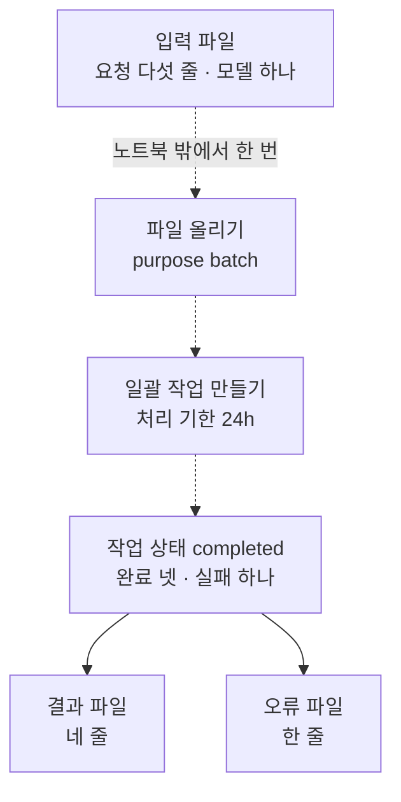
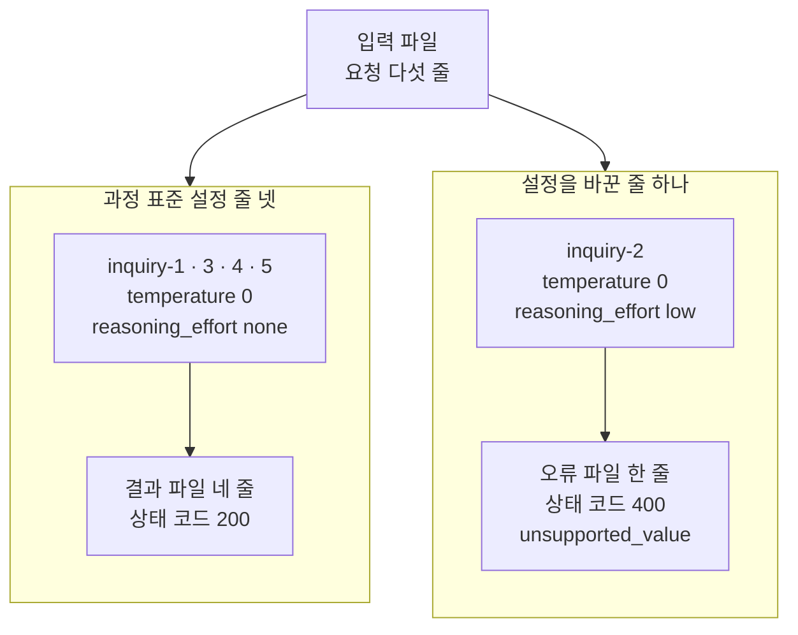
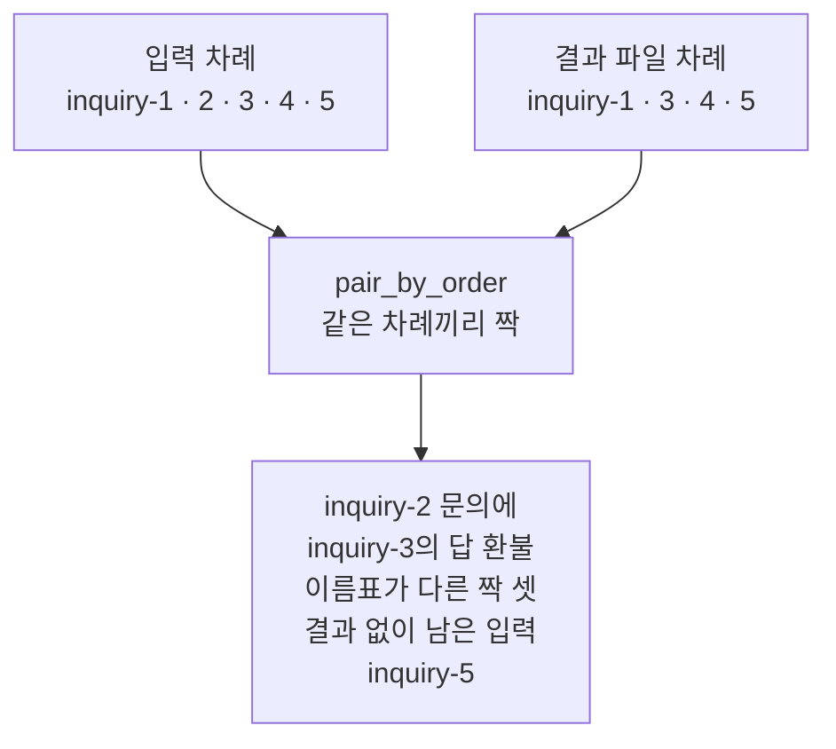
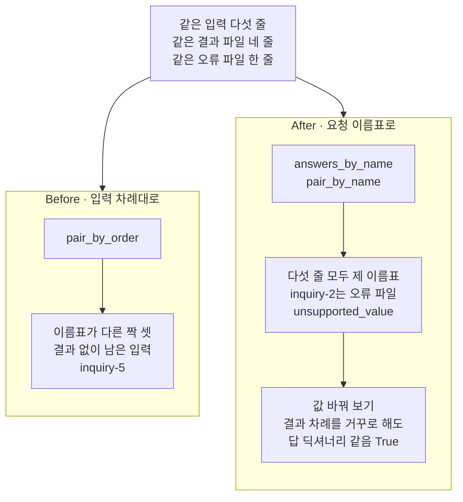

# 02-Batch-API

## _src 본문 (HTML 원본)

```html
<!--meta: 강의 0.6h | 실습 1h | 코드 notebooks/02-Batch-API.ipynb | 새 용어 4 -->
<style>html,body{overflow-x:hidden}.notebook,.nb-cell,.nb-main,.nb-input,.nb-result{min-width:0;max-width:100%}.nb-input pre,.nb-output{box-sizing:border-box;max-width:100%;overflow-x:auto}code.nb-source{display:block!important;width:100%!important;min-width:0!important;overflow-x:auto!important;padding:0!important}</style>
<h2 id="b1"><span class="no">1</span>학습 목표</h2><div class="goal"><ul>
<li>요청 이름표를 붙인 요청 다섯 줄로 일괄 처리의 입력 파일을 만들 수 있습니다.</li>
<li>한 일괄 작업의 결과 파일과 오류 파일을 읽고, 결과 줄을 요청 이름표로 입력 줄과 짝지을 수 있습니다.</li>
<li>요금표와 공식 안내의 50% 할인으로 일괄 처리의 예상 비용을 계산할 수 있습니다.</li>
</ul></div>
<h2 id="b2"><span class="no">2</span>이 내용을 배우는 이유</h2><p>문의 분류처럼 답을 곧바로 보여 주지 않아도 되는 요청이 있습니다. 밤사이 쌓인 문의를 아침까지 분류해 두면 되는 경우입니다. 이런 요청은 파일 하나로 모아 맡기고, 결과를 나중에 파일로 받을 수 있습니다. 공식 안내는 이 방법의 요금이 곧바로 보내는 요청보다 50% 싸고, 24시간 안에 끝난다고 적습니다.</p><p>제목의 Batch API는 이렇게 요청을 모아 맡기는 방법입니다. <a href="../../part4/ch15-evaluation-advanced/08-Batch-평가-입력.html">Ch 15 08절</a>은 이를 일괄 처리(Batch API)라고 불렀고, 입력 파일까지만 만들었습니다. 맡긴 뒤에도 할 일이 있습니다. 결과는 파일 둘로 나뉘어 오고, 그 줄이 어느 요청의 결과인지 짝지어야 합니다. 이 절은 실제로 한 번 맡긴 작업에서 받은 파일로 그 일을 합니다.</p>
<h2 id="b3"><span class="no">3</span>앞에서 배운 내용</h2><p><a href="../../part4/ch15-evaluation-advanced/08-Batch-평가-입력.html">Ch 15 08절</a>에서는 판정 요청 여섯 개를 네 칸짜리 요청 한 줄씩 JSONL 입력 파일에 담았습니다. 네 칸은 요청마다 붙이는 이름 <code>custom_id</code>, 방식, 요청 주소, 요청 본문이었습니다. 본문에는 과정의 모델 설정 <code>temperature</code> 0과 <code>reasoning_effort</code> none을 같은 이름 칸에 적었습니다. 손으로 적은 결과 줄 다섯 개를 그 이름으로 요청과 이어, 결과가 없는 요청도 찾았습니다. 파일을 맡기지는 않아, 그 본문이 일괄 처리에서 받아들여지는지는 확인하지 않았습니다.</p><p>이 절은 Ch 15 08절의 함수 넷을 도구 파일 <code>cost_tools.py</code>에서 가져옵니다. 요청 한 줄을 만드는 <code>make_batch_line</code>, 파일을 쓰고 읽는 <code>write_jsonl</code>·<code>read_jsonl</code>, 빠진 이름을 찾는 <code>ids_not_in</code>입니다. 칸 <code>custom_id</code>의 이름은 이 챕터에서 요청 이름표라고 부릅니다.</p><p><a href="01-프롬프트-캐시-계측.html">01절</a>에서는 문의 글 둘을 배송·환불·결제 가운데 하나로 분류하게 했습니다. <a href="../../part2/ch06-langchain-start/06-토큰-비용-지연-비교.html">Ch 6 06절</a>의 요금표와 함수 <code>estimate_cost</code>로 예상 비용도 어림했습니다. 이 절은 같은 문의 분류와 같은 요금표를 씁니다.</p>
<h2 id="b4"><span class="no">4</span>핵심 개념</h2><h3>비유로 시작하기</h3><p>저녁에 배터리 다섯 개를 나무 충전 선반의 칸 다섯에 한꺼번에 꽂아 두고, 다음 날 아침에 찾으러 갑니다. 배터리마다 색이 다른 띠를 감아 두어, 누구의 배터리인지 가릴 수 있게 합니다. 아침에 보니 둘째 칸의 불만 빨갛고, 그 배터리는 차지 않았습니다. 나머지 네 칸은 초록 불로, 다 찼습니다.</p><p>다 찬 배터리 넷을 꺼내, 꽂았던 사람의 차례대로 하나씩 나눠 준다고 해 봅니다. 둘째 사람은 셋째 사람의 배터리를 받고, 그 뒤로 모두 한 사람씩 밀립니다. 다섯째 사람은 받을 배터리가 없어, 자기 배터리가 안 찼다고 여깁니다. 색 띠를 보고 나눠 주면 꺼낸 차례와 상관없이 모두 제 배터리를 받습니다.</p><p>선반의 칸 다섯이 입력 파일의 요청 다섯 줄이고, 색 띠가 요청 이름표입니다. 빨간 불 칸이 오류 파일로 간 요청이고, 다 찬 배터리 넷이 결과 파일의 네 줄입니다. 비유와 다른 점도 있습니다. 실제 서비스는 결과 줄의 차례를 입력 차례와 같게 하겠다고 약속하지 않습니다.</p>
{{img:02-5-한꺼번에-꽂아-둔-배터리|흰 바탕에 가까이에서 본 나무 충전 선반 하나가 화면을 채웁니다. 칸 다섯이 한 줄로 나란하고, 칸마다 회색 네모 배터리가 하나씩 서 있습니다. 배터리마다 가운데에 색 띠가 감겨 있고, 왼쪽부터 파랑·노랑·보라·분홍·청록입니다. 칸 위에는 큰 동그란 표시등이 하나씩 있고, 왼쪽부터 초록·빨강·초록·초록·초록입니다. 사람·손·글자·숫자·화살표·전선은 없는 그림|칸 다섯 가운데 둘째 칸의 표시등만 빨갛고, 배터리마다 색이 다른 띠가 감겨 있습니다.}}
<p class="look"><b>그림 읽기</b> — 나무 충전 선반에 칸 다섯이 한 줄로 있고, 칸마다 배터리가 하나씩 꽂혀 있습니다. 칸 위의 표시등은 왼쪽부터 초록, 빨강, 초록, 초록, 초록으로, 빨간 불은 둘째 칸 하나뿐입니다. 배터리마다 파랑, 노랑, 보라, 분홍, 청록 띠가 감겨 있어, 꺼낸 차례가 섞여도 누구의 배터리인지 가릴 수 있습니다. 빨간 불 칸이 오류 파일로 간 inquiry-2이고, 색 띠가 요청 이름표입니다. 배터리 모양은 모두 같아, 다 찼는지는 표시등 색으로만 보입니다.</p>
<h3>일괄 처리를 맡기고 받는 차례</h3><p>일괄 처리는 네 단계로 갑니다. 먼저 입력 파일을 용도 <code>batch</code>로 올립니다. 올린 파일로 일괄 작업을 만들며, 요청 주소와 처리 기한 <code>24h</code>를 정합니다. 작업 상태를 확인하다가 끝나면 결과 파일과 오류 파일을 받습니다.</p><p>설치판 openai 3.13.0에서는 네 단계에 <code>client.files.create</code>·<code>client.batches.create</code>·<code>client.batches.retrieve</code>·<code>client.files.content</code>를 씁니다. 교재를 만들 때 노트북 밖에서 이 함수로 한 번 맡겼고, 노트북에서는 실행하지 않습니다. 노트북은 그때 받은 파일을 읽기만 합니다.</p>
{{mermaid:02-1-일괄-처리를-맡기고-받는-차례|위에서 아래로 읽는 흐름도입니다. 초록 상자 입력 파일 요청 다섯 줄 모델 하나에서 점선을 따라 회색 상자 파일 올리기 purpose batch와 회색 상자 일괄 작업 만들기 처리 기한 24h를 지나 노란 상자 작업 상태 completed 완료 넷 실패 하나로 갑니다. 노란 상자에서 초록 상자 결과 파일 네 줄과 초록 상자 오류 파일 한 줄로 갈라지는 그림|입력 파일을 올려 일괄 작업을 만들면, 작업이 끝난 뒤 결과 파일과 오류 파일을 따로 받습니다.}}
<p class="look"><b>도식 읽기</b> — 위에서 아래로 읽습니다. 점선과 회색 상자는 교재를 만들 때 노트북 밖에서 한 번 한 단계이고, 노트북에서는 실행하지 않습니다. 노란 상자는 노트북 3절에서 출력한 작업 기록이고, 초록 상자는 노트북이 만든 입력 파일과 읽는 자료 파일입니다.</p>
<h3>이 절에서 쓰는 말</h3><table><thead><tr><th>말</th><th>뜻</th><th>이 절에서 보이는 모습</th></tr></thead><tbody><tr><td>요청 이름표(custom_id)</td><td>입력 파일의 요청 한 줄마다 붙이는 겹치지 않는 이름입니다. 외투를 맡길 때 받는 보관표처럼, 결과를 찾을 때 봅니다.</td><td><code>inquiry-1</code>부터 <code>inquiry-5</code>까지 — 결과 줄과 오류 줄에도 같은 이름이 적혀 옴</td></tr><tr><td>결과 파일(output file)</td><td>일괄 작업에서 끝난 요청의 답을 한 줄에 하나씩 담은 JSONL 파일입니다.</td><td><code>data/batch-output.jsonl</code> — 네 줄, 상태 코드 모두 <code>200</code></td></tr><tr><td>오류 파일(error file)</td><td>일괄 작업에서 실패한 요청의 오류 정보를 한 줄에 하나씩 담은 JSONL 파일입니다.</td><td><code>data/batch-errors.jsonl</code> — 한 줄, <code>inquiry-2</code>의 상태 코드 <code>400</code></td></tr><tr><td>작업 상태(status)</td><td>일괄 작업이 지금 어느 단계에 있는지 적은 칸입니다. 수선집에 맡긴 옷이 접수, 수선 중, 찾아가기로 바뀌는 것과 같습니다.</td><td>작업 기록의 <code>completed</code> — 노트북 밖에서 확인할 때 validating, in_progress를 거침</td></tr></tbody></table>
<h3>작업 상태 여덟 가지</h3><p>공식 안내는 일괄 작업의 상태를 여덟 가지로 적습니다. 이번 작업은 노트북 밖에서 상태를 네 번 확인했고, validating·in_progress·completed를 보았습니다. 끝나기 전에 작업을 멈추려면 취소를 요청합니다. 안내는 상태가 cancelling을 거쳐 cancelled가 되고, 그 사이 10분까지 걸린다고 적습니다. 이 절은 취소를 실행하지 않았습니다.</p><table><thead><tr><th>작업 상태</th><th>뜻(공식 안내)</th></tr></thead><tbody><tr><td><code>validating</code></td><td>입력 파일을 검사하는 중</td></tr><tr><td><code>failed</code></td><td>입력 파일이 검사를 통과하지 못함</td></tr><tr><td><code>in_progress</code></td><td>요청을 처리하는 중</td></tr><tr><td><code>finalizing</code></td><td>결과 파일을 준비하는 중</td></tr><tr><td><code>completed</code></td><td>끝나서 결과를 받을 수 있음</td></tr><tr><td><code>expired</code></td><td>처리 기한 24시간 안에 끝나지 못함</td></tr><tr><td><code>cancelling</code></td><td>취소하는 중</td></tr><tr><td><code>cancelled</code></td><td>취소됨</td></tr></tbody></table>
<h3>결과 줄의 차례와 요청 이름표</h3><p>공식 안내는 결과 줄의 차례가 입력 줄의 차례와 다를 수 있다고 적습니다. 그래서 차례에 기대지 말고, 결과 줄마다 있는 칸 <code>custom_id</code>로 요청과 결과를 이으라고 권합니다. 실패한 요청의 오류 정보는 오류 파일에 따로 적힌다고도 적습니다. 그러니 결과 파일의 줄 수는 입력보다 적을 수 있습니다.</p><p>LangChain 모델의 메서드 <code>batch</code>는 이름이 비슷하지만 다른 것입니다. 그 메서드는 요청 여러 개를 곧바로 함께 보내고, 답도 곧바로 받습니다. 파일로 맡기지 않고, 일괄 처리의 할인도 붙지 않습니다.</p>
<h2 id="b5"><span class="no">5</span>실행 예제</h2><p>노트북 2절은 문의 글 다섯으로 요청 다섯 줄을 만들어, 운영체제 임시 폴더에 입력 파일로 씁니다. 이름표 <code>inquiry-2</code> 줄만 생각하는 단계를 low로 바꾸고, temperature 0은 그대로 둡니다. 3절은 노트북 밖에서 맡긴 작업의 기록과 결과 파일·오류 파일을 읽습니다. 4절은 결과 줄의 토큰 수로 일괄 처리의 예상 비용을 어림합니다.</p><p>노트북은 모델에 요청을 보내지 않고, API 키도 쓰지 않습니다. 읽는 파일은 실습 폴더 <code>data/</code>의 자료 파일 셋이고, 실습 폴더에는 파일을 쓰지 않습니다. 걸린 시간은 재지 않았습니다.</p>
{{notebook:02-Batch-API|example}}
<p class="look"><b>확인할 점</b> — 노트북 3절에서 <code>작업 상태: completed</code>와 <code>요청 수: {'completed': 4, 'failed': 1, 'total': 5}</code>를 찾습니다. 결과 파일에 <code>inquiry-2</code>가 없는지와, 오류 파일 줄의 <code>상태 코드: 400</code>을 확인합니다. 4절의 <code>합: 173 18</code>과 사용량이 같다는 두 줄의 <code>True</code>도 봅니다.</p>
{{mermaid:02-2-다섯-줄이-간-곳|위에서 아래로 읽는 흐름도입니다. 초록 상자 입력 파일 요청 다섯 줄에서 칸 둘로 갈라집니다. 왼쪽 초록 상자 inquiry-1 3 4 5 temperature 0 reasoning_effort none은 노란 상자 결과 파일 네 줄 상태 코드 200으로, 오른쪽 초록 상자 inquiry-2 temperature 0 reasoning_effort low는 노란 상자 오류 파일 한 줄 상태 코드 400 unsupported_value로 이어지는 그림|설정을 바꾼 inquiry-2만 상태 코드 400으로 오류 파일에 가고, 나머지 네 줄은 결과 파일에 갔습니다.}}
<p class="look"><b>도식 읽기</b> — 위에서 아래로 읽습니다. 초록 상자는 노트북 2절에서 만든 요청 줄이고, 노란 상자는 3절에서 출력한 결과 파일과 오류 파일의 값입니다. 두 칸의 차이는 인자 reasoning_effort 값 하나입니다.</p>
<h2 id="b6"><span class="no">6</span>일부러 실패해 보기</h2><p>아래 Before 셀은 결과 파일 네 줄을 입력 다섯 줄과 같은 차례로 짝짓습니다. After 셀은 같은 두 파일을 요청 이름표로 짝짓습니다. 두 쪽이 읽는 파일은 같고, 짝짓는 방법만 다릅니다.</p>
{{notebook:02-Batch-API|failure}}
{{mermaid:02-3-차례대로-짝지은-결과|위에서 아래로 읽는 흐름도입니다. 초록 상자 입력 차례 inquiry-1 2 3 4 5와 초록 상자 결과 파일 차례 inquiry-1 3 4 5가 파란 상자 pair_by_order 같은 차례끼리 짝으로 모이고, 빨간 상자 inquiry-2 문의에 inquiry-3의 답 환불 이름표가 다른 짝 셋 결과 없이 남은 입력 inquiry-5로 이어지는 그림|결과 줄을 입력 차례대로 짝짓자, 둘째 문의부터 다음 요청의 답이 붙고 실패한 요청은 다섯째로 보였습니다.}}
<p class="look"><b>도식 읽기</b> — 위에서 아래로 읽습니다. 초록 상자 둘은 노트북 2절의 입력 차례와 3절에서 읽은 결과 파일 차례입니다. 파란 상자는 5절에서 정의한 함수이고, 빨간 상자는 5절에서 출력한 Before의 결함 결과입니다.</p>
{{mermaid:02-4-차례와-이름표로-짝지은-두-결과|맨 위 회색 상자 같은 입력 다섯 줄 같은 결과 파일 네 줄 같은 오류 파일 한 줄 아래에 칸 둘이 나란히 있습니다. 왼쪽 칸 Before 입력 차례대로에는 파란 상자 pair_by_order에서 빨간 상자 이름표가 다른 짝 셋 결과 없이 남은 입력 inquiry-5로 이어집니다. 오른쪽 칸 After 요청 이름표로에는 파란 상자 answers_by_name pair_by_name에서 노란 상자 다섯 줄 모두 제 이름표 inquiry-2는 오류 파일 unsupported_value로, 이어서 노란 상자 결과 차례를 거꾸로 해도 답 딕셔너리 같음 True로 이어지는 그림|같은 두 파일을 차례대로 짝지으면 세 짝이 어긋나고, 요청 이름표로 짝지으면 차례를 바꿔도 다섯 줄이 모두 제 짝을 찾습니다.}}
<p class="look"><b>도식 읽기</b> — 맨 위 회색 상자는 두 칸이 함께 쓴 같은 파일입니다. 왼쪽 칸이 Before, 오른쪽 칸이 After이고, 칸마다 위가 함수, 아래가 노트북 5·6절의 출력입니다. 오른쪽 칸 맨 아래 노란 상자는 After 쪽 값 바꿔 보기의 출력이고, 왼쪽 칸에는 해당하지 않습니다.</p>
<table><thead><tr><th>견준 것</th><th>Before — 입력 차례대로</th><th>After — 요청 이름표로</th></tr></thead><tbody><tr><td>짝짓는 기준</td><td>입력 줄과 같은 차례</td><td>요청 이름표(custom_id)</td></tr><tr><td>읽은 파일</td><td>결과 파일 네 줄</td><td>결과 파일 네 줄 · 오류 파일 한 줄</td></tr><tr><td>둘째 문의에 붙은 것</td><td><code>inquiry-3</code>의 답 <code>환불</code></td><td>오류 코드 <code>unsupported_value</code></td></tr><tr><td>이름표가 서로 다른 짝</td><td><code>3</code></td><td>없음</td></tr><tr><td>결과 없이 남은 입력</td><td><code>['inquiry-5']</code></td><td><code>['inquiry-2']</code>(오류 파일에 있음)</td></tr><tr><td>결과 줄 차례를 거꾸로 했을 때</td><td>셋째 짝만 우연히 맞음</td><td>답 딕셔너리가 같음(<code>True</code>)</td></tr></tbody></table>
<p>Before 쪽 코드는 결과 파일의 둘째 줄을 둘째 문의의 답으로 보았습니다. 그런데 그 줄은 셋째 요청 <code>inquiry-3</code>의 결과였습니다. 둘째 요청이 오류 파일로 가서, 그 뒤의 결과 줄이 한 칸씩 앞으로 당겨져 있었기 때문입니다. 그래서 짝 넷 가운데 셋이 다른 요청의 답을 받았고, 거절되지 않은 다섯째가 결과 없이 남았습니다.</p><p>코드는 오류 없이 끝났습니다. 결제 창 문의에 환불이라는 답이 붙어도, 코드는 그것이 틀린 짝인지 알지 못합니다. 이 절은 짝지은 결과 줄의 이름표를 함께 출력해서, 밀린 것을 볼 수 있었습니다.</p><p>After 쪽 코드는 결과 줄을 이름표로 딕셔너리에 담고, 입력 줄마다 제 이름표로 답을 찾았습니다. 결과 파일에 없는 <code>inquiry-2</code>는 오류 파일에서 오류 코드 <code>unsupported_value</code>를 찾았습니다. 결과 줄의 차례를 거꾸로 해도, 이름표로 만든 답 딕셔너리는 같았습니다.</p><p>거꾸로 한 차례를 입력 차례대로 짝지으니, 넷째 짝은 이름표가 달랐는데 답은 우연히 배송이었습니다. 문의 글도 배송 문의라, 답 글만 보고는 틀린 짝인 줄 알 수 없습니다. 요청 이름표로 짝지으면 답 글과 상관없이 짝이 정해집니다.</p>
<p>새 커널로 두 번 실행해 견주자, 코드 셀 스물아홉의 출력이 셀마다 모두 같았습니다. 한 번은 프로젝트 맨 위에서, 한 번은 <code>notebooks/</code> 폴더에서 연 커널이었습니다. 노트북은 모델을 부르지 않고 받은 파일을 읽기만 해서, 출력이 자료 파일로 정해집니다.</p>
<p class="look"><b>확인할 점</b> — Before 쪽 <code>inquiry-2 | inquiry-3 | 환불</code>과 <code>이름표가 서로 다른 짝: 3</code>을 봅니다. After 쪽 <code>결과 파일에 없는 입력: ['inquiry-2']</code>와 <code>inquiry-2 | 오류 파일 | unsupported_value</code>를 확인합니다. 값 바꿔 보기의 <code>True</code>와 넷째 짝 <code>inquiry-4 | inquiry-1 | 배송</code>도 찾습니다.</p>
<h2 id="b7"><span class="no">7</span>주의할 점과 실무 메모</h2><ul><li>이 절의 파일은 2026-09-29에 교재를 만들며 노트북 밖에서 한 번 맡긴 일괄 작업에서 받았습니다. 요청 다섯 줄 가운데 넷이 끝나고 하나가 거절되었습니다. 받은 파일에서 작업·파일·요청 ID와 시각을 빼고, 짝짓기와 셈에 쓰는 칸만 남겼습니다.</li><li>노트북에서는 맡기지 않았습니다. 같은 입력 파일을 여러분의 키로 맡기면 실제 요금이 붙고, 계정에 파일과 작업 기록이 남습니다. 설치판 SDK의 설명은 용도 <code>batch</code>로 올린 파일이 기본으로 30일 뒤 만료된다고 적습니다. 공식 안내는 결과 파일이 작업이 끝나고 30일 뒤 지워진다고 적습니다.</li><li>둘째 줄의 설정은 공식 안내대로면 거절될 줄로 골랐습니다. 결과 파일이 입력보다 짧아지는 경우를 보려고, 교재를 만들 때 정한 설정입니다.</li><li>둘째 줄의 거절은 한 번 맡긴 작업에서 본 결과입니다. 오류 글은 이 모델이 온도 칸에 기본값 1만 받는다고 적었습니다. 공식 GPT-5.4 안내는 생각하는 단계가 none이 아니면 온도 칸을 받지 않는다고 적습니다. 그 문장은 GPT-5.4를 적고, GPT-5.4 mini를 따로 적지는 않습니다.</li><li>이번 작업은 만든 때부터 약 2분 뒤에 끝났습니다. 공식 안내는 24시간 안에 끝난다고만 적어, 이 시간을 다른 작업에 기대하지 않습니다. 끝나기 전에 멈추는 취소는 이번에 실행하지 않았습니다.</li><li>이번 결과 파일은 입력 차례에서 둘째 줄만 빠진 차례였습니다. 공식 안내는 결과 줄의 차례가 입력과 다를 수 있다고 적어, 다음 작업도 같은 차례라고 볼 수 없습니다. 노트북에서 거꾸로 한 차례는 노트북이 바꾼 것입니다.</li><li>문의 다섯의 차례는 이웃한 문의의 종류가 모두 다르게 정했습니다. 답이 밀린 것이 눈에 보이게 하려고, 흐름을 보여 주려고 정한 예입니다. 요청 이름표로 짝짓는 방법은 차례와 상관없이 맞습니다.</li><li>답 글 넷은 모델이 쓴 글이라, 같은 요청을 다시 맡기면 달라질 수 있습니다. 이 절은 답 글을 자료 파일에서 읽어, 노트북을 다시 실행해도 같은 글이 나옵니다.</li><li>작업 기록의 사용량은 결과 네 줄의 합과 같았고, 거절된 줄은 토큰을 쓰지 않았습니다. 예상 비용은 요금표로 어림한 값이고, 청구 금액은 확인하지 않았습니다. 캐시 입력 할인이 일괄 처리에도 붙는지는 공식 안내에 없어 셈에 넣지 않았습니다.</li><li>공식 안내는 일괄 처리의 요청 제한을 모델마다의 요청 제한과 따로 센다고 적습니다. 요청 제한은 <a href="04-백오프-큐-동시성.html">04절</a>에서 다룹니다.</li><li>입력 파일에는 API 키나 개인 정보를 넣지 않습니다. 이 절의 문의 글은 교재에서 지어낸 글입니다.</li><li>교재 출력은 Linux의 Python 3.12.13으로 만들었습니다. 다른 버전과 Windows·macOS에서는 실행하지 않았습니다.</li></ul>
<h2 id="b8"><span class="no">8</span>정리와 다음 절</h2><ul><li>한 일괄 작업의 결과는 결과 파일과 오류 파일로 나뉘어 왔고, 거절된 한 줄은 오류 파일에만 있었습니다.</li><li>결과 줄을 입력 차례대로 짝짓자 거절된 줄 뒤부터 답이 밀렸고, 요청 이름표로 짝짓자 다섯 줄이 모두 제 짝을 찾았습니다.</li><li>일괄 처리의 예상 비용은 요금표로 센 값에 공식 안내의 50% 할인을 곱해 어림합니다.</li></ul><p><strong>다음 학습과 이어지는 지점</strong> — <a href="03-모델-라우팅.html">03절</a>에서는 요청마다 어느 모델로 보낼지 고르는 방법을 봅니다.</p>
<h2 id="b9"><span class="no">9</span>복습 문제</h2><details class="quiz" open><summary>문제 5개 · 해설 포함</summary><p class="quiz-q">1. 이번 일괄 작업에서 결과 파일이 입력 파일보다 한 줄 적었던 까닭은 무엇인가요?</p><p class="quiz-a">이름표 <code>inquiry-2</code> 줄이 상태 코드 400으로 거절되어, 결과 파일이 아니라 오류 파일에 적혔기 때문입니다. 그 줄은 생각하는 단계를 low로 바꾸고 temperature 0을 그대로 둔 줄입니다. 틀렸다면 노트북 3절을 다시 읽습니다.</p><p class="quiz-q">2. 결과 줄을 입력 차례대로 짝지으면, 둘째 문의에는 어떤 답이 붙었고 그 까닭은 무엇인가요?</p><p class="quiz-a">셋째 요청의 답 환불이 붙었습니다. 둘째 요청이 오류 파일로 가서, 그 뒤의 결과 줄이 한 칸씩 앞으로 당겨졌기 때문입니다. 틀렸다면 노트북 5절을 다시 읽습니다.</p><p class="quiz-q">3. 결과 줄의 차례가 섞여 와도 요청마다 제 답을 찾으려면 어떻게 하나요?</p><p class="quiz-a">결과 줄을 요청 이름표를 키로 하는 딕셔너리에 담고, 입력 줄마다 제 이름표로 찾습니다. 노트북에서 결과 차례를 거꾸로 해도 답 딕셔너리가 같았습니다. 틀렸다면 노트북 6절을 다시 읽습니다.</p><p class="quiz-q">4. 일괄 처리로 입력 1,000토큰과 출력 100토큰을 쓰면, mini 요금표로 예상 비용은 얼마인가요?</p><p class="quiz-a">곧바로 보낼 때의 식은 (1,000 × 0.75 + 100 × 4.50) ÷ 1000000입니다. 750 + 450 = 1,200이라 0.0012달러이고, 50% 할인을 넣으면 0.0006달러입니다. 틀렸다면 노트북 4절을 다시 봅니다.</p><p class="quiz-q">5. 동료가 「LangChain 메서드 <code>batch</code>로 요청을 보내면 일괄 처리 할인을 받는다」고 말합니다. 맞나요?</p><p class="quiz-a">맞지 않습니다. 그 메서드는 요청 여러 개를 곧바로 함께 보내고 답도 곧바로 받는 것이라, 파일로 맡기는 일괄 처리와 다릅니다. 할인은 입력 파일을 올려 일괄 작업을 만들 때 붙습니다. 틀렸다면 본문 4블록의 마지막 단락을 다시 읽습니다.</p></details>
<h2 id="b10"><span class="no">10</span>참고 자료</h2><ul><li><div><a href="https://developers.openai.com/api/docs/guides/batch">OpenAI Batch API</a></div>확인 2026-09-29 · 곧바로 보내는 요청보다 50% 싸고, 24시간 안에 끝난다고 적습니다. 입력 줄의 네 칸과 겹치지 않는 <code>custom_id</code>, 한 파일에 한 모델이라는 규칙이 있습니다. 상태 여덟 가지와 취소, 오류 파일, 결과 줄의 차례가 입력과 다를 수 있다는 문장도 이 안내에 있습니다.</li><li><div><a href="https://developers.openai.com/api/docs/guides/latest-model?model=gpt-5.4">OpenAI Using GPT-5.4</a></div>확인 2026-09-29 · 온도 칸은 생각하는 단계가 none일 때만 받고, 다른 단계와 함께 보내면 오류가 난다고 적습니다.</li><li><div><a href="https://developers.openai.com/api/docs/models/gpt-5.4-mini">OpenAI GPT-5.4 mini</a></div>확인 2026-09-29 · 100만 토큰당 입력 0.75달러, 캐시 입력 0.075달러, 출력 4.50달러입니다. 요청 주소 Chat Completions와 Batch를 지원하고, 생각하는 단계의 기본값은 none입니다.</li><li><div>설치판 소스 openai 3.13.0</div>확인 2026-09-29 · 파일 <code>resources/batches.py</code> 47~67행이 일괄 작업 만들기로, 처리 기한은 <code>24h</code>만 받습니다. 파일 <code>types/batch.py</code> 40~42행에 상태 여덟 가지가, 96행에 요청 수 칸이 있습니다. 파일 <code>types/file_create_params.py</code> 31행은 용도 batch 파일이 기본으로 30일 뒤 만료된다고 적습니다.</li></ul>
```

## 노트북 셀 (순서대로)

### [0] markdown {'html': 'skip'}

# Batch API

**이 노트북에서 할 일**

1. 문의 글 다섯으로 일괄 처리(Batch API) 입력 파일을 만들어, 운영체제 임시 폴더에 씁니다.
2. 노트북 밖에서 한 번 맡긴 일괄 작업의 결과 파일과 오류 파일을 읽고, 예상 비용을 어림합니다.
3. 결과 줄을 입력 차례대로 짝짓는 방법(Before)과 요청 이름표로 짝짓는 방법(After)을 견줍니다.

**준비물** — 이 노트북은 모델에 요청을 보내지 않고, API 키도 쓰지 않습니다.
일괄 작업은 교재를 만들 때 노트북 밖에서 한 번 맡겼습니다.
노트북은 그 작업에서 받은 파일을 실습 폴더 `data/`에서 읽기만 합니다.
받은 파일에서 작업·파일·요청마다 붙는 ID와 시각은 빼고 두었습니다.

입력 파일은 운영체제 임시 폴더에만 쓰고, 실습 폴더에는 파일을 쓰지 않습니다.
실습 폴더의 도구 파일 `cost_tools.py`에서 함수 다섯을 가져옵니다.
따로 설치할 패키지는 없습니다. 걸린 시간은 재지 않았습니다.

**기준 버전** — 이 노트북은 Python에 들어 있는 모듈과 도구 파일만 씁니다.
교재 출력은 Linux의 Python 3.12.13으로 만들었습니다.
다른 버전과 Windows·macOS에서는 실행하지 않았습니다.

**강의와 실습 범위** — 강의 시간에는 3절에서 결과 파일과 오류 파일을 함께 읽습니다.
입력 파일을 만드는 2절, 비용을 셈하는 4절, 두 방법을 견주는 5·6절은 실습 시간에 실행합니다.

실습 폴더 `labs/part7/ch34-cost-rate-limits`에서 `uv sync --locked`를 실행합니다.
그다음 `notebooks/` 폴더의 이 노트북을 열고, 실습 폴더의 `.venv` 커널을 고릅니다.
첫 셀부터 순서대로 실행합니다.

### [1] markdown {'html': 'skip'}

## 오늘 볼 그림


위에서 아래로 읽습니다.
점선과 회색 상자는 교재를 만들 때 노트북 밖에서 한 번 한 단계이고, 노트북에서는 실행하지 않습니다.
노란 상자는 노트북 3절에서 출력한 작업 기록이고, 초록 상자는 노트북이 만든 입력 파일과 읽는 자료 파일입니다.

### [2] markdown {}

## 1. 준비

제목의 Batch API는, 곧바로 답이 필요 없는 요청을 파일로 모아 맡기고 결과를 나중에 받는 방법입니다.
Ch 15 08절은 이 방법을 일괄 처리(Batch API)라고 불렀고, 이 절도 그 말을 씁니다.
Ch 15 08절은 입력 파일까지만 만들고 맡기지는 않았습니다.
이 절은 맡긴 뒤에 받는 파일을 읽습니다.

첫 셀은 이 절에서 쓸 모듈과 도구 파일의 함수를 가져옵니다.
따로 설치할 패키지가 없어, 설치 셀은 두지 않았습니다.

### [3] code {'execution': {'iopub.execute_input': '2026-09-29T23:24:53.436355Z', 'iopub.status.busy': '2026-09-29T23:24:53.436163Z', 'iopub.status.idle': '2026-09-29T23:24:53.446055Z', 'shell.execute_reply': '2026-09-29T23:24:53.445338Z'}, 'lesson_role': 'setup'}

```python
# 파일 위치 찾기·임시 폴더·JSON 글에 쓸 모듈과, 도구 파일의 함수 다섯을 가져옵니다
import json
import os
import tempfile
# Ch 6 06절과 Ch 15 08절에서 배운 함수는 도구 파일에서 가져옵니다
from cost_tools import estimate_cost, make_batch_line, write_jsonl, read_jsonl, ids_not_in

print("가져온 모듈:", "json, os, tempfile")
print("도구 파일에서 가져온 함수:", estimate_cost.__name__, make_batch_line.__name__, write_jsonl.__name__)
print("도구 파일에서 가져온 함수:", read_jsonl.__name__, ids_not_in.__name__)
```

출력:
```
가져온 모듈: json, os, tempfile
도구 파일에서 가져온 함수: estimate_cost make_batch_line write_jsonl
도구 파일에서 가져온 함수: read_jsonl ids_not_in

```

### [4] markdown {}

**결과 읽기** — 출력 줄 `가져온 모듈: json, os, tempfile`이 보입니다.
세 모듈은 Python에 들어 있어 따로 설치하지 않습니다.
함수 `estimate_cost`는 01절처럼 Ch 6 06절에서 배운 함수입니다.
나머지 넷은 Ch 15 08절에서 배웠고, 이 절에서 도구 파일에 옮겼습니다.

앞에서 배운 함수는 `cost_tools.py`에 모아 두었습니다.
파일을 열면 코드를 볼 수 있습니다.
노트북과 같은 폴더(`notebooks/`)에 있는 파일입니다.
커널이 `notebooks/` 폴더에서 시작해야 이 파일을 가져올 수 있습니다.
교재 출력을 만든 실행 도구는 이 폴더를 따로 알려 주어, 다른 자리에서 시작해도 가져오기가 되었습니다.

다음 셀은 실습 폴더의 위치를 찾습니다.
이 절은 실습 폴더 `data/`의 자료 파일 셋을 읽기 때문입니다.

### [5] code {'execution': {'iopub.execute_input': '2026-09-29T23:24:53.447475Z', 'iopub.status.busy': '2026-09-29T23:24:53.447337Z', 'iopub.status.idle': '2026-09-29T23:24:53.451585Z', 'shell.execute_reply': '2026-09-29T23:24:53.450952Z'}}

```python
# 노트북을 연 자리에서 본 실습 폴더의 위치를 후보 셋 가운데에서 고릅니다
candidates = ["..", ".", "labs/part7/ch34-cost-rate-limits"]
lab_path = None
for candidate in candidates:
    if os.path.exists(candidate + "/data/batch-output.jsonl"):
        lab_path = candidate
        break
print("실습 폴더를 찾았는가:", lab_path is not None)
assert lab_path is not None, "notebooks 폴더나 실습 폴더 맨 위에서 노트북을 열어 주세요."
```

출력:
```
실습 폴더를 찾았는가: True

```

### [6] markdown {}

**결과 읽기** — 출력 줄 `실습 폴더를 찾았는가: True`가 보입니다.
첫 후보 `..`는 `notebooks/` 폴더에서 열었을 때 맞는 자리입니다.
둘째 `.`는 실습 폴더 맨 위, 셋째는 프로젝트 맨 위에서 열었을 때 맞습니다.
고른 후보는 연 자리마다 달라서 출력하지 않습니다.

## 2. 입력 파일 만들기

일괄 처리의 입력 파일은 요청 하나를 JSON 한 줄로 적은 JSONL 파일입니다.
Ch 15 08절에서 배운 대로, 한 줄에는 네 칸 `custom_id`·`method`·`url`·`body`가 들어갑니다.
이 절은 01절의 문의 분류를 요청 다섯 줄로 만들어 봅니다.

다음 셀은 일괄 처리로 맡길 문의 글 다섯을 목록에 담습니다.
첫째와 셋째는 01절의 문의 글 둘이고, 셋을 더했습니다.

### [7] code {'execution': {'iopub.execute_input': '2026-09-29T23:24:53.453023Z', 'iopub.status.busy': '2026-09-29T23:24:53.452914Z', 'iopub.status.idle': '2026-09-29T23:24:53.455410Z', 'shell.execute_reply': '2026-09-29T23:24:53.455065Z'}}

```python
# 일괄 처리로 맡길 문의 글 다섯을 목록에 담습니다(첫째·셋째는 01절의 문의 글입니다)
inquiries = [
    "주문한 책이 일주일째 오지 않습니다. 이 문의의 종류를 배송, 환불, 결제 가운데 한 낱말로 답하세요.",
    "결제 창에서 카드 번호를 넣었는데 다음 단계로 넘어가지 않습니다. 이 문의의 종류를 배송, 환불, 결제 가운데 한 낱말로 답하세요.",
    "받은 책이 찢어져 있어 돈을 되찾고 싶습니다. 이 문의의 종류를 배송, 환불, 결제 가운데 한 낱말로 답하세요.",
    "주문한 책을 받을 주소를 회사로 바꾸고 싶습니다. 이 문의의 종류를 배송, 환불, 결제 가운데 한 낱말로 답하세요.",
    "결제 수단을 카드에서 계좌 이체로 바꿀 수 있나요? 이 문의의 종류를 배송, 환불, 결제 가운데 한 낱말로 답하세요.",
]
print("문의 글 수:", len(inquiries))
```

출력:
```
문의 글 수: 5

```

### [8] markdown {}

**결과 읽기** — 출력 줄 `문의 글 수: 5`가 보입니다.
다섯 문의는 차례대로 배송, 결제, 환불, 배송, 결제를 묻는 글입니다.
이웃한 두 문의가 묻는 종류는 모두 다릅니다.
그래서 답이 한 칸씩 밀리면, 문의와 답이 맞지 않는 것이 눈에 보입니다.

다음 셀은 요청마다 붙일 요청 이름표를 적습니다.
요청 이름표(custom_id)는 입력 파일의 요청 한 줄마다 붙이는 겹치지 않는 이름입니다.
외투를 맡길 때 받는 보관표처럼, 나중에 결과를 찾을 때 이 이름을 봅니다.
이 절 코드에서는 `inquiry-1`부터 `inquiry-5`까지가 요청 이름표입니다.

### [9] code {'execution': {'iopub.execute_input': '2026-09-29T23:24:53.456505Z', 'iopub.status.busy': '2026-09-29T23:24:53.456412Z', 'iopub.status.idle': '2026-09-29T23:24:53.458965Z', 'shell.execute_reply': '2026-09-29T23:24:53.458331Z'}}

```python
# 요청마다 붙일 요청 이름표 다섯을, 문의 글과 같은 차례로 적습니다
request_names = ["inquiry-1", "inquiry-2", "inquiry-3", "inquiry-4", "inquiry-5"]
print("요청 이름표:", request_names)
```

출력:
```
요청 이름표: ['inquiry-1', 'inquiry-2', 'inquiry-3', 'inquiry-4', 'inquiry-5']

```

### [10] markdown {}

**결과 읽기** — 라벨 `요청 이름표:` 뒤에 이름표 다섯이 문의 글과 같은 차례로 있습니다.
공식 안내는 한 작업 안에서 요청 이름표가 겹치면 안 된다고 적습니다.
다섯 이름표는 끝 번호가 모두 달라 겹치지 않습니다.
Ch 15 08절은 같은 칸에 판 표시와 질문 번호를 이어 붙인 이름을 썼습니다.

다음 셀은 요청 주소와, 요청 본문에 넣을 모델 설정을 정합니다.
Ch 15 08절처럼 과정의 모델 설정을 본문의 같은 이름 칸에 적습니다.

### [11] code {'execution': {'iopub.execute_input': '2026-09-29T23:24:53.460005Z', 'iopub.status.busy': '2026-09-29T23:24:53.459917Z', 'iopub.status.idle': '2026-09-29T23:24:53.462423Z', 'shell.execute_reply': '2026-09-29T23:24:53.461928Z'}}

```python
# 요청 주소와, 요청 본문에 넣을 과정 표준 모델 설정을 정합니다(Ch 15 08절과 같은 값입니다)
url = "/v1/chat/completions"
settings = {"model": "gpt-5.4-mini", "temperature": 0, "reasoning_effort": "none"}
print("요청 주소:", url)
print("모델 설정:", settings)
```

출력:
```
요청 주소: /v1/chat/completions
모델 설정: {'model': 'gpt-5.4-mini', 'temperature': 0, 'reasoning_effort': 'none'}

```

### [12] markdown {}

**결과 읽기** — 출력 줄 `요청 주소: /v1/chat/completions`가 보입니다.
Ch 15 08절에서 본 대로, 이 과정의 LangChain 모델 객체도 이 요청 주소로 요청을 보냅니다.
모델 설정에는 `'temperature': 0`과 `'reasoning_effort': 'none'`이 있습니다.
공식 안내는 한 입력 파일에 모델 하나의 요청만 담으라고 적어, 다섯 줄 모두 같은 모델로 둡니다.

다음 셀은 둘째 문의에만 쓸 설정을 따로 만듭니다.
둘째 문의는 결제 창이 넘어가지 않는다는 글이라, 모델이 조금 더 생각하게 하고 싶다고 해 봅니다.
그래서 인자 `reasoning_effort`만 low로 바꾸고, temperature 0은 그대로 둡니다.
메서드 `copy`는 딕셔너리를 하나 더 만들어, 원래 설정은 바뀌지 않습니다.

이 설정은 공식 안내대로면 거절될 줄로, 교재를 만들 때 골랐습니다.
결과 파일이 입력보다 짧아지는 경우를 보려는 것입니다.

### [13] code {'execution': {'iopub.execute_input': '2026-09-29T23:24:53.463613Z', 'iopub.status.busy': '2026-09-29T23:24:53.463501Z', 'iopub.status.idle': '2026-09-29T23:24:53.465869Z', 'shell.execute_reply': '2026-09-29T23:24:53.465419Z'}}

```python
# 둘째 문의에만 쓸 설정을 만듭니다: 생각하는 단계를 조금 쓰게 low로 바꾸고, temperature 0은 그대로 둡니다
thinking_settings = settings.copy()
thinking_settings["reasoning_effort"] = "low"
print("둘째 문의의 설정:", thinking_settings)
```

출력:
```
둘째 문의의 설정: {'model': 'gpt-5.4-mini', 'temperature': 0, 'reasoning_effort': 'low'}

```

### [14] markdown {}

**결과 읽기** — 출력 줄 끝이 `'reasoning_effort': 'low'}`입니다.
원래 설정과 달라진 칸은 이것 하나이고, 온도 칸은 `'temperature': 0` 그대로입니다.
공식 GPT-5.4 안내는 온도 칸을 생각하는 단계가 none일 때만 받는다고 적습니다.
다른 단계와 함께 온도 칸을 보내면 오류가 난다고도 적습니다.
이 줄이 실제로 어떻게 되었는지는 3절에서 받은 파일로 봅니다.

다음 셀은 문의마다 요청 한 줄을 만듭니다.
함수 `make_batch_line`은 Ch 15 08절처럼, 설정 딕셔너리를 복사하고 사용자 메시지 하나를 더해 요청 한 줄을 만듭니다.
이름표가 `inquiry-2`인 줄에만 바꾼 설정을 넣습니다.

### [15] code {'execution': {'iopub.execute_input': '2026-09-29T23:24:53.466982Z', 'iopub.status.busy': '2026-09-29T23:24:53.466896Z', 'iopub.status.idle': '2026-09-29T23:24:53.469841Z', 'shell.execute_reply': '2026-09-29T23:24:53.469456Z'}}

```python
# 문의마다 요청 한 줄을 만듭니다(이름표 inquiry-2 줄만 바꾼 설정을 씁니다)
batch_lines = []
for number in range(len(inquiries)):
    line_settings = settings
    if request_names[number] == "inquiry-2":
        line_settings = thinking_settings
    batch_lines.append(make_batch_line(request_names[number], url, line_settings, inquiries[number]))
print("만든 요청 줄 수:", len(batch_lines))
print("둘째 줄의 요청 본문 설정:", batch_lines[1]["body"]["reasoning_effort"], batch_lines[1]["body"]["temperature"])
```

출력:
```
만든 요청 줄 수: 5
둘째 줄의 요청 본문 설정: low 0

```

### [16] markdown {}

**결과 읽기** — 출력 줄 `만든 요청 줄 수: 5`가 보입니다.
둘째 줄의 본문 설정은 `low 0`으로, 생각하는 단계 low와 temperature 0입니다.
나머지 네 줄은 과정 표준 설정을 그대로 씁니다.
다섯 줄의 모델은 모두 같아, 한 파일에 한 모델만 담는다는 안내를 지킵니다.

다음 셀은 운영체제 임시 폴더에 새 폴더를 만들고, 다섯 줄을 입력 파일로 씁니다.
함수 `tempfile.mkdtemp`는 임시 폴더 안에 새 폴더를 만들고, 그 위치를 글로 내놓습니다.
Ch 23에서처럼 새 파일은 실습 폴더가 아니라 임시 폴더에 씁니다.
함수 `write_jsonl`과 `read_jsonl`은 Ch 15 08절에서 파일을 쓰고 다시 읽을 때 쓴 함수입니다.

### [17] code {'execution': {'iopub.execute_input': '2026-09-29T23:24:53.470893Z', 'iopub.status.busy': '2026-09-29T23:24:53.470811Z', 'iopub.status.idle': '2026-09-29T23:24:53.473932Z', 'shell.execute_reply': '2026-09-29T23:24:53.473435Z'}}

```python
# 운영체제 임시 폴더에 새 폴더를 만들고, 요청 다섯 줄을 입력 파일로 씁니다(실습 폴더에는 쓰지 않습니다)
input_folder = tempfile.mkdtemp(prefix="ch34-02-")
input_path = os.path.join(input_folder, "batch-input.jsonl")
write_jsonl(input_path, batch_lines)
input_rows = read_jsonl(input_path)
print("다시 읽은 줄 수:", len(input_rows))
print("쓴 목록과 다시 읽은 목록이 같은가:", input_rows == batch_lines)
print("입력 파일의 크기(바이트):", os.path.getsize(input_path))
```

출력:
```
다시 읽은 줄 수: 5
쓴 목록과 다시 읽은 목록이 같은가: True
입력 파일의 크기(바이트): 1780

```

### [18] markdown {}

**결과 읽기** — 출력 줄 `다시 읽은 줄 수: 5`와 `쓴 목록과 다시 읽은 목록이 같은가: True`가 보입니다.
입력 파일의 크기는 `1780`바이트입니다.
교재를 만들 때 노트북 밖에서 맡긴 입력 파일도 이 셀까지의 코드로 만들었고, 바이트까지 같았습니다.
임시 폴더의 위치는 실행마다 달라서 출력하지 않습니다.
임시 폴더의 파일은 실습 폴더 밖에 있어 그대로 둡니다.

다음 셀은 입력 파일 둘째 줄의 칸 이름과, 그 줄을 JSON 글로 바꾼 모습을 봅니다.
함수 `json.dumps`에 인자 `ensure_ascii=False`를 주면 한글을 그대로 적습니다.

### [19] code {'execution': {'iopub.execute_input': '2026-09-29T23:24:53.474788Z', 'iopub.status.busy': '2026-09-29T23:24:53.474715Z', 'iopub.status.idle': '2026-09-29T23:24:53.476861Z', 'shell.execute_reply': '2026-09-29T23:24:53.476376Z'}}

```python
# 입력 파일 둘째 줄의 칸 이름과, 그 줄을 JSON 글로 바꾼 모습을 봅니다
second_line = input_rows[1]
second_text = json.dumps(second_line, ensure_ascii=False)
print("둘째 줄의 칸:", list(second_line))
print("둘째 줄의 JSON 글:")
print(second_text)
```

출력:
```
둘째 줄의 칸: ['custom_id', 'method', 'url', 'body']
둘째 줄의 JSON 글:
{"custom_id": "inquiry-2", "method": "POST", "url": "/v1/chat/completions", "body": {"model": "gpt-5.4-mini", "temperature": 0, "reasoning_effort": "low", "messages": [{"role": "user", "content": "결제 창에서 카드 번호를 넣었는데 다음 단계로 넘어가지 않습니다. 이 문의의 종류를 배송, 환불, 결제 가운데 한 낱말로 답하세요."}]}}

```

### [20] markdown {}

**결과 읽기** — 출력 줄 `둘째 줄의 칸: ['custom_id', 'method', 'url', 'body']`가 보입니다.
라벨 줄 아래의 글이 입력 파일 둘째 줄 그대로입니다.
요청 이름표 `inquiry-2`, 방식 `POST`, 요청 주소와 본문이 모두 한 줄에 들어 있습니다.
본문 안에는 모델 설정 세 칸과 메시지 목록이 있습니다.

## 3. 노트북 밖에서 맡긴 일괄 작업

교재를 만들 때 이 입력 파일을 노트북 밖에서 한 번 맡겼습니다.
차례는 파일 올리기, 일괄 작업 만들기, 상태 확인, 결과 파일과 오류 파일 받기입니다.
노트북에서는 맡기지 않았고, 그 작업에서 받은 파일을 읽기만 합니다.
작업·파일·요청마다 붙는 ID와 시각은 실행마다 달라서, 자료 파일에서 뺐습니다.

LangChain 모델의 메서드 `batch`는 이름이 비슷하지만 다른 것입니다.
그 메서드는 요청 여러 개를 곧바로 함께 보내고, 답도 곧바로 받습니다.
파일로 맡기지 않고, 일괄 처리의 할인도 붙지 않습니다.

작업 상태(status)는 일괄 작업이 지금 어느 단계에 있는지 적은 칸입니다.
수선집에 맡긴 옷이 접수, 수선 중, 찾아가기로 바뀌는 것과 같습니다.
이 절 자료에서는 `completed`가 작업 상태입니다.
다음 셀은 그 일괄 작업의 기록을 읽습니다.

### [21] code {'execution': {'iopub.execute_input': '2026-09-29T23:24:53.477719Z', 'iopub.status.busy': '2026-09-29T23:24:53.477637Z', 'iopub.status.idle': '2026-09-29T23:24:53.481022Z', 'shell.execute_reply': '2026-09-29T23:24:53.480469Z'}}

```python
# 노트북 밖에서 한 번 맡긴 일괄 작업의 기록을 읽습니다(ID와 시각은 빼고 둔 자료 파일입니다)
with open(lab_path + "/data/batch-job.json", encoding="utf-8") as file:
    job = json.loads(file.read())
print("요청 주소:", job["endpoint"])
print("처리 기한:", job["completion_window"])
print("작업 상태:", job["status"])
print("요청 수:", job["request_counts"])
```

출력:
```
요청 주소: /v1/chat/completions
처리 기한: 24h
작업 상태: completed
요청 수: {'completed': 4, 'failed': 1, 'total': 5}

```

### [22] markdown {}

**결과 읽기** — 출력 줄 `작업 상태: completed`와 `요청 수: {'completed': 4, 'failed': 1, 'total': 5}`가 보입니다.
작업은 끝났고, 요청 다섯 가운데 넷은 끝나고 하나는 실패했습니다.
처리 기한 `24h`는 작업을 만들 때 정한 값이고, 공식 안내가 받는 값은 이것 하나입니다.

노트북 밖에서 본 작업 기록으로는, 작업을 만들고 약 2분 뒤에 상태가 completed가 되었습니다.
이 시각은 자료 파일에서 뺐고, 공식 안내는 24시간 안에 끝난다고만 적습니다.
그래서 이번에 걸린 시간을 다른 작업에도 기대하지 않습니다.

결과 파일(output file)은 끝난 요청의 답을 한 줄에 하나씩 담은 JSONL 파일입니다.
오류 파일(error file)은 실패한 요청의 오류 정보를 같은 모양으로 담은 파일입니다.
수선집에서 찾아온 봉투에 고친 옷과, 고치지 못한 까닭을 적은 쪽지가 따로 든 것과 같습니다.
이 절에서는 `data/batch-output.jsonl`과 `data/batch-errors.jsonl`이 두 파일입니다.
다음 셀은 두 파일을 읽고, 줄 수를 작업 기록의 요청 수와 견줍니다.

### [23] code {'execution': {'iopub.execute_input': '2026-09-29T23:24:53.481978Z', 'iopub.status.busy': '2026-09-29T23:24:53.481901Z', 'iopub.status.idle': '2026-09-29T23:24:53.485327Z', 'shell.execute_reply': '2026-09-29T23:24:53.484861Z'}}

```python
# 같은 작업에서 받은 결과 파일과 오류 파일을 읽습니다(읽기만 하고 쓰지 않습니다)
output_rows = read_jsonl(lab_path + "/data/batch-output.jsonl")
error_rows = read_jsonl(lab_path + "/data/batch-errors.jsonl")
print("결과 파일 줄 수:", len(output_rows))
print("오류 파일 줄 수:", len(error_rows))
print("완료 수와 결과 줄 수가 같은가:", job["request_counts"]["completed"] == len(output_rows))
print("실패 수와 오류 줄 수가 같은가:", job["request_counts"]["failed"] == len(error_rows))
```

출력:
```
결과 파일 줄 수: 4
오류 파일 줄 수: 1
완료 수와 결과 줄 수가 같은가: True
실패 수와 오류 줄 수가 같은가: True

```

### [24] markdown {}

**결과 읽기** — 출력 줄 `결과 파일 줄 수: 4`와 `오류 파일 줄 수: 1`이 보입니다.
뒤의 두 줄이 모두 `True`로, 완료 수는 결과 줄 수와, 실패 수는 오류 줄 수와 같습니다.
공식 안내는 실패한 요청의 오류 정보를 따로 오류 파일에 적는다고 설명합니다.
그래서 결과 파일은 입력 파일보다 한 줄 적습니다.

다음 셀은 줄 목록에서 요청 이름표만 줄 차례대로 모으는 함수를 정의합니다.

### [25] code {'execution': {'iopub.execute_input': '2026-09-29T23:24:53.486290Z', 'iopub.status.busy': '2026-09-29T23:24:53.486208Z', 'iopub.status.idle': '2026-09-29T23:24:53.488396Z', 'shell.execute_reply': '2026-09-29T23:24:53.487877Z'}}

```python
# 줄 목록에서 요청 이름표(custom_id)만 줄 차례대로 모읍니다
def names_of(rows):
    names = []
    for row in rows:
        names.append(row["custom_id"])
    return names
```

출력:
```

```

### [26] markdown {}

**결과 읽기** — 정의 셀이라 출력이 없습니다.
입력 줄과 결과 줄 모두 칸 `custom_id`를 가지고 있어, 같은 함수로 세 파일을 볼 수 있습니다.

다음 셀은 입력 파일·결과 파일·오류 파일의 요청 이름표를 줄 차례대로 봅니다.

### [27] code {'execution': {'iopub.execute_input': '2026-09-29T23:24:53.489358Z', 'iopub.status.busy': '2026-09-29T23:24:53.489287Z', 'iopub.status.idle': '2026-09-29T23:24:53.491740Z', 'shell.execute_reply': '2026-09-29T23:24:53.491220Z'}}

```python
# 입력 파일·결과 파일·오류 파일의 요청 이름표를 줄 차례대로 봅니다
input_names = names_of(batch_lines)
output_names = names_of(output_rows)
error_names = names_of(error_rows)
print("입력 파일:", input_names)
print("결과 파일:", output_names)
print("오류 파일:", error_names)
```

출력:
```
입력 파일: ['inquiry-1', 'inquiry-2', 'inquiry-3', 'inquiry-4', 'inquiry-5']
결과 파일: ['inquiry-1', 'inquiry-3', 'inquiry-4', 'inquiry-5']
오류 파일: ['inquiry-2']

```

### [28] markdown {}

**결과 읽기** — 출력 줄 `결과 파일: ['inquiry-1', 'inquiry-3', 'inquiry-4', 'inquiry-5']`가 보입니다.
결과 파일에는 `inquiry-2`가 없고, 오류 파일에 `['inquiry-2']`가 있습니다.
이번 결과 파일은 입력 차례에서 둘째 줄만 빠진 차례였습니다.
공식 안내는 결과 줄의 차례가 입력 줄의 차례와 다를 수 있다고 적습니다.

다음 셀은 결과 줄 하나에서 모델이 쓴 답 글을 꺼내는 함수를 정의합니다.
답 글은 칸 `response` 안의 본문, 그 안의 첫 선택지, 그 안의 메시지에 들어 있습니다.

### [29] code {'execution': {'iopub.execute_input': '2026-09-29T23:24:53.492541Z', 'iopub.status.busy': '2026-09-29T23:24:53.492466Z', 'iopub.status.idle': '2026-09-29T23:24:53.494617Z', 'shell.execute_reply': '2026-09-29T23:24:53.494152Z'}}

```python
# 결과 줄 하나에서 모델이 쓴 답 글을 꺼냅니다(본문 → 첫 선택지 → 메시지 차례로 들어갑니다)
def answer_of(row):
    body = row["response"]["body"]
    message = body["choices"][0]["message"]
    return message["content"]
```

출력:
```

```

### [30] markdown {}

**결과 읽기** — 정의 셀이라 출력이 없습니다.
세 단계 안쪽에 든 칸을 한 줄에 몰아 적지 않고, 중간 값을 변수에 담아 차례로 꺼냅니다.
칸 `choices`는 목록이라, 첫 선택지를 자리 번호 `[0]`으로 꺼냅니다.

다음 셀은 결과 파일 첫 줄의 칸 이름과 상태 코드, 답 글을 봅니다.

### [31] code {'execution': {'iopub.execute_input': '2026-09-29T23:24:53.495401Z', 'iopub.status.busy': '2026-09-29T23:24:53.495339Z', 'iopub.status.idle': '2026-09-29T23:24:53.497717Z', 'shell.execute_reply': '2026-09-29T23:24:53.497209Z'}}

```python
# 결과 파일 첫 줄의 칸 이름과 상태 코드, 모델이 쓴 답 글을 봅니다
first_output = output_rows[0]
print("결과 줄의 칸:", list(first_output))
print("칸 response 안의 칸:", list(first_output["response"]))
print("상태 코드:", first_output["response"]["status_code"])
print("답 글:", answer_of(first_output))
```

출력:
```
결과 줄의 칸: ['custom_id', 'response', 'error']
칸 response 안의 칸: ['status_code', 'body']
상태 코드: 200
답 글: 배송

```

### [32] markdown {}

**결과 읽기** — 출력 줄 `결과 줄의 칸: ['custom_id', 'response', 'error']`가 보입니다.
칸 response 안에는 `['status_code', 'body']`가 있고, 상태 코드는 `200`입니다.
답 글은 `배송`으로, 첫째 문의가 배송 문의라는 답입니다.
받은 파일에 있던 칸 가운데, 이 절에서 쓰는 칸만 자료 파일에 남겼습니다.

답 글은 모델이 쓴 글이라, 같은 요청을 다시 맡기면 달라질 수 있습니다.
이 절의 답 글은 자료 파일에 적혀 있어, 노트북을 다시 실행해도 바뀌지 않습니다.

다음 셀은 오류 파일 줄의 요청 이름표·상태 코드와, 서비스가 적은 오류 칸을 봅니다.

### [33] code {'execution': {'iopub.execute_input': '2026-09-29T23:24:53.498573Z', 'iopub.status.busy': '2026-09-29T23:24:53.498494Z', 'iopub.status.idle': '2026-09-29T23:24:53.500767Z', 'shell.execute_reply': '2026-09-29T23:24:53.500454Z'}}

```python
# 오류 파일 줄의 요청 이름표·상태 코드와, 서비스가 적은 오류 칸을 봅니다
first_error = error_rows[0]
error_body = first_error["response"]["body"]["error"]
print("요청 이름표:", first_error["custom_id"])
print("상태 코드:", first_error["response"]["status_code"])
print("오류 코드:", error_body["code"], "| 칸:", error_body["param"])
print("오류 글:", error_body["message"])
```

출력:
```
요청 이름표: inquiry-2
상태 코드: 400
오류 코드: unsupported_value | 칸: temperature
오류 글: Unsupported value: 'temperature' does not support 0 with this model. Only the default (1) value is supported.

```

### [34] markdown {}

**결과 읽기** — 출력 줄 `상태 코드: 400`과 `오류 코드: unsupported_value | 칸: temperature`가 보입니다.
오류 글은 이 모델이 온도 칸의 값 0을 받지 않고, 기본값 1만 받는다는 뜻입니다.
생각하는 단계를 low로 바꾼 둘째 줄이, 2절에서 본 안내 규칙대로 거절되었습니다.
서비스는 이 줄의 요청을 처리하지 않고, 이 줄만 오류 파일에 적었습니다.

나머지 네 줄은 같은 temperature 0으로 받아들여졌습니다.
Ch 15 08절은 이 본문 모양이 일괄 처리에서 받아들여지는지 확인하지 않았습니다.
이번에 맡긴 작업에서는 생각하는 단계가 none인 네 줄이 모두 상태 코드 200을 받았습니다.

## 4. 일괄 처리의 예상 비용

공식 안내는 일괄 처리의 요금이 곧바로 보내는 요청보다 50% 싸다고 적습니다.
01절처럼 요금표와 함수 `estimate_cost`로 예상 비용을 어림합니다.
다음 셀은 요금표와, 일괄 처리에서 내는 몫을 적습니다.

### [35] code {'execution': {'iopub.execute_input': '2026-09-29T23:24:53.501665Z', 'iopub.status.busy': '2026-09-29T23:24:53.501601Z', 'iopub.status.idle': '2026-09-29T23:24:53.503806Z', 'shell.execute_reply': '2026-09-29T23:24:53.503450Z'}}

```python
# gpt-5.4-mini의 요금표(100만 토큰당 달러)와, 안내에 적힌 일괄 처리 할인을 적습니다
pricing_date = "2026-09-29"
mini_prices = {"ordinary_input": 0.75, "cached_input": 0.075, "output": 4.50}
batch_discount = 0.5
print("요금 확인 날짜:", pricing_date)
print("mini 요금:", mini_prices)
print("일괄 처리에서 내는 몫:", batch_discount)
```

출력:
```
요금 확인 날짜: 2026-09-29
mini 요금: {'ordinary_input': 0.75, 'cached_input': 0.075, 'output': 4.5}
일괄 처리에서 내는 몫: 0.5

```

### [36] markdown {}

**결과 읽기** — 출력 줄 `일괄 처리에서 내는 몫: 0.5`가 보입니다.
요금표는 01절과 같은 값이고, 확인한 날짜 `2026-09-29`를 함께 적었습니다.
내는 몫 0.5는 50% 할인을 식에 넣으려고 이름을 붙인 값입니다.
캐시 입력 할인이 일괄 처리에도 붙는지는 공식 안내에 없어, 이 절의 셈에 넣지 않습니다.

다음 셀은 결과 줄마다 토큰 수를 출력하고, 입력과 출력 토큰 수를 더합니다.
받은 사용량은 칸 이름이 01절의 사용량과 다릅니다.
입력 토큰은 칸 `prompt_tokens`, 출력 토큰은 칸 `completion_tokens`에 있습니다.

### [37] code {'execution': {'iopub.execute_input': '2026-09-29T23:24:53.504607Z', 'iopub.status.busy': '2026-09-29T23:24:53.504539Z', 'iopub.status.idle': '2026-09-29T23:24:53.506921Z', 'shell.execute_reply': '2026-09-29T23:24:53.506469Z'}}

```python
# 결과 줄마다 입력·출력·캐시 입력 토큰 수를 출력하고, 입력과 출력 토큰 수를 더합니다
input_total = 0
output_total = 0
print("요청 이름표 | 입력 토큰 | 출력 토큰 | 캐시 입력 토큰")
for row in output_rows:
    usage = row["response"]["body"]["usage"]
    print(row["custom_id"], "|", usage["prompt_tokens"], "|", usage["completion_tokens"], "|", usage["prompt_tokens_details"]["cached_tokens"])
    input_total = input_total + usage["prompt_tokens"]
    output_total = output_total + usage["completion_tokens"]
print("합:", input_total, output_total)
```

출력:
```
요청 이름표 | 입력 토큰 | 출력 토큰 | 캐시 입력 토큰
inquiry-1 | 40 | 4 | 0
inquiry-3 | 44 | 5 | 0
inquiry-4 | 43 | 4 | 0
inquiry-5 | 46 | 5 | 0
합: 173 18

```

### [38] markdown {}

**결과 읽기** — 라벨 줄 아래 네 줄이 결과 줄마다의 토큰 수입니다.
마지막 줄 `합: 173 18`은 입력 토큰 173개와 출력 토큰 18개입니다.
네 줄 모두 캐시 입력 토큰은 0이었습니다.
문의 글이 짧아, 01절에서 본 공통 앞부분의 캐시 입력은 생기지 않았습니다.

다음 셀은 결과 줄의 합이 작업 기록의 사용량과 같은지 봅니다.
거절된 줄이 토큰을 썼다면, 작업 기록 쪽 합이 더 클 것입니다.

### [39] code {'execution': {'iopub.execute_input': '2026-09-29T23:24:53.507668Z', 'iopub.status.busy': '2026-09-29T23:24:53.507603Z', 'iopub.status.idle': '2026-09-29T23:24:53.509833Z', 'shell.execute_reply': '2026-09-29T23:24:53.509472Z'}}

```python
# 결과 줄의 합이 작업 기록의 사용량과 같은지 봅니다(거절된 줄이 토큰을 썼다면 작업 쪽 합이 더 큽니다)
print("작업 기록의 입력·출력 토큰:", job["usage"]["input_tokens"], job["usage"]["output_tokens"])
print("입력 토큰 합이 같은가:", input_total == job["usage"]["input_tokens"])
print("출력 토큰 합이 같은가:", output_total == job["usage"]["output_tokens"])
```

출력:
```
작업 기록의 입력·출력 토큰: 173 18
입력 토큰 합이 같은가: True
출력 토큰 합이 같은가: True

```

### [40] markdown {}

**결과 읽기** — 출력 줄 `작업 기록의 입력·출력 토큰: 173 18`과 두 줄의 `True`가 보입니다.
작업 기록의 사용량이 결과 네 줄의 합과 같습니다.
그래서 이번 작업에서 거절된 둘째 줄은 토큰을 쓰지 않았습니다.

다음 셀은 합친 토큰 수로 사용량 딕셔너리를 만들어 예상 비용을 계산합니다.
키는 함수 `estimate_cost`가 읽는 `input_tokens`와 `output_tokens`로 맞춥니다.
캐시 입력 키를 넣지 않아, 함수는 입력 토큰을 모두 일반 입력 요금으로 셉니다.

### [41] code {'execution': {'iopub.execute_input': '2026-09-29T23:24:53.510677Z', 'iopub.status.busy': '2026-09-29T23:24:53.510612Z', 'iopub.status.idle': '2026-09-29T23:24:53.512976Z', 'shell.execute_reply': '2026-09-29T23:24:53.512491Z'}}

```python
# 합친 토큰 수로 사용량 딕셔너리를 만들어, 곧바로 보낼 때와 일괄 처리의 예상 비용을 봅니다
batch_usage = {"input_tokens": input_total, "output_tokens": output_total}
direct_cost = estimate_cost(batch_usage, mini_prices["ordinary_input"], mini_prices["cached_input"], mini_prices["output"])
batch_cost = direct_cost * batch_discount
print("곧바로 보낼 때의 예상 비용(달러):", round(direct_cost, 9))
print("일괄 처리 예상 비용(달러):", round(batch_cost, 9))
```

출력:
```
곧바로 보낼 때의 예상 비용(달러): 0.00021075
일괄 처리 예상 비용(달러): 0.000105375

```

### [42] markdown {}

**결과 읽기** — 출력 줄 `곧바로 보낼 때의 예상 비용(달러): 0.00021075`가 보입니다.
식은 (173 × 0.75 + 18 × 4.50) ÷ 1000000이고, 129.75 + 81 = 210.75입니다.
일괄 처리 예상 비용은 여기에 0.5를 곱한 `0.000105375`달러입니다.
예상 비용은 청구 금액이 아니고, 요금표로 어림한 값입니다.

### [43] markdown {'lesson_part': 'before'}

## 5. 결과 줄을 입력 차례대로 짝짓기 (Before)

결과 파일은 네 줄이고, 입력 파일은 다섯 줄입니다.
결과 줄을 입력 줄과 같은 차례로 짝지으면, 둘째 문의에는 어떤 답이 붙을까요?
다음 셀은 입력 차례와 결과 차례가 같은 줄끼리 짝짓는 함수를 정의합니다.
짝지은 결과 줄의 이름표도 함께 출력해, 짝이 맞는지 볼 수 있게 합니다.

### [44] code {'execution': {'iopub.execute_input': '2026-09-29T23:24:53.513789Z', 'iopub.status.busy': '2026-09-29T23:24:53.513725Z', 'iopub.status.idle': '2026-09-29T23:24:53.515906Z', 'shell.execute_reply': '2026-09-29T23:24:53.515453Z'}, 'lesson_part': 'before'}

```python
# Before: 결과 줄을 입력 줄과 같은 차례로 짝지어, 입력 이름표·짝지은 결과의 이름표·답을 한 줄씩 출력합니다
def pair_by_order(input_lines, result_rows):
    for number in range(len(input_lines)):
        input_name = input_lines[number]["custom_id"]
        if number < len(result_rows):
            result_row = result_rows[number]
            print(input_name, "|", result_row["custom_id"], "|", answer_of(result_row))
        else:
            print(input_name, "| 짝지을 결과 줄 없음")
```

출력:
```

```

### [45] markdown {'lesson_part': 'before'}

**결과 읽기** — 정의 셀이라 출력이 없습니다.
입력 줄의 번호가 결과 줄 수보다 작으면, 같은 번호의 결과 줄과 짝짓습니다.
결과 줄이 모자라면 짝지을 결과 줄이 없다고 출력합니다.
이 함수는 요청 이름표를 보지 않고 차례만 봅니다.

다음 셀은 입력 다섯 줄과 결과 파일 네 줄을 차례대로 짝짓습니다.

### [46] code {'execution': {'iopub.execute_input': '2026-09-29T23:24:53.516681Z', 'iopub.status.busy': '2026-09-29T23:24:53.516616Z', 'iopub.status.idle': '2026-09-29T23:24:53.518777Z', 'shell.execute_reply': '2026-09-29T23:24:53.518293Z'}, 'lesson_part': 'before'}

```python
# Before: 입력 다섯 줄과 결과 파일 네 줄을 차례대로 짝짓습니다
print("입력 이름표 | 짝지은 결과의 이름표 | 답")
pair_by_order(batch_lines, output_rows)
```

출력:
```
입력 이름표 | 짝지은 결과의 이름표 | 답
inquiry-1 | inquiry-1 | 배송
inquiry-2 | inquiry-3 | 환불
inquiry-3 | inquiry-4 | 배송
inquiry-4 | inquiry-5 | 결제
inquiry-5 | 짝지을 결과 줄 없음

```

### [47] markdown {'lesson_part': 'before'}

**결과 읽기** — 라벨 줄 아래 둘째 줄이 `inquiry-2 | inquiry-3 | 환불`입니다.
결제 창 문의인 둘째 문의에, 셋째 문의의 답 환불이 짝지어졌습니다.
셋째 문의에는 넷째의 답 배송이, 넷째 문의에는 다섯째의 답 결제가 붙었습니다.
마지막 줄 `inquiry-5 | 짝지을 결과 줄 없음`은 실패한 요청이 다섯째인 것처럼 보이게 합니다.
실제로 거절된 요청은 둘째였습니다.

다음 셀은 이름표가 서로 다른 짝이 몇 개인지 셉니다.

### [48] code {'execution': {'iopub.execute_input': '2026-09-29T23:24:53.519473Z', 'iopub.status.busy': '2026-09-29T23:24:53.519412Z', 'iopub.status.idle': '2026-09-29T23:24:53.521643Z', 'shell.execute_reply': '2026-09-29T23:24:53.521208Z'}, 'lesson_part': 'before'}

```python
# 차례대로 짝지을 때, 입력 이름표와 결과 이름표가 서로 다른 짝이 몇 개인지 셉니다
mismatch_count = 0
for number in range(len(output_rows)):
    if input_names[number] != output_names[number]:
        mismatch_count = mismatch_count + 1
print("이름표가 서로 다른 짝:", mismatch_count)
print("결과 줄 없이 남은 입력:", input_names[len(output_rows):])
```

출력:
```
이름표가 서로 다른 짝: 3
결과 줄 없이 남은 입력: ['inquiry-5']

```

### [49] markdown {'lesson_part': 'before'}

**결과 읽기** — 출력 줄 `이름표가 서로 다른 짝: 3`과 `결과 줄 없이 남은 입력: ['inquiry-5']`가 보입니다.
짝 넷 가운데 셋이 다른 요청의 답을 받았습니다.
오류 파일로 간 한 줄 때문에, 그 뒤의 결과 줄이 한 칸씩 앞으로 당겨졌습니다.
차례대로 짝짓는 코드는 오류 없이 끝나, 밀린 답을 알려 주지 않았습니다.
받은 두 파일을 읽어 셈한 값이라, 노트북을 다시 실행해도 같습니다.

### [50] markdown {'lesson_part': 'after'}

## 6. 결과 줄을 요청 이름표로 짝짓기 (After)

공식 안내는 차례에 기대지 말고, 결과 줄마다 있는 칸 `custom_id`로 짝지으라고 적습니다.
먼저 Ch 15 08절의 함수 `ids_not_in`으로, 결과 파일에 없는 입력 이름표를 찾습니다.
Ch 15 08절은 손으로 적은 결과 줄로 같은 일을 했고, 이 절은 받은 결과 파일로 합니다.

### [51] code {'execution': {'iopub.execute_input': '2026-09-29T23:24:53.522507Z', 'iopub.status.busy': '2026-09-29T23:24:53.522439Z', 'iopub.status.idle': '2026-09-29T23:24:53.524667Z', 'shell.execute_reply': '2026-09-29T23:24:53.524204Z'}, 'lesson_part': 'after'}

```python
# After: 결과 파일에 없는 입력 이름표를 찾고, 그 이름표가 모두 오류 파일에 있는지 봅니다
missing_names = ids_not_in(input_names, output_names)
not_in_errors = ids_not_in(missing_names, error_names)
print("결과 파일에 없는 입력:", missing_names)
print("그 가운데 오류 파일에도 없는 것:", not_in_errors)
```

출력:
```
결과 파일에 없는 입력: ['inquiry-2']
그 가운데 오류 파일에도 없는 것: []

```

### [52] markdown {'lesson_part': 'after'}

**결과 읽기** — 출력 줄 `결과 파일에 없는 입력: ['inquiry-2']`가 보입니다.
5절의 Before 쪽이 결과 없이 남았다고 본 다섯째 요청이 아니라, 실제로 거절된 둘째 요청입니다.
다음 줄 `[]`는 빠진 이름표가 모두 오류 파일에 있다는 뜻입니다.

다음 셀은 결과 줄 목록으로 「요청 이름표 → 답 글」 딕셔너리를 만드는 함수를 정의합니다.

### [53] code {'execution': {'iopub.execute_input': '2026-09-29T23:24:53.525455Z', 'iopub.status.busy': '2026-09-29T23:24:53.525386Z', 'iopub.status.idle': '2026-09-29T23:24:53.527409Z', 'shell.execute_reply': '2026-09-29T23:24:53.526958Z'}, 'lesson_part': 'after'}

```python
# 결과 줄 목록으로 「요청 이름표 → 답 글」 딕셔너리를 만듭니다
def answers_by_name(result_rows):
    answers = {}
    for row in result_rows:
        answers[row["custom_id"]] = answer_of(row)
    return answers
```

출력:
```

```

### [54] markdown {'lesson_part': 'after'}

**결과 읽기** — 정의 셀이라 출력이 없습니다.
키가 요청 이름표이고 값이 답 글이라, 결과 줄의 차례와 상관없이 이름표로 답을 찾습니다.

다음 셀은 결과 파일로 답 딕셔너리를, 오류 파일로 오류 코드 딕셔너리를 만듭니다.

### [55] code {'execution': {'iopub.execute_input': '2026-09-29T23:24:53.528199Z', 'iopub.status.busy': '2026-09-29T23:24:53.528122Z', 'iopub.status.idle': '2026-09-29T23:24:53.530563Z', 'shell.execute_reply': '2026-09-29T23:24:53.530128Z'}, 'lesson_part': 'after'}

```python
# 결과 파일로 답 딕셔너리를, 오류 파일로 「요청 이름표 → 오류 코드」 딕셔너리를 만듭니다
answer_book = answers_by_name(output_rows)
error_codes = {}
for row in error_rows:
    error_codes[row["custom_id"]] = row["response"]["body"]["error"]["code"]
print("답 딕셔너리:", answer_book)
print("오류 코드 딕셔너리:", error_codes)
```

출력:
```
답 딕셔너리: {'inquiry-1': '배송', 'inquiry-3': '환불', 'inquiry-4': '배송', 'inquiry-5': '결제'}
오류 코드 딕셔너리: {'inquiry-2': 'unsupported_value'}

```

### [56] markdown {'lesson_part': 'after'}

**결과 읽기** — 출력 줄 `오류 코드 딕셔너리: {'inquiry-2': 'unsupported_value'}`가 보입니다.
답 딕셔너리에는 이름표 넷과 답 글이 결과 파일의 차례대로 들어 있습니다.
두 딕셔너리를 합치면 입력 다섯 줄의 이름표가 모두 한 번씩 나옵니다.

다음 셀은 입력 줄마다 제 이름표로 답을 찾는 함수를 정의합니다.
답 딕셔너리에 없는 이름표는 오류 코드 딕셔너리에서 찾습니다.

### [57] code {'execution': {'iopub.execute_input': '2026-09-29T23:24:53.531342Z', 'iopub.status.busy': '2026-09-29T23:24:53.531268Z', 'iopub.status.idle': '2026-09-29T23:24:53.533492Z', 'shell.execute_reply': '2026-09-29T23:24:53.533076Z'}, 'lesson_part': 'after'}

```python
# After: 입력 줄마다 제 이름표로 답을 찾고, 결과 파일에 없으면 오류 코드를 출력합니다
def pair_by_name(input_lines, answers, errors):
    for line in input_lines:
        name = line["custom_id"]
        if name in answers:
            print(name, "|", name, "|", answers[name])
        else:
            print(name, "| 오류 파일 |", errors[name])
```

출력:
```

```

### [58] markdown {'lesson_part': 'after'}

**결과 읽기** — 정의 셀이라 출력이 없습니다.
연산자 `in`은 딕셔너리에 그 키가 있는지를 참·거짓으로 냅니다.
출력 모양은 5절의 함수와 같게 맞춰, 두 결과를 나란히 견줄 수 있게 했습니다.

다음 셀은 입력 다섯 줄을 요청 이름표로 짝짓습니다.

### [59] code {'execution': {'iopub.execute_input': '2026-09-29T23:24:53.534155Z', 'iopub.status.busy': '2026-09-29T23:24:53.534097Z', 'iopub.status.idle': '2026-09-29T23:24:53.535877Z', 'shell.execute_reply': '2026-09-29T23:24:53.535464Z'}, 'lesson_part': 'after'}

```python
# After: 입력 다섯 줄을 요청 이름표로 짝짓습니다
print("입력 이름표 | 짝지은 결과의 이름표 | 답")
pair_by_name(batch_lines, answer_book, error_codes)
```

출력:
```
입력 이름표 | 짝지은 결과의 이름표 | 답
inquiry-1 | inquiry-1 | 배송
inquiry-2 | 오류 파일 | unsupported_value
inquiry-3 | inquiry-3 | 환불
inquiry-4 | inquiry-4 | 배송
inquiry-5 | inquiry-5 | 결제

```

### [60] markdown {'lesson_part': 'after'}

**결과 읽기** — 라벨 줄 아래 둘째 줄이 `inquiry-2 | 오류 파일 | unsupported_value`입니다.
둘째 문의는 답 대신 오류 코드를 받았고, 나머지 넷은 제 이름표의 답과 짝지어졌습니다.
셋째는 `환불`, 넷째는 `배송`, 다섯째는 `결제`로, 문의 글이 묻는 종류와 맞습니다.
같은 두 파일에서 짝짓는 방법만 바꾸자, 밀린 답이 없어졌습니다.

**값 바꿔 보기** — 이번 결과 파일은 입력 차례에서 한 줄만 빠진 차례였습니다.
공식 안내는 결과 줄의 차례가 입력과 다를 수 있다고 적어, 차례가 섞인 때도 봅니다.
다음 셀은 결과 줄의 차례만 거꾸로 바꾼 목록으로 두 방법을 다시 견줍니다.
이 차례는 이 셀에서 바꾼 것이고, 서비스가 보낸 차례가 아닙니다.
메서드 `reverse`는 목록의 차례를 그 자리에서 거꾸로 바꿉니다.

### [61] code {'execution': {'iopub.execute_input': '2026-09-29T23:24:53.536652Z', 'iopub.status.busy': '2026-09-29T23:24:53.536585Z', 'iopub.status.idle': '2026-09-29T23:24:53.538851Z', 'shell.execute_reply': '2026-09-29T23:24:53.538431Z'}, 'lesson_part': 'after'}

```python
# 값 바꿔 보기: 결과 줄의 차례만 거꾸로 바꾼 목록으로 두 방법을 다시 견줍니다
reversed_rows = output_rows.copy()
reversed_rows.reverse()
print("거꾸로 바꾼 차례:", names_of(reversed_rows))
print("이름표로 만든 답 딕셔너리가 같은가:", answers_by_name(reversed_rows) == answer_book)
print("입력 이름표 | 짝지은 결과의 이름표 | 답")
pair_by_order(batch_lines, reversed_rows)
```

출력:
```
거꾸로 바꾼 차례: ['inquiry-5', 'inquiry-4', 'inquiry-3', 'inquiry-1']
이름표로 만든 답 딕셔너리가 같은가: True
입력 이름표 | 짝지은 결과의 이름표 | 답
inquiry-1 | inquiry-5 | 결제
inquiry-2 | inquiry-4 | 배송
inquiry-3 | inquiry-3 | 환불
inquiry-4 | inquiry-1 | 배송
inquiry-5 | 짝지을 결과 줄 없음

```

### [62] markdown {'lesson_part': 'after'}

**결과 읽기** — 출력 줄 `이름표로 만든 답 딕셔너리가 같은가: True`가 보입니다.
결과 줄의 차례가 바뀌어도, 요청 이름표로 찾은 답은 그대로입니다.
차례대로 짝지은 쪽은 셋째 짝만 `inquiry-3`끼리 우연히 맞았습니다.
넷째 짝 `inquiry-4 | inquiry-1 | 배송`은 이름표가 다른데, 답이 우연히 배송이라 답만 보면 모릅니다.
차례에 기대는 코드는 차례가 바뀌면 이렇게 틀린 짝을 알아채기 어렵습니다.

## 정리

1. 한 일괄 작업의 결과는 결과 파일과 오류 파일로 나뉘어 왔고, 거절된 한 줄은 오류 파일에만 있었습니다.
2. 결과 줄을 입력 차례대로 짝짓자 거절된 줄 뒤부터 답이 밀렸고, 요청 이름표로 짝짓자 다섯 줄이 모두 제 짝을 찾았습니다.
3. 일괄 처리의 예상 비용은 요금표로 센 값에 공식 안내의 50% 할인을 곱해 어림합니다.

03절에서는 요청마다 어느 모델로 보낼지 고르는 방법을 봅니다.

## 그림

### 02-1-일괄-처리를-맡기고-받는-차례.mmd



입력 파일을 올려 일괄 작업을 만들면, 작업이 끝난 뒤 결과 파일과 오류 파일을 따로 받습니다.

### 02-2-다섯-줄이-간-곳.mmd



설정을 바꾼 inquiry-2만 상태 코드 400으로 오류 파일에 가고, 나머지 네 줄은 결과 파일에 갔습니다.

### 02-3-차례대로-짝지은-결과.mmd



결과 줄을 입력 차례대로 짝짓자, 둘째 문의부터 다음 요청의 답이 붙고 실패한 요청은 다섯째로 보였습니다.

### 02-4-차례와-이름표로-짝지은-두-결과.mmd



같은 두 파일을 차례대로 짝지으면 세 짝이 어긋나고, 요청 이름표로 짝지으면 차례를 바꿔도 다섯 줄이 모두 제 짝을 찾습니다.

### 02-5-한꺼번에-꽂아-둔-배터리.prompt.md

# 02-5-한꺼번에-꽂아-둔-배터리 (Higgsfield 삽화)

설명 대상 문장(본문 b4 비유 단락): 저녁에 배터리 다섯 개를 나무 충전 선반의 칸 다섯에 한꺼번에 꽂아 두고, 다음 날 아침에 찾으러 갑니다. 배터리마다 색이 다른 띠를 감아 두어 … 아침에 보니 둘째 칸의 불만 빨갛고, 그 배터리는 차지 않았습니다. … 꽂았던 사람의 차례대로 하나씩 나눠 준다고 해 봅니다. 둘째 사람은 셋째 사람의 배터리를 받고 … 색 띠를 보고 나눠 주면 꺼낸 차례와 상관없이 모두 제 배터리를 받습니다.

구성 요소와 배치: **나무 충전 선반 하나**(가까이에서 본 앞모습) · **칸 다섯이 한 줄** · 칸마다 **네모난 배터리 하나**(가운데에 색 띠 — 왼쪽부터 파랑·노랑·보라·분홍·청록 = 요청 이름표) · 칸 위 **큰 동그란 표시등** 왼쪽부터 **초록·빨강·초록·초록·초록**(빨강 = 오류 파일로 간 inquiry-2, 초록 넷 = 결과 파일 네 줄). 비유 계열 **「충전 거치대와 배터리」**의 「한꺼번에 꽂기」(handoff §01 → §02 12). 01 소품(연회색 긴 거치대·회색 원통 배터리·초록/주황 표시등·위아래 두 줄 구도)을 되풀이하지 않음 — 나무 선반·네모 배터리·색 띠·빨간 불·한 줄 구도. 앞 챕터 금지 소품(전화 교환대·화물 열차·번호판·오르골·종이띠·도킹 포트·정거장·온실·모종판·예인선·밧줄·홈통·물방울·도미노·체스판·즉석사진·세탁기·승강 상자·전표·가마·물레·발자국·쟁반·서랍·바구니·저울·도장·개찰구·공항 검사·안내 데스크·창구·신청서·택배·출입구) 없음. 사람·손·글자·숫자·화살표·전선·플러그·화면·콘센트 없음.

시선 순서: 표시등 다섯(빨강 하나) → 배터리의 색 띠 다섯.

검수 기준: 그림만 보고 「다섯 칸 가운데 하나만 빨간 불이고, 배터리마다 다른 색 띠가 있다」가 읽히는가. 초록 넷·빨강 하나, 색 띠 다섯을 셀 수 있는가. 사람·글자·숫자·화살표 없음. 흰 여백이 크지 않은가(물건이 화면을 채우는 가까운 구도).

## 프롬프트 (1차, 탈락 — 여백)

```text
Simple flat educational illustration, white background, limited soft palette, clean outlines, plain everyday objects, no text, no letters, no numbers, no logos. Close front view of one wide wooden charging cabinet with exactly five large square cubbies side by side in a single row, drawn large so the cabinet fills the frame edge to edge. Each cubby holds one chunky rectangular battery pack standing upright, and each pack has a wide colored band around its middle: blue, yellow, purple, pink, teal from left to right. Above each cubby is one large round indicator light. From left to right the lights are green, red, green, green, green. No people, no hands, no arrows, no cables, no plugs, no screens, no wall sockets.
```

## 프롬프트 (2차, 채택)

```text
Simple flat educational illustration, white background, limited soft palette, clean outlines, plain everyday objects, no text, no letters, no numbers, no logos. Very close front view of one tall wooden charging cabinet with exactly five tall cubbies side by side in a single row; the cabinet fills the whole frame from the top edge to the bottom edge and from the left edge to the right edge. Each cubby holds one big rectangular battery pack standing upright, and each pack has a wide colored band around its middle: blue, yellow, purple, pink, teal from left to right. Above each cubby is one large round indicator light. From left to right the lights are green, red, green, green, green. No people, no hands, no arrows, no cables, no plugs, no screens, no wall sockets.
```

## 상태

- 2026-09-29 · `generate_image` 두 번(재생성 1 — 한도 1회 안), `params` = `{"model":"nano_banana_pro","prompt":…,"aspect_ratio":"16:9","resolution":"2k","use_unlim":false,"count":1}`. `generate_image` 응답 모델 `nano_banana_pro`, **`jobs_wait` 응답 모델 표시 `nano_banana_2`**(01과 같은 표시, 거래 표시는 「Nano Banana Pro」 — 기록만). 서비스 쪽 실패 0.
- 생성 전 잔액 **2245**(`balance`), 바로 앞 거래 2026-09-29T22:46:51.829523Z는 01절 몫.
- **1차 job `dd4ed46a-6699-4899-a2e3-9968dcf32bba` — 탈락**: 거래 2026-09-29T23:27:20.235510Z 「Nano Banana Pro −2」. 원본 `6626d6c8bac04100c927240f69a8382fac43c08bce7e670d7eb90d1573a10aac`(2752 × 1536). 관계(빨강 하나·색 띠 다섯)는 읽혔으나 선반이 가로로만 차고 위아래가 비어 **거의 흰 가로줄 226 / 614**(흰 픽셀 비율 0.417) — 「여백이 크게 남지 않게」에 못 미쳐 한 번 다시 만듦.
- **2차 job `6d54643e-efa3-4872-986d-5bcf8add1204` — 채택**: 거래 2026-09-29T23:28:31.781514Z 「Nano Banana Pro −2」. 원본 `7bcbc5f94cbb358e8c8fa317444db770427068d0f33fa3f2079996f282d6ee98`(2752 × 1536).
- **이 절 몫 4크레딧**(잔액 2245 → 2241, 거래 두 줄).
- **그림에서 확인한 것(저장 PNG를 열어 셈)**: 흰 바탕 · 나무 선반이 화면을 채움(오른쪽 끝은 조금 잘림) · 칸 다섯이 한 줄 · 칸마다 회색 네모 배터리 하나(가운데 색 띠 왼쪽부터 파랑·노랑·보라·분홍·청록) · 칸 위 큰 동그란 표시등 왼쪽부터 **초록·빨강·초록·초록·초록** · 사람·손·글자·숫자·화살표·전선·플러그·화면 없음. 거의 흰 가로줄 **22 / 614**(흰 픽셀 비율 0.099).
- **설계와 다른 점**: 배터리 몸통이 회색이고 모양이 모두 같아, 빨간 칸의 배터리가 차지 않았다는 것은 표시등 색으로만 보임 · 배터리 몸통의 회색은 01의 회색 원통과 색이 같으나 모양(네모)·띠·선반·구도가 다름.
- 검수: 「다섯 칸 가운데 둘째 칸만 빨간 불이고, 배터리마다 다른 색 띠가 있다」가 그림만으로 읽힘 → 채택.
- 저장: 기기 셸에서 결과 URL을 `curl`로 받아(`/tmp/ch34-02/illu/illu-2-orig.png`) `UV_CACHE_DIR=/tmp/uv-cache uv run --no-project --with pillow`로 RGB·폭 1100px(LANCZOS)로 줄여 `figures/02-5-한꺼번에-꽂아-둔-배터리.png`(1100 × 614, `489d9d51ddfaa33f22201d6d435204a2e5aff0d1fddbe086d9649a13beab87af`)로 저장했습니다(1차 저장본을 같은 이름에 먼저 두었다가 2차로 바꿔 씀).
- 결과 URL을 한 번 더 받아(`illu-2-again.png`, 원본과 해시 같음) 같은 폭으로 줄인 그림과 저장 PNG를 픽셀 대조했습니다(`ImageChops.difference` bbox `None`, 가장 큰 차이 0). 저장 PNG와 같은 보기 사본(`.cache/ch34-02-view/illu-2-1100.png` — bbox `None`)을 직접 열어 개수를 세고 그림 읽기를 썼습니다.

