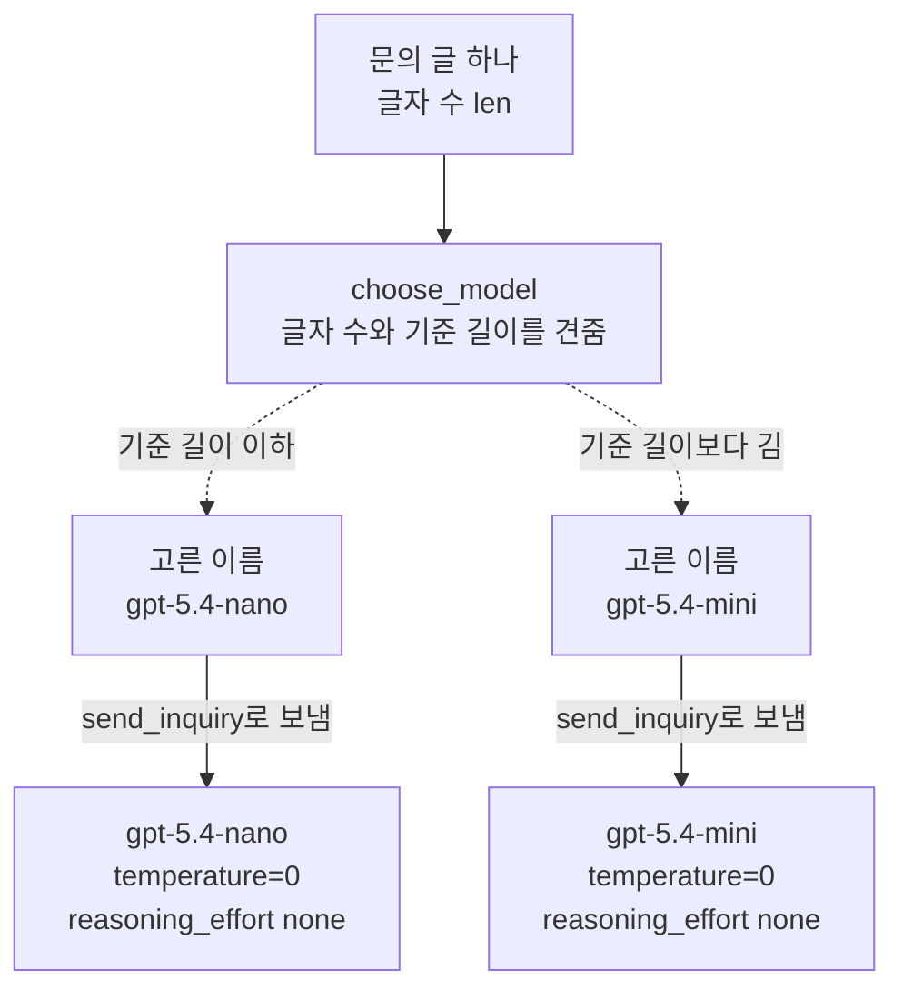
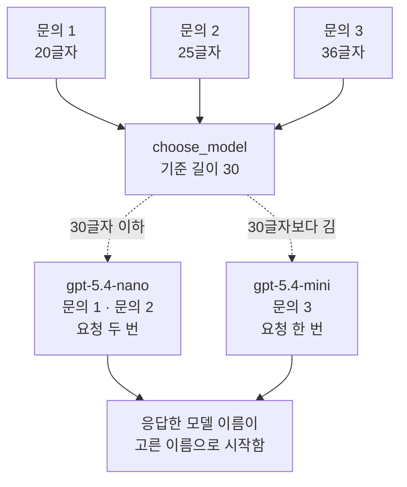
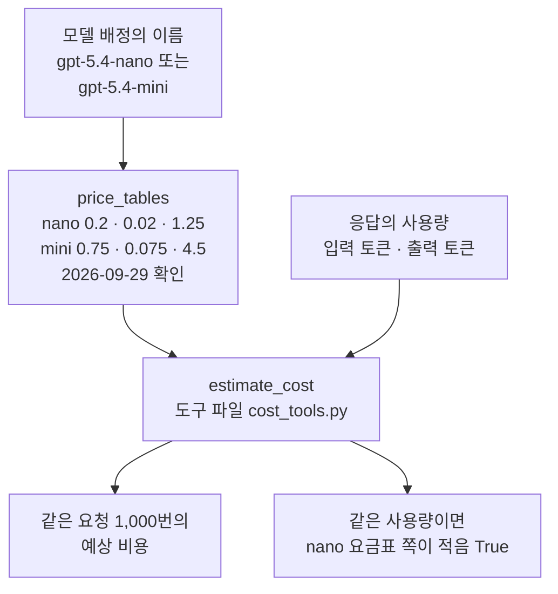
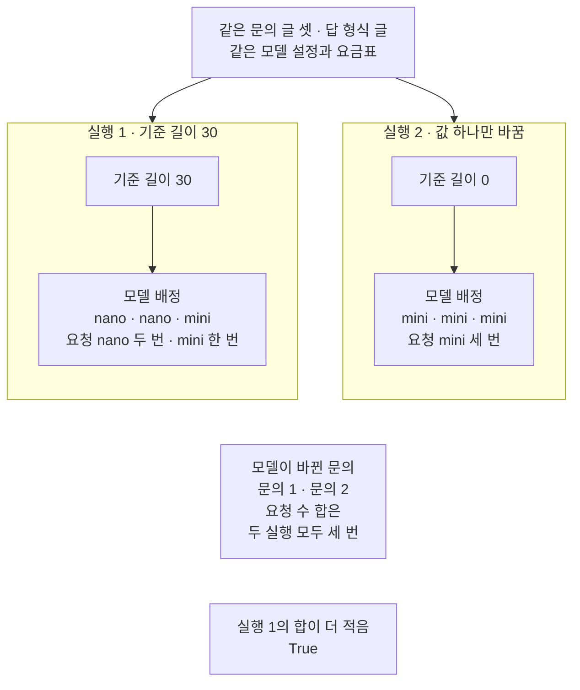

# 03-모델-라우팅

## _src 본문 (HTML 원본)

```html
<!--meta: 강의 0.6h | 실습 1h | 코드 notebooks/03-모델-라우팅.ipynb | 새 용어 4 -->
<style>html,body{overflow-x:hidden}.notebook,.nb-cell,.nb-main,.nb-input,.nb-result{min-width:0;max-width:100%}.nb-input pre,.nb-output{box-sizing:border-box;max-width:100%;overflow-x:auto}code.nb-source{display:block!important;width:100%!important;min-width:0!important;overflow-x:auto!important;padding:0!important}</style>
<h2 id="b1"><span class="no">1</span>학습 목표</h2><div class="goal"><ul>
<li>문의 글의 글자 수를 기준 길이와 견주어 보낼 모델의 이름을 고르는 모델 라우터를 만들 수 있습니다.</li>
<li>기준 길이 하나만 바꾼 실험으로, 모델 배정과 모델별 요청 수가 어떻게 바뀌는지 출력으로 설명할 수 있습니다.</li>
<li>모델마다 다른 요금표로 예상 비용을 셈하고, 싼 모델의 답도 정답 종류와 같은지 함께 확인할 수 있습니다.</li>
</ul></div>
<h2 id="b2"><span class="no">2</span>이 내용을 배우는 이유</h2><p>상담 서비스에 오는 문의는 짧고 흔한 것부터 길고 복잡한 것까지 섞여 있습니다. 모든 문의를 같은 모델로 보내면, 짧은 문의에도 같은 요금이 붙습니다. 싼 모델로 충분한 문의를 골라 보내면 예상 비용을 줄일 수 있습니다. 그러나 싼 모델의 답이 틀리면 줄인 비용은 뜻이 없습니다.</p><p>제목의 모델 라우팅은, 요청마다 어느 모델로 보낼지 코드가 고르는 일입니다. 이 절에서는 그 일을 하는 함수를 모델 라우터라고 부릅니다. <a href="../../part6/ch26-delegation/03-Router-분류와-병렬-실행.html">Ch 26 03절</a>의 라우터는 요청을 분류해, 맞는 전문 에이전트에게 보내는 쪽이었습니다. 이 절의 모델 라우터는 같은 요청을 어느 모델로 보낼지만 고르고, 모델을 부르지 않습니다.</p>
<h2 id="b3"><span class="no">3</span>앞에서 배운 내용</h2><p><a href="../../part2/ch06-langchain-start/02-메시지와-제공자-전환.html">Ch 6 02절</a>에서는 모델 이름만 <code>gpt-5.4-nano</code>로 바꿔 불렀습니다. <a href="../../part2/ch06-langchain-start/06-토큰-비용-지연-비교.html">Ch 6 06절</a>에서는 같은 메시지를 mini와 nano에 보내 토큰 수와 예상 비용을 견줬습니다. 요금표와 함수 <code>estimate_cost</code>도 그때 배웠고, 이 챕터에서는 도구 파일 <code>cost_tools.py</code>에서 가져옵니다. <a href="01-프롬프트-캐시-계측.html">01절</a>과 <a href="02-Batch-API.html">02절</a>은 책 가게 문의를 배송, 환불, 결제로 나눴고, 이 절도 그 문의 글을 이어 씁니다.</p><p><a href="../../part5/ch18-workflow-patterns/02-실패를-처리하는-라우팅.html">Ch 18 02절</a>의 라우팅은 모델이 쓴 종류 이름을 보고, 코드가 준비한 갈래 가운데 하나로 가는 모양이었습니다. 이 절의 모델 라우터도 갈래 둘을 두지만, 모델을 부르기 전에 문의 글의 글자 수만 봅니다. 02절에서는 생각하는 단계를 low로 바꾼 줄이 온도 0과 함께 거절되었습니다. 그래서 이 절은 두 모델 모두 과정 표준 설정으로 두고, 모델 이름만 바꿉니다.</p>
<h2 id="b4"><span class="no">4</span>핵심 개념</h2><h3>비유로 시작하기</h3><p>충전 거치대 하나에 작은 배터리 셋과 큰 배터리 셋이 꽂혀 있습니다. 작은 배터리는 채우는 값이 싸고, 큰 배터리는 더 많이 담지만 채우는 값이 비쌉니다. 가벼운 물건에는 작은 배터리를, 무거운 물건에는 큰 배터리를 꺼내 쓰면 전기 요금을 아낄 수 있습니다. 어느 물건이 무거운지는 무게 하나를 기준으로 미리 정해 둡니다.</p><p>꺼내 쓸 배터리 칸에는 불이 켜집니다. 기준을 알맞게 두면 작은 배터리 칸 둘과 큰 배터리 칸 하나에 불이 켜집니다. 기준을 0으로 내리면 모든 물건을 무겁다고 여겨, 큰 배터리 칸 셋에만 불이 켜집니다. 배터리가 모델이고, 채우는 값이 요금표이며, 무게 기준이 기준 길이입니다.</p><p>비유와 다른 점이 있습니다. 실제 모델 라우터는 문의 글의 글자 수만 보고, 문의가 정말 어려운지는 모릅니다. 또 작은 배터리가 일을 잘 해냈는지는 불빛으로 알 수 없어, 답을 따로 확인해야 합니다.</p>
{{img:03-5-크기가-다른-두-배터리|흰 바탕에 연파랑 충전 받침대 하나가 화면을 채운 그림입니다. 왼쪽 절반에는 작고 가는 청록 배터리 셋이, 오른쪽 절반에는 크고 굵은 짙은 파랑 배터리 셋이 꽂혀 있습니다. 칸마다 위에 큰 동그란 표시등이 있습니다. 작은 배터리 쪽은 왼쪽부터 노란 불, 노란 불, 꺼진 불이고, 큰 배터리 쪽은 노란 불, 꺼진 불, 꺼진 불입니다. 사람과 글자는 없습니다.|작은 배터리 셋 가운데 둘, 큰 배터리 셋 가운데 하나에만 불이 켜져, 실행 1의 모델 배정처럼 나뉩니다.}}
<p class="look"><b>그림 읽기</b> — 왼쪽의 작은 청록 배터리 셋이 nano, 오른쪽의 큰 짙은 파랑 배터리 셋이 mini입니다. 노란 불은 꺼내 쓸 배터리이고, 작은 쪽에 둘, 큰 쪽에 하나 켜져 있습니다. 실행 1의 모델 배정 nano 둘·mini 하나와 같은 나뉨입니다. 그림에 없는 실행 2라면 큰 쪽 불 셋만 켜지는 셈입니다. 배터리의 크기는 요금표 값과 짝짓지 않습니다.</p>
<h3>모델 라우터와 기준 길이</h3><p>모델 라우터는 요청마다 보낼 모델의 이름을 고르는 함수입니다. 복사할 장수가 적으면 작은 복사기로, 많으면 큰 복사기로 보내는 것과 같습니다. 이 절 코드에서는 함수 <code>choose_model</code>이 모델 라우터이고, 모델 이름만 내놓습니다. <a href="../ch30-fastapi-serving/01-비동기-라우팅과-스키마.html">Ch 30 01절</a>에서 요청 주소와 처리 함수를 이은 일과도 다른 말입니다.</p><p>기준 길이는 모델 라우터가 문의 글의 글자 수와 견주는 값입니다. 놀이기구 앞의 키 재는 막대처럼, 넘는지만 봅니다. 이 절에서는 문의 글이 기준 길이보다 길면 mini를, 아니면 nano를 고릅니다. 글자 수가 기준 길이와 같으면 nano로 갑니다.</p><p>모델 배정은 문의마다 고른 모델 이름을 문의 차례대로 적은 목록입니다. 모임에서 사람마다 앉을 탁자를 적어 둔 자리표와 같습니다. 정답 종류는 문의마다 맞는 종류를 미리 적어 둔 값으로, 채점표 옆의 모범 답과 같습니다. 이 절은 답을 정답 종류와 글자까지 견줍니다.</p>
<h3>이 절에서 쓰는 말</h3><table><thead><tr><th>말</th><th>뜻</th><th>이 절에서 보이는 모습</th></tr></thead><tbody><tr><td>모델 라우터</td><td>요청마다 보낼 모델의 이름을 고르는 함수입니다. <a href="../../part6/ch26-delegation/03-Router-분류와-병렬-실행.html">Ch 26 03절</a>의 라우터(분류해 전문 에이전트에게 보내는 쪽)와 다른 말입니다.</td><td>함수 <code>choose_model</code> — 이름만 내놓고 모델을 부르지 않음</td></tr><tr><td>기준 길이</td><td>모델 라우터가 문의 글의 글자 수와 견주는 값입니다. <a href="../../part4/ch13-langgraph-basics/03-조건부-엣지.html">Ch 13 03절</a>과 <a href="../../part5/ch18-workflow-patterns/02-실패를-처리하는-라우팅.html">Ch 18 02절</a>에서 쓴 기준값의 하나입니다.</td><td>인자 <code>length_limit</code> — 실행 1은 <code>30</code>, 실행 2는 <code>0</code></td></tr><tr><td>모델 배정</td><td>문의마다 고른 모델 이름을 문의 차례대로 적은 목록입니다.</td><td>실행 1 <code>['gpt-5.4-nano', 'gpt-5.4-nano', 'gpt-5.4-mini']</code></td></tr><tr><td>정답 종류</td><td>문의마다 맞는 종류를 미리 적어 둔 값입니다.</td><td>목록 <code>expected_types</code> — 배송·환불·결제, 답과 글자까지 견줌</td></tr></tbody></table>
{{mermaid:03-1-모델-라우터가-고르는-두-갈래|위에서 아래로 읽는 흐름도입니다. 맨 위 초록 상자 문의 글 하나 글자 수 len에서 파란 상자 choose_model 글자 수와 기준 길이를 견줌으로 갑니다. 파란 상자에서 점선 둘이 갈라져, 기준 길이 이하이면 파란 상자 고른 이름 gpt-5.4-nano로, 기준 길이보다 길면 파란 상자 고른 이름 gpt-5.4-mini로 갑니다. 두 이름 상자는 send_inquiry로 보냄이라고 적힌 화살표로 보라 상자 gpt-5.4-nano와 보라 상자 gpt-5.4-mini에 각각 이어지고, 두 보라 상자에는 temperature=0 reasoning_effort none이 적혀 있는 그림|모델 라우터는 글자 수와 기준 길이만 보고 모델 이름을 고르고, 요청은 send_inquiry가 그 이름의 모델로 보냅니다.}}
<p class="look"><b>도식 읽기</b> — 위에서 아래로 읽습니다. 초록 상자는 셀에 적은 문의 글이고, 파란 상자는 우리가 정의한 함수와 그 함수가 고른 이름입니다. 점선 둘은 모델 라우터의 두 갈래입니다. 이름 상자에서 보라 상자로 가는 화살표가, 함수 send_inquiry가 요청을 보내는 자리입니다. 보라 상자는 이 절에서 실제로 부른 두 모델이고, 두 모델의 설정은 이름만 다릅니다.</p>
<h3>모델마다 다른 요금표</h3><p>2026-09-29에 확인한 두 모델의 100만 토큰당 요금은 서로 다릅니다. 모델 nano는 입력 0.20달러, 캐시 입력 0.02달러, 출력 1.25달러입니다. 모델 mini는 입력 0.75달러, 캐시 입력 0.075달러, 출력 4.50달러입니다. 세 값 모두 nano가 작아서, 같은 사용량이면 nano 요금표로 센 값이 늘 적습니다.</p><p>그래서 예상 비용은 요청마다 그 요청을 받은 모델의 요금표로 따로 셉니다. 이 절은 모델 이름으로 요금표를 찾는 딕셔너리를 두고, 도구 파일의 함수 <code>estimate_cost</code>에 넘깁니다. 요청 한 번의 값은 너무 작아, <a href="../../part2/ch06-langchain-start/06-토큰-비용-지연-비교.html">Ch 6 06절</a>처럼 같은 요청을 1,000번 보낼 때의 값으로 적습니다.</p>
{{mermaid:03-3-모델마다-다른-요금표|위에서 아래로 읽는 흐름도입니다. 맨 위 파란 상자 모델 배정의 이름 gpt-5.4-nano 또는 gpt-5.4-mini가 초록 상자 price_tables로 갑니다. 초록 상자에는 nano 0.2 0.02 1.25, mini 0.75 0.075 4.5, 2026-09-29 확인이 적혀 있습니다. 초록 상자와 오른쪽 노란 상자 응답의 사용량 입력 토큰 출력 토큰이 파란 상자 estimate_cost 도구 파일 cost_tools.py로 모입니다. 파란 상자 아래에 노란 상자 둘, 같은 요청 1,000번의 예상 비용과 같은 사용량이면 nano 요금표 쪽이 적음 True가 나란히 있는 그림|요금표는 모델 이름으로 고르고, 같은 사용량이면 nano 요금표로 센 값이 늘 적습니다.}}
<p class="look"><b>도식 읽기</b> — 위에서 아래로 읽습니다. 초록 상자는 셀에 적은 두 요금표이고, 파란 상자는 모델 배정의 이름과 도구 파일의 함수입니다. 노란 상자는 노트북에서 출력으로 확인한 사용량과 셈한 값입니다. 아래 왼쪽 상자의 값은 토큰 수에 따라 달라지고, 오른쪽 상자의 참·거짓은 요금표가 정합니다.</p>
<h2 id="b5"><span class="no">5</span>실행 예제</h2><p>노트북 2절은 문의 글 셋과 정답 종류, 답 형식 글을 준비하고 모델 라우터를 정의합니다. 3절은 기준 길이 30으로 모델 배정을 만든 뒤, 문의 셋을 배정대로 보냅니다. 4절은 기준 길이만 0으로 바꿔 같은 일을 합니다. 5절은 두 실행의 모델 배정·답·입력 토큰 수·예상 비용을 견줍니다.</p><p>모델 요청은 모두 여섯 번으로, nano에 두 번, mini에 네 번입니다. 요금표(2026-09-29)로 어림한 비용은 합쳐 0.001달러보다 적습니다. 요청 글은 <a href="../../part2/ch06-langchain-start/01-계층-지도와-첫-호출.html">Ch 6 01절</a>처럼 글 하나로 보내, 사용자 메시지 하나가 됩니다. 이 노트북은 파일을 쓰지 않고, 걸린 시간은 재지 않았습니다. 교재를 만들 때는 같은 요청 여섯을 노트북 밖에서 다섯 번 더 보냈고, 결과 읽기는 이를 흔들림 확인이라고 부릅니다.</p>
{{notebook:03-모델-라우팅}}
<p class="look"><b>확인할 점</b> — 노트북 3절에서 <code>모델 배정: ['gpt-5.4-nano', 'gpt-5.4-nano', 'gpt-5.4-mini']</code>와 두 요청 수 <code>2</code>·<code>1</code>을 찾습니다. 응답한 모델 이름이 고른 모델 이름으로 시작하는지도 봅니다. 표의 답과 토큰 수는 교재 출력의 값이라, 여러분의 실행에서는 다를 수 있습니다.</p>
{{mermaid:03-2-실행-1의-모델-배정|위에서 아래로 읽는 흐름도입니다. 맨 위 초록 상자 셋 문의 1 20글자, 문의 2 25글자, 문의 3 36글자가 파란 상자 choose_model 기준 길이 30으로 모입니다. 파란 상자에서 점선 둘이 갈라져, 30글자 이하는 보라 상자 gpt-5.4-nano 문의 1 문의 2 요청 두 번으로, 30글자보다 긴 문의는 보라 상자 gpt-5.4-mini 문의 3 요청 한 번으로 갑니다. 두 보라 상자는 노란 상자 응답한 모델 이름이 고른 이름으로 시작함으로 모이는 그림|기준 길이 30에서는 문의 1·문의 2가 nano로 가고, 36글자인 문의 3만 mini로 갔습니다.}}
<p class="look"><b>도식 읽기</b> — 위에서 아래로 읽습니다. 초록 상자는 문의 글과 그 글자 수이고, 파란 상자는 기준 길이 30을 받은 모델 라우터입니다. 보라 상자는 실행 1에서 실제로 부른 두 모델과, 그 모델로 보낸 문의입니다. 노란 상자는 노트북 3절에서 출력으로 확인한 값입니다.</p>
<h2 id="b6"><span class="no">6</span>실험 결과 해석</h2><p>가설은 요금표에서 세웠습니다. 요금표의 세 값이 모두 nano가 작으므로, nano로 보내는 문의가 많을수록 예상 비용이 적을 것이라고 보았습니다. 실험은 같은 문의 글·답 형식 글·모델 설정으로, 기준 길이 하나만 바꿔 두 번 했습니다. 실행 1은 기준 길이 30, 실행 2는 0이었습니다.</p>
{{mermaid:03-4-기준-길이만-바꾼-두-실행|맨 위 회색 상자 같은 문의 글 셋 답 형식 글 같은 모델 설정과 요금표 아래에 칸 둘이 나란히 있습니다. 왼쪽 칸 실행 1 기준 길이 30에는 초록 상자 기준 길이 30에서 노란 상자 모델 배정 nano nano mini 요청 nano 두 번 mini 한 번으로 이어집니다. 오른쪽 칸 실행 2 값 하나만 바꿈에는 파란 상자 기준 길이 0에서 노란 상자 모델 배정 mini mini mini 요청 mini 세 번으로 이어집니다. 칸 아래 회색 상자는 모델이 바뀐 문의 문의 1 문의 2 요청 수 합은 두 실행 모두 세 번이고, 맨 아래 노란 상자는 실행 1의 합이 더 적음 True인 그림|기준 길이를 0으로 내리자, nano로 가던 문의 1·문의 2가 mini로 갔고 요청 수의 합은 그대로였습니다.}}
<p class="look"><b>도식 읽기</b> — 맨 위 회색 상자는 두 실행에 공통인 값입니다. 왼쪽 칸이 실행 1, 오른쪽 칸이 실행 2이고, 칸마다 위가 기준 길이, 아래가 노트북 3·4절의 출력입니다. 오른쪽 칸의 파란 상자가 바꾼 값입니다. 칸 아래 회색 상자는 두 모델 배정을 코드 차례로 견준 사실입니다. 맨 아래 노란 상자는 5절 출력이고, 흔들림 확인 다섯 번과 새 커널 두 번에서 모두 같았습니다.</p>
<table><thead><tr><th>견준 것</th><th>실행 1 — 기준 길이 30</th><th>실행 2 — 기준 길이 0</th></tr></thead><tbody><tr><td>바꾼 값 — 기준 길이</td><td><code>30</code></td><td><code>0</code></td></tr><tr><td>모델 배정</td><td>nano · nano · mini</td><td>mini · mini · mini</td></tr><tr><td>모델별 요청 수</td><td>nano <code>2</code> · mini <code>1</code></td><td>nano <code>0</code> · mini <code>3</code></td></tr><tr><td>모델이 바뀐 문의</td><td>—</td><td>첫째 · 둘째(<code>True</code> · <code>True</code> · <code>False</code>)</td></tr><tr><td>세 답이 정답 종류와 같은가(흔들림 확인 다섯 번과 새 커널 두 번)</td><td>세 답 모두 같음</td><td>세 답 모두 같음</td></tr><tr><td>1,000번 예상 비용 합(교재 출력, 실행마다 다를 수 있음)</td><td><code>0.08355</code>달러</td><td><code>0.159</code>달러</td></tr></tbody></table>
<p>기준 길이를 0으로 내리자, nano로 가던 첫째와 둘째 문의가 mini로 갔습니다. 셋째 문의는 두 실행 모두 mini였고, 요청 수의 합은 두 실행 모두 셋이었습니다. 모델 배정과 요청 수는 글자 수와 기준 길이만으로 정해지므로 실행할 때마다 같습니다. 같은 사용량을 두 요금표로 세면 nano 쪽이 늘 적습니다.</p><p>흔들림 확인 다섯 번과 새 커널 두 번에서 모두, 여섯 답이 정답 종류와 같았습니다. 같은 문의를 보낸 두 요청은 입력 토큰 수도 같았고, 실행 1의 예상 비용 합이 더 적었습니다. 이 세 문의에서는 nano로 보내도 답의 종류가 바뀌지 않고, 예상 비용만 줄었다는 뜻입니다. 그러나 문의 셋은 작은 표본이고, 모두 짧고 뜻이 분명한 문의였습니다. 합의 값과 차이는 토큰 수에 따라 달라져, 결론에는 쓰지 않습니다.</p>
<p>새 커널로 두 번 실행해 견주자, 코드 셀 스물셋의 출력 글이 셀마다 모두 같았습니다. 한 번은 프로젝트 맨 위에서, 한 번은 <code>notebooks/</code> 폴더에서 연 커널이었습니다. 모델에 요청을 보낸 두 셀과, 그 응답으로 만든 표도 두 번 모두 같았습니다.</p>
<p class="look"><b>확인할 점</b> — 5절 첫 셀의 넷째 칸이 <code>True</code>·<code>True</code>·<code>False</code>인지 봅니다. 5절 마지막 셀의 <code>nano 요금표로 센 값이 더 적은가: True</code>도 찾습니다. 두 실행의 합과 입력 토큰 수는 토큰에 따라 달라지는 값입니다.</p>
<h2 id="b7"><span class="no">7</span>주의할 점과 실무 메모</h2><ul><li>글자 수는 문의가 얼마나 어려운지를 다 보여 주지 않습니다. 짧아도 판단이 까다로운 문의가 있고, 길어도 뜻이 분명한 문의가 있습니다. 이 절의 기준 길이 30은 문의 셋의 글자 수를 보고, 둘과 하나로 나뉘게 정한 예입니다.</li><li>교재를 만들 때 노트북 밖에서 같은 요청 여섯을 다섯 번 보냈고, 여섯 답은 다섯 번 모두 정답 종류와 같았습니다. 그래도 같은 요청도 실행한 때에 따라 답이 달라질 수 있습니다. 다른 문의에서 nano가 정답 종류와 다른 답을 낼 수도 있어, 기준 길이는 더 많은 문의로 답을 확인한 뒤 정합니다.</li><li>답을 정답 종류와 글자까지 견주므로, 모델이 마침표나 설명을 붙이면 뜻이 같아도 같지 않다고 나옵니다. 이번 실행의 여섯 답에는 마침표가 없었습니다.</li><li>싼 모델의 답이 틀렸을 때 mini로 다시 보내는 방법도 있습니다. <a href="../../part2/ch06-langchain-start/05-타임아웃-재시도-폴백.html">Ch 6 05절</a>의 대체 모델(<code>with_fallbacks</code>)은 오류가 났을 때만 넘어갑니다. 답이 틀린 경우에는 코드로 답을 검사해 다시 보내야 합니다. 이 절은 다시 보내는 코드를 실행하지 않았고, 다시 보낸 요청의 비용도 셈하지 않았습니다.</li><li>공식 GPT-5.4 안내는 nano가 속도와 비용이 가장 중요한 많은 요청에 맞는다고 적습니다. 이 절은 걸린 시간을 재지 않아 속도는 견주지 않았습니다.</li><li>모델 이름은 날짜판 없이 적었고, 답한 모델은 날짜판 <code>gpt-5.4-nano-2026-03-17</code>·<code>gpt-5.4-mini-2026-03-17</code>이었습니다. 요금과 모델은 바뀔 수 있어, 요금표에 확인 날짜를 함께 적습니다.</li><li>두 모델 안내는 지역 처리 요청에 요금을 10% 더 받는다고 적습니다. 이 절의 요금 셈에는 넣지 않았습니다.</li><li>LangChain 안내는 실행 중에 모델을 바꾸는 방법도 소개합니다. 이 절은 두 모델 객체를 따로 만들어 딕셔너리로 골랐고, 그 방법은 실행하지 않았습니다.</li><li>여러분의 키로 보내는 요청에는 실제 요금이 붙습니다. 예상 비용은 청구 금액이 아닙니다.</li></ul>
<h2 id="b8"><span class="no">8</span>정리와 다음 절</h2><ul><li>모델 라우터는 문의 글의 글자 수를 기준 길이와 견주어 모델 이름만 고르고, 요청은 따로 보냅니다.</li><li>기준 길이 하나를 바꾸면 모델 배정과 모델별 요청 수가 바뀌고, 예상 비용은 모델마다 다른 요금표로 셉니다.</li><li>싼 모델로 보낸 문의의 답이 정답 종류와 같은지 함께 확인해야, 줄인 비용에 뜻이 있습니다.</li></ul><p><strong>다음 학습과 이어지는 지점</strong> — <a href="04-백오프-큐-동시성.html">04절</a>은 요청 제한(429)을 받았을 때 다시 보내는 횟수와 한꺼번에 보내는 수를 다룹니다.</p>
<h2 id="b9"><span class="no">9</span>복습 문제</h2><details class="quiz" open><summary>문제 4개 · 해설 포함</summary><p class="quiz-q">1. 기준 길이가 30일 때, 글자 수가 딱 30인 문의는 어느 모델로 가나요?</p><p class="quiz-a">모델 nano로 갑니다. 연산자 <code>&gt;</code>는 보다 클 때만 참이라, 30은 기준 길이 30보다 크지 않습니다. 틀렸다면 노트북 2절의 모델 라우터 정의를 다시 읽습니다.</p><p class="quiz-q">2. 기준 길이를 30에서 0으로 바꾸자 모델 배정은 어떻게 바뀌었나요?</p><p class="quiz-a">nano·nano·mini에서 mini 셋으로 바뀌었습니다. 첫째와 둘째 문의의 모델만 바뀌었고, 요청 수의 합은 셋 그대로였습니다. 틀렸다면 노트북 4절 첫 셀과 5절 첫 셀을 다시 읽습니다.</p><p class="quiz-q">3. 입력 100토큰, 출력 10토큰인 요청을 1,000번 보내면 두 요금표로 예상 비용은 얼마인가요?</p><p class="quiz-a">nano 요금표로는 (100 × 0.20 + 10 × 1.25) ÷ 1000000 × 1000입니다. 20 + 12.5 = 32.5라 0.0325달러입니다. mini 요금표로는 100 × 0.75 + 10 × 4.50 = 75 + 45 = 120이라 0.12달러입니다. 틀렸다면 노트북 2절의 요금표와 5절 마지막 셀을 다시 봅니다.</p><p class="quiz-q">4. 이 절의 결과만으로 「짧은 문의는 모두 nano로 보내도 된다」고 할 수 있나요?</p><p class="quiz-a">할 수 없습니다. 문의 셋은 작은 표본이고, 모두 짧고 뜻이 분명한 문의였습니다. 더 많은 문의로 nano의 답이 정답 종류와 같은지 확인한 뒤에 기준 길이를 정합니다. 틀렸다면 본문 6·7 블록을 다시 읽습니다.</p></details>
<h2 id="b10"><span class="no">10</span>참고 자료</h2><ul><li><div><a href="https://developers.openai.com/api/docs/models/gpt-5.4-nano">OpenAI GPT-5.4 nano</a></div>확인 2026-09-29 · 100만 토큰당 입력 0.20달러, 캐시 입력 0.02달러, 출력 1.25달러입니다. 날짜판 이름은 <code>gpt-5.4-nano-2026-03-17</code>이고, 생각하는 단계의 기본값은 none입니다.</li><li><div><a href="https://developers.openai.com/api/docs/models/gpt-5.4-mini">OpenAI GPT-5.4 mini</a></div>확인 2026-09-29 · 100만 토큰당 입력 0.75달러, 캐시 입력 0.075달러, 출력 4.50달러입니다. 날짜판 이름은 <code>gpt-5.4-mini-2026-03-17</code>입니다. 두 안내 모두 지역 처리 요청에 10%를 더 받는다고 적습니다.</li><li><div><a href="https://developers.openai.com/api/docs/guides/latest-model?model=gpt-5.4">OpenAI Using GPT-5.4</a></div>확인 2026-09-29 · 온도 칸은 생각하는 단계가 none일 때만 받는다고 적습니다. 작은 모델로 mini와 nano를 들고, nano는 속도와 비용이 가장 중요한 많은 요청에 맞는다고 적습니다.</li><li><div><a href="https://docs.langchain.com/oss/python/langchain/models">LangChain Models</a></div>확인 2026-09-29 · 제공자와 모델 이름을 <code>openai:gpt-5.4-nano</code>처럼 한 글로 적는 방법을 설명합니다. 실행 중에 모델을 고르는 방법도 소개하지만, 이 절은 실행하지 않았습니다.</li><li><div>설치판 소스 langchain-openai 1.6.0 · langchain-core 1.6.2</div>확인 2026-09-29 · 파일 <code>chat_models/base.py</code> 2024행이 응답의 칸 <code>model</code>을 키 <code>model_name</code>에 담습니다. langchain-core 파일 <code>language_models/chat_models.py</code> 2042~2046행이 이 값을 응답의 <code>response_metadata</code>에 합칩니다.</li></ul>
```

## 노트북 셀 (순서대로)

### [0] markdown {'html': 'skip'}

# 모델 라우팅

**이 노트북에서 할 일**

1. 문의 글의 글자 수로 nano와 mini 가운데 보낼 모델을 고르는 함수를 만듭니다.
2. 기준 길이 30으로 문의 셋을 보내고, 기준 길이 하나만 0으로 바꿔 다시 보냅니다.
3. 두 실행의 답과, 모델마다 다른 요금표로 셈한 예상 비용을 견줍니다.

**준비물** — 이 노트북은 실제 모델에 요청을 여섯 번 보냅니다.
실행 1에서 세 번, 실행 2에서 세 번입니다.
모델별로는 `gpt-5.4-nano`에 두 번, `gpt-5.4-mini`에 네 번입니다.
프로젝트 폴더의 `.env` 파일에 `OPENAI_API_KEY`가 있어야 합니다.
키가 없으면 키를 확인하는 셀에서 멈추고, 모델 요청은 나가지 않습니다.

요금표(2026-09-29 확인)로 어림한 비용은 여섯 번을 합쳐 0.001달러보다 적습니다.
청구 금액이 아니라, 교재를 만들 때 본 사용량으로 어림한 값입니다.
실행마다 답 글과 토큰 수가 달라질 수 있습니다.
교재를 만들 때 같은 요청 여섯을 노트북 밖에서 다섯 번 더 보내 보았고, 이를 흔들림 확인이라고 부릅니다.
걸린 시간은 재지 않았습니다.

실습 폴더의 도구 파일 `cost_tools.py`에서 함수 하나를 가져옵니다.
이 노트북은 파일을 쓰지 않습니다.

**기준 버전** — 첫 셀에서 패키지 셋을 설치합니다.
버전은 langchain 1.4.0, langchain-openai 1.6.0, python-dotenv 1.2.3입니다.
셋 모두 실습 폴더 잠금과 같은 버전입니다.
교재 출력은 Linux의 Python 3.12.13으로 만들었습니다.
다른 버전과 Windows·macOS에서는 실행하지 않았습니다.

**강의와 실습 범위** — 강의 시간에는 2절의 모델 라우터를 보고 가설을 함께 세웁니다.
모델에 요청을 보내는 3·4절과 두 실행을 견주는 5절은 실습 시간에 실행합니다.

실습 폴더 `labs/part7/ch34-cost-rate-limits`에서 `uv sync --locked`를 실행합니다.
그다음 `notebooks/` 폴더의 이 노트북을 열고, 실습 폴더의 `.venv` 커널을 고릅니다.
첫 셀부터 순서대로 실행합니다.

### [1] markdown {'html': 'skip'}

## 오늘 볼 그림


위에서 아래로 읽습니다.
초록 상자는 셀에 적은 문의 글이고, 파란 상자는 우리가 정의한 함수와 그 함수가 고른 이름입니다.
점선 둘은 모델 라우터의 두 갈래입니다.
이름 상자에서 보라 상자로 가는 화살표가, 함수 send_inquiry가 요청을 보내는 자리입니다.
보라 상자는 이 절에서 실제로 부른 두 모델이고, 두 모델의 설정은 이름만 다릅니다.

### [2] markdown {}

## 1. 준비

제목의 모델 라우팅은, 요청마다 어느 모델로 보낼지 코드가 고르는 일입니다.
이 절에서는 그 일을 하는 함수를 모델 라우터라고 부릅니다.
Ch 26 03절의 라우터는 요청을 분류해, 맞는 전문 에이전트에게 보내는 쪽이었습니다.
이 절의 모델 라우터는 같은 요청을 어느 모델로 보낼지만 고르고, 모델을 부르지 않습니다.

첫 셀은 패키지 셋을 설치하고 설치된 버전을 출력합니다.
설치에는 몇십 초가 걸릴 수 있습니다.

### [3] code {'execution': {'iopub.execute_input': '2026-09-30T00:00:40.354106Z', 'iopub.status.busy': '2026-09-30T00:00:40.353942Z', 'iopub.status.idle': '2026-09-30T00:00:41.034887Z', 'shell.execute_reply': '2026-09-30T00:00:41.034434Z'}, 'lesson_role': 'setup'}

```python
# 이 절에서 쓰는 패키지를 설치하고 버전을 확인합니다
%pip install -q "langchain==1.4.0" "langchain-openai==1.6.0" "python-dotenv==1.2.3"
from importlib.metadata import version

print("langchain:", version("langchain"))
print("langchain-openai:", version("langchain-openai"))
print("python-dotenv:", version("python-dotenv"))
```

출력:
```
Note: you may need to restart the kernel to use updated packages.
langchain: 1.4.0
langchain-openai: 1.6.0
python-dotenv: 1.2.3

```

### [4] markdown {}

**결과 읽기** — 출력 줄 `langchain: 1.4.0`과 `langchain-openai: 1.6.0`이 보입니다.
패키지 python-dotenv는 `.env` 파일에서 키를 읽을 때 씁니다.
세 패키지 모두 01절과 같은 버전입니다.

다음 셀은 이 절에서 쓸 이름을 가져옵니다.
Ch 6 06절에서 배운 함수 `estimate_cost`는 도구 파일 `cost_tools.py`에서 가져옵니다.

### [5] code {'execution': {'iopub.execute_input': '2026-09-30T00:00:41.036055Z', 'iopub.status.busy': '2026-09-30T00:00:41.035957Z', 'iopub.status.idle': '2026-09-30T00:00:41.397198Z', 'shell.execute_reply': '2026-09-30T00:00:41.396763Z'}, 'lesson_role': 'setup'}

```python
# 모델 객체를 만들 함수와, 도구 파일의 함수를 가져옵니다
from langchain.chat_models import init_chat_model
# Ch 6 06절에서 배운 함수는 도구 파일에서 가져옵니다
from cost_tools import estimate_cost

print("가져온 이름:", "init_chat_model")
print("도구 파일에서 가져온 함수:", estimate_cost.__name__)
```

출력:
```
가져온 이름: init_chat_model
도구 파일에서 가져온 함수: estimate_cost

```

### [6] markdown {}

**결과 읽기** — 출력 줄 `도구 파일에서 가져온 함수: estimate_cost`가 보입니다.
01·02절처럼, 사용량과 요금표로 요청 한 번의 예상 비용을 셈하는 함수입니다.
이 절은 모델마다 요금표를 바꿔 가며 이 함수를 부릅니다.

앞에서 배운 함수는 `cost_tools.py`에 모아 두었습니다.
파일을 열면 코드를 볼 수 있습니다.
노트북과 같은 폴더(`notebooks/`)에 있는 파일입니다.
커널이 `notebooks/` 폴더에서 시작해야 이 파일을 가져올 수 있습니다.
교재 출력을 만든 실행 도구는 이 폴더를 따로 알려 주어, 다른 자리에서 시작해도 가져오기가 되었습니다.

다음 셀은 `.env` 파일에서 API 키를 읽고, 키가 있는지만 출력합니다.

### [7] code {'execution': {'iopub.execute_input': '2026-09-30T00:00:41.397884Z', 'iopub.status.busy': '2026-09-30T00:00:41.397829Z', 'iopub.status.idle': '2026-09-30T00:00:41.402964Z', 'shell.execute_reply': '2026-09-30T00:00:41.402644Z'}, 'lesson_role': 'setup'}

```python
# .env 파일에서 OpenAI API 키를 읽습니다(키 값은 출력하지 않습니다)
import os
from dotenv import find_dotenv, load_dotenv

env_path = find_dotenv(usecwd=True)
load_dotenv(env_path)
has_key = os.getenv("OPENAI_API_KEY") is not None
print("OPENAI_API_KEY 설정 여부:", has_key)
assert has_key, "프로젝트 폴더의 .env 파일에 OPENAI_API_KEY를 적어 주세요."
```

출력:
```
OPENAI_API_KEY 설정 여부: True

```

### [8] markdown {}

**결과 읽기** — 출력 줄 `OPENAI_API_KEY 설정 여부: True`가 보입니다.
키 값은 출력하지 않고, 있는지만 봅니다.
키가 없으면 이 셀의 `assert`가 멈추고, 뒤 셀의 모델 요청도 나가지 않습니다.

다음 셀은 작은 모델 `gpt-5.4-nano`를 과정 표준 설정으로 준비합니다.
Ch 6 02절에서 모델 이름만 바꿔 불러 본 모델입니다.
객체를 만들 때는 모델 요청이 나가지 않습니다.

### [9] code {'execution': {'iopub.execute_input': '2026-09-30T00:00:41.403543Z', 'iopub.status.busy': '2026-09-30T00:00:41.403491Z', 'iopub.status.idle': '2026-09-30T00:00:42.426561Z', 'shell.execute_reply': '2026-09-30T00:00:42.426138Z'}}

```python
# 작은 모델 gpt-5.4-nano를 과정 표준 설정으로 준비합니다(요청은 나가지 않습니다)
nano_model = init_chat_model(
    "openai:gpt-5.4-nano",
    temperature=0,
    reasoning_effort="none",
)
print("모델 이름:", nano_model.model_name)
print("temperature:", nano_model.temperature)
```

출력:
```
모델 이름: gpt-5.4-nano
temperature: 0.0

```

### [10] markdown {}

**결과 읽기** — 모델 이름 `gpt-5.4-nano`, temperature `0.0`이 보입니다.
과정 표준 모델과 설정은 같고, 모델 이름만 다릅니다.
인자 `reasoning_effort="none"`은 모델이 답하기 전에 따로 생각하는 단계를 쓰지 않게 합니다.

다음 셀은 과정 표준 모델 `gpt-5.4-mini`를 같은 설정으로 준비합니다.
01절에서 쓴 모델입니다.

### [11] code {'execution': {'iopub.execute_input': '2026-09-30T00:00:42.427251Z', 'iopub.status.busy': '2026-09-30T00:00:42.427184Z', 'iopub.status.idle': '2026-09-30T00:00:42.429407Z', 'shell.execute_reply': '2026-09-30T00:00:42.429053Z'}}

```python
# 과정 표준 모델 gpt-5.4-mini를 같은 설정으로 준비합니다(요청은 나가지 않습니다)
mini_model = init_chat_model(
    "openai:gpt-5.4-mini",
    temperature=0,
    reasoning_effort="none",
)
print("모델 이름:", mini_model.model_name)
print("temperature:", mini_model.temperature)
```

출력:
```
모델 이름: gpt-5.4-mini
temperature: 0.0

```

### [12] markdown {}

**결과 읽기** — 모델 이름 `gpt-5.4-mini`, temperature `0.0`이 보이면 준비가 끝났습니다.
이 노트북의 출력은 2026-09-30에 이 두 모델로 실행한 결과입니다.
온도 값을 0으로 두어도 모델의 답이 매번 같다고 할 수는 없습니다.

두 모델 모두 생각하는 단계를 none으로 두었습니다.
공식 GPT-5.4 안내는 온도 칸을 none일 때만 받는다고 적습니다.
02절에서도 low와 온도 0을 함께 보낸 줄이 거절되었습니다.
그래서 이 절은 생각하는 단계를 그대로 두고, 모델 이름만 바꿔 고릅니다.

## 2. 문의 글과 모델 라우터

이 절도 01·02절처럼 책 가게의 문의를 배송, 환불, 결제 가운데 하나로 나눕니다.
짧고 흔한 문의는 싼 모델로도 답할 수 있을지 모릅니다.
그렇다고 모든 문의를 싼 모델로 보내면 답이 나빠질 수 있습니다.
그래서 문의마다 보낼 모델을 코드로 고르고, 답과 예상 비용을 함께 봅니다.

다음 셀은 문의 글 셋과, 문의마다 맞는 종류를 같은 차례로 적습니다.
문의마다 맞는 종류를 이 절에서는 정답 종류라고 부릅니다.
채점표 옆에 적어 둔 모범 답과 같습니다.
이 절 코드에서는 목록 `expected_types`의 세 값이 정답 종류입니다.

### [13] code {'execution': {'iopub.execute_input': '2026-09-30T00:00:42.429985Z', 'iopub.status.busy': '2026-09-30T00:00:42.429930Z', 'iopub.status.idle': '2026-09-30T00:00:42.431807Z', 'shell.execute_reply': '2026-09-30T00:00:42.431462Z'}}

```python
# 모델에 보낼 문의 글 셋과, 문의마다 맞는 종류(정답 종류)를 같은 차례로 적습니다
inquiries = [
    "주문한 책이 일주일째 오지 않습니다.",
    "받은 책이 찢어져 있어 돈을 되찾고 싶습니다.",
    "결제 창에서 카드 번호를 넣었는데 다음 단계로 넘어가지 않습니다.",
]
expected_types = ["배송", "환불", "결제"]
print("문의 글 수:", len(inquiries))
print("정답 종류:", expected_types)
```

출력:
```
문의 글 수: 3
정답 종류: ['배송', '환불', '결제']

```

### [14] markdown {}

**결과 읽기** — 출력 줄 `정답 종류: ['배송', '환불', '결제']`가 보입니다.
첫째와 둘째 문의는 01절 문의 글의 앞부분이고, 셋째는 02절 둘째 문의 글의 앞부분입니다.
답을 어떤 모양으로 쓸지 알려 주는 뒷부분은 조금 뒤에 따로 붙입니다.

다음 셀은 문의 글마다 글자 수를 셉니다.
모델 라우터는 이 글자 수를 보고 모델을 고릅니다.

### [15] code {'execution': {'iopub.execute_input': '2026-09-30T00:00:42.432357Z', 'iopub.status.busy': '2026-09-30T00:00:42.432311Z', 'iopub.status.idle': '2026-09-30T00:00:42.433823Z', 'shell.execute_reply': '2026-09-30T00:00:42.433604Z'}}

```python
# 문의 글마다 글자 수를 셉니다(모델 라우터가 기준 길이와 견줄 값입니다)
print("문의 | 글자 수")
for number in range(len(inquiries)):
    print(number + 1, "|", len(inquiries[number]))
```

출력:
```
문의 | 글자 수
1 | 20
2 | 25
3 | 36

```

### [16] markdown {}

**결과 읽기** — 라벨 줄 아래 세 줄이 문의마다 글자 수입니다.
차례대로 `1 | 20`, `2 | 25`, `3 | 36`입니다.
함수 `len`은 공백과 마침표까지 한 글자로 셉니다.

다음 셀은 문의 글 뒤에 붙일 답 형식 글을 정합니다.
답 형식 글은 답을 어떤 모양으로 쓸지 알려 주는 글입니다.
첫 문의로 요청 글 하나를 만들어, 모델에 실제로 갈 글을 봅니다.

### [17] code {'execution': {'iopub.execute_input': '2026-09-30T00:00:42.434415Z', 'iopub.status.busy': '2026-09-30T00:00:42.434365Z', 'iopub.status.idle': '2026-09-30T00:00:42.436222Z', 'shell.execute_reply': '2026-09-30T00:00:42.435860Z'}}

```python
# 문의 글 뒤에 붙일 답 형식 글을 정하고, 첫 문의로 요청 글 하나를 만들어 봅니다
answer_rule = "이 문의의 종류를 배송, 환불, 결제 가운데 한 낱말로 답하세요."
first_request = inquiries[0] + " " + answer_rule
print("요청 글 1:", first_request)
print("요청 글 1의 글자 수:", len(first_request))
```

출력:
```
요청 글 1: 주문한 책이 일주일째 오지 않습니다. 이 문의의 종류를 배송, 환불, 결제 가운데 한 낱말로 답하세요.
요청 글 1의 글자 수: 57

```

### [18] markdown {}

**결과 읽기** — 출력 줄 `요청 글 1의 글자 수: 57`이 보입니다.
문의 글 20글자, 공백 한 글자, 답 형식 글 36글자를 이었습니다.
이 요청 글은 01절 문의 글 1과 글자까지 같습니다.
둘째와 셋째 요청 글도 01절 문의 글 2, 02절 둘째 문의 글과 글자까지 같습니다.
한 낱말로 답하게 해서, 출력 토큰이 적게 나오게 했습니다.

다음 셀은 모델 라우터를 정의합니다.
모델 라우터는 요청마다 보낼 모델의 이름을 고르는 함수입니다.
복사할 장수가 적으면 작은 복사기로, 많으면 큰 복사기로 보내는 것과 같습니다.
이 절 코드에서는 함수 `choose_model`이 모델 라우터이고, 문의 글의 글자 수만 봅니다.

모델 라우터가 문의 글의 글자 수와 견주는 값을 이 절에서는 기준 길이라고 부릅니다.
Ch 13 03절과 Ch 18 02절에서 쓴 기준값의 하나입니다.
놀이기구 앞의 키 재는 막대처럼, 넘는지만 봅니다.
이 절 코드에서는 인자 `length_limit`가 기준 길이입니다.

### [19] code {'execution': {'iopub.execute_input': '2026-09-30T00:00:42.436769Z', 'iopub.status.busy': '2026-09-30T00:00:42.436718Z', 'iopub.status.idle': '2026-09-30T00:00:42.438544Z', 'shell.execute_reply': '2026-09-30T00:00:42.438198Z'}}

```python
# 문의 글의 글자 수를 기준 길이와 견주어, 보낼 모델의 이름을 고릅니다
def choose_model(inquiry, length_limit):
    # 이름을 먼저 nano로 두고, 기준 길이보다 긴 문의만 mini로 바꿉니다
    model_name = "gpt-5.4-nano"
    if len(inquiry) > length_limit:
        model_name = "gpt-5.4-mini"
    return model_name
```

출력:
```

```

### [20] markdown {}

**결과 읽기** — 정의 셀이라 출력이 없습니다.
이름을 먼저 nano로 두고, 글자 수가 기준 길이보다 클 때만 mini로 바꿉니다.
그래서 글자 수가 기준 길이와 같으면 nano를 고릅니다.
함수는 모델 이름만 내놓고, 모델에 요청을 보내지 않습니다.
Ch 18 02절의 라우팅은 모델이 쓴 종류를 보고 갈래를 골랐지만, 이 함수는 모델을 부르기 전에 고릅니다.

다음 셀은 모델 라우터가 고른 이름으로 모델 객체를 찾을 수 있게, 이름과 객체를 딕셔너리에 담습니다.

### [21] code {'execution': {'iopub.execute_input': '2026-09-30T00:00:42.439207Z', 'iopub.status.busy': '2026-09-30T00:00:42.439143Z', 'iopub.status.idle': '2026-09-30T00:00:42.440783Z', 'shell.execute_reply': '2026-09-30T00:00:42.440420Z'}}

```python
# 모델 라우터가 고른 이름으로 모델 객체를 찾을 수 있게, 이름과 객체를 딕셔너리에 담습니다
models = {"gpt-5.4-nano": nano_model, "gpt-5.4-mini": mini_model}
print("고를 수 있는 모델:", list(models))
```

출력:
```
고를 수 있는 모델: ['gpt-5.4-nano', 'gpt-5.4-mini']

```

### [22] markdown {}

**결과 읽기** — 출력 줄 `고를 수 있는 모델: ['gpt-5.4-nano', 'gpt-5.4-mini']`가 보입니다.
함수 `list`에 딕셔너리를 넣으면 키만 모은 목록이 나옵니다.
키는 모델 라우터가 내놓는 이름과 같고, 값은 1절에서 만든 모델 객체입니다.

다음 셀은 두 모델의 요금표를 적습니다.
키 이름은 Ch 6 06절과 01절의 요금표와 같습니다.
모델 이름으로 요금표를 찾을 수 있게, 딕셔너리 하나에도 모읍니다.

### [23] code {'execution': {'iopub.execute_input': '2026-09-30T00:00:42.441397Z', 'iopub.status.busy': '2026-09-30T00:00:42.441347Z', 'iopub.status.idle': '2026-09-30T00:00:42.443308Z', 'shell.execute_reply': '2026-09-30T00:00:42.442949Z'}}

```python
# 두 모델의 공식 요금(100만 토큰당 달러)과 확인한 날짜를 적고, 모델 이름으로 찾게 모읍니다
pricing_date = "2026-09-29"
nano_prices = {"ordinary_input": 0.20, "cached_input": 0.02, "output": 1.25}
mini_prices = {"ordinary_input": 0.75, "cached_input": 0.075, "output": 4.50}
price_tables = {"gpt-5.4-nano": nano_prices, "gpt-5.4-mini": mini_prices}
print("요금 확인 날짜:", pricing_date)
print("nano 요금:", nano_prices)
print("mini 요금:", mini_prices)
```

출력:
```
요금 확인 날짜: 2026-09-29
nano 요금: {'ordinary_input': 0.2, 'cached_input': 0.02, 'output': 1.25}
mini 요금: {'ordinary_input': 0.75, 'cached_input': 0.075, 'output': 4.5}

```

### [24] markdown {}

**결과 읽기** — 출력 줄 `nano 요금: {'ordinary_input': 0.2, 'cached_input': 0.02, 'output': 1.25}`가 보입니다.
단위는 100만 토큰당 달러이고, 세 값 모두 nano가 mini보다 작습니다.
입력은 0.20과 0.75달러, 출력은 1.25와 4.50달러입니다.
두 요금표 모두 Ch 6 06절의 요금표(2026-09-17)와 값이 같습니다.
요금은 바뀔 수 있어서 확인한 날짜를 함께 적습니다.

**가설** — 실행 1은 기준 길이를 30으로 둡니다.
그러면 20·25글자인 문의 둘은 nano로, 36글자인 문의는 mini로 갈 것입니다.
실행 2는 기준 길이 하나만 0으로 바꿔, 모든 문의를 mini로 보냅니다.
요금표의 세 값이 모두 nano가 작으므로, 실행 1의 예상 비용 합이 더 적을 것입니다.
세 문의는 짧고 뜻이 분명해서, 두 실행의 답은 같을 것이라고 예상합니다.

## 3. 실행 1 — 기준 길이 30

다음 셀은 기준 길이를 30으로 두고, 문의마다 모델 라우터가 고른 이름을 목록에 모읍니다.
문의마다 고른 모델 이름을 문의 차례대로 적은 목록을 이 절에서는 모델 배정이라고 부릅니다.
모임에서 사람마다 앉을 탁자를 적어 둔 자리표와 같습니다.
이 셀에서는 모델 요청이 나가지 않습니다.

### [25] code {'execution': {'iopub.execute_input': '2026-09-30T00:00:42.443879Z', 'iopub.status.busy': '2026-09-30T00:00:42.443832Z', 'iopub.status.idle': '2026-09-30T00:00:42.445808Z', 'shell.execute_reply': '2026-09-30T00:00:42.445500Z'}}

```python
# 실행 1: 기준 길이를 30으로 두고, 문의마다 모델 라우터가 고른 이름을 모읍니다(요청 없음)
length_limit = 30
run1_models = []
for inquiry in inquiries:
    run1_models.append(choose_model(inquiry, length_limit))
print("기준 길이:", length_limit)
print("모델 배정:", run1_models)
# 메서드 count는 목록에서 같은 값이 몇 번 나오는지 셉니다
print("nano로 보낼 요청 수:", run1_models.count("gpt-5.4-nano"))
print("mini로 보낼 요청 수:", run1_models.count("gpt-5.4-mini"))
```

출력:
```
기준 길이: 30
모델 배정: ['gpt-5.4-nano', 'gpt-5.4-nano', 'gpt-5.4-mini']
nano로 보낼 요청 수: 2
mini로 보낼 요청 수: 1

```

### [26] markdown {}

**결과 읽기** — 출력 줄 `모델 배정: ['gpt-5.4-nano', 'gpt-5.4-nano', 'gpt-5.4-mini']`이 보입니다.
가설대로 36글자인 셋째 문의만 기준 길이 30보다 길어 mini로 갑니다.
요청 수는 `nano로 보낼 요청 수: 2`, `mini로 보낼 요청 수: 1`입니다.
모델 배정은 글자 수와 기준 길이만으로 정해져, 실행할 때마다 같습니다.

다음 셀은 문의 하나를 고른 모델로 보내는 함수를 정의합니다.
딕셔너리 `models`에서 모델 객체를 찾고, 문의 글 뒤에 공백과 답 형식 글을 붙여 보냅니다.
Ch 6 01절처럼 글 하나를 메서드 `invoke`에 넣으면, 사용자 메시지 하나로 보냅니다.

### [27] code {'execution': {'iopub.execute_input': '2026-09-30T00:00:42.446421Z', 'iopub.status.busy': '2026-09-30T00:00:42.446376Z', 'iopub.status.idle': '2026-09-30T00:00:42.447762Z', 'shell.execute_reply': '2026-09-30T00:00:42.447492Z'}}

```python
# 고른 이름으로 모델 객체를 찾아, 문의 글 뒤에 답 형식 글을 붙여 보내고 응답을 내놓습니다
def send_inquiry(inquiry, model_name, models, answer_rule):
    chosen_model = models[model_name]
    request_text = inquiry + " " + answer_rule
    response = chosen_model.invoke(request_text)
    return response
```

출력:
```

```

### [28] markdown {}

**결과 읽기** — 정의 셀이라 출력이 없습니다.
모델 이름과 모델 객체 딕셔너리를 인자로 받으므로, 두 실행 모두 같은 함수로 보낼 수 있습니다.
함수는 받은 응답 객체를 그대로 내놓습니다.

다음 셀은 실행 1의 문의 셋을 모델 배정대로 하나씩 보냅니다.
응답마다 실제로 답한 모델의 이름을 `response_metadata`에서 꺼내, 고른 이름과 나란히 적습니다.
이 셀에서 모델 요청이 세 번 나갑니다.

### [29] code {'execution': {'iopub.execute_input': '2026-09-30T00:00:42.448280Z', 'iopub.status.busy': '2026-09-30T00:00:42.448225Z', 'iopub.status.idle': '2026-09-30T00:00:47.143279Z', 'shell.execute_reply': '2026-09-30T00:00:47.142220Z'}}

```python
# 실행 1: 문의 셋을 모델 배정대로 하나씩 보냅니다(모델 요청 3번)
print("문의 | 고른 모델 | 응답한 모델")
run1_responses = []
for number in range(len(inquiries)):
    response = send_inquiry(inquiries[number], run1_models[number], models, answer_rule)
    run1_responses.append(response)
    print(number + 1, "|", run1_models[number], "|", response.response_metadata["model_name"])
```

출력:
```
문의 | 고른 모델 | 응답한 모델
1 | gpt-5.4-nano | gpt-5.4-nano-2026-03-17
2 | gpt-5.4-nano | gpt-5.4-nano-2026-03-17
3 | gpt-5.4-mini | gpt-5.4-mini-2026-03-17

```

### [30] markdown {}

**결과 읽기** — 라벨 줄 아래 세 줄에서, 응답한 모델 이름이 고른 모델 이름으로 시작합니다.
첫 줄은 `1 | gpt-5.4-nano | gpt-5.4-nano-2026-03-17`입니다.
이름 끝의 날짜는 Ch 7 08절에서 본 날짜판입니다.
모델 라우터가 고른 모델로 요청이 실제로 갔다는 뜻입니다.
흔들림 확인 다섯 번에서도 모두 고른 모델이 답했습니다.

다음 셀은 응답 하나를 표 한 줄로 출력하는 함수를 정의합니다.
답, 정답 종류와 같은지, 입력·출력 토큰 수, 예상 비용을 차례로 적습니다.
예상 비용은 그 줄 모델의 요금표로 셈합니다.
요청 한 번의 값은 너무 작아서, Ch 6 06절처럼 같은 요청을 1,000번 보낼 때의 값으로 적습니다.

### [31] code {'execution': {'iopub.execute_input': '2026-09-30T00:00:47.145318Z', 'iopub.status.busy': '2026-09-30T00:00:47.145078Z', 'iopub.status.idle': '2026-09-30T00:00:47.150019Z', 'shell.execute_reply': '2026-09-30T00:00:47.149237Z'}}

```python
# 응답 하나의 답·정답 여부·토큰 수와, 같은 요청을 1,000번 보낼 때의 예상 비용을 한 줄로 출력하고 그 비용을 내놓습니다
def report_row(number, model_name, response, expected_type, price_tables):
    usage = response.usage_metadata
    prices = price_tables[model_name]
    cost = estimate_cost(usage, prices["ordinary_input"], prices["cached_input"], prices["output"])
    # 요청 한 번의 값은 너무 작아, Ch 6 06절처럼 같은 요청 1,000번의 값으로 적습니다
    request_count = 1000
    cost_1000 = cost * request_count
    print(number, "|", model_name, "|", response.text, "|", response.text == expected_type, "|", usage["input_tokens"], "|", usage["output_tokens"], "|", round(cost_1000, 6))
    return cost_1000
```

출력:
```

```

### [32] markdown {}

**결과 읽기** — 정의 셀이라 출력이 없습니다.
모델 이름으로 요금표를 찾으므로, nano가 답한 줄은 nano 요금표로 셈합니다.
답이 정답 종류와 같은지는 연산자 `==`로 글자까지 견줍니다.
모델이 답 끝에 마침표를 붙이면, 뜻은 같아도 같지 않다고 나옵니다.
함수는 1,000번 보낼 때의 예상 비용을 내놓아, 다음 셀에서 합을 셉니다.

다음 셀은 실행 1의 세 응답을 표로 출력하고, 1,000번 예상 비용의 합을 셉니다.

### [33] code {'execution': {'iopub.execute_input': '2026-09-30T00:00:47.151876Z', 'iopub.status.busy': '2026-09-30T00:00:47.151736Z', 'iopub.status.idle': '2026-09-30T00:00:47.155466Z', 'shell.execute_reply': '2026-09-30T00:00:47.154953Z'}}

```python
# 실행 1의 세 응답을 표로 출력하고, 1,000번 예상 비용의 합을 셉니다(요청 없음)
print("문의 | 모델 | 답 | 정답 종류와 같은가 | 입력 토큰 | 출력 토큰 | 1,000번 예상 비용(달러)")
run1_total = 0
for number in range(len(run1_responses)):
    cost_1000 = report_row(number + 1, run1_models[number], run1_responses[number], expected_types[number], price_tables)
    run1_total = run1_total + cost_1000
print("실행 1 합(달러):", round(run1_total, 6))
```

출력:
```
문의 | 모델 | 답 | 정답 종류와 같은가 | 입력 토큰 | 출력 토큰 | 1,000번 예상 비용(달러)
1 | gpt-5.4-nano | 배송 | True | 40 | 4 | 0.013
2 | gpt-5.4-nano | 환불 | True | 44 | 5 | 0.01505
3 | gpt-5.4-mini | 결제 | True | 44 | 5 | 0.0555
실행 1 합(달러): 0.08355

```

### [34] markdown {}

**결과 읽기** — 라벨 줄 아래 세 줄이 실행 1의 세 응답이고, 둘째 칸은 모델 배정 차례와 같습니다.
1,000번 예상 비용은 줄마다 그 줄 모델의 요금표로 셈했습니다.
넷째 칸은 답이 정답 종류와 글자까지 같은지입니다.
흔들림 확인 다섯 번에서는 세 문의 모두 정답 종류와 같은 답이 나왔습니다.

교재 출력에서는 답이 `배송`·`환불`·`결제`이고, 넷째 칸은 세 줄 모두 `True`였습니다.
입력 토큰 수는 `40`·`44`·`44`, 출력 토큰 수는 `4`·`5`·`5`였습니다.
1,000번 예상 비용은 `0.013`·`0.01505`·`0.0555`달러, 실행 1 합은 `0.08355`달러였습니다.
답과 토큰 수는 모델이 정하는 값이라 실행마다 달라질 수 있습니다.

## 4. 실행 2 — 기준 길이 0

실행 2는 값 하나만 바꿉니다.
바꾸는 값은 기준 길이이고, 30에서 0으로 내립니다.
문의 글·답 형식 글·모델 설정·요금표는 실행 1과 같습니다.

다음 셀은 기준 길이를 0으로 두고 모델 배정을 다시 만듭니다.
빈 글이 아닌 문의는 모두 0글자보다 길어서 mini로 갈 것입니다.
모든 요청을 과정 표준 모델 하나로 보내던 때와 같은 배정입니다.

### [35] code {'execution': {'iopub.execute_input': '2026-09-30T00:00:47.156924Z', 'iopub.status.busy': '2026-09-30T00:00:47.156787Z', 'iopub.status.idle': '2026-09-30T00:00:47.159917Z', 'shell.execute_reply': '2026-09-30T00:00:47.159413Z'}}

```python
# 실행 2: 기준 길이 하나만 0으로 바꾸고, 모델 배정을 다시 만듭니다(요청 없음)
length_limit = 0
run2_models = []
for inquiry in inquiries:
    run2_models.append(choose_model(inquiry, length_limit))
print("기준 길이:", length_limit)
print("모델 배정:", run2_models)
print("nano로 보낼 요청 수:", run2_models.count("gpt-5.4-nano"))
print("mini로 보낼 요청 수:", run2_models.count("gpt-5.4-mini"))
```

출력:
```
기준 길이: 0
모델 배정: ['gpt-5.4-mini', 'gpt-5.4-mini', 'gpt-5.4-mini']
nano로 보낼 요청 수: 0
mini로 보낼 요청 수: 3

```

### [36] markdown {}

**결과 읽기** — 출력 줄 `모델 배정: ['gpt-5.4-mini', 'gpt-5.4-mini', 'gpt-5.4-mini']`이 보입니다.
요청 수는 `nano로 보낼 요청 수: 0`, `mini로 보낼 요청 수: 3`입니다.
실행 1과 견주면 첫째와 둘째 문의만 nano에서 mini로 바뀌었습니다.
요청 수의 합은 두 실행 모두 셋입니다.

다음 셀은 실행 2의 문의 셋을 새 모델 배정대로 보냅니다.
실행 1과 같은 함수 `send_inquiry`를 씁니다.
이 셀에서 모델 요청이 세 번 나갑니다.

### [37] code {'execution': {'iopub.execute_input': '2026-09-30T00:00:47.161202Z', 'iopub.status.busy': '2026-09-30T00:00:47.161058Z', 'iopub.status.idle': '2026-09-30T00:00:50.255455Z', 'shell.execute_reply': '2026-09-30T00:00:50.254432Z'}}

```python
# 실행 2: 문의 셋을 새 모델 배정대로 하나씩 보냅니다(모델 요청 3번)
print("문의 | 고른 모델 | 응답한 모델")
run2_responses = []
for number in range(len(inquiries)):
    response = send_inquiry(inquiries[number], run2_models[number], models, answer_rule)
    run2_responses.append(response)
    print(number + 1, "|", run2_models[number], "|", response.response_metadata["model_name"])
```

출력:
```
문의 | 고른 모델 | 응답한 모델
1 | gpt-5.4-mini | gpt-5.4-mini-2026-03-17
2 | gpt-5.4-mini | gpt-5.4-mini-2026-03-17
3 | gpt-5.4-mini | gpt-5.4-mini-2026-03-17

```

### [38] markdown {}

**결과 읽기** — 라벨 줄 아래 세 줄 모두 고른 모델이 `gpt-5.4-mini`입니다.
응답한 모델도 세 줄 모두 `gpt-5.4-mini-2026-03-17`입니다.
첫째와 둘째 문의는 실행 1에서 nano가 답했던 문의입니다.
흔들림 확인 다섯 번에서도 모두 고른 모델이 답했습니다.

다음 셀은 실행 2의 세 응답을 실행 1과 같은 모양의 표로 출력합니다.

### [39] code {'execution': {'iopub.execute_input': '2026-09-30T00:00:50.257513Z', 'iopub.status.busy': '2026-09-30T00:00:50.257331Z', 'iopub.status.idle': '2026-09-30T00:00:50.262207Z', 'shell.execute_reply': '2026-09-30T00:00:50.261472Z'}}

```python
# 실행 2의 세 응답을 실행 1과 같은 모양의 표로 출력하고, 합을 셉니다(요청 없음)
print("문의 | 모델 | 답 | 정답 종류와 같은가 | 입력 토큰 | 출력 토큰 | 1,000번 예상 비용(달러)")
run2_total = 0
for number in range(len(run2_responses)):
    cost_1000 = report_row(number + 1, run2_models[number], run2_responses[number], expected_types[number], price_tables)
    run2_total = run2_total + cost_1000
print("실행 2 합(달러):", round(run2_total, 6))
```

출력:
```
문의 | 모델 | 답 | 정답 종류와 같은가 | 입력 토큰 | 출력 토큰 | 1,000번 예상 비용(달러)
1 | gpt-5.4-mini | 배송 | True | 40 | 4 | 0.048
2 | gpt-5.4-mini | 환불 | True | 44 | 5 | 0.0555
3 | gpt-5.4-mini | 결제 | True | 44 | 5 | 0.0555
실행 2 합(달러): 0.159

```

### [40] markdown {}

**결과 읽기** — 라벨 줄 아래 세 줄 모두 mini 요금표로 셈했습니다.
셋째 문의는 두 실행 모두 mini로 보냈으므로, 실행 1의 셋째 줄과 같은 요금표를 썼습니다.
흔들림 확인 다섯 번에서는 세 문의 모두 정답 종류와 같은 답이 나왔습니다.

교재 출력에서는 답이 `배송`·`환불`·`결제`이고, 넷째 칸은 세 줄 모두 `True`였습니다.
1,000번 예상 비용은 `0.048`·`0.0555`·`0.0555`달러, 실행 2 합은 `0.159`달러였습니다.
첫째 문의의 비용은 실행 1의 `0.013`달러에서 `0.048`달러로 커졌습니다.
토큰 수가 같아도, 요금표가 mini로 바뀌었기 때문입니다.

## 5. 두 실행 견주기

다음 셀은 문의마다 두 실행의 모델 배정과 답을 나란히 봅니다.
연산자 `!=`는 두 값이 다르면 True를 냅니다.

### [41] code {'execution': {'iopub.execute_input': '2026-09-30T00:00:50.263758Z', 'iopub.status.busy': '2026-09-30T00:00:50.263637Z', 'iopub.status.idle': '2026-09-30T00:00:50.267134Z', 'shell.execute_reply': '2026-09-30T00:00:50.266476Z'}}

```python
# 문의마다 두 실행의 모델 배정과 답을 나란히 봅니다(요청 없음)
print("문의 | 실행 1 모델 | 실행 2 모델 | 모델이 바뀌었는가 | 두 답이 같은가")
for number in range(len(inquiries)):
    # 연산자 !=는 두 값이 다르면 True를 냅니다
    changed = run1_models[number] != run2_models[number]
    same_answer = run1_responses[number].text == run2_responses[number].text
    print(number + 1, "|", run1_models[number], "|", run2_models[number], "|", changed, "|", same_answer)
```

출력:
```
문의 | 실행 1 모델 | 실행 2 모델 | 모델이 바뀌었는가 | 두 답이 같은가
1 | gpt-5.4-nano | gpt-5.4-mini | True | True
2 | gpt-5.4-nano | gpt-5.4-mini | True | True
3 | gpt-5.4-mini | gpt-5.4-mini | False | True

```

### [42] markdown {}

**결과 읽기** — 라벨 줄 아래 넷째 칸은 차례대로 `True`, `True`, `False`입니다.
기준 길이 하나만 바꾸자 첫째와 둘째 문의의 모델이 바뀌었습니다.
셋째 문의는 두 실행 모두 mini였습니다.
모델 배정은 코드가 정하므로 실행할 때마다 같습니다.

다섯째 칸은 두 실행의 답 글이 같은지이고, 교재 출력에서는 세 줄 모두 `True`였습니다.
흔들림 확인 다섯 번에서도 모두 같았습니다.
그래도 답 글은 모델이 쓰는 값이라, 실행마다 달라질 수 있습니다.

다음 셀은 같은 문의를 보낸 두 요청의 입력 토큰 수를 견줍니다.
첫째와 둘째 문의는 nano와 mini에 한 번씩, 셋째 문의는 mini에 두 번 보냈습니다.

### [43] code {'execution': {'iopub.execute_input': '2026-09-30T00:00:50.268468Z', 'iopub.status.busy': '2026-09-30T00:00:50.268355Z', 'iopub.status.idle': '2026-09-30T00:00:50.271551Z', 'shell.execute_reply': '2026-09-30T00:00:50.270913Z'}}

```python
# 같은 문의를 보낸 두 요청의 입력 토큰 수를 견줍니다(요청 없음)
print("문의 | 실행 1 입력 토큰 | 실행 2 입력 토큰 | 같은가")
for number in range(len(inquiries)):
    first_input = run1_responses[number].usage_metadata["input_tokens"]
    second_input = run2_responses[number].usage_metadata["input_tokens"]
    print(number + 1, "|", first_input, "|", second_input, "|", first_input == second_input)
```

출력:
```
문의 | 실행 1 입력 토큰 | 실행 2 입력 토큰 | 같은가
1 | 40 | 40 | True
2 | 44 | 44 | True
3 | 44 | 44 | True

```

### [44] markdown {}

**결과 읽기** — 라벨 줄 아래 세 줄의 마지막 칸이 두 요청의 입력 토큰 수가 같은지입니다.
흔들림 확인 다섯 번에서는 세 문의 모두 같았습니다.

교재 출력에서는 세 줄 모두 `True`였고, 입력 토큰 수는 문의마다 `40`·`44`·`44`였습니다.
이번 실행에서는 같은 글을 보내면 두 모델의 입력 토큰 수가 같았습니다.
그래서 두 실행의 예상 비용 차이는 토큰 수가 아니라 요금표에서 왔습니다.

다음 셀은 두 실행의 1,000번 예상 비용 합을 견줍니다.

### [45] code {'execution': {'iopub.execute_input': '2026-09-30T00:00:50.272676Z', 'iopub.status.busy': '2026-09-30T00:00:50.272565Z', 'iopub.status.idle': '2026-09-30T00:00:50.275047Z', 'shell.execute_reply': '2026-09-30T00:00:50.274612Z'}}

```python
# 두 실행의 1,000번 예상 비용 합을 견줍니다(요청 없음)
print("실행 1 합(달러):", round(run1_total, 6))
print("실행 2 합(달러):", round(run2_total, 6))
print("실행 1의 합이 더 적은가:", run1_total < run2_total)
```

출력:
```
실행 1 합(달러): 0.08355
실행 2 합(달러): 0.159
실행 1의 합이 더 적은가: True

```

### [46] markdown {}

**결과 읽기** — 마지막 줄은 실행 1의 합이 실행 2보다 적은지입니다.
흔들림 확인 다섯 번에서는 모두 실행 1의 합이 더 적었습니다.

교재 출력에서는 `실행 1의 합이 더 적은가: True`였고, 합은 `0.08355`와 `0.159`달러였습니다.
합의 값은 토큰 수에 따라 달라지므로, 결론에는 참·거짓만 씁니다.

다음 셀은 실행 1 첫 응답의 사용량 하나를, 두 모델의 요금표로 각각 셈합니다.
사용량은 같고 요금표만 다른 셈입니다.

### [47] code {'execution': {'iopub.execute_input': '2026-09-30T00:00:50.276285Z', 'iopub.status.busy': '2026-09-30T00:00:50.276168Z', 'iopub.status.idle': '2026-09-30T00:00:50.279037Z', 'shell.execute_reply': '2026-09-30T00:00:50.278564Z'}}

```python
# 실행 1 첫 응답의 사용량 하나를 두 요금표로 각각 셈해, 1,000번 예상 비용을 견줍니다(요청 없음)
same_usage = run1_responses[0].usage_metadata
nano_cost = estimate_cost(same_usage, nano_prices["ordinary_input"], nano_prices["cached_input"], nano_prices["output"])
mini_cost = estimate_cost(same_usage, mini_prices["ordinary_input"], mini_prices["cached_input"], mini_prices["output"])
request_count = 1000
print("nano 요금표로 센 값(달러):", round(nano_cost * request_count, 6))
print("mini 요금표로 센 값(달러):", round(mini_cost * request_count, 6))
print("nano 요금표로 센 값이 더 적은가:", nano_cost < mini_cost)
```

출력:
```
nano 요금표로 센 값(달러): 0.013
mini 요금표로 센 값(달러): 0.048
nano 요금표로 센 값이 더 적은가: True

```

### [48] markdown {}

**결과 읽기** — 마지막 줄 `nano 요금표로 센 값이 더 적은가: True`가 보입니다.
요금표의 세 값이 모두 nano가 작으므로, 사용량이 같으면 nano 쪽이 늘 적습니다.
이 참·거짓은 토큰 수가 0보다 크기만 하면 요금표가 정합니다.

교재 출력에서는 nano `0.013`달러, mini `0.048`달러였습니다.
입력 토큰이 많은 요청일수록 두 값의 차이가 커집니다.

**결론** — 바꾼 값은 모델 라우터의 기준 길이 하나였습니다.
기준 길이 30에서는 nano 둘·mini 하나로, 0에서는 mini 셋으로 문의가 갔습니다.
요청 수의 합은 두 실행 모두 셋이고, 같은 사용량이면 nano 요금표로 센 값이 늘 적습니다.
흔들림 확인 다섯 번과 새 커널 두 번에서 모두, 여섯 답이 정답 종류와 같았고 실행 1의 합이 더 적었습니다.
다만 문의 셋은 작은 표본이라, 다른 문의에서도 nano의 답이 맞는다고 할 수는 없습니다.

## 정리

1. 모델 라우터는 문의 글의 글자 수를 기준 길이와 견주어 모델 이름만 고르고, 요청은 따로 보냅니다.
2. 기준 길이 하나를 바꾸면 모델 배정과 모델별 요청 수가 바뀌고, 예상 비용은 모델마다 다른 요금표로 셉니다.
3. 싼 모델로 보낸 문의의 답이 정답 종류와 같은지 함께 확인해야, 줄인 비용에 뜻이 있습니다.

04절에서는 요청 제한(429)을 받았을 때 다시 보내는 횟수와 한꺼번에 보내는 수를 다룹니다.

## 그림

### 03-1-모델-라우터가-고르는-두-갈래.mmd



모델 라우터는 글자 수와 기준 길이만 보고 모델 이름을 고르고, 요청은 send_inquiry가 그 이름의 모델로 보냅니다.

### 03-2-실행-1의-모델-배정.mmd



기준 길이 30에서는 문의 1·문의 2가 nano로 가고, 36글자인 문의 3만 mini로 갔습니다.

### 03-3-모델마다-다른-요금표.mmd



요금표는 모델 이름으로 고르고, 같은 사용량이면 nano 요금표로 센 값이 늘 적습니다.

### 03-4-기준-길이만-바꾼-두-실행.mmd



기준 길이를 0으로 내리자, nano로 가던 문의 1·문의 2가 mini로 갔고 요청 수의 합은 그대로였습니다.

### 03-5-크기가-다른-두-배터리.prompt.md

# 03-5-크기가-다른-두-배터리 (Higgsfield 삽화)

설명 대상 문장(본문 b4 비유 단락): 충전 거치대 하나에 작은 배터리 셋과 큰 배터리 셋이 꽂혀 있습니다. 작은 배터리는 채우는 값이 싸고, 큰 배터리는 더 많이 담지만 채우는 값이 비쌉니다. … 꺼내 쓸 배터리 칸에는 불이 켜집니다. 기준을 알맞게 두면 작은 배터리 칸 둘과 큰 배터리 칸 하나에 불이 켜집니다. … 배터리가 모델이고, 채우는 값이 요금표이며, 무게 기준이 기준 길이입니다.

구성 요소와 배치: **연파랑 충전 받침대 하나**(가까이에서 본 앞모습, 낮고 넓음) · 왼쪽 절반에 **작은 배터리 셋**(짧고 가는 청록 몸통 — 작은 모델 nano) · 오른쪽 절반에 **큰 배터리 셋**(크고 굵은 짙은 파랑 몸통 — 큰 모델 mini) · 칸마다 위에 **큰 동그란 표시등** — 작은 쪽 왼쪽부터 **켜짐·켜짐·꺼짐**, 큰 쪽 왼쪽부터 **켜짐·꺼짐·꺼짐**(켜짐 = 노란 불, 꺼짐 = 어두운 불) = 실행 1의 모델 배정(nano 둘·mini 하나 — 코드가 정한 값, 5/5). 비유 계열 **「충전 거치대와 배터리」**의 「크기가 다른 두 배터리」(handoff §02 → §03 11). 01 소품(연회색 긴 거치대·회색 원통 배터리·작은 초록/주황 표시등·위아래 두 줄 구도) · 02 소품(나무 충전 선반·칸 다섯 한 줄·회색 네모 배터리·색 띠·초록/빨강 큰 표시등)을 되풀이하지 않음 — 받침대 연파랑·배터리 몸통 청록/짙은 파랑(회색 아님)·크기 둘·노란 불/꺼진 불. 앞 챕터 금지 소품(전화 교환대·화물 열차·번호판·오르골·종이띠·도킹 포트·정거장·온실·모종판·예인선·밧줄·홈통·물방울·도미노·체스판·즉석사진·세탁기·승강 상자·전표·가마·물레·발자국·쟁반·서랍·바구니·저울·도장·개찰구·공항 검사·안내 데스크·창구·신청서·택배·출입구) 없음. 사람·손·글자·숫자·화살표·전선·플러그·화면·콘센트 없음.

시선 순서: 배터리 크기 둘(작은 셋·큰 셋) → 노란 불 셋(작은 쪽 둘·큰 쪽 하나) → 꺼진 불 셋.

검수 기준: 그림만 보고 「작은 배터리 셋과 큰 배터리 셋이 있고, 작은 쪽 둘과 큰 쪽 하나에만 불이 켜졌다」가 읽히는가. 작은 셋·큰 셋, 켜진 불 셋(2 + 1)·꺼진 불 셋을 셀 수 있는가. 사람·글자·숫자·화살표 없음. 흰 여백이 크지 않은가(물건이 화면을 채우는 가까운 구도). 배터리 몸통이 회색이 아닌가.

## 프롬프트 (1차)

```text
Simple flat educational illustration, white background, limited soft palette, clean outlines, plain everyday objects, no text, no letters, no numbers, no logos. Very close front view of one low, wide light-blue charging stand, drawn very large so the stand and its batteries fill the whole frame from the top edge to the bottom edge and from the left edge to the right edge. The left half of the stand holds three small, short, thin teal batteries standing upright in three small slots. The right half holds three large, tall, thick dark-blue batteries standing upright in three large slots. Above every slot is one large round indicator light. Above the three small batteries, from left to right: glowing yellow, glowing yellow, dark and off. Above the three large batteries, from left to right: glowing yellow, dark and off, dark and off. No people, no hands, no arrows, no cables, no plugs, no screens, no wall sockets.
```

## 상태

- 2026-09-30 · `generate_image` 한 번(재생성 0 — 한도 1회 안), `params` = `{"model":"nano_banana_pro","prompt":…,"aspect_ratio":"16:9","resolution":"2k","use_unlim":false,"count":1}`. `generate_image` 응답 모델 `nano_banana_pro`, **`jobs_wait` 응답 모델 표시 `nano_banana_2`**(01·02와 같은 표시, 거래 표시는 「Nano Banana Pro」 — 기록만). 서비스 쪽 실패 0(작업 조회 한 번이 「Authentication service unavailable」로 실패했으나 다음 조회에서 완료 — 생성 요청은 한 번).
- 생성 전 잔액 **2241**(`balance`), 바로 앞 거래 2026-09-29T23:28:31.781514Z는 02절 몫 — 앞 03절 작업자는 삽화를 만들지 않았음(거래 기록에 그 뒤 줄 없음).
- **1차 job `1b1deb81-aa14-488c-9287-3325ee68b9e2` — 채택**: 거래 2026-09-30T00:14:54.072044Z 「Nano Banana Pro −2」. **이 절 몫 2크레딧**(잔액 2241 → 2239). 원본 `f158e66a4bd2d17aa0f074c70105da0f9576af75ce4843f8e51873f087674e74`(2752 × 1536, 기기 `/tmp/ch34-03/illu/illu-1-orig.png`).
- **그림에서 확인한 것(저장 PNG를 열어 셈)**: 흰 바탕 · 연파랑 충전 받침대 하나가 화면을 가로세로로 채움 · 왼쪽 절반에 작고 가는 청록 배터리 **셋**, 오른쪽 절반에 크고 굵은 짙은 파랑 배터리 **셋**(몸통 회색 아님) · 칸마다 위에 큰 동그란 표시등 여섯 — 왼쪽부터 **노랑·노랑·꺼짐 / 노랑·꺼짐·꺼짐**(켜진 불 셋 = 작은 쪽 둘 + 큰 쪽 하나) · 사람·손·글자·숫자·화살표·전선·플러그·화면 없음. 거의 흰 가로줄 **60 / 614**(흰 픽셀 비율 0.194).
- **설계와 다른 점**: 표시등이 배터리와 떨어져 받침대 위쪽 판에 한 줄로 붙어 있음(칸마다 위라는 짝은 세로 줄로 읽힘) · 작은 배터리 쪽 판 위가 비어 보임(배터리가 작아서).
- 검수: 「작은 배터리 셋과 큰 배터리 셋이 있고, 작은 쪽 둘과 큰 쪽 하나에만 불이 켜졌다」가 그림만으로 읽힘 → 채택(재생성 없음).
- 저장: 기기 셸에서 결과 URL을 `curl`로 받아 `UV_CACHE_DIR=/tmp/uv-cache uv run --no-project --with pillow`로 RGB·폭 1100px(LANCZOS)로 줄여 `figures/03-5-크기가-다른-두-배터리.png`(1100 × 614, `37fc9666ff6dffa3e798b8edd92e0b3295f901b8f900b29381b39f640b4cd88c`)로 저장했습니다.
- 결과 URL을 한 번 더 받아(`illu-1-again.png`, 원본과 해시 같음) 같은 폭으로 줄인 그림과 저장 PNG를 픽셀 대조했습니다(`ImageChops.difference` bbox `None`, 가장 큰 차이 0). 저장 PNG와 같은 보기 사본(`.cache/ch34-03-view/illu-1-1100.png` — bbox `None`)을 직접 열어 개수를 세고 그림 읽기를 썼습니다.

