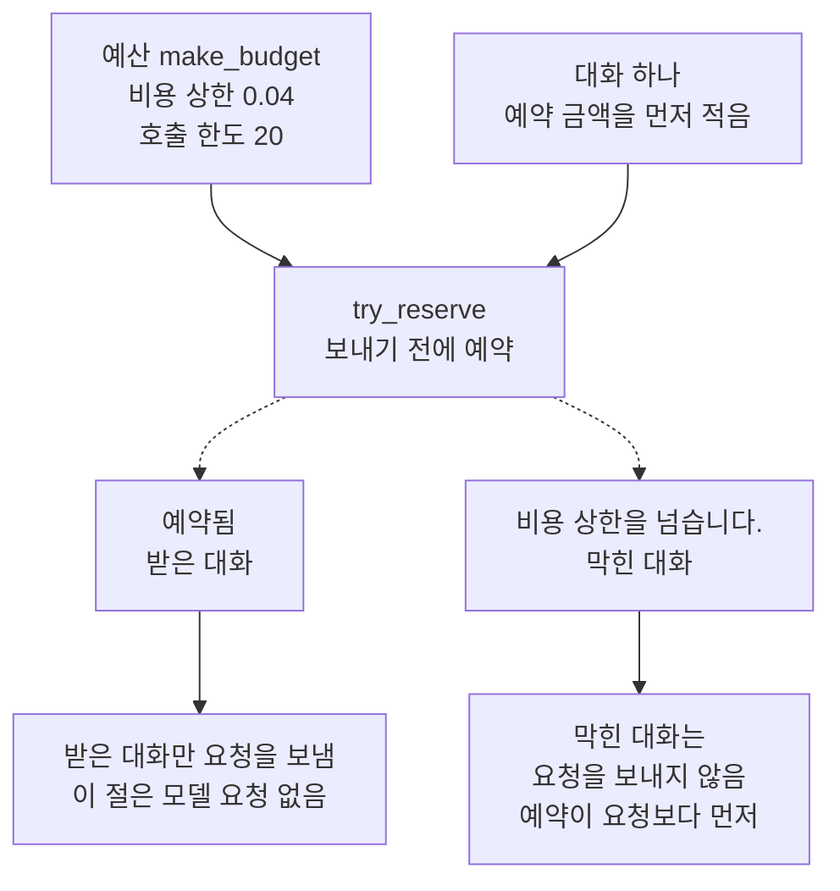
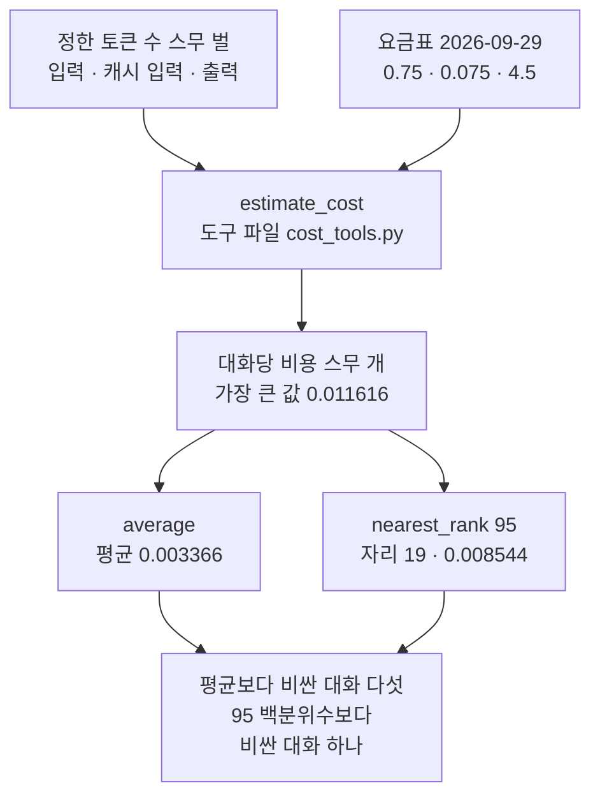
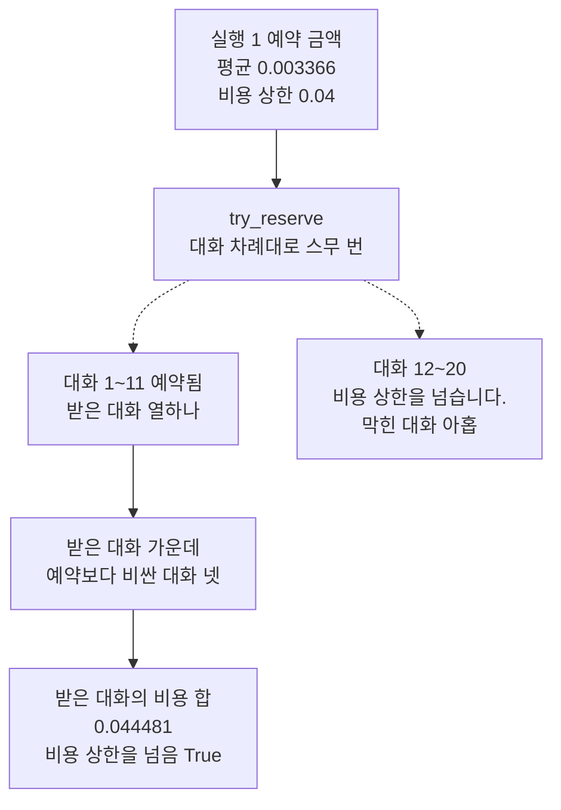
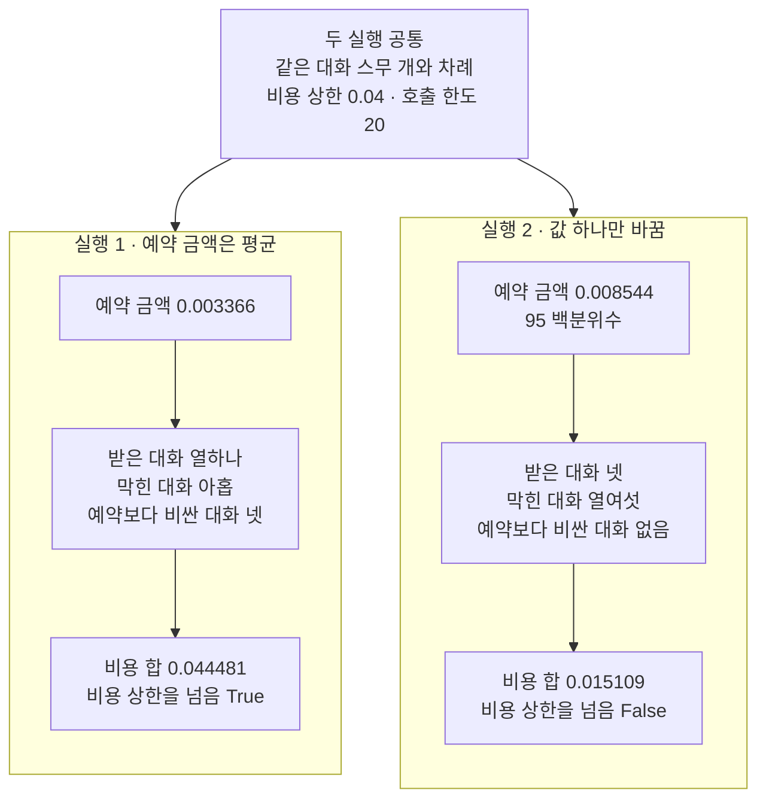

# 05-예산-가드와-p95

## _src 본문 (HTML 원본)

```html
<!--meta: 강의 0.6h | 실습 1h | 코드 notebooks/05-예산-가드와-p95.ipynb | 새 용어 5 -->
<style>html,body{overflow-x:hidden}.notebook,.nb-cell,.nb-main,.nb-input,.nb-result{min-width:0;max-width:100%}.nb-input pre,.nb-output{box-sizing:border-box;max-width:100%;overflow-x:auto}code.nb-source{display:block!important;width:100%!important;min-width:0!important;overflow-x:auto!important;padding:0!important}</style>
<h2 id="b1"><span class="no">1</span>학습 목표</h2><div class="goal"><ul>
<li>정한 토큰 수와 요금표로 대화당 비용을 셈하고, 평균과 95 백분위수를 찾을 수 있습니다.</li>
<li>대화를 시작하기 전에 예약하는 예산 가드로, 받은 대화와 막힌 대화를 셀 수 있습니다.</li>
<li>예약 금액을 평균과 95 백분위수로 바꿔 보며, 받는 대화 수와 비용 합이 어떻게 달라지는지 설명할 수 있습니다.</li>
</ul></div>
<h2 id="b2"><span class="no">2</span>이 내용을 배우는 이유</h2><p>응답의 사용량은 요청을 보낸 뒤에야 알 수 있습니다. 그래서 예산은 보내기 전에 예상 비용으로 막습니다. 그런데 대화마다 비용이 다르면, 대화 하나에 얼마를 예약할지 정해야 합니다. 너무 작게 잡으면 상한을 넘고, 너무 크게 잡으면 받을 수 있던 대화까지 막습니다.</p><p>제목의 p95는 <a href="../../part4/ch15-evaluation-advanced/06-대화당-비용-백분위수.html">Ch 15 06절</a>에서 본 95 백분위수를 줄여 쓴 말입니다. 이 절은 이 말을 제목에만 두고, 본문에서는 95 백분위수라고 씁니다. 제목의 예산 가드는 요청을 보내기 전에 예산에 예약해 보고, 막히면 보내지 않는 코드입니다. <a href="../../part4/ch16-guardrails/04-호출-한도와-비용-상한.html">Ch 16 04절</a>의 예약 함수가 이 일을 합니다.</p>
<h2 id="b3"><span class="no">3</span>앞에서 배운 내용</h2><p><a href="../../part2/ch06-langchain-start/06-토큰-비용-지연-비교.html">Ch 6 06절</a>에서는 토큰 수와 요금표로 요청 한 번의 예상 비용을 셌습니다. <a href="../../part4/ch15-evaluation-advanced/06-대화당-비용-백분위수.html">Ch 15 06절</a>은 대화 하나의 예상 비용을 모두 더한 대화당 비용을 줄 세웠습니다. 그리고 가장 가까운 자리 방식으로 백분위수를 찾았습니다. 그 절의 대화 백 개도 이 절처럼 흐름을 보여 주려고 정한 목록이었습니다. <a href="../../part6/ch29-agent-evaluation/04-운영-지표와-Ch18-궤적-비교.html">Ch 29 04절</a>은 같은 두 함수로 운영 지표의 평균과 95 백분위수를 셌습니다.</p><table><thead><tr><th>앞 절</th><th>배운 것</th><th>이 절에서 이어지는 곳</th></tr></thead><tbody><tr><td><a href="../../part2/ch06-langchain-start/06-토큰-비용-지연-비교.html">Ch 6 06절</a></td><td>요금표와 함수 <code>estimate_cost</code> · 예상 비용은 청구 금액이 아님</td><td>2절 — 정한 토큰 수로 대화당 비용을 셈(도구 파일)</td></tr><tr><td><a href="../../part4/ch15-evaluation-advanced/06-대화당-비용-백분위수.html">Ch 15 06절</a></td><td>대화당 비용 · 가장 가까운 자리 방식 · 함수 <code>average</code>·<code>nearest_rank</code> · 이 절에서 정한 목록</td><td>3절 — 평균과 95 백분위수(두 함수를 도구 파일에 옮김)</td></tr><tr><td><a href="../../part4/ch16-guardrails/04-호출-한도와-비용-상한.html">Ch 16 04절</a></td><td>호출 한도 · 비용 상한 · 예약 · 예산 · 함수 <code>make_budget</code>·<code>reserve</code></td><td>4~6절 — 예산 가드(두 함수를 도구 파일에 옮김)</td></tr><tr><td><a href="../../part6/ch22-middleware/05-커스텀-예산-미들웨어.html">Ch 22 05절</a></td><td>모델을 부르기 전에 지금까지 쓴 토큰 수를 한도와 견줌 · 마지막 호출에서 한도를 조금 넘을 수 있음</td><td>7블록 — 예약만으로는 상한을 넘을 수 있음</td></tr><tr><td><a href="../../part6/ch29-agent-evaluation/04-운영-지표와-Ch18-궤적-비교.html">Ch 29 04절</a></td><td>운영 지표의 평균과 95 백분위수 · 줄이 적을 때의 한계</td><td>3절 · 7블록</td></tr><tr><td><a href="01-프롬프트-캐시-계측.html">01절</a></td><td>캐시 입력 할인 · 캐시 입력 토큰 수는 128의 배수</td><td>2절 — 토큰 수의 캐시 입력 칸</td></tr><tr><td><a href="04-백오프-큐-동시성.html">04절</a></td><td>앱이 한 번 부른 호출에 서버가 받은 요청 아홉 번</td><td>4절 — 예약은 앱이 세는 단위</td></tr></tbody></table><p><a href="../../part4/ch16-guardrails/04-호출-한도와-비용-상한.html">Ch 16 04절</a>은 모델을 부르기 전에 호출 한 번과 예상 비용을 예산에 예약했습니다. 그 절은 요청 하나의 예상 비용을 0.002달러로 정해 두었습니다. 또 예약은 예상 비용만 더하므로, 응답 뒤의 비용이 예상 비용보다 크면 상한을 넘을 수 있다고 적었습니다. 이 절은 예약 금액을 대화당 비용의 평균과 95 백분위수로 정해, 그 말을 셈으로 확인합니다. <a href="../../part6/ch22-middleware/05-커스텀-예산-미들웨어.html">Ch 22 05절</a>도 호출 전에 쓴 토큰 수만 보아, 마지막 호출에서 한도를 조금 넘을 수 있다고 적었습니다.</p><p><a href="01-프롬프트-캐시-계측.html">01절</a>부터 <a href="04-백오프-큐-동시성.html">04절</a>까지는 대화 비용과 요청 수를 줄이는 방법을 봤습니다. 01절은 캐시 입력 할인, <a href="02-Batch-API.html">02절</a>은 일괄 처리의 절반 요금, <a href="03-모델-라우팅.html">03절</a>은 모델마다 다른 요금표를 다뤘습니다. 04절은 겹친 다시 보내기로 늘어난 요청 수를 셌습니다. 이 절은 줄인 뒤에도 남는 비용을, 요청을 보내기 전에 예산으로 막습니다.</p>
<h2 id="b4"><span class="no">4</span>핵심 개념</h2><h3>비유로 시작하기</h3><p>큰 보조 배터리 하나로 작은 배터리 여러 개를 채운다고 해 봅니다. 보조 배터리 앞면의 막대는 남은 양을 채움 높이로만 보여 줍니다. 작은 배터리 하나를 올리기 전에, 그 배터리 몫을 막대에서 먼저 떼어 둡니다. 떼어 둘 몫이 남은 양보다 크면 그 배터리는 올리지 않습니다.</p><p>막대의 처음 높이가 비용 상한이고, 떼어 두는 몫이 예약 금액입니다. 작은 배터리 하나가 대화 하나입니다. 몫을 작게 잡으면 많이 올릴 수 있지만, 몫보다 많이 먹는 배터리가 섞이면 떼어 둔 것보다 빨리 줄어듭니다. 몫을 크게 잡으면 막대가 넉넉히 남아도 몇 개밖에 올리지 못합니다.</p><p>비유와 다른 점도 있습니다. 보조 배터리는 남은 양이 0이 되면 더 내주지 못합니다. 이 절의 예산 가드는 예약한 금액만 적고, 대화를 마친 뒤의 비용은 적지 않습니다. 그래서 받은 대화의 비용 합이 비용 상한을 넘을 수 있습니다.</p>
{{img:05-5-남은-양이-보이는-보조-배터리|흰 바탕 왼쪽에 짙은 숯색 보조 배터리 하나가 서 있고, 앞면의 큰 세로 창에는 초록 막대가 아래쪽에 조금만 차 있습니다. 보조 배터리 오른쪽의 낮은 받침판 위에 겨자색 배터리 셋이 서 있고, 셋 모두 앞면의 큰 동그란 표시등이 초록으로 켜져 있습니다. 받침판 밖 탁자 위에는 같은 겨자색 배터리 둘이 서 있고, 두 표시등은 회색으로 꺼져 있습니다. 사람·손·글자·숫자·화살표는 없는 그림|보조 배터리의 막대는 아래쪽만 남았고, 받침판 위 배터리 셋만 초록 불이 켜졌으며 밖의 둘은 꺼져 있습니다.}}
<p class="look"><b>그림 읽기</b> — 왼쪽 보조 배터리 앞면의 창에는 초록 막대가 아래쪽에 조금만 남아 있습니다. 받침판 위의 배터리 셋은 초록 불이 켜져 있고, 받침판 밖의 배터리 둘은 불이 꺼져 있습니다. 불이 켜진 셋이 몫을 떼어 받은 대화이고, 꺼진 둘이 남은 양이 모자라 막힌 대화입니다. 막대의 처음 높이가 비용 상한이고, 떼어 준 만큼 막대가 내려간 셈입니다. 그림의 개수와 막대 높이는 비유라서, 노트북의 대화 수나 금액과 짝짓지 않습니다.</p>
<h3>예산 가드와 예약 금액</h3><p>예산 가드는 요청을 보내기 전에 예산에 예약해 보고, 막히면 보내지 않는 코드입니다. 택시를 타기 전에 지갑 속 남은 돈으로 갈 수 있는지 보고, 모자라면 타지 않는 것과 같습니다. 이 절 코드에서는 <a href="../../part4/ch16-guardrails/04-호출-한도와-비용-상한.html">Ch 16 04절</a>의 함수 <code>make_budget</code>과 <code>reserve</code>가 예산 가드입니다. 함수 <code>reserve</code>는 한도나 상한을 넘으면 <code>ValueError</code>를 내고, 예산 칸을 고치지 않습니다.</p><p>예약 금액은 대화 하나를 받기 전에 예산에 적는 예상 비용입니다. 모임 회비에서 한 사람 몫으로 미리 떼어 두는 돈과 같습니다. 이 절 코드에서는 변수 <code>run1_amount</code>와 <code>run2_amount</code>가 예약 금액입니다. Ch 16 04절은 요청마다 예약했지만, 이 절은 대화 하나를 시작하기 전에 한 번 예약합니다.</p><p>예약이 된 대화는 받은 대화, 비용 상한에 걸려 예약이 막힌 대화는 막힌 대화라고 부릅니다. 정원이 찬 강의실에 들어간 사람과, 문 앞에서 돌아간 사람과 같습니다. 이 절 코드에서는 결과 목록의 <code>예약됨</code>이 받은 대화, <code>비용 상한을 넘습니다.</code>가 막힌 대화입니다. 받은 대화 가운데 대화당 비용이 예약 금액보다 큰 대화는 예약보다 비싼 대화라고 부릅니다. 떼어 둔 식비보다 더 먹은 날과 같고, 이 절에서는 함수 <code>count_above</code>로 셉니다.</p>
{{mermaid:05-1-보내기-전에-예약하는-예산-가드|위에서 아래로 읽는 흐름도입니다. 초록 상자 예산 make_budget 비용 상한 0.04 호출 한도 20과 초록 상자 대화 하나 예약 금액을 먼저 적음이 파란 상자 try_reserve 보내기 전에 예약으로 모입니다. 파란 상자에서 점선 둘이 갈라져, 노란 상자 예약됨 받은 대화와 노란 상자 비용 상한을 넘습니다 막힌 대화로 갑니다. 두 노란 상자 아래에는 회색 상자 받은 대화만 요청을 보냄 이 절은 모델 요청 없음과 회색 상자 막힌 대화는 요청을 보내지 않음 예약이 요청보다 먼저가 하나씩 이어지는 그림|예산 가드는 요청을 보내기 전에 예약해 보고, 막힌 대화는 요청을 보내지 않습니다.}}
<p class="look"><b>도식 읽기</b> — 위에서 아래로 읽습니다. 초록 상자는 셀에 적은 예산 값과 대화이고, 파란 상자는 우리가 정의한 함수입니다. 점선 둘은 예약이 된 갈래와 막힌 갈래이고, 노란 상자는 노트북 4절에서 출력한 두 결과입니다. 맨 아래 회색 상자 둘은 코드 차례로 정해지는 사실이고, 이 절은 모델에 요청을 보내지 않습니다.</p>
<h3>평균과 95 백분위수</h3><p>평균은 값을 모두 더해 값의 수로 나눈 값이고, 비싼 대화 몇 개에 끌려 올라갑니다. 95 백분위수는 값을 작은 것부터 줄 세웠을 때, 95 × 값의 수 ÷ 100을 올린 자리의 값입니다. 대화가 스무 개이면 95 × 20 ÷ 100 = 19라, 열아홉째 값이 95 백분위수입니다. 스무째 값인 가장 큰 값과는 다릅니다.</p><p>이 절의 대화 스무 개에서 평균은 0.003366달러, 95 백분위수는 0.008544달러였습니다. 평균보다 비싼 대화는 다섯, 95 백분위수보다 비싼 대화는 하나였습니다. 가장 가까운 자리 방식에서 값이 스무 개이면, 95 백분위수보다 큰 값은 많아야 하나입니다.</p>
{{mermaid:05-2-대화당-비용에서-평균과-95-백분위수로|위에서 아래로 읽는 흐름도입니다. 초록 상자 정한 토큰 수 스무 벌 입력 캐시 입력 출력과 초록 상자 요금표 2026-09-29 0.75 0.075 4.5가 파란 상자 estimate_cost 도구 파일 cost_tools.py로 모이고, 노란 상자 대화당 비용 스무 개 가장 큰 값 0.011616으로 이어집니다. 이 노란 상자에서 노란 상자 average 평균 0.003366과 노란 상자 nearest_rank 95 자리 19 0.008544로 갈라지고, 두 상자는 노란 상자 평균보다 비싼 대화 다섯 95 백분위수보다 비싼 대화 하나로 모이는 그림|대화 스무 개에서 95 백분위수는 열아홉째 값 0.008544이고, 가장 큰 값 0.011616과 다릅니다.}}
<p class="look"><b>도식 읽기</b> — 위에서 아래로 읽습니다. 초록 상자 둘은 셀에 적은 토큰 수와 요금표이고, 파란 상자는 도구 파일의 함수입니다. 노란 상자는 노트북 2·3절에서 출력한 값입니다. 평균과 95 백분위수는 같은 대화당 비용 목록에서 셉니다.</p>
<h3>앱이 정한 상한과 제공자가 정한 상한</h3><p>호출 한도와 비용 상한은 우리 코드가 정한 상한입니다. <a href="04-백오프-큐-동시성.html">04절</a>의 요청 제한은 제공자가 정한 분당 상한이라 다른 말입니다. 예약은 앱이 세는 단위라, 04절처럼 다시 보내기가 두 곳에 겹치면 받은 대화 하나가 요청을 여러 번 보낼 수 있습니다. 04절에서는 앱이 한 번 부른 호출에 서버가 받은 요청이 아홉 번이었습니다.</p><p>제공자도 프로젝트마다 월 지출 한도를 둘 수 있습니다. 공식 안내는 알림만 보내는 설정과 요청을 막는 설정이 있다고 적습니다. 이 설정은 프로젝트 설정 화면의 기능이고, 노트북에서 실행하지 않았습니다.</p>
<h3>이 절에서 쓰는 말</h3><table><thead><tr><th>말</th><th>뜻</th><th>이 절에서 보이는 모습</th></tr></thead><tbody><tr><td>예산 가드</td><td>요청을 보내기 전에 예산에 예약해 보고, 막히면 보내지 않는 코드입니다.</td><td>Ch 16 04절 함수 <code>make_budget</code>·<code>reserve</code> — 이 절은 함수 <code>try_reserve</code>로 막힌 까닭을 받음</td></tr><tr><td>예약 금액</td><td>대화 하나를 받기 전에 예산에 적는 예상 비용입니다.</td><td>실행 1 <code>0.003366</code>(평균) · 실행 2 <code>0.008544</code>(95 백분위수)</td></tr><tr><td>받은 대화</td><td>예약이 된 대화입니다.</td><td>결과 <code>예약됨</code> — 실행 1 <code>11</code> · 실행 2 <code>4</code></td></tr><tr><td>막힌 대화</td><td>비용 상한에 걸려 예약이 막힌 대화입니다. 모델에 요청을 보내지 않습니다.</td><td>결과 <code>비용 상한을 넘습니다.</code> — 실행 1 <code>9</code> · 실행 2 <code>16</code></td></tr><tr><td>예약보다 비싼 대화</td><td>받은 대화 가운데 대화당 비용이 예약 금액보다 큰 대화입니다.</td><td>실행 1 <code>4</code> · 실행 2 <code>0</code></td></tr></tbody></table>
<h2 id="b5"><span class="no">5</span>실행 예제</h2><p>노트북 2절은 대화 스무 개의 토큰 수를 세 목록에 적고, 요금표로 대화당 비용을 셉니다. 3절은 평균과 95 백분위수를 찾고, 그보다 비싼 대화를 셉니다. 4절은 비용 상한과 호출 한도를 정하고, 예약을 해 보는 함수를 만듭니다. 5절과 6절은 예약 금액 하나만 바꾼 두 실행이고, 7절은 두 실행을 견줍니다.</p><p>노트북은 모델에 요청을 보내지 않고, API 키도 읽지 않습니다. 토큰 수는 흐름을 보여 주려고 이 절에서 정한 값이라, 출력은 실행할 때마다 같습니다. 파일을 쓰지 않고, 걸린 시간은 재지 않았습니다.</p>
{{notebook:05-예산-가드와-p95}}
<p class="look"><b>확인할 점</b> — 노트북 3절에서 <code>95 백분위수의 자리: 19</code>와 <code>95 백분위수(달러): 0.008544</code>를 찾습니다. 가장 큰 값 <code>0.011616</code>과 다르다는 것도 봅니다. 4절의 <code>0.05달러 예약: 비용 상한을 넘습니다.</code> 뒤에도 예산 칸 <code>calls</code>가 <code>1</code>인지 확인합니다.</p>
{{mermaid:05-3-실행-1에서-받은-대화와-막힌-대화|위에서 아래로 읽는 흐름도입니다. 초록 상자 실행 1 예약 금액 평균 0.003366 비용 상한 0.04에서 파란 상자 try_reserve 대화 차례대로 스무 번으로 갑니다. 파란 상자에서 점선 둘이 갈라져, 노란 상자 대화 1~11 예약됨 받은 대화 열하나와 노란 상자 대화 12~20 비용 상한을 넘습니다 막힌 대화 아홉으로 갑니다. 받은 대화 상자는 노란 상자 받은 대화 가운데 예약보다 비싼 대화 넷을 지나 노란 상자 받은 대화의 비용 합 0.044481 비용 상한을 넘음 True로 이어지는 그림|평균으로 예약하자 대화 열하나를 받았고, 그 가운데 넷이 예약보다 비싸 비용 합이 상한을 넘었습니다.}}
<p class="look"><b>도식 읽기</b> — 위에서 아래로 읽습니다. 초록 상자는 실행 1의 예약 금액과 비용 상한이고, 파란 상자는 예약을 해 보는 함수입니다. 점선 둘은 예약이 된 갈래와 막힌 갈래입니다. 노란 상자는 노트북 5절에서 출력한 값이고, 대화 번호는 출력 줄 처음 막힌 대화의 번호 12에서 읽었습니다.</p>
<h2 id="b6"><span class="no">6</span>실험 결과 해석</h2><p>가설은 대화당 비용의 모양에서 세웠습니다. 평균은 비싼 대화 몇 개에 끌려 올라가지만, 95 백분위수보다는 작습니다. 그래서 평균으로 예약하면 받는 대화는 많지만, 평균보다 비싼 대화를 받아 비용 합이 상한을 넘을 수 있다고 보았습니다. 실험은 같은 대화 스무 개와 같은 비용 상한으로, 예약 금액 하나만 바꿔 두 번 했습니다.</p>
{{mermaid:05-4-예약-금액만-바꾼-두-실행|맨 위 회색 상자 두 실행 공통 같은 대화 스무 개와 차례 비용 상한 0.04 호출 한도 20 아래에 칸 둘이 나란히 있습니다. 왼쪽 칸 실행 1 예약 금액은 평균에는 초록 상자 예약 금액 0.003366에서 노란 상자 받은 대화 열하나 막힌 대화 아홉 예약보다 비싼 대화 넷, 노란 상자 비용 합 0.044481 비용 상한을 넘음 True로 이어집니다. 오른쪽 칸 실행 2 값 하나만 바꿈에는 파란 상자 예약 금액 0.008544 95 백분위수에서 노란 상자 받은 대화 넷 막힌 대화 열여섯 예약보다 비싼 대화 없음, 노란 상자 비용 합 0.015109 비용 상한을 넘음 False로 이어지는 그림|예약 금액을 95 백분위수로 올리자 받은 대화는 열하나에서 넷으로 줄었고, 비용 합은 상한 안에 들었습니다.}}
<p class="look"><b>도식 읽기</b> — 맨 위 회색 상자는 두 실행에 공통인 값입니다. 왼쪽 칸이 실행 1, 오른쪽 칸이 실행 2이고, 칸마다 위가 예약 금액, 아래가 노트북 5·6절의 출력입니다. 오른쪽 칸의 파란 상자가 바꾼 값입니다. 노란 상자의 값은 모두 셀에 적은 토큰 수로 정해져, 새 커널 두 번에서 같았습니다.</p>
<table><thead><tr><th>견준 것</th><th>실행 1 — 예약 금액은 평균</th><th>실행 2 — 예약 금액은 95 백분위수</th></tr></thead><tbody><tr><td>바꾼 값 — 예약 금액</td><td><code>0.003366</code>(평균)</td><td><code>0.008544</code>(95 백분위수)</td></tr><tr><td>받은 대화 · 막힌 대화</td><td><code>11</code> · <code>9</code></td><td><code>4</code> · <code>16</code></td></tr><tr><td>처음 막힌 대화의 번호</td><td><code>12</code></td><td><code>5</code></td></tr><tr><td>예약한 금액의 합(달러)</td><td><code>0.037026</code></td><td><code>0.034176</code></td></tr><tr><td>받은 대화의 대화당 비용 합(달러)</td><td><code>0.044481</code></td><td><code>0.015109</code></td></tr><tr><td>예약보다 비싼 대화</td><td><code>4</code></td><td><code>0</code></td></tr><tr><td>비용 합이 비용 상한 0.04를 넘는가</td><td><code>True</code></td><td><code>False</code></td></tr><tr><td>예약 합에서 비용 합을 뺀 값(달러)</td><td><code>-0.007455</code></td><td><code>0.019067</code></td></tr></tbody></table>
<p>평균으로 예약한 실행 1은 대화 열하나를 받고 아홉을 막았습니다. 예약한 금액의 합은 0.037026달러로 상한 안이었지만, 받은 대화의 대화당 비용 합은 0.044481달러였습니다. 받은 대화 가운데 넷이 예약보다 비쌌고, 가장 비싼 대화 6도 그 안에 있었습니다.</p><p>95 백분위수로 예약한 실행 2는 넷을 받고 열여섯을 막았습니다. 받은 네 대화는 모두 예약 금액 이하였습니다. 비용 합 0.015109달러는 예약한 0.034176달러의 절반보다 적었습니다. 대화 6은 막힌 쪽이었고, 받은 쪽이었다면 예약보다 비싼 대화가 하나 생겼을 것입니다.</p><p>예약 금액이 모두 같으면, 받는 대화 수는 비용 상한을 예약 금액으로 나눈 몫입니다. 그래서 예약 금액을 올리면 받는 대화는 같거나 줄어듭니다. 예약보다 비싼 대화 수와 비용 합은 어느 대화를 받았는지에 따라 달라집니다. 이 절은 비싼 대화가 앞쪽에 오게 정한 목록이라, 결과는 이 목록에서 본 것으로만 읽습니다.</p>
<p>새 커널로 두 번 실행해 견주자, 코드 셀 스물셋의 출력이 셀마다 모두 같았습니다. 한 번은 프로젝트 맨 위에서, 한 번은 <code>notebooks/</code> 폴더에서 연 커널이었습니다. 모든 값이 셀에 적은 토큰 수와 요금표로 정해지기 때문입니다.</p>
<p class="look"><b>확인할 점</b> — 7절 표의 두 줄에서 받은 대화 <code>11</code>과 <code>4</code>, 예약보다 비싼 대화 <code>4</code>와 <code>0</code>을 견줍니다. 마지막 셀의 <code>-0.007455</code>와 <code>0.019067</code>로, 예약이 모자랐는지 남았는지 봅니다.</p>
<h2 id="b7"><span class="no">7</span>주의할 점과 실무 메모</h2><ul><li>대화 스무 개의 토큰 수와 대화 차례, 비용 상한 0.04달러, 호출 한도 20은 흐름을 보여 주려고 이 절에서 정한 예입니다. 토큰 수와 차례는 두 실행의 차이가 보이도록 셈해 보며 정했고, 비싼 대화 넷(대화 2·5·6·8)을 앞쪽에 두었습니다. 실행 1이 상한을 넘은 것은 가장 비싼 대화 6이 받은 열한 대화 안에 들었기 때문입니다. 대화 6 대신 대화 12를 받았다면 비용 합은 0.034514달러로 상한 안입니다. 셈은 0.044481 − 0.011616 + 0.001649 = 0.034514입니다.</li><li>대화당 비용은 정한 토큰 수와 요금표(2026-09-29)로 셈한 예상 비용입니다. 모델에 보낸 대화의 사용량이 아니고, 청구 금액도 아닙니다. 요금은 바뀔 수 있어 확인한 날짜를 함께 적습니다.</li><li>이 절의 예산 가드는 예약한 금액만 적습니다. 대화를 마친 뒤 대화당 비용으로 예산 칸을 고치는 일은 하지 않았습니다. <a href="../../part4/ch16-guardrails/04-호출-한도와-비용-상한.html">Ch 16 04절</a>도 응답 뒤의 토큰 수로 비용을 다시 셈하지 않았습니다.</li><li>예약 금액을 무엇으로 잡을지에 정해진 답은 없습니다. 이 목록에서 평균은 받은 대화가 많았지만 상한을 넘었고, 95 백분위수는 상한 안이었지만 막힌 대화가 많았습니다. 다른 목록에서는 결과가 달라질 수 있습니다.</li><li>실제 서비스는 지난 대화의 기록으로 예약 금액을 정하고, 새 대화에 씁니다. 이 절은 같은 목록으로 금액을 정하고 같은 목록을 예약해, 대화마다 예약 금액과 대화당 비용을 견줄 수 있게 했습니다.</li><li>대화가 스무 개이면 95 백분위수는 열아홉째 값입니다. <a href="../../part6/ch29-agent-evaluation/04-운영-지표와-Ch18-궤적-비교.html">Ch 29 04절</a>에서 본 것처럼, 값이 적으면 한두 값에 따라 95 백분위수가 크게 바뀝니다.</li><li>예약은 앱이 세는 단위입니다. <a href="04-백오프-큐-동시성.html">04절</a>처럼 다시 보내기가 두 곳에 겹치면, 받은 대화 하나가 예약보다 많은 요청을 보낼 수 있습니다.</li><li>OpenAI 안내는 조직과 프로젝트마다 월 지출 한도를 둘 수 있다고 적습니다. 알림만 보내는 설정과 요청을 막는 설정이 있고, 막는 한도에 닿은 요청은 429를 받습니다. 안내는 막는 일이 곧바로 되지 않아, 기록된 지출이 한도를 조금 넘을 수 있다고도 적습니다. 이 설정은 프로젝트 설정 화면의 기능이고, 노트북에서 실행하지 않았습니다.</li><li>예산 딕셔너리는 노트북 안에만 있어, 커널을 다시 시작하면 처음부터 다시 셉니다. 사용자별 하루 한도처럼 오래 둘 값은 파일이나 데이터베이스에 두어야 하고, 이 절에서는 실행하지 않았습니다.</li><li>교재 출력은 Linux의 Python 3.12.13으로 만들었습니다. 다른 버전과 Windows·macOS에서는 실행하지 않았습니다.</li></ul>
<h2 id="b8"><span class="no">8</span>정리와 다음 절</h2><ul><li>예산 가드는 대화를 시작하기 전에 예약 금액을 예산에 적고, 비용 상한을 넘으면 그 대화를 받지 않습니다.</li><li>예약 금액이 모두 같으면 받는 대화 수는 비용 상한을 예약 금액으로 나눈 몫이라, 금액을 올리면 같거나 줄어듭니다.</li><li>예약은 예상 비용만 적으므로, 예약보다 비싼 대화를 받으면 비용 합이 비용 상한을 넘을 수 있습니다.</li></ul><p><strong>다음 학습과 이어지는 지점</strong> — 다음 <a href="06-비용과-Rate-Limit-실습.html">06절</a>은 이 챕터의 실습 절입니다. 01·03·05절에서 쓴 기능을 한 흐름으로 이어 봅니다.</p>
<h2 id="b9"><span class="no">9</span>복습 문제</h2><details class="quiz" open><summary>문제 5개 · 해설 포함</summary><p class="quiz-q">1. 대화 스무 개의 대화당 비용에서, 가장 가까운 자리 방식의 95 백분위수는 몇째 값인가요? 가장 큰 값과 같나요?</p><p class="quiz-a">작은 값부터 열아홉째 값입니다. 95 × 20 ÷ 100 = 19이고, 가장 큰 값은 스무째 값이라 다릅니다. 틀렸다면 노트북 3절을 다시 읽습니다.</p><p class="quiz-q">2. 비용 상한이 0.04달러이고 예약 금액이 0.003366달러이면, 대화를 몇 개 받나요?</p><p class="quiz-a">열한 개입니다. 열한 번 예약하면 0.037026달러이고, 열두 번이면 0.040392달러로 상한을 넘습니다. 틀렸다면 노트북 5절 첫 셀을 다시 읽습니다.</p><p class="quiz-q">3. 실행 1에서 예약한 금액의 합은 상한 안이었는데, 받은 대화의 비용 합은 왜 상한을 넘었나요?</p><p class="quiz-a">예약은 예상 비용만 적고, 대화를 마친 뒤의 비용은 보지 않습니다. 받은 열한 대화 가운데 넷이 예약 금액보다 비쌌고, 특히 가장 비싼 대화 6이 받은 쪽에 있었기 때문입니다. 틀렸다면 노트북 5절 마지막 두 셀을 다시 읽습니다.</p><p class="quiz-q">4. 막힌 대화는 모델에 요청을 몇 번 보내나요? 받은 대화는 예약한 대로 한 번씩만 보내나요?</p><p class="quiz-a">막힌 대화는 요청을 보내지 않습니다. 예약이 요청보다 먼저이기 때문입니다. 받은 대화는 04절처럼 다시 보내기가 겹치면 요청을 여러 번 보낼 수 있습니다. 틀렸다면 본문 4블록을 다시 읽습니다.</p><p class="quiz-q">5. 동료가 「95 백분위수로 예약하면 예약보다 비싼 대화는 절대 없다」고 말합니다. 이 절로 보면 어떤가요?</p><p class="quiz-a">그렇지 않습니다. 95 백분위수보다 비싼 대화가 이 목록에도 하나 있었습니다. 실행 2에서는 그 대화 6이 막힌 쪽이라 없었지만, 받은 쪽이었다면 하나가 됩니다. 틀렸다면 노트북 6절 마지막 셀을 다시 읽습니다.</p></details>
<h2 id="b10"><span class="no">10</span>참고 자료</h2><ul><li><div><a href="https://developers.openai.com/api/docs/models/gpt-5.4-mini">OpenAI GPT-5.4 mini</a></div>확인 2026-09-30 · 100만 토큰당 입력 0.75달러, 캐시 입력 0.075달러, 출력 4.50달러입니다. 01절에서 2026-09-29에 확인한 요금표와 같습니다.</li><li><div><a href="https://developers.openai.com/api/docs/guides/spend-limits">OpenAI Spend limits</a></div>확인 2026-09-30 · 조직과 프로젝트마다 월 지출 한도를 두는 방법을 설명합니다. 알림은 요청을 막지 않고, 막는 한도에 닿은 요청은 429를 받는다고 적습니다. 막는 일이 곧바로 되지 않아, 기록된 지출이 한도를 조금 넘을 수 있다고도 적습니다.</li><li><div>도구 파일 함수의 출처</div>확인 2026-09-30 · 함수 <code>average</code>·<code>nearest_rank</code>는 Ch 29 도구 파일 <code>eval_tools.py</code>에서 설명 주석과 본문을 글자 그대로 옮겼습니다. <a href="../../part4/ch15-evaluation-advanced/06-대화당-비용-백분위수.html">Ch 15 06절</a> 노트북 셀과도 본문이 같습니다. 함수 <code>make_budget</code>·<code>reserve</code>는 <a href="../../part4/ch16-guardrails/04-호출-한도와-비용-상한.html">Ch 16 04절</a> 노트북 셀에서 설명 줄과 본문을 글자 그대로 옮겼습니다.</li></ul>
```

## 노트북 셀 (순서대로)

### [0] markdown {'html': 'skip'}

# 예산 가드와 p95

**이 노트북에서 할 일**

1. 이 절에서 정한 토큰 수로 대화 스무 개의 대화당 비용을 셈하고, 평균과 95 백분위수를 봅니다.
2. 대화마다 먼저 예약하는 예산 가드로, 예약 금액을 평균으로 둔 실행 1을 합니다.
3. 예약 금액 하나만 95 백분위수로 바꾼 실행 2와 견주어, 받은 대화와 비용 합을 봅니다.

**준비물** — 이 노트북은 모델에 요청을 보내지 않고, API 키도 읽지 않습니다.
대화 스무 개의 토큰 수는 흐름을 보여 주려고 이 절에서 정한 값입니다.
비용은 그 토큰 수와 요금표(2026-09-29 확인)로 셈한 예상 비용이고, 청구 금액이 아닙니다.
실습 폴더의 도구 파일 `cost_tools.py`에서 함수 다섯을 가져옵니다.
따로 설치할 패키지는 없고, 이 노트북은 파일을 쓰지 않습니다.

모든 출력은 셀에 적은 값으로 정해져, 실행할 때마다 같습니다.
걸린 시간은 재지 않았습니다.

**기준 버전** — 이 노트북은 Python에 들어 있는 모듈과 도구 파일만 씁니다.
교재 출력은 Linux의 Python 3.12.13으로 만들었습니다.
다른 버전과 Windows·macOS에서는 실행하지 않았습니다.

**강의와 실습 범위** — 강의 시간에는 3절의 평균과 95 백분위수, 4절의 예산 가드를 보고 가설을 함께 세웁니다.
두 실행을 하는 5·6절과 두 실행을 견주는 7절은 실습 시간에 실행합니다.

실습 폴더 `labs/part7/ch34-cost-rate-limits`에서 `uv sync --locked`를 실행합니다.
그다음 `notebooks/` 폴더의 이 노트북을 열고, 실습 폴더의 `.venv` 커널을 고릅니다.
첫 셀부터 순서대로 실행합니다.

### [1] markdown {'html': 'skip'}

## 오늘 볼 그림


위에서 아래로 읽습니다.
초록 상자는 셀에 적은 예산 값과 대화이고, 파란 상자는 우리가 정의한 함수입니다.
점선 둘은 예약이 된 갈래와 막힌 갈래이고, 노란 상자는 노트북 4절에서 출력한 두 결과입니다.
맨 아래 회색 상자 둘은 코드 차례로 정해지는 사실이고, 이 절은 모델에 요청을 보내지 않습니다.

### [2] markdown {}

## 1. 준비

제목의 p95는 Ch 15 06절에서 본 95 백분위수를 줄여 쓴 말입니다.
이 절은 이 말을 제목에만 두고, 본문에서는 95 백분위수라고 씁니다.
제목의 예산 가드는 4절에서 풀어 씁니다.

첫 셀은 자리 계산에 쓸 모듈 `math`와 도구 파일의 함수 다섯을 가져옵니다.
따로 설치할 패키지가 없어, 설치 셀은 두지 않았습니다.

### [3] code {'execution': {'iopub.execute_input': '2026-09-30T01:48:41.630960Z', 'iopub.status.busy': '2026-09-30T01:48:41.630806Z', 'iopub.status.idle': '2026-09-30T01:48:41.641991Z', 'shell.execute_reply': '2026-09-30T01:48:41.641421Z'}, 'lesson_role': 'setup'}

```python
# 자리 계산에 쓸 모듈 math와, 도구 파일의 함수 다섯을 가져옵니다
import math
# Ch 6 06절·Ch 15 06절·Ch 16 04절에서 배운 함수는 도구 파일에서 가져옵니다
from cost_tools import estimate_cost, average, nearest_rank, make_budget, reserve

print("가져온 모듈:", math.__name__)
print("도구 파일에서 가져온 함수:", estimate_cost.__name__, average.__name__, nearest_rank.__name__)
print("도구 파일에서 가져온 함수:", make_budget.__name__, reserve.__name__)
```

출력:
```
가져온 모듈: math
도구 파일에서 가져온 함수: estimate_cost average nearest_rank
도구 파일에서 가져온 함수: make_budget reserve

```

### [4] markdown {}

**결과 읽기** — 출력 줄 `가져온 모듈: math`가 보입니다.
모듈 `math`는 Python에 들어 있어 따로 설치하지 않습니다.
함수 `estimate_cost`는 01~03절처럼 Ch 6 06절에서 배운 함수입니다.
함수 `average`·`nearest_rank`는 Ch 15 06절, `make_budget`·`reserve`는 Ch 16 04절에서 배웠습니다.
이 네 함수는 이 절에서 도구 파일에 옮겼습니다.

앞에서 배운 함수는 `cost_tools.py`에 모아 두었습니다.
파일을 열면 코드를 볼 수 있습니다.
노트북과 같은 폴더(`notebooks/`)에 있는 파일입니다.
커널이 `notebooks/` 폴더에서 시작해야 이 파일을 가져올 수 있습니다.
교재 출력을 만든 실행 도구는 이 폴더를 따로 알려 주어, 다른 자리에서 시작해도 가져오기가 되었습니다.

이 절은 모델 서비스에 요청을 보내지 않아, 키를 읽는 셀을 두지 않았습니다.

## 2. 대화 스무 개의 대화당 비용

Ch 15 06절은 대화 하나에서 보낸 요청들의 예상 비용을 모두 더해 대화당 비용이라고 불렀습니다.
이 절도 그 말을 씁니다.
이 절의 대화는 책 가게 상담 대화 스무 개이고, 모델에 보내지 않습니다.
대화마다 토큰 수를 정해 두고, 요금표로 대화당 비용을 셉니다.

다음 셀은 01절과 같은 요금표를 적습니다.

### [5] code {'execution': {'iopub.execute_input': '2026-09-30T01:48:41.643788Z', 'iopub.status.busy': '2026-09-30T01:48:41.643671Z', 'iopub.status.idle': '2026-09-30T01:48:41.646219Z', 'shell.execute_reply': '2026-09-30T01:48:41.645808Z'}}

```python
# gpt-5.4-mini의 공식 요금(100만 토큰당 달러)과 확인한 날짜를 적습니다
pricing_date = "2026-09-29"
mini_prices = {"ordinary_input": 0.75, "cached_input": 0.075, "output": 4.50}
print("요금 확인 날짜:", pricing_date)
print("mini 요금:", mini_prices)
```

출력:
```
요금 확인 날짜: 2026-09-29
mini 요금: {'ordinary_input': 0.75, 'cached_input': 0.075, 'output': 4.5}

```

### [6] markdown {}

**결과 읽기** — 출력 줄 `요금 확인 날짜: 2026-09-29`가 보입니다.
단위는 100만 토큰당 달러이고, 01·03절의 mini 요금표와 같습니다.
캐시 입력 요금 0.075달러는 일반 입력 요금 0.75달러의 10분의 1입니다.

다음 셀은 대화 스무 개의 토큰 수를 대화 차례대로 세 목록에 적습니다.
대화 하나의 토큰 수는 그 대화에서 보낸 요청들의 토큰 수를 더한 값으로 정했습니다.
세 목록은 입력 토큰 수, 그 가운데 캐시 입력 토큰 수, 출력 토큰 수입니다.
캐시 입력 토큰 수는 01절에서 본 것처럼 128의 배수로 정했습니다.

### [7] code {'execution': {'iopub.execute_input': '2026-09-30T01:48:41.647344Z', 'iopub.status.busy': '2026-09-30T01:48:41.647246Z', 'iopub.status.idle': '2026-09-30T01:48:41.650668Z', 'shell.execute_reply': '2026-09-30T01:48:41.650147Z'}}

```python
# 대화 스무 개의 토큰 수를 대화 차례대로 적습니다(흐름을 보여 주려고 이 절에서 정한 값입니다)
input_counts = [2600, 9400, 2400, 3000, 4200, 14000, 2500, 5200, 3100, 2600, 2400, 2100, 2900, 2800, 2300, 2700, 3300, 3000, 3500, 3600]
cached_counts = [1280, 5120, 1280, 1536, 2048, 7680, 1280, 2560, 1536, 1280, 1280, 1024, 1536, 1280, 1024, 1280, 1664, 1536, 1792, 1792]
output_counts = [240, 1100, 180, 320, 480, 1400, 220, 700, 280, 230, 200, 170, 300, 340, 190, 250, 340, 280, 360, 420]
print("대화 수:", len(input_counts))
print("대화 1의 입력·캐시 입력·출력 토큰 수:", input_counts[0], cached_counts[0], output_counts[0])
```

출력:
```
대화 수: 20
대화 1의 입력·캐시 입력·출력 토큰 수: 2600 1280 240

```

### [8] markdown {}

**결과 읽기** — 출력 줄 `대화 수: 20`이 보입니다.
대화 1은 입력 토큰 `2600`개 가운데 `1280`개가 캐시 입력이고, 출력 토큰은 `240`개입니다.
대화 2·6·8처럼 토큰 수가 큰 대화는, 요청을 여러 번 보낸 긴 대화로 정했습니다.
이 값은 실제로 잰 사용량이 아니라, 흐름을 보여 주려고 이 절에서 정한 목록입니다.

다음 셀은 토큰 수 셋으로, 응답의 사용량과 같은 모양의 딕셔너리를 만드는 함수를 정의합니다.
Ch 6 06절에서 본 `usage_metadata`와 키가 같아, 함수 `estimate_cost`에 그대로 넣을 수 있습니다.

### [9] code {'execution': {'iopub.execute_input': '2026-09-30T01:48:41.651761Z', 'iopub.status.busy': '2026-09-30T01:48:41.651664Z', 'iopub.status.idle': '2026-09-30T01:48:41.653806Z', 'shell.execute_reply': '2026-09-30T01:48:41.653440Z'}}

```python
# 입력·캐시 입력·출력 토큰 수로, 응답의 사용량(usage_metadata)과 같은 모양의 딕셔너리를 만듭니다
def make_usage(input_tokens, cached_tokens, output_tokens):
    details = {"cache_read": cached_tokens}
    usage = {"input_tokens": input_tokens, "output_tokens": output_tokens, "input_token_details": details}
    return usage
```

출력:
```

```

### [10] markdown {}

**결과 읽기** — 정의 셀이라 출력이 없습니다.
키 `input_token_details` 안의 `cache_read`가 캐시 입력 토큰 수입니다.
01절에서 본 사용량 딕셔너리와 같은 자리입니다.
함수는 새 딕셔너리를 내놓기만 하고, 모델을 부르지 않습니다.

다음 셀은 대화 1의 사용량 딕셔너리를 만들고, mini 요금표로 예상 비용을 셉니다.

### [11] code {'execution': {'iopub.execute_input': '2026-09-30T01:48:41.654888Z', 'iopub.status.busy': '2026-09-30T01:48:41.654808Z', 'iopub.status.idle': '2026-09-30T01:48:41.657279Z', 'shell.execute_reply': '2026-09-30T01:48:41.656700Z'}}

```python
# 대화 1의 사용량 딕셔너리를 만들어, mini 요금표로 예상 비용을 셈합니다
first_usage = make_usage(input_counts[0], cached_counts[0], output_counts[0])
first_cost = estimate_cost(first_usage, mini_prices["ordinary_input"], mini_prices["cached_input"], mini_prices["output"])
print("대화 1의 사용량:", first_usage)
print("대화 1의 예상 비용(달러):", round(first_cost, 6))
```

출력:
```
대화 1의 사용량: {'input_tokens': 2600, 'output_tokens': 240, 'input_token_details': {'cache_read': 1280}}
대화 1의 예상 비용(달러): 0.002166

```

### [12] markdown {}

**결과 읽기** — 출력 줄 `대화 1의 예상 비용(달러): 0.002166`이 보입니다.
일반 입력은 2600에서 1280을 뺀 1320토큰입니다.
셈은 (1320 × 0.75 + 1280 × 0.075 + 240 × 4.5) ÷ 1000000입니다.
990 + 96 + 1080 = 2166이라, 0.002166달러가 됩니다.

다음 셀은 대화 스무 개 모두에 같은 셈을 하고, 대화 차례대로 목록에 모읍니다.
값은 함수 `round`로 여섯째 자리에서 반올림합니다.

### [13] code {'execution': {'iopub.execute_input': '2026-09-30T01:48:41.658344Z', 'iopub.status.busy': '2026-09-30T01:48:41.658254Z', 'iopub.status.idle': '2026-09-30T01:48:41.660944Z', 'shell.execute_reply': '2026-09-30T01:48:41.660472Z'}}

```python
# 대화마다 사용량을 만들어 예상 비용을 셈하고, 여섯째 자리에서 반올림해 대화 차례대로 모읍니다
costs = []
for number in range(len(input_counts)):
    usage = make_usage(input_counts[number], cached_counts[number], output_counts[number])
    cost = estimate_cost(usage, mini_prices["ordinary_input"], mini_prices["cached_input"], mini_prices["output"])
    costs.append(round(cost, 6))
print("대화당 비용(달러):")
print(costs)
```

출력:
```
대화당 비용(달러):
[0.002166, 0.008544, 0.001746, 0.002653, 0.003928, 0.011616, 0.002001, 0.005322, 0.002548, 0.002121, 0.001836, 0.001649, 0.002488, 0.002766, 0.001889, 0.002286, 0.002882, 0.002473, 0.003035, 0.00338]

```

### [14] markdown {}

**결과 읽기** — 라벨 줄 아래 목록이 대화 스무 개의 대화당 비용입니다.
첫 값 `0.002166`은 앞 셀에서 셈한 대화 1의 값과 같습니다.
가장 큰 값은 여섯째 대화의 `0.011616`달러이고, 둘째 대화의 `0.008544`달러가 그다음입니다.
나머지 열여덟 개는 모두 0.006달러보다 작습니다.

## 3. 평균과 95 백분위수

Ch 15 06절은 대화당 비용을 줄 세워, 평균과 백분위수가 다르게 보이는 것을 봤습니다.
이 절은 그때 배운 두 함수를 도구 파일에서 가져와 씁니다.
함수 `average`는 값을 모두 더해 값의 수로 나누고, 여섯째 자리에서 반올림합니다.
다음 셀은 대화당 비용 스무 개의 평균을 셉니다.

### [15] code {'execution': {'iopub.execute_input': '2026-09-30T01:48:41.661936Z', 'iopub.status.busy': '2026-09-30T01:48:41.661855Z', 'iopub.status.idle': '2026-09-30T01:48:41.663915Z', 'shell.execute_reply': '2026-09-30T01:48:41.663420Z'}}

```python
# 대화당 비용 스무 개의 평균을 셉니다(여섯째 자리에서 반올림합니다)
cost_average = average(costs)
print("대화당 비용의 평균(달러):", cost_average)
```

출력:
```
대화당 비용의 평균(달러): 0.003366

```

### [16] markdown {}

**결과 읽기** — 출력 줄 `대화당 비용의 평균(달러): 0.003366`이 보입니다.
이 값은 목록에 있는 어느 대화의 비용과도 같지 않습니다.
평균은 비싼 대화 몇 개에 끌려 올라간 값입니다.

다음 셀은 같은 목록에서 95 백분위수를 찾습니다.
Ch 15 06절처럼 가장 가까운 자리 방식으로 셉니다.
자리는 95 × 값의 수 ÷ 100을 올린 정수이고, 작은 값부터 그 자리의 값을 고릅니다.

### [17] code {'execution': {'iopub.execute_input': '2026-09-30T01:48:41.664861Z', 'iopub.status.busy': '2026-09-30T01:48:41.664763Z', 'iopub.status.idle': '2026-09-30T01:48:41.667430Z', 'shell.execute_reply': '2026-09-30T01:48:41.666973Z'}}

```python
# 작은 값부터 줄 세운 목록에서 95 백분위수의 자리와 값을 보고, 가장 큰 값과 견줍니다
ordered = sorted(costs)
rank = math.ceil(95 * len(ordered) / 100)
cost_p95 = nearest_rank(costs, 95)
print("95 백분위수의 자리:", rank)
print("95 백분위수(달러):", cost_p95)
print("그 자리의 값과 같은가:", ordered[rank - 1] == cost_p95)
print("가장 큰 값(달러):", ordered[-1])
```

출력:
```
95 백분위수의 자리: 19
95 백분위수(달러): 0.008544
그 자리의 값과 같은가: True
가장 큰 값(달러): 0.011616

```

### [18] markdown {}

**결과 읽기** — 출력 줄 `95 백분위수의 자리: 19`와 `95 백분위수(달러): 0.008544`가 보입니다.
95 × 20 ÷ 100 = 19라, 작은 값부터 열아홉째 값을 골랐습니다.
가장 큰 값 `0.011616`은 스무째 값이라, 95 백분위수와 다릅니다.
출력 줄 `그 자리의 값과 같은가: True`로, 함수 `nearest_rank`가 같은 자리를 골랐다는 것을 봅니다.

다음 셀은 값 목록에서 기준 값보다 큰 값이 몇 개인지 세는 함수를 정의합니다.

### [19] code {'execution': {'iopub.execute_input': '2026-09-30T01:48:41.668267Z', 'iopub.status.busy': '2026-09-30T01:48:41.668184Z', 'iopub.status.idle': '2026-09-30T01:48:41.670138Z', 'shell.execute_reply': '2026-09-30T01:48:41.669791Z'}}

```python
# 값 목록에서 기준 값보다 큰 값이 몇 개인지 셉니다
def count_above(values, limit):
    count = 0
    for value in values:
        if value > limit:
            count = count + 1
    return count
```

출력:
```

```

### [20] markdown {}

**결과 읽기** — 정의 셀이라 출력이 없습니다.
기준 값과 같은 값은 세지 않고, 더 큰 값만 셉니다.
셀 바깥의 이름을 읽지 않고, 값 목록과 기준 값을 인자로 받습니다.

다음 셀은 대화 스무 개 가운데 평균보다 비싼 대화와, 95 백분위수보다 비싼 대화를 셉니다.

### [21] code {'execution': {'iopub.execute_input': '2026-09-30T01:48:41.671027Z', 'iopub.status.busy': '2026-09-30T01:48:41.670949Z', 'iopub.status.idle': '2026-09-30T01:48:41.673136Z', 'shell.execute_reply': '2026-09-30T01:48:41.672744Z'}}

```python
# 대화 스무 개 가운데 평균보다 비싼 대화와 95 백분위수보다 비싼 대화가 몇 개인지 셉니다
print("평균보다 비싼 대화 수:", count_above(costs, cost_average))
print("95 백분위수보다 비싼 대화 수:", count_above(costs, cost_p95))
```

출력:
```
평균보다 비싼 대화 수: 5
95 백분위수보다 비싼 대화 수: 1

```

### [22] markdown {}

**결과 읽기** — 출력 줄 `평균보다 비싼 대화 수: 5`와 `95 백분위수보다 비싼 대화 수: 1`이 보입니다.
평균보다 비싼 대화는 스무 개 가운데 다섯이었습니다.
95 백분위수보다 비싼 대화는 가장 큰 값인 여섯째 대화 하나뿐입니다.
가장 가까운 자리 방식에서 값이 스무 개이면, 95 백분위수보다 큰 값은 많아야 하나입니다.

## 4. 예산 가드와 예약 금액

예산 가드는 요청을 보내기 전에 예산에 예약해 보고, 막히면 보내지 않는 코드입니다.
택시를 타기 전에 지갑 속 남은 돈으로 갈 수 있는지 보고, 모자라면 타지 않는 것과 같습니다.
이 절 코드에서는 Ch 16 04절의 함수 `make_budget`과 `reserve`가 예산 가드입니다.
함수 `make_budget`은 호출 한도와 비용 상한을 담은 예산 딕셔너리를 만듭니다.
함수 `reserve`는 호출 한 번과 예상 비용을 예산에 적고, 한도나 상한을 넘으면 `ValueError`를 냅니다.

Ch 16 04절은 요청마다 예약했고, 요청 하나의 예상 비용을 0.002달러로 정해 두었습니다.
이 절은 대화 하나를 시작하기 전에 한 번 예약합니다.
대화 하나를 받기 전에 예산에 적는 예상 비용을 이 절에서는 예약 금액이라고 부릅니다.
모임 회비에서 한 사람 몫으로 미리 떼어 두는 돈과 같습니다.
이 절 코드에서는 변수 `run1_amount`와 `run2_amount`가 예약 금액입니다.

다음 셀은 대화당 비용 목록을 모두 더하는 함수를 정의합니다.

### [23] code {'execution': {'iopub.execute_input': '2026-09-30T01:48:41.674023Z', 'iopub.status.busy': '2026-09-30T01:48:41.673953Z', 'iopub.status.idle': '2026-09-30T01:48:41.675786Z', 'shell.execute_reply': '2026-09-30T01:48:41.675445Z'}}

```python
# 대화당 비용 목록을 모두 더하고, 여섯째 자리에서 반올림한 합을 내놓습니다
def total_cost(values):
    total = 0
    for value in values:
        total = total + value
    return round(total, 6)
```

출력:
```

```

### [24] markdown {}

**결과 읽기** — 정의 셀이라 출력이 없습니다.
합도 대화당 비용처럼 여섯째 자리에서 반올림합니다.
작은 소수를 여러 번 더하면 끝자리에 아주 작은 차이가 남을 수 있기 때문입니다.

다음 셀은 대화 스무 개 모두에 쓸 비용 상한과 호출 한도를 정합니다.
스무 개를 모두 받을 때의 대화당 비용 합과도 견줍니다.

### [25] code {'execution': {'iopub.execute_input': '2026-09-30T01:48:41.676672Z', 'iopub.status.busy': '2026-09-30T01:48:41.676591Z', 'iopub.status.idle': '2026-09-30T01:48:41.678858Z', 'shell.execute_reply': '2026-09-30T01:48:41.678432Z'}}

```python
# 대화 스무 개 모두에 쓸 비용 상한과 호출 한도를 정하고, 스무 개를 모두 받을 때의 합과 견줍니다
cost_cap = 0.04
max_calls = len(costs)
all_total = total_cost(costs)
print("비용 상한(달러):", cost_cap)
print("호출 한도:", max_calls)
print("대화 스무 개의 대화당 비용 합(달러):", all_total)
print("모두 받으면 비용 상한을 넘는가:", all_total > cost_cap)
```

출력:
```
비용 상한(달러): 0.04
호출 한도: 20
대화 스무 개의 대화당 비용 합(달러): 0.067329
모두 받으면 비용 상한을 넘는가: True

```

### [26] markdown {}

**결과 읽기** — 출력 줄 `대화 스무 개의 대화당 비용 합(달러): 0.067329`와 `모두 받으면 비용 상한을 넘는가: True`가 보입니다.
비용 상한 `0.04`달러로는 대화 스무 개를 모두 받을 수 없습니다.
호출 한도는 대화 수와 같은 `20`으로 두었습니다.
대화마다 한 번 예약하므로, 이 절에서 호출 한도에 막히는 대화는 없습니다.
막는 일은 비용 상한만 합니다.

다음 셀은 예약을 해 보고, 막히면 받은 오류의 글을 내놓는 함수를 정의합니다.
Ch 16 04절처럼 `ValueError` 하나만 받아, 셀이 멈추지 않게 합니다.

### [27] code {'execution': {'iopub.execute_input': '2026-09-30T01:48:41.679713Z', 'iopub.status.busy': '2026-09-30T01:48:41.679641Z', 'iopub.status.idle': '2026-09-30T01:48:41.681776Z', 'shell.execute_reply': '2026-09-30T01:48:41.681398Z'}}

```python
# 예산에 예약 금액을 예약해 보고, 되면 「예약됨」을, 막히면 받은 ValueError의 글을 내놓습니다
def try_reserve(budget, amount):
    try:
        reserve(budget, amount)
    except ValueError as error:
        return str(error)
    return "예약됨"
```

출력:
```

```

### [28] markdown {}

**결과 읽기** — 정의 셀이라 출력이 없습니다.
함수 `reserve`가 오류를 내지 않으면 글 「예약됨」을 내놓습니다.
오류를 내면 함수 `str`로 오류의 글을 꺼내 내놓습니다.
Ch 16 04절에서 본 대로, 막힌 예약은 예산 칸을 고치지 않습니다.

다음 셀은 예산 하나를 만들어 평균 금액을 한 번 예약해 봅니다.
이어서 남은 몫보다 큰 0.05달러도 예약해 봅니다.

### [29] code {'execution': {'iopub.execute_input': '2026-09-30T01:48:41.682548Z', 'iopub.status.busy': '2026-09-30T01:48:41.682481Z', 'iopub.status.idle': '2026-09-30T01:48:41.684712Z', 'shell.execute_reply': '2026-09-30T01:48:41.684325Z'}}

```python
# 예산 하나를 만들어 평균 금액을 한 번 예약해 보고, 남은 몫보다 큰 0.05달러도 예약해 봅니다
trial_budget = make_budget(max_calls, cost_cap)
too_large = 0.05
print("평균 금액 예약:", try_reserve(trial_budget, cost_average))
print("0.05달러 예약:", try_reserve(trial_budget, too_large))
print("예약 뒤 예산:", trial_budget)
```

출력:
```
평균 금액 예약: 예약됨
0.05달러 예약: 비용 상한을 넘습니다.
예약 뒤 예산: {'max_calls': 20, 'max_cost_usd': 0.04, 'calls': 1, 'cost_usd': 0.003366}

```

### [30] markdown {}

**결과 읽기** — 출력 줄 `평균 금액 예약: 예약됨`과 `0.05달러 예약: 비용 상한을 넘습니다.`가 보입니다.
둘째 예약은 `ValueError`로 막혔고, 함수는 그 오류의 글을 내놓았습니다.
출력 줄 `예약 뒤 예산:`에서 칸 `calls`는 `1`, 칸 `cost_usd`는 `0.003366`입니다.
막힌 둘째 예약은 두 칸을 바꾸지 않았습니다.

실제 서비스라면, 막힌 대화는 모델에 요청을 하나도 보내지 않습니다.
04절에서는 앱이 한 번 부른 호출에, 서버가 받은 요청이 아홉 번이었습니다.
예약은 앱이 세는 단위라, 받은 대화가 실제로 보내는 요청은 예약보다 많을 수 있습니다.

**가설** — 대화마다 예약 금액을 먼저 예약하고, 비용 상한에 걸리면 그 대화를 받지 않습니다.
예약 금액을 평균으로 잡으면, 95 백분위수로 잡을 때보다 받는 대화가 많을 것입니다.
그러나 평균보다 비싼 대화도 받게 되어, 받은 대화의 비용 합이 비용 상한을 넘을 수 있습니다.
95 백분위수로 잡으면 예약보다 비싼 대화는 드물겠지만, 막히는 대화가 많을 것입니다.

## 5. 실행 1 — 예약 금액은 평균

실행 1은 예약 금액을 3절의 평균으로 둡니다.
대화 스무 개가 대화 차례대로 들어온다고 보고, 들어올 때마다 예약해 봅니다.
예약이 된 대화를 이 절에서는 받은 대화라고 부르고, 예약이 막힌 대화는 막힌 대화라고 부릅니다.
정원이 찬 강의실에 들어간 사람과, 문 앞에서 돌아간 사람과 같습니다.
이 절 코드에서는 결과 목록의 `예약됨`이 받은 대화, `비용 상한을 넘습니다.`가 막힌 대화입니다.

실제 서비스는 지난 기록으로 정한 금액을 새 대화에 씁니다.
이 절은 같은 목록을 두 번 써서, 대화마다 예약 금액과 대화당 비용을 견줄 수 있게 했습니다.
다음 셀에서는 모델 요청이 나가지 않습니다.

### [31] code {'execution': {'iopub.execute_input': '2026-09-30T01:48:41.685524Z', 'iopub.status.busy': '2026-09-30T01:48:41.685450Z', 'iopub.status.idle': '2026-09-30T01:48:41.687903Z', 'shell.execute_reply': '2026-09-30T01:48:41.687459Z'}}

```python
# 실행 1: 예약 금액을 평균으로 두고, 대화 스무 개를 차례로 예약해 봅니다(모델 요청 없음)
run1_amount = cost_average
run1_budget = make_budget(max_calls, cost_cap)
run1_results = []
for number in range(len(costs)):
    run1_results.append(try_reserve(run1_budget, run1_amount))
print("예약 금액(달러):", run1_amount)
print("받은 대화 수:", run1_results.count("예약됨"))
print("막힌 대화 수:", run1_results.count("비용 상한을 넘습니다."))
```

출력:
```
예약 금액(달러): 0.003366
받은 대화 수: 11
막힌 대화 수: 9

```

### [32] markdown {}

**결과 읽기** — 출력 줄 `받은 대화 수: 11`과 `막힌 대화 수: 9`가 보입니다.
평균 0.003366달러를 열한 번 예약하면 0.037026달러이고, 열두 번이면 0.04달러를 넘습니다.
그래서 열한 대화를 받은 뒤부터는 모두 막혔습니다.
예약 금액이 모두 같아서, 한 번 막힌 뒤에는 뒤 대화도 모두 막힙니다.

다음 셀은 결과 목록에서 받은 대화의 대화당 비용만 모으는 함수를 정의합니다.

### [33] code {'execution': {'iopub.execute_input': '2026-09-30T01:48:41.688682Z', 'iopub.status.busy': '2026-09-30T01:48:41.688607Z', 'iopub.status.idle': '2026-09-30T01:48:41.691018Z', 'shell.execute_reply': '2026-09-30T01:48:41.690493Z'}}

```python
# 예약 결과 목록에서 「예약됨」인 대화의 대화당 비용만 대화 차례대로 모읍니다
def accepted_costs(results, costs):
    accepted = []
    for number in range(len(results)):
        if results[number] == "예약됨":
            accepted.append(costs[number])
    return accepted
```

출력:
```

```

### [34] markdown {}

**결과 읽기** — 정의 셀이라 출력이 없습니다.
결과 목록과 대화당 비용 목록은 같은 대화 차례라, 같은 번호끼리 짝지어 봅니다.
결과가 「예약됨」인 번호의 대화당 비용만 새 목록에 담습니다.

다음 셀은 실행 1에서 받은 대화의 대화당 비용을 모으고, 예약한 금액의 합과 견줍니다.
처음 막힌 대화의 번호도 봅니다.

### [35] code {'execution': {'iopub.execute_input': '2026-09-30T01:48:41.692154Z', 'iopub.status.busy': '2026-09-30T01:48:41.692072Z', 'iopub.status.idle': '2026-09-30T01:48:41.694988Z', 'shell.execute_reply': '2026-09-30T01:48:41.694438Z'}}

```python
# 실행 1에서 받은 대화의 대화당 비용을 모으고, 예약한 금액의 합과 받은 대화의 비용 합을 견줍니다
run1_accepted = accepted_costs(run1_results, costs)
run1_total = total_cost(run1_accepted)
# 메서드 index는 목록에서 그 값이 처음 나오는 자리를 0부터 세어 내놓습니다
print("처음 막힌 대화의 번호:", run1_results.index("비용 상한을 넘습니다.") + 1)
print("예약한 금액의 합(달러):", round(run1_budget["cost_usd"], 6))
print("받은 대화의 대화당 비용 합(달러):", run1_total)
```

출력:
```
처음 막힌 대화의 번호: 12
예약한 금액의 합(달러): 0.037026
받은 대화의 대화당 비용 합(달러): 0.044481

```

### [36] markdown {}

**결과 읽기** — 출력 줄 `예약한 금액의 합(달러): 0.037026`과 `받은 대화의 대화당 비용 합(달러): 0.044481`이 보입니다.
받은 대화는 대화 1부터 11까지이고, 출력 줄 `처음 막힌 대화의 번호: 12`와 맞습니다.
예약은 상한 안이었지만, 받은 대화의 비용을 모두 더하니 상한보다 컸습니다.
받은 대화 가운데 평균보다 비싼 대화가 들어 있었고, 특히 가장 비싼 대화 6이 받은 쪽에 있었기 때문입니다.

다음 셀은 받은 대화 가운데 예약보다 비싼 대화가 몇 개인지 셉니다.
대화당 비용이 예약 금액보다 큰 대화를 이 절에서는 예약보다 비싼 대화라고 부릅니다.
떼어 둔 식비보다 더 먹은 날과 같습니다.
이 절 코드에서는 함수 `count_above`에 받은 대화의 목록과 예약 금액을 넣어 셉니다.

### [37] code {'execution': {'iopub.execute_input': '2026-09-30T01:48:41.696236Z', 'iopub.status.busy': '2026-09-30T01:48:41.696125Z', 'iopub.status.idle': '2026-09-30T01:48:41.698380Z', 'shell.execute_reply': '2026-09-30T01:48:41.697949Z'}}

```python
# 실행 1에서 받은 대화 가운데 예약보다 비싼 대화 수와, 비용 합이 비용 상한을 넘는지 봅니다
run1_over = count_above(run1_accepted, run1_amount)
print("예약보다 비싼 대화 수:", run1_over)
print("대화당 비용 합이 비용 상한을 넘는가:", run1_total > cost_cap)
```

출력:
```
예약보다 비싼 대화 수: 4
대화당 비용 합이 비용 상한을 넘는가: True

```

### [38] markdown {}

**결과 읽기** — 출력 줄 `예약보다 비싼 대화 수: 4`와 `대화당 비용 합이 비용 상한을 넘는가: True`가 보입니다.
받은 열한 대화 가운데 넷이 예약 금액보다 비쌌습니다.
대화 2·5·6·8이고, 가장 비싼 대화 6도 받은 대화 쪽에 있었습니다.
예산 가드는 예약한 금액으로만 막으므로, 받은 대화의 비용 합은 비용 상한 0.04달러를 넘었습니다.

## 6. 실행 2 — 예약 금액 하나만 95 백분위수로

실행 2는 값 하나만 바꿉니다.
바꾸는 값은 예약 금액이고, 3절의 평균에서 95 백분위수로 올립니다.
대화 스무 개와 대화 차례, 비용 상한, 호출 한도는 실행 1과 같습니다.
예산은 새로 만들어, 실행 1에서 예약한 양이 섞이지 않게 합니다.

실행 전에 예상해 봅니다.
0.008544달러를 몇 번 예약하면 0.04달러를 넘을까요?

### [39] code {'execution': {'iopub.execute_input': '2026-09-30T01:48:41.699238Z', 'iopub.status.busy': '2026-09-30T01:48:41.699145Z', 'iopub.status.idle': '2026-09-30T01:48:41.701710Z', 'shell.execute_reply': '2026-09-30T01:48:41.701223Z'}}

```python
# 실행 2: 예약 금액 하나만 95 백분위수로 바꾸고, 같은 대화 스무 개를 새 예산으로 예약해 봅니다(모델 요청 없음)
run2_amount = cost_p95
run2_budget = make_budget(max_calls, cost_cap)
run2_results = []
for number in range(len(costs)):
    run2_results.append(try_reserve(run2_budget, run2_amount))
print("예약 금액(달러):", run2_amount)
print("받은 대화 수:", run2_results.count("예약됨"))
print("막힌 대화 수:", run2_results.count("비용 상한을 넘습니다."))
```

출력:
```
예약 금액(달러): 0.008544
받은 대화 수: 4
막힌 대화 수: 16

```

### [40] markdown {}

**결과 읽기** — 출력 줄 `받은 대화 수: 4`와 `막힌 대화 수: 16`이 보입니다.
0.008544달러를 네 번 예약하면 0.034176달러이고, 다섯 번이면 0.04달러를 넘습니다.
예약 금액을 올리자 받은 대화가 열하나에서 넷으로 줄었습니다.
예약 금액이 모두 같으면, 받는 대화 수는 비용 상한을 예약 금액으로 나눈 몫입니다.

다음 셀은 실행 2에서 받은 대화의 대화당 비용을 모으고, 예약한 금액의 합과 견줍니다.

### [41] code {'execution': {'iopub.execute_input': '2026-09-30T01:48:41.702524Z', 'iopub.status.busy': '2026-09-30T01:48:41.702449Z', 'iopub.status.idle': '2026-09-30T01:48:41.704780Z', 'shell.execute_reply': '2026-09-30T01:48:41.704382Z'}}

```python
# 실행 2에서 받은 대화의 대화당 비용을 모으고, 예약한 금액의 합과 받은 대화의 비용 합을 견줍니다
run2_accepted = accepted_costs(run2_results, costs)
run2_total = total_cost(run2_accepted)
print("처음 막힌 대화의 번호:", run2_results.index("비용 상한을 넘습니다.") + 1)
print("예약한 금액의 합(달러):", round(run2_budget["cost_usd"], 6))
print("받은 대화의 대화당 비용 합(달러):", run2_total)
```

출력:
```
처음 막힌 대화의 번호: 5
예약한 금액의 합(달러): 0.034176
받은 대화의 대화당 비용 합(달러): 0.015109

```

### [42] markdown {}

**결과 읽기** — 출력 줄 `처음 막힌 대화의 번호: 5`와 `받은 대화의 대화당 비용 합(달러): 0.015109`가 보입니다.
받은 대화는 대화 1부터 4까지입니다.
예약한 금액의 합은 0.034176달러였지만, 받은 대화의 비용은 그 절반보다 적었습니다.
남은 몫은 쓰이지 않은 채, 대화 열여섯을 막았습니다.

다음 셀은 실행 2에서 받은 대화 가운데 예약보다 비싼 대화를 셉니다.

### [43] code {'execution': {'iopub.execute_input': '2026-09-30T01:48:41.705677Z', 'iopub.status.busy': '2026-09-30T01:48:41.705608Z', 'iopub.status.idle': '2026-09-30T01:48:41.707755Z', 'shell.execute_reply': '2026-09-30T01:48:41.707365Z'}}

```python
# 실행 2에서 받은 대화 가운데 예약보다 비싼 대화 수와, 비용 합이 비용 상한을 넘는지 봅니다
run2_over = count_above(run2_accepted, run2_amount)
print("예약보다 비싼 대화 수:", run2_over)
print("대화당 비용 합이 비용 상한을 넘는가:", run2_total > cost_cap)
```

출력:
```
예약보다 비싼 대화 수: 0
대화당 비용 합이 비용 상한을 넘는가: False

```

### [44] markdown {}

**결과 읽기** — 출력 줄 `예약보다 비싼 대화 수: 0`과 `대화당 비용 합이 비용 상한을 넘는가: False`가 보입니다.
받은 네 대화는 모두 0.008544달러 이하였습니다.
대화 2는 95 백분위수와 같은 값이라, 예약보다 비싼 대화로 세지 않았습니다.
가장 비싼 대화 6은 막힌 대화 쪽이었습니다.
대화 6이 받은 대화 쪽에 있었다면, 예약보다 비싼 대화는 하나가 됩니다.

## 7. 두 실행 견주기

다음 셀은 두 실행의 결과를 한 표로 모읍니다.

### [45] code {'execution': {'iopub.execute_input': '2026-09-30T01:48:41.708708Z', 'iopub.status.busy': '2026-09-30T01:48:41.708635Z', 'iopub.status.idle': '2026-09-30T01:48:41.711059Z', 'shell.execute_reply': '2026-09-30T01:48:41.710608Z'}}

```python
# 두 실행의 결과를 한 표로 모읍니다(요청 없음)
run1_blocked = len(costs) - len(run1_accepted)
run2_blocked = len(costs) - len(run2_accepted)
print("실행 | 예약 금액(달러) | 받은 대화 | 막힌 대화 | 예약보다 비싼 대화 | 대화당 비용 합(달러) | 상한을 넘는가")
print("실행 1 |", run1_amount, "|", len(run1_accepted), "|", run1_blocked, "|", run1_over, "|", run1_total, "|", run1_total > cost_cap)
print("실행 2 |", run2_amount, "|", len(run2_accepted), "|", run2_blocked, "|", run2_over, "|", run2_total, "|", run2_total > cost_cap)
```

출력:
```
실행 | 예약 금액(달러) | 받은 대화 | 막힌 대화 | 예약보다 비싼 대화 | 대화당 비용 합(달러) | 상한을 넘는가
실행 1 | 0.003366 | 11 | 9 | 4 | 0.044481 | True
실행 2 | 0.008544 | 4 | 16 | 0 | 0.015109 | False

```

### [46] markdown {}

**결과 읽기** — 라벨 줄 아래 두 줄이 두 실행의 결과입니다.
첫 줄은 `실행 1 | 0.003366 | 11 | 9 | 4 | 0.044481 | True`입니다.
둘째 줄은 `실행 2 | 0.008544 | 4 | 16 | 0 | 0.015109 | False`입니다.
바꾼 것은 예약 금액 하나이고, 나머지 칸이 모두 달라졌습니다.

다음 셀은 두 실행마다 예약한 금액의 합에서, 받은 대화의 대화당 비용 합을 뺍니다.
뺀 값이 음수이면 예약보다 많이 쓴 것이고, 양수이면 예약해 두고 쓰지 않은 몫입니다.

### [47] code {'execution': {'iopub.execute_input': '2026-09-30T01:48:41.711958Z', 'iopub.status.busy': '2026-09-30T01:48:41.711891Z', 'iopub.status.idle': '2026-09-30T01:48:41.713767Z', 'shell.execute_reply': '2026-09-30T01:48:41.713380Z'}}

```python
# 두 실행마다 예약한 금액의 합에서 받은 대화의 대화당 비용 합을 뺍니다(요청 없음)
run1_gap = round(run1_budget["cost_usd"] - run1_total, 6)
run2_gap = round(run2_budget["cost_usd"] - run2_total, 6)
print("실행 1 예약 합에서 비용 합을 뺀 값(달러):", run1_gap)
print("실행 2 예약 합에서 비용 합을 뺀 값(달러):", run2_gap)
```

출력:
```
실행 1 예약 합에서 비용 합을 뺀 값(달러): -0.007455
실행 2 예약 합에서 비용 합을 뺀 값(달러): 0.019067

```

### [48] markdown {}

**결과 읽기** — 출력 줄 `실행 1 예약 합에서 비용 합을 뺀 값(달러): -0.007455`가 보입니다.
실행 1은 예약한 금액보다 0.007455달러를 더 썼습니다.
출력 줄 `실행 2 예약 합에서 비용 합을 뺀 값(달러): 0.019067`로, 실행 2는 그만큼을 예약만 하고 쓰지 않았습니다.
이 목록에서는 평균으로 예약하면 모자랐고, 95 백분위수로 예약하면 남는 몫이 컸습니다.

**결론** — 바꾼 값은 대화 하나의 예약 금액 하나였습니다.
평균으로 예약한 실행 1은 대화 열하나를 받았지만, 넷이 예약보다 비싸 비용 합이 상한을 넘었습니다.
95 백분위수로 예약한 실행 2는 넷만 받았고, 비용 합은 상한의 절반보다 적었습니다.
예약 금액을 올리면 상한을 넘을 걱정은 줄지만, 막히는 대화가 늘었습니다.

대화 차례는 두 실행의 차이가 보이도록 비싼 대화를 앞쪽에 둔 차례입니다.
값은 이 절에서 정한 토큰 수와 대화 차례로 정해지므로, 이 목록에서 본 결과로만 읽습니다.

## 정리

1. 예산 가드는 대화를 시작하기 전에 예약 금액을 예산에 적고, 비용 상한을 넘으면 그 대화를 받지 않습니다.
2. 예약 금액이 모두 같으면 받는 대화 수는 비용 상한을 예약 금액으로 나눈 몫이라, 금액을 올리면 같거나 줄어듭니다.
3. 예약은 예상 비용만 적으므로, 예약보다 비싼 대화를 받으면 비용 합이 비용 상한을 넘을 수 있습니다.

다음 06절은 이 챕터의 실습 절입니다. 01·03·05절에서 쓴 기능을 한 흐름으로 이어 봅니다.

## 그림

### 05-1-보내기-전에-예약하는-예산-가드.mmd



예산 가드는 요청을 보내기 전에 예약해 보고, 막힌 대화는 요청을 보내지 않습니다.

### 05-2-대화당-비용에서-평균과-95-백분위수로.mmd



대화 스무 개에서 95 백분위수는 열아홉째 값 0.008544이고, 가장 큰 값 0.011616과 다릅니다.

### 05-3-실행-1에서-받은-대화와-막힌-대화.mmd



평균으로 예약하자 대화 열하나를 받았고, 그 가운데 넷이 예약보다 비싸 비용 합이 상한을 넘었습니다.

### 05-4-예약-금액만-바꾼-두-실행.mmd



예약 금액을 95 백분위수로 올리자 받은 대화는 열하나에서 넷으로 줄었고, 비용 합은 상한 안에 들었습니다.

### 05-5-남은-양이-보이는-보조-배터리.prompt.md

# 05-5-남은-양이-보이는-보조-배터리 (Higgsfield 삽화)

설명 대상 문장(본문 b4 비유 단락): 큰 보조 배터리 하나로 작은 배터리 여러 개를 채운다고 해 봅니다. 보조 배터리 앞면의 막대는 남은 양을 채움 높이로만 보여 줍니다. 작은 배터리 하나를 올리기 전에, 그 배터리 몫을 막대에서 먼저 떼어 둡니다. 떼어 둘 몫이 남은 양보다 크면 그 배터리는 올리지 않습니다. … 막대의 처음 높이가 비용 상한이고, 떼어 두는 몫이 예약 금액입니다. 작은 배터리 하나가 대화 하나입니다.

구성 요소와 배치: **짙은 숯색 보조 배터리 하나**(왼쪽, 크게) · 앞면 **큰 세로 창 — 초록 막대가 아래쪽에 조금만 참**(남은 양, 채움 높이로만) · 보조 배터리 밑에서 오른쪽으로 뻗은 **낮은 받침판** · 받침판 위 **겨자색 배터리 셋 — 큰 표시등 초록으로 켜짐**(받은 대화) · 받침판 밖 탁자 위 **같은 배터리 둘 — 큰 표시등 꺼짐**(막힌 대화). 비유 계열 **「충전 거치대와 배터리」**의 「남은 양」(handoff §04 → §05 12항). 01(연회색 긴 거치대·회색 원통 배터리·작은 초록/주황 표시등·위아래 두 줄)·02(나무 충전 선반·칸 다섯 한 줄·회색 네모 배터리·색 띠·초록/빨강 큰 표시등)·03(연파랑 낮고 넓은 받침대·청록 작은 배터리 셋·짙은 파랑 큰 배터리 셋·노란 불/꺼진 불 한 줄)·04(크림색 충전기·꽂는 자리 둘·산호색 배터리·은색 단자 뚜껑·파란 큰 불 둘·옆에 한 줄로 선 셋) 소품을 되풀이하지 않음 — 칸·꽂는 자리 대신 채움 높이 막대와 받침판, 겨자색 배터리. 앞 챕터 금지 소품(전화 교환대·화물 열차·번호판·오르골·종이띠·도킹 포트·정거장·온실·모종판·예인선·밧줄·홈통·물방울·도미노·체스판·즉석사진·세탁기·승강 상자·전표·가마·물레·발자국·쟁반·서랍·바구니·저울·도장·개찰구·공항 검사·안내 데스크·창구·신청서·택배·출입구) 없음. 사람·손·글자·숫자·화살표·전선·플러그·화면·콘센트 없음.

시선 순서: 보조 배터리 창의 낮은 초록 막대 → 받침판 위 켜진 불 셋 → 받침판 밖 꺼진 불 둘.

검수 기준: 그림만 보고 「남은 양이 조금뿐인 보조 배터리 옆에서 배터리 셋은 채워지고(초록 불), 둘은 받침판에 오르지 못해 꺼져 있다」가 읽히는가. 켜진 불 셋·꺼진 불 둘을 셀 수 있는가. 다섯 배터리가 같은 물건으로 보이는가. 사람·글자·숫자·화살표·전선 없음. 흰 여백이 크지 않은가.

## 프롬프트 (1차)

```text
Simple flat educational illustration, white background, limited soft palette, clean outlines, plain everyday objects, no text, no letters, no numbers, no logos. Close front view, objects drawn large so they fill the frame from the left edge to the right edge and from the top edge to the bottom edge. On the left stands one tall upright dark charcoal power bank with one big vertical glass window on its front; inside the window a bright green fill bar reaches only the bottom fifth, and the rest of the window is empty. A flat charcoal charging pad extends from the base of the power bank to the right. Exactly three small mustard-yellow batteries stand on the pad, each with one large round indicator light glowing green. Beyond the end of the pad, exactly two more identical mustard-yellow batteries stand on the bare table, each with its large round indicator light dark and off. No people, no hands, no arrows, no cables, no plugs, no screens, no wall sockets, no slots.
```

## 프롬프트 (2차 — 채택)

```text
Simple flat educational illustration, white background, limited soft palette, clean outlines, plain everyday objects, no text, no letters, no numbers, no logos. Very close front view, objects drawn very large so they fill the whole frame from the left edge to the right edge and from the top edge to the bottom edge. On the left stands one tall upright dark charcoal power bank, almost as tall as the frame, with one big vertical glass window on its front; inside the window a bright green fill bar reaches only the bottom fifth, and the rest of the window is empty. A flat charcoal charging pad extends from the base of the power bank to the right. Five identical tall upright rectangular mustard-yellow batteries, each about half as tall as the power bank, with a small terminal on top, stand side by side facing the viewer; each battery has one large round indicator light on its front face. Exactly three of them stand on the pad and their lights glow bright green. Exactly two of them stand on the bare table beyond the end of the pad and their lights are dark grey and off. No coins, no cans, no people, no hands, no arrows, no cables, no plugs, no screens, no wall sockets, no slots.
```

## 상태

- 2026-09-30 · `generate_image` 두 번(재생성 1 — 한도 1회 안), `params` = `{"model":"nano_banana_pro","prompt":…,"aspect_ratio":"16:9","resolution":"2k","use_unlim":false,"count":1}`. `generate_image` 응답 모델 `nano_banana_pro`, **`jobs_wait` 응답 모델 표시 `nano_banana_2`**(01~04와 같은 표시, 거래 표시는 「Nano Banana Pro」 — 기록만). 서비스 쪽 실패 0.
- 생성 전 잔액 **2235**(`balance`), 바로 앞 거래 2026-09-30T01:09:57.552211Z는 04절 몫.
- **1차 job `2e74e0d5-c16a-482b-9f4e-86a0b76cc211` — 탈락**: 거래 2026-09-30T01:50:56.174242Z −2. 원본 `97aad7a159e7a5217f4a8f7b49212fd98a0ab248306979e7ee61e02d9eb32811`(2752 × 1536). 켜진 불 셋·꺼진 불 둘은 셀 수 있었으나, 받침판 위 셋이 눕힌 둥근 통처럼 그려져 밖의 네모 배터리 둘과 같은 물건으로 읽히지 않음 · 오른쪽 위 흰 여백이 큼(거의 흰 가로줄 118/614).
- **2차 job `7d80c904-6eff-469f-b50d-f78bce2119eb` — 채택**: 거래 2026-09-30T01:51:58.767498Z −2. 원본 `d5b717f2e011d077d71ec56578f8d1aa88cdc63b99f6c53884e3e9be8a0359e1`(2752 × 1536). **이 절 몫 4크레딧**(잔액 2235 → 2231).
- **그림에서 확인한 것(저장 PNG를 열어 셈)**: 흰 바탕 · 왼쪽 짙은 숯색 보조 배터리 하나 — 앞면 세로 창(윗부분에 작은 돌기가 있는 배터리 모양 테두리)에 **초록 막대가 아래쪽 5분의 1쯤만** 참 · 보조 배터리 밑에서 오른쪽으로 뻗은 낮은 받침판 위에 겨자색 배터리 **셋**(윗면 작은 단자) — 앞면 큰 동그란 표시등 **셋 모두 초록으로 켜짐** · 받침판 밖 탁자 위에 같은 겨자색 배터리 **둘** — 표시등 **둘 모두 회색으로 꺼짐** · 사람·손·글자·숫자·화살표·화면 없음. 거의 흰 가로줄 **116 / 614**(위쪽 여백).
- **설계와 다른 점**: 보조 배터리와 받침판 사이에 짧은 회색 연결 막대가 그려짐(전선처럼 늘어지지 않은 짧은 막대 — 그대로 둠) · 탁자 선이 한 줄 그려짐 · 받침판 밖 둘이 받침판 두께만큼 낮게 서 있음.
- 검수: 「남은 양이 조금뿐인 보조 배터리 옆에서 셋은 채워지고, 둘은 받침판에 오르지 못해 꺼져 있다」가 그림만으로 읽힘 → 채택.
- 저장: 기기 셸에서 결과 URL을 `curl`로 받아 `UV_CACHE_DIR=/tmp/uv-cache uv run --no-project --with pillow`로 RGB·폭 1100px(LANCZOS)로 줄여 `figures/05-5-남은-양이-보이는-보조-배터리.png`(1100 × 614, `10b2ee8e3e9015e3257ade9b843b8ebb5a13141bbdae45a22823bb9734fe2ed9`)로 저장했습니다.
- 결과 URL을 한 번 더 받아(`illu-2-again.png`, 원본과 해시 같음) 같은 폭으로 줄인 그림과 저장 PNG를 픽셀 대조했습니다(`ImageChops.difference` bbox `None`, 가장 큰 차이 0). 저장 PNG의 보기 사본(`.cache/ch34-05-view/illu-saved.png`)을 직접 열어 개수를 세고 그림 읽기를 썼습니다.

