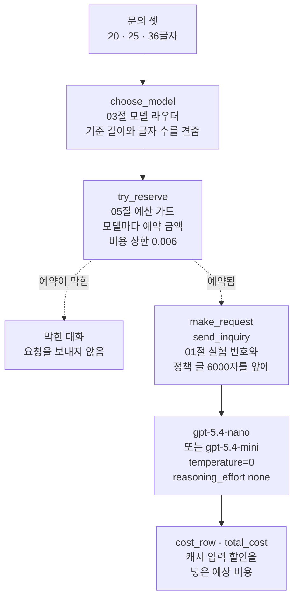
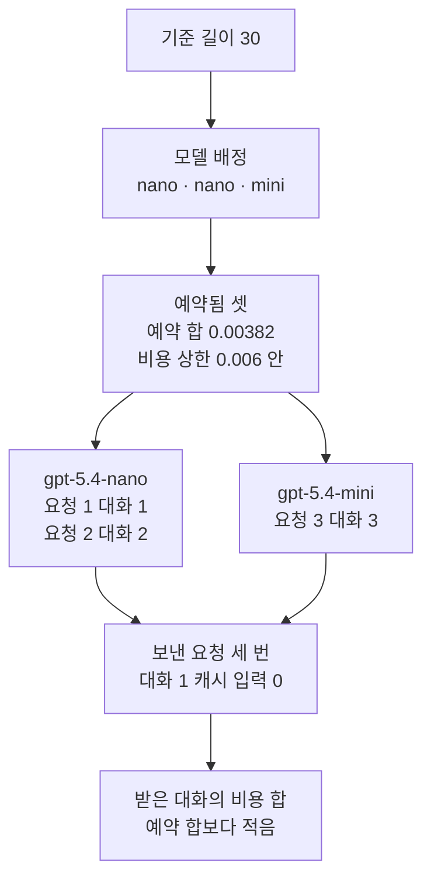
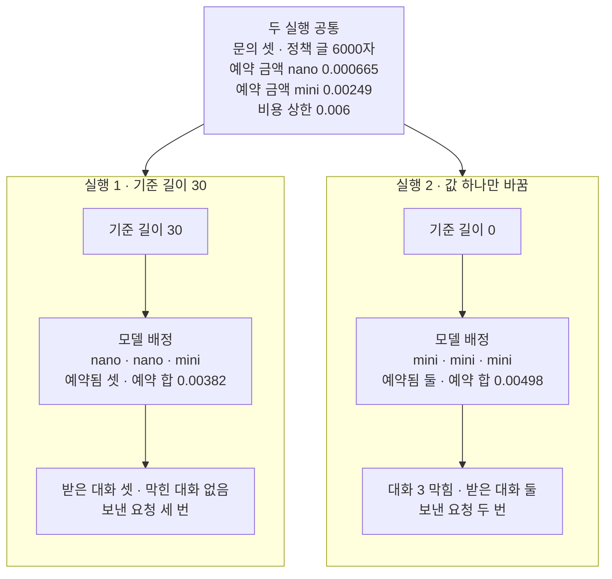

# 06-비용과-Rate-Limit-실습

## _src 본문 (HTML 원본)

```html
<!--meta: 실습 30분 | 코드 notebooks/06-비용과-Rate-Limit-실습.ipynb | 새 용어 0 -->
<style>html,body{overflow-x:hidden}.notebook,.nb-cell,.nb-main,.nb-input,.nb-result{min-width:0;max-width:100%}.nb-input pre,.nb-output{box-sizing:border-box;max-width:100%;overflow-x:auto}code.nb-source{display:block!important;width:100%!important;min-width:0!important;overflow-x:auto!important;padding:0!important}</style>
<h2 id="b1"><span class="no">1</span>학습 목표</h2><div class="goal"><ul>
<li>01절 공통 앞부분, 03절 모델 라우터, 05절 예산 가드를 문의 셋의 흐름 하나로 이어 실행할 수 있습니다.</li>
<li>기준 길이 하나만 바꾼 두 실행에서, 받은 대화와 보낸 요청의 수가 어떻게 달라지는지 출력으로 설명할 수 있습니다.</li>
<li>대화당 비용을 캐시 입력 할인을 넣어 세고, 싼 모델로 줄인 비용과 포기한 것을 함께 적을 수 있습니다.</li>
</ul></div>
<h2 id="b2"><span class="no">2</span>이 내용을 배우는 이유</h2><p>이 챕터에서는 비용을 줄이는 방법을 절마다 따로 익혔습니다. <a href="01-프롬프트-캐시-계측.html">01절</a>은 공통 앞부분 뒤에 바뀌는 글을 두어 캐시 입력 할인을 받았습니다. <a href="03-모델-라우팅.html">03절</a>은 문의 글의 글자 수로 싼 모델과 비싼 모델을 골랐습니다. <a href="05-예산-가드와-p95.html">05절</a>은 요청 전에 예약해, 비용 상한을 넘는 대화를 막았습니다.</p><p>실제 서비스에서는 이 일들이 문의 하나를 처리하는 동안 함께 일어납니다. 이번 실습은 세 기능을 책 가게 문의 셋의 흐름 하나로 이어 실행합니다. 기준 길이 하나만 바꿔 한 번 더 실행하고, 두 실행을 견줍니다. 과정표의 이 챕터 과제는 대화당 비용을 줄이고, 무엇을 포기했는지 함께 적는 것입니다.</p><p>03절에서도 기준 길이를 30에서 0으로 바꿨습니다. 이 절에서 새로 볼 것은 두 가지입니다. 같은 비용 상한에서 모두 mini로 보내면 대화 하나가 막히고, 막힌 대화는 요청을 보내지 않습니다. 01절에서 본 캐시 입력이, 모델 라우터가 고른 모델마다 따로 생기는지도 봅니다.</p><p>제목의 Rate Limit은 <a href="04-백오프-큐-동시성.html">04절</a>에서 본 요청 제한(rate limit)입니다. 이 실습은 요청 제한에 닿는 장면을 만들지 않고, 비용 쪽 기능을 한 흐름으로 잇습니다. 이번 절은 이 챕터의 실습입니다. 01~05절에서 쓴 이름과 Ch 2에서 배운 문법만 쓰고, 따로 내는 과제는 없습니다. 강사와 함께 노트북 셀을 차례로 실행합니다.</p><p><b>이 절의 질문</b> — 모델 라우터와 예산 가드를 함께 붙이면, 같은 비용 상한에서 받는 대화와 포기하는 것은 어떻게 달라질까요?</p>
<h2 id="b3"><span class="no">3</span>앞에서 배운 내용</h2><p>이번 실습은 아래 절에서 배운 이름을 그대로 씁니다. 앞 절 함수는 도구 파일 <code>cost_tools.py</code>에서 가져오고, 결과를 보는 함수 하나만 노트북에 새로 적습니다.</p>
<table><thead><tr><th>절</th><th>배운 것</th><th>실습에서 쓰는 곳</th></tr></thead><tbody><tr><td><a href="01-프롬프트-캐시-계측.html">01절</a></td><td>공통 앞부분·실험 번호·함수 <code>make_request</code> · 캐시 입력 할인과 함수 <code>cost_row</code>(할인을 넣은 값과 할인 없이 센 값)</td><td>정책 글 셀(01절 셀과 글자까지 같음), 실행마다 새 실험 번호, 요청 글 모양, 비용 표</td></tr><tr><td><a href="03-모델-라우팅.html">03절</a></td><td>모델 라우터 <code>choose_model</code>·기준 길이 30과 0·모델 배정·함수 <code>send_inquiry</code>·모델마다 요금표·정답 종류</td><td>두 모델 셀과 문의 셀(03절 셀과 글자까지 같음), 모델 배정, 보내기, 답 표</td></tr><tr><td><a href="05-예산-가드와-p95.html">05절</a></td><td>예산 가드(<code>make_budget</code>·<code>try_reserve</code>)·예약 금액·받은 대화·막힌 대화·함수 <code>make_usage</code>·<code>total_cost</code></td><td>모델마다 예약 금액, 대화마다 한 번 예약, 받은 대화의 비용 합</td></tr><tr><td><a href="../../part2/ch06-langchain-start/06-토큰-비용-지연-비교.html">Ch 6 06절</a></td><td>요금표와 함수 <code>estimate_cost</code> · 예상 비용은 청구 금액이 아님</td><td>예약 금액 셈, 대화당 비용 셈(함수 <code>cost_row</code> 안)</td></tr><tr><td><a href="../../part4/ch16-guardrails/04-호출-한도와-비용-상한.html">Ch 16 04절</a></td><td>호출 한도·비용 상한·예약·예산 · 함수 <code>make_budget</code>·<code>reserve</code> · 요청마다 예약</td><td>예산 딕셔너리, 함수 <code>try_reserve</code> 안의 <code>reserve</code></td></tr></tbody></table>
<p>붙인 기능은 01절 공통 앞부분과 캐시 입력 할인, 03절 모델 라우터, 05절 예산 가드 셋입니다. 셋 모두 실행 1·2 흐름에서 출력으로 보입니다. 03절에서 본 대로 모델 라우터는 모델 이름만 고르는 함수입니다. <a href="../../part6/ch26-delegation/03-Router-분류와-병렬-실행.html">Ch 26 03절</a>에서 요청을 분류해 전문 에이전트에게 보내던 라우터와는 다른 말입니다.</p><p><a href="02-Batch-API.html">02절</a>의 일괄 처리(Batch API)는 결과를 24시간 안에 받는 방법이라, 노트북 흐름 안에서 기다리지 않도록 뺐습니다. 04절의 다시 보내기와 한꺼번에 보내는 수는 요청이 실패하거나 여럿을 함께 보낼 때 드러납니다. 이 절의 요청 다섯은 차례로 하나씩 보내고, 제공자의 요청 제한에 일부러 닿게 할 수 없어 뺐습니다. 05절의 평균과 95 백분위수는 대화가 셋뿐이라 뜻을 갖기 어려워 쓰지 않았습니다.</p><p>이 절은 05절처럼 대화마다 한 번 예약합니다. Ch 16 04절은 요청마다 예약했습니다. 이 절은 대화 하나가 요청 한 번이라, 두 방식의 예약 수가 같습니다.</p>
<h2 id="b4"><span class="no">4</span>핵심 개념</h2><h3>비유로 시작하기</h3><p>충전대 하나를 모듈 셋으로 조립한다고 해 봅니다. 모듈마다 배터리를 꽂는 칸이 하나 있고, 모듈끼리는 걸쇠로 이어져 한 줄이 됩니다. 칸의 크기는 꽂을 배터리에 맞춥니다. 가벼운 일에는 작은 배터리를, 무거운 일에는 큰 배터리를 꽂습니다.</p><p>충전대가 한 번에 쓸 수 있는 전력은 정해져 있습니다. 그래서 배터리를 꽂기 전에 그 배터리의 몫을 먼저 떼어 두고, 몫이 모자라면 꽂지 않습니다. 몫을 떼어 둔 배터리만 칸에 꽂히고, 그 모듈 앞의 불이 켜집니다.</p><p>그림은 실행 1이 끝난 모습입니다. 작은 배터리 둘과 큰 배터리 하나가 꽂혀, 불 셋이 모두 켜져 있습니다.</p><p>배터리의 크기가 모델이고, 크기를 고르는 일이 모델 라우터입니다. 떼어 두는 몫이 예약 금액이고, 정해진 전력이 비용 상한입니다. 모듈 셋을 걸쇠로 이은 것이, 세 절의 기능을 한 흐름으로 이은 것입니다.</p><p>비유와 다른 점이 있습니다. 실제 요청은 정책 글을 앞에 붙여 보내고, 같은 앞부분의 둘째 요청은 캐시 입력 할인을 받을 수 있습니다. 그림에는 이 할인이 보이지 않습니다. 그림에 없는 실행 2라면, 큰 배터리 셋 가운데 둘만 꽂히는 셈입니다.</p>
{{img:06-4-모듈-셋을-이은-충전대|흰 바탕에 긴 충전대 하나가 화면을 가로지릅니다. 충전대는 네모 모듈 셋을 한 줄로 붙이고 은색 걸쇠 둘로 이은 것입니다. 모듈은 왼쪽부터 세이지 초록, 연보라, 복숭아색입니다. 왼쪽과 가운데 모듈의 윗면 칸에는 작은 크림색 배터리가 하나씩, 오른쪽 모듈의 큰 칸에는 큰 크림색 배터리 하나가 꽂혀 있습니다. 모듈 앞면마다 큰 둥근 초록 불이 하나씩 켜져 있습니다. 사람·글자·숫자·화살표·전선은 없는 그림|색이 다른 모듈 셋을 걸쇠로 이은 충전대에 작은 배터리 둘과 큰 배터리 하나가 꽂혀, 불 셋이 모두 켜져 있습니다.}}
<p class="look"><b>그림 읽기</b> — 색이 다른 모듈 셋이 은색 걸쇠 둘로 이어져, 충전대 하나가 되었습니다. 왼쪽과 가운데 모듈에는 작은 배터리가 하나씩, 오른쪽 모듈에는 큰 배터리가 하나 꽂혀 있습니다. 모듈 앞면의 초록 불은 셋 모두 켜져 있습니다. 작은 배터리 둘과 큰 배터리 하나는, 실행 1의 모델 배정 nano 둘·mini 하나와 같은 나뉨입니다. 배터리의 크기는 요금 값과 짝짓지 않습니다.</p>
<h3>실습 조립의 구성</h3><p>실습의 흐름은 대화 하나마다 네 단계입니다. 먼저 03절 함수 <code>choose_model</code>이 문의 글의 글자 수로 모델 이름을 고릅니다. 다음으로 05절 함수 <code>try_reserve</code>가 그 모델의 예약 금액을 예산에 예약해 봅니다. 예약이 되면 01절 함수 <code>make_request</code>가 실험 번호와 정책 글을 앞에 붙이고, 03절 함수 <code>send_inquiry</code>가 고른 모델로 보냅니다.</p><p>응답이 오면 01절 함수 <code>cost_row</code>가 캐시 입력 할인을 넣은 비용과 할인 없이 센 비용을 한 줄에 적습니다. 예약이 막힌 대화는 모델에 요청을 보내지 않습니다. 예산 칸은 예약 금액으로만 바뀌고, 응답의 실제 사용량으로 고치지 않습니다. 이 절에서 새로 배우는 말은 없습니다.</p>
{{mermaid:06-1-세-절의-기능을-이은-조립도|위에서 아래로 읽는 조립도입니다. 맨 위 초록 상자 문의 셋 20 25 36글자에서 파란 상자 choose_model 03절 모델 라우터 기준 길이와 글자 수를 견줌으로 갑니다. 이어서 파란 상자 try_reserve 05절 예산 가드 모델마다 예약 금액 비용 상한 0.006으로 갑니다. 여기서 점선 둘이 갈라져, 예약이 막힘은 왼쪽 회색 상자 막힌 대화 요청을 보내지 않음으로, 예약됨은 오른쪽 파란 상자 make_request send_inquiry 01절 실험 번호와 정책 글 6000자를 앞에로 갑니다. 그 아래 보라 상자 gpt-5.4-nano 또는 gpt-5.4-mini temperature=0 reasoning_effort none을 지나, 맨 아래 파란 상자 cost_row total_cost 캐시 입력 할인을 넣은 예상 비용에 이르는 그림|문의 하나마다 모델 라우터가 모델을 고르고, 예산 가드가 예약한 뒤에만 정책 글을 앞에 붙여 요청을 보냅니다.}}
<p class="look"><b>도식 읽기</b> — 위에서 아래로 읽습니다. 초록 상자는 셀에 적은 문의 셋이고, 파란 상자는 01·03·05절에서 배운 함수입니다. 점선 둘은 예산 가드의 두 갈래입니다. 왼쪽 회색 상자는 막힌 대화가 요청을 보내지 않는다는, 코드 차례로 정해지는 사실입니다. 보라 상자는 이 절에서 실제로 부른 두 모델이고, 맨 아래 상자에서 응답의 사용량으로 대화당 비용을 셉니다.</p>
<h2 id="b5"><span class="no">5</span>실행 예제</h2><p>노트북 1절은 패키지·도구 파일 함수·키와 두 모델을 준비합니다. 2절은 요금표·정책 글·문의 셋·답 형식 글과, 예약 금액·비용 상한을 정합니다. 3절은 기준 길이 30으로 모델 배정·예약·보내기를 하고, 답과 비용을 봅니다. 4절은 기준 길이만 0으로 바꿔 같은 일을 하고, 5절은 두 실행을 견줍니다.</p><p>모델 요청은 모두 다섯 번으로, nano에 두 번, mini에 세 번입니다. 요금표(2026-09-30 확인)로 어림한 비용은 다섯 번을 합쳐 약 0.006달러이고, 청구 금액이 아닙니다. 파일은 쓰지 않고, 걸린 시간은 재지 않았습니다.</p>
{{notebook:06-비용과-Rate-Limit-실습}}
<p class="look"><b>확인할 점</b> — 노트북 3절에서 <code>예약 결과: ['예약됨', '예약됨', '예약됨']</code>과 <code>보낸 요청 수: 3</code>을 찾습니다. 4절에서는 <code>예약 결과: ['예약됨', '예약됨', '비용 상한을 넘습니다.']</code>와 <code>보낸 요청 수: 2</code>를 봅니다. 답·토큰 수·비용은 교재 출력의 값이라, 여러분의 실행에서는 다를 수 있습니다.</p>
{{mermaid:06-2-실행-1의-실제-차례|위에서 아래로 읽는 흐름도입니다. 맨 위 초록 상자 기준 길이 30에서 노란 상자 모델 배정 nano nano mini, 노란 상자 예약됨 셋 예약 합 0.00382 비용 상한 0.006 안으로 이어집니다. 여기서 두 갈래로 나뉘어 왼쪽 보라 상자 gpt-5.4-nano 요청 1 대화 1 요청 2 대화 2와 오른쪽 보라 상자 gpt-5.4-mini 요청 3 대화 3으로 가고, 두 상자는 노란 상자 보낸 요청 세 번 대화 1 캐시 입력 0으로 모입니다. 맨 아래 노란 상자는 받은 대화의 비용 합 예약 합보다 적음인 그림|기준 길이 30에서는 문의 셋이 모두 예약되어 nano에 두 번, mini에 한 번 요청이 나갔습니다.}}
<p class="look"><b>도식 읽기</b> — 위에서 아래로 읽습니다. 초록 상자는 실행 1에서 셀에 적은 기준 길이이고, 노란 상자는 노트북 3절에서 출력으로 확인한 값입니다. 보라 상자 둘은 실제로 부른 두 모델과, 그 모델로 보낸 요청의 차례입니다. 맨 아래 노란 상자는 흔들림 확인 다섯 번과 새 커널 두 번에서 모두 같았던 부등식입니다. 대화 2의 캐시 입력은 실행에 따라 달라, 그림에 넣지 않았습니다.</p>
<h2 id="b6"><span class="no">6</span>실험 결과 해석</h2><p>가설은 예약 금액과 비용 상한으로 세웠습니다. 기준 길이 30이면 예약 합 0.00382달러로 셋을 모두 받을 것이라고 보았습니다. 기준 길이 0이면 mini 셋의 예약 합 0.00747달러가 상한 0.006달러를 넘을 것이라고 보았습니다. 실험은 같은 문의 글·정책 글·예약 금액·비용 상한으로, 기준 길이 하나만 바꿔 두 번 했습니다.</p>
{{mermaid:06-3-기준-길이만-바꾼-두-실행|맨 위 회색 상자 두 실행 공통 문의 셋 정책 글 6000자 예약 금액 nano 0.000665 예약 금액 mini 0.00249 비용 상한 0.006 아래에 칸 둘이 나란히 있습니다. 왼쪽 칸 실행 1 기준 길이 30에는 초록 상자 기준 길이 30에서 노란 상자 모델 배정 nano nano mini 예약됨 셋 예약 합 0.00382, 노란 상자 받은 대화 셋 막힌 대화 없음 보낸 요청 세 번으로 이어집니다. 오른쪽 칸 실행 2 값 하나만 바꿈에는 파란 상자 기준 길이 0에서 노란 상자 모델 배정 mini mini mini 예약됨 둘 예약 합 0.00498, 노란 상자 대화 3 막힘 받은 대화 둘 보낸 요청 두 번으로 이어지는 그림|기준 길이를 0으로 내리자 mini 셋의 예약이 비용 상한을 넘어, 대화 3이 막히고 요청은 두 번만 나갔습니다.}}
<p class="look"><b>도식 읽기</b> — 맨 위 회색 상자는 두 실행에 공통인 값입니다. 왼쪽 칸이 실행 1, 오른쪽 칸이 실행 2이고, 칸마다 위가 기준 길이, 아래가 노트북 3·4절의 출력입니다. 오른쪽 칸의 파란 상자가 바꾼 값입니다. 노란 상자의 값은 코드와 정한 값으로 정해져, 흔들림 확인 다섯 번과 새 커널 두 번에서 모두 같았습니다.</p>
<table><thead><tr><th>견준 것</th><th>실행 1 — 기준 길이 30</th><th>실행 2 — 기준 길이 0</th></tr></thead><tbody><tr><td>바꾼 값 — 기준 길이</td><td><code>30</code></td><td><code>0</code></td></tr><tr><td>모델 배정</td><td>nano · nano · mini</td><td>mini · mini · mini</td></tr><tr><td>예약 결과</td><td>셋 모두 <code>예약됨</code></td><td><code>예약됨</code> · <code>예약됨</code> · <code>비용 상한을 넘습니다.</code></td></tr><tr><td>예약한 금액의 합(달러)</td><td><code>0.00382</code></td><td><code>0.00498</code></td></tr><tr><td>받은 대화 · 막힌 대화 · 보낸 요청</td><td><code>3</code> · <code>0</code> · <code>3</code></td><td><code>2</code> · <code>1</code> · <code>2</code></td></tr><tr><td>대화 1의 캐시 입력</td><td>0(새 실험 번호 뒤 첫 요청)</td><td>0(새 실험 번호 뒤 첫 요청)</td></tr><tr><td>대화 2의 캐시 입력</td><td>교재 출력 <code>2816</code> · 새 커널 둘째 실행 0(흔들림 확인 다섯 번은 0보다 큼)</td><td>0보다 큼(흔들림 확인 다섯 번과 새 커널 두 번)</td></tr><tr><td>답이 정답 종류와 같은가(흔들림 확인 다섯 번과 새 커널 두 번)</td><td>세 답 모두 같음</td><td>두 답 모두 같음</td></tr><tr><td>받은 대화의 대화당 비용 합(교재 출력, 실행마다 다를 수 있음)</td><td><code>0.003169</code>달러</td><td><code>0.00289</code>달러</td></tr><tr><td>포기한 것</td><td>대화 1·2의 mini 답</td><td>대화 3의 답</td></tr></tbody></table>
<p>기준 길이를 0으로 내리자, nano로 가던 대화 1·2가 mini로 갔습니다. 예약 금액이 0.000665달러에서 0.00249달러로 커져, 같은 비용 상한에서 대화 3의 예약이 막혔습니다. 막힌 대화 3은 모델에 요청을 보내지 않아, 보낸 요청이 셋에서 둘로 줄었습니다. 모델 배정·예약 결과·요청 수는 코드와 정한 값으로 정해져, 실행할 때마다 같습니다.</p><p>아래 다섯 가지는 흔들림 확인 다섯 번과 새 커널 두 번에서 모두 같았습니다. 다섯 답이 정답 종류와 같았고, 실행 2의 대화 2(mini 둘째 요청)에는 캐시 입력이 생겼습니다. 두 실행 모두 첫 요청인 대화 1은, nano로 보낸 실행 1의 대화당 비용이 더 적었습니다. 두 실행 모두 받은 대화의 비용 합이 예약한 금액의 합보다 적었습니다. 실행 1에서 nano 다음에 mini로 보낸 대화 3은, 같은 정책 글 뒤인데도 캐시 입력이 0이었습니다.</p><p>실행 1 대화 2(nano 둘째 요청)의 캐시 입력은 실행에 따라 달랐습니다. 그래서 대화 2의 비용 비교는 결론에 넣지 않고, 위 표와 주의할 점에만 적었습니다.</p><p>과제 모양으로 적으면, 실행 1은 대화 1을 nano로 보내 대화당 비용을 줄였습니다. 그 대신 대화 1·2의 mini 답을 포기했습니다. 이번 문의 셋에서는 nano의 답도 정답 종류와 같았습니다. 실행 2는 모든 대화를 mini로 보내, 같은 비용 상한에서 대화 3을 받지 못했습니다.</p><p>새 커널로 두 번 실행해 견주자, 코드 셀 스물여섯 가운데 스물의 출력 글이 셀마다 같았습니다. 한 번은 프로젝트 맨 위에서, 한 번은 <code>notebooks/</code> 폴더에서 연 커널이었습니다. 다른 여섯은 모델 응답의 토큰 수와 그 값으로 센 비용이 든 셀입니다. 둘째 실행에서는 실행 1 대화 2에 캐시 입력이 생기지 않아, 5절 둘째 셀 대화 2의 칸도 달랐습니다. 모델 배정·예약 결과·보낸 요청 수와 다섯 답의 정답 여부는 두 번 모두 같았습니다.</p>
<p class="look"><b>확인할 점</b> — 5절 첫 셀의 두 줄에서 받은 대화 <code>3</code>과 <code>2</code>, 막힌 대화 <code>0</code>과 <code>1</code>을 견줍니다. 5절 둘째 셀에서는 대화 1의 마지막 칸 <code>True</code>를 봅니다. 대화 2의 칸과 비용 합, 토큰 수는 실행마다 달라질 수 있는 값입니다.</p>
<h2 id="b7"><span class="no">7</span>주의할 점과 실무 메모</h2><ul><li>정한 사용량(입력 3,200토큰·캐시 입력 0·출력 20토큰)과 비용 상한 0.006달러는 실행 전에 이 절에서 정한 값입니다. 입력 3,200토큰은 01절 교재 출력의 입력 토큰 수 3,166·3,170보다 조금 크게 잡았습니다. 비용 상한은 nano 둘·mini 하나의 예약 합은 들어가고, mini 셋의 예약 합은 넘도록 고른 흐름을 보여 주는 예입니다. 문의 글·정답 종류·답 형식 글은 03절, 정책 글은 01절 셀에서 가져왔습니다.</li><li>교재를 만들 때 노트북 밖에서 같은 요청 다섯을 다섯 번 보냈습니다. 다섯 번 모두 모델 배정·예약 결과·요청 수가 같았고, 다섯 답도 모두 정답 종류와 같았습니다. 두 실행의 대화 2에도 다섯 번 모두 캐시 입력이 생겼습니다. 그런데 교재 출력을 만든 뒤 새 커널로 한 번 더 실행하자, 실행 1 대화 2의 캐시 입력은 0이었습니다. 같은 요청도 실행한 때에 따라 캐시 입력과 답이 달라질 수 있습니다.</li><li>공식 안내는 같은 앞부분을 가진 기계에 요청이 닿았을 때만 캐시 입력이 생긴다고 적습니다. 조직이 다르면 나누어 쓰지 않고, 쉬는 시간이 5~10분쯤 지나면 지워질 수 있다고도 적습니다. 새 커널 둘째 실행의 대화 2는 첫 요청 바로 뒤에 보냈는데도 캐시 입력이 없었습니다. 그 까닭은 서비스 안쪽 일이라 확인하지 못했습니다. 여러분의 출력에서도 대화 2에 캐시 입력이 없을 수 있습니다.</li><li>새 커널 둘째 실행의 대화 2는 실행 1(nano, 캐시 입력 없음)이 0.00064달러였습니다. 실행 2(mini, 캐시 입력 있음)는 0.000499달러로, 실행 2 쪽이 더 쌌습니다. 캐시 입력이 있는 mini 요청이 캐시 입력이 없는 nano 요청보다 쌀 수 있기 때문입니다. 그래서 대화 2의 비용 비교는 결론에 넣지 않았습니다.</li><li>예약 금액은 캐시 입력 할인 없이 넉넉히 어림했습니다. 그래서 캐시 입력이 생긴 대화는 예약 금액보다 훨씬 적게 들었습니다. 05절과 Ch 16 04절처럼, 대화를 마친 뒤 응답의 사용량으로 예산 칸을 고치는 일은 하지 않았습니다.</li><li>예약은 앱이 세는 단위입니다. 04절처럼 오류가 나면 SDK가 요청을 다시 보낼 수 있어, 제공자가 받은 요청 수는 예약 수보다 많아질 수 있습니다. 이 절은 설치판의 다시 보내기(오류 때 2번)를 켜 둔 채 실행했고, 교재 출력에서는 다섯 요청이 모두 답을 받았습니다.</li><li>모델 라우터는 글자 수만 봅니다. 짧아도 판단이 까다로운 문의가 있어, nano로 보낸 문의의 답은 따로 확인해야 합니다. 이 절의 문의 셋에서 nano의 답이 맞았다고, 다른 문의에서도 맞는다고 할 수는 없습니다.</li><li>제공자도 프로젝트마다 월 지출 한도를 둘 수 있습니다. 공식 안내는 알림만 보내는 설정과 요청을 막는 설정이 있다고 적습니다. 이 설정은 프로젝트 설정 화면의 기능이고, 노트북에서 실행하지 않았습니다.</li><li>02절에서 문서로 본 일괄 처리의 할인 50%는 이 절 셈에 넣지 않았습니다. 이 절에서는 일괄 작업을 만들지 않았습니다.</li><li>교재 출력은 Linux의 Python 3.12.13으로 만들었습니다. 다른 버전과 Windows·macOS에서는 실행하지 않았습니다.</li></ul>
<h2 id="b8"><span class="no">8</span>정리와 다음 절</h2><ul><li>모델 라우터가 고른 모델의 예약 금액을 요청 전에 예약하면, 비용 상한에 걸린 대화는 요청을 보내지 않습니다.</li><li>같은 비용 상한에서 기준 길이 30은 문의 셋을 모두 받았고, 0은 mini 셋의 예약이 상한을 넘어 둘만 받았습니다.</li><li>정책 글을 앞에 둔 요청은 캐시 입력 할인을 넣어 비용을 세고, 싼 모델의 답이 정답 종류와 같은지도 함께 적습니다.</li></ul><p><strong>다음 학습과 이어지는 지점</strong> — 이 절로 Ch 34와 Part 7이 끝납니다. 과정표의 다음 차례는 Part 8 Ch 35 「0단계 — 무지침」입니다. 이 교재에는 Part 8이 아직 없고, 과정표는 그 세부를 개강 전에 정한다고 적습니다. 이 절은 파일을 쓰지 않아, 다음 챕터로 넘기는 파일도 없습니다.</p>
<h2 id="b9"><span class="no">9</span>복습 문제</h2><details class="quiz" open><summary>문제 5개 · 해설 포함</summary><p class="quiz-q">1. 실행 1에서 대화 셋의 예약 금액을 모두 더하면 얼마이고, 비용 상한 안에 드나요?</p><p class="quiz-a">0.000665 + 0.000665 + 0.00249 = 0.00382달러입니다. 비용 상한 0.006달러 안이라, 셋 모두 예약되었습니다. 틀렸다면 노트북 2절의 예약 금액 셀과 3절의 예약 셀을 다시 읽습니다.</p><p class="quiz-q">2. 실행 2에서 대화 3이 막힌 까닭은 무엇이고, 막힌 뒤 모델에 요청이 나갔나요?</p><p class="quiz-a">예약 금액 0.00249달러를 세 번 예약하면 0.00747달러라, 비용 상한 0.006달러를 넘기 때문입니다. 예약이 요청보다 먼저라, 대화 3은 요청을 보내지 않았고 보낸 요청 수는 2였습니다. 틀렸다면 노트북 4절을 다시 읽습니다.</p><p class="quiz-q">3. 두 실행 모두 대화 1의 캐시 입력 토큰 수가 0인 까닭은 무엇인가요?</p><p class="quiz-a">실행마다 새 실험 번호를 요청 글 맨 앞에 두어, 앞 요청과 첫 글자부터 맞는 앞부분이 거의 없기 때문입니다. 01절의 첫 요청과 같은 자리입니다. 틀렸다면 노트북 3절의 실험 번호 셀을 다시 읽습니다.</p><p class="quiz-q">4. 받은 대화의 비용 합이 예약한 금액의 합보다 적었던 까닭은 무엇인가요?</p><p class="quiz-a">예약 금액은 입력 3,200토큰·캐시 입력 0·출력 20토큰으로, 할인 없이 넉넉히 어림했습니다. 흔들림 확인 다섯 번과 새 커널 두 번에서 모두, 실제 입력 토큰 수는 3,200보다 적었습니다. 흔들림 확인 다섯 번에서는 출력 토큰 수도 20보다 적었습니다. 캐시 입력이 생긴 대화는 할인까지 받아 더 적게 들었습니다. 틀렸다면 노트북 2절의 예약 금액 셀과 3절의 비용 셀을 다시 읽습니다.</p><p class="quiz-q">5. 이 실습에서 비용을 줄인 대신 포기한 것은 무엇이고, 무엇으로 확인했나요?</p><p class="quiz-a">실행 1은 대화 1·2를 nano로 보내 mini의 답을 포기했고, 그 답이 정답 종류와 같은지로 확인했습니다. 실행 2는 모든 대화를 mini로 보내, 같은 비용 상한에서 대화 3을 받지 못했습니다. 틀렸다면 노트북 5절을 다시 읽습니다.</p></details>
<h2 id="b10"><span class="no">10</span>참고 자료</h2><ul><li><div><a href="https://developers.openai.com/api/docs/models/gpt-5.4-nano">OpenAI GPT-5.4 nano</a></div>확인 2026-09-30 · 100만 토큰당 입력 0.20달러, 캐시 입력 0.02달러, 출력 1.25달러입니다. 날짜판 이름은 <code>gpt-5.4-nano-2026-03-17</code>이고, 03절에서 2026-09-29에 확인한 요금표와 같습니다.</li><li><div><a href="https://developers.openai.com/api/docs/models/gpt-5.4-mini">OpenAI GPT-5.4 mini</a></div>확인 2026-09-30 · 100만 토큰당 입력 0.75달러, 캐시 입력 0.075달러, 출력 4.50달러입니다. 날짜판 이름은 <code>gpt-5.4-mini-2026-03-17</code>이고, 01·05절의 요금표와 같습니다.</li><li><div><a href="https://developers.openai.com/api/docs/guides/prompt-caching">OpenAI Prompt caching</a></div>확인 2026-09-30 · GPT-5.6 앞 모델은 캐시 입력 토큰 수를 128의 배수로 내려 보고한다고 적습니다. 같은 앞부분을 가진 기계에 요청이 닿아야 다시 쓸 수 있고, 조직 사이에는 나누지 않는다고 적습니다. 메모리에 둔 앞부분은 보통 쉬는 시간 5~10분쯤 남는다고 적습니다.</li><li><div><a href="https://developers.openai.com/api/docs/guides/spend-limits">OpenAI Spend limits</a></div>확인 2026-09-30 · 조직과 프로젝트마다 월 지출 한도를 두는 방법을 설명합니다. 알림은 요청을 막지 않고, 막는 한도에 닿은 요청은 429를 받는다고 적습니다.</li><li>도구 파일 함수의 출처 · 확인 2026-09-30 · 함수 <code>make_request</code>·<code>cost_row</code>는 01절, <code>choose_model</code>·<code>send_inquiry</code>는 03절 노트북 셀에서 옮겼습니다. 함수 <code>make_usage</code>·<code>total_cost</code>·<code>try_reserve</code>는 05절 노트북 셀에서 옮겼습니다. 설명 줄과 본문은 셀과 글자까지 같습니다.</li></ul>
```

## 노트북 셀 (순서대로)

### [0] markdown {'html': 'skip'}

# 비용과 Rate Limit 실습: 문의 셋을 모델 라우터와 예산 가드로 보내고 기준 길이 바꾸기

**이 노트북에서 할 일**

1. 01·03·05절에서 쓴 기능을 책 가게 문의 셋의 흐름 하나로 잇습니다.
2. 기준 길이 30으로 문의 셋을 예약하고 보내, 답과 대화당 비용을 봅니다.
3. 기준 길이 하나만 0으로 바꿔 다시 실행하고, 받은 대화와 포기한 것을 견줍니다.

**준비물** — 이 노트북은 실제 모델에 요청을 다섯 번 보냅니다.
실행 1에서 세 번, 실행 2에서 두 번입니다.
모델별로는 `gpt-5.4-nano`에 두 번, `gpt-5.4-mini`에 세 번입니다.
프로젝트 폴더의 `.env` 파일에 `OPENAI_API_KEY`가 있어야 합니다.
키가 없으면 키를 확인하는 셀에서 멈추고, 모델 요청은 나가지 않습니다.

요청마다 6,000자 정책 글을 앞에 붙여 보내, 요청 하나가 약 3,200토큰입니다.
요금표(2026-09-30 확인)로 어림한 비용은 다섯 번을 합쳐 약 0.006달러입니다.
청구 금액이 아니라, 교재를 만들 때 본 사용량으로 어림한 값입니다.
실행마다 답 글과 토큰 수가 달라질 수 있습니다.
교재를 만들 때 같은 요청 다섯을 노트북 밖에서 다섯 번 더 보내 보았고, 이를 흔들림 확인이라고 부릅니다.

실습 폴더의 도구 파일 `cost_tools.py`에서 함수 아홉을 가져옵니다.
이 노트북은 파일을 쓰지 않습니다.
걸린 시간은 재지 않았습니다.

**기준 버전** — 첫 셀에서 패키지 셋을 설치합니다.
버전은 langchain 1.4.0, langchain-openai 1.6.0, python-dotenv 1.2.3입니다.
셋 모두 실습 폴더 잠금과 같은 버전입니다.
교재 출력은 Linux의 Python 3.12.13으로 만들었습니다.
다른 버전과 Windows·macOS에서는 실행하지 않았습니다.

**실습 범위** — 이 절은 이 챕터 끝의 실습 절입니다.
강사와 함께 첫 셀부터 차례로 실행하고, 따로 내는 과제는 없습니다.
실습 시간 30분 안팎에 맞춘 분량입니다.

실습 폴더 `labs/part7/ch34-cost-rate-limits`에서 `uv sync --locked`를 실행합니다.
그다음 `notebooks/` 폴더의 이 노트북을 열고, 실습 폴더의 `.venv` 커널을 고릅니다.
첫 셀부터 순서대로 실행합니다.

### [1] markdown {'html': 'skip'}

## 오늘 볼 그림


위에서 아래로 읽습니다.
초록 상자는 셀에 적은 문의 셋이고, 파란 상자는 01·03·05절에서 배운 함수입니다.
점선 둘은 예산 가드의 두 갈래입니다.
왼쪽 회색 상자는 막힌 대화가 요청을 보내지 않는다는, 코드 차례로 정해지는 사실입니다.
보라 상자는 이 절에서 실제로 부른 두 모델이고, 맨 아래 상자에서 응답의 사용량으로 대화당 비용을 셉니다.

### [2] markdown {}

## 1. 준비

이 절은 이 챕터의 실습 절입니다.
01·03·05절에서 쓴 기능을 책 가게 문의 셋의 흐름 하나로 이어 실행합니다.
새 문법과 새 라이브러리 함수는 넣지 않고, 결과를 보는 함수 하나만 이 절에서 만듭니다.

제목의 Rate Limit은 04절에서 본 요청 제한(rate limit)입니다.
이 실습은 요청 제한에 닿는 장면을 만들지 않고, 비용 쪽 기능을 한 흐름으로 잇습니다.

첫 셀은 패키지 셋을 설치하고 설치된 버전을 출력합니다.
설치에는 몇십 초가 걸릴 수 있습니다.

### [3] code {'execution': {'iopub.execute_input': '2026-09-30T02:36:38.828676Z', 'iopub.status.busy': '2026-09-30T02:36:38.828507Z', 'iopub.status.idle': '2026-09-30T02:36:39.573378Z', 'shell.execute_reply': '2026-09-30T02:36:39.572799Z'}, 'lesson_role': 'setup'}

```python
# 이 절에서 쓰는 패키지를 설치하고 버전을 확인합니다
%pip install -q "langchain==1.4.0" "langchain-openai==1.6.0" "python-dotenv==1.2.3"
from importlib.metadata import version

print("langchain:", version("langchain"))
print("langchain-openai:", version("langchain-openai"))
print("python-dotenv:", version("python-dotenv"))
```

출력:
```
Note: you may need to restart the kernel to use updated packages.
langchain: 1.4.0
langchain-openai: 1.6.0
python-dotenv: 1.2.3

```

### [4] markdown {}

**결과 읽기** — 출력 줄 `langchain: 1.4.0`과 `langchain-openai: 1.6.0`이 보입니다.
세 패키지 모두 01·03절과 같은 버전입니다.

다음 셀은 이 절에서 쓸 이름을 가져옵니다.
모듈 `uuid`는 01절에서 실험 번호를 만들 때 쓴 모듈입니다.
앞에서 배운 함수 아홉은 도구 파일 `cost_tools.py`에서 가져옵니다.

### [5] code {'execution': {'iopub.execute_input': '2026-09-30T02:36:39.574575Z', 'iopub.status.busy': '2026-09-30T02:36:39.574476Z', 'iopub.status.idle': '2026-09-30T02:36:39.966790Z', 'shell.execute_reply': '2026-09-30T02:36:39.966434Z'}, 'lesson_role': 'setup'}

```python
# 실험 번호를 만들 모듈 uuid와 모델 객체를 만들 함수, 도구 파일의 함수 아홉을 가져옵니다
import uuid
from langchain.chat_models import init_chat_model
# 01·03·05절과 Ch 6 06절·Ch 16 04절에서 배운 함수는 도구 파일에서 가져옵니다(이름의 알파벳 차례)
from cost_tools import choose_model, cost_row, estimate_cost, make_budget, make_request
from cost_tools import make_usage, send_inquiry, total_cost, try_reserve

print("가져온 이름:", "uuid, init_chat_model")
print("도구 파일에서 가져온 함수:", choose_model.__name__, cost_row.__name__, estimate_cost.__name__)
print("도구 파일에서 가져온 함수:", make_budget.__name__, make_request.__name__, make_usage.__name__)
print("도구 파일에서 가져온 함수:", send_inquiry.__name__, total_cost.__name__, try_reserve.__name__)
```

출력:
```
가져온 이름: uuid, init_chat_model
도구 파일에서 가져온 함수: choose_model cost_row estimate_cost
도구 파일에서 가져온 함수: make_budget make_request make_usage
도구 파일에서 가져온 함수: send_inquiry total_cost try_reserve

```

### [6] markdown {}

**결과 읽기** — 출력 줄 `가져온 이름: uuid, init_chat_model`이 보입니다.
라벨 `도구 파일에서 가져온 함수:` 뒤에 함수 아홉이 세 줄로 나뉘어 보입니다.

함수 `make_request`·`cost_row`는 01절, `choose_model`·`send_inquiry`는 03절에서 배웠습니다.
함수 `make_usage`·`total_cost`·`try_reserve`는 05절에서 배웠습니다.
이 일곱 함수는 이 절에서 도구 파일에 옮겼고, 설명 줄과 본문은 앞 절 셀과 글자까지 같습니다.
나머지 둘 가운데 `estimate_cost`는 Ch 6 06절, `make_budget`은 Ch 16 04절에서 배웠습니다.

앞에서 배운 함수는 `cost_tools.py`에 모아 두었습니다.
파일을 열면 코드를 볼 수 있습니다.
노트북과 같은 폴더(`notebooks/`)에 있는 파일입니다.
커널이 `notebooks/` 폴더에서 시작해야 이 파일을 가져올 수 있습니다.
교재 출력을 만든 실행 도구는 이 폴더를 따로 알려 주어, 다른 자리에서 시작해도 가져오기가 되었습니다.

다음 셀은 `.env` 파일에서 API 키를 읽고, 키가 있는지만 출력합니다.

### [7] code {'execution': {'iopub.execute_input': '2026-09-30T02:36:39.967588Z', 'iopub.status.busy': '2026-09-30T02:36:39.967531Z', 'iopub.status.idle': '2026-09-30T02:36:39.972880Z', 'shell.execute_reply': '2026-09-30T02:36:39.972552Z'}, 'lesson_role': 'setup'}

```python
# .env 파일에서 OpenAI API 키를 읽습니다(키 값은 출력하지 않습니다)
import os
from dotenv import find_dotenv, load_dotenv

env_path = find_dotenv(usecwd=True)
load_dotenv(env_path)
has_key = os.getenv("OPENAI_API_KEY") is not None
print("OPENAI_API_KEY 설정 여부:", has_key)
assert has_key, "프로젝트 폴더의 .env 파일에 OPENAI_API_KEY를 적어 주세요."
```

출력:
```
OPENAI_API_KEY 설정 여부: True

```

### [8] markdown {}

**결과 읽기** — 출력 줄 `OPENAI_API_KEY 설정 여부: True`가 보입니다.
키 값은 출력하지 않고, 있는지만 봅니다.
키가 없으면 이 셀의 `assert`가 멈추고, 뒤 셀의 모델 요청도 나가지 않습니다.

다음 두 셀은 03절과 같은 두 모델을 과정 표준 설정으로 준비합니다.
먼저 작은 모델 `gpt-5.4-nano`입니다.
객체를 만들 때는 모델 요청이 나가지 않습니다.

### [9] code {'execution': {'iopub.execute_input': '2026-09-30T02:36:39.973442Z', 'iopub.status.busy': '2026-09-30T02:36:39.973389Z', 'iopub.status.idle': '2026-09-30T02:36:41.026891Z', 'shell.execute_reply': '2026-09-30T02:36:41.026475Z'}}

```python
# 작은 모델 gpt-5.4-nano를 과정 표준 설정으로 준비합니다(요청은 나가지 않습니다)
nano_model = init_chat_model(
    "openai:gpt-5.4-nano",
    temperature=0,
    reasoning_effort="none",
)
print("모델 이름:", nano_model.model_name)
print("temperature:", nano_model.temperature)
```

출력:
```
모델 이름: gpt-5.4-nano
temperature: 0.0

```

### [10] markdown {}

**결과 읽기** — 모델 이름 `gpt-5.4-nano`, temperature `0.0`이 보입니다.
03절 노트북의 셀과 글자까지 같은 셀입니다.

다음 셀은 과정 표준 모델 `gpt-5.4-mini`를 같은 설정으로 준비합니다.

### [11] code {'execution': {'iopub.execute_input': '2026-09-30T02:36:41.027659Z', 'iopub.status.busy': '2026-09-30T02:36:41.027606Z', 'iopub.status.idle': '2026-09-30T02:36:41.029877Z', 'shell.execute_reply': '2026-09-30T02:36:41.029521Z'}}

```python
# 과정 표준 모델 gpt-5.4-mini를 같은 설정으로 준비합니다(요청은 나가지 않습니다)
mini_model = init_chat_model(
    "openai:gpt-5.4-mini",
    temperature=0,
    reasoning_effort="none",
)
print("모델 이름:", mini_model.model_name)
print("temperature:", mini_model.temperature)
```

출력:
```
모델 이름: gpt-5.4-mini
temperature: 0.0

```

### [12] markdown {}

**결과 읽기** — 모델 이름 `gpt-5.4-mini`, temperature `0.0`이 보이면 준비가 끝났습니다.
이 노트북의 출력은 2026-09-30에 이 두 모델로 실행한 결과입니다.
온도 값을 0으로 두어도 모델의 답이 매번 같다고 할 수는 없습니다.
인자 `reasoning_effort="none"`은 모델이 답하기 전에 따로 생각하는 단계를 쓰지 않게 합니다.

## 2. 오늘의 상황과 재료

책 가게 상담 서비스에 문의 셋이 차례로 옵니다.
문의마다 긴 정책 글을 앞에 붙여, 모델에 문의의 종류를 묻습니다.
이 절에서는 문의 하나를 대화 하나로 보고, 대화마다 요청을 한 번 보냅니다.
목표는 대화당 비용을 줄이는 것이고, 그 대신 무엇을 포기했는지도 함께 적습니다.

흐름은 네 단계입니다.
03절 모델 라우터가 보낼 모델을 고르고, 05절 예산 가드가 요청 전에 예약합니다.
예약된 대화만 01절처럼 실험 번호와 정책 글을 앞에 붙여 보냅니다.
끝으로 응답의 사용량으로 캐시 입력 할인을 넣은 예상 비용을 셉니다.

다음 셀은 03절과 같은 셀로, 모델 이름과 모델 객체를 딕셔너리에 담습니다.
모델 라우터가 고른 이름으로 모델 객체를 찾을 때 씁니다.

### [13] code {'execution': {'iopub.execute_input': '2026-09-30T02:36:41.030488Z', 'iopub.status.busy': '2026-09-30T02:36:41.030437Z', 'iopub.status.idle': '2026-09-30T02:36:41.032091Z', 'shell.execute_reply': '2026-09-30T02:36:41.031846Z'}}

```python
# 모델 라우터가 고른 이름으로 모델 객체를 찾을 수 있게, 이름과 객체를 딕셔너리에 담습니다
models = {"gpt-5.4-nano": nano_model, "gpt-5.4-mini": mini_model}
print("고를 수 있는 모델:", list(models))
```

출력:
```
고를 수 있는 모델: ['gpt-5.4-nano', 'gpt-5.4-mini']

```

### [14] markdown {}

**결과 읽기** — 출력 줄 `고를 수 있는 모델: ['gpt-5.4-nano', 'gpt-5.4-mini']`가 보입니다.
키는 모델 라우터가 내놓는 이름이고, 값은 1절에서 만든 모델 객체입니다.

다음 셀은 두 모델의 요금표를 적습니다.
값은 03절 셀과 같고, 확인한 날짜만 이 절에서 다시 본 날로 적었습니다.

### [15] code {'execution': {'iopub.execute_input': '2026-09-30T02:36:41.032722Z', 'iopub.status.busy': '2026-09-30T02:36:41.032678Z', 'iopub.status.idle': '2026-09-30T02:36:41.034794Z', 'shell.execute_reply': '2026-09-30T02:36:41.034358Z'}}

```python
# 두 모델의 공식 요금(100만 토큰당 달러)과 확인한 날짜를 적고, 모델 이름으로 찾게 모읍니다
pricing_date = "2026-09-30"
nano_prices = {"ordinary_input": 0.20, "cached_input": 0.02, "output": 1.25}
mini_prices = {"ordinary_input": 0.75, "cached_input": 0.075, "output": 4.50}
price_tables = {"gpt-5.4-nano": nano_prices, "gpt-5.4-mini": mini_prices}
print("요금 확인 날짜:", pricing_date)
print("nano 요금:", nano_prices)
print("mini 요금:", mini_prices)
```

출력:
```
요금 확인 날짜: 2026-09-30
nano 요금: {'ordinary_input': 0.2, 'cached_input': 0.02, 'output': 1.25}
mini 요금: {'ordinary_input': 0.75, 'cached_input': 0.075, 'output': 4.5}

```

### [16] markdown {}

**결과 읽기** — 출력 줄 `요금 확인 날짜: 2026-09-30`이 보입니다.
단위는 100만 토큰당 달러이고, 세 값 모두 nano가 mini보다 작습니다.
두 모델 모두 캐시 입력 요금이 일반 입력 요금의 10분의 1입니다.

다음 셀은 01절과 같은 셀로, 요청마다 똑같이 보낼 긴 정책 글을 만듭니다.
여러 요청이 첫 글자부터 똑같이 보내는 부분을 01절에서는 공통 앞부분이라고 불렀습니다.
이 절에서는 실험 번호와 정책 글이 공통 앞부분이 됩니다.

### [17] code {'execution': {'iopub.execute_input': '2026-09-30T02:36:41.035399Z', 'iopub.status.busy': '2026-09-30T02:36:41.035352Z', 'iopub.status.idle': '2026-09-30T02:36:41.037103Z', 'shell.execute_reply': '2026-09-30T02:36:41.036776Z'}}

```python
# 규칙 문장 하나를 100번 이어 붙여, 요청마다 똑같이 보낼 긴 정책 글을 만듭니다
rule_sentence = "고객 문의에 답할 때는 확인한 주문 정보만 근거로 삼고, 확인하지 못한 내용은 확인하지 못했다고 적습니다. "
repeat_count = 100
policy_text = ""
for number in range(repeat_count):
    policy_text = policy_text + rule_sentence
print("규칙 문장의 글자 수:", len(rule_sentence))
print("정책 글의 글자 수:", len(policy_text))
```

출력:
```
규칙 문장의 글자 수: 60
정책 글의 글자 수: 6000

```

### [18] markdown {}

**결과 읽기** — 출력 줄 `정책 글의 글자 수: 6000`이 보입니다.
규칙 문장 `60`글자를 100번 이어 붙였습니다.
01절에서는 이 정책 글을 앞에 둔 둘째 요청에 캐시 입력이 생겼습니다.

다음 셀은 03절과 같은 셀로, 문의 글 셋과 정답 종류를 같은 차례로 적습니다.
문의마다 맞는 종류를 03절에서는 정답 종류라고 불렀습니다.

### [19] code {'execution': {'iopub.execute_input': '2026-09-30T02:36:41.037670Z', 'iopub.status.busy': '2026-09-30T02:36:41.037617Z', 'iopub.status.idle': '2026-09-30T02:36:41.039532Z', 'shell.execute_reply': '2026-09-30T02:36:41.039257Z'}}

```python
# 모델에 보낼 문의 글 셋과, 문의마다 맞는 종류(정답 종류)를 같은 차례로 적습니다
inquiries = [
    "주문한 책이 일주일째 오지 않습니다.",
    "받은 책이 찢어져 있어 돈을 되찾고 싶습니다.",
    "결제 창에서 카드 번호를 넣었는데 다음 단계로 넘어가지 않습니다.",
]
expected_types = ["배송", "환불", "결제"]
print("문의 글 수:", len(inquiries))
print("정답 종류:", expected_types)
```

출력:
```
문의 글 수: 3
정답 종류: ['배송', '환불', '결제']

```

### [20] markdown {}

**결과 읽기** — 출력 줄 `정답 종류: ['배송', '환불', '결제']`가 보입니다.
세 문의 글은 차례대로 20·25·36글자입니다.
모델 라우터는 이 글자 수만 보고 모델을 고릅니다.

다음 셀은 문의 글 뒤에 붙일 답 형식 글을 정합니다.
03절과 같은 글이고, 03절 함수 `send_inquiry`가 문의 글 뒤에 공백과 함께 붙입니다.

### [21] code {'execution': {'iopub.execute_input': '2026-09-30T02:36:41.040153Z', 'iopub.status.busy': '2026-09-30T02:36:41.040111Z', 'iopub.status.idle': '2026-09-30T02:36:41.041856Z', 'shell.execute_reply': '2026-09-30T02:36:41.041497Z'}}

```python
# 문의 글 뒤에 붙일 답 형식 글을 정합니다(03절과 같은 글입니다)
answer_rule = "이 문의의 종류를 배송, 환불, 결제 가운데 한 낱말로 답하세요."
print("답 형식 글:", answer_rule)
print("답 형식 글의 글자 수:", len(answer_rule))
```

출력:
```
답 형식 글: 이 문의의 종류를 배송, 환불, 결제 가운데 한 낱말로 답하세요.
답 형식 글의 글자 수: 36

```

### [22] markdown {}

**결과 읽기** — 출력 줄 `답 형식 글의 글자 수: 36`이 보입니다.
한 낱말로 답하게 해서, 출력 토큰이 적게 나오게 했습니다.

다음 셀은 대화 하나를 받기 전에 예약할 금액을 모델마다 셉니다.
05절에서는 대화 하나를 받기 전에 예산에 적는 예상 비용을 예약 금액이라고 불렀습니다.
요청 전에는 사용량을 모르므로, 토큰 수를 정해 05절 함수 `make_usage`로 사용량을 만듭니다.
입력 3,200토큰은 01절 교재 출력의 입력 토큰 수보다 조금 크게 정한 값입니다.
캐시 입력은 생길지 모르므로 0으로, 출력은 한 낱말 답이라 넉넉히 20토큰으로 두었습니다.

### [23] code {'execution': {'iopub.execute_input': '2026-09-30T02:36:41.042447Z', 'iopub.status.busy': '2026-09-30T02:36:41.042385Z', 'iopub.status.idle': '2026-09-30T02:36:41.044388Z', 'shell.execute_reply': '2026-09-30T02:36:41.044108Z'}}

```python
# 요청 전에 정한 토큰 수로 사용량 딕셔너리를 만들고, 모델마다 대화 하나의 예약 금액을 셉니다
planned_input = 3200
planned_cached = 0
planned_output = 20
planned_usage = make_usage(planned_input, planned_cached, planned_output)
nano_amount = estimate_cost(planned_usage, nano_prices["ordinary_input"], nano_prices["cached_input"], nano_prices["output"])
mini_amount = estimate_cost(planned_usage, mini_prices["ordinary_input"], mini_prices["cached_input"], mini_prices["output"])
amounts = {"gpt-5.4-nano": round(nano_amount, 6), "gpt-5.4-mini": round(mini_amount, 6)}
print("정한 사용량:", planned_usage)
print("모델마다 예약 금액(달러):", amounts)
```

출력:
```
정한 사용량: {'input_tokens': 3200, 'output_tokens': 20, 'input_token_details': {'cache_read': 0}}
모델마다 예약 금액(달러): {'gpt-5.4-nano': 0.000665, 'gpt-5.4-mini': 0.00249}

```

### [24] markdown {}

**결과 읽기** — 출력 줄 `모델마다 예약 금액(달러): {'gpt-5.4-nano': 0.000665, 'gpt-5.4-mini': 0.00249}`가 보입니다.
모델 nano의 예약 금액은 (3200 × 0.2 + 20 × 1.25) ÷ 1000000 = 0.000665달러입니다.
모델 mini의 예약 금액은 같은 토큰 수에 mini 요금을 곱해 0.00249달러입니다.
두 값은 정한 토큰 수와 요금표로만 정해져, 실행할 때마다 같습니다.

다음 셀은 두 실행에 같게 쓸 비용 상한과 호출 한도를 정합니다.
비용 상한 0.006달러는 실행 전에 이 절에서 정한 값입니다.
모델 nano 둘과 mini 하나의 예약 합은 들어가고, mini 셋의 예약 합은 넘도록 골랐습니다.
이 절은 05절처럼 대화마다 한 번 예약하고, 호출 한도는 대화 수와 같게 둡니다.

### [25] code {'execution': {'iopub.execute_input': '2026-09-30T02:36:41.044880Z', 'iopub.status.busy': '2026-09-30T02:36:41.044838Z', 'iopub.status.idle': '2026-09-30T02:36:41.046614Z', 'shell.execute_reply': '2026-09-30T02:36:41.046322Z'}}

```python
# 두 실행에 같게 쓸 비용 상한과 호출 한도를 정합니다(대화 하나에 요청 한 번이라, 호출 한도는 대화 수로 둡니다)
cost_cap = 0.006
max_calls = len(inquiries)
print("비용 상한(달러):", cost_cap)
print("호출 한도:", max_calls)
```

출력:
```
비용 상한(달러): 0.006
호출 한도: 3

```

### [26] markdown {}

**결과 읽기** — 출력 줄 `비용 상한(달러): 0.006`과 `호출 한도: 3`이 보입니다.
호출 한도가 대화 수와 같아, 이 절에서 호출 한도에 막히는 대화는 없습니다.
막는 일은 05절처럼 비용 상한만 합니다.

Ch 16 04절은 요청마다 예약했고, 05절은 대화마다 예약했습니다.
이 절은 대화 하나에 요청 한 번이라, 예산 칸 `calls`는 받은 대화 수이자 보낸 요청 수가 됩니다.

다음 셀은 결과를 볼 함수를 정의합니다.
응답 하나의 대화 번호·응답한 모델·답·정답 종류와 같은지·토큰 수를 한 줄로 출력합니다.
캐시 입력 토큰 수는 01절에서 본 사용량 칸 `cache_read`의 값입니다.
함수는 답이 정답 종류와 같은지를 내놓아, 뒤 셀에서 같은 답의 수를 셉니다.

### [27] code {'execution': {'iopub.execute_input': '2026-09-30T02:36:41.047250Z', 'iopub.status.busy': '2026-09-30T02:36:41.047180Z', 'iopub.status.idle': '2026-09-30T02:36:41.048617Z', 'shell.execute_reply': '2026-09-30T02:36:41.048382Z'}}

```python
# 응답 하나의 대화 번호·응답한 모델·답·정답 종류와 같은가·토큰 수를 한 줄로 출력하고, 정답 종류와 같은지를 내놓습니다
def print_answer(number, response, expected_type):
    usage = response.usage_metadata
    cache_read = usage["input_token_details"]["cache_read"]
    matched = response.text == expected_type
    print(number, "|", response.response_metadata["model_name"], "|", response.text, "|", matched, "|", usage["input_tokens"], "|", cache_read)
    return matched
```

출력:
```

```

### [28] markdown {}

**결과 읽기** — 정의 셀이라 출력이 없습니다.
응답한 모델의 이름은 03절처럼 `response_metadata`에서 꺼냅니다.
답은 연산자 `==`로 정답 종류와 글자까지 견줍니다.
이 절에서 새로 만드는 함수는 이것 하나입니다.

**가설** — 실행 1은 기준 길이를 30으로 두어, 03절 실행 1처럼 nano·nano·mini로 보냅니다.
예약 합은 0.000665 + 0.000665 + 0.00249 = 0.00382달러라, 셋을 모두 받을 것입니다.
nano 둘째 요청은 같은 번호와 정책 글 뒤에 오므로, 01절처럼 캐시 입력이 생길 것입니다.
대화 3은 그 실행에서 mini로 보내는 첫 요청이라, 캐시 입력이 없을 것입니다.

## 3. 실행 1 — 기준 길이 30

다음 셀은 기준 길이를 30으로 두고, 문의마다 모델 라우터가 고른 이름을 모읍니다.
03절에서 본 대로, 모델 라우터는 Ch 26 03절의 라우터와 달리 모델 이름만 고릅니다.
이 셀에서는 모델 요청이 나가지 않습니다.

### [29] code {'execution': {'iopub.execute_input': '2026-09-30T02:36:41.049175Z', 'iopub.status.busy': '2026-09-30T02:36:41.049133Z', 'iopub.status.idle': '2026-09-30T02:36:41.050712Z', 'shell.execute_reply': '2026-09-30T02:36:41.050394Z'}}

```python
# 실행 1: 기준 길이를 30으로 두고, 문의마다 모델 라우터가 고른 이름을 모읍니다(요청 없음)
run1_limit = 30
run1_models = []
for inquiry in inquiries:
    run1_models.append(choose_model(inquiry, run1_limit))
print("기준 길이:", run1_limit)
print("모델 배정:", run1_models)
```

출력:
```
기준 길이: 30
모델 배정: ['gpt-5.4-nano', 'gpt-5.4-nano', 'gpt-5.4-mini']

```

### [30] markdown {}

**결과 읽기** — 출력 줄 `모델 배정: ['gpt-5.4-nano', 'gpt-5.4-nano', 'gpt-5.4-mini']`이 보입니다.
03절 실행 1과 같은 모델 배정입니다.
36글자인 대화 3만 기준 길이 30보다 길어 mini로 갑니다.

다음 셀은 대화마다 고른 모델의 예약 금액을 예산에 먼저 예약해 봅니다.
05절 함수 `try_reserve`는 예약이 되면 「예약됨」을, 막히면 받은 오류의 글을 내놓습니다.
05절에서는 예약이 된 대화를 받은 대화, 예약이 막힌 대화를 막힌 대화라고 불렀습니다.
이 셀에서도 모델 요청은 나가지 않습니다.

### [31] code {'execution': {'iopub.execute_input': '2026-09-30T02:36:41.051295Z', 'iopub.status.busy': '2026-09-30T02:36:41.051251Z', 'iopub.status.idle': '2026-09-30T02:36:41.053102Z', 'shell.execute_reply': '2026-09-30T02:36:41.052782Z'}}

```python
# 실행 1: 대화마다 고른 모델의 예약 금액을 먼저 예약해 봅니다(요청 없음)
run1_budget = make_budget(max_calls, cost_cap)
run1_results = []
for number in range(len(inquiries)):
    model_name = run1_models[number]
    run1_results.append(try_reserve(run1_budget, amounts[model_name]))
print("예약 결과:", run1_results)
print("받은 대화 수:", run1_results.count("예약됨"))
print("예약한 금액의 합(달러):", round(run1_budget["cost_usd"], 6))
```

출력:
```
예약 결과: ['예약됨', '예약됨', '예약됨']
받은 대화 수: 3
예약한 금액의 합(달러): 0.00382

```

### [32] markdown {}

**결과 읽기** — 출력 줄 `예약 결과: ['예약됨', '예약됨', '예약됨']`과 `받은 대화 수: 3`이 보입니다.
예약한 금액의 합은 `0.00382`달러로, 비용 상한 0.006달러 안입니다.
이 절은 예약 결과를 먼저 모두 만든 뒤, 받은 대화만 보냅니다.
예산은 예약 금액으로만 바뀌어, 대화마다 예약 직후 보내도 받는 대화는 같습니다.

다음 셀은 실행 1에서만 쓸 실험 번호를 만들고, 대화 1로 보낼 요청 글의 모양을 봅니다.
실험 번호는 01절에서, 앞 실행이 남긴 앞부분과 맞지 않게 요청 글 맨 앞에 둔 무작위 글입니다.
실행 2에서는 번호를 새로 만들어, 실행 1이 남긴 앞부분과도 맞지 않게 합니다.

### [33] code {'execution': {'iopub.execute_input': '2026-09-30T02:36:41.053628Z', 'iopub.status.busy': '2026-09-30T02:36:41.053588Z', 'iopub.status.idle': '2026-09-30T02:36:41.055313Z', 'shell.execute_reply': '2026-09-30T02:36:41.055049Z'}}

```python
# 실행 1에서만 쓸 실험 번호를 만들고, 대화 1로 보낼 요청 글의 모양을 봅니다(번호는 글자 수만 출력합니다)
run1_mark = "실험 번호 " + uuid.uuid4().hex
first_request = make_request(run1_mark, policy_text, inquiries[0]) + " " + answer_rule
print("실험 번호의 글자 수:", len(run1_mark))
print("요청 글 1의 글자 수:", len(first_request))
print("정책 글이 시작하는 자리:", first_request.find(policy_text))
```

출력:
```
실험 번호의 글자 수: 38
요청 글 1의 글자 수: 6097
정책 글이 시작하는 자리: 39

```

### [34] markdown {}

**결과 읽기** — 출력 줄 `요청 글 1의 글자 수: 6097`과 `정책 글이 시작하는 자리: 39`가 보입니다.
실험 번호 `38`글자와 줄바꿈 하나 뒤에 정책 글이 시작합니다.
정책 글 뒤에는 줄바꿈, 문의 글, 공백, 답 형식 글이 옵니다.
01절 요청 글 1과 글자 수와 모양이 같고, 실험 번호만 다릅니다.

다음 셀은 받은 대화만 차례로 보냅니다.
함수 `make_request`가 실험 번호·정책 글·문의 글을 줄바꿈으로 잇습니다.
함수 `send_inquiry`는 그 글 뒤에 공백과 답 형식 글을 붙여, 고른 모델로 보냅니다.
이 셀에서 모델 요청이 세 번 나갑니다.

### [35] code {'execution': {'iopub.execute_input': '2026-09-30T02:36:41.055784Z', 'iopub.status.busy': '2026-09-30T02:36:41.055739Z', 'iopub.status.idle': '2026-09-30T02:36:44.885305Z', 'shell.execute_reply': '2026-09-30T02:36:44.884438Z'}}

```python
# 실행 1: 예약된 대화만 실험 번호와 정책 글을 앞에 붙여, 고른 모델로 하나씩 보냅니다(모델 요청 3번)
run1_sent = []
run1_responses = []
for number in range(len(inquiries)):
    if run1_results[number] == "예약됨":
        question = make_request(run1_mark, policy_text, inquiries[number])
        run1_responses.append(send_inquiry(question, run1_models[number], models, answer_rule))
        run1_sent.append(number)
print("보낸 요청 수:", len(run1_responses))
```

출력:
```
보낸 요청 수: 3

```

### [36] markdown {}

**결과 읽기** — 출력 줄 `보낸 요청 수: 3`이 보입니다.
받은 대화 셋을 모두 보냈습니다.

목록 `run1_sent`에는 보낸 대화의 차례 번호를 0부터 세어 담았습니다.

다음 셀은 보낸 대화마다 응답을 한 줄씩 보고, 정답 종류와 같은 답을 셉니다.
각 줄의 마지막 칸이 캐시 입력 토큰 수입니다.

### [37] code {'execution': {'iopub.execute_input': '2026-09-30T02:36:44.887326Z', 'iopub.status.busy': '2026-09-30T02:36:44.887138Z', 'iopub.status.idle': '2026-09-30T02:36:44.891724Z', 'shell.execute_reply': '2026-09-30T02:36:44.890780Z'}}

```python
# 실행 1에서 보낸 대화마다 응답을 한 줄씩 보고, 정답 종류와 같은 답을 셉니다(요청 없음)
print("대화 | 응답한 모델 | 답 | 정답 종류와 같은가 | 입력 토큰 | 캐시 입력 토큰")
run1_matched = 0
for index in range(len(run1_sent)):
    number = run1_sent[index]
    matched = print_answer(number + 1, run1_responses[index], expected_types[number])
    if matched:
        run1_matched = run1_matched + 1
print("정답 종류와 같은 답 수:", run1_matched)
```

출력:
```
대화 | 응답한 모델 | 답 | 정답 종류와 같은가 | 입력 토큰 | 캐시 입력 토큰
1 | gpt-5.4-nano-2026-03-17 | 배송 | True | 3164 | 0
2 | gpt-5.4-nano-2026-03-17 | 환불 | True | 3168 | 2816
3 | gpt-5.4-mini-2026-03-17 | 결제 | True | 3168 | 0
정답 종류와 같은 답 수: 3

```

### [38] markdown {}

**결과 읽기** — 라벨 줄 아래 세 줄에서, 응답한 모델 이름이 모델 배정의 이름으로 시작합니다.
대화 1·2는 `gpt-5.4-nano-2026-03-17`, 대화 3은 `gpt-5.4-mini-2026-03-17`이 답했습니다.
대화 1은 새 실험 번호로 보낸 첫 요청이라, 캐시 입력 토큰 수가 0입니다.
흔들림 확인 다섯 번과 새 커널 두 번에서 모두, 대화 3의 캐시 입력은 0이었고 세 답은 정답 종류와 같았습니다.
대화 3은 그 실행에서 mini로 보낸 첫 요청입니다.

교재 출력에서는 답이 차례대로 `배송`, `환불`, `결제`입니다.
입력 토큰 수는 `3164`·`3168`·`3168`토큰이고, 대화 2의 캐시 입력 토큰 수는 `2816`토큰입니다.
흔들림 확인 다섯 번에서도 대화 2에는 캐시 입력이 생겼습니다.
그러나 새 커널로 한 번 더 실행했을 때는 대화 2의 캐시 입력이 0이었습니다.
같은 앞부분을 보내도, 캐시 입력이 생기는지는 실행한 때에 따라 달라질 수 있습니다.

다음 셀은 보낸 대화마다 캐시 입력 할인을 넣은 비용과 할인 없이 센 비용을 봅니다.
01절 함수 `cost_row`가 한 줄씩 출력하고, 할인을 넣은 값을 내놓습니다.
요금표는 그 대화를 받은 모델의 것을 씁니다.
끝에서 예약한 금액의 합과 받은 대화의 비용 합을 견줍니다.

### [39] code {'execution': {'iopub.execute_input': '2026-09-30T02:36:44.893443Z', 'iopub.status.busy': '2026-09-30T02:36:44.893281Z', 'iopub.status.idle': '2026-09-30T02:36:44.897105Z', 'shell.execute_reply': '2026-09-30T02:36:44.896475Z'}}

```python
# 실행 1에서 보낸 대화마다 할인을 넣은 비용과 할인 없이 센 비용을 보고, 예약 합과 비용 합을 견줍니다(요청 없음)
print("대화 | 할인을 넣은 비용 | 할인 없이 센 비용 | 두 값이 같은가")
run1_costs = []
for index in range(len(run1_sent)):
    number = run1_sent[index]
    label = "대화 " + str(number + 1)
    run1_costs.append(cost_row(label, run1_responses[index].usage_metadata, price_tables[run1_models[number]]))
print("예약한 금액의 합(달러):", round(run1_budget["cost_usd"], 6))
print("받은 대화의 대화당 비용 합(달러):", total_cost(run1_costs))
```

출력:
```
대화 | 할인을 넣은 비용 | 할인 없이 센 비용 | 두 값이 같은가
대화 1 | 0.000638 | 0.000638 | True
대화 2 | 0.000133 | 0.00064 | False
대화 3 | 0.002399 | 0.002399 | True
예약한 금액의 합(달러): 0.00382
받은 대화의 대화당 비용 합(달러): 0.003169

```

### [40] markdown {}

**결과 읽기** — 라벨 줄 아래 세 줄이 대화마다의 예상 비용입니다.
대화 1·3은 캐시 입력이 없어, 두 값이 같은지를 보는 마지막 칸이 `True`입니다.
출력 줄 `예약한 금액의 합(달러): 0.00382`는 예약 셀과 같은 값입니다.
흔들림 확인 다섯 번과 새 커널 두 번에서 모두, 받은 대화의 비용 합이 예약한 금액의 합보다 적었습니다.

교재 출력에서는 대화당 비용이 `0.000638`·`0.000133`·`0.002399`달러입니다.
대화 2는 캐시 입력이 있어 할인을 넣은 값이 작고, 할인 없이 세면 `0.00064`달러입니다.
캐시 입력이 없는 실행이라면, 대화 2의 비용은 할인 없이 센 값과 같아집니다.
받은 대화의 대화당 비용 합은 `0.003169`달러입니다.
예약은 입력 3,200·출력 20토큰으로 넉넉히 잡고 캐시 입력 할인도 넣지 않아, 비용 합이 예약 합보다 작게 나왔습니다.

## 4. 실행 2 — 기준 길이 0

실행 2는 값 하나만 바꿉니다.
바꾸는 값은 기준 길이이고, 30에서 0으로 내립니다.
03절 실행 2와 같은 값이라, 모든 문의가 mini로 갑니다.
정책 글·문의 글·예약 금액·비용 상한·호출 한도는 실행 1과 같습니다.

**가설** — 예약 금액 0.00249달러를 세 번 예약하면 0.00747달러라, 비용 상한 0.006달러를 넘습니다.
그래서 두 번까지만 예약되고, 대화 3은 막힐 것입니다.
막힌 대화는 요청을 보내지 않으므로, 요청은 두 번만 나갈 것입니다.

다음 셀은 기준 길이 하나만 0으로 바꾸고, 모델 배정을 다시 만듭니다.

### [41] code {'execution': {'iopub.execute_input': '2026-09-30T02:36:44.898473Z', 'iopub.status.busy': '2026-09-30T02:36:44.898366Z', 'iopub.status.idle': '2026-09-30T02:36:44.901159Z', 'shell.execute_reply': '2026-09-30T02:36:44.900429Z'}}

```python
# 실행 2: 기준 길이 하나만 0으로 바꾸고, 모델 배정을 다시 만듭니다(요청 없음)
run2_limit = 0
run2_models = []
for inquiry in inquiries:
    run2_models.append(choose_model(inquiry, run2_limit))
print("기준 길이:", run2_limit)
print("모델 배정:", run2_models)
```

출력:
```
기준 길이: 0
모델 배정: ['gpt-5.4-mini', 'gpt-5.4-mini', 'gpt-5.4-mini']

```

### [42] markdown {}

**결과 읽기** — 출력 줄 `모델 배정: ['gpt-5.4-mini', 'gpt-5.4-mini', 'gpt-5.4-mini']`이 보입니다.
빈 글이 아닌 문의는 모두 0글자보다 길어서 mini로 갑니다.
실행 1과 견주면 대화 1·2만 nano에서 mini로 바뀌었습니다.

다음 셀은 새 예산을 만들고, 대화마다 예약 금액을 예약해 봅니다.
실행 1에서 예약한 양이 섞이지 않게, 예산은 새로 만듭니다.

### [43] code {'execution': {'iopub.execute_input': '2026-09-30T02:36:44.902335Z', 'iopub.status.busy': '2026-09-30T02:36:44.902237Z', 'iopub.status.idle': '2026-09-30T02:36:44.905285Z', 'shell.execute_reply': '2026-09-30T02:36:44.904620Z'}}

```python
# 실행 2: 새 예산에 대화마다 고른 모델의 예약 금액을 먼저 예약해 봅니다(요청 없음)
run2_budget = make_budget(max_calls, cost_cap)
run2_results = []
for number in range(len(inquiries)):
    model_name = run2_models[number]
    run2_results.append(try_reserve(run2_budget, amounts[model_name]))
print("예약 결과:", run2_results)
print("받은 대화 수:", run2_results.count("예약됨"))
print("예약한 금액의 합(달러):", round(run2_budget["cost_usd"], 6))
```

출력:
```
예약 결과: ['예약됨', '예약됨', '비용 상한을 넘습니다.']
받은 대화 수: 2
예약한 금액의 합(달러): 0.00498

```

### [44] markdown {}

**결과 읽기** — 출력 줄 `예약 결과: ['예약됨', '예약됨', '비용 상한을 넘습니다.']`가 보입니다.
두 번 예약한 합 `0.00498`달러에 0.00249를 더하면 0.00747달러라, 대화 3이 막혔습니다.
같은 비용 상한인데, 실행 1은 셋을 받았고 실행 2는 둘만 받았습니다.

다음 셀은 새 실험 번호를 만들고, 받은 대화만 실행 1과 같은 방법으로 보냅니다.
막힌 대화 3은 요청을 보내지 않으므로, 이 셀에서 모델 요청은 두 번 나갑니다.

### [45] code {'execution': {'iopub.execute_input': '2026-09-30T02:36:44.906522Z', 'iopub.status.busy': '2026-09-30T02:36:44.906402Z', 'iopub.status.idle': '2026-09-30T02:36:47.210431Z', 'shell.execute_reply': '2026-09-30T02:36:47.209509Z'}}

```python
# 실행 2: 새 실험 번호를 만들고, 예약된 대화만 같은 방법으로 보냅니다(모델 요청 2번)
run2_mark = "실험 번호 " + uuid.uuid4().hex
run2_sent = []
run2_responses = []
for number in range(len(inquiries)):
    if run2_results[number] == "예약됨":
        question = make_request(run2_mark, policy_text, inquiries[number])
        run2_responses.append(send_inquiry(question, run2_models[number], models, answer_rule))
        run2_sent.append(number)
print("보낸 요청 수:", len(run2_responses))
```

출력:
```
보낸 요청 수: 2

```

### [46] markdown {}

**결과 읽기** — 출력 줄 `보낸 요청 수: 2`가 보입니다.
대화 3은 예약이 막혀, 모델에 요청이 하나도 나가지 않았습니다.
예산 가드가 요청보다 먼저 막았기 때문입니다.

다음 셀은 실행 2에서 보낸 대화마다 응답을 한 줄씩 보고, 정답 종류와 같은 답을 셉니다.

### [47] code {'execution': {'iopub.execute_input': '2026-09-30T02:36:47.212703Z', 'iopub.status.busy': '2026-09-30T02:36:47.212526Z', 'iopub.status.idle': '2026-09-30T02:36:47.217329Z', 'shell.execute_reply': '2026-09-30T02:36:47.216498Z'}}

```python
# 실행 2에서 보낸 대화마다 응답을 한 줄씩 보고, 정답 종류와 같은 답을 셉니다(요청 없음)
print("대화 | 응답한 모델 | 답 | 정답 종류와 같은가 | 입력 토큰 | 캐시 입력 토큰")
run2_matched = 0
for index in range(len(run2_sent)):
    number = run2_sent[index]
    matched = print_answer(number + 1, run2_responses[index], expected_types[number])
    if matched:
        run2_matched = run2_matched + 1
print("정답 종류와 같은 답 수:", run2_matched)
```

출력:
```
대화 | 응답한 모델 | 답 | 정답 종류와 같은가 | 입력 토큰 | 캐시 입력 토큰
1 | gpt-5.4-mini-2026-03-17 | 배송 | True | 3165 | 0
2 | gpt-5.4-mini-2026-03-17 | 환불 | True | 3169 | 2816
정답 종류와 같은 답 수: 2

```

### [48] markdown {}

**결과 읽기** — 라벨 줄 아래 두 줄 모두 `gpt-5.4-mini-2026-03-17`이 답했습니다.
대화 1은 새 실험 번호로 보낸 실행 2의 첫 요청이라, 캐시 입력 토큰 수가 0입니다.
흔들림 확인 다섯 번과 새 커널 두 번에서 모두, 대화 2에는 캐시 입력이 생겼습니다.
두 답도 모두 정답 종류와 같았습니다.

교재 출력에서는 답이 차례대로 `배송`, `환불`입니다.
입력 토큰 수는 `3165`·`3169`토큰이고, 대화 2의 캐시 입력 토큰 수는 `2816`토큰입니다.
실험 번호의 토큰 수가 실행마다 조금 달라, 입력 토큰 수는 실행마다 달라질 수 있습니다.

다음 셀은 실행 2에서 보낸 대화마다 두 가지 비용을 보고, 예약 합과 비용 합을 견줍니다.

### [49] code {'execution': {'iopub.execute_input': '2026-09-30T02:36:47.219177Z', 'iopub.status.busy': '2026-09-30T02:36:47.219019Z', 'iopub.status.idle': '2026-09-30T02:36:47.222832Z', 'shell.execute_reply': '2026-09-30T02:36:47.222124Z'}}

```python
# 실행 2에서 보낸 대화마다 할인을 넣은 비용과 할인 없이 센 비용을 보고, 예약 합과 비용 합을 견줍니다(요청 없음)
print("대화 | 할인을 넣은 비용 | 할인 없이 센 비용 | 두 값이 같은가")
run2_costs = []
for index in range(len(run2_sent)):
    number = run2_sent[index]
    label = "대화 " + str(number + 1)
    run2_costs.append(cost_row(label, run2_responses[index].usage_metadata, price_tables[run2_models[number]]))
print("예약한 금액의 합(달러):", round(run2_budget["cost_usd"], 6))
print("받은 대화의 대화당 비용 합(달러):", total_cost(run2_costs))
```

출력:
```
대화 | 할인을 넣은 비용 | 할인 없이 센 비용 | 두 값이 같은가
대화 1 | 0.002392 | 0.002392 | True
대화 2 | 0.000498 | 0.002399 | False
예약한 금액의 합(달러): 0.00498
받은 대화의 대화당 비용 합(달러): 0.00289

```

### [50] markdown {}

**결과 읽기** — 라벨 줄 아래 두 줄이 실행 2의 대화마다의 예상 비용입니다.
대화 1은 캐시 입력이 없어, 마지막 칸이 `True`입니다.
출력 줄 `예약한 금액의 합(달러): 0.00498`은 예약 셀과 같은 값입니다.
흔들림 확인 다섯 번과 새 커널 두 번에서 모두, 받은 대화의 비용 합이 예약한 금액의 합보다 적었습니다.

교재 출력에서는 대화당 비용이 `0.002392`·`0.000498`달러입니다.
대화 2를 할인 없이 세면 `0.002399`달러입니다.
받은 대화의 대화당 비용 합은 `0.00289`달러입니다.

## 5. 두 실행 견주기

다음 셀은 두 실행을 한 표로 모읍니다.
받은 대화·막힌 대화·보낸 요청·정답 종류와 같은 답의 수와 대화당 비용 합을 나란히 둡니다.

### [51] code {'execution': {'iopub.execute_input': '2026-09-30T02:36:47.224337Z', 'iopub.status.busy': '2026-09-30T02:36:47.224228Z', 'iopub.status.idle': '2026-09-30T02:36:47.227865Z', 'shell.execute_reply': '2026-09-30T02:36:47.227243Z'}}

```python
# 두 실행을 한 표로 모읍니다(요청 없음)
print("실행 | 기준 길이 | 받은 대화 | 막힌 대화 | 보낸 요청 | 정답 종류와 같은 답 | 대화당 비용 합(달러)")
run1_blocked = run1_results.count("비용 상한을 넘습니다.")
run2_blocked = run2_results.count("비용 상한을 넘습니다.")
print("실행 1 |", run1_limit, "|", run1_results.count("예약됨"), "|", run1_blocked, "|", len(run1_responses), "|", run1_matched, "|", total_cost(run1_costs))
print("실행 2 |", run2_limit, "|", run2_results.count("예약됨"), "|", run2_blocked, "|", len(run2_responses), "|", run2_matched, "|", total_cost(run2_costs))
```

출력:
```
실행 | 기준 길이 | 받은 대화 | 막힌 대화 | 보낸 요청 | 정답 종류와 같은 답 | 대화당 비용 합(달러)
실행 1 | 30 | 3 | 0 | 3 | 3 | 0.003169
실행 2 | 0 | 2 | 1 | 2 | 2 | 0.00289

```

### [52] markdown {}

**결과 읽기** — 라벨 줄 아래 첫 줄은 `실행 1 | 30 | 3 | 0 | 3 | 3 |`으로 시작합니다.
둘째 줄은 `실행 2 | 0 | 2 | 1 | 2 | 2 |`로 시작합니다.
바꾼 값은 기준 길이 하나였고, 받은 대화와 보낸 요청이 셋에서 둘로 줄었습니다.
두 실행 모두 받은 대화 수와 보낸 요청 수가 같습니다.

교재 출력에서는 대화당 비용 합이 실행 1 `0.003169`달러, 실행 2 `0.00289`달러입니다.
두 실행은 받은 대화의 수가 달라, 합만으로 어느 쪽이 싼지 견주지 않습니다.
같은 대화끼리의 견줌은 다음 셀에서 봅니다.

다음 셀은 두 실행에서 모두 받은 대화 1·2만 골라, 두 실행의 대화당 비용을 견줍니다.
같은 대화를 nano와 mini에 보낸 값이라, 모델에 따른 차이를 봅니다.

### [53] code {'execution': {'iopub.execute_input': '2026-09-30T02:36:47.229155Z', 'iopub.status.busy': '2026-09-30T02:36:47.229054Z', 'iopub.status.idle': '2026-09-30T02:36:47.232012Z', 'shell.execute_reply': '2026-09-30T02:36:47.231441Z'}}

```python
# 두 실행에서 모두 받은 대화마다 두 실행의 모델과 대화당 비용을 견줍니다(요청 없음)
print("대화 | 실행 1 모델 | 실행 2 모델 | 실행 1의 비용이 더 적은가")
for index in range(len(run2_sent)):
    number = run2_sent[index]
    # 메서드 index는 목록에서 그 값이 처음 나오는 자리를 0부터 세어 내놓습니다
    run1_cost = run1_costs[run1_sent.index(number)]
    print(number + 1, "|", run1_models[number], "|", run2_models[number], "|", run1_cost < run2_costs[index])
```

출력:
```
대화 | 실행 1 모델 | 실행 2 모델 | 실행 1의 비용이 더 적은가
1 | gpt-5.4-nano | gpt-5.4-mini | True
2 | gpt-5.4-nano | gpt-5.4-mini | True

```

### [54] markdown {}

**결과 읽기** — 라벨 줄 아래 두 줄 모두 실행 1은 `gpt-5.4-nano`, 실행 2는 `gpt-5.4-mini`로 보냈습니다.
대화 1의 줄은 흔들림 확인 다섯 번과 새 커널 두 번에서 모두 마지막 칸이 `True`였습니다.
대화 1은 두 실행 모두 첫 요청이라 캐시 입력이 없어, 요금표만 다른 비교입니다.
같은 사용량이면 nano 요금표로 센 값이 늘 적다는 03절 결과와 맞습니다.

교재 출력에서는 대화 1이 `0.000638`달러와 `0.002392`달러이고, 대화 2의 줄도 `True`였습니다.
새 커널로 한 번 더 실행했을 때는 실행 1 대화 2에 캐시 입력이 없어, 대화 2의 줄이 False였습니다.
캐시 입력이 없는 nano 요청은 `0.00064`달러로, 캐시 입력이 있는 mini 요청 `0.000498`달러보다 비쌉니다.
모델 mini의 캐시 입력 요금 0.075달러가, nano의 일반 입력 요금 0.20달러보다 작기 때문입니다.

**결론** — 바꾼 값은 모델 라우터의 기준 길이 하나였습니다.
기준 길이 30에서는 nano 둘·mini 하나로 문의 셋을 모두 받았고, 요청이 세 번 나갔습니다.
기준 길이 0에서는 mini 셋의 예약이 비용 상한을 넘어 대화 3이 막혔고, 요청은 두 번 나갔습니다.
흔들림 확인 다섯 번과 새 커널 두 번에서 모두, 다섯 답이 정답 종류와 같았고 대화 1은 nano 쪽 비용이 적었습니다.

실행 1이 포기한 것은 대화 1·2의 mini 답이고, 실행 2가 포기한 것은 대화 3의 답입니다.
대화 2의 비용 비교는 캐시 입력이 생기는지에 따라 달라져, 결론에 넣지 않았습니다.
문의 셋만 본 결과라, 다른 문의에서도 nano의 답이 맞는다고 할 수는 없습니다.

## 정리

1. 모델 라우터가 고른 모델의 예약 금액을 요청 전에 예약하면, 비용 상한에 걸린 대화는 요청을 보내지 않습니다.
2. 같은 비용 상한에서 기준 길이 30은 문의 셋을 모두 받았고, 0은 mini 셋의 예약이 상한을 넘어 둘만 받았습니다.
3. 정책 글을 앞에 둔 요청은 캐시 입력 할인을 넣어 비용을 세고, 싼 모델의 답이 정답 종류와 같은지도 함께 적습니다.

이 절로 Ch 34와 Part 7이 끝납니다.
과정표의 다음 차례는 Part 8 Ch 35 「0단계 — 무지침」입니다.
이 교재에는 Part 8이 아직 없고, 과정표는 그 세부를 개강 전에 정한다고 적습니다.

## 그림

### 06-1-세-절의-기능을-이은-조립도.mmd



문의 하나마다 모델 라우터가 모델을 고르고, 예산 가드가 예약한 뒤에만 정책 글을 앞에 붙여 요청을 보냅니다.

### 06-2-실행-1의-실제-차례.mmd



기준 길이 30에서는 문의 셋이 모두 예약되어 nano에 두 번, mini에 한 번 요청이 나갔습니다.

### 06-3-기준-길이만-바꾼-두-실행.mmd



기준 길이를 0으로 내리자 mini 셋의 예약이 비용 상한을 넘어, 대화 3이 막히고 요청은 두 번만 나갔습니다.

### 06-4-모듈-셋을-이은-충전대.prompt.md

# 06-4-모듈-셋을-이은-충전대 (Higgsfield 삽화)

설명 대상 문장(본문 b4 비유 단락): 충전대 하나를 모듈 셋으로 조립한다고 해 봅니다. 모듈마다 배터리를 꽂는 칸이 하나 있고, 모듈끼리는 걸쇠로 이어져 한 줄이 됩니다. … 그림은 실행 1이 끝난 모습입니다. 작은 배터리 둘과 큰 배터리 하나가 꽂혀, 불 셋이 모두 켜져 있습니다. … 모듈 셋을 걸쇠로 이은 것이, 세 절의 기능을 한 흐름으로 이은 것입니다.

구성 요소와 배치: **네모 모듈 셋**을 한 줄로 붙여 **은색 걸쇠 둘**로 이은 긴 충전대 하나(조립 — 세 절의 기능을 이음) · 모듈 색 왼쪽부터 **세이지 초록·연보라·복숭아색**(서로 다른 부품) · 모듈마다 윗면 칸 하나 — 왼쪽·가운데 **작은 칸에 작은 크림색 배터리 하나씩**(nano 둘), 오른쪽 **큰 칸에 큰 크림색 배터리 하나**(mini 하나) · 모듈 앞면마다 **큰 둥근 초록 불 하나 — 셋 모두 켜짐**(받은 대화 셋). 비유 계열 **「충전 거치대와 배터리」**에서 「조립」(handoff §05 → 실습 절 10항). 01(연회색 긴 거치대 둘·회색 원통·작은 초록/주황 불·위아래 두 줄)·02(나무 선반·칸 다섯 한 줄·회색 네모 배터리·색 띠·초록/빨강 큰 불)·03(연파랑 낮고 넓은 받침대·청록 작은 셋·짙은 파랑 큰 셋·노란 불/꺼진 불 한 줄)·04(크림색 충전기·꽂는 자리 둘·산호색 배터리·은색 단자 뚜껑·파란 큰 불 둘·옆에 한 줄로 선 셋)·05(짙은 숯색 보조 배터리·세로 창 초록 막대·낮은 받침판·겨자색 배터리 셋·밖의 둘) 소품을 되풀이하지 않음 — 색이 다른 모듈을 걸쇠로 이은 모양, 크기가 다른 칸, 불은 배터리가 아니라 모듈 앞면에. 앞 챕터 금지 소품(전화 교환대·화물 열차·번호판·오르골·종이띠·도킹 포트·정거장·온실·모종판·예인선·밧줄·홈통·물방울·도미노·체스판·즉석사진·세탁기·승강 상자·전표·가마·물레·발자국·쟁반·서랍·바구니·저울·도장·개찰구·공항 검사·안내 데스크·창구·신청서·택배·출입구) 없음 — 프롬프트는 「dock」 대신 「charging stand」. 사람·손·글자·숫자·화살표·전선·플러그·화면·콘센트 없음.

시선 순서: 색이 다른 모듈 셋과 걸쇠 둘 → 작은 배터리 둘·큰 배터리 하나 → 켜진 초록 불 셋.

검수 기준: 그림만 보고 「서로 다른 부품 셋이 이어져 한 충전대가 되었고, 작은 배터리 둘과 큰 배터리 하나가 모두 꽂혀 불이 켜져 있다」가 읽히는가. 모듈 셋·걸쇠 둘·배터리 셋(작은 둘·큰 하나)·켜진 불 셋을 셀 수 있는가. 사람·글자·숫자·화살표·전선 없음. 흰 여백이 크지 않은가.

## 프롬프트 (1차 — 채택)

```text
Simple flat educational illustration, white background, limited soft palette, clean outlines, plain everyday objects, no text, no letters, no numbers, no logos. One long battery charging stand seen from the front at a slight angle, assembled from exactly three separate rectangular modules placed side by side in one row and joined together by two small silver latches, so the three modules clearly form one long unit. The three modules have three different soft colors: sage green on the left, pale lavender in the middle, soft peach on the right. Each module has exactly one slot on its top. The left module and the middle module each have a small slot holding one small cream-white battery standing upright. The right module has a large slot holding one large cream-white battery standing upright, about twice as tall and twice as wide as each small battery. On the front face of each module there is exactly one big round lamp glowing bright green, three glowing lamps in total. The charging stand and batteries are drawn large so they fill the whole frame from the left edge to the right edge and from the top edge to the bottom edge, with very little empty space. No people, no hands, no arrows, no cables, no wires, no plugs, no screens, no wall sockets, no shelves, no trays, no text.
```

## 상태

- 2026-09-30 · `generate_image` 한 번(재생성 0), `params` = `{"model":"nano_banana_pro","prompt":…,"aspect_ratio":"16:9","resolution":"2k","use_unlim":false,"count":1}`. `generate_image` 응답 모델 `nano_banana_pro`, **`jobs_wait` 응답 모델 표시 `nano_banana_2`**(01~05와 같은 표시, 거래 표시는 「Nano Banana Pro」 — 기록만). 서비스 쪽 실패 0.
- 생성 전 잔액 **2231**(`balance`), 바로 앞 거래 2026-09-30T01:51:58.767498Z는 05절 몫.
- **1차 job `455f2dcd-7cd8-49d5-8710-7355a46990e5` — 채택**: 거래 2026-09-30T02:43:12.276321Z −2. 원본 `116b975172216ea613ab6e342fdab4a6ea812b2f21c7d322ffb0dfa97745236d`(2752 × 1536, RGB) → 폭 1100(LANCZOS, RGB) 저장 `06ad7169a97f78ee28deba4b4939229940280ba70b4f1f7c581c007d3982805e`(1100 × 614). 채택 job 결과를 다시 받아 같은 폭으로 줄여 저장 PNG와 픽셀 대조 — 가장 큰 차이 0. **이 절 몫 2크레딧**(잔액 2231 → 2229).
- **그림에서 확인한 것(저장 PNG를 열어 셈)**: 흰 바탕 · 네모 모듈 **셋**이 한 줄로 붙어 있고 모듈 사이에 은색 걸쇠 **둘** · 모듈 색 왼쪽부터 세이지 초록·연보라·복숭아색 · 왼쪽·가운데 모듈 윗면의 네모 칸에 작은 크림색 원통 배터리 **하나씩**, 오른쪽 모듈 윗면의 둥근 큰 칸에 큰 크림색 원통 배터리 **하나** · 모듈 앞면마다 큰 둥근 초록 불 **하나씩, 셋 모두 켜짐** · 사람·손·글자·숫자·화살표·전선 없음. 거의 흰 가로줄 **47 / 614**(위쪽 여백 조금).
- **설계와 다른 점**: 오른쪽 큰 칸은 네모가 아니라 둥근 칸으로 그려짐 · 배터리가 네모가 아닌 원통이라 01의 원통 배터리와 모양이 닮았지만, 색(크림색)·크기 차이·꽂는 모양(모듈 윗면에 한 개씩)이 달라 그대로 둠.

